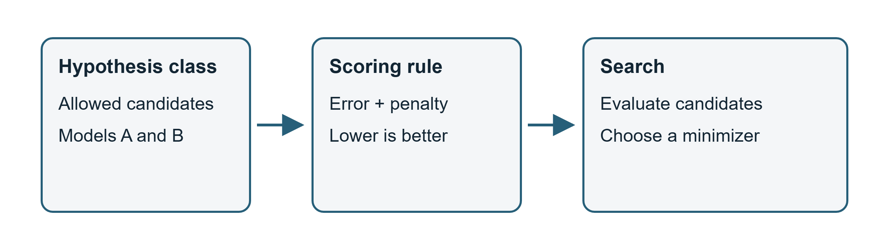
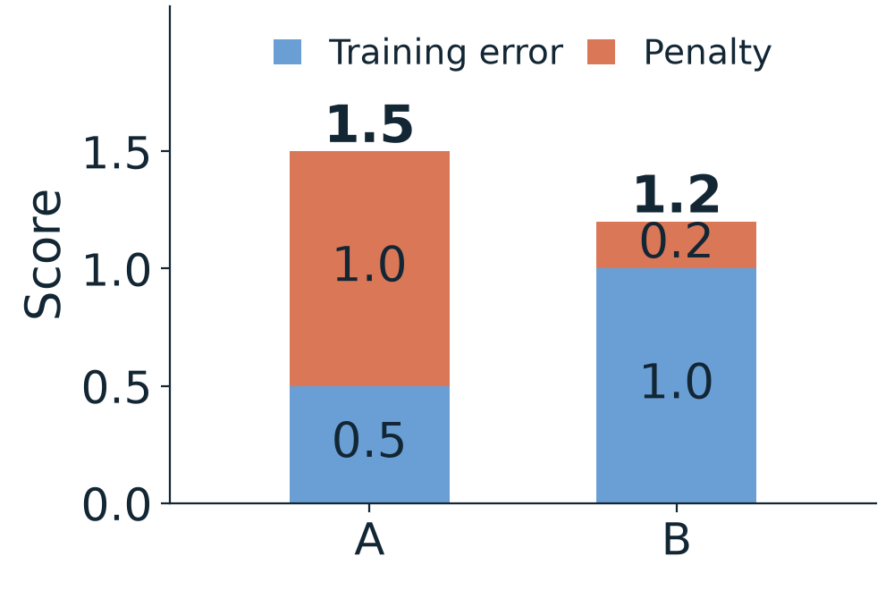
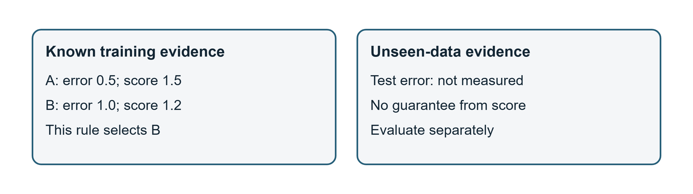

# 第1週 KP01：選模型要有評分標準（Model selection needs a scoring rule）

> 程度：大學生（undergrad）／Level: Undergraduate (undergrad)
>
> 週次：第1週（2026-09-10）｜主題：課程介紹與機器學習回顧
>
> Week 1 (2026-09-10) | Topic: Course introduction and machine learning review

這份講義從「如何選模型」開始。先備知識是集合、函數和基本代數。內容依第一章的 KP01 主文與教授備課資料重新講解；來源讀取日期為 2026-10-14。新增的釐清標為 `[補充]`，與原例的數字分開。

This note starts with how to choose a model. It assumes sets, functions and basic algebra. It re-explains the main text and teaching guide for Chapter 1, KP01, accessed on 2026-10-14. New clarifications are marked `[Added]` and distinguished from the source example.

[下載本單元簡報](../slides/lec01-kp01-model-selection-framework.jbd.json)

## 學習目標（Learning objectives）

- 區分假設集合、評分函數與搜尋方法的工作。（Distinguish the roles of the hypothesis class, scoring function and search method.）
- 用同一評分規則比較2個候選，重算懲罰與總分。（Compare 2 candidates under one rule and recompute their penalties and total scores.）
- 分辨 argmin 回傳的模型與 min 回傳的數值。（Distinguish the model returned by argmin from the value returned by min.）
- 說明低訓練誤差為何不足以證明泛化，並指出假設的限制。（Explain why low training error does not establish generalization, and identify the limits of assumptions.）

## KP01 選模型要有評分標準（Model selection needs a scoring rule）

**一句話重點**：先說清楚可選哪些模型、分數怎麼算，再進行搜尋；選出的模型還需要新資料的檢驗。

**One-sentence summary**: Specify the candidates and scoring rule before searching; the selected model still needs evaluation on new data.

**白話說明**：模型是把觀測整理成可用規律的工具。它可能能描述已知資料，卻不能預測新的情況。因此，學習不能只問「記得多準」，也要問「在哪些情況仍然有用」。

**Plain explanation**: A model organizes observations into a usable pattern. It may describe known data yet fail on new situations. Learning therefore asks both how well it fits and where it remains useful.

### 1. 模型的用途決定你怎麼比較（Purpose determines how you compare models）

地圖省略道路以外的細節，才容易用來導航。模型也會忽略一些現象。省略本身不等於錯誤；關鍵是它是否保留任務所需的規律。地圖的類比只說明「表示有取捨」，不表示模型一定具有真實世界的因果機制。

A map omits details to support navigation. A model also leaves out aspects of the world. Omission alone is not a flaw; the question is whether the model retains the patterns needed for its task. The map analogy describes selective representation, not guaranteed knowledge of real-world causes.

來源把模型的用途連到2個要求：能描述目前的觀測，也能預測尚未見過的觀測。前者是擬合：調整模型以符合訓練資料。後者是泛化：在未參與擬合的新資料上仍然有效。它們不是同一項證據。只會背答案的模型，可能在第一項表現好，在第二項失敗。

The source connects usefulness to 2 requirements: describing current observations and predicting unseen observations. Fitting adjusts a model to match training data. Generalization means remaining effective on data not used for fitting. They are different kinds of evidence. A model that memorizes answers may succeed at the first and fail at the second.

現在假設你面前有候選 A 與 B。來源例子中，A 的訓練誤差較低，但使用更多參數。參數是模型中可調整的數值。要選哪個，不能只靠「複雜」或「簡單」的印象；你必須先訂評分規則。

Suppose you have candidates A and B. In the source example, A has lower training error but more parameters. Parameters are adjustable values in a model. Neither complexity nor simplicity alone settles the choice. You must first specify a scoring rule.

### 2. 假設、評分與搜尋各做一件事（Hypothesis, scoring and search have different roles）

要訂評分規則，先要知道你准許哪些候選。**假設集合**是允許選擇的模型集合。例如，線性模型、決策樹與神經網路給出不同的表示範圍。這裡是在選擇一類函數，不是在宣稱資料的真實機制必然屬於該類。

Before scoring, specify the allowed candidates. A **hypothesis class** is the set of models you may choose. Linear models, decision trees and neural networks offer different representations. Choosing a class does not establish that the true data-generating mechanism belongs to it.

**評分函數**給每個候選一個可比較的數值。本單元統一用「越低越好」的慣例。分數可以只量預測錯誤，也可以加入複雜度懲罰。**搜尋方法**則是實際尋找低分候選的程序；它不會替你決定任務應重視哪些錯誤。

A **scoring function** assigns a comparable value to each candidate. This unit uses the lower-is-better convention. A score can measure prediction error alone or include a complexity penalty. A **search method** finds low-scoring candidates; it does not decide which mistakes matter for your task.

**正式定義**：在允許的集合中，選出達到最小分數的模型。

**Formal definition**: Select a model that attains the minimum score within the allowed class.

$$
\widehat f\in\arg\min_{f\in\mathcal F} S(f).
$$

| 符號 | 中文意義 | English meaning |
|---|---|---|
| $\mathcal F$ | 允許選擇的模型集合 | allowed class of models |
| $f$ | 集合中的1個候選函數 | one candidate function in the class |
| $S(f)$ | 候選的評分，越低越好 | candidate score; lower is better |
| $\arg\min$ | 達到最小分數的候選集合 | set of candidates attaining the minimum score |
| $\widehat f$ | 選出的1個模型 | one selected model |

白話讀法是「先限定比較範圍，再從中找分數最低的模型」。來源用等號寫出單一結果；這裡用屬於符號，保留可能並列的情況。最小值存在且唯一時，2種寫法表達同一個選擇。

Read the formula as: restrict the candidates, then choose a lowest-scoring model. The source writes a single result with equality. Membership here allows tied minimizers. When the minimum exists and is unique, both forms describe the same choice.

**圖說 `lec01-kp01-learning-workflow`**：先看左端允許的候選，再沿2條箭頭看如何評分與選擇。三個方塊表示不同工作；評分不等於搜尋，搜尋也不能替代假設的選擇。這張圖呈現選擇的角色關係，不宣稱有固定的執行順序可以涵蓋所有演算法。〔功能：1〕

**Caption `lec01-kp01-learning-workflow`**: Start with the allowed candidates, then follow the 2 arrows to scoring and selection. The boxes represent distinct roles. Scoring is not search, and search does not choose your assumptions. This is a role diagram, not a universal execution schedule. [Function: 1]

### 3. 懲罰項會改變候選的排名（A penalty can change the candidate ranking）

評分已定義後，就能比較同一組候選。**例子**採用來源教授備課資料的 A／B 設定。訓練誤差的單位已固定，懲罰係數與它相容。參數數目只是此例的複雜度代理，不是通用的複雜度定義。

Once the score is specified, compare the same candidates. The **example** uses A and B from the source teaching guide. Training-error units are fixed, and the penalty coefficient uses compatible units. Parameter count is this example's proxy for complexity, not a universal definition.

$$
S(f)=E_{\mathrm{train}}(f)+\lambda k(f),\qquad \lambda=0.1.
$$

| 符號 | 中文意義 | English meaning |
|---|---|---|
| $E_{\mathrm{train}}(f)$ | 候選在訓練資料上的誤差 | candidate's error on the training data |
| $k(f)$ | 此例用來計算懲罰的參數數目 | parameter count used for the penalty in this example |
| $\lambda$ | 每個參數增加的分數，單位是分數／參數 | score added per parameter, in score units per parameter |

白話說法是：錯誤有代價，增加複雜度也有代價。英文可讀作 “The score charges for training error and for complexity.”

In plain terms, both error and added complexity carry a cost. The coefficient specifies their relative weight under this scoring rule.

| 候選 | 訓練誤差 Training error | 參數數目 Parameter count | 懲罰 Penalty |
|---|---|---|---|
| A | $0.5$ | $10$ | $0.1\times10=1.0$ |
| B | $1.0$ | $2$ | $0.1\times2=0.2$ |

A 的總分依序算為：

For A, compute the total score in order:

$$
S(A)=0.5+0.1\times10=0.5+1.0=1.5.
$$

B 的總分依序算為：

For B, compute the total score in order:

$$
S(B)=1.0+0.1\times2=1.0+0.2=1.2.
$$

因為 $1.2<1.5$，此評分選 B。若只比較訓練誤差，則是 $0.5<1.0$，排序相反。這不是把 A 的誤差算錯，而是改變了評分規則。例中的所有數值已用 Python 的十進位算術重算。

Since $1.2<1.5$, this score selects B. Training error alone gives $0.5<1.0$ and the opposite ranking. This is a different scoring rule, not an arithmetic error. All example values were recomputed with Python decimal arithmetic.

**圖說 `lec01-kp01-candidate-scores`**：先看每根柱的訓練誤差，再看上方加上的懲罰。A 的兩段為0.5與1.0，B 的兩段為1.0與0.2；柱高按數值比例，總高分別是1.5與1.2。它補強評分的精準度，未提供測試誤差。〔功能：1、2〕

**Caption `lec01-kp01-candidate-scores`**: Read each training-error segment, then its added penalty. A stacks 0.5 and 1.0; B stacks 1.0 and 0.2. Heights are proportional, giving totals of 1.5 and 1.2. The plot checks the scoring arithmetic and provides no test errors. [Function: 1, 2]

### 4. 低分模型仍需要檢查泛化（A low-scoring model still needs a generalization check）

選出了 B，接下來要問它能否用在新資料。**泛化**是模型在未參與擬合的新資料上仍能有效預測。**過擬合**則是過度貼合訓練資料的細節，連不應保留的雜訊也一起記住。低訓練誤差本身不足以判斷是否過擬合。

After choosing B, ask whether it works on new data. **Generalization** means effective prediction on data not used for fitting. **Overfitting** means fitting training-specific detail, including noise that should not transfer. Low training error alone does not establish whether overfitting occurred.

本例沒有給 A 或 B 的測試結果。因此，你可以說「B 的指定分數更低」，不能說「B 已證明泛化更好」。懲罰會改變搜尋偏好，卻不自動產生測試證據。也不能由此推出參數越少一定越好。

The example supplies no test results for A or B. You can conclude that B has the lower specified score, not that B demonstrably generalizes better. A penalty changes the search preference; it does not create test evidence. Fewer parameters are not automatically better.

**圖說 `lec01-kp01-generalization-check`**：先看左側已計算的兩個訓練誤差與總分，再看右側未見資料：測試結果標為尚未量測。兩區之間刻意不畫保證箭頭，提醒你不能從左側直接推得右側。〔功能：1〕

**Caption `lec01-kp01-generalization-check`**: Read the known training errors and scores on the left, then the unseen-data panel on the right. Test performance is marked as not measured. No guarantee arrow connects the panels: the left does not establish the right. [Function: 1]

`[補充]` 實作時，訓練集用來擬合。驗證集可協助調整設定與選模型；最後的測試集應留給固定模型的評估。反覆用測試集挑設定，會讓它失去獨立檢驗的用途。此處只區分角色，不指定資料切分比例。

`[Added]` In practice, the training set supports fitting. A validation set can support tuning and selection; a final test set evaluates the fixed model. Repeatedly selecting settings on the test set undermines its independent evaluation role. No split ratio is prescribed here.

模型的偏好從哪裡來？**歸納偏置**是學習時採用的限制或偏好，例如限定線性函數，或對複雜模型加懲罰。它使模型願意把某種規律延伸到新資料，也使模型在不符合假設的任務上可能失敗。

Where do model preferences come from? **Inductive bias** is a restriction or preference used in learning, such as choosing linear functions or penalizing complexity. It favors particular patterns for unseen data and may fail when the task violates those assumptions.

`[補充]` 來源的「沒有免費午餐」口訣需要條件。相關定理考慮對全部可能的學習問題作特定平均，例如均勻分布。在這種設定下，不能宣稱某演算法普遍勝出。它不是說實際任務上的所有方法都一樣，也不是「候選太多不好選」的計算量定理。條件可參閱 [Wolpert 的說明](https://arxiv.org/abs/2007.10928)。

`[Added]` The source's No Free Lunch slogan needs conditions. Theorems average over possible learning problems under specified assumptions, such as a uniform distribution. Under that setting, universal algorithmic superiority cannot be claimed. This does not make methods equal on a real task, nor is it a theorem about searching too many candidates. See [Wolpert's explanation](https://arxiv.org/abs/2007.10928).

### 5. 搜尋目標與實際找到的解要分開（Separate the search target from the solution actually found）

前一節說明了泛化的界線；搜尋本身也有界線。**常見迷思**是看到 argmin 就以為已經有演算法找到全域最佳。argmin 定義你想找的對象，實際程序是否找到它，要另外分析。本例只有2個候選，直接各算1次便能完成比較。

Generalization has limits, and so does search. A **common misconception** is that writing argmin means an algorithm has found a global optimum. Argmin defines the target; whether a procedure finds it is a separate question. Here there are only 2 candidates, so evaluating both completes the comparison.

min 給出最小分數，argmin 給出達到它的候選。本例最小分數為1.2，選出的模型是 B，兩者型態不同。若候選並列最低，還需要說明如何選其中1個。若最低分未被任何候選達到，argmin 集合可能是空的。

Min gives the minimum score; argmin gives the candidates attaining it. Here the minimum value is 1.2, while the selected model is B. Their types differ. Ties require a selection rule; if no candidate attains the infimum, the argmin set may be empty.

在連續參數的模型裡，通常不能逐一列舉所有候選。凸性也不是任意搜尋程序成功的保證；仍須考慮解是否存在及演算法條件。非凸性更不能直接推出「必然卡住」。這些細節留待最佳化單元，此處不加入新的搜尋公式。

Continuous-parameter models generally prevent exhaustive enumeration. Convexity alone does not guarantee success for an arbitrary procedure; existence and algorithmic conditions still matter. Nonconvexity also does not imply inevitable trapping. The optimization unit develops those details without adding a search formula here.

### 6. 用問題檢查框架，再問資料如何表示（Check the framework, then ask how data is represented）

**小練習**：以下保留來源 KP01 的4個檢核方向及全部選項，改用本講義的詞語。先寫理由，再選答案；這裡只提供提示，不標示答案。

**Practice**: The following keeps the 4 checks and all options from source KP01, using this note's terminology. Explain your reasoning before choosing. Only hints are provided; no options are marked as answers.

| 題目與選項 | Question and options |
|---|---|
| 1. 三個角色的概念順序是？A 評分→假設→搜尋；B 假設→評分→搜尋；C 搜尋→評分→假設；D 假設→搜尋→評分。提示：先想可比較的候選從哪裡來。 | 1. What is the conceptual order? A score→hypothesis→search; B hypothesis→score→search; C search→score→hypothesis; D hypothesis→search→score. Hint: where do comparable candidates come from? |
| 2. 式中的帽子 f 代表什麼？A 假設集合；B 評分函數；C 使分數最小的選出模型；D 資料集。提示：分辨函數與分數的型態。 | 2. What does f with a hat represent? A hypothesis class; B scoring function; C selected score-minimizing model; D dataset. Hint: distinguish a function from its score. |
| 3. 「沒有免費午餐」想提醒什麼？A 所有方法在所有問題都一樣好；B 沒有假設就沒有學習；C 損失越低越好；D 資料越多越好。提示：回看定理的平均設定，再辨識來源口訣的教學意思。 | 3. What does the slogan emphasize? A all methods are equally good on every problem; B learning requires assumptions; C lower loss is better; D more data is better. Hint: distinguish the averaging assumptions from the teaching slogan. |
| 4. 有用模型的2種證據是？A 訓練與測試誤差皆低；B 訓練誤差高、測試誤差低；C 參數多、速度快；D 假設集合大、分數高。提示：描述已知資料與預測未見資料是否同一件事？ | 4. What are the 2 kinds of evidence? A low training and test errors; B high training and low test errors; C many parameters and fast execution; D a large class and high score. Hint: are fitting known data and predicting unseen data the same? |

理解了選模型的框架，下一個問題是：模型到底接收什麼？KP02 將把「一個樣本」寫成向量，將「一批樣本」排成矩陣，再說明模型如何把輸入映射到輸出。

With the selection framework in place, ask what the model receives. KP02 represents one sample as a vector and several samples as a matrix, then explains the mapping from input to output.

## 小結（Summary）

- 模型是為任務保留規律的表示，仍須接受資料檢驗。（A model retains task-relevant patterns and needs empirical evaluation.）
- 假設集合、評分與搜尋是不同角色；argmin 指模型，min 指分數。（The class, score and search have different roles; argmin identifies models and min identifies a value.）
- 來源例的評分選 B，但未提供哪個模型泛化更好的證據。（The source score selects B without establishing which model generalizes better.）
- 偏好與假設須說清楚，不能把任何方法當成所有任務的保證。（State the preferences and assumptions; no method is a guarantee for every task.）

## 術語表（Glossary）

| 中文 | English |
|---|---|
| 模型 | model |
| 擬合 | fitting |
| 假設集合／假設類別 | hypothesis class |
| 評分函數 | scoring function |
| 損失函數 | loss function |
| 搜尋方法／最佳化方法 | search method / optimization method |
| 訓練誤差 | training error |
| 複雜度懲罰 | complexity penalty |
| 參數 | parameter |
| 泛化 | generalization |
| 過擬合 | overfitting |
| 歸納偏置 | inductive bias |
| 沒有免費午餐定理 | No Free Lunch theorem |
| 訓練集／驗證集／測試集 | training / validation / test set |
| 全域最小值 | global minimum |
| 凸性／非凸性 | convexity / nonconvexity |

## 來源與釐清（Sources and clarifications）

主來源：[CCC-LNS IDL_115 第1章 KP01](https://ndhuccc.github.io/CCC-LNS/IDL_115/Ch01-introduction-history/index.html#kp1)，包含主文、4題檢核與教授備課例，讀取日期2026-10-14。A／B 數值沿用來源，說明與圖全新設計。Popper 的猜想與檢驗只作來源中的背景類比，不當成所有科學工作的唯一定義。

Main source: [CCC-LNS IDL_115 Chapter 1, KP01](https://ndhuccc.github.io/CCC-LNS/IDL_115/Ch01-introduction-history/index.html#kp1), including the main text, 4 checks and teaching example, accessed on 2026-10-14. The A/B numbers are retained; prose and diagrams are newly designed. The Popper comparison is contextual, not a universal definition of scientific work.

來源釐清：評分「越低越好」保持一致，修正備課比喻中「最高分」與 argmin 的矛盾。argmin 與搜尋程序分開，凸問題也列出成功所需條件。No Free Lunch 加入平均設定；參數懲罰不等同於實測泛化。來源餐廳菜單的比喻仍可協助理解候選集合，但低分代表損失低，不代表餐點較難吃。

Clarifications: the lower-is-better convention resolves the guide's conflict between a highest score and argmin. The target is distinguished from its search procedure, including conditions for convex problems. No Free Lunch is qualified by its averaging setting; parameter penalties are not empirical generalization evidence. A menu illustrates a candidate set, while a lower loss does not mean less enjoyable food.

## 延伸閱讀（Further reading）

- `[補充]` [Wolpert：What is important about the No Free Lunch theorems?](https://arxiv.org/abs/2007.10928)，核對定理的平均設定，讀取日期2026-10-14。（`[Added]` Check the averaging assumptions in Wolpert's discussion, accessed on 2026-10-14.）
- `[補充]` [Stanford CS229：Regularization and model selection](https://cs229.stanford.edu/summer2020/cs229-notes5.pdf)，第1–2頁，區分訓練分數與未參與擬合的資料評估，讀取日期2026-10-14。（`[Added]` Pages 1–2 distinguish training scores from evaluation on held-out data, accessed on 2026-10-14.）
