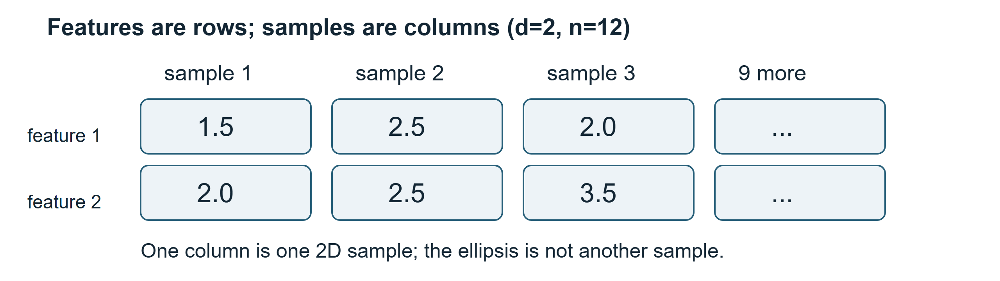
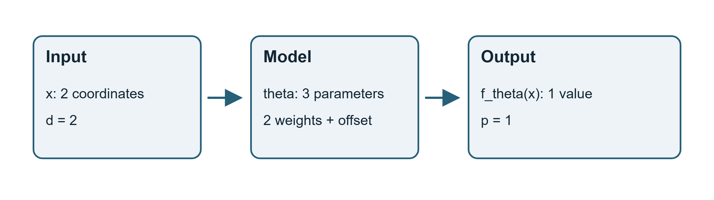
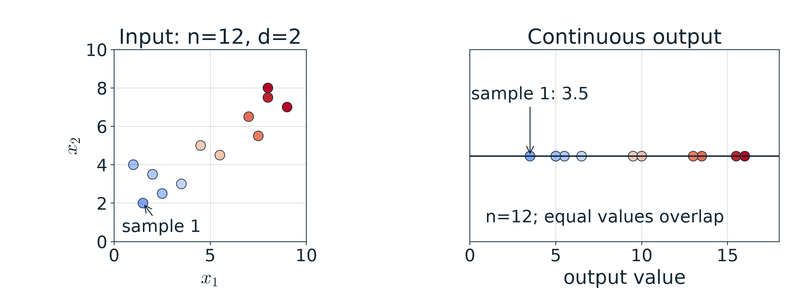

# 第1週 KP02：資料是向量，模型是映射（Data are vectors and models are mappings）

> 程度：大學生（undergrad）／Level: Undergraduate (undergrad)
>
> 週次：第1週（2026-09-10）｜主題：課程介紹與機器學習回顧
>
> Week 1 (2026-09-10) | Topic: Course introduction and machine learning review

KP01 留下了模型如何接收資料的問題。這裡先固定資料的表示，再把模型寫成輸入到輸出的函數。先備知識是向量與矩陣乘法；讀取來源日期為2026-10-14。資料採用來源互動的固定教學點，不是真實水果測量。

KP01 asked how a model receives data. We first fix the representation, then describe the input-output function. This note assumes vectors and matrix multiplication. The source was accessed on 2026-10-14. Its fixed interactive points are teaching data, not fruit measurements.

[下載本單元簡報](../slides/lec01-kp02-data-vectors-and-mappings.jbd.json)

## 學習目標（Learning objectives）

- 將樣本按直欄排成資料矩陣，辨識特徵與樣本維度。（Arrange samples as columns and identify feature and sample dimensions.）
- 區分輸出維度與參數的工作。（Distinguish output dimension from model parameters.）
- 對固定輸入代入加權和，驗算模型輸出。（Substitute a fixed input into a weighted sum and verify its output.）
- 說明矩陣方向與特徵編碼的約定。（Explain matrix orientation and feature-encoding conventions.）

## KP02 資料是向量，模型是映射（Data are vectors and models are mappings）

**一句話重點**：每筆樣本是一個特徵向量；矩陣收集樣本，模型將它們映射到所需的輸出。

**One-sentence summary**: A sample is a feature vector; a matrix collects samples, and a model maps them to required outputs.

**白話說明**：同一顆蘋果可以記錄多種量測。每種量測是特徵，一顆蘋果是一筆樣本。模型接收的數值必須有固定順序和相同意義，不能一筆先放甜度，下一筆先放脆度。

**Plain explanation**: One apple can have several measurements. Each measurement is a feature; one apple is a sample. Values need a consistent order and meaning. Sweetness cannot occupy the first position in one sample and crunchiness in the next.

### 1. 先固定每一筆資料的座標意義（Fix the meaning of each coordinate first）

**特徵向量**將一筆資料的數值按固定順序排好。若有d個特徵，向量便有d個座標。來源以水果、健康量測、圖片和時間序列說明這種表示。它們的共同點是數值化，不是天然具有相同單位。

A **feature vector** arranges one sample's values in a fixed order. With d features, it has d coordinates. The source uses fruit, health measurements, images and time series. These share a numerical representation, not common physical units.

「紅色」和「偏長」是描述，還不能直接當成實數座標。需要先說明如何編碼。類似地，圖像尺寸也不是資料筆數；來源的64×64灰階圖攤平後有4096個像素特徵，但仍然只是一筆圖像樣本。

“Red” and “elongated” are descriptions, not yet real-valued coordinates. Their encoding must be specified. Image size is not sample count either: the source's flattened 64×64 grayscale image has 4096 pixel features but remains one sample.

來源互動採用12個無單位的二維教學點。第一筆是(1.5,2.0)，第二筆是(2.5,2.5)。本講義用這批固定點貫穿表示與數值運算；不將它們解讀為已編碼的真實水果特徵。

The interactive source uses 12 unitless teaching points in 2 dimensions. The first is (1.5,2.0), and the second is (2.5,2.5). We keep these points for representation and computation without interpreting them as encoded real fruit features.

### 2. 按直欄收集樣本，矩陣便有明確形狀（Collect samples as columns to fix the matrix shape）

固定了單筆表示後，就能收集多筆。**正式定義**：每筆向量是d×1的直欄；n筆向量併排成d×n的資料矩陣。本講義稱水平方向為「橫列 row」，垂直方向為「直欄 column」，避免行列譯名混淆。

With one sample defined, collect several. **Formal definition**: each sample is a d×1 column; n sample columns form a d×n data matrix. This note explicitly distinguishes horizontal rows and vertical columns to avoid ambiguous translations.

$$
\mathbf{x}_i\in\mathbb R^d,\qquad
\mathbf X=[\mathbf{x}_1\ \mathbf{x}_2\ \cdots\ \mathbf{x}_n]\in\mathbb R^{d\times n}.
$$

| 符號 | 中文意義 | English meaning |
|---|---|---|
| $i$ | 樣本索引 | sample index |
| $d$ | 每筆樣本的特徵數 | number of features per sample |
| $n$ | 樣本數 | number of samples |
| $\mathbf{x}_i$ | 第i筆特徵向量 | feature vector of sample i |
| $\mathbf X$ | 按直欄排列的資料矩陣 | data matrix with samples as columns |

來源12點的矩陣有2個橫列、12個直欄。只展開前3筆，可看見下列排列；省略號代表另外9筆，不是新特徵。

The 12-point source matrix has 2 rows and 12 columns. Expanding only the first 3 shows the arrangement below. The ellipsis denotes 9 more samples, not another feature.

$$
\mathbf X=\begin{bmatrix}1.5&2.5&2.0&\cdots\\2.0&2.5&3.5&\cdots\end{bmatrix}\in\mathbb R^{2\times12}.
$$

**圖說 `lec01-kp02-data-matrix`**：先看每個直欄中的2個數字，再看同一橫列橫向收集同種特徵。圖中只畫前3筆與省略號；完整樣本數是12。這張圖讓矩陣方向一目了然，不把省略號當作第4筆實際樣本。〔功能：1〕

**Caption `lec01-kp02-data-matrix`**: Read the 2 values in each column, then follow one feature across its row. Only 3 samples and an ellipsis are drawn; there are 12 samples in total. The ellipsis is not an actual fourth sample. [Function: 1]

`[補充]` 軟體也常使用n×d、樣本按橫列的約定。這不是數學錯誤，但與本講義相反。寫矩陣乘法前要檢查形狀，不能只記「第一個維度是樣本」而忽略使用情境。

`[Added]` Software also commonly uses n×d arrays with samples as rows. That is a different convention, not a mathematical error. Check shapes before multiplication rather than assuming the first dimension always counts samples.

### 3. 輸出維度與可調參數是不同問題（Output dimension and adjustable parameters are different questions）

矩陣說明了輸入，下一步是模型。**參數化映射**是一族由參數θ決定的函數；選定θ，才得到其中一個具體函數。它的輸出有p個數值座標。

After specifying the input matrix, specify the model. A **parameterized mapping** is a family of functions indexed by θ. Fixing θ selects one concrete function, whose output has p numerical coordinates.

$$
f_\theta:\mathbb R^d\longrightarrow\mathbb R^p,\qquad\mathbf{x}\longmapsto f_\theta(\mathbf{x}).
$$

| 符號 | 中文意義 | English meaning |
|---|---|---|
| $p$ | 一筆輸出的維度 | dimension of one numerical output |
| $\theta$ | 決定具體函數的參數 | parameters specifying a particular function |
| $f_\theta$ | 固定參數下的映射 | mapping at fixed parameters |

**例子**：來源互動取d=2、p=1，輸入2個數字，輸出1個分數。它有2個權重和1個偏移，共3個參數。因此「輸出1維」不等於「只有1個參數」。

**Example**: The interactive source uses d=2 and p=1: 2 input values produce 1 score. There are 2 weights and 1 offset, hence 3 parameters. A one-dimensional output does not imply one parameter.

**圖說 `lec01-kp02-model-mapping`**：先沿箭頭讀輸入、模型與輸出，再比較輸入維度d、輸出維度p和模型參數θ。θ寫在模型內，不寫成輸入座標；圖依來源原圖的關係重新繪製。〔功能：1〕

**Caption `lec01-kp02-model-mapping`**: Follow input, model and output, then compare d, p and θ. Parameters appear inside the model, not as input coordinates. This redraw preserves the relationship in the source figure. [Function: 1]

來源另有5顆蘋果、2特徵的形狀例：資料矩陣是2×5。若模型輸出2個類別機率，這個數值輸出可取p=2；最後選出的類別則屬於有限標籤集合。也有用1個機率表示二元分類的方式，所以不能把p一律等同類別數。

The guide also describes 5 apples with 2 features, giving a 2×5 matrix. A vector of 2 class probabilities has p=2, while the chosen class belongs to a finite label set. Binary classification can also use one probability, so p is not always the class count.

### 4. 固定輸入後，參數才決定輸出數值（For a fixed input, parameters determine the output value）

形狀正確後，再驗算數值。來源的加權和模型為下式；權重調整各特徵的貢獻，b調整所有分數的偏移。

Once shapes agree, check the values. The source's weighted-sum model follows below. Weights set feature contributions, while b shifts every score.

$$
f_\theta(\mathbf{x})=w_1x_1+w_2x_2+b,\qquad\theta=(w_1,w_2,b).
$$

| 符號 | 中文意義 | English meaning |
|---|---|---|
| $x_1,x_2$ | 一筆輸入的2個座標 | 2 coordinates of one input |
| $w_1,w_2$ | 2個特徵的權重 | weights of the 2 features |
| $b$ | 分數偏移 | score offset |

來源預設w1=w2=1、b=0。對第一筆輸入逐步代入：

The source defaults are w1=w2=1 and b=0. Substitute the first input step by step:

$$
f_\theta(1.5,2.0)=1\times1.5+1\times2.0+0=1.5+2.0=3.5.
$$

以下是同一組參數對所有12筆輸入的結果，均由程式實算。

The following are the computed outputs for all 12 inputs under the same parameters.

| 樣本 Sample | $x_1$ | $x_2$ | 輸出 Output |
|---|---|---|---|
| 1 | 1.5 | 2.0 | 3.5 |
| 2 | 2.5 | 2.5 | 5.0 |
| 3 | 2.0 | 3.5 | 5.5 |
| 4 | 3.5 | 3.0 | 6.5 |
| 5 | 1.0 | 4.0 | 5.0 |
| 6 | 7.0 | 6.5 | 13.5 |
| 7 | 8.0 | 7.5 | 15.5 |
| 8 | 7.5 | 5.5 | 13.0 |
| 9 | 9.0 | 7.0 | 16.0 |
| 10 | 8.0 | 8.0 | 16.0 |
| 11 | 4.5 | 5.0 | 9.5 |
| 12 | 5.5 | 4.5 | 10.0 |

**圖說 `lec01-kp02-affine-outputs`**：先看左圖2個座標，再看右圖它們的加權和。左右使用同12點，色彩對應數值大小；相同輸出可重疊，總樣本數仍為12。第一筆標示3.5，最大輸出16完整呈現；它是加權和，不是未縮放的正交投影長度。〔功能：2、3〕

**Caption `lec01-kp02-affine-outputs`**: Read the 2 input coordinates, then their weighted sum. Both panels use the same 12 points; color encodes output value. Equal outputs may overlap without changing the sample count. The first value is 3.5 and the maximum 16 is fully shown. These are weighted sums, not unscaled orthogonal projection lengths. [Function: 2, 3]

**常見迷思**：任意內積都等於投影長度。只有投影方向是單位向量時，內積才直接給該方向的帶號投影長度。此例方向(1,1)不是單位向量。此外，b不為0時，這是仿射映射；來源「線性模型」是常用的較寬稱法。

**Common misconception**: Every inner product equals a projection length. That interpretation requires a unit direction vector; (1,1) is not a unit vector. When b is nonzero, the mapping is affine; the source uses the broader common term “linear model.”

### 5. 先檢查形狀，再問輸出代表什麼（Check the shape, then ask what the output means）

數值對得上公式，還不能代表模型已經學會任務。這裡的θ由互動控制指定，沒有訓練程序或正確標籤的比較。你已驗證運算，尚未驗證預測品質。下一個單元會問：輸出是類別，還是連續值？

Matching the arithmetic does not establish task performance. These parameters are set by interactive controls, without fitting or comparisons against correct labels. Computation has been checked, not prediction quality. The next unit asks whether outputs are categories or continuous values.

**小練習**：保留來源4題及全部選項，先說明符號，再選擇；不標示答案。

**Practice**: The 4 source checks retain all options. Explain the symbols before choosing; no answers are marked.

| 題目與提示 | Question and hint |
|---|---|
| 1. d個數值特徵表示在哪個空間？A R^p；B R^d；C R^n；D R^(d×n)。提示：先看一筆樣本有幾個座標。 | 1. Which space represents d numerical features? A R^p; B R^d; C R^n; D R^(d×n). Hint: count coordinates of one sample. |
| 2. 本講義X的維度？A n×d；B d×n；C d×d；D n×n。提示：先查採用橫列還是直欄放樣本。 | 2. What is X's shape here? A n×d; B d×n; C d×d; D n×n. Hint: check the sample-orientation convention. |
| 3. θ代表什麼？A 資料筆數；B 特徵維度；C 函數參數；D 輸出維度。提示：哪個量會改變同一輸入的輸出？ | 3. What does θ represent? A sample count; B feature dimension; C function parameters; D output dimension. Hint: which quantity changes the output for a fixed input? |
| 4. 來源所說的常見p、d關係？A p≤d；B p>d；C p=d恆成立；D 兩者無關。提示：這題問來源的常見情境，不是數學必要條件。 | 4. Which relation is described as common in the source? A p≤d; B p>d; C always p=d; D unrelated. Hint: distinguish its typical setting from a mathematical requirement. |

## 小結（Summary）

- 先定義特徵座標，再整理樣本。（Define feature coordinates before collecting samples.）
- 本講義按直欄放樣本，因此X的形狀是d×n。（This note places samples in columns, so X has shape d×n.）
- p描述數值輸出，θ決定具體函數；兩者不相同。（p describes numerical output, while θ specifies a function.）
- 固定模型的運算正確，不代表已驗證學習品質。（Correct arithmetic for a fixed model does not establish learning quality.）

## 術語表（Glossary）

| 中文 | English |
|---|---|
| 特徵／樣本 | feature / sample |
| 特徵向量／資料矩陣 | feature vector / data matrix |
| 橫列／直欄 | row / column |
| 維度／座標 | dimension / coordinate |
| 編碼／灰階 | encoding / grayscale |
| 參數化映射／數值輸出 | parameterized mapping / numerical output |
| 權重／偏移／仿射映射 | weight / offset / affine mapping |
| 內積／單位向量／正交投影 | inner product / unit vector / orthogonal projection |

## 來源與更正（Sources and corrections）

[CCC-LNS 第1章 KP02](https://ndhuccc.github.io/CCC-LNS/IDL_115/Ch01-introduction-history/index.html#kp2)，主文、原圖、教授資料、互動程式與4題檢核，讀取2026-10-14。12點座標與預設θ完整沿用；圖與說明重新設計。原圖的映射關係改為可編輯物件。

[CCC-LNS Chapter 1, KP02](https://ndhuccc.github.io/CCC-LNS/IDL_115/Ch01-introduction-history/index.html#kp2), main text, original figure, guide, interactive code and 4 checks, accessed on 2026-10-14. All 12 coordinates and default parameters are retained; prose and figures are redesigned with editable mapping objects.

更正：來源d×n與行列說法易混淆，本文明定樣本按直欄。p是輸出維度，不是參數個數，也不必等於分類的類別數。p≤d不是一般映射的必要條件。原互動輸出軸[-12,12]不足以容納預設資料的16，本文改用完整範圍；未改輸出值。

Corrections: samples are explicitly columns. p counts output coordinates, not parameters, and need not equal the class count. The relation p≤d is not required for a general mapping. The original [-12,12] output axis clips the default value 16; our range shows it without changing the value.

## 延伸閱讀（Further reading）

`[補充]` [scikit-learn LogisticRegression 的 predict 與 predict_proba](https://scikit-learn.org/stable/modules/generated/sklearn.linear_model.LogisticRegression.html)，區分類別預測與機率輸出，讀取2026-10-14。

`[Added]` [LogisticRegression predict and predict_proba](https://scikit-learn.org/stable/modules/generated/sklearn.linear_model.LogisticRegression.html) distinguish class predictions from probability outputs; accessed on 2026-10-14.
