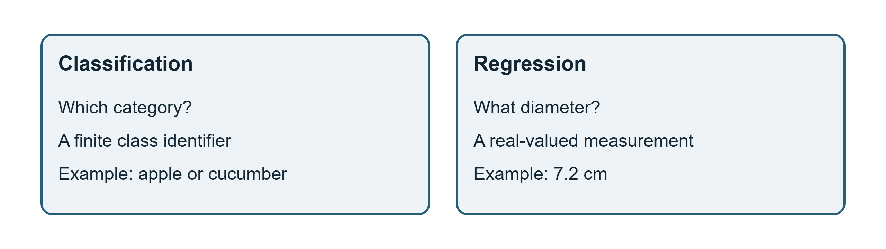
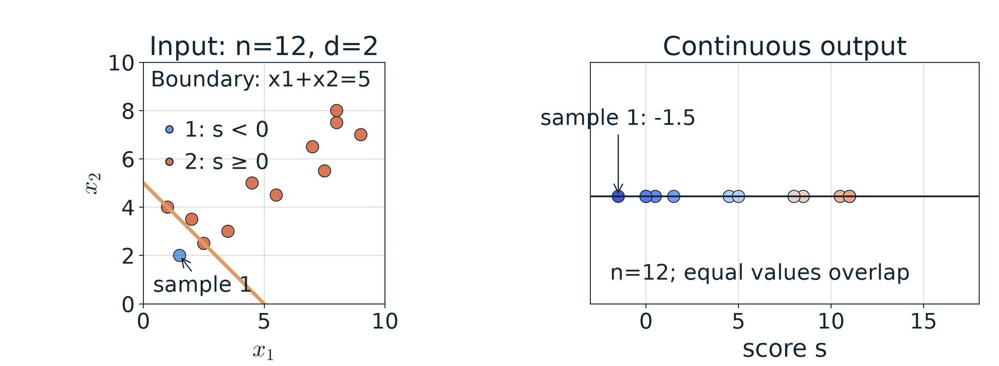

# 第1週 KP03：標籤決定分類或回歸（Labels distinguish classification from regression）

> 程度：大學生（undergrad）／Level: Undergraduate (undergrad)
>
> 週次：第1週（2026-09-10）｜主題：課程介紹與機器學習回顧
>
> Week 1 (2026-09-10) | Topic: Course introduction and machine learning review

KP02 已說明模型將輸入轉成輸出，現在要問輸出代表什麼。這份講義延用二維輸入與來源水果場景；新控制設定以 `[補充]` 標示。來源讀取日期2026-10-14。

KP02 explained input-output mappings. We now ask what an output means. This note retains the two-dimensional input and fruit examples; new controlled settings are marked `[Added]`. The source was accessed on 2026-10-14.

[下載本單元簡報](../slides/lec01-kp03-classification-and-regression.jbd.json)

## 學習目標（Learning objectives）

- 依標籤型態辨識分類或回歸。（Identify classification or regression from the target type.）
- 區分類別編號、分類分數與連續預測值。（Distinguish class identifiers, classification scores and continuous predictions.）
- 對同一分數套用分類規則與回歸輸出。（Apply a classification rule and a regression output rule to one score.）
- 說明有標籤與無標籤資料的差別。（Explain the difference between labeled and unlabeled data.）

## KP03 標籤決定分類或回歸（Labels distinguish classification from regression）

**一句話重點**：分類的最終答案是有限類別之一，回歸的最終答案是實數；判斷任務要看標籤意義。

**One-sentence summary**: A final classification answer is a member of a finite class set; a regression answer is real-valued. Target meaning identifies the task.

**白話說明**：問水果「是哪一類」與「直徑是多少」可以看相似的輸入，卻需要不同的答案。類名有多少種，不等於直徑能取多少個值。模型內部即使都算數字，最後的輸出規則仍然不同。

**Plain explanation**: Asking which fruit and asking its diameter can use similar inputs but require different answers. The number of category names does not count possible diameter values. Internal numerical computations do not make the final output rules identical.

### 1. 標籤先定義你要預測的對象（A label defines the object you predict）

**監督式學習**使用輸入與目標成對的資料。目標又叫標籤，不必是文字；它也可以是數值。來源用各5個蘋果、黃瓜示範類別標籤，再用量好的5顆蘋果直徑示範連續標籤。

**Supervised learning** uses paired inputs and targets. A target, or label, need not be text; it can be numerical. The source gives 5 apples and 5 cucumbers for categorical labels, then 5 measured apples for continuous diameter labels.

**正式定義**：資料包含每筆輸入與其標籤。分類將輸入映射到m個類別之一；此處的回歸則映射到一個實數。

**Formal definition**: Each input is paired with a target. Classification maps to one of m classes; the scalar regression task here maps to a real number.

$$
\mathcal D=\{(\mathbf{x}_i,y_i)\}_{i=1}^n,\qquad
f_\theta^{\mathrm{cls}}:\mathbb R^d\to\{\ell_1,\ldots,\ell_m\}.
$$

$$
f_\theta^{\mathrm{reg}}:\mathbb R^d\to\mathbb R.
$$

| 符號 | 中文意義 | English meaning |
|---|---|---|
| $\mathbf{x}_i,d,n$ | 第i筆輸入、特徵數、樣本數 | input i, feature count, sample count |
| $y_i$ | 第i筆的目標標籤 | target of sample i |
| $m,\ell_j$ | 類別數、第j種類別名稱 | number of classes, label of class j |
| $\theta$ | 模型參數 | model parameters |
| $\mathrm{cls},\mathrm{reg}$ | 分類與回歸的註記 | classification and regression annotations |

**圖說 `lec01-kp03-output-types`**：先讀兩側問題，再比較答案的型態。左側從有限類別選1個，右側預測直徑數值；同樣使用特徵資料，並不讓2個任務變成同一件事。〔功能：1〕

**Caption `lec01-kp03-output-types`**: Read each question, then compare answer types. The left selects one finite category; the right predicts a diameter value. Shared input features do not make the tasks identical. [Function: 1]

### 2. 原例的類別與直徑不可混為一個尺度（Categories and diameters are not one scale）

定義了標籤後，來看來源教授資料中的**例子**。表內是3筆假想教學樣本，保留原數字；描述詞還需要編碼，不能直接稱為R²中的數值向量。來源標題稱3顆蘋果，但第2筆其實標成黃瓜，本文明列這個差別。

With targets defined, examine the guide's **example**. These are 3 hypothetical teaching samples with the original values. Descriptions require encoding before becoming numerical vectors in R². The source calls them 3 apples but labels the second a cucumber; this discrepancy is made explicit.

| 樣本 Sample | 描述 Description | 類別 Class | 直徑 Diameter (cm) |
|---|---|---|---|
| 1 | 紅、大 / red, large | 蘋果 / apple | 7.2 |
| 2 | 綠、長 / green, elongated | 黃瓜 / cucumber | 6.8 |
| 3 | 紅、中 / red, medium | 蘋果 / apple | 6.5 |

「類別1」與「類別2」只是名字，不能解讀成第二類是第一類的2倍。相反地，直徑的差值有cm的意義。這也說明標籤即使寫成數字，仍要先問它是編號還是量測值。

“Class 1” and “class 2” are identifiers, not a claim that one is twice the other. Diameter differences have a meaning in cm. Thus numerical targets still require interpretation as identifiers or measurements.

來源另用「大小>5」的假想規則，讓大小6與3落在不同類別。那只是指定規則的示範，不是由這3筆資料估得的模型。教學用分類規則也不能替代真實水果的多特徵判斷。

The source also applies a hypothetical “size>5” rule to sizes 6 and 3. It illustrates a prescribed rule, not a model fitted to these 3 records. A toy rule is not a real fruit classifier.

### 3. 同一分數可以通往不同型態的輸出（One score can feed different output types）

原例說明型態，接著換成來源互動的無單位12點，以便完整驗算運算。取KP02的加權和，明示控制設定為w1=w2=1、b=−5。`[補充]` 偏移從來源預設0改為−5，只為在同一點雲中看見正負分數；它不是訓練結果。

The fruit example explains types. We now use the source's 12 unitless points to verify computations. Set w1=w2=1 and b=−5. `[Added]` Changing the default offset from 0 to −5 exposes both signs in the same cloud. This is not a training result.

$$
s(\mathbf{x})=x_1+x_2-5.
$$

分類沿用來源互動「非負分數選ℓ2，負分數選ℓ1」的規則；回歸保留分數本身。

Classification retains the interactive rule: nonnegative scores select ℓ2 and negative scores select ℓ1. Regression retains the score itself.

$$
f_\theta^{\mathrm{cls}}(\mathbf{x})=
\begin{cases}\ell_2,&s(\mathbf{x})\ge0,\\\ell_1,&s(\mathbf{x})<0,\end{cases}
\qquad f_\theta^{\mathrm{reg}}(\mathbf{x})=s(\mathbf{x}).
$$

第一筆輸入(1.5,2.0)的計算為：

For the first input (1.5,2.0), compute:

$$
s(1.5,2.0)=1.5+2.0-5=3.5-5=-1.5.
$$

第7筆輸入(8.0,7.5)的計算為：

For input 7, (8.0,7.5), compute:

$$
s(8.0,7.5)=8.0+7.5-5=15.5-5=10.5.
$$

| 符號 | 中文意義 | English meaning |
|---|---|---|
| $s$ | 由2特徵計算的實數分數 | real-valued score from 2 features |
| $x_1,x_2$ | 無單位教學座標 | unitless teaching coordinates |
| $\ell_1,\ell_2$ | 示範的2個類別名稱 | 2 demonstration class identifiers |

因此第一筆分類輸出ℓ1，回歸輸出−1.5；第7筆分類輸出ℓ2，回歸輸出10.5。這些不是實際水果的標籤或cm預測，不能拿來計算辨識正確率或直徑誤差。

Thus sample 1 gives class ℓ1 or regression value −1.5; sample 7 gives class ℓ2 or value 10.5. These are not observed fruit labels or diameter predictions in cm. They cannot establish classification accuracy or diameter error.

**圖說 `lec01-kp03-shared-score`**：先看左圖邊界x1+x2=5如何區分分數正負，再看右圖保留全部分數大小。邊界由解析式計算，座標等比例；兩圖使用同12點與同一組參數，只有輸出規則不同。〔功能：1、2、3〕

**Caption `lec01-kp03-shared-score`**: Read the boundary x1+x2=5 separating score signs, then the continuous scores on the right. The boundary is analytical and the input axes have equal scale. Both panels use the same 12 points and parameters; only the output rule changes. [Function: 1, 2, 3]

### 4. 看見機率，不等於任務就是回歸（A probability output does not make the task regression）

**常見迷思**是把內部數值直接當成最終任務。分類器可以先算類別分數或機率，再選出類別。二元事件的機率雖然是連續數值，也可以從有事件標籤的分類資料估計；來源「降雨機率必是回歸」的說法因此過於武斷。

A **common misconception** is to identify the task from an internal value alone. A classifier can compute scores or probabilities before choosing a class. Probabilities of binary events may be estimated from categorical event labels. The guide's claim that rain probability must be regression is therefore too broad.

`[補充]` 判斷時先寫出要預測的目標，再說輸出如何使用。同樣地，把直徑分箱可形成新的分類任務，但已改變評分與資訊粒度，不必然「品質崩壞」。分類與回歸是常見監督任務，不是所有監督學習的完整清單。

`[Added]` Identify the target and how the output is used. Binning diameters creates a different classification task with a different scoring rule and resolution; quality does not necessarily collapse. Classification and regression are common supervised tasks, not an exhaustive list.

### 5. 有標籤的框架確立後，再考慮沒有標籤（After labeled learning, consider unlabeled learning）

你已看見同一輸入如何支援不同目標。兩種任務的共同點，是有目標可以用來訓練；圖中的手動分數示範沒有取代這個條件。若拿掉標籤，只保留輸入，下一個單元就要改問資料本身有什麼結構。

You have seen different targets for one input. Both tasks use targets for training; the manually controlled score does not replace this requirement. If targets are removed, the next unit asks what structure can be found in the inputs themselves.

**小練習**：來源4題與全部選項如下，只附提示，不標示答案。

**Practice**: The 4 source checks retain all options. Only hints are supplied.

| 題目與提示 | Question and hint |
|---|---|
| 1. 分類標籤來自？A R；B 有限類別集合；C R^d；D 任意實數。提示：區分名稱與量測值。 | 1. Classification labels come from? A R; B a finite class set; C R^d; D arbitrary real numbers. Hint: distinguish identifiers and measurements. |
| 2. 此處回歸標籤來自？A 有限類別集合；B R^d；C R；D 布林值。提示：問直徑時要的是什麼？ | 2. Scalar regression labels come from? A a finite class set; B R^d; C R; D Boolean values. Hint: what does a diameter target mean? |
| 3. 分類映射的輸出集合是？A R；B R^p；C {ℓ1,…,ℓm}；D R^d。提示：這題問最終標籤，而非內部機率向量。 | 3. The class-output set is? A R; B R^p; C {ℓ1,…,ℓm}; D R^d. Hint: identify the final label, not an internal probability vector. |
| 4. 教小孩辨認蘋果／黃瓜對應？A 回歸；B 分類；C 降維；D 分群。提示：題目提供類別名字及有標籤例子。 | 4. Teaching apple/cucumber recognition corresponds to? A regression; B classification; C reduction; D clustering. Hint: the setting supplies category names and labeled examples. |

## 小結（Summary）

- 看目標意義，而非只看是否出現數字。（Interpret targets rather than the mere presence of numbers.）
- 同一分數可以產生類別或實數，輸出規則必須明定。（One score can produce a class or a real value; specify the rule.）
- 類別機率與最終類別是不同輸出。（Class probabilities and final class identifiers differ.）
- 手動模型展示的是機制，尚未證明預測品質。（A manually controlled model illustrates a mechanism, not predictive performance.）

## 術語表（Glossary）

| 中文 | English |
|---|---|
| 監督式學習／標籤／目標 | supervised learning / label / target |
| 分類／回歸 | classification / regression |
| 類別編號／連續值／實數 | class identifier / continuous value / real number |
| 分數／決策規則／決策邊界 | score / decision rule / decision boundary |
| 類別機率／分箱 | class probability / binning |
| 預測品質／正確率 | predictive performance / accuracy |

## 來源與更正（Sources and corrections）

[CCC-LNS 第1章 KP03](https://ndhuccc.github.io/CCC-LNS/IDL_115/Ch01-introduction-history/index.html#kp3)，主文、教授資料、12點互動與4題，讀取2026-10-14。來源假想表保留7.2、6.8、6.5；12點保持原座標，b=−5為明示補充控制。類別標籤與機率向量分開，修正「分類時p必為類別數」「降雨機率必為回歸」和分箱必然失效的過度概括。

[CCC-LNS Chapter 1, KP03](https://ndhuccc.github.io/CCC-LNS/IDL_115/Ch01-introduction-history/index.html#kp3), main text, guide, 12-point demo and 4 checks, accessed on 2026-10-14. The hypothetical values 7.2, 6.8 and 6.5 are retained. Coordinates are unchanged; b=−5 is an explicit added control setting. Labels and probability vectors are separated, correcting overgeneralized claims about dimensions, rain probability and binning.

## 延伸閱讀（Further reading）

`[補充]` [scikit-learn 的分類輸出介面](https://scikit-learn.org/stable/modules/generated/sklearn.linear_model.LogisticRegression.html)，核對predict的類別與predict_proba的機率，讀取2026-10-14。

`[Added]` [Classification output interfaces](https://scikit-learn.org/stable/modules/generated/sklearn.linear_model.LogisticRegression.html) distinguish predict labels and predict_proba probabilities; accessed on 2026-10-14.
