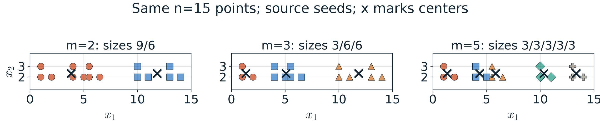
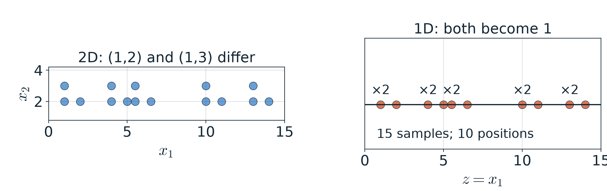

# 第1週 KP04：無標籤資料也能找結構（Unlabeled data can reveal structure）

> 程度：大學生（undergrad）／Level: Undergraduate (undergrad)
>
> 週次：第1週（2026-09-10）｜主題：課程介紹與機器學習回顧
>
> Week 1 (2026-09-10) | Topic: Course introduction and machine learning review

KP03 以輸入及標籤成對學習，現在拿掉訓練標籤。分群與降維仍能找結構，但需要不同的取捨。來源讀取日期2026-10-14；所有分群點、種子與更正表都由程式核算。

KP03 used paired inputs and labels. Now remove the training labels. Clustering and dimensionality reduction still find structure but make different tradeoffs. The source was accessed on 2026-10-14; points, seeds and corrected tables were checked computationally.

[下載本單元簡報](../slides/lec01-kp04-clustering-and-embedding.jbd.json)

## 學習目標（Learning objectives）

- 區分無訓練標籤的分群與有標籤的分類。（Distinguish clustering without target labels from supervised classification.）
- 用固定點與種子比較群數的影響。（Compare cluster counts on fixed points and seeds.）
- 根據指定中心重算距離，不依錯誤表格指派群別。（Recompute distances to specified centers instead of relying on an inconsistent table.）
- 用2維到1維的碰撞例說明資訊損失。（Explain information loss through a 2D-to-1D collision example.）

## KP04 無標籤資料也能找結構（Unlabeled data can reveal structure）

**一句話重點**：分群把點分組，降維改變資料的表示；沒有訓練標籤，也仍然要指定假設與評分準則。

**One-sentence summary**: Clustering groups points; reduction changes their representation. Without target labels, assumptions and scoring criteria are still necessary.

**白話說明**：把沒有名字的水果依外觀分堆，是分群。把多種特徵縮成較少座標，是降維。前者的輸出是群別，後者的輸出是較低維的表示，兩者不能只因「都沒標籤」便混為一談。

**Plain explanation**: Grouping unnamed fruit by appearance is clustering. Reducing several features to fewer coordinates is dimensionality reduction. One outputs group identifiers and the other a lower-dimensional representation. Unlabeled inputs do not make them the same task.

### 1. 分群找的是依準則定義的群（Clusters are defined by a criterion）

**非監督式學習**不使用每筆的目標類別來訓練。來源的各5個蘋果與黃瓜比喻，表示不先告訴類名；不是說資料處理完全沒有先備假設。仍須決定怎麼量相似度、要分幾群或如何接受一個分群結果。

**Unsupervised learning** does not use target class labels for training. The source's 5 apples and 5 cucumbers illustrate withholding category names, not removing all assumptions. Similarity, cluster count and assessment criteria must still be specified.

**正式定義**：此處分群用m個群號表示指派結果。形式與分類的標籤輸出相似，但群號不是預先提供的真實類名。

**Formal definition**: Here clustering assigns one of m group identifiers. Its output form resembles class prediction, but those identifiers are not supplied ground-truth category names.

$$
f_\theta(\mathbf{x})\in\{\ell_1,\ldots,\ell_m\},\qquad
f_\theta:\mathbb R^d\to\{\ell_1,\ldots,\ell_m\}.
$$

| 符號 | 中文意義 | English meaning |
|---|---|---|
| $\mathbf{x},d$ | 輸入向量、特徵數 | input vector, feature count |
| $m,\ell_j$ | 群數、第j群的識別碼 | cluster count, identifier of group j |
| $\theta$ | 指派模型的參數，例如中心 | assignment parameters, such as centers |

### 2. 固定點雲可有不同粒度（A fixed point cloud can have different granularities）

定義了群號後，看看來源互動的15個教學點。座標不變，固定種子不變，只切換群數m。下表按來源順序列出資料；它們不是有真實類別的測量。

With group identifiers defined, examine the 15 interactive teaching points. Coordinates and specified seeds are fixed for each m. The following retains source order; these are not measurements with known true classes.

| 樣本 Samples | 座標 Coordinates |
|---|---|
| 1–3 | (1,2), (1,3), (2,2) |
| 4–6 | (4,2), (4,3), (5,2) |
| 7–9 | (5.5,2), (5.5,3), (6.5,2) |
| 10–12 | (10,2), (10,3), (11,2) |
| 13–15 | (13,2), (13,3), (14,2) |

來源採用k-means的指派與更新。**指派**將每個點交給距離最近的中心；**更新**把每個中心移到其負責點的平均。這是演算法，不是類別答案的查表。

The source uses k-means assignment and update. **Assignment** chooses the nearest center. **Update** moves each center to the mean of its assigned points. This is an algorithm, not a lookup of category answers.

依來源固定種子重算到指派不再改變，得到下列結果。圖內中心以×標示，不把中心稱為某類水果的真值。

Recomputing from the fixed source seeds until assignments stop changing gives the results below. Centers are marked ×, not interpreted as true fruit categories.

| 群數 Cluster count | 固定初始中心 Fixed initial centers | 最終各群人數 Final sizes |
|---|---|---|
| 2 | (1,2.5), (13,2.5) | 9, 6 |
| 3 | (1.33,2.33), (5.83,2.33), (13.33,2.33) | 3, 6, 6 |
| 5 | (1.33,2.33), (4.33,2.33), (5.83,2.33), (10.33,2.33), (13.33,2.33) | 3, 3, 3, 3, 3 |

**圖說 `lec01-kp04-cluster-granularity`**：先比較三圖的點位置，完全相同；再看顏色與×中心。每圖仍有15點，但群大小依序為9／6、3／6／6、每群3點。三圖座標等比例、範圍相同；群號跨圖不代表同一個語意類別。〔功能：1、2、3〕

**Caption `lec01-kp04-cluster-granularity`**: Compare identical point positions, then colors and × centers. Each panel contains 15 points. Sizes are 9/6, 3/6/6 and 3 per group. Axes share ranges and equal scale; cluster identifiers are not semantic categories across panels. [Function: 1, 2, 3]

來源敘述m=3把左側分為1點與6點，沒有對上15點程式。這裡按原座標與原種子得到3／6／6，明列更正。這個例子的分組可細分，不代表任意k-means在m增加時都會形成巢狀群；初始化和局部解也可能改變結果。

The source's m=3 narrative mentions 1 and 6 left-side points, inconsistent with its 15-point code. Keeping the original coordinates and seeds gives 3/6/6. This example admits finer groups, but arbitrary k-means solutions need not be nested as m increases; initialization and local solutions matter.

### 3. 距離要按指定中心計算（Compute distances to the specified centers）

上一節展示粒度，這裡補完來源教授資料的5點**例子**。它指定中心A=(1,1)、B=(6,6)，卻列出不一致的距離。固定原中心與原點，先計算歐氏距離，再比較；不換中心來遷就錯表。

After granularity, complete the guide's 5-point **example**. It specifies A=(1,1), B=(6,6) but lists inconsistent distances. Keep the centers and points, recompute Euclidean distances, then compare. Do not change centers to match the table.

$$
\operatorname{dist}(\mathbf{x},\mathbf c)=\sqrt{(x_1-c_1)^2+(x_2-c_2)^2}.
$$

| 符號 | 中文意義 | English meaning |
|---|---|---|
| $\mathbf c=(c_1,c_2)$ | 指定的中心 | specified center |
| $\operatorname{dist}$ | 二維歐氏距離 | two-dimensional Euclidean distance |

對第一點到B的距離，逐步算為：

For the first point's distance to B, compute:

$$
\operatorname{dist}((1,1),(6,6))=\sqrt{(1-6)^2+(1-6)^2}=\sqrt{25+25}=\sqrt{50}\approx7.0711.
$$

| 輸入 Input | 到A距離 Distance to A | 到B距離 Distance to B | 最近中心 Nearest center |
|---|---|---|---|
| (1,1) | 0.0000 | 7.0711 | A |
| (2,2) | 1.4142 | 5.6569 | A |
| (1,3) | 2.0000 | 5.8310 | A |
| (6,6) | 7.0711 | 0.0000 | B |
| (7,5) | 7.2111 | 1.4142 | B |

特別檢查(6,6)：它就是B中心，到B的距離必為0，來源表的1.4不能成立。這5點只做一次最近中心指派，與前節15點跑到固定指派的互動不同，不把2個資料集混在一起。

In particular, (6,6) is center B, so its distance to B must be 0; the source's 1.4 is inconsistent. This 5-point example performs one assignment, unlike the converged 15-point interactive example. The datasets are kept distinct.

### 4. 降維改變表示，也可能合併差異（Reduction changes representation and can merge differences）

分群保留原座標、增加群號；**降維**則把d維資料變成p維表示，其中p<d。這個低維表示叫**嵌入**。你要保留哪些變化，取決於準則；不能同時假設所有細節都會留下。

Clustering retains coordinates and assigns group identifiers. **Dimensionality reduction** changes a d-dimensional input to a p-dimensional **embedding**, with p<d. The criterion determines which changes are retained; every detail cannot simply be assumed preserved.

$$
f_\theta:\mathbb R^d\to\mathbb R^p,\qquad p<d.
$$

| 符號 | 中文意義 | English meaning |
|---|---|---|
| $p$ | 降維後的座標數 | coordinate count after reduction |
| $z$ | 此例的單一保留座標 | the retained scalar coordinate in this example |

`[補充]` 用來源同15點作最簡單的指定投影：只保留第一座標。這是特徵選擇的一種降維，不是PCA，也不是宣稱投影已由資料學得。

`[Added]` Use the same 15 points for a prescribed projection that retains only the first coordinate. This is reduction by feature selection, not PCA or a claim of a learned projection.

$$
z=f(\mathbf{x})=x_1,\qquad (1,2)\mapsto1,\quad(1,3)\mapsto1.
$$

兩個不同輸入得到相同輸出，所以第二座標的差異不再可辨。15筆樣本仍然存在，但它們落在10個不同的第一座標位置上；不把碰撞解讀成刪掉了5筆樣本。

Different inputs now have the same output, so their second-coordinate difference is lost. All 15 samples remain, occupying 10 distinct first-coordinate positions. Collisions do not mean that 5 samples were deleted.

**圖說 `lec01-kp04-projection-loss`**：先看左圖x1相同但x2不同的兩點，再看右側1維位置。×2標出同位置的兩筆，垂直方向不編碼新特徵；15筆共落在10個位置。這張圖呈現具體資訊損失，不宣稱保留第一座標就是最佳選擇。〔功能：1、2、3〕

**Caption `lec01-kp04-projection-loss`**: Read points with the same x1 and different x2, then their 1D positions. ×2 marks two samples at one position; vertical placement is not another feature. There are 15 samples at 10 positions. The plot shows information loss, not optimality of retaining x1. [Function: 1, 2, 3]

### 5. 無標籤也要說明保留準則（Unlabeled learning still needs a preservation criterion）

**常見迷思**是「降維一定不能刪欄位」。特徵選擇可以減少座標；特徵萃取則組合或轉換原座標。另一個迷思是所有降維都只靠把相似點推近、相異點拉遠；不同方法也可能重視變異、距離或局部關係。

A **common misconception** is that reduction cannot remove feature columns. Feature selection reduces coordinates, while feature extraction combines or transforms them. Another misconception is that all reduction only pulls similar points together and pushes others apart. Methods may instead preserve variance, distances or local relationships.

來源還提到線性與非線性表示；流形學習關心低維幾何結構，不能把任意非線性特徵轉換直接當成流形學習。這裡先保留方法的界線，完整方法譜系留到KP07。

The source also mentions linear and nonlinear representations. Manifold learning concerns low-dimensional geometry, not every nonlinear feature transformation. We state that boundary here; KP07 develops the method families.

無監督降維只看資料；監督降維可加入類別或其他側資訊。來源費雪判別分析利用標籤改善表示，與「沒有標籤」的設定不同。接下來KP05要問：額外回饋能幫我們保留什麼結構？

Unsupervised reduction uses the inputs; supervised reduction can use class labels or other side information. The source's Fisher discriminant analysis uses labels and differs from the unlabeled setting. KP05 next asks what extra feedback helps preserve.

**小練習**：保留來源4題、全部選項與提示，不附答案。

**Practice**: Retain the 4 source checks, all options and hints, without marked answers.

| 題目與提示 | Question and hint |
|---|---|
| 1. 分群與分類主要差別？A 分群沒有訓練標籤；B 分群輸出連續值；C 分類不需資料；D 完全相同。提示：群號從哪裡來？ | 1. Main difference from classification? A clustering has no target labels; B continuous outputs; C classification needs no data; D identical. Hint: where do group identifiers come from? |
| 2. 來源常見降維關係？A p≫d；B p≪d；C p=d；D 無關。提示：辨認「顯著降幅」與一般p<d的差別。 | 2. Common substantial-reduction relation? A p≫d; B p≪d; C p=d; D unrelated. Hint: distinguish substantial reduction from merely p<d. |
| 3. 來源將非線性降維常稱為？A 特徵萃取；B 流形學習；C 分類；D 回歸。提示：這題問來源慣用名稱；正文已說明其適用界線。 | 3. The source's common name? A feature extraction; B manifold learning; C classification; D regression. Hint: consider the stated geometric scope. |
| 4. 費雪判別分析屬於？A 非監督；B 監督；C 強化；D 分群。提示：方法有沒有使用側資訊？ | 4. Fisher discriminant analysis is? A unsupervised; B supervised; C reinforcement; D clustering. Hint: does it use side information? |

## 小結（Summary）

- 群號不等於預先給定的類別答案。（Group identifiers are not supplied class targets.）
- 群數及初始化會影響分組，不能假設永遠唯一或巢狀。（Cluster count and initialization affect grouping; uniqueness or nesting is not guaranteed.）
- 降維可以選擇或萃取特徵，必須說明保留準則。（Reduction can select or extract features; state the preservation criterion.）
- 較低維表示可能合併差異，評估用途而非只看維度。（Lower-dimensional representations may merge distinctions; assess usefulness rather than dimension alone.）

## 術語表（Glossary）

| 中文 | English |
|---|---|
| 非監督式學習／分群／群號 | unsupervised learning / clustering / cluster identifier |
| 相似度／群數／粒度 | similarity / cluster count / granularity |
| k-means／種子／中心 | k-means / seed / center |
| 指派／更新／歐氏距離 | assignment / update / Euclidean distance |
| 降維／嵌入／投影／碰撞 | dimensionality reduction / embedding / projection / collision |
| 特徵選擇／特徵萃取／流形學習 | feature selection / feature extraction / manifold learning |
| 側資訊／費雪判別分析 | side information / Fisher discriminant analysis |

## 來源與更正（Sources and corrections）

[CCC-LNS 第1章 KP04](https://ndhuccc.github.io/CCC-LNS/IDL_115/Ch01-introduction-history/index.html#kp4)，主文、教授5點距離例、15點互動與4題，讀取2026-10-14。點、中心與初始種子保留原設定；距離及群人數按原公式重算，明列更正，不沿用錯表。兩組點不混為同一資料集。z=x1是明示補充投影，並用它更正「降維不能刪特徵」的過度概括。

[CCC-LNS Chapter 1, KP04](https://ndhuccc.github.io/CCC-LNS/IDL_115/Ch01-introduction-history/index.html#kp4), main text, 5-point guide example, 15-point demo and 4 checks, accessed on 2026-10-14. Points, centers and seeds retain their source settings. Distances and group sizes are recomputed and corrected explicitly. The datasets remain distinct. The added z=x1 projection clarifies that reduction may select features.

## 延伸閱讀（Further reading）

`[補充]` [scikit-learn 的降維說明](https://scikit-learn.org/stable/modules/unsupervised_reduction.html)與[特徵選擇說明](https://scikit-learn.org/stable/modules/feature_selection.html)，核對選擇與萃取的區別，讀取2026-10-14。

`[Added]` See the official [reduction guide](https://scikit-learn.org/stable/modules/unsupervised_reduction.html) and [feature-selection guide](https://scikit-learn.org/stable/modules/feature_selection.html), accessed on 2026-10-14.
