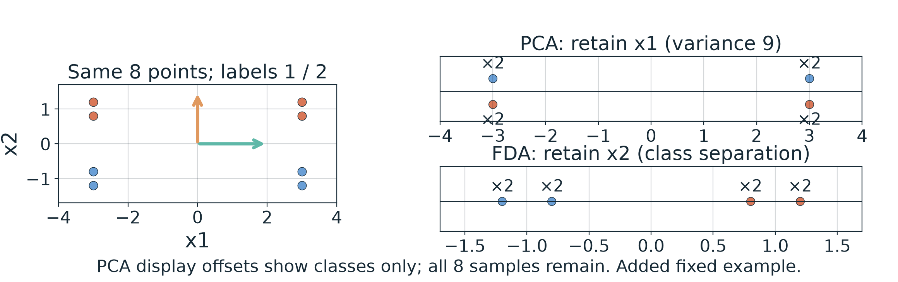
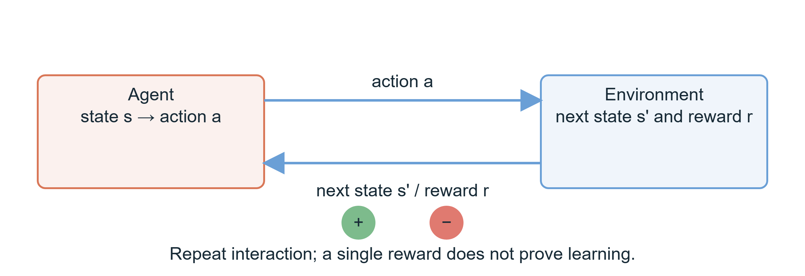
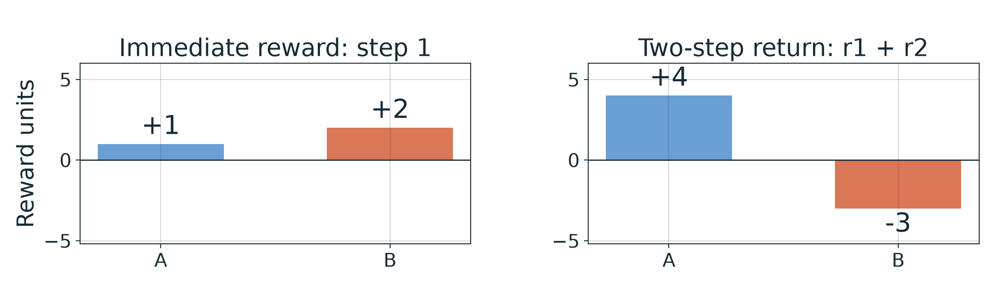

# 第1週 KP05：回饋型態改變學習目標（Feedback changes the learning objective）

**程度 / Level：**大學生 / Undergraduate　**建議時間 / Time：**15 分鐘（第一章 3 小時配置的一部分）　**對應實作 / Related practice：**辨識投影準則與行動回報；無程式作業。

**學習目標 / Learning goals：**辨別無監督與有側資訊的表示準則；畫出代理與環境的雙向回路；逐步計算兩步回報；說明錯誤標籤與獎勵設計的影響。 / Distinguish unlabeled and label-informed representations, describe the agent–environment loop, calculate two-step returns, and identify feedback-design limits.

[下載本單元簡報 / Download this unit's slides](../slides/lec01-kp05-side-information-and-rewards.jbd.json)

**一句話重點 / Main point：**標籤告訴表示模型哪些區別值得保留；獎勵評估的是行動後果，常須把數步合起來看。 / Labels identify distinctions to preserve in a representation; rewards evaluate the consequences of actions, often over several steps.

## 1. 從「壓成幾維」轉到「保留什麼」 / What should an embedding preserve?

**白話說明 / Plain explanation.** KP04 說明把座標變少會遺失某些差異。只有輸入點時，主成分分析（PCA）保留最大變異；給了類別標籤後，Fisher 判別分析（FDA）能優先找可分開類別的方向。二者回答不同問題。 / KP04 showed that reducing coordinates can erase distinctions. PCA retains the directions of greatest variation, whereas FDA uses class labels to favor separation. They answer different questions.

**正式定義 / Formal view.** 對中心化樣本 $\mathbf{x}_i\in\mathbb R^d$、單位方向 $\mathbf{w}$，投影是 $z_i=\mathbf{w}^{\mathsf T}\mathbf{x}_i$。PCA 最大化投影變異 $\mathbf{w}^{\mathsf T}C\mathbf{w}$；FDA 比較類間與類內散布，例如二類時最大化 $J(\mathbf{w})=(\mathbf{w}^{\mathsf T}S_B\mathbf{w})/(\mathbf{w}^{\mathsf T}S_W\mathbf{w})$，分母須大於零。$C$ 是全部樣本的共變異數，$S_B$ 和 $S_W$ 分別量類別中心距離與類內散布。兩式都不是所有降維方法共用的目標。 / PCA maximizes projected variance, while FDA uses a between-class to within-class scatter ratio; neither is a universal dimensionality-reduction objective.

**[補充] 同一組 8 點的完整控制例 / Added fixed eight-point control.** 四個類別 1 點為 $(-3,-1.2),(3,-1.2),(-3,-0.8),(3,-0.8)$；四個類別 2 點為 $(-3,0.8),(3,0.8),(-3,1.2),(3,1.2)$。總平均 $(0,0)$；類中心 $(0,-1)$ 和 $(0,1)$。以 $1/8$ 平均的總共變異數是 $C=\operatorname{diag}(9,1.04)$，類內散布是 $S_W=\operatorname{diag}(9,0.04)$，類間散布是 $S_B=\operatorname{diag}(0,1)$。所以 PCA 選 $\mathbf w=(1,0)$，其變異 9 大於 $x_2$ 的 1.04；此時兩類都投到 $-3$ 與 $3$，各位置各有 2 筆。FDA 選 $(0,1)$，因為 $J((0,1))=1/0.04=25$，而 $J((1,0))=0/9=0$；兩類分別投到 $-1.2,-0.8$ 與 $0.8,1.2$。這是指定教學點，不是訓練結果或真實量測。 / The same eight fixed samples make variance and separation point in different directions; no sample is removed.

**圖說 `lec01-kp05-projection-criteria`**：左為原 8 點，右上保留 $x_1$ 時類別重疊，右下保留 $x_2$ 時類別分開；「×2」表示該投影位置有兩筆，PCA 面板的上下偏移僅幫助看見兩類，並非第二維。圖由 `assets/figures/src/lec01-kp0507-figures.py` 依上述固定點產生。 / **Caption `lec01-kp05-projection-criteria`:** The same eight points yield overlapping class projections under PCA and separated ones under FDA. Vertical offsets on the PCA line only distinguish colors.

來源還用紅／藍球作另一個**示意距離**：類中心由 5 變 8，紅球群內距離由 1.5 變 0.8。這些是敘事給定的距離，不是上面 8 點算出的共變異數，也不能代替 FDA 公式。若把 1000 張照片各以 1000 個特徵表示，壓成 2 維可供視覺檢視；若另有「風景／人像」標籤，可要求表示保留這個區別。兩種表示仍須按用途評估。 / The source’s 5→8 and 1.5→0.8 are illustrative distances, not computed outputs of the eight-point example.

**常見迷思 / Misconception.** 無監督降維並不一律「推近相似、拉遠相異」；PCA 看變異，LLE 看局部重建。標籤也不保證更好的表示，因為標錯時投影準則可能朝錯方向調整。 / Different embedding methods preserve different structures; bad labels can misdirect a supervised one.

## 2. 從靜態資料轉到行動後果 / From static representation to action consequences

**白話說明 / Plain explanation.** 表示學習觀察既有資料；強化學習（RL）的代理會採取行動，環境再回傳新狀態與獎勵。前者不是後者必需的前置步驟。 / Representation learning analyzes existing data; in RL, actions change the situation and elicit feedback. Dimensionality reduction is not a required prerequisite for RL.

**正式定義 / Formal view.** 時刻 $t$，代理觀察狀態 $s_t$，依策略選 $a_t\in\mathcal A$；環境回傳 $(s_{t+1},r_{t+1})$。$\mathcal A$ 是可選行動集合，$r$ 是獎勵，$\theta$ 是策略參數。來源式 (8) $f_\theta(\mathbf x)=a\in\mathcal A$ 可作決定性策略示意：若 $\mathbf x$ 編碼當前觀察或狀態，模型輸出一個行動；實務策略也可以給出行動機率。$r$ 可正、負或零。 / An agent receives a state, chooses an action, and receives the next state and reward. Policies may be deterministic or stochastic.

**圖說 `lec01-kp05-agent-environment-loop`**：上箭頭由代理指向環境，傳送行動；下箭頭由環境返回代理，傳送新狀態與獎勵。綠色「+」與紅色「−」標示獎勵可有不同符號，並不表示每步必有兩項。講義圖由同一圖程式生成；投影片以可編輯形狀重建。 / **Caption `lec01-kp05-agent-environment-loop`:** Two directed arrows form the interaction loop; reward signs indicate possible values, not two simultaneous rewards.

玩具收拾例：稱讚收好可設正獎勵，咬壞玩具可設負獎勵。另一情境是掃地機器人，掃到灰塵和碰牆可回不同訊號。例子的數字是設計者給定的，不是孩子或機器人的實測。 / The toy-cleaning and robot-cleaning cases illustrate designed feedback, not observed performance data.

## 3. 要比較整段回報 / Compare the whole return

**正式定義 / Formal view.** 此處只看兩步、沒有折扣，定義 $G=r_1+r_2$。一般延長到多步時可用 $G_t=\sum_{k=0}^{T-t-1}\gamma^k r_{t+k+1}$，$\gamma\in[0,1]$ 是折扣因子；此例相當於 $\gamma=1$。強化學習關心策略下的**預期**累積回報，並非單次軌跡的保證。 / The two-step teaching case uses an undiscounted return; RL typically optimizes expected return under a policy.

| 路徑 / Path | 第一步 $r_1$ / First reward | 第二步 $r_2$ / Second reward | 代入與總回報 / Calculation and return |
|---|---:|---:|---|
| A：先收玩具再坐下 / Tidy then sit | $+1$ | $+3$ | $G_A=1+3=4$ |
| B：先咬玩具再亂跑 / Bite then run | $+2$ | $-5$ | $G_B=2+(-5)=-3$ |

第一步 $2>1$，但兩步後 $4>-3$；因此在這個**固定的兩條路徑**中 A 的回報較高。這個算式沒有證明代理已學會 A，也沒有給每條路徑的機率。 / B pays more immediately, while A has the higher two-step return in these stipulated paths; a single comparison does not establish learning.

**圖說 `lec01-kp05-reward-sequences`**：左圖比較第一步，右圖用同一兩條路徑比較總和；$-3$ 保留負號。圖程式依表格的 1、3、2、−5 直接計算。 / **Caption `lec01-kp05-reward-sequences`:** Immediate ranking reverses when the second step is included.

**常見迷思 / Misconception.** 只獎勵「快收拾」可能誘使代理把玩具掃到床底；獎勵函數應反映真正目標。錯誤的類別標籤和錯誤的獎勵設計都提供回饋，但兩者作用於不同問題。 / A poorly specified reward can favor an unwanted shortcut.

## 4. 自我檢核（保留來源全部四題，不附答案） / Self-check (all four source questions; no answers)

| 題 / Question | A | B | C | D | 提示 / Hint |
|---|---|---|---|---|---|
| 1. 依來源相似度型嵌入示意，未用標籤時關注什麼？ / In the source's similarity-based illustration, what guides an unlabeled embedding? | 用標籤提高類間差 / Increase between-class difference with labels | 僅依資料模式安排相似與相異點 / Arrange similar and dissimilar points from data patterns | 最小化標籤誤差 / Minimize target-label error | 用側資訊壓低類內差 / Use side information to lower within-class spread | 先留意題目限定「來源示意」；PCA 未必用相同準則。 / The qualifier does not describe every embedding method. |
| 2. FDA 如何利用類別側資訊？ / How does FDA use class information? | 類內提高、類間降低 / Raise within-class, lower between-class | 忽略類別 / Ignore classes | 類內降低、類間提高 / Lower within-class, raise between-class | 只改圖不改嵌入 / Change only the display | 比較 $S_B$ 與 $S_W$ 的作用。 / Compare the two scatter terms. |
| 3. 來源式 (8) 的 $a$ 是什麼？ / What does $a$ denote in equation (8)? | 從 $\mathcal A$ 選的行動 / An action selected from $\mathcal A$ | 輸入標籤 / An input label | 環境狀態 / The environment state | 回報總和 / The total return | 分開「觀察、輸出、回饋」。 / Separate observation, output and feedback. |
| 4. 哪項描述強化學習機制？ / Which describes RL? | 配對標籤擬合 / Fit labeled targets | 只從無標籤資料找結構 / Find structure only | 與環境互動並用獎勵調整 / Interact and adjust with rewards | 隨機猜且永不調整 / Guess without adjustment | 看行動是否影響下一次收到的資料。 / Ask whether actions affect later observations. |

**口訣 / Memory aid：**先問訊號從哪來：資料幾何、側資訊，還是行動後的獎勵？ / Ask where the feedback comes from: data geometry, side information, or rewards after actions.

**銜接 / Next：**KP06 比較各種監督式分類工具的假設。 / KP06 compares the assumptions of classification methods.

**來源與更正 / Source and corrections：**[CCC-LNS 第一章，KP05](https://ndhuccc.github.io/CCC-LNS/IDL_115/Ch01-introduction-history/index.html)，2026-10-14 讀取。8 點例為補充；來源的 5→8、1.5→0.8 為示意距離，未當成演算法量測。來源把降維一概描述為推近拉遠、把降維接 RL 當必經步驟，以及把兩步回報當成已學會策略，均在文中加上條件。強化學習的狀態、行動與預期回報術語另參考 [Sutton 與 Barto，MIT Press](https://mitpress.mit.edu/9780262039246/reinforcement-learning/)。
