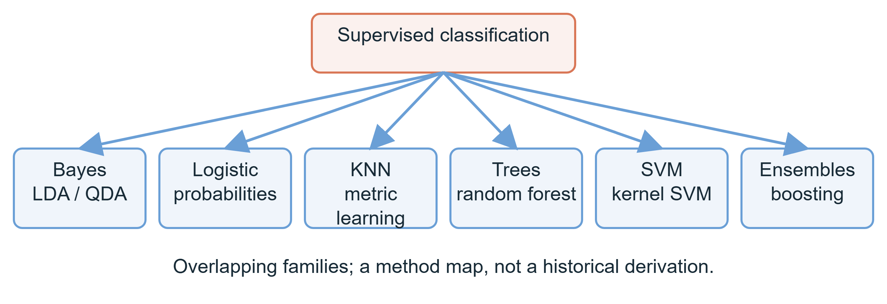
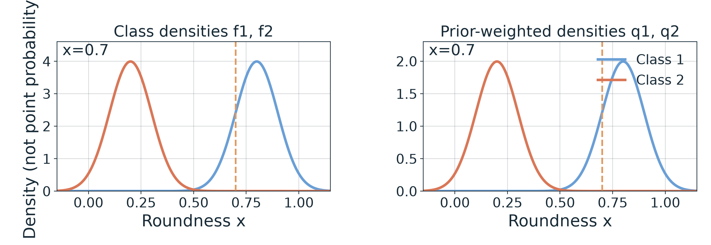
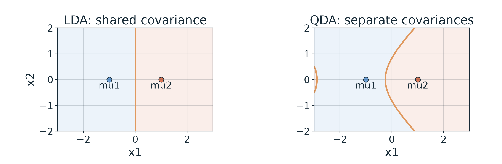

# 第1週 KP06：分類工具各有不同假設（Classification methods use different assumptions）

**程度 / Level**：大學生 / Undergraduate　**建議時間 / Time**：15 分鐘　**對應實作 / Related practice**：手算二類後驗並比較 LDA/QDA 假設。

**學習目標 / Learning goals**：區分先驗、類條件密度、後驗與證據；用同一組數字完成 Bayes 計算；說明 LDA/QDA、Logistic、KNN、樹、SVM 與集成方法的基本假設。 / Distinguish prior, density, posterior and evidence; normalize a two-class example; compare common classifier assumptions.

[下載本單元簡報 / Download this unit's slides](../slides/lec01-kp06-classification-method-families.jbd.json)

**一句話重點 / Main point**：分類方法沒有單一共同的建模途徑；選法要看假設、資料與未見樣本的表現。 / Classifiers make different modeling choices; evaluate those choices on data not used for fitting.

## 1. 六個重疊的工具家族 / Six overlapping families of tools

**白話說明 / Plain explanation.** KP03 定義了「輸出類別」這項任務，但沒有指定演算法。統計方法可以為每類描述資料密度、直接描述類別機率、比較鄰居、逐步切分空間，或尋找間隔邊界。集成方法則組合多個模型；因此「樹」和「集成」會重疊。這張圖是任務工具地圖，不是六條互斥血統，也不是「其餘方法都是 Bayes 推導出的後代」。 / Classification is the task. These families differ in how they score classes and some overlap, especially tree ensembles.

**圖說 `lec01-kp06-classifier-families`**：共同根節點是監督式分類；六支標出 Bayes／LDA／QDA、Logistic、KNN／度量、樹／隨機森林、SVM／核方法、集成／Boosting。圖中連線是概念分組而非歷史衍生關係，投影片用可編輯形狀重建。 / **Caption `lec01-kp06-classifier-families`:** The six branches organize tools by working assumptions; they are neither mutually exclusive nor all derived from Bayes.

**正式定義 / Formal view.** 訓練資料有 $(\mathbf x_i,y_i)$，其中 $y_i\in\{1,\ldots,K\}$ 是已給標籤。分類器 $h(\mathbf x)$ 指派類別，或先求每類分數 $q_j(\mathbf x)$ 再比較。沒有已知對所有資料集都最好的一個家族。 / In supervised classification, labeled examples support a mapping from features to one of $K$ classes.

## 2. Bayes：從先驗和密度得到後驗 / Bayes: prior and density to posterior

**白話說明 / Plain explanation.** 先驗 $\pi_j=P(Y=j)$ 是看特徵之前的類別比例；類條件密度 $f_j(x)=f_{X\mid Y=j}(x)$ 衡量在第 $j$ 類中，某個連續特徵位置附近的相對集中程度；後驗 $P(Y=j\mid X=x)$ 是看過特徵後的類別機率。密度可以大於 1，因為它不是「恰好等於這個實數點」的機率。 / A density is probability per unit of the measurement scale, not the probability of one exact continuous value.

**正式定義 / Formal view.** 對連續 $X$ 與有限類別，邊際**密度** $f_X(x)=\sum_{k=1}^K \pi_k f_k(x)$，而

$$
P(Y=j\mid X=x)=\frac{\pi_j f_j(x)}{f_X(x)}
=\frac{\pi_j f_j(x)}{\sum_{k=1}^K\pi_k f_k(x)}.
$$

連續分布的 $P(X=x)=0$；來源式 (9) 把密度寫成 $P(X=x)$ 會混淆點機率與密度。若後驗正確、各類誤判代價相同（0–1 損失），取最大後驗的分類規則有最小**預期**誤判率；它不保證每筆都判對，也不適用所有代價設定。 / Under correct posteriors and equal 0–1 costs, the largest-posterior rule minimizes expected classification error, not the error of every individual example.

**完整數值例 / Worked example.** 來源設定蘋果 $j=1$、黃瓜 $j=2$，圓度 $x=0.7$，$\pi_1=\pi_2=0.5$，高斯平均 $\mu_1=0.8,\mu_2=0.2$，標準差 $\sigma_1=\sigma_2=0.1$。對任一類，

$$
f_j(x)=\frac{1}{\sigma_j\sqrt{2\pi}}
\exp\!\left[-\frac{(x-\mu_j)^2}{2\sigma_j^2}\right].
$$

蘋果類的標準化距離 $(0.7-0.8)/0.1=-1$；黃瓜類的是 $(0.7-0.2)/0.1=5$。代入共同前因子 $1/(0.1\sqrt{2\pi})=3.989422804$，得到

$$
f_1(0.7)=3.989422804\,e^{-1/2}=2.419707245,
\qquad
f_2(0.7)=3.989422804\,e^{-25/2}=0.000014867195.
$$

先乘先驗，$q_1=0.5f_1=1.209853623$、$q_2=0.5f_2=0.000007433598$；再加成證據密度 $f_X(0.7)=q_1+q_2=1.209861056$；最後歸一化：

$$
P(Y=1\mid X=0.7)=\frac{1.209853623}{1.209861056}=0.999993856,
\quad
P(Y=2\mid X=0.7)=\frac{0.000007433598}{1.209861056}=0.000006144.
$$

兩個後驗和為 1（四捨五入誤差除外）。比較類別時可略去共同分母，但**不可略去不同的先驗**。來源教授備課表把相同參數的密度寫成約 $0.24$、$0.0001$，並給後驗 $0.9996$／$0.0004$；這些值與高斯密度公式不合。這裡保留參數，逐步重算。 / The source's printed numbers do not follow its stated Gaussian parameters; the corrected normalization is shown in full.

**圖說 `lec01-kp06-bayes-roundness`**：左圖為兩類的類條件密度 $f_1,f_2$，右圖為乘上各 0.5 先驗的 $q_1,q_2$；虛線標 $x=0.7$。縱軸是密度，非單點機率。圖由同一公式和來源參數產生。 / **Caption `lec01-kp06-bayes-roundness`:** The right panel weights each density by its prior; the vertical line marks the evaluated roundness.

來源互動元件另有一組**不同的預設**：$\mu_1=3,\mu_2=7,\sigma_1=\sigma_2=1,\pi_1=0.5,x=5$。兩類距均值同為 2，故 $f_1(5)=f_2(5)=e^{-2}/\sqrt{2\pi}=0.053990967$；各加權密度 $q_j=0.026995483$，證據 $0.053990967$，後驗各 $0.5$。這是平手，若要輸出一個類別仍需明定平手規則。 / The interactive default is a separate symmetric example with a posterior tie.

## 3. 共變異數如何改變邊界 / How covariance changes a boundary

**正式定義 / Formal view.** 共變異數矩陣 $\Sigma_j$ 描述第 $j$ 類在各座標的散布與共同變動。線性判別分析（LDA）採各類共享的高斯共變異數，因此二類對數後驗差中的二次項抵消，邊界為直線；二次判別分析（QDA）讓每類有自己的共變異數，邊界通常為二次曲線。「通常」是因為特殊參數仍可能退化成直線。 / LDA shares a covariance and yields a linear decision boundary under the Gaussian model; QDA allows separate covariances and generally a quadratic boundary.

**[補充] 受控 2D 比較 / Added 2D control.** 固定兩類平均 $\boldsymbol\mu_1=(-1,0)$、$\boldsymbol\mu_2=(1,0)$ 與相等先驗。LDA 令 $\Sigma_1=\Sigma_2=\operatorname{diag}(1,0.5)$，其等後驗邊界是 $x_1=0$。QDA 只改散布，令 $\Sigma_1=\operatorname{diag}(0.4,0.8)$、$\Sigma_2=\operatorname{diag}(1.8,0.3)$；比較的對數分數是

$$
\delta_j(\mathbf x)=-\frac12(\mathbf x-\boldsymbol\mu_j)^{\mathsf T}\Sigma_j^{-1}(\mathbf x-\boldsymbol\mu_j)
-\frac12\log|\Sigma_j|+\log\pi_j,
$$

並畫 $\delta_1(\mathbf x)=\delta_2(\mathbf x)$。圖上兩個圓點只標定平均，**不是**訓練樣本；陰影只是分數較大一側。這個控制例固定平均與先驗，單看共變異數假設的影響。 / The mean markers are parameters, not sampled training data.

**圖說 `lec01-kp06-covariance-boundaries`**：兩面板固定同一類中心、先驗與座標範圍；左共用散布得直線，右分別散布得曲線。二類高斯密度按上述解析分數計算，沒有擬合資料。 / **Caption `lec01-kp06-covariance-boundaries`:** Only the covariance assumption changes between panels; boundaries come from analytic Gaussian scores.

FDA（KP05）是選投影方向的判別準則；二類共享共變異數高斯模型下，其方向可與 LDA 分類器方向對應，但二者不是所有情境下完全相同的程序。 / Under restricted two-class shared-covariance conditions, FDA and LDA directions correspond; their full tasks differ.

## 4. 其他家族的假設與限制 / Other families: assumptions and limits

| 工具 / Tool | 核心做法 / Working idea | 條件或限制 / Condition or limit |
|---|---|---|
| Naive Bayes | 給定類別後近似把各特徵密度相乘：$f_j(\mathbf x)\approx\prod_k f_{jk}(x_k)$。 / Approximate conditional feature independence. | 特徵相關時假設不一定成立；評估仍要看未見資料。 / Dependence can violate the assumption. |
| Logistic regression | 直接用 $P(Y=1\mid\mathbf x)=1/(1+e^{-(b+\boldsymbol\beta^{\mathsf T}\mathbf x)})$ 建二類後驗。 / Model the conditional probability directly. | 基本式是二類線性 log-odds；可另擴充多類。 / The basic form is binary. |
| KNN and metrics | 依距離找 $k$ 個近鄰，按鄰居標籤投票。 / Vote among nearby labeled samples. | 距離與特徵尺度、$k$ 都會影響結果；「不擬合參數」不等於沒有模型假設。 / Scaling and $k$ matter. |
| Decision tree | 逐層用特徵閾值分割資料。 / Recursively split feature space. | 單樹易受資料擾動；深度可控制複雜度。 / Tree depth affects complexity. |
| Random forest; boosting | 前者常以重抽樣與特徵隨機化建多樹並聚合；後者依序修正先前不足。 / Aggregate randomized trees versus sequentially improving learners. | 集成與樹是重疊概念，boosting 不等同 bagging。 / These are overlapping categories. |
| SVM; kernel SVM | 在間隔與錯誤間取捨；核函數提供隱含特徵空間的內積。 / Balance margin and error; kernels express inner products. | 硬間隔需可分；軟間隔可有間隔內或錯分的支持向量。核不保證可分或普遍更準。 / Kernels do not guarantee separability. |

SVM 對偶解中非零係數對應支持向量；在硬間隔且線性可分的簡化圖像裡，它們常位於間隔邊緣。軟間隔的支持向量也可能在間隔內甚至錯分，因此來源「只在乎最靠近邊界的點」需加條件。KKT 是用來描述最優性條件，不是普遍泛化保證。核技巧不用顯式算高維座標，但需要合適的核。RKHS 是核方法的函數空間脈絡，並不是此節計算 Bayes 後驗的先決知識。 / Support vectors have nonzero dual weights; soft-margin support vectors need not lie exactly on a clean boundary.

距離式分類也可先比較樣本與各類中心的距離，再選最近中心；度量學習則設法學出適合任務的距離。若學到同類較近、異類較遠的表示，KNN 可能受益；triplet loss 是一種相關的訓練準則，卻不保證任意 KNN 資料都會改善。來源另列 CHAID、CART、ID3、C4.5、OC1 與 MARS 作歷史名稱：前五者可放在決策樹脈絡，MARS 是分段樣條的回歸方法，並非另一種分類樹。/ One can classify by the nearest class center, or learn a task-sensitive distance. The source lists several historical names; MARS belongs to adaptive spline regression rather than classification-tree induction. See [Friedman's original MARS paper](https://www.stat.yale.edu/~lc436/08Spring665/Mars_Friedman_91.pdf).

**常見迷思 / Misconception.** 真實類條件密度難估不代表「Bayes 算不出來」：玩具例可直接算；高維估計困難才是實務問題。沒有任何家族因名稱、稀疏性或理論最優條件而在所有資料上必然勝出。 / Estimation difficulty and a theoretical decision rule are different claims.

## 5. 自我檢核（來源四題，不附答案） / Self-check (four source questions; no answers)

| 題 / Question | A | B | C | D | 提示 / Hint |
|---|---|---|---|---|---|
| 1. 在正確後驗與等代價條件下，Bayes 規則為何最佳？ / Why is the Bayes rule optimal under correct posteriors and equal costs? | 假設特徵獨立 / Assumes independent features | 取最大後驗以降低預期 0–1 錯誤 / Maximizes posterior under 0–1 loss | 一定線性邊界 / Always linear | 不用先驗 / Needs no prior | 區分決策規則和估計假設。 / Separate rule from estimation assumption. |
| 2. LDA 與 QDA 的主要差別？ / Main LDA–QDA difference? | LDA 共享共變異數，QDA 放寬 / Shared versus separate covariances | QDA 必假設特徵獨立 / QDA requires feature independence | LDA 是核法 / LDA is a kernel method | 完全相同 / Identical | 看上方控制例只改哪個參數。 / Find the single changed assumption. |
| 3. Logistic 如何處理後驗？ / How does logistic regression handle posterior probability? | 經生成密度間接計算 / Only via generative densities | 直接用 sigmoid 建模 / Direct sigmoid model | 假設後驗是高斯 / Gaussian posterior | 完全不處理 / Does not model it | 問 $P(Y=1\mid\mathbf x)$ 在哪一式直接出現。 / Find the direct conditional-probability equation. |
| 4. 在線性可分硬間隔 SVM 下，何謂「稀疏」？ / What is sparse in a linearly separable hard-margin SVM? | 每筆都有非零對偶係數 / All dual weights nonzero | 間隔邊緣的支持向量有非零係數 / Margin support vectors have nonzero weights | 一定得用核 / A kernel is mandatory | 只能處理一維 / Only one dimension | 題目刻意限定硬間隔；軟間隔另有情況。 / The qualifier matters. |

**口訣 / Memory aid**：先問「怎樣產生分數」，再問「哪些假設可被資料挑戰」。 / Ask how scores are produced, then which assumptions the data can challenge.

**銜接 / Next**：KP07 轉向連續值預測及表示降維。 / KP07 moves to numerical prediction and representations.

**來源與更正 / Source and corrections**：[CCC-LNS 第一章，KP06](https://ndhuccc.github.io/CCC-LNS/IDL_115/Ch01-introduction-history/index.html)，2026-10-14 讀取。高斯例沿用來源參數，密度與後驗已重算；2D 邊界為補充。LDA/QDA、Logistic、KNN、樹、集成與 SVM 的技術條件查核 [scikit-learn LDA/QDA](https://scikit-learn.org/stable/modules/lda_qda.html)、[linear models](https://scikit-learn.org/stable/modules/linear_model.html)、[SVM](https://scikit-learn.org/stable/modules/svm.html)。六枝是方法地圖而非歷史推導樹；來源 1950s→現在的時間提示不應機械地對應每枝。來源對 SVM 支持向量與最優性的概括已限定適用條件。
