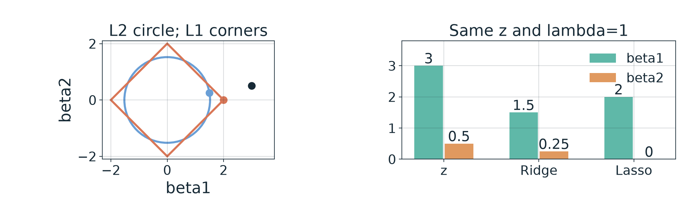
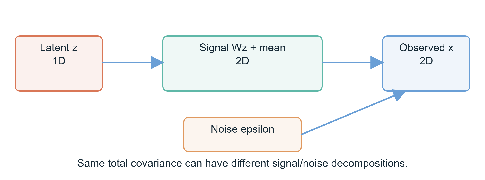
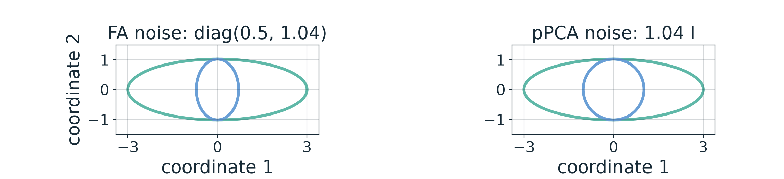

# 第1週 KP07：回歸與降維保留不同資訊（Regression and reduction preserve different information）

**程度 / Level：**大學生 / Undergraduate　**建議時間 / Time：**15 分鐘　**對應實作 / Related practice：**重算 Ridge/Lasso 控制例，對比因子模型的雜訊假設。

**學習目標 / Learning goals：**區分連續值預測與低維表示；寫出 $L_2^2$ 與 $L_1$ 懲罰；從固定數字算出收縮與零係數；辨別因子分析與機率式 PCA 的雜訊假設；正確定位其他降維家族。 / Distinguish prediction from representation, calculate a regularization example, compare factor-analysis and pPCA noise, and locate other reduction methods.

[下載本單元簡報 / Download this unit's slides](../slides/lec01-kp07-regression-and-dimension-reduction.jbd.json)

**一句話重點 / Main point：**正則化控制預測模型的係數，降維改變資料的表示；方法各有保留準則，並非每次都須「先降維再預測」。 / Regularization controls model coefficients, while reduction changes a representation; neither implies a mandatory pipeline.

## 1. 連續預測與係數懲罰 / Numerical prediction and coefficient penalties

**白話說明 / Plain explanation.** 線性回歸從特徵預測數值，例如水果直徑；殘差是「實際值－預測值」。只壓低訓練殘差可能給出不穩定的大係數，因此可在損失外加懲罰。Ridge 常用平方 $L_2$ 懲罰，Lasso 常用 $L_1$ 懲罰；二者不是把輸入維度直接投影成較低維。 / Regression predicts numbers. Coefficient penalties change the fitted model; they are not automatically dimensionality-reduction maps.

**正式定義 / Formal view.** 設 $D\in\mathbb R^{n\times d}$ 每**列**是一個樣本，$\mathbf y\in\mathbb R^n$ 是連續標籤，$\boldsymbol\beta\in\mathbb R^d$ 是係數，$b$ 是截距。此處 $D$ 是 KP02 以**欄**放樣本的 $X\in\mathbb R^{d\times n}$ 的轉置：$D=X^{\mathsf T}$，避免把行列約定混用。未懲罰最小平方法為

$$
\min_{\boldsymbol\beta,b}\ \frac{1}{2n}\|\mathbf y-D\boldsymbol\beta-b\mathbf 1\|_2^2.
$$

擬合向量是 $D\boldsymbol\beta+b\mathbf1$；最小平方可理解為把 $\mathbf y$ 投影到設計矩陣（含截距列）的**欄空間**。唯一係數解須有適當滿秩條件，並非每個特徵統計獨立。Ridge 在損失後加 $\lambda\|\boldsymbol\beta\|_2^2/2$，Lasso 加 $\lambda\|\boldsymbol\beta\|_1$；通常不懲罰截距。$\lambda\ge0$ 是懲罰強度，兩種規範化的數值不能直接拿另一套軟體的 `alpha` 對照。 / Least squares projects the target vector onto a design-matrix column space; full rank governs uniqueness, not statistical independence of features.

**[補充] 可完整手算的獨立二次例 / Added separable quadratic control.** 指定 $\mathbf z=(3,0.5)$、$\lambda=1$ 與簡化基本損失 $L(\boldsymbol\beta)=\frac12\|\boldsymbol\beta-\mathbf z\|_2^2$。這是兩個獨立係數的教學控制，**不是**任意相關設計矩陣的 Ridge/Lasso 通式，也不是擬合的資料結果。未加懲罰解是 $\boldsymbol\beta=\mathbf z$。Ridge 的一階條件為 $(\boldsymbol\beta-\mathbf z)+\lambda\boldsymbol\beta=0$，故

$$
\boldsymbol\beta_R=\frac{\mathbf z}{1+\lambda}
=\left(\frac3{1+1},\frac{0.5}{1+1}\right)=(1.5,0.25).
$$

Lasso 可對每一座標作軟閾值 $\beta_{L,j}=\operatorname{sign}(z_j)\max(|z_j|-\lambda,0)$，所以

$$
\beta_{L,1}=\max(3-1,0)=2,
\qquad\beta_{L,2}=\max(0.5-1,0)=0,
\qquad\boldsymbol\beta_L=(2,0).
$$

$L_2$ 球是圓，$L_1$ 球在座標軸上有角；這幫助理解為什麼 Lasso **可能**得到零係數，卻不保證選出真實有用的特徵。係數大小也受特徵尺度影響；選 $\lambda$ 時要看未用來擬合的資料。 / Lasso can set coefficients to zero, but sparsity alone does not establish correct feature selection.

**圖說 `lec01-kp07-penalty-geometry`**：左示意 $L_2$ 圓和 $L_1$ 菱形的幾何以及指定 $\mathbf z$、Ridge、Lasso 解；右比較兩個係數。圓與菱形只是幾何示意，沒有宣稱同一約束預算或一般資料解。 / **Caption `lec01-kp07-penalty-geometry`:** Geometry illustrates norm shapes; the bars use the fully calculated separable example.

## 2. 回歸家族中的其他問題 / Other questions in regression

| 方法 / Method | 回答的問題 / Question answered | 使用條件 / Qualification |
|---|---|---|
| 線性回歸 / Linear regression | 條件平均能否用特徵的線性組合預測？ / Can a linear combination predict a numerical target? | 特徵可相關；多重共線性會影響係數辨識。 / Features need not be independent. |
| 廣義線性模型（GLM） / Generalized linear model | 能否用連結函數 $g(E[Y\mid\mathbf x])=b+\boldsymbol\beta^{\mathsf T}\mathbf x$ 處理機率、計數等？ / Can a link connect a linear predictor to a mean? | 條件分布與 link 需相配；Logistic/Bernoulli 是例子。 / Match distribution and link. |
| 分位數回歸 / Quantile regression | 想預測第 $\tau$ 分位而不是平均？ / Predict a conditional quantile instead of a mean? | 最小化 pinball 損失 $\rho_\tau(u)=u(\tau-\mathbf1_{u<0})$，$u=y-\hat y$。 / Uses asymmetric absolute residuals. |
| 非線性回歸 / Nonlinear regression | 線性輸入關係不夠時怎麼辦？ / What if the input–response relation bends? | 多項式特徵對係數仍可線性；KNN、樹、森林、神經網路提供其他形式。 / Polynomial models can remain linear in parameters. |

**常見迷思 / Misconception.** 上述方法不是「前一個不夠就一定改用下一個」的歷史階梯。回歸與分類可共享工具：例如樹、KNN、神經網路，差在目標與輸出。 / Methods are choices shaped by the target and assumptions, not mandatory upgrades.

## 3. 降維：幾何、局部關係與監督目標 / Reduction: variance, geometry and target information

**正式定義 / Formal view.** 降維建立 $z=f(\mathbf x)\in\mathbb R^p$，$p<d$。$z$ 可服務視覺化、雜訊處理或後續預測，但必須說清楚保留的是哪種資訊。 / A lower-dimensional map requires a preservation criterion; lower dimension alone guarantees none.

| 家族與來源例 / Family and source examples | 核心準則 / Preservation criterion | 限制與更正 / Limit |
|---|---|---|
| PCA；FDA | PCA 保留最大線性變異；FDA 用類別側資訊分開類別。 / Variance versus class separation. | 二者皆可線性投影；FDA 用標籤，PCA 不用。 / Label availability changes the task. |
| MDS；Sammon mapping | MDS 依差異矩陣配置點；Sammon 特別重視原空間小距離。 / Arrange points from pairwise dissimilarities. | Sammon 是非線性映射的早期例子，來源「第一個非線性降維」不作普遍起源斷言。 / Avoid a universal first claim. |
| 核 PCA | 在核隱含空間作 PCA。 / PCA in an implicit feature space. | 核的選擇影響結果，不保證一定抓到真流形。 / Kernel choice matters. |
| Isomap；LLE | Isomap 以近鄰圖上的最短路徑近似流形測地距離；LLE 先用近鄰線性重建權重，再在低維保留這些權重。 / Graph distances versus local reconstruction weights. | 近鄰選錯或取樣稀疏可扭曲結果；LLE 不保證所有全局關係自然正確。 / Neighborhoods matter. |
| SDE/MVU；圖嵌入 | 前者以半正定規劃在局部距離約束下找核；後者以圖與 Laplacian 表示鄰接關係。 / Semidefinite versus graph-based constraints. | 不把所有譜法說成同一個簡單特徵值問題。 / Objectives differ. |
| HSIC 與監督 PCA | HSIC 是核相依性統計量，可用於選擇與標籤有關的方向。 / Kernel dependence can score label-related representations. | HSIC 不等於普通線性相關；「監督 PCA」有多個具體方案。 / Different formulations exist. |

來源的概念年代順序可作記憶線索：PCA（20 世紀初）、Sammon（1969）、核 PCA（1990 年代後期）、Isomap 與 LLE（2000）。年份只標具體文獻，不能推論某種「唯一首創」或單一必然演化路徑。 / A chronology can orient reading without implying that each method replaces the preceding one.

## 4. 因子模型與 pPCA 的雜訊假設 / Factor models and pPCA noise

**白話說明 / Plain explanation.** 另一種問題是「觀察到的散布是否由少數共同因素，加上各座標雜訊所形成？」因子分析（FA）允許各座標有不同的獨立雜訊變異；機率式 PCA（pPCA）把它限制為各方向相同。 / FA permits different coordinate-wise noise variances; pPCA uses isotropic noise.

**正式定義 / Formal view.** 令潛在因子 $\mathbf z\in\mathbb R^q$、載荷矩陣 $W\in\mathbb R^{d\times q}$、均值 $\boldsymbol\mu$，

$$
\mathbf x=W\mathbf z+\boldsymbol\mu+\boldsymbol\varepsilon,
\qquad \mathbf z\sim N(0,I_q),\quad
\boldsymbol\varepsilon\sim N(0,\Psi),\quad
\operatorname{Cov}(\mathbf x)=WW^{\mathsf T}+\Psi.
$$

FA 的典型設定 $\Psi=\operatorname{diag}(\psi_1,\ldots,\psi_d)$；pPCA 特例 $\Psi=\sigma^2 I_d$。$q<d$ 是潛在維度；「等向」須同時有對角形式及各座標**相同**變異。對完整觀測、高斯模型與標準極大概似條件，pPCA 的最優載荷子空間與 PCA 主方向一致，並有閉式極大概似解；這不表示任意缺值、限制或推論問題都無須迭代。EM 可用於某些潛因子模型的估計，並不等於變分推論。 / The standard complete-data Gaussian pPCA model has a closed-form ML subspace; EM and variational inference are distinct procedures.

**圖說 `lec01-kp07-latent-generation`**：潛在因子經 $W$ 映到觀察空間，加入均值與雜訊後成為觀測 $\mathbf x$；原生投影片使用同語意的可編輯節點與箭頭。 / **Caption `lec01-kp07-latent-generation`:** The latent vector, loading matrix and noise jointly generate an observed vector.

**[補充] 與 KP05 同一總散布的兩種解釋 / Added two decompositions of the same covariance.** 沿用 8 個固定點的 $C=\operatorname{diag}(9,1.04)$，設定 $d=2,q=1$。其一，FA 選 $W=(\sqrt{8.5},0)^{\mathsf T}\approx(2.9155,0)^{\mathsf T}$ 與 $\Psi=\operatorname{diag}(0.5,1.04)$；則 $WW^{\mathsf T}+\Psi=\operatorname{diag}(8.5+0.5,0+1.04)=C$。其二，pPCA 選 $W=(\sqrt{7.96},0)^{\mathsf T}\approx(2.8213,0)^{\mathsf T}$ 與 $\Psi=1.04 I$；則 $WW^{\mathsf T}+\Psi=\operatorname{diag}(7.96+1.04,0+1.04)=C$。兩組是**指定且可核算的模型分解**，不是由 8 點識別出的唯一生成真相。 / The same total covariance admits both specified decompositions; the observed spread alone does not identify a unique mechanism.

**圖說 `lec01-kp07-noise-assumptions`**：每面板青綠大橢圓皆表示總共變異數 $C$ 的單位標準差等高線；藍色小圖形表示雜訊 $\Psi$。FA 的藍色為長短軸不同的橢圓，pPCA 的為圓；兩者總散布相同。 / **Caption `lec01-kp07-noise-assumptions`:** Teal outlines show the same total covariance; blue outlines show anisotropic versus isotropic noise.

## 5. 其他機率式與監督降維的定位 / Other probability and supervised reduction ideas

Johnson–Lindenstrauss（JL）引理對有限點集的隨機線性投影給出近似保距保證，所需目標維度的典型量級是 $O(\log n/\epsilon^2)$（機率與常數條件略）；這**不是**神經網路初始化或後續訓練有效性的直接證明。充分維度縮減（SDR）問是否存在 $B$，使 $P(Y\mid\mathbf X)=P(Y\mid B^{\mathsf T}\mathbf X)$；其中 $B$ 是投影矩陣，這是保留預測條件資訊的目標而非自動找到最小維。核維度縮減（KDR）用核方法追求這一目標；來源寫 2003 Fukumizu／Bach／Jordan，所引期刊論文於 **2004** 發表，2003 可作投稿時間。 / JL concerns approximate distances among finite points; SDR and KDR instead focus on preserving information about a target.

把 1000 維資料想成沿 3 維彎曲結構分布，可用來問「哪些方法適合保留局部或測地關係？」這只是來源給的假設場景，不是量到某個資料集恰有 3 維流形。 / A hypothetical 3D manifold inside 1000D motivates method choice but is not evidence about a dataset.

**常見迷思 / Misconception.** 不要把「先降維再回歸」寫成通用流程。降維也可能丟掉對標籤最有用、但總變異很小的方向（回看 KP05 的 8 點）；應與直接建模及其他表示一起在未見資料上比較。 / A low-variance direction can still matter greatly for prediction.

## 6. 自我檢核（來源四題，不附答案） / Self-check (four source questions; no answers)

| 題 / Question | A | B | C | D | 提示 / Hint |
|---|---|---|---|---|---|
| 1. Ridge 與 Lasso 的差別？ / Which penalty distinguishes Ridge and Lasso? | Ridge $L_1$；Lasso $L_2$ / Ridge L1; Lasso L2 | Ridge 平方 $L_2$；Lasso $L_1$ / Ridge squared L2; Lasso L1 | 都平方 $L_2$ / Both squared L2 | 都沒有懲罰 / Neither is penalized | 比較兩個明寫的目標式。 / Compare the two written objectives. |
| 2. 哪個文獻順序符合來源？ / Which chronology matches the cited examples? | PCA → Sammon → 核 PCA → Isomap/LLE / Same order | Isomap → PCA → 核 PCA → Sammon / Same order | 核 PCA → PCA → LLE → Sammon / Same order | Sammon → Isomap → PCA → 核 PCA / Same order | 先分 20 世紀初、1969、1990 年代後期、2000。 / Sort the four time periods. |
| 3. Isomap 和 LLE 的核心想法各是？ / How do Isomap and LLE differ? | 測地距離；局部鄰居重建 / Geodesic distance; local reconstruction | 都只用原始歐氏距離 / Both use only original Euclidean distance | 線性投影；核法 / Linear projection; kernel method | 都最大化類間差 / Both maximize class separation | 一個保路徑距離，一個保重建權重。 / Contrast distances with reconstruction weights. |
| 4. pPCA 相較典型 FA 的雜訊限制？ / What noise restriction characterizes pPCA? | 等向、各維同變異 / Isotropic, equal variance | 完全沒有雜訊 / No noise | 必為非線性投影 / Necessarily nonlinear | 必用半定規劃 / Necessarily semidefinite programming | 看 $\Psi$ 是否只能寫成單一常數乘 $I$。 / Inspect the covariance form. |

**口訣 / Memory aid：**先問要預測什麼，再問要保留什麼；係數懲罰與表示準則各有任務。 / Ask what to predict and what to preserve; penalties and representations solve different problems.

**銜接 / Next：**KP08 將介紹神經網路如何把權重變成可學參數。 / KP08 turns to learnable network weights.

**來源與更正 / Source and corrections：**[CCC-LNS 第一章，KP07](https://ndhuccc.github.io/CCC-LNS/IDL_115/Ch01-introduction-history/index.html)，2026-10-14 讀取。係數二次例與相同共變異數分解為補充，全部數值由圖程式及獨立算式核對；來源「標籤投影到係數的列空間」「所有譜法都是特徵值問題」「EM 即變分推論」「JL 解釋神經網路初始化」等概括已按適用條件修正。方法條件參照 [scikit-learn 線性模型](https://scikit-learn.org/stable/modules/linear_model.html)、[分解方法](https://scikit-learn.org/stable/modules/decomposition.html)、[隨機投影](https://scikit-learn.org/stable/modules/random_projection.html)；KDR 年份依 [Fukumizu、Bach、Jordan 的 JMLR 原論文](https://jmlr.org/papers/v5/fukumizu04a.html)；LLE 原文見 [Roweis 與 Saul 的出版清單](https://cs.nyu.edu/home/people/in_memoriam/roweis/lle/publications.html)。
