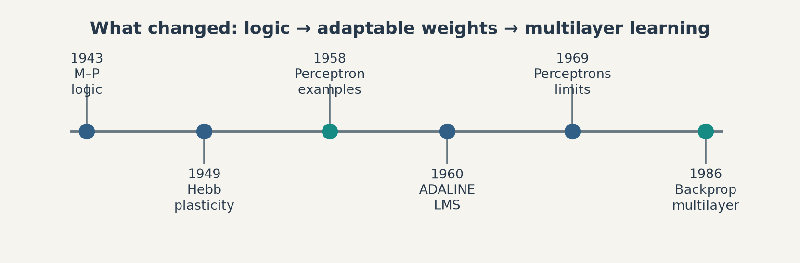
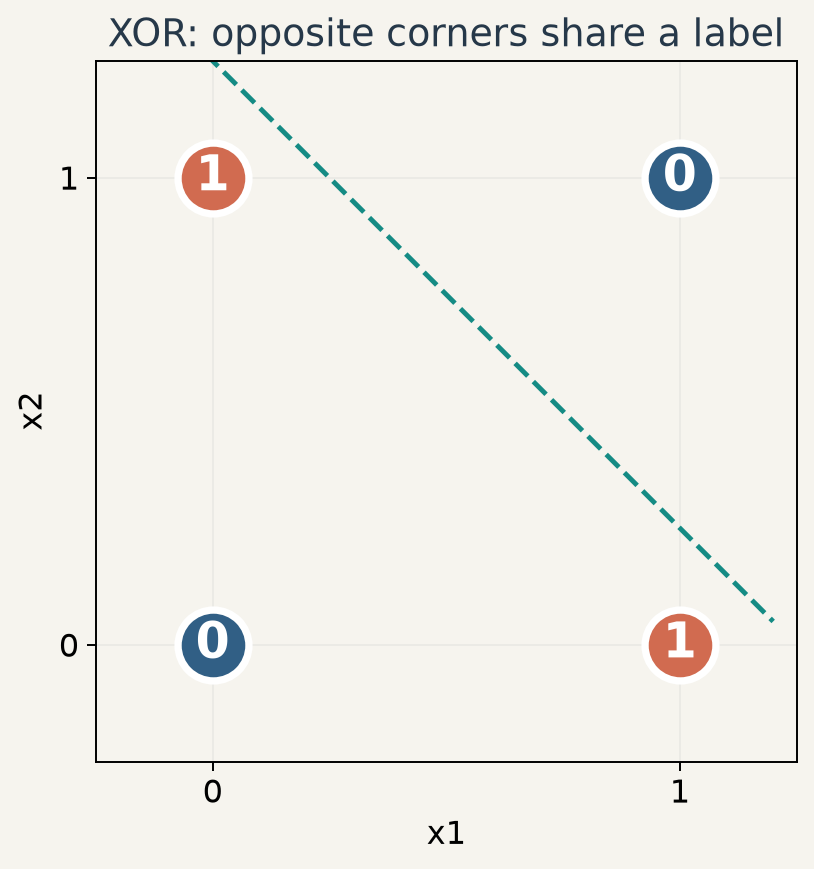
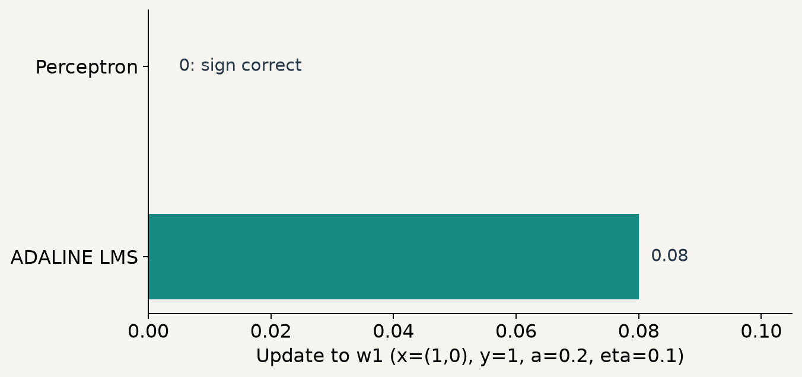

# 第1週 KP08：從邏輯單元走向可學權重（From logic units to learnable weights）

**程度 / Level**：大學生 / Undergraduate　**建議時間 / Time**：15 分鐘　**對應實作 / Related practice**：手算 XOR 的線性限制與兩種更新規則。

**學習目標 / Learning goals**：依時間區分神經元形式、可調權重與多層訓練；以不等式說明 XOR 不能由單一線性門檻分開；比較 Perceptron 與 ADALINE 的更新目標。 / Separate neuron design, weight learning and multilayer training; prove the single-threshold XOR limitation; compare two update objectives.

[下載本單元簡報 / Download this unit's slides](../slides/lec01-kp08-early-neural-network-history.jbd.json)

**一句話重點 / Main point**：網路「能表示」某個函數與「能從資料學到」該函數是兩個問題。 / Representational capacity and a workable learning rule are distinct questions.

## 1. 固定的邏輯單元與可調權重（Fixed logic units and adjustable weights）

**白話說明 / Plain explanation.** 1943 年 McCulloch 與 Pitts 研究由全或無單元構成的邏輯網路：輸入經門檻轉為二元輸出。這是計算模型，並未給出現代意義上的從樣本調參訓練法。1949 年 Hebb 討論活動關聯如何改變連結，是學習規則的生物學靈感；常見口訣「一起活躍，連結變強」是後來的概括，不是完整的最佳化公式。1958 年 Rosenblatt 的 Perceptron 讓可調連結接受例子來做辨識。這條線索表示問題逐步從「能算甚麼」走向「如何調權重」，並不表示每項工作直接由前一項推導。 / Early logical networks formalized computation; Hebbian ideas inspired changing connections; the Perceptron supplied an example-driven adjustment rule. The historical line is conceptual rather than a single derivation.

**形式化 / Formal view.** 對二元輸入 $\mathbf x$，門檻單元可寫成 $\hat y=\mathbf1[\mathbf w^{\mathsf T}\mathbf x+b>0]$，其中 $\mathbf w$ 是權重、$b$ 是偏置、$\mathbf1[\cdot]$ 是條件成立取 1 的指示函數。用它表示 AND、OR 需選不同權重與門檻；NOT 也可用抑制性連結或相應有符號權重表示。這是現代教學的等價寫法，**不是**聲稱 McCulloch–Pitts 原文把所有權重固定相等，或已給出 Perceptron 更新。 / The indicator notation is a modern teaching form, not a literal transcription of the 1943 circuit assumptions.

**圖說 `lec01-kp08-early-timeline`**：1943／1949／1958／1960／1969／1986 分別標出邏輯形式、連結可塑性、感知機、ADALINE、單層限制及多層誤差傳遞。圖中的箭頭表示課堂問題逐步改變，並非每篇文獻的直接承繼關係。 / **Caption `lec01-kp08-early-timeline`:** Dates orient the changing questions, not a claim of one inevitable research lineage.

## 2. 單一線性門檻不能分開 XOR（Why one linear threshold cannot separate XOR）

**[補充] 四點反例 / Added four-point counterexample.** XOR 的輸入與標籤是 $(0,0)\mapsto0$、$(1,0)\mapsto1$、$(0,1)\mapsto1$、$(1,1)\mapsto0$。假設單一門檻以 $w_1x_1+w_2x_2+b>0$ 輸出 1，四點要求

$$
b\le0,\qquad w_1+b>0,\qquad w_2+b>0,\qquad w_1+w_2+b\le0.
$$

由中間兩式可得 $w_1+w_2+2b>0$，而第一式 $b\le0$，故 $w_1+w_2+b=(w_1+w_2+2b)-b>0$，與最後一式矛盾。因此**單一線性邊界**無法給這四點正確標籤；多層且有非線性時，表達能力不同，但仍須解決訓練。 / The four strict/non-strict inequalities contradict one another. A multilayer nonlinear construction can express XOR, yet expressibility alone does not supply a training algorithm.

**圖說 `lec01-kp08-xor-four-points`**：對角的兩個 $1$ 與另兩個 $0$ 交錯，圖上的示意直線只能留下至少一個錯點；正式論證以四條不等式為準。 / **Caption `lec01-kp08-xor-four-points`:** Alternating labels make a single straight split impossible; the inequalities supply the proof.

1969 年 Minsky 與 Papert 的《Perceptrons》分析特定感知機架構的能力限制。XOR 限制是可驗算的數學事實；「該書單獨造成整個 AI 冬天」則是過度簡化。多層方法、資料、算力、研究資源等因素各自影響後續發展。 / The mathematical limitation is precise; a single-cause story about an entire research era is not.

## 3. Perceptron 與 ADALINE 問不同的更新問題（Two update objectives）

設 $y\in\{-1,+1\}$、$a=\mathbf w^{\mathsf T}\mathbf x+b$。感知機先用 $\hat y=\operatorname{sign}(a)$ 分類；典型錯分更新可寫為 $\mathbf w\leftarrow\mathbf w+\eta y\mathbf x$、$b\leftarrow b+\eta y$，只在 $y a\le0$ 時更新（零點慣例可另定）。ADALINE 在**閾值之前的線性輸出** $a$ 上最小化平方誤差 $L=\frac12(y-a)^2$，其 LMS／Widrow–Hoff 更新為 $\mathbf w\leftarrow\mathbf w+\eta(y-a)\mathbf x$、$b\leftarrow b+\eta(y-a)$。二者在這裡的決策邊界都仍是線性的。 / The Perceptron responds to classification errors; ADALINE adjusts the linear response to reduce squared error, even when the sign is already correct.

**[補充] 同一已分對樣本 / Added controlled sample.** 取 $\mathbf x=(1,0)$、$y=+1$、$\mathbf w=(0.2,0)$、$b=0$、$\eta=0.1$，則 $a=0.2>0$，感知機已分對而不更新。ADALINE 還有誤差 $y-a=1-0.2=0.8$，故 $\Delta\mathbf w=0.1(0.8)(1,0)=(0.08,0)$、$\Delta b=0.08$；新 $\mathbf w=(0.28,0)$、$b=0.08$。若把偏置併入常數輸入，可得到同一個計算。**此例只展示目標不同，不能推出 ADALINE 一定泛化較好。** / A correct sign does not imply zero squared error; this comparison alone gives no generalization ranking.

**圖說 `lec01-kp08-update-comparison`**：感知機本例更新為 0；ADALINE 權重第一座標與偏置各加 $0.08$。圖中只比較一筆受控樣本。 / **Caption `lec01-kp08-update-comparison`:** The controlled sample separates a mistake-driven update from a nonzero LMS correction.

Widrow 與 Hoff 在 1960 年提出相關 ADALINE／LMS 工作；MADALINE 使用多個 ADALINE。不能把「把單元堆起來」與「可用誤差有效訓練所有層」當作同一件事。1986 年 Rumelhart、Hinton、Williams 的多層誤差反傳文獻是重要里程碑，**不是**說反向模式的所有構想直到 1986 年才出現。 / Multiunit structure and learning all layers are distinct; 1986 is a landmark publication, not a claim of absolute invention.

## 4. 自我檢核：來源四題，不附答案（Self-check: four source questions; no answers）

| 題 / Question | A | B | C | D | 提示 / Hint |
|---|---|---|---|---|---|
| 1. McCulloch–Pitts 單元本質上像甚麼？ / What does the unit resemble? | 從例子學習的分類器 / Example-trained classifier | 邏輯閘 / Logic gate | 多層網路 / Multilayer net | 生成模型 / Generative model | 分開「可計算」與「可學習」。 / Separate computation from learning. |
| 2. Hebbian 學習的核心口訣？ / Which phrase summarizes Hebbian learning? | 越大的權重越重要 / Large weights matter more | 一起活躍，連結增強 / Co-activity strengthens a connection | 損失越小越好 / Minimize loss | 資料越多越好 / More data is better | 想想相鄰單元活動的關聯。 / Think of repeated co-activity. |
| 3. 單層 Perceptron 的限制？ / What limits one linear-threshold unit? | 不能處理大量資料 / Cannot process many samples | 不能分開 XOR / Cannot split XOR | 訓練必很慢 / Must train slowly | 不能二元分類 / Cannot classify binary labels | 看四條不等式。 / Inspect the four inequalities. |
| 4. ADALINE 與 Perceptron 的主要差別？ / What differs in the update? | ADALINE 必為多層 / Necessarily multilayer | LMS 可在已分對時修正連續誤差 / LMS can update a correct sign | ADALINE 不可學 / Cannot learn | ADALINE 決策必非線性 / Necessarily nonlinear | 比較更新前用的是 sign 還是 $a$。 / Compare the thresholded and linear outputs. |

**口訣 / Memory aid**：形式決定能表示甚麼，損失與更新決定怎樣學。 / Architecture sets capacity; objective and update determine learning.

**銜接 / Next**：KP09 比較影像、序列和生成任務怎樣共同改變架構與訓練。 / KP09 follows the interaction of data structure, objectives and training.

**來源與更正 / Sources and corrections**：[CCC-LNS 第一章 KP08](https://ndhuccc.github.io/CCC-LNS/IDL_115/Ch01-introduction-history/index.html)，2026-10-14 讀取。來源的「所有權重固定相等」、「ADALINE 因 LMS 必然泛化較好」及「單本書造成 AI 冬天」改為有條件的說明；XOR 與更新數值例為明示補充。原始文獻：[McCulloch–Pitts 1943](https://gwern.net/doc/ai/nn/1943-mcculloch.pdf)、[Rosenblatt 1958](https://papers.baulab.info/papers/Rosenblatt-1958.pdf)、[Widrow–Hoff 1960](https://isl.stanford.edu/~widrow/papers/c1960adaptiveswitching.pdf)、[Rumelhart–Hinton–Williams 1986](https://doi.org/10.1038/323533a0)。
