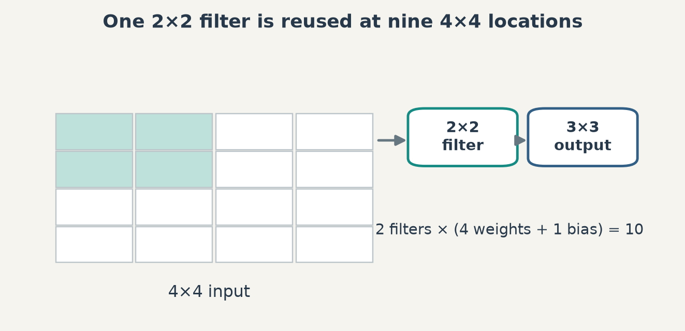
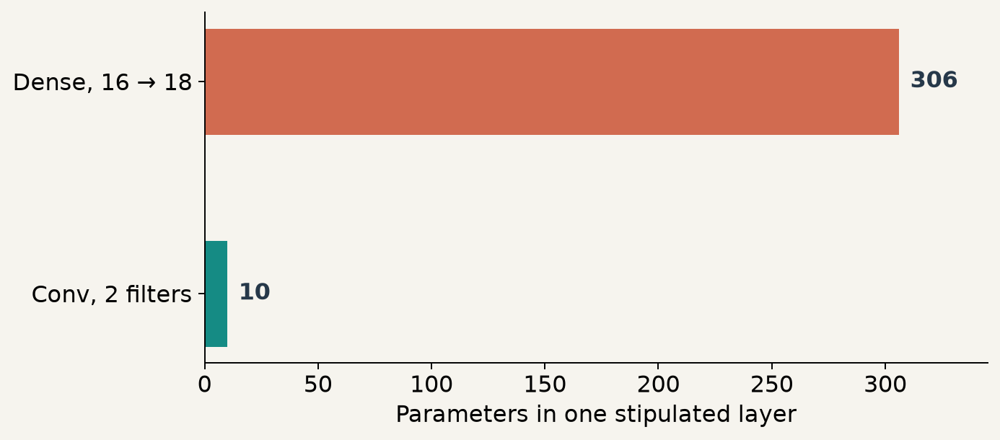
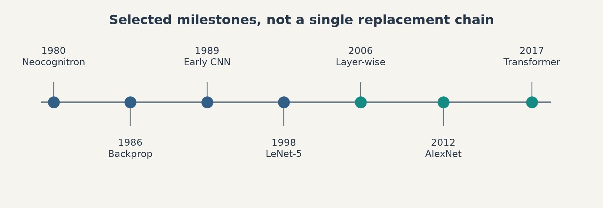
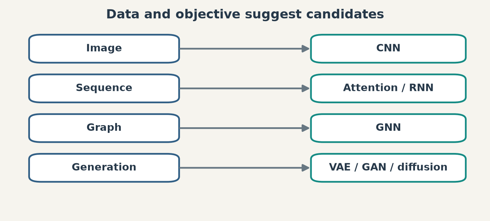

# 第 1 週補充講義 KP09｜架構與訓練共同推動復興
# Week 1 supplement KP09 | Architecture and training shaped deep learning

**程度 / Level：**大學生 / Undergraduate　**建議時間 / Time：**15 分鐘　**對應實作 / Related practice：**重算一層卷積與全連接的參數量，按資料結構選候選方法。

**學習目標 / Learning goals：**說明局部連結與權重共享；區分早期卷積網、LeNet-5 與 AlexNet；辨認 2006 預訓練和 2017 Transformer 解決的不同問題；按任務理解生成、偏好及圖方法。 / Explain locality and weight sharing, distinguish historical milestones, and relate architectures to data and objectives.

[下載本單元簡報 / Download this unit's slides](../slides/lec01-kp09-modern-deep-learning-history.jbd.json)

**一句話重點 / Main point：**沒有單一演算法「喚醒」深度學習；資料表示、可訓練性、算力與任務目標一起改變可行的方法。 / Architecture, optimization, compute and the task objective jointly shape what works.

## 1. 影像的局部結構與權重共享（Locality and weight sharing in images）

影像相鄰像素通常形成局部圖案。1980 年 Fukushima 的 Neocognitron 以階層、局部接受野及相似特徵的重用處理位置變化；它**不是**後來用反向傳播端到端訓練的 LeNet-5。LeCun 等人的 1989 年郵遞區號辨識工作展示早期可訓練卷積網；1998 年《Gradient-Based Learning Applied to Document Recognition》描述的是具體架構 **LeNet-5**。所以「LeNet 1989」與「LeNet-5 1998」不能當成同一型號和同一論文。 / Neocognitron, early trainable CNNs and LeNet-5 are related but distinct milestones.

**[補充] 一層的參數數目 / Added one-layer parameter count.** 假設輸入是 $4\times4$ 單通道影像、使用 stride 1 且不補邊的 $2\times2$ 核，輸出有兩張 $3\times3$ 特徵圖，故共有 $3\times3\times2=18$ 個輸出。若每個輸出各與全部 16 個像素全連接並各有偏置，參數為 $16\times18+18=306$。若兩個卷積核在各位置重用，參數為 $2\times(2\times2+1)=10$。等式中的 $+1$ 是每個濾波器的偏置；此例只比較**同樣輸出形狀的一層**，不表示 CNN 整體一定更小、更準，也不把平移等變誤說成完全平移不變。 / The controlled layer uses 306 independent dense parameters versus 10 shared convolution parameters; model quality and full-network size do not follow from this count.

**圖說 `lec01-kp09-shared-kernel`**：同一 $2\times2$ 濾波器在 $4\times4$ 輸入的九個位置滑動；第二個濾波器另用四個權重。投影片以原生節點與箭頭重建局部重用。 / **Caption `lec01-kp09-shared-kernel`:** Each filter reuses four weights across nine spatial positions.

**圖說 `lec01-kp09-parameter-count`**：柱長依 $306$ 與 $10$ 繪製，顯示受控例的一層參數差；不比較模型效果。 / **Caption `lec01-kp09-parameter-count`:** Counts refer only to the stipulated one-layer example.

## 2. 從可訓練到可擴充（From trainable networks to scalable practice）

1986 年的反向傳播里程碑並沒有讓每個深網立刻好訓練。深度增加後，梯度傳遞、初始化、資料規模與硬體都會成為障礙；同時核方法與 SVM 在某些任務和資料條件下仍有價值。把 1990 年代到 2006 年寫成所有神經網路研究完全「冬眠」，會掩蓋 CNN、語音與循環網路等持續工作。 / Difficult optimization did not imply that all neural-network research stopped.

2006 年有兩篇需分開的 Hinton 相關論文：Hinton、Osindero、Teh 的 **Deep Belief Nets** 論文提出逐層貪婪學習法；Hinton 與 Salakhutdinov 的論文研究用深層自編碼器降維。來源把 DBN 作者與降維論文作者混在一起；兩者均是復興脈絡的一部分，但不可合成一篇。2012 年 Krizhevsky、Sutskever、Hinton 的 AlexNet 以大型標註資料、GPU、ReLU、資料增強與 dropout 等組合，在 ImageNet 挑戰得到突破。這裡的時間軸是不同**可行條件與方法**的標記，不是「新法一出，舊法立即失效」的直線進化。 / The 2006 papers differ in authors and purpose; AlexNet's 2012 result combined multiple design and training choices.

**圖說 `lec01-kp09-revival-timeline`**：1980、1986、1989、1998、2006、2012、2017 是選取的文獻節點；橫列把「局部表示」「多層學習」「資料／算力」「序列架構」分開。 / **Caption `lec01-kp09-revival-timeline`:** Dates are anchored to distinct papers and enabling conditions.

## 3. 序列、生成與偏好的目標不同（Sequences, generation and preferences）

RNN／LSTM 以遞迴狀態處理序列；注意力可在序列各位置間選取資訊，但 2014–2015 年帶注意力的編碼器—解碼器仍可含 RNN，**不能**說注意力當時已消除遞迴計算。2017 年 Transformer 的論文才明確提出以注意力替代其序列轉換架構中的遞迴，改善訓練平行化；2018 年 BERT 代表編碼器式預訓練，GPT 代表自迴歸生成路線。不同架構對應不同輸入與輸出需求。 / Attention existed in recurrent systems; the Transformer specifically removed recurrence from its proposed sequence-transduction model.

生成模型回答「如何產生像資料的樣本」：VAE 用潛變量和變分目標，GAN 用生成器—判別器對抗，擴散式模型學逐步逆向生成。Kingma–Welling 的 VAE 預印本為 2013、會議版本 2014；GAN 為 2014；Sohl-Dickstein 等人的擴散生成論文為 **2015**，Ho 等人 2020 的 DDPM 是重要改進，並非擴散模型首次登場。三種方法的樣本品質、涵蓋度、訓練及取樣成本皆取決於具體實作與資料，不能宣稱一類全面勝過另一類。 / Generative families target different training objectives, and diffusion models predate 2020.

偏好對齊又是另一個問題：典型 RLHF 流程先估計偏好獎勵模型，再最佳化策略；2023 年 DPO 原論文提供不需**另外擬合顯式獎勵模型**的直接偏好最佳化目標，但仍依賴偏好資料與參考策略條件。不要把「無額外獎勵模型」說成「無人類偏好」或「任何 RLHF 都有同一套步驟」。 / DPO avoids a separately fitted explicit reward model under its formulation, not preference data itself.

**圖說 `lec01-kp09-task-architecture-map`**：影像／序列／圖／生成／偏好形成不同問題入口；箭頭指向方法候選，沒有宣稱方法與任務一對一。投影片用原生節點重建。 / **Caption `lec01-kp09-task-architecture-map`:** Data and objectives suggest candidate architectures without a one-to-one rule.

## 4. 來源其他里程碑的定位（Other milestones in the source）

| 脈絡 / Context | 來源例 / Source examples | 必須保留的界線 / Qualification |
|---|---|---|
| 深度強化學習 / Deep RL | DQN（2013 預印本、2015 *Nature*）；AlphaGo（2016） / DQN 用神經網路近似行動價值；AlphaGo 還結合樹搜尋，不能等同單一 DQN。 / DQN and AlphaGo use different mechanisms. |
| 圖資料 / Graphs | ChebNet、GCN、GAT / GCN 2016 預印本、2017 會議；圖上的鄰接與標籤條件須說清。 / Publication and preprint years differ. |
| 少樣本與自監督 / Few-shot and self-supervision | Matching Networks、Prototypical Networks、MAML；SimCLR、BYOL、SwAV、SimSiam、Barlow Twins、VICReg / 從資料自身造學習訊號不表示完全無目標；少樣本仍需合適訓練與評估任務。 / Neither family is a universal substitute. |
| 部署與風險 / Deployment and risk | 蒸餾、剪枝、量化；聯邦學習、對抗穩健、解釋性、捷徑學習 / 聯邦學習不自動保證隱私，壓縮也可能改變品質；需分開量測。 / Claims require evaluation. |

**常見迷思 / Misconception.** CNN、Transformer、GNN、生成模型、DPO 不是一列互相取代的「版本」。有些是輸入結構，有些是模型架構，有些是學習目標或訓練程序；先問問題，再比較條件。 / These names live on different axes: data, architecture, objective and procedure.

## 5. 自我檢核：來源四題，不附答案（Self-check: four source questions; no answers）

| 題 / Question | A | B | C | D | 提示 / Hint |
|---|---|---|---|---|---|
| 1. Neocognitron 的關鍵概念？ / What spatial ideas mattered? | 局部連結與相似特徵重用 / Locality and feature reuse | 注意力與自監督 / Attention and self-supervision | 生成與判別 / Generator and discriminator | 強化與獎懲 / Reinforcement and reward | 比較每個位置是否都學一組全新參數。 / Ask whether weights are reused across positions. |
| 2. 下列何者不是深層訓練困難的合理主因？ / Which was not a cause? | 梯度消失／爆炸 / Gradient problems | 算力不足 / Limited compute | 資料不足 / Limited data | 反向傳播直到 2006 年才發明 / Backprop was invented only in 2006 | 對照 1986 與 2006 年的工作。 / Compare the dated papers. |
| 3. 來源所指的 2006 復興方法？ / Which method is the 2006 milestone? | AlexNet GPU / AlexNet GPU | DBN 逐層預訓練 / DBN layer-wise pretraining | Transformer 注意力 / Transformer attention | GAN 對抗 / GAN adversarial learning | 對照各論文年份，不把兩篇 2006 論文混成一篇。 / Check dates and the distinct 2006 papers. |
| 4. RLHF 與 DPO 的正確比較？ / How do RLHF and DPO differ here? | 都必另訓顯式獎勵模型 / Both require a separate reward model | DPO 無須另訓顯式獎勵模型 / DPO does not separately fit one | RLHF 不用人類偏好 / RLHF needs no preference data | 都只用於影像分類 / Both are image classifiers | 分開「偏好資料」和「額外的顯式獎勵模型」。 / Separate preference data from a fitted reward model. |

**口訣 / Memory aid：**先看資料結構與目標，再看架構、訓練與成本。 / Start from data and objective; then evaluate architecture, training and cost.

**銜接 / Next：**KP10 將把整章的任務、方法與歷史收束為選擇流程。 / KP10 turns the chapter into a usable decision map.

**來源與更正 / Sources and corrections：**[CCC-LNS 第一章 KP09](https://ndhuccc.github.io/CCC-LNS/IDL_115/Ch01-introduction-history/index.html)，2026-10-14 讀取。參數例為明示補充；LeNet 年份／型號、兩篇 2006 論文作者、注意力與遞迴、擴散模型 2015 起點，以及「全面優於」敘述已依原文釐清。原始文獻：[Fukushima 1980](https://www.cs.princeton.edu/courses/archive/spr08/cos598B/Readings/Fukushima1980.pdf)、[LeCun 等 1989](https://henriquetmaia.github.io/pdf/papers/lecun1989.pdf)、[LeCun 等 1998](https://hal.science/hal-03926082v1/file/lecun1998.pdf)、[Hinton–Osindero–Teh 2006](https://www.stats.ox.ac.uk/~teh/research/unsup/nc2006.pdf)、[Hinton–Salakhutdinov 2006](https://www.cs.toronto.edu/~hinton/science.pdf)、[Transformer 2017](https://arxiv.org/abs/1706.03762)、[擴散生成 2015](https://arxiv.org/abs/1503.03585)、[DDPM 2020](https://arxiv.org/abs/2006.11239)、[DPO 2023](https://arxiv.org/abs/2305.18290)。
