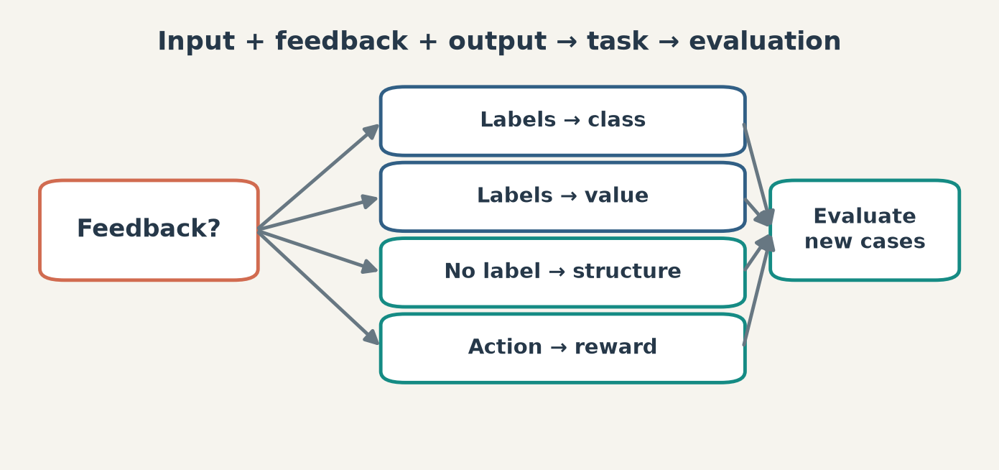
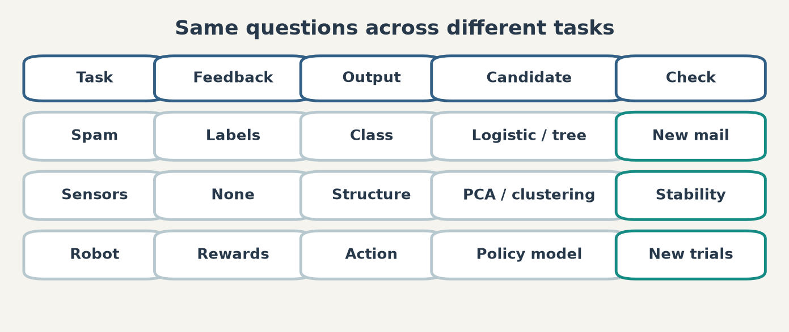

# 第 1 週講義 KP10｜用共同框架選下一步
# Week 1 lecture KP10 | A common map for choosing the next step

**程度 / Level：**大學生 / Undergraduate　**建議時間 / Time：**15 分鐘　**對應實作 / Related practice：**根據一個新情境列出輸入、可用回饋、輸出、評分與未見資料檢查。

**學習目標 / Learning goals：**整合假設、評分與搜尋三步；按標籤、無標籤及互動回饋辨認任務；將統計方法與神經網路放在同一候選集合比較。 / Reuse the three-part learning framework, distinguish feedback types and compare methods under a stated objective.

[下載本單元簡報 / Download this unit's slides](../slides/lec01-kp10-learning-task-and-method-map.jbd.json)

**一句話重點 / Main point：**先寫清楚輸入、回饋與輸出，再指定候選模型、評分和搜尋；最後以未見資料或新互動檢查。 / Define the task before choosing a model, then validate the result beyond the training examples.

## 1. 先辨認任務，再挑工具（Identify the task before a method）

同一份影像或向量可以服務不同問題。若有「這張是貓」的類別標籤，可能做分類；若有連續年齡數值，可能做回歸；若暫無標籤而想整理結構，可考慮分群或降維；若代理的行動會改變下一狀態並收到獎勵，才進入互動決策。分類和回歸屬常見監督任務，分群與一般無標籤降維常屬非監督；**帶標籤的降維（KP05 的 FDA）提醒我們，方法名稱不能取代資料與回饋條件。** / Labels, targets and interaction signals distinguish tasks; a named algorithm family does not by itself define the task.

**圖說 `lec01-kp10-task-feedback-map`**：由資料與回饋分出類別、實數、無標籤結構和互動行動；各枝回到「要評估甚麼」的共同問題。投影片以可編輯節點重建。 / **Caption `lec01-kp10-task-feedback-map`:** Feedback and desired output determine the task; evaluation remains necessary on every branch.

## 2. 三步流程把方法變成可比較的候選（The three-part comparison）

沿用 KP01：先定假設集合 $\mathcal H$，再用資料 $D$ 定義損失或評分 $S(h;D)$，最後用實際搜尋程序尋找低分候選。若最小解存在，可用 $h^*\in\operatorname*{argmin}_{h\in\mathcal H} S(h;D)$ 表示**目標**；這個記號本身不是梯度下降、樹搜尋或任何具體演算法，也不保證一定找到全域解。輸入表示 $\mathbf x$ 與輸出 $y$ 的型態、限制與資料切分會改變可選的 $\mathcal H$ 和 $S$。 / A hypothesis class and a score specify the target; an optimization procedure attempts to find a good candidate, while a separate check probes generalization.

**[補充] 三個情境而非三個標準答案 / Added comparison cases, not universal recommendations.** 下表把同一框架用在三種問題。每列只給**候選**，實際選擇要看資料量、成本、錯誤類型及未見資料表現。

| 情境 / Situation | 輸入與回饋 / Input and feedback | 輸出與候選 / Output and candidates | 評分與檢查 / Score and check |
|---|---|---|---|
| 垃圾郵件 / Spam | 郵件特徵與人工類別標籤 / Features with labels | 類別；邏輯迴歸、樹或神經網路 / Class; logistic model, tree or network | 按錯誤代價選分類指標，留出新郵件驗證。 / Choose a class metric and test on new mail. |
| 感測器整理 / Sensor structure | 時序特徵，無人工標籤 / Unlabeled features | 群或低維表示；K-means、PCA 等候選 / Groups or representation | 查穩定性、重建或下游用途；沒有單一「正確標籤」準確率。 / Examine stability or downstream use. |
| 掃地機器人 / Cleaning robot | 狀態、行動與後續獎勵 / States, actions and rewards | 策略；值函數或策略模型候選 / Policy | 比較累積回報與安全條件，觀察新環境。 / Compare return and safety under new conditions. |

**圖說 `lec01-kp10-method-matrix`**：每個任務依相同欄位記錄回饋、輸出、候選方法與評估；方法只是例子，沒有單一固定推薦。 / **Caption `lec01-kp10-method-matrix`:** The same decision fields apply across tasks, without imposing one universally best model.

## 3. 歷史是工具箱，不是固定階梯（History is a toolbox, not a ladder）

KP08 的 Perceptron 與 ADALINE 提醒我們分開問表達與訓練；KP09 的 CNN、Transformer、生成模型與偏好方法提醒我們分開問資料結構與學習目標。把 Bayes、SVM、Ridge、PCA、CNN、Transformer 直接排成「誰淘汰誰」的世代序列，會混淆任務、模型、損失及搜尋四個維度。第 2 章會深入單一神經元與 Perceptron，第 3 章討論反向傳播與最佳化；之後再按影像、序列、生成、圖與互動情境展開。 / Historical milestones help place tools, but they do not form a mandatory replacement chain.

**[補充] 回看十個 KP / Added chapter synthesis.** KP01 是選擇框架；KP02 是資料映射；KP03–05 是標籤、無標籤與環境回饋；KP06–07 是分類、回歸與表示工具；KP08–09 是神經網路的表達、訓練與架構歷史；KP10 把它們收成一張決策圖。 / The first seven KPs establish the task and method vocabulary; the next two add a historical explanation for neural-network options.

**常見迷思 / Misconception.** 分群不等於「沒有評分」；強化學習不等於所有負值回饋；神經網路也不自動免除資料表示、損失設計與泛化檢查。 / Every family still needs an explicit objective and a relevant evaluation.

## 4. 自我檢核：來源四題，不附答案（Self-check: four source questions; no answers）

| 題 / Question | A | B | C | D | 提示 / Hint |
|---|---|---|---|---|---|
| 1. 三步流程依序是？ / What is the three-part sequence? | 假設類別 → 評分 → 搜尋 / Hypotheses, score, search | 收集 → 訓練 → 部署 / Collect, train, deploy | 損失 → 模型 → 資料 / Loss, model, data | 監督 → 非監督 → 強化 / Supervised, unsupervised, RL | 回看 $\mathcal H$、$S$ 與搜尋程序的角色。 / Recall the roles of the class, score and search. |
| 2. 監督式學習常見哪兩種輸出？ / Which two outputs are typical? | 群與低維表示 / Clusters and embeddings | 類別與實數 / Classes and real values | 行動與回報 / Actions and returns | 壓縮與蒸餾 / Compression and distillation | 找到與每筆標籤對應的兩種型態。 / Identify label types. |
| 3. 在來源的「統計學習家族」清單中，何者不在列？ / Which item is outside the source list? | 統計分類 / Statistical classification | 統計回歸 / Statistical regression | 統計降維 / Statistical reduction | 深度強化學習 DQN / Deep RL DQN | 這是**來源清單的分類題**，不是斷言 DQN 沒有統計成分。 / Treat this as a source-taxonomy question. |
| 4. 來源所指 2006 深度學習里程碑？ / Which is the 2006 milestone? | AlexNet | DBN | Transformer | GAN | 對照 KP09 的文獻時間線。 / Consult the KP09 chronology. |

**口訣 / Memory aid：**輸入、回饋、輸出 → 假設、評分、搜尋 → 新情境檢查。 / Input, feedback, output → hypotheses, score, search → new-condition check.

**銜接 / Next：**第 2 章先把一個可學習神經元寫清楚，接著第 3 章處理多層網路的梯度與反向傳播。 / Next, study a trainable neuron, then gradients for multilayer networks.

**來源與界線 / Source and scope：**[CCC-LNS 第一章 KP10](https://ndhuccc.github.io/CCC-LNS/IDL_115/Ch01-introduction-history/index.html)，2026-10-14 讀取。三個情境、決策表與章級地圖為明示補充；來源列出的「統計學習家族」不是統計方法的唯一正式分類，後續章節對照採本課程章節安排。題目保留來源意圖但不附答案。
