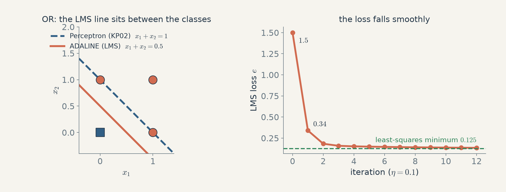
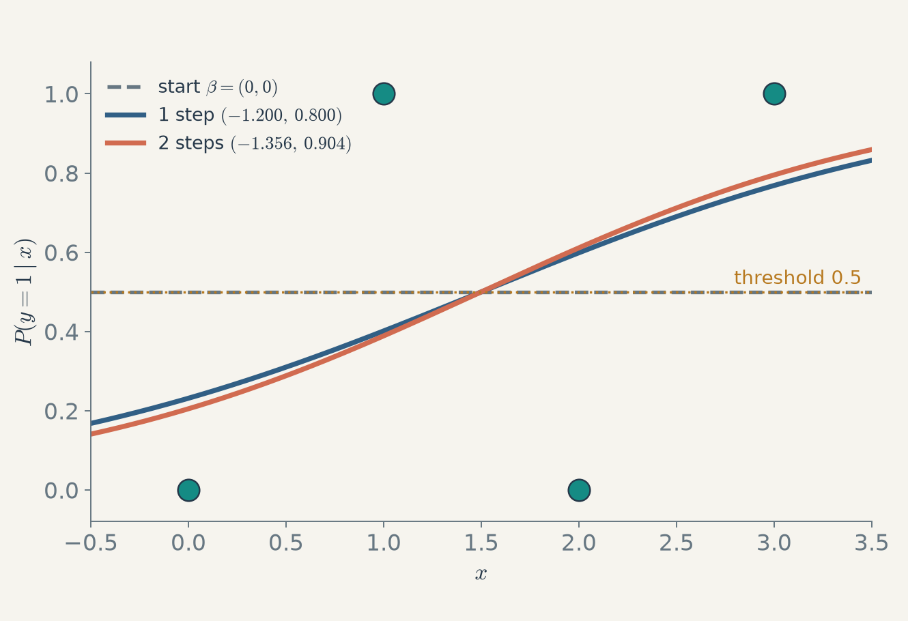

# 第2週 KP08：用連續誤差取代「對或錯」，ADALINE 與邏輯回歸（Continuous error instead of "right or wrong": ADALINE and logistic regression）

> 程度：大學生（undergrad）／Level: Undergraduate (undergrad)
>
> 週次：第2週（2026-09-17）｜主題：神經網路基礎：感知器與多層感知器
>
> Week 2 (2026-09-17) | Topic: Neural network fundamentals: perceptron and multilayer perceptron

本講義是第2章的第八個知識點（KP08），承接 KP07 留下的問題：Perceptron 的損失只數「錯幾個」，是離散的，不能用梯度學。這一節看兩個把誤差換成連續量的單神經元模型：ADALINE（用平方誤差，線性輸出）與邏輯回歸（用 sigmoid 輸出機率，從最大似然得到損失），並用同一組小資料手算一次更新。先備知識是 KP02、KP06、KP07 與偏導數。第3章 KP02 會把梯度下降講完整，這一節只用它的最簡形式。內容依第2章主文重新講解，來源讀取日期為 2026-10-14；新增的釐清標為 `[補充]`。

This is the eighth knowledge point (KP08) of Chapter 2. It picks up the question left by KP07: the Perceptron's loss only counts "how many are wrong", which is discrete and cannot be learned by gradients. This note looks at two single-neuron models that replace the error by a continuous quantity: ADALINE (squared error, linear output) and logistic regression (a sigmoid output that is a probability, with the loss coming from maximum likelihood), and does one update by hand on a small data set. It assumes KP02, KP06, KP07 and partial derivatives. Chapter 3 KP02 treats gradient descent in full; this note uses only its simplest form. It re-explains the main text of Chapter 2, accessed on 2026-10-14; clarifications that are new are marked `[Added]`.

[下載本單元投影片](../slides/lec02-kp08-adaline-and-logistic-regression.jbd.json)

## KP08 用連續誤差取代「對或錯」，ADALINE 與邏輯回歸（Continuous error instead of "right or wrong": ADALINE and logistic regression）

**建議時間 / Time**：15 分鐘　**對應實作 / Related practice**：用 OR 資料手算 ADALINE 的第一步更新；用四筆一維資料手算邏輯回歸的牛頓法第一步。

### 學習目標（Learning objectives）

讀完之後，你能寫出 ADALINE 的 LMS 損失、梯度與更新式；能用 OR 資料手算一步更新並說出收斂到哪裡；能說明邏輯回歸如何用 sigmoid 把線性輸出變成機率，並寫出它的對數似然與梯度；能指出兩者梯度的形式相同；能為牛頓法寫出正確的更新方向。

After reading, you can write the LMS loss, gradient and update of ADALINE; do one update by hand on the OR data and say where it converges; explain how logistic regression turns a linear output into a probability with a sigmoid and write its log-likelihood and gradient; point out that the two gradients have the same form; and write the correct direction of the Newton update.

### 符號表（Symbols）

| 符號 | 中文意義 | English meaning |
|---|---|---|
| $\mathbf{x}_i,\ y_i$ | 第 $i$ 筆輸入與標籤 | the $i$-th input and label |
| $w_j,\ w_0$ | 權重與偏置 | weights and bias |
| $b$ | 批次大小（來源用 $b$，$n$ 為全部資料筆數） | batch size (the source uses $b$; $n$ is the number of all samples) |
| $e$ | ADALINE 的 LMS 損失 | the LMS loss of ADALINE |
| $\eta>0$ | 學習率 | learning rate |
| $\boldsymbol\beta$ | 邏輯回歸的參數（偏置併入，$\mathbf{x}=[1,x_1,\dots,x_d]^\top$） | parameters of logistic regression (bias folded in) |
| $p_i$ | 模型給第 $i$ 筆的 $P(y=1\mid\mathbf{x}_i)$ | the model's $P(y=1\mid\mathbf{x}_i)$ for sample $i$ |
| $\ell(\boldsymbol\beta)$ | 對數似然（要最大化） | the log-likelihood (to be maximized) |

### 1. ADALINE：拿「還沒過活化」的加權和去比標籤（ADALINE: compare the label with the sum before any activation）

1960 年 Widrow 與 Hoff 的 ADALINE 做了一個小改變：訓練時不先用階梯切成 0/1，而是直接拿加權和 $\hat y_i=\sum_jw_jx_{ij}+w_0$ 和標籤 $y_i$ 比，損失是 LMS（最小均方）二次損失

$$
e=\frac12\sum_{i=1}^{b}\big(y_i-\hat y_i\big)^2,\qquad
\frac{\partial e}{\partial w_j}=-\sum_{i=1}^{b}(y_i-\hat y_i)\,x_{ij},\qquad
\frac{\partial e}{\partial w_0}=-\sum_{i=1}^{b}(y_i-\hat y_i)
$$

更新是梯度下降 $w_j:=w_j-\eta\,\partial e/\partial w_j$。階梯只留到推論時才用。這套做法叫 LMS 演算法或 Widrow-Hoff 規則；它和 KP07 的 MSE 是同一種損失，只是這裡作用在一個神經元上。

In 1960 Widrow and Hoff's ADALINE made one small change: during training it does not first cut the sum into 0/1 with a step, but compares the weighted sum $\hat y_i=\sum_jw_jx_{ij}+w_0$ directly with the label $y_i$. The loss is the LMS (least mean squares) quadratic loss above, and the update is gradient descent $w_j:=w_j-\eta\,\partial e/\partial w_j$. The step is used only at inference time. This is called the LMS algorithm or the Widrow-Hoff rule; it is the same kind of loss as the MSE of KP07, here acting on one neuron.

**用 OR 資料手算〔程式計算〕。** 四筆資料 $(x_1,x_2)\to y$：$(0,0)\to0$、$(0,1)\to1$、$(1,0)\to1$、$(1,1)\to1$，從 $\mathbf{w}=(w_1,w_2,w_0)=(0,0,0)$ 開始，$\eta=0.1$。所有 $\hat y_i=0$，殘差 $y_i-\hat y_i=(0,1,1,1)$，所以

- $\partial e/\partial w_1=-(0\cdot0+1\cdot0+1\cdot1+1\cdot1)=-2$，$\partial e/\partial w_2=-2$，$\partial e/\partial w_0=-(0+1+1+1)=-3$；
- 更新後 $\mathbf{w}=(0.2,\,0.2,\,0.3)$；損失由 $e=\tfrac12(0+1+1+1)=1.5$ 降到 $0.34$。

**A hand calculation on the OR data (computed by program).** The four samples $(x_1,x_2)\to y$ are $(0,0)\to0$, $(0,1)\to1$, $(1,0)\to1$, $(1,1)\to1$, starting from $\mathbf{w}=(w_1,w_2,w_0)=(0,0,0)$ with $\eta=0.1$. All $\hat y_i=0$, so the residuals $y_i-\hat y_i$ are $(0,1,1,1)$, and

- $\partial e/\partial w_1=-(0\cdot0+1\cdot0+1\cdot1+1\cdot1)=-2$, $\partial e/\partial w_2=-2$, $\partial e/\partial w_0=-(0+1+1+1)=-3$;
- after the update $\mathbf{w}=(0.2,\,0.2,\,0.3)$, and the loss drops from $e=\tfrac12(0+1+1+1)=1.5$ to $0.34$.

繼續跑，$e$ 依序是 $1.5,\ 0.34,\ 0.183,\ 0.159,\dots$，最後收斂到最小平方解 $\mathbf{w}=(0.5,\,0.5,\,0.25)$，$e=0.125$。此時四個輸出是 $0.25,\ 0.75,\ 0.75,\ 1.25$，以 $0.5$ 為門檻就分成 $0,1,1,1$，是正確的 OR。邊界是 $0.5x_1+0.5x_2+0.25=0.5$，即 $x_1+x_2=0.5$，落在 $(0,0)$ 與另外三點的中間；KP02 的 Perceptron 停在 $x_1+x_2=1$，剛好壓在 $(0,1)$ 與 $(1,0)$ 上。注意 $(1,1)$ 的輸出 $1.25$ 雖然分對，LMS 仍把它的 $0.25$ 當作誤差，這是平方損失的特性。

Keep going and $e$ is $1.5,\ 0.34,\ 0.183,\ 0.159,\dots$, converging to the least-squares solution $\mathbf{w}=(0.5,\,0.5,\,0.25)$ with $e=0.125$. The four outputs are then $0.25,\ 0.75,\ 0.75,\ 1.25$, and thresholding at $0.5$ gives $0,1,1,1$, the correct OR. The boundary $0.5x_1+0.5x_2+0.25=0.5$ is $x_1+x_2=0.5$, between $(0,0)$ and the other three points, whereas the Perceptron of KP02 stops at $x_1+x_2=1$, right on top of $(0,1)$ and $(1,0)$. Note that although the output $1.25$ of $(1,1)$ is right, LMS still counts its $0.25$ as error, a property of the squared loss.

**圖說 `lec02-kp08-adaline-or`**：先看左圖，藍色虛線是 Perceptron 的邊界，擦過兩個點；橘色實線是 ADALINE 的邊界，落在兩類中間。再看右圖，LMS 損失從 $1.5$ 平滑降到 $0.125$ 的最小值附近。 / **Caption `lec02-kp08-adaline-or`:** Look first at the left panel: the blue dashed Perceptron boundary grazes two points, whereas the orange solid ADALINE boundary lies between the classes. Then the right panel: the LMS loss falls smoothly from $1.5$ toward its minimum of $0.125$.

**MADALINE。** 把多顆 ADALINE 疊成層就是 MADALINE：1962 年的 MRI 只能更新輸入到隱藏層的權重；1988 年的 MRII 兩段連接都能更新；1990 年的 MRIII 支援更深的多層訓練。這是在反向傳播普及之前，最早訓練多層網路的嘗試之一。

**MADALINE.** Stacking several ADALINEs into layers gives MADALINE: MRI of 1962 could update only the weights from input to hidden layer; MRII of 1988 could update both connections; MRIII of 1990 supported deeper multilayer training. It was among the earliest attempts to train multilayer networks, before backpropagation became widespread.

### 2. 邏輯回歸：把線性輸出壓成機率（Logistic regression: squash the linear output into a probability）

邏輯回歸不屬於神經網路的歷史，但它就是「一顆神經元加 sigmoid」。設 $y\in\{0,1\}$，它直接建模後驗機率（不像 LDA 先算似然與先驗），線性部分 $\boldsymbol\beta^\top\mathbf{x}$ 沒有上下界，所以用 sigmoid 壓到 $(0,1)$：

$$
P(y=1\mid\mathbf{x})=\frac{e^{\boldsymbol\beta^\top\mathbf{x}}}{1+e^{\boldsymbol\beta^\top\mathbf{x}}}=p,\qquad
P(y=0\mid\mathbf{x})=1-p
$$

logistic 函數是 1845 年 Verhulst 為人口成長提出的。測試時，若 $p\ge0.5$ 就判成 1。

Logistic regression is outside the history of neural networks, but it is exactly "one neuron plus a sigmoid". With $y\in\{0,1\}$ it models the posterior probability directly (unlike LDA, which computes the likelihood and prior first). The linear part $\boldsymbol\beta^\top\mathbf{x}$ has no bounds, so a sigmoid squashes it into $(0,1)$ as above. The logistic function was proposed by Verhulst in 1845 for population growth. At test time the sample is labelled 1 if $p\ge0.5$.

**損失從最大似然來。** 對 $n$ 筆獨立資料，把對數後驗（對數似然）加起來：

$$
\ell(\boldsymbol\beta)=\sum_{i=1}^{n}\Big(y_i\,\boldsymbol\beta^\top\mathbf{x}_i-\log\big(1+e^{\boldsymbol\beta^\top\mathbf{x}_i}\big)\Big)
$$

它的負值正是 KP07 的二元交叉熵 $-\sum[y\ln p+(1-y)\ln(1-p)]$。梯度與 Hessian 為

$$
\frac{\partial\ell}{\partial\boldsymbol\beta}=\sum_{i=1}^{n}(y_i-p_i)\,\mathbf{x}_i=\mathbf{X}(\mathbf{y}-\mathbf{p}),\qquad
\frac{\partial^2\ell}{\partial\boldsymbol\beta\,\partial\boldsymbol\beta^\top}=-\mathbf{X}\mathbf{W}\mathbf{X}^\top,\quad
\mathbf{W}=\mathrm{diag}\big(p_i(1-p_i)\big)
$$

其中 $\mathbf{X}$ 的每一欄是一筆資料（第一列全為 1）。把它和 ADALINE 的梯度 $-\sum(y_i-\hat y_i)x_{ij}$ 並排看：兩者都是「（標籤 − 預測）× 輸入」，差別只在預測是線性輸出 $\hat y_i$ 還是 sigmoid 輸出 $p_i$。

**The loss comes from maximum likelihood.** For $n$ independent samples, add up the log posteriors (the log-likelihood) as above. Its negative is exactly the binary cross-entropy $-\sum[y\ln p+(1-y)\ln(1-p)]$ of KP07. The gradient and Hessian are as shown, where each column of $\mathbf{X}$ is one sample (the first row is all 1). Set it next to the ADALINE gradient $-\sum(y_i-\hat y_i)x_{ij}$: both are "(label − prediction) × input", differing only in whether the prediction is the linear output $\hat y_i$ or the sigmoid output $p_i$.

**牛頓法的方向。** 我們要**最大化** $\ell$，牛頓法是 $\boldsymbol\beta\leftarrow\boldsymbol\beta-H^{-1}g$，其中 $g$ 是梯度、$H$ 是 Hessian；把上面的 $g=\mathbf{X}(\mathbf{y}-\mathbf{p})$ 與 $H=-\mathbf{X}\mathbf{W}\mathbf{X}^\top$ 代入，得到

$$
\boldsymbol\beta^{(\tau+1)}=\boldsymbol\beta^{(\tau)}+\big(\mathbf{X}\mathbf{W}\mathbf{X}^\top\big)^{-1}\mathbf{X}(\mathbf{y}-\mathbf{p})
$$

**Direction of the Newton step.** We **maximize** $\ell$. Newton's method is $\boldsymbol\beta\leftarrow\boldsymbol\beta-H^{-1}g$ with gradient $g$ and Hessian $H$; substituting $g=\mathbf{X}(\mathbf{y}-\mathbf{p})$ and $H=-\mathbf{X}\mathbf{W}\mathbf{X}^\top$ gives the update above, with a **plus** sign.

**手算〔程式計算〕。** 四筆一維資料 $x=(0,1,2,3)$、$y=(0,1,0,1)$（不可分，所以最大似然解有限）。從 $\boldsymbol\beta=(0,0)$ 開始，所有 $p_i=0.5$：

- 梯度 $g=\sum(y_i-p_i)(1,x_i)=(0,\,1)$；
- $H=-0.25\begin{pmatrix}4&6\\6&14\end{pmatrix}$，所以 $\mathbf{X}\mathbf{W}\mathbf{X}^\top=\begin{pmatrix}1&1.5\\1.5&3.5\end{pmatrix}$，行列式 $1.25$；
- 一步：$\boldsymbol\beta=(0,0)+\tfrac1{1.25}\begin{pmatrix}3.5&-1.5\\-1.5&1\end{pmatrix}(0,1)^\top=(-1.2,\,0.8)$。

**By hand (computed by program).** Four one-dimensional samples $x=(0,1,2,3)$, $y=(0,1,0,1)$ (not separable, so the maximum-likelihood solution is finite). Start at $\boldsymbol\beta=(0,0)$, where all $p_i=0.5$:

- the gradient is $g=\sum(y_i-p_i)(1,x_i)=(0,\,1)$;
- $H=-0.25\begin{pmatrix}4&6\\6&14\end{pmatrix}$, so $\mathbf{X}\mathbf{W}\mathbf{X}^\top=\begin{pmatrix}1&1.5\\1.5&3.5\end{pmatrix}$ with determinant $1.25$;
- one step: $\boldsymbol\beta=(0,0)+\tfrac1{1.25}\begin{pmatrix}3.5&-1.5\\-1.5&1\end{pmatrix}(0,1)^\top=(-1.2,\,0.8)$.

對數似然從 $-2.7726$（$=-4\ln2$）升到 $-2.3526$；第二步 $\boldsymbol\beta=(-1.356,\,0.904)$，$\ell=-2.3475$；第三步起幾乎不變，收斂在 $\boldsymbol\beta=(-1.362,\,0.908)$，四個機率是 $0.204,\ 0.388,\ 0.612,\ 0.796$。邊界在 $p=0.5$，即 $x=1.362/0.908=1.5$。因為資料交錯，四筆裡有兩筆（$x=1$ 與 $x=2$）仍判錯，這是資料的問題，不是演算法的問題。

The log-likelihood rises from $-2.7726$ ($=-4\ln2$) to $-2.3526$; the second step gives $\boldsymbol\beta=(-1.356,\,0.904)$ with $\ell=-2.3475$; from the third step it barely changes and settles at $\boldsymbol\beta=(-1.362,\,0.908)$, with four probabilities $0.204,\ 0.388,\ 0.612,\ 0.796$. The boundary is at $p=0.5$, i.e. $x=1.362/0.908=1.5$. Because the classes interleave, two of the four samples ($x=1$ and $x=2$) are still wrong; that is a property of the data, not of the algorithm.

**圖說 `lec02-kp08-logistic-newton`**：先看灰色虛線，起點 $\boldsymbol\beta=(0,0)$ 是一條平的 0.5；再看藍色曲線，一步就把 sigmoid 立起來；橘色是第二步，已經很接近最後的解。四個圓點是資料。 / **Caption `lec02-kp08-logistic-newton`:** Look first at the grey dashed line: the start $\boldsymbol\beta=(0,0)$ is a flat 0.5; then at the blue curve: one step already stands the sigmoid up; the orange is the second step, close to the final solution. The four dots are the data.

### 本單元重點整理（KP08 summary）

**一句話重點**：ADALINE 用連續的平方誤差，邏輯回歸用 sigmoid 加最大似然，兩者的梯度都是「（標籤 − 預測）× 輸入」，所以能用梯度或牛頓法一步一步學，而 Perceptron 的離散錯誤數做不到。

**One-sentence summary**: ADALINE uses a continuous squared error and logistic regression uses a sigmoid with maximum likelihood; both have a gradient of the form "(label − prediction) × input", so they can be learned step by step with gradients or Newton's method, which the Perceptron's discrete error count cannot.

**白話說明**：Perceptron 像老師只說「對」或「錯」；ADALINE 像老師說「差 0.3」，你知道往哪調、調多少。邏輯回歸再進一步，直接說「你給正確答案的機率只有 0.39，太低」。

**Plain explanation**: The Perceptron is a teacher who only says "right" or "wrong"; ADALINE is a teacher who says "off by 0.3", so you know which way and how much to adjust. Logistic regression goes further and says "you gave the right answer only 0.39 probability, too low".

**正式定義**：LMS $e=\tfrac12\sum(y_i-\hat y_i)^2$，更新 $w_j:=w_j-\eta\,\partial e/\partial w_j$；邏輯回歸 $p=\sigma(\boldsymbol\beta^\top\mathbf{x})$，$\ell=\sum(y_i\boldsymbol\beta^\top\mathbf{x}_i-\log(1+e^{\boldsymbol\beta^\top\mathbf{x}_i}))$，牛頓 $\boldsymbol\beta\leftarrow\boldsymbol\beta+(\mathbf{X}\mathbf{W}\mathbf{X}^\top)^{-1}\mathbf{X}(\mathbf{y}-\mathbf{p})$。

**Formal definition**: LMS $e=\tfrac12\sum(y_i-\hat y_i)^2$ with the update $w_j:=w_j-\eta\,\partial e/\partial w_j$; logistic regression $p=\sigma(\boldsymbol\beta^\top\mathbf{x})$, $\ell=\sum(y_i\boldsymbol\beta^\top\mathbf{x}_i-\log(1+e^{\boldsymbol\beta^\top\mathbf{x}_i}))$, Newton $\boldsymbol\beta\leftarrow\boldsymbol\beta+(\mathbf{X}\mathbf{W}\mathbf{X}^\top)^{-1}\mathbf{X}(\mathbf{y}-\mathbf{p})$.

**例子**：OR 資料從 $\mathbf{w}=0$ 一步到 $(0.2,0.2,0.3)$，損失 $1.5\to0.34$，最後收斂到 $(0.5,0.5,0.25)$、損失 $0.125$；一維資料牛頓一步 $\boldsymbol\beta=(0,0)\to(-1.2,0.8)$，對數似然 $-2.7726\to-2.3526$。

**Example**: On the OR data one step takes $\mathbf{w}=0$ to $(0.2,0.2,0.3)$ and the loss from $1.5$ to $0.34$, finally converging to $(0.5,0.5,0.25)$ with loss $0.125$; on the one-dimensional data one Newton step takes $\boldsymbol\beta=(0,0)$ to $(-1.2,0.8)$ and the log-likelihood from $-2.7726$ to $-2.3526$.

**常見迷思**：

- 「ADALINE 就是 Perceptron 換個名字」——不是。差別在訓練時比較的對象：Perceptron 比階梯後的 0/1，ADALINE 比階梯前的連續和。
- 「邏輯回歸是回歸，所以輸出是連續數」——它是分類模型；「回歸」指的是回歸出機率。
- 「牛頓法的更新式前面是減號」——對**最小化**的損失才是減號；對數似然要最大化，Hessian 為負，結果是加號。

**Common misconceptions**:

- "ADALINE is the Perceptron under another name." No: they differ in what is compared during training. The Perceptron compares the 0/1 after the step; ADALINE compares the continuous sum before it.
- "Logistic regression is regression, so its output is a continuous number." It is a classification model; "regression" refers to regressing a probability.
- "The Newton update has a minus sign." That is for a loss to be **minimized**; the log-likelihood is maximized, the Hessian is negative, and the result is a plus sign.

**圖**：本單元兩張圖，`lec02-kp08-adaline-or`（兩種邊界與 LMS 損失，功能 1、2）、`lec02-kp08-logistic-newton`（sigmoid 曲線隨牛頓步數，功能 1），以 `assets/figures/src/lec02-kp0810-figures.py` 繪製。

**Figures**: Two figures in this unit, `lec02-kp08-adaline-or` (the two boundaries and the LMS loss; functions 1, 2) and `lec02-kp08-logistic-newton` (the sigmoid curve against Newton steps; function 1), drawn by `assets/figures/src/lec02-kp0810-figures.py`.

**想深入**（選讀）：邏輯回歸的對數似然對 $\boldsymbol\beta$ 是凹函數（負值是凸的），所以牛頓法沒有局部極值的問題；但若資料完全可分，似然沒有有限的最大值，$\|\boldsymbol\beta\|$ 會無限增大，實務上要加正則化。

**Going deeper** (optional): The log-likelihood of logistic regression is concave in $\boldsymbol\beta$ (its negative is convex), so Newton's method has no local-optimum problem; but if the data are perfectly separable the likelihood has no finite maximum and $\|\boldsymbol\beta\|$ grows without bound, so in practice regularization is added.

**小練習**：

1. 用 OR 資料、$\mathbf{w}=(0.2,0.2,0.3)$、$\eta=0.1$，算 ADALINE 的第二步梯度與新的 $\mathbf{w}$。（提示：先算四個 $\hat y_i$ 與殘差。）
2. 邏輯回歸 $\boldsymbol\beta=(-1.2,0.8)$，求 $x=2$ 的 $p$。（提示：先算 $\beta_0+\beta_1x$ 再代 sigmoid。）
3. 為什麼 ADALINE 訓練完仍要用門檻 0.5 才能分類？（提示：它訓練時比的是連續和。）

**Practice**:

1. With the OR data, $\mathbf{w}=(0.2,0.2,0.3)$ and $\eta=0.1$, compute the second-step gradient and the new $\mathbf{w}$ of ADALINE. (Hint: compute the four $\hat y_i$ and the residuals first.)
2. For logistic regression with $\boldsymbol\beta=(-1.2,0.8)$, find $p$ at $x=2$. (Hint: compute $\beta_0+\beta_1x$ first and then the sigmoid.)
3. Why must ADALINE still use the threshold 0.5 to classify after training? (Hint: during training it compared the continuous sum.)

**解題示範**（第 1 題）：

1. $\hat y_i=0.2x_1+0.2x_2+0.3=(0.3,\,0.5,\,0.5,\,0.7)$，殘差 $y_i-\hat y_i=(-0.3,\,0.5,\,0.5,\,0.3)$。
2. $\partial e/\partial w_1=-(0\cdot(-0.3)+0\cdot0.5+1\cdot0.5+1\cdot0.3)=-0.8$，$\partial e/\partial w_2=-0.8$，$\partial e/\partial w_0=-(-0.3+0.5+0.5+0.3)=-1.0$。
3. 新的 $\mathbf{w}=(0.2+0.08,\ 0.2+0.08,\ 0.3+0.1)=(0.28,\,0.28,\,0.4)$。
4. 檢查：與上面「0.28, 0.28, 0.4」的第二步一致，損失 $0.183$。

**Worked solution** (exercise 1):

1. $\hat y_i=0.2x_1+0.2x_2+0.3=(0.3,\,0.5,\,0.5,\,0.7)$, residuals $y_i-\hat y_i=(-0.3,\,0.5,\,0.5,\,0.3)$.
2. $\partial e/\partial w_1=-(0\cdot(-0.3)+0\cdot0.5+1\cdot0.5+1\cdot0.3)=-0.8$, $\partial e/\partial w_2=-0.8$, $\partial e/\partial w_0=-(-0.3+0.5+0.5+0.3)=-1.0$.
3. New $\mathbf{w}=(0.2+0.08,\ 0.2+0.08,\ 0.3+0.1)=(0.28,\,0.28,\,0.4)$.
4. Check: this matches the second step $(0.28,0.28,0.4)$ above, with loss $0.183$.

**自我檢核**（來源八題，不附答案）：

| 題 / Question | A | B | C | D | 提示 / Hint |
|---|---|---|---|---|---|
| 1. ADALINE 訓練時拿什麼當預測誤差的基準？ / What is the baseline of the prediction error in ADALINE training? | 套用硬閾值後的二元輸出 | 尚未套活化的加權和 | 經過 sigmoid 後的機率 | 對權重取絕對值 | 看第 1 節。 / Section 1. |
| 2. ADALINE 最小化哪一個損失？ / Which loss does ADALINE minimize? | 交叉熵 | LMS 二次損失 | Hinge 損失 | KL 散度 | 看公式。 / See the formula. |
| 3. 權重的梯度下降更新式？ / The gradient-descent update of a weight? | $w_j:=w_j+\eta\,\partial e/\partial w_j$ | $w_j:=w_j-\eta\,\partial e/\partial w_j$ | $w_j:=\eta\,\partial e/\partial w_j$ | $w_j:=w_j/\eta$ | 要讓損失下降。 / The loss should go down. |
| 4. MADALINE 訓練規則的演進，何者正確？ / Which statement on the MADALINE rules is correct? | MRI（1962）只能更新輸入到隱藏層，MRII（1988）才支援兩段連接 | MRI 已能全連接更新 | MRIII 是最早的規則 | MRII 不需要隱藏層 | 看年份。 / Look at the years. |
| 5. 與 LDA 相比，邏輯回歸建模的是？ / Compared with LDA, what does logistic regression model? | 似然 $P(\mathbf{x}\mid y)$ | 直接建模後驗 $P(y\mid\mathbf{x})$ | 先驗 $P(y)$ | 生成模型 $P(\mathbf{x},y)$ | 看第 2 節。 / Section 2. |
| 6. logistic 函數最初的用途？ / What was the logistic function first used for? | 建模人口成長（Verhulst，1845） | 影像分類 | 矩陣分解 | 圖論最短徑 | 看歷史小記。 / The history note. |
| 7. 矩陣形式的牛頓更新式？ / The matrix form of the Newton update? | 見來源選項 A | $\boldsymbol\beta+\mathbf{X}\mathbf{W}\mathbf{X}^\top$ | $\boldsymbol\beta-\mathbf{W}^{-1}\mathbf{y}$ | $\boldsymbol\beta+(\mathbf{y}-\mathbf{p})$ | 注意正負號（見下方更正）。 / Mind the sign (see the correction below). |
| 8. 測試階段如何決定類別？ / How is the class decided at test time? | 看梯度是否為 0 | 機率是否 $\ge0.5$ | 直接取權重總和 | 隨機猜測 | 看第 2 節。 / Section 2. |

**留給下一個知識點的問題**：到目前為止，單層模型的第一層都是學出來的權重。如果第一層固定成一組「局部」的基函數，只學第二層，會怎樣？這就是 RBF 網路；另一個完全不用標籤的做法是 SOM。

**Question for the next knowledge point**: So far, the first layer of every single-layer model has used learned weights. What if the first layer is fixed to a set of "local" basis functions and only the second layer is learned? That is the RBF network; a different approach that uses no labels at all is the SOM.

### 來源更正與取捨（Corrections to the source）

- 來源把牛頓更新寫成 $\boldsymbol\beta-(\mathbf{X}\mathbf{W}\mathbf{X}^\top)^{-1}\mathbf{X}(\mathbf{y}-\mathbf{p})$。我們要最大化對數似然，Hessian 是 $-\mathbf{X}\mathbf{W}\mathbf{X}^\top$，正確的是**加號**；一維例子的第一步 $(0,0)\to(-1.2,0.8)$ 由程式驗算（用減號會得到 $(1.2,-0.8)$，似然下降）。上表第 7 題的選項照來源列出，請以本講義的符號為準。
- 來源圖中寫「對數後驗為凸」。要最大化的對數似然是**凹**的（等價地，負對數似然是凸的）。
- 來源說 ADALINE「通常帶來更好的泛化」。本講義只展示邊界落在兩類中間這一點（OR 的例子），不另證泛化更好（`[補充]`）。
- 來源的 Newton 與梯度推導（式 48–54）省略了中間步驟；本講義只保留梯度與 Hessian 的結果，並用手算驗證。

- The source writes the Newton update as $\boldsymbol\beta-(\mathbf{X}\mathbf{W}\mathbf{X}^\top)^{-1}\mathbf{X}(\mathbf{y}-\mathbf{p})$. We maximize the log-likelihood, whose Hessian is $-\mathbf{X}\mathbf{W}\mathbf{X}^\top$, so the correct sign is **plus**; the first step $(0,0)\to(-1.2,0.8)$ of the one-dimensional example was checked by program (a minus sign would give $(1.2,-0.8)$ and the likelihood would fall). The options of question 7 above are listed as in the source; follow the notation of this note.
- A figure of the source says the "log posterior is convex". The log-likelihood to be maximized is **concave** (equivalently, the negative log-likelihood is convex).
- The source says ADALINE "usually generalizes better". This note shows only that the boundary lies between the classes (the OR example) and does not prove better generalization (`[Added]`).
- The source skips intermediate steps in the Newton and gradient derivation (equations 48–54); this note keeps only the results for the gradient and Hessian and checks them by hand.

### 術語對照（Terminology）

| 中文 | English |
|---|---|
| 最小均方 | least mean squares (LMS) |
| 邏輯回歸 | logistic regression |
| 後驗 | posterior |
| 似然／對數似然 | likelihood / log-likelihood |
| 牛頓法 | Newton's method |
| 凹函數 | concave function |
| 學習率 | learning rate |
