# 第3週：反向傳播與最佳化（Backpropagation and optimization）

> 程度：大學生（undergrad）／Level: Undergraduate (undergrad)

> 簡報時長：4小時，規劃40分鐘休息、淨授課200分鐘。16個KP平均12.5分鐘；完整教材含課堂主線與選讀延伸。

> Presentation duration: four hours, including 40 minutes of breaks and 200 teaching minutes. Sixteen knowledge points receive 12.5 core minutes each; extensions preserve the complete material.

本講義對應第3週「反向傳播與梯度下降」。先備為微積分、向量與矩陣運算；第一次出現的符號會定義，數值例可逐步重算。

This handout accompanies week 3, Backpropagation and Gradient Descent. Calculus, vectors, and matrices are prerequisites; symbols are defined and examples can be recomputed step by step.

學習目標：分清求梯度與更新參數，驗算一次反向傳播與優化步驟，辨認收斂假設，區分訓練成功和測試泛化。

Learning objectives: distinguish gradient computation from parameter updates, verify a backward pass and optimizer step, identify convergence assumptions, and separate successful training from test generalization.

[來源：CCC-LNS 第3章](https://ndhuccc.github.io/CCC-LNS/IDL_115/Ch03-backprop-optimization/index.html)，讀取日期2026-10-13，涵蓋主文、教授祕笈、互動算例與原練習；以自己的雙語說法重寫並明列更正。

Source: CCC-LNS chapter 3, accessed on 2026-10-13, including the main text, professor guides, interactive examples, and original exercises. This bilingual rewrite identifies corrections explicitly.

[下載課堂主線簡報](../slides/lec03-backprop-optimization-v2-core.jbd.json) · [下載新版完整簡報](../slides/lec03-backprop-optimization-v2.jbd.json)

每個KP先讀課堂主線；「延伸」完整保留細節與其他練習。主線時間不是全文閱讀時間，延伸可在課後依需要閱讀。

Read each core lesson first. Extensions preserve details and additional exercises for independent study; core class time is not the reading time of the complete handout.

| KP | 知識點 | 主線頁 | 延伸頁 |
|---|---|---:|---:|
| KP01 | [優化搜尋參數，反傳計算梯度](#kp01) | 3 | 15 |
| KP02 | [梯度下降沿反方向更新參數](#kp02) | 3 | 20 |
| KP03 | [停表準則是儀表而非最優證明](#kp03) | 3 | 17 |
| KP04 | [線搜索試步長，不降就減半](#kp04) | 3 | 18 |
| KP05 | [動量把歷史位移加進本步更新](#kp05momentum-retains-previous-displacements) | 3 | 20 |
| KP06 | [反向傳播先算全部梯度，再更新參數](#kp06backpropagation-computes-gradients-before-updates) | 4 | 28 |
| KP07 | [單樣本梯度以便宜換取抽樣雜訊](#kp07single-sample-gradients-trade-cost-for-noise) | 3 | 22 |
| KP08 | [小批次先平均，每次更新後重算梯度](#kp08mini-batches-average-gradients-at-the-current-state) | 3 | 26 |
| KP09 | [收斂率必須連同假設與量測量解讀](#kp09knowledge-point-09) | 3 | 18 |
| KP10 | [AdaGrad 用逐座標平方歷史調整步幅](#kp10adagrad-knowledge-point-10) | 3 | 13 |
| KP11 | [RMSProp 與 Adam 管理近期梯度資訊](#kp11rmsprop-adam-knowledge-point-11) | 3 | 23 |
| KP12 | [平坦極小值是局部穩健性的條件線索](#kp12knowledge-point-12) | 3 | 15 |
| KP13 | [SAM以鄰域損失改變目標](#kp13samknowledge-point-13) | 4 | 20 |
| KP14 | [SAM兼顧成本與尺度](#kp14samknowledge-point-14) | 3 | 19 |
| KP15 | [收斂保證需要明確假設](#kp15knowledge-point-15) | 3 | 21 |
| KP16 | [訓練成功仍須驗證泛化](#kp16knowledge-point-16) | 3 | 15 |

## KP01 優化搜尋參數，反傳計算梯度

> 程度：大學生（undergrad）／Level: Undergraduate (undergrad)

> 課程主線：每 KP 12.5 分鐘；完整延伸內容供自主閱讀。

> Core allocation: 12.5 minutes per KP; full extensions support independent study.

來源：老師提供的 KP01 主文與教授祕笈，源頁 [https://ndhuccc.github.io/CCC-LNS/IDL_115/Ch03-backprop-optimization/index.html](https://ndhuccc.github.io/CCC-LNS/IDL_115/Ch03-backprop-optimization/index.html)；文本收到日期 2026-10-13。

Source: the supplied KP01 text and professor guide, received on 2026-10-13. No page numbers were invented.

### 學習目標（Learning objectives）

辨認「優化搜尋參數，反傳計算梯度」的概念、假設、計算與限制，能用原數值例重算並解釋迷思。

Identify the concepts, assumptions, calculations, and limitations of this unit, reproduce the worked examples, and explain common misconceptions.

### 符號表（Symbols）

| 符號 | 中文意義 | English meaning |
|---|---|---|
| $n$ | 參數個數 | number of parameters |
| $\mathbf w$ | 參數向量 | parameter vector |
| $\nabla f$ | 梯度向量 | gradient vector |
| $\mathbf H$ | 海森矩陣，n×n | n-by-n Hessian matrix |

### 訓練搜尋參數，反傳只算梯度（Training searches parameters; backpropagation computes gradients）

① 假設類別：選模型家族。

1. A hypothesis class specifies the model family.

② 損失函數：讓模型表現可比較。

2. A loss function makes model performance comparable.

③ 優化：調參數使損失降低。
反傳以鏈式法則算梯度：各參數的偏導數向量。

3. Optimization changes parameters to reduce loss.
Backpropagation uses the chain rule to compute the vector of partial derivatives.

### 百萬參數的完整海森矩陣需八兆位元組（A dense Hessian needs eight terabytes for a million parameters）

每個數字存 8 bytes；n 是參數個數。
Hessian 是二階偏導數組成的 n×n 矩陣。

Each number occupies 8 bytes; n is the number of parameters.
The Hessian is the n-by-n matrix of second partial derivatives.

梯度：8 MB；完整 Hessian：8 TB。
單位採十進位，不含其他訓練記憶體。

The gradient uses 8 MB; the full Hessian uses 8 TB.
Units are decimal and exclude other training memory.

$$
8n=8\times10^6\ \mathrm{bytes}=8\ \mathrm{MB}
$$

$$
8n^2=8\times(10^6)^2=8\times10^{12}\ \mathrm{bytes}=8\ \mathrm{TB}
$$

### 練習：本章聚焦哪個機器學習步驟？（Which machine-learning step does this chapter focus on?）

機器學習三個步驟中，本章聚焦的是哪一步？
A. 提出假設類別
B. 定義損失函數
C. 搜尋最佳假設（優化）
D. 資料前處理

Which machine-learning step does this chapter focus on?
A. Propose a hypothesis class.
B. Define a loss function.
C. Search for the best hypothesis through optimization.
D. Preprocess data.

提示：先區分「選模型、定評分、調參數」三件事。

Hint: Distinguish choosing a model, defining scores, and adjusting parameters.

題目與四個選項（如有）完整保留；未附答案。

Questions and all four choices, where applicable, are retained without answers.

### 延伸：完整矩陣的儲存量隨參數平方增長（Dense-matrix storage grows quadratically with parameter count）

讀圖：橫軸是參數 n，縱軸是 bytes。
藍線為 8n，橘線為 8n²。

Read parameter count n horizontally and bytes vertically.
The blue curve is 8n; the orange curve is 8n squared.

兩軸為對數刻度；只比較儲存量。

Both axes use logarithmic scales; only storage is compared.

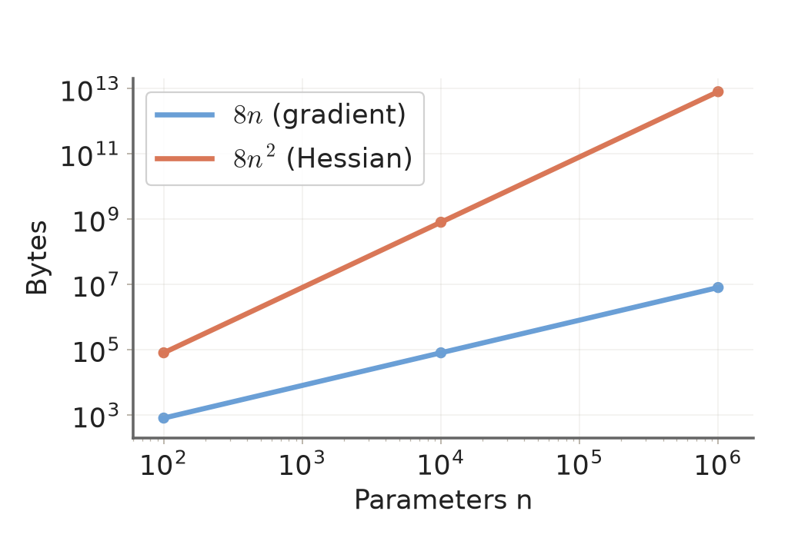

圖說 `lec03-bp-v2-kp01-memory`：讀圖：橫軸是參數 n，縱軸是 bytes。
藍線為 8n，橘線為 8n²。

Caption `lec03-bp-v2-kp01-memory`: Read parameter count n horizontally and bytes vertically.
The blue curve is 8n; the orange curve is 8n squared.

### 延伸：小模型也能看見平方成本（Even small models reveal the quadratic cost）

n=100：梯度 100 個；Hessian 10,000 個。

At n=100, the gradient has 100 entries and the Hessian has 10,000.

n=10,000：梯度 10,000 個；Hessian 10⁸ 個。

At n=10,000, the gradient has 10,000 entries and the Hessian has 100 million.

$$
8\times100^2=8\times10{,}000=80{,}000\ \mathrm{bytes}=80\ \mathrm{KB}
$$

$$
8\times10{,}000^2=8\times10^8=800{,}000{,}000\ \mathrm{bytes}=800\ \mathrm{MB}
$$

### 延伸：一階看梯度，二階也看曲率（First-order methods use gradients; second-order methods also use curvature）

一階：梯度是損失對各參數的偏導數。
隨機版本是大型網路訓練主力。

First-order methods use partial derivatives of loss.
Stochastic variants are central to large-network training.

二階：Hessian 記錄偏導數的再變化。
Newton 法解線性系統，未必顯式求逆；條件合適時局部收斂較快。

Second-order methods use the Hessian of second derivatives.
Newton methods solve a linear system, need not form an inverse, and can converge faster locally under suitable conditions.

$$
\mathbf H=\nabla^2 f(\mathbf w)
$$

### 延伸：平坦與泛化的關係需要條件（The connection between flatness and generalization needs qualifications）

來源觀察：隨機一階方法常找到較平坦的解。

The source reports that stochastic first-order methods often find flatter solutions.

更正：平坦不自動等於泛化好；二階也不必然較差。

Correction: flatness does not automatically imply better generalization, and second-order methods are not necessarily worse.

### 延伸：摸坡靠反傳，移動靠優化器（Backpropagation measures the slope; the optimizer makes the move）

人生下山找谷底：
摸坡靠反傳，走路靠一階。

Training is like descending toward a valley:
backpropagation measures slopes; first-order methods guide movement.

### 延伸：先掌握更新與反傳兩個地基（Learn parameter updates and backpropagation first）

§2 梯度下降：怎麼更新參數。

Section 2 explains how gradient descent updates parameters.

§3 反向傳播：怎麼高效算梯度。

Section 3 explains how backpropagation computes gradients efficiently.

§4 隨機與 mini-batch：用資料子集近似梯度。

Section 4 uses stochastic and mini-batch estimates of gradients.

### 延伸：把名詞還原成各自的工作（Translate each term into its task）

假設類別選家族；損失函數定代價；
優化找參數；鏈式法則串偏導。

A hypothesis class selects a family; a loss assigns costs.
Optimization finds parameters; the chain rule links derivatives.

### 延伸：進階方法調步長並研究解的性質（Advanced methods adjust steps and study properties of solutions）

§5 AdaGrad、RMSProp、Adam：自適應學習率。

Section 5 covers adaptive learning rates with AdaGrad, RMSProp, and Adam.

§6 SAM：Sharpness-Aware Minimization。
考量參數擾動附近的損失。

Section 6 covers Sharpness-Aware Minimization.
It considers loss near parameter perturbations.

§7 收斂理論：過參數化網路的優化行為。

Section 7 studies convergence in overparameterized networks.

### 延伸：原題：反向傳播解決的核心難題是？（What central difficulty does backpropagation solve?）

反向傳播解決的核心難題是？
A. 如何設計激活函數
B. 如何高效計算多層網路各參數對最終損失的梯度
C. 如何收集訓練資料
D. 如何選擇 batch size

What central difficulty does backpropagation solve?
A. Designing activation functions.
B. Efficiently computing each multilayer-network parameter’s gradient of the final loss.
C. Collecting training data.
D. Choosing the batch size.

提示：分清「提供敏感度」與「使用敏感度更新」。

Hint: Separate supplying sensitivities from using them to update parameters.

題目與四個選項（如有）完整保留；未附答案。

Questions and all four choices, where applicable, are retained without answers.

### 延伸：晚餐比喻只描述搜尋資訊的成本（The dinner analogy describes the cost of search information）

陌生城市找便宜晚餐：
先問附近方向，不先列全城曲率表。

To find a cheap dinner in an unfamiliar city,
ask for local directions rather than tabulate curvature everywhere.

侷限：局部詢問不能證明找到全城最便宜。

Limit: local inquiries cannot certify the cheapest dinner in the entire city.

### 延伸：原題：偏好一階方法的主要原因不包括？（Which item is not a main reason for preferring first-order methods?）

深度學習實務上偏好一階方法而非二階方法，主要原因不包括？
A. 二階方法需計算與反轉 Hessian，算力負擔大
B. 一階隨機方法常找到較平坦最小值、泛化較好
C. 二階方法在深度學習規模下計算不可行
D. 二階方法永遠找不到任何局部最低點

Which item is not a main reason for preferring first-order methods?
A. Computing and inverting a Hessian imposes a large cost.
B. Stochastic first-order methods often find flatter minima with better generalization.
C. Second-order computation is infeasible at deep-learning scale.
D. Second-order methods can never find a local minimum.

提示：原題措辭偏強；請依前頁更正，區分成本與不可能。

Hint: The source wording is strong; distinguish high cost from impossibility using the corrections.

題目與四個選項（如有）完整保留；未附答案。

Questions and all four choices, where applicable, are retained without answers.

### 延伸：資源取捨不是方法的絕對排名（Resource trade-offs do not give an absolute ranking of methods）

二階方法不是永遠更好，也不是永遠無用。

Second-order methods are neither always superior nor always useless.

大型訓練常選一階；理由是成本與實務取捨。

Large-scale training often uses first-order methods because of computational and practical trade-offs.

### 延伸：原題：核心必讀與進階補充如何對應？（How do the core material and advanced supplements correspond?）

本章核心必讀內容與進階補充的正確對應是？
A. §2 梯度下降 + §3 backprop 為核心；§4–§7 為進階與理論
B. 只有 §6 SAM 是核心
C. §7 理論是唯一必讀
D. §4 SGD 取代 §3 backprop 成為核心

How do the core material and advanced supplements correspond?
A. Sections 2 and 3 are core; Sections 4–7 provide advanced methods and theory.
B. Only Section 6 on SAM is core.
C. Section 7 on theory is the only required reading.
D. Section 4 on SGD replaces Section 3 as the core.

提示：回看兩張路線圖，找出後續方法依賴的地基。

Hint: Use the roadmap to identify the foundations required by later methods.

題目與四個選項（如有）完整保留；未附答案。

Questions and all four choices, where applicable, are retained without answers.

### 延伸：讀符號也要看它在做什麼（Read each symbol together with its task）

向量列偏導，矩陣列曲率；
先數元素，再算資源成本。

Vectors collect derivatives and matrices collect curvature.
Count their entries before estimating resource costs.

### 延伸：符號先對照意義再代入（Match symbols to their meanings before substitution）

$n$：參數個數

number of parameters

$\mathbf w$：參數向量

parameter vector

$\nabla f$：梯度向量

gradient vector

$\mathbf H$：海森矩陣，n×n

n-by-n Hessian matrix

### 術語對照（Terminology）

| 中文 | English |
|---|---|
| 假設類別 | hypothesis class |
| 損失函數 | loss function |
| 優化 | optimization |
| 反向傳播 | backpropagation |
| 鏈式法則 | chain rule |
| 梯度 | gradient |
| 海森矩陣 | Hessian |
| 一階方法 | first-order method |
| 二階方法 | second-order method |
| 泛化 | generalization |
| 過參數化 | overparameterization |


## KP02 梯度下降沿反方向更新參數

> 程度：大學生（undergrad）／Level: Undergraduate (undergrad)

> 課程主線：每 KP 12.5 分鐘；完整延伸內容供自主閱讀。

> Core allocation: 12.5 minutes per KP; full extensions support independent study.

來源：老師提供的 KP02 主文與教授祕笈，源頁 [https://ndhuccc.github.io/CCC-LNS/IDL_115/Ch03-backprop-optimization/index.html](https://ndhuccc.github.io/CCC-LNS/IDL_115/Ch03-backprop-optimization/index.html)；文本收到日期 2026-10-13。

Source: the supplied KP02 text and professor guide, received on 2026-10-13. No page numbers were invented.

### 學習目標（Learning objectives）

辨認「梯度下降沿反方向更新參數」的概念、假設、計算與限制，能用原數值例重算並解釋迷思。

Identify the concepts, assumptions, calculations, and limitations of this unit, reproduce the worked examples, and explain common misconceptions.

### 符號表（Symbols）

| 符號 | 中文意義 | English meaning |
|---|---|---|
| $\mathbf w$ | 參數向量 | parameter vector |
| $f$ | 可微目標／損失 | differentiable objective or loss |
| $k$ | 迭代索引 | iteration index |
| $\eta$ | 正學習率 | positive learning rate |
| $L$ | 梯度變化上界常數 | gradient Lipschitz constant |
| $\Delta\mathbf w$ | 更新位移 | update displacement |
| $\mathbf w^*$ | 最優解 | optimal solution |

### 負梯度決定方向，學習率決定步長（The negative gradient sets direction; the learning rate sets scale）

w 是參數向量，k 是迭代，f 是損失。
梯度由偏導數組成；η>0 是學習率。
負梯度在歐氏距離下是最陡局部下降方向。

w is the parameter vector, k the iteration, and f the loss.
The gradient collects partial derivatives; positive eta is the learning rate.
The negative gradient is the steepest local descent direction under Euclidean distance.

先算目前梯度，再減去縮放後的梯度。

Compute the current gradient, then subtract its scaled value.

$$
\mathbf w^{(k+1)}=\mathbf w^{(k)}-\eta\nabla f(\mathbf w^{(k)})
$$

### 二次谷底第一步從四降到三點二（The first quadratic step moves from four to 3.2）

f(w)=w²，起點 4，η=0.1。
梯度 f′(4)=2×4=8。

For f(w)=w squared, start at 4 with eta=0.1.
The derivative at 4 is 2 times 4, equal to 8.

位移 −0.1×8=−0.8；
新損失 3.2²=10.24，低於 4²=16。

The displacement is minus 0.1 times 8, equal to minus 0.8.
The new loss is 3.2 squared, or 10.24, below 16.

$$
w^{(1)}=w^{(0)}-\eta f\prime(w^{(0)})=4-0.1(8)=4-0.8=3.2
$$

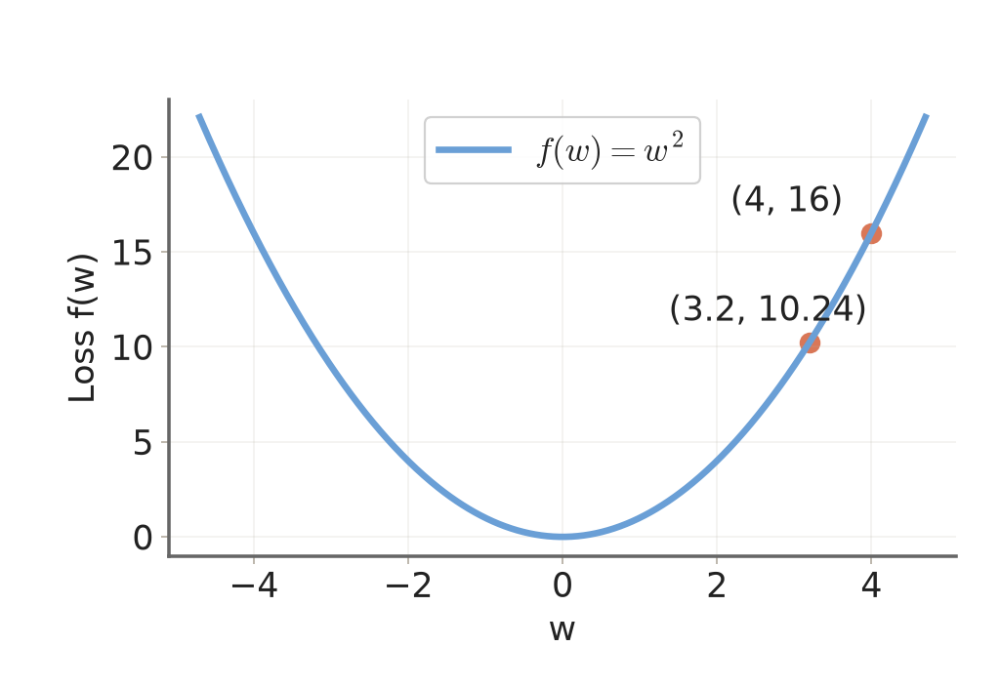

圖說 `lec03-bp-v2-kp02-quadratic`：f(w)=w²，起點 4，η=0.1。
梯度 f′(4)=2×4=8。

Caption `lec03-bp-v2-kp02-quadratic`: For f(w)=w squared, start at 4 with eta=0.1.
The derivative at 4 is 2 times 4, equal to 8.

讀圖：橫軸 w，縱軸 loss。

The x-axis shows w; the y-axis shows loss.

### 練習：更新式中的學習率代表什麼？（What does eta represent in the update rule?）

式 (4) 梯度下降更新 $\mathbf{w}^{(k+1)}:=\mathbf{w}^{(k)}-\eta\nabla f(\mathbf{w}^{(k)})$ 中，$\eta$ 代表什麼？
A. Lipschitz 常數
B. 學習率（固定步長）
C. 動量係數
D. batch size

What does eta represent in the update rule?
A. A Lipschitz constant.
B. The learning rate, used as a fixed step scale.
C. A momentum coefficient.
D. The batch size.

提示：把更新拆成「梯度方向」與「乘上的正數」。

Hint: Separate the gradient direction from the positive scaling factor.

題目與四個選項（如有）完整保留；未附答案。

Questions and all four choices, where applicable, are retained without answers.

### 延伸：最小化任務透過逐步位移實現（A minimization task is implemented through repeated displacements）

先選初始位置 w⁽⁰⁾，通常用隨機初始化。

Choose an initial position, often through random initialization.

更新量 Δw 是本次位移；w* 表示目標最優解。

Delta w is the current displacement; w star denotes an optimal solution.

$$
\min_{\mathbf w}f(\mathbf w)
$$

$$
\mathbf w^{(k+1)}=\mathbf w^{(k)}+\Delta\mathbf w
$$

來源式 (1) 定義最小化目標；來源式 (2) 定義逐步位移更新。

Source equation (1) defines the minimization task; source equation (2) defines iterative displacement updates.

### 延伸：光滑性限制相鄰位置的梯度變化（Smoothness bounds changes in gradients between nearby positions）

L>0 是梯度的 Lipschitz 常數。
光滑指梯度變化有上界，不是函數值有上界。

Positive L is a Lipschitz constant for the gradient.
Smoothness bounds gradient changes, not the function values.

對 f(w)=w²，|2u−2v|=2|u−v|，可取 L=2。

For f(w)=w squared, the gradient difference is twice the position difference, so L=2 works.

$$
\|\nabla f(\mathbf u)-\nabla f(\mathbf v)\|_2\le L\|\mathbf u-\mathbf v\|_2
$$

### 延伸：矇眼下山仍要限制每步距離（Descending blindfolded still requires a safe step length）

摸當前坡度，走最陡反方向；
太大會拍皮球，太小會走得慢。

Measure the current slope and move against it.
Oversized steps can bounce; undersized steps can progress slowly.

### 延伸：倒數光滑常數是一個安全步長（The reciprocal smoothness constant is a safe step size）

更正：「理想」不是所有問題的最優步長。
光滑且梯度非零時，取 1/L 可嚴格下降。

Correction: this is not the best step for every problem.
With smoothness and a nonzero gradient, choosing 1/L gives strict descent.

二次例 L=2，故 1/L=0.5。L 未知時需選或調 η。

In the quadratic example L=2, so 1/L=0.5.
If L is unknown, eta must be selected or adjusted.

$$
\begin{aligned}\Delta\mathbf w&=-\frac1L\nabla f(\mathbf w^{(k)})\\\mathbf w^{(k+1)}&=\mathbf w^{(k)}-\frac1L\nabla f(\mathbf w^{(k)})\end{aligned}\tag{3}
$$

### 延伸：第二步必須重算當前坡度（The second step requires a fresh gradient）

沿用 f(w)=w²、η=0.1，現在 w=3.2。
梯度 2×3.2=6.4；縮放量 0.1×6.4=0.64。

Keep the quadratic loss and eta=0.1, now at w=3.2.
The gradient is 6.4; its scaled amount is 0.64.

因梯度變小，這次位移也變小。
$f(2.56)=2.56^2=2.56\times2.56=6.5536$。

The smaller gradient produces a smaller displacement.
Substitute the new position into the squared loss and multiply to obtain 6.5536.

$$
w^{(2)}=w^{(1)}-\eta f\prime(w^{(1)})=3.2-0.1(6.4)=3.2-0.64=2.56
$$

### 延伸：第三步延續相同更新規則（The third step follows the same update rule）

目前 w=2.56，梯度 2×2.56=5.12。
0.1×5.12=0.512 是本次縮放量。

At w=2.56, the gradient is 5.12.
The scaled amount is 0.1 times 5.12, equal to 0.512.

目前損失 6.5536；更新後 2.048²=4.194304。
最後一項是為完整檢查補算的值。

The current loss is 6.5536; the updated loss is 4.194304.
The final value is added to complete the check.

$$
w^{(3)}=2.56-0.1(5.12)=2.56-0.512=2.048
$$

$$
f(2.048)=2.048^2=2.048\times2.048=4.194304
$$

### 延伸：學習率為一時會在兩壁往返（A learning rate of one bounces between two walls）

從 4 出發，η=1；兩次梯度分別為 8、−8。

Starting at 4 with eta=1, the successive gradients are 8 and minus 8.

兩端損失都是 16，並未下降。
二次函數更新為 w新=(1−2η)w。

Both endpoints have loss 16, so no descent occurs.
For this quadratic, the new position is (1 minus 2 eta) times w.

$$
4-1(8)=-4,\qquad -4-1(-8)=4
$$

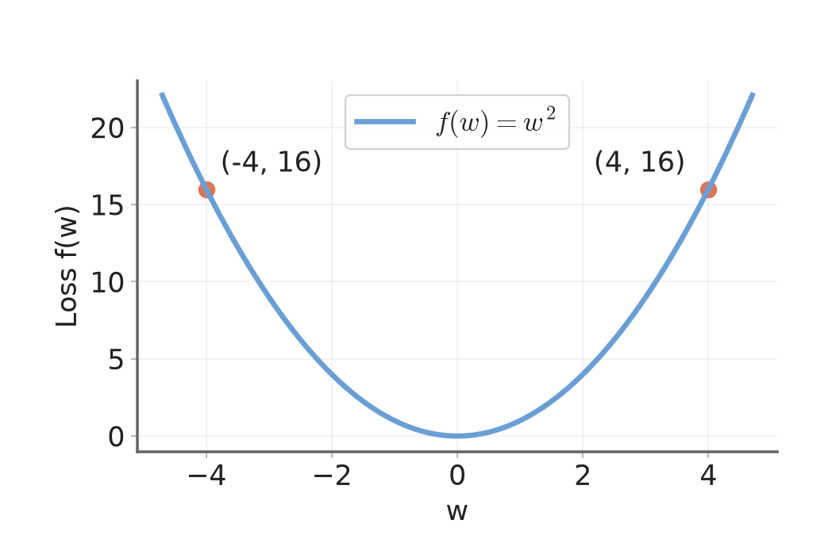

圖說 `lec03-bp-v2-kp02-bounce`：從 4 出發，η=1；兩次梯度分別為 8、−8。

Caption `lec03-bp-v2-kp02-bounce`: Starting at 4 with eta=1, the successive gradients are 8 and minus 8.

讀圖：橫軸 w，縱軸 loss。

The x-axis shows w; the y-axis shows loss.

### 延伸：凸與非凸的保證都依賴前提（Guarantees for convex and nonconvex objectives depend on assumptions）

凸：線段上的函數值不高於端點加權平均。
凸且 L-smooth、有最小值，步長適當：可保證目標值趨向全域最小值。

Convexity bounds values on a line segment by weighted endpoint values.
With L-smoothness, a minimizer, and suitable steps, objective values approach the global minimum.

更正：非凸不能只保證局部最低；也可能到鞍點。
下降保證須看光滑性與步長。

Correction: nonconvex optimization may reach a saddle, not necessarily a local minimum.
Descent requires smoothness and step-size conditions.

### 延伸：原圖呈現示例而非普遍定理（The original figure illustrates examples rather than a universal theorem）

圖 1：凸與非凸成本函數上的迭代步驟。
讀圖先分清參數路徑與 loss 隨迭代的曲線。

Figure 1 shows iterations on convex and nonconvex cost functions.
Distinguish parameter paths from loss-versus-iteration curves.

原始資料未提供，保留公開原圖；未仿造資料。

The underlying data are unavailable; the public original is retained without fabricated data.

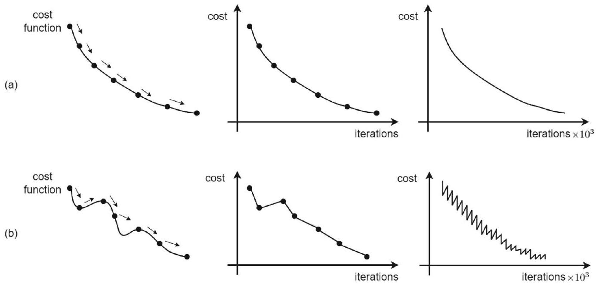

圖說 `orig-kp2-fig1`：圖 1：凸與非凸成本函數上的迭代步驟。
讀圖先分清參數路徑與 loss 隨迭代的曲線。

Caption `orig-kp2-fig1`: Figure 1 shows iterations on convex and nonconvex cost functions.
Distinguish parameter paths from loss-versus-iteration curves.

### 延伸：冷氣比喻對應方向與反應速度（The air-conditioning analogy maps direction and response speed）

室溫 28°C，目標 24°C：依偏熱或偏冷反向調整。
比喻只說明回饋方向，真實冷氣有時間延遲。

At 28 degrees Celsius with a target of 24, adjust against the temperature error.
The analogy explains feedback direction; real systems have delays.

### 延伸：換個谷底仍使用同一更新式（A shifted valley uses the same update structure）

練習：f(w)=(w−1)²、w⁽⁰⁾=5、η=0.25，走兩步。

Practice: use f(w)=(w minus 1) squared, start at 5, and take two steps with eta=0.25.

提示：先微分，再代入目前 w；每步都重算梯度。
不要把 w 當成距離谷底的誤差。

Hint: differentiate, substitute the current w, and recompute the gradient after each step.
Do not confuse w with its distance from the minimum.

題目與四個選項（如有）完整保留；未附答案。

Questions and all four choices, where applicable, are retained without answers.

### 延伸：向下走一步，不等於已知終點（A downward step does not identify the destination）

矇眼下山，走最陡反方向；
步長要合適，終點要另檢查。

Descend against the steepest local slope.
Choose suitable steps and assess the destination separately.

### 延伸：原題：光滑設定下原文選哪個步長？（Which step size does the source choose under smoothness?）

若 $f(\cdot)$ 的梯度是 $L$-smooth，理想步長應取？
A. $\eta=L$
B. $\eta=1/L$
C. $\eta=L^2$
D. $\eta=0$

Which step size does the source choose under smoothness?
A. Eta equals L.
B. Eta equals the reciprocal of L.
C. Eta equals L squared.
D. Eta equals zero.

提示：此題沿用原文「理想」步長；把它讀成安全選擇。

Hint: Interpret the source’s “ideal” step as a safe choice, not a universal optimum.

題目與四個選項（如有）完整保留；未附答案。

Questions and all four choices, where applicable, are retained without answers.

### 延伸：最大化時沿正梯度移動（Maximization moves in the positive gradient direction）

梯度上升用於最大化；符號改成加號。
方向仍是局部判斷，步長不能任意放大。

Gradient ascent maximizes an objective and uses a plus sign.
The direction is local; the step cannot be enlarged arbitrarily.

$$
\mathbf w^{(k+1)}=\mathbf w^{(k)}+\eta\nabla f(\mathbf w^{(k)})
$$

### 延伸：原題：原文對凸目標提出什麼保證？（What guarantee does the source state for a convex objective?）

對凸目標函數 $f(\cdot)$，梯度下降的保證是？
A. 收斂到局部最低點且 loss 可能上升
B. 收斂到全域最低點且 loss 單調遞減
C. 一定發散
D. 與初始點無關永遠找到同一鞍點

What guarantee does the source state for a convex objective?
A. Convergence to a local minimum while loss may rise.
B. Convergence to a global minimum with monotonically decreasing loss.
C. Certain divergence.
D. Always reaching the same saddle regardless of initialization.

提示：原題保留；請先補上凸、光滑、最小值存在及適當步長。

Hint: Retain the question but apply convexity, smoothness, existence of a minimum, and suitable-step assumptions.

題目與四個選項（如有）完整保留；未附答案。

Questions and all four choices, where applicable, are retained without answers.

### 延伸：柯西的梯度方法年份更正為一八四七（Cauchy’s gradient-method date is corrected to 1847）

明示更正：來源的 Cauchy 1874 應為 1847。

Explicit correction: the source’s Cauchy date of 1874 should be 1847.

EMS Press《Cauchy and the Gradient Method》引原論文：
C. R. Acad. Sci. Paris 25:536–538 (1847)。
來源另列 Hadamard 1908、Curry 1944，尚未獨立核對。

EMS Press cites the original paper in C. R. Acad. Sci. Paris 25:536–538 (1847).
The source also lists Hadamard 1908 and Curry 1944; those dates were not independently checked.

更正依據：[EMS Press：Cauchy and the Gradient Method](https://ems.press/content/book-chapter-files/27368)，由主代理核對原論文引用。

Correction source: EMS Press, verified by the parent agent against the cited original publication.

### 延伸：原題：原文描述非凸地形的實務表現為何？（How does the source describe practical behavior on nonconvex landscapes?）

非凸 loss 地形上，梯度下降的實務表現如何？
A. 完全無法使用
B. 只能找到全域最優
C. 可能震盪但整體 loss 傾向下降
D. 保證每步 loss 嚴格遞減

How does the source describe practical behavior on nonconvex landscapes?
A. It is entirely unusable.
B. It can only find the global optimum.
C. It may oscillate while loss tends to decline overall.
D. Every step is guaranteed to decrease loss strictly.

提示：區分來源的經驗描述與需要條件的數學保證。

Hint: Distinguish an empirical description from a mathematical guarantee that needs assumptions.

題目與四個選項（如有）完整保留；未附答案。

Questions and all four choices, where applicable, are retained without answers.

### 延伸：符號先對照意義再代入（Match symbols to their meanings before substitution）

$\mathbf w$：參數向量

parameter vector

$f$：可微目標／損失

differentiable objective or loss

$k$：迭代索引

iteration index

$\eta$：正學習率

positive learning rate

### 延伸：先認量，再選公式與判準（Identify the quantity before choosing a formula or criterion）

參數、梯度、損失、步長各司其職；
符號相近，也不代表量相同。

Parameters, gradients, losses, and steps have different roles.
Similar symbols need not represent the same quantity.

### 延伸：符號先對照意義再代入（續）（Match symbols to their meanings before substitution (continued)）

$L$：梯度變化上界常數

gradient Lipschitz constant

$\Delta\mathbf w$：更新位移

update displacement

$\mathbf w^*$：最優解

optimal solution

### 術語對照（Terminology）

| 中文 | English |
|---|---|
| 梯度下降 | gradient descent |
| 學習率 | learning rate |
| 位移 | displacement |
| 光滑性 | smoothness |
| Lipschitz 常數 | Lipschitz constant |
| 凸 | convex |
| 非凸 | nonconvex |
| 全域最小值 | global minimum |
| 駐點 | stationary point |
| 梯度上升 | gradient ascent |


原圖來源：[原圖 orig-kp2-fig1](https://ndhuccc.github.io/CCC-LNS/IDL_115/Ch03-backprop-optimization/assets/orig-kp2-fig1.jpg)。

Original image references are retained above; local copies keep the diagrams available offline.


## KP03 停表準則是儀表而非最優證明

> 程度：大學生（undergrad）／Level: Undergraduate (undergrad)

> 課程主線：每 KP 12.5 分鐘；完整延伸內容供自主閱讀。

> Core allocation: 12.5 minutes per KP; full extensions support independent study.

來源：老師提供的 KP03 主文與教授祕笈，源頁 [https://ndhuccc.github.io/CCC-LNS/IDL_115/Ch03-backprop-optimization/index.html](https://ndhuccc.github.io/CCC-LNS/IDL_115/Ch03-backprop-optimization/index.html)；文本收到日期 2026-10-13。

Source: the supplied KP03 text and professor guide, received on 2026-10-13. No page numbers were invented.

### 學習目標（Learning objectives）

辨認「停表準則是儀表而非最優證明」的概念、假設、計算與限制，能用原數值例重算並解釋迷思。

Identify the concepts, assumptions, calculations, and limitations of this unit, reproduce the worked examples, and explain common misconceptions.

### 符號表（Symbols）

| 符號 | 中文意義 | English meaning |
|---|---|---|
| $\epsilon$ | 正容忍值，各量分別選擇 | positive tolerance selected for each quantity |
| $N$ | 連續觀察步數 | number of consecutive monitored steps |
| $\|\cdot\|_2$ | 歐氏範數 | Euclidean norm |
| $k$ | 更新索引 | update index |

### 停表看儀表，不等於證明到谷底（Stopping checks indicators; it does not certify a minimum）

火車進站看四塊表：
坡度、loss 差、梯度差、計算次數。

Stopping resembles a train using four indicators:
slope, loss change, gradient change, and iteration count.

門檻 ε>0 是容忍值；各儀表量測的量不同。

A positive epsilon is a tolerance; each indicator measures a different quantity.

### 第三步兩種停表儀表會分歧（At the third step, two stopping indicators disagree）

f(w)=w²、η=0.25、w⁽⁰⁾=1、ε=0.05。
更新是 w−0.25(2w)=0.5w；每次乘 0.5，
1→0.5→0.25→0.125。

Use the quadratic loss, eta=0.25, start at 1, and epsilon=0.05.
The update equals 0.5w: multiply by 0.5 each time to obtain 0.5, 0.25, then 0.125.

loss 差 0.046875≤0.05；
0.125²=0.015625，0.25²=0.0625。
梯度 |2×0.125|=0.25>0.05。

The losses are 0.015625 and 0.0625, giving a change below 0.05.
The gradient magnitude is 2 times 0.125, or 0.25, exceeding 0.05.

$$
|f(w^{(3)})-f(w^{(2)})|=|0.015625-0.0625|=0.046875
$$

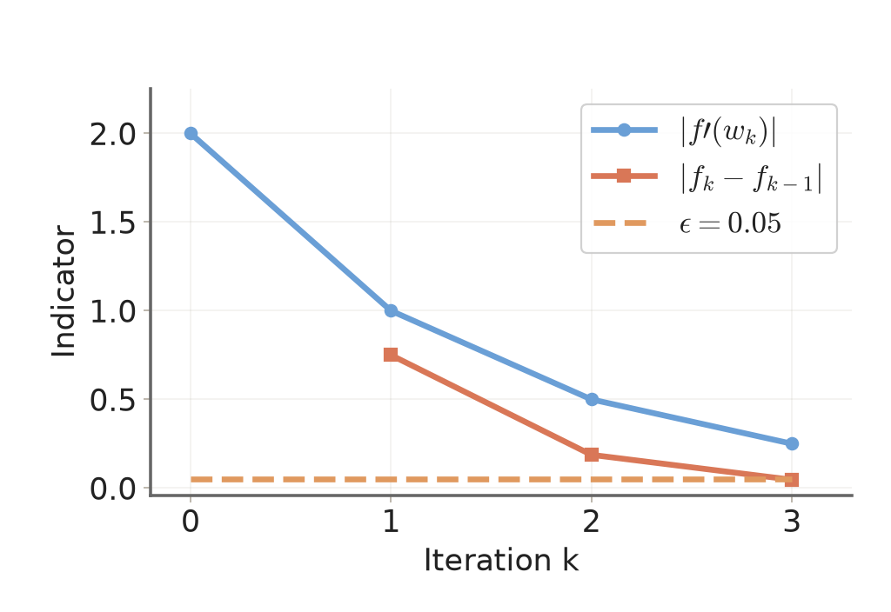

圖說 `lec03-bp-v2-kp03-stopping`：f(w)=w²、η=0.25、w⁽⁰⁾=1、ε=0.05。
更新是 w−0.25(2w)=0.5w；每次乘 0.5，
1→0.5→0.25→0.125。

Caption `lec03-bp-v2-kp03-stopping`: Use the quadratic loss, eta=0.25, start at 1, and epsilon=0.05.
The update equals 0.5w: multiply by 0.5 each time to obtain 0.5, 0.25, then 0.125.

讀圖：橫軸迭代 k，縱軸儀表值。

The x-axis shows k; the y-axis shows each indicator.

### 練習：一階最優性條件提供哪種停表動機？（Which stopping criterion is motivated by first-order optimality?）

一階最優性條件 $\|\nabla f(\mathbf{w}^{*})\|_2=0$ 對應哪種收斂準則的動機？
A. 最大迭代次數
B. 梯度範數夠小
C. batch size 夠大
D. 學習率歸零

Which stopping criterion is motivated by first-order optimality?
A. A maximum iteration count.
B. A small gradient norm.
C. A sufficiently large batch size.
D. A learning rate of zero.

提示：一階最優性是無約束可微問題的必要條件；辨識它量測什麼。

Hint: First-order optimality is necessary for an unconstrained differentiable optimum; identify the quantity measured.

題目與四個選項（如有）完整保留；未附答案。

Questions and all four choices, where applicable, are retained without answers.

### 延伸：小梯度只代表一階近似平坦（A small gradient indicates approximate first-order stationarity）

無約束可微函數在局部最小點 w*，梯度必為零。

For an unconstrained differentiable function, the gradient is zero at a local minimum.

停止時容許梯度範數不超過 ε；這是近似駐點測試。

A stopping rule allows the gradient norm to be at most epsilon; it tests approximate stationarity.

$$
\|\nabla f(\mathbf w^*)\|_2=0
$$

$$
\|\nabla f(\mathbf w^{(k+1)})\|_2\le\epsilon
$$

### 延伸：小損失差不保證梯度也小（Small loss changes do not guarantee small gradients）

loss 差衡量連續兩步的改善幅度。
太小的步長也能讓改善變小。

Loss change measures improvement between consecutive steps.
A very small step can also make improvement small.

可看連續 N 步，而非只看單步；但仍不是最優證書。

Check N consecutive steps rather than only one; this still does not certify optimality.

$$
|f(\mathbf w^{(k+1)})-f(\mathbf w^{(k)})|\le\epsilon
$$

### 延伸：鞍點沿兩個方向有相反曲率（A saddle curves in opposite ways along two directions）

[補充] 用 f(x,y)=x²−y² 精確說明鞍點。
原點梯度 (0,0)，卻沿 y 方向降低。

[Added] The function x squared minus y squared gives an exact saddle example.
Its gradient vanishes at the origin, yet loss decreases along y.

讀圖：兩條截面經同一原點，一條向上、一條向下。

Read two sections through the same origin: one rises and the other falls.

$$
\nabla f(x,y)=(2x,-2y),\quad \nabla f(0,0)=(0,0)
$$

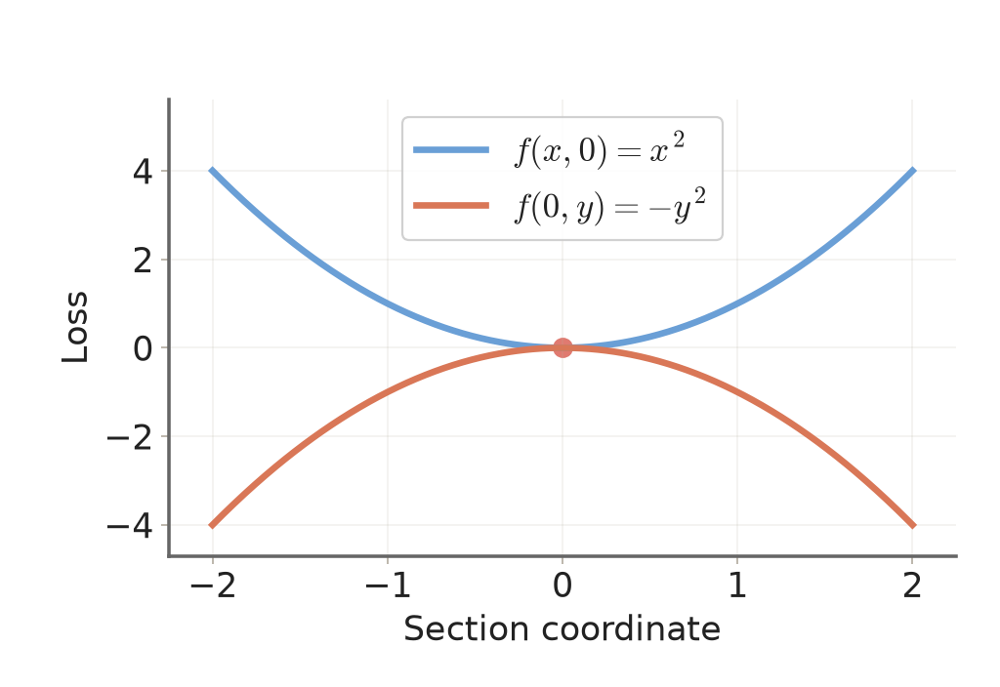

圖說 `lec03-bp-v2-kp03-saddle`：[補充] 用 f(x,y)=x²−y² 精確說明鞍點。
原點梯度 (0,0)，卻沿 y 方向降低。

Caption `lec03-bp-v2-kp03-saddle`: [Added] The function x squared minus y squared gives an exact saddle example.
Its gradient vanishes at the origin, yet loss decreases along y.

### 延伸：梯度變化小並非梯度本身小（A stable gradient is not necessarily a small gradient）

更正：梯度是向量，前後差應用範數。
單純絕對值記號只適合一維。

Correction: use a norm for differences between gradient vectors.
Absolute-value notation is appropriate only in one dimension.

穩定可以仍很陡；此判據較少單獨使用。

A stable gradient may still be large; this criterion is rarely used alone.

$$
\|\nabla f(\mathbf w^{(k+1)})-\nabla f(\mathbf w^{(k)})\|_2\le\epsilon
$$

### 延伸：第一步先建立可比較的儀表值（The first step establishes comparable indicator values）

η=0.25；更新為 w新=w−0.25(2w)=0.5w。

With eta=0.25, the update is w minus 0.25 times 2w, equal to 0.5w.

w⁽¹⁾=0.5；f=0.5²=0.25；|f′|=|2×0.5|=1。
loss 差 |0.25−1|=0.75。

The first position is 0.5, with loss 0.25 and gradient magnitude 1.
The loss change is the absolute difference between 0.25 and 1, equal to 0.75.

$$
w^{(1)}=1-0.25(2)=1-0.5=0.5
$$

### 延伸：第二步繼續重算位置與坡度（The second step recomputes position and slope）

w⁽²⁾=0.5−0.25(1)=0.25；
f=0.25²=0.0625，|f′|=0.5。

The second position is 0.5 minus 0.25 times 1, equal to 0.25.
Its loss is 0.0625 and gradient magnitude is 0.5.

loss 差 |0.0625−0.25|=0.1875；仍超過 0.05。

The loss change is 0.1875, still greater than 0.05.

### 延伸：第三步的位置與梯度各有依據（The third-step position and gradient have explicit derivations）

w⁽³⁾=0.25−0.25(0.5)=0.125；
f=0.125²=0.015625。

The third position is 0.25 minus 0.25 times 0.5, equal to 0.125.
Its loss is 0.015625.

|f′|=|2×0.125|=0.25。
loss 差過門檻，不代表梯度也過門檻。

The gradient magnitude is 2 times 0.125, equal to 0.25.
Passing the loss-change threshold does not imply passing the gradient threshold.


圖說 `lec03-bp-v2-kp03-stopping`：w⁽³⁾=0.25−0.25(0.5)=0.125；
f=0.125²=0.015625。

Caption `lec03-bp-v2-kp03-stopping`: The third position is 0.25 minus 0.25 times 0.5, equal to 0.125.
Its loss is 0.015625.

讀圖：橫軸迭代 k，縱軸儀表值。

The x-axis shows k; the y-axis shows each indicator.

### 延伸：煎牛排的不同儀表回答不同問題（Different cooking indicators answer different questions）

煎牛排可看溫度、上色變化、火候或計時器。
比喻用來辨認不同判準，不是證明收斂。

Cooking can use temperature, color change, heat control, or a timer.
The analogy distinguishes criteria; it does not prove convergence.

### 延伸：原題：非凸時只看小梯度可能出什麼問題？（What can happen when only a small-gradient test is used in a nonconvex problem?）

在非凸設定下，僅用「梯度範數 $\leq \epsilon$」停表，可能發生什麼問題？
A. 一定找到全域最優
B. 可能收斂到鞍點
C. 梯度永遠不會變小
D. loss 一定發散

What can happen when only a small-gradient test is used in a nonconvex problem?
A. The global optimum is guaranteed.
B. The method may converge to a saddle.
C. The gradient can never become small.
D. Loss must diverge.

提示：思考「必要條件」能否反向推出「充分條件」。

Hint: Ask whether a necessary condition can be reversed into a sufficient condition.

題目與四個選項（如有）完整保留；未附答案。

Questions and all four choices, where applicable, are retained without answers.

### 延伸：到最大次數只是預算已用完（Reaching the iteration limit means the budget is exhausted）

step 是一次參數更新；epoch 是完整走過訓練資料一輪。

A step is one parameter update; an epoch is one full pass through the training data.

可設 loss 連續 N 步變化小，或達到 100 epoch 就停。
停止不表示已數學收斂。

Stop after small loss changes for N steps or after 100 epochs.
Stopping does not imply mathematical convergence.

### 延伸：宣佈到站看儀表，山口不一定是谷底（Read the indicators; a mountain pass is not necessarily a minimum）

坡夠平、高度差小、方向穩、或時間到；
儀表會吵架，所以要交代停止邏輯。

Stop for small slopes, small loss changes, stable gradients, or exhausted time.
Indicators may disagree, so state the stopping logic.

### 延伸：原題：連續兩步損失差小代表什麼？（What does a small absolute loss difference between two steps represent?）

$|f(\mathbf{w}^{(k+1)})-f(\mathbf{w}^{(k)})|\leq\epsilon$ 這條準則代表？
A. 連續兩步 loss 變化夠小
B. 梯度為零
C. 達到最大 epoch
D. Hessian 為零

What does a small absolute loss difference between two steps represent?
A. A sufficiently small loss change between consecutive steps.
B. A zero gradient.
C. Reaching the maximum epoch count.
D. A zero Hessian.

提示：直接辨認式子的量，不把它換成另一種儀表。

Hint: Identify the measured quantity directly rather than substituting another indicator.

題目與四個選項（如有）完整保留；未附答案。

Questions and all four choices, where applicable, are retained without answers.

### 延伸：改門檻不等於改更新軌跡（Changing a threshold does not change the update trajectory）

固定更新法，再換停止門檻；
問的是何時亮燈，不是如何走路。

Fix the update rule, then change the stopping tolerance.
Ask when the indicator triggers, not how the parameters move.

### 延伸：調整門檻後要重新逐列判斷（Changing the tolerance requires checking every row again）

練習：把二次例的 ε 改成 0.3。
梯度範數會在哪一步首次不超過門檻？

Practice: change epsilon to 0.3 in the quadratic example.
At which step does the gradient norm first satisfy the threshold?

提示：固定原更新序列，只改判斷值；不改 η。

Hint: keep the update sequence and eta fixed; change only the comparison threshold.

題目與四個選項（如有）完整保留；未附答案。

Questions and all four choices, where applicable, are retained without answers.

### 延伸：有限訓練也要記錄停止理由（Finite training still needs a recorded stopping reason）

到點收工是預算選擇；
把停止原因與收斂結論分開。

Stopping on schedule is a budget choice.
Separate the stopping reason from a convergence claim.

### 延伸：原題：來源列的常見訓練停表方式為何？（Which stopping method does the source describe as common in training?）

深度學習訓練中最常見的停表方式是？
A. 嚴格等到梯度範數精確為 0
B. 預先設定的最大迭代次數（epoch / step）
C. 必須解出 Hessian 特徵值
D. 永遠不停止

Which stopping method does the source describe as common in training?
A. Wait until the gradient norm is exactly zero.
B. Use a preset maximum iteration count in epochs or steps.
C. Always compute Hessian eigenvalues.
D. Never stop.

提示：分清數學收斂要求與有限計算預算。

Hint: Separate mathematical convergence from a finite computation budget.

題目與四個選項（如有）完整保留；未附答案。

Questions and all four choices, where applicable, are retained without answers.

### 延伸：符號先對照意義再代入（Match symbols to their meanings before substitution）

$\epsilon$：正容忍值，各量分別選擇

positive tolerance selected for each quantity

$N$：連續觀察步數

number of consecutive monitored steps

$\|\cdot\|_2$：歐氏範數

Euclidean norm

$k$：更新索引

update index

### 術語對照（Terminology）

| 中文 | English |
|---|---|
| 收斂準則 | convergence criterion |
| 範數 | norm |
| 容忍值 | tolerance |
| 一階最優性 | first-order optimality |
| 鞍點 | saddle point |
| 迭代次數 | iteration count |
| 步 | step |
| 訓練輪次 | epoch |


## KP04 線搜索試步長，不降就減半

> 程度：大學生（undergrad）／Level: Undergraduate (undergrad)

> 課程主線：每 KP 12.5 分鐘；完整延伸內容供自主閱讀。

> Core allocation: 12.5 minutes per KP; full extensions support independent study.

來源：老師提供的 KP04 主文與教授祕笈，源頁 [https://ndhuccc.github.io/CCC-LNS/IDL_115/Ch03-backprop-optimization/index.html](https://ndhuccc.github.io/CCC-LNS/IDL_115/Ch03-backprop-optimization/index.html)；文本收到日期 2026-10-13。

Source: the supplied KP04 text and professor guide, received on 2026-10-13. No page numbers were invented.

### 學習目標（Learning objectives）

辨認「線搜索試步長，不降就減半」的概念、假設、計算與限制，能用原數值例重算並解釋迷思。

Identify the concepts, assumptions, calculations, and limitations of this unit, reproduce the worked examples, and explain common misconceptions.

### 符號表（Symbols）

| 符號 | 中文意義 | English meaning |
|---|---|---|
| $\eta$ | 候選步長 | candidate step size |
| $\eta^{(k)}$ | 第k步選出的步長 | step chosen at iteration k |
| $\phi(\eta)$ | 沿固定方向的目標函數 | objective along a fixed direction |
| $\mathbf g$ | 目前梯度 | current gradient |

### 線搜索固定方向，再試步長（Line search fixes the direction and then tests step sizes）

① 算目前梯度，從 η=1 試起。

1. Compute the current gradient and start with eta=1.

② 候選 loss 有下降嗎？

2. Does the candidate loss decrease?

③ 沒降：η←η/2，再試；有降：接受並更新。

3. If not, halve eta and retry; otherwise accept and update.

### 同高的一大步被拒，減半才下降（A large equal-loss step is rejected; halving gives descent）

f(w)=w²，w=3；f=9，梯度 2×3=6。
η=1：3−1×6=−3，損失 (−3)²=9，不下降。

Use the quadratic loss at w=3: loss 9 and gradient 6.
With eta=1, the candidate is minus 3 with loss 9, so it does not decrease.

η=0.5：3−0.5×6=0，損失 0²=0；接受。

With eta=0.5, the candidate is zero with loss zero; accept it.

$$
\phi(\eta)=f(3-6\eta)=(3-6\eta)^2
$$

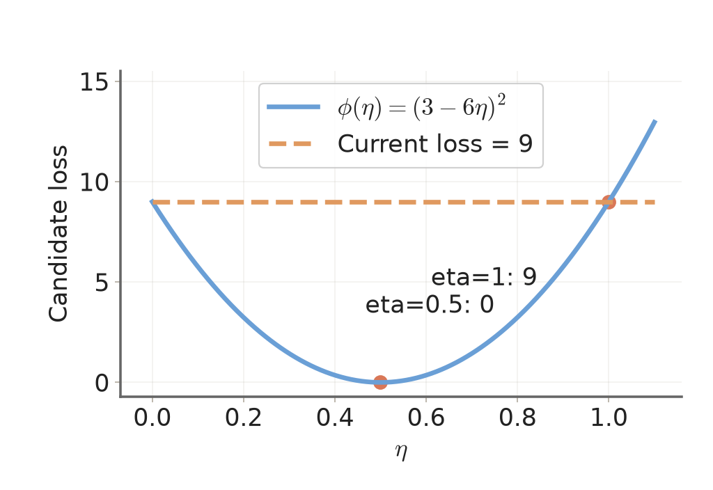

圖說 `lec03-bp-v2-kp04-linesearch`：f(w)=w²，w=3；f=9，梯度 2×3=6。
η=1：3−1×6=−3，損失 (−3)²=9，不下降。

Caption `lec03-bp-v2-kp04-linesearch`: Use the quadratic loss at w=3: loss 9 and gradient 6.
With eta=1, the candidate is minus 3 with loss 9, so it does not decrease.

讀圖：橫軸 η，縱軸候選 loss。

The x-axis shows eta; the y-axis shows candidate loss.

### 練習：線搜索的候選損失條件要求什麼？（What does the line-search loss condition require?）

線搜索式 (5) 的條件 $f(\mathbf{w}^{(k)}-\eta\nabla f(\mathbf{w}^{(k)}))\lt f(\mathbf{w}^{(k)})$ 要求什麼？
A. loss 必須上升
B. 沿梯度反方向更新後 loss 必須下降
C. 梯度範數為零
D. $\eta$ 必須等於 $L$

What does the line-search loss condition require?
A. Loss must rise.
B. Loss must decrease after moving against the gradient.
C. The gradient norm must be zero.
D. Eta must equal L.

提示：比較目前 loss 與候選 loss；不把位置改變當作改善。

Hint: Compare current and candidate loss; a position change alone is not improvement.

題目與四個選項（如有）完整保留；未附答案。

Questions and all four choices, where applicable, are retained without answers.

### 延伸：嚴格下降測試先排除零梯度（A strict-descent test must handle zero gradients first）

L-smooth 且梯度非零時，足夠小的正步長會下降。

With L-smoothness and a nonzero gradient, sufficiently small positive steps decrease loss.

若梯度為零，所有候選都不動；先交由停表判斷。

If the gradient is zero, all candidates stay put; assess stopping first.

$$
f(\mathbf w^{(k)}-\eta\nabla f(\mathbf w^{(k)}))<f(\mathbf w^{(k)})\tag{5}
$$

$$
0<\eta<1/L\tag{6}
$$

### 延伸：安全下降條件也包含倒數端點（The safe descent bound includes the reciprocal endpoint）

更正：原式 η<1/L 是充分條件，非必要條件。
η=1/L 在非零梯度時仍嚴格下降。

Correction: eta below 1/L is sufficient, not necessary.
At eta=1/L, a nonzero gradient still gives strict descent.

二次例 L=2，接受的 0.5 正好等於 1/L。

For the quadratic example L=2, the accepted 0.5 equals 1/L.

$$
f(\mathbf w-\eta\mathbf g)\le f(\mathbf w)-\eta(1-L\eta/2)\|\mathbf g\|_2^2,\quad \mathbf g=\nabla f(\mathbf w)
$$

### 延伸：不降就對半砍，不先換方向（If loss does not decrease, halve the step without changing direction）

步子太大會跨過谷底；
先縮 η，再測同一方向。

An oversized step can cross the valley.
Shrink eta and test the same direction again.

### 延伸：充分下降比只要有降更嚴格（Sufficient decrease is stricter than any decrease）

Armijo 規則要求「充分下降」，不只 loss 變小。

The Armijo rule requires sufficient decrease, not merely any reduction.

Wolfe 條件再約束沿線方向導數，避免過小步長。
這些策略增加損失或梯度評估成本。

Wolfe conditions also constrain the directional derivative to avoid overly small steps.
These strategies add loss or gradient evaluations.

### 延伸：外層決定繼續，內層決定步長（The outer loop decides continuation; the inner loop selects a step）

外層：檢查 KP03 的停表準則。

Outer loop: check the stopping criteria from KP03.

內層：固定 w 與梯度，測 η 並回溯。

Inner loop: fix w and its gradient, test eta, and backtrack.

接受後更新 w，回到外層重算梯度。

After accepting a step, update w and recompute the gradient in the outer loop.

### 延伸：精確線搜索在已選方向上找最優步長（Exact line search finds the best step along the chosen direction）

本章把精確線搜索的梯度法稱為最陡下降。
η⁽ᵏ⁾ 是第 k 步的一維最優步長。

This chapter calls gradient descent with exact line search steepest descent.
Eta at iteration k is the one-dimensional optimal step.

搜尋正步長；求得後仍沿 −∇f 更新。

Search over positive steps; the update still follows the negative gradient.

$$
\eta^{(k)}=\arg\min_{\eta\ge0}f(\mathbf w^{(k)}-\eta\nabla f(\mathbf w^{(k)}))\tag{7}
$$

$$
\mathbf w^{(k+1)}=\mathbf w^{(k)}-\eta^{(k)}\nabla f(\mathbf w^{(k)})
$$

### 延伸：二次例的沿線最小值可直接解出（The quadratic example has a directly solvable line minimum）

φ(η)=(3−6η)²≥0，最小值在平方項為零。

The squared line objective is nonnegative, and its minimum occurs when the squared term is zero.

3−6η=0，故 6η=3、η=3/6=0.5；
更新後 w=3−0.5×6=0。

Solve 3 minus 6 eta equal to zero: eta is 3/6, or 0.5.
The updated position is 3 minus 0.5 times 6, equal to zero.

$$
\phi(\eta)=(3-6\eta)^2,\quad 3-6\eta=0\Longrightarrow\eta=0.5
$$


圖說 `lec03-bp-v2-kp04-linesearch`：φ(η)=(3−6η)²≥0，最小值在平方項為零。

Caption `lec03-bp-v2-kp04-linesearch`: The squared line objective is nonnegative, and its minimum occurs when the squared term is zero.

讀圖：橫軸 η，縱軸候選 loss。

The x-axis shows eta; the y-axis shows candidate loss.

### 延伸：步長更精細，每次更新也更昂貴（More careful steps also make each update more expensive）

固定 η：最簡單，但需選適當大小。
回溯：試候選損失，接受一個下降步長。

Fixed eta is simple but needs suitable tuning.
Backtracking evaluates candidates and accepts a decreasing step.

精確線搜索：解一維最小化，每步多做計算。
大型深度學習常改用排程或自適應步長。

Exact line search solves a one-dimensional problem at extra cost.
Large-scale deep learning often uses schedules or adaptive steps.

### 延伸：試探比喻描述候選而非真正移動（The trial analogy describes candidates rather than actual moves）

原比喻：過馬路前試探車距，不合適就縮短。
侷限：數學試探可先算 loss，不必真的走出去。

The source analogy tests a road-crossing distance and shortens it if unsuitable.
Limit: mathematical trials evaluate loss before making a real move.

### 延伸：原題：步長不滿足條件時來源如何處理？（How does the source handle a step that fails the condition?）

線搜索中步長不滿足條件時，採取的策略是？
A. 步長加倍 $\eta\leftarrow 2\eta$
B. 步長減半 $\eta\leftarrow\eta/2$
C. 停止優化
D. 反轉梯度方向

How does the source handle a step that fails the condition?
A. Double eta.
B. Halve eta.
C. Stop optimization.
D. Reverse the gradient direction.

提示：保持目前位置與方向固定，只調候選距離。

Hint: Keep the current position and direction fixed; adjust only the candidate distance.

題目與四個選項（如有）完整保留；未附答案。

Questions and all four choices, where applicable, are retained without answers.

### 延伸：同方向不代表同樣的步長策略（The same direction can use different step-size strategies）

誤解：線搜索和固定 GD 走不同方向。

Misconception: line search and fixed-step gradient descent use different directions.

更正：本章都沿 −∇f，差在 η 的選法。
「沿線最優」不等於「全域最優」。

Correction: both follow the negative gradient here; they differ in choosing eta.
Optimality along a line is not global optimality.

### 延伸：固定方向，縮步長，接受後再更新（Fix the direction, shrink the step, and update only after acceptance）

不降就對半砍；降了才更新。
內層選距離，外層看何時停。

Halve when loss does not decrease; update only after acceptance.
The inner loop selects distance; the outer loop decides when to stop.

### 延伸：原題：最陡下降與固定 GD 的主要差異為何？（What is the source’s main distinction between steepest descent and fixed-step gradient descent?）

最陡下降（式 (7)）與固定學習率梯度下降的主要差異是？
A. 更新方向不同
B. 每步用一維優化解出使 $f$ 最小的 $\eta^{(k)}$
C. 不使用梯度
D. 只用二階方法

What is the source’s main distinction between steepest descent and fixed-step gradient descent?
A. They use different update directions.
B. Each step solves a one-dimensional problem for the minimizing eta.
C. They do not use gradients.
D. They only use second-order methods.

提示：依本章的精確線搜索用法比較，不改動已選方向。

Hint: Use this chapter’s exact-line-search convention and keep the chosen direction fixed.

題目與四個選項（如有）完整保留；未附答案。

Questions and all four choices, where applicable, are retained without answers.

### 延伸：候選只是試算，不先移動位置（A candidate is a trial calculation, not an immediate move）

先固定現在位置；
每個候選都從同一位置出發。

Keep the current position fixed.
Every candidate starts from that same position.

### 延伸：移到另一個谷底再做減半表（Repeat the halving table for a shifted valley）

練習：f(w)=(w−1)²、w=5，梯度 8、loss 16。
先試 η=1，不下降就減半，直到成立。

Practice: use the shifted quadratic at w=5, with gradient 8 and loss 16.
Start with eta=1 and halve it until loss decreases.

提示：候選 w新=5−8η；檢查 (w新−1)²<16。

Hint: the candidate position is 5 minus 8 eta; compare its shifted squared loss with 16.

題目與四個選項（如有）完整保留；未附答案。

Questions and all four choices, where applicable, are retained without answers.

### 延伸：步長判準與梯度算法各司其職（Step criteria and gradient algorithms have distinct roles）

鏈式法則算梯度；
下降判準選步長。

The chain rule computes gradients.
Descent criteria choose step sizes.

### 延伸：原題：Armijo 規則屬於哪類方法？（What type of method does the Armijo rule belong to?）

Armijo 規則屬於哪類方法？
A. 反向傳播
B. 進階線搜索策略（充分下降條件）
C. 激活函數
D. 資料增強

What type of method does the Armijo rule belong to?
A. Backpropagation.
B. An advanced line-search strategy requiring sufficient decrease.
C. An activation function.
D. Data augmentation.

提示：辨認它判斷的是梯度計算、候選步長，還是資料處理。

Hint: Identify whether it concerns gradient calculation, candidate steps, or data processing.

題目與四個選項（如有）完整保留；未附答案。

Questions and all four choices, where applicable, are retained without answers.

### 延伸：符號先對照意義再代入（Match symbols to their meanings before substitution）

$\eta$：候選步長

candidate step size

$\eta^{(k)}$：第k步選出的步長

step chosen at iteration k

$\phi(\eta)$：沿固定方向的目標函數

objective along a fixed direction

$\mathbf g$：目前梯度

current gradient

### 術語對照（Terminology）

| 中文 | English |
|---|---|
| 線搜索 | line search |
| 回溯 | backtracking |
| 充分下降 | sufficient decrease |
| 方向導數 | directional derivative |
| 精確線搜索 | exact line search |
| 最陡下降 | steepest descent |
| 候選步長 | candidate step size |


## KP05：動量把歷史位移加進本步更新（Momentum retains previous displacements）

> 教材程度：大學生；每單元課堂主線 12.5 分鐘，其他為完整延伸。
> Level: undergraduate; 12.5 minutes for the core lesson, with complete extensions.

### 符號表（Symbols）

| 符號 | 中文意義 | English meaning |
|---|---|---|
| $k$ | 迭代索引，從零開始 | Iteration index, starting at zero |
| $\mathbf{w}^{(k)}$ | 第 k 步參數向量 | Parameter vector at iteration k |
| $\Delta\mathbf{w}^{(k)}$ | 本步位移向量 | Current displacement vector |
| $\alpha$ | 動量係數，常取 0≤α<1 | Momentum coefficient, commonly between zero and one |
| $\eta^{(k)}$ | 學習率，正的步長比例 | Positive learning rate |
| $\nabla f$ | 損失對參數的梯度向量 | Gradient of the loss with respect to parameters |

### 動量記住上一推，梯度仍看當前點（Core lesson）

純梯度下降只看腳下坡度。在狹長山谷中，它可能左右來回。動量保留上一推的一部分，再加上本次下坡位移。它改變更新規則，不取代梯度計算。

Gradient descent uses only the current slope. Momentum adds a fraction of the previous displacement to the current downhill step.

$$
\Delta\mathbf{w}^{(k)}=\alpha\Delta\mathbf{w}^{(k-1)}-\eta^{(k)}\nabla f(\mathbf{w}^{(k)})
$$

$$
\mathbf{w}^{(k+1)}=\mathbf{w}^{(k)}+\Delta\mathbf{w}^{(k)}
$$


### 同一起點比較路徑，先看曲率差（Core lesson）

Demo 使用 f(x,y)=½(x²+25y²)，梯度為 (x,25y)。y 方向曲率是 x 的 25 倍。η=0.060、α=0.80，跑 40 步。圖中起點設為 (2,1)，是重建圖的明示條件，並非未知原圖資料。 本組參數動量的初期側向震盪反而較大；較快的長向收斂不代表每步更平滑。

The demo has 25 times more curvature along y. Our reconstructed plot starts at (2,1), uses a learning rate of 0.060 and momentum 0.80, and runs 40 steps. These parameters produce larger early sideways oscillations with momentum; faster progress along x does not mean a smoother path at every step.

$$
f(x,y)=\tfrac12(x^2+25y^2),\quad\nabla f=(x,25y)
$$

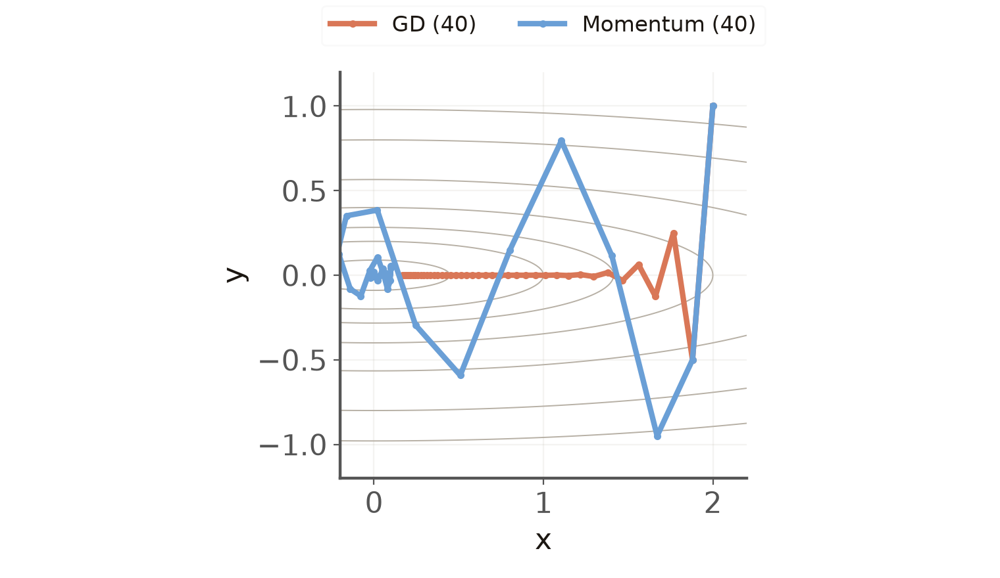

**圖說 `lec03-bp-v2-kp05-ravine`**：Demo 使用 f(x,y)=½(x²+25y²)，梯度為 (x,25y)。y 方向曲率是 x 的 25 倍。η=0.060、α=0.80，跑 40 步。圖中起點設為 (2,1)，是重建圖的明示條件，並非未知原圖資料。 本組參數動量的初期側向震盪反而較大；較快的長向收斂不代表每步更平滑。 先看圖例與輸入條件，再對照正文公式。〔功能：1、2〕

**Caption `lec03-bp-v2-kp05-ravine`**: The demo has 25 times more curvature along y. Our reconstructed plot starts at (2,1), uses a learning rate of 0.060 and momentum 0.80, and runs 40 steps. These parameters produce larger early sideways oscillations with momentum; faster progress along x does not mean a smoother path at every step. Read the inputs and legend first, then compare the formulas.


### 兩項分開計算，才能看見側向相消（Core lesson）

祕笈例：α=0.9、η=0.1、上一位移 (1.0,0.4)，當前梯度 (−0.5,6.0)。先算下坡項與歷史項，再相加：前進 0.95，側向 −0.24。提示練習：改 α=0.8、η=0.2、上一位移 (0.5,−0.4)、梯度 (1,2)，先拆成兩項。

Separate the downhill step from the retained displacement. In the guide example they add to (0.95,-0.24). For practice, change the four inputs and add the two terms separately.

$$
-0.1(-0.5,6)=(0.05,-0.60)
$$

$$
0.9(1,0.4)+(0.05,-0.60)=(0.95,-0.24)
$$


### 零初始慣性使第一步等於純梯度下降（Extension）

令前一步位移 Δw⁽⁻¹⁾=0。則第一步只剩 −η∇f。當 α=0 時每一步都退回純 GD。祕笈把「第零步位移=0」稱為第一推相同；此處明確使用前一步索引，避免一個索引代表兩件事。

A zero initial previous displacement makes the first update identical to gradient descent. The first step then contains only the negative learning rate times the current gradient. Setting momentum to zero makes every update identical to gradient descent. The guide calls a zero displacement at step zero the same first push; here we explicitly index the previous displacement to avoid giving one index two meanings.

$$
\Delta\mathbf{w}^{(-1)}=0\Rightarrow\Delta\mathbf{w}^{(0)}=-\eta^{(0)}\nabla f(\mathbf{w}^{(0)})
$$


### 購物車比喻只解釋記憶，不保證加速（Extension）

原比喻是推車透過又長又窄的超市走道。前進分力可累積，撞架分力可能相消；也像推嬰兒車下緩坡石階。侷限：數學更新沒有真實摩擦、貨架或碰撞；側向不一定每步相消。

The original analogy is a shopping cart in a narrow aisle, or a stroller on a sloping stairway. It illustrates memory, but physical collisions and friction are absent from the mathematical update.


### 把位移相加，並不等於改變當前梯度（Extension）

祕笈數值：當前位置 (10,1)。純 GD 到 (10.05,0.40)，動量到 (10.95,0.76)。x 位移 0.95/0.05=19 倍；y 位移絕對值由 0.60 降至 0.24。這是本例的位移比例，不是普遍收斂加速率。

From (10,1), gradient descent reaches (10.05,0.40) while momentum reaches (10.95,0.76). The factor of nineteen describes this displacement only, not a universal convergence speedup.

$$
(10,1)+(0.05,-0.60)=(10.05,0.40)
$$

$$
(10,1)+(0.95,-0.24)=(10.95,0.76)
$$

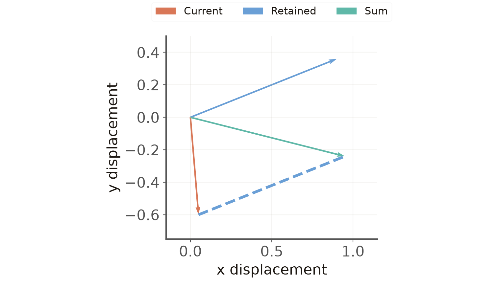

**圖說 `lec03-bp-v2-kp05-vectors`**：祕笈數值：當前位置 (10,1)。純 GD 到 (10.05,0.40)，動量到 (10.95,0.76)。x 位移 0.95/0.05=19 倍；y 位移絕對值由 0.60 降至 0.24。這是本例的位移比例，不是普遍收斂加速率。 先看圖例與輸入條件，再對照正文公式。〔功能：1、2〕

**Caption `lec03-bp-v2-kp05-vectors`**: From (10,1), gradient descent reaches (10.05,0.40) while momentum reaches (10.95,0.76). The factor of nineteen describes this displacement only, not a universal convergence speedup. Read the inputs and legend first, then compare the formulas.


### 原圖是來源證據，重建圖另列條件（Extension）

保留來源 Fig.2，對比有無動量的等高線軌跡。原始軌跡資料與起點未提供，因此不聲稱重建 40 步圖與原圖同資料。來源提及 Fig.3 的向量相加，已按祕笈數值重畫。

The source contour plot is preserved. Its trajectory data and starting point are unavailable, so our analytic reconstruction is explicitly a separate demonstration.

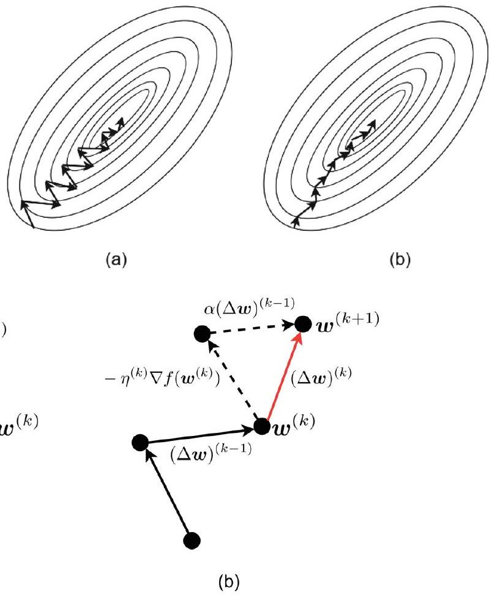

**圖說 `orig-kp5-fig2`**：保留來源 Fig.2，對比有無動量的等高線軌跡。原始軌跡資料與起點未提供，因此不聲稱重建 40 步圖與原圖同資料。來源提及 Fig.3 的向量相加，已按祕笈數值重畫。 先看圖例與輸入條件，再對照正文公式。〔功能：1、2〕

**Caption `orig-kp5-fig2`**: The source contour plot is preserved. Its trajectory data and starting point are unavailable, so our analytic reconstruction is explicitly a separate demonstration. Read the inputs and legend first, then compare the formulas.


### 動量可能越過谷底，也可能發散（Extension）

α 不是學習率；η 才控制當前梯度項的尺度。α 接近 1 會保留較多歷史，可能過衝。動量不保證全域最小值。祕笈列 0.8–0.99 為例示範圍，不能當作每個問題的安全區間。

Alpha is not the learning rate; eta scales the current-gradient term. An alpha close to one retains more history and may overshoot. Momentum does not guarantee a global minimum. The guide range 0.8–0.99 is illustrative, not a universally safe interval.


### 低通濾波直覺要附上成立條件（Extension）

當梯度方向連續多步一致，歷史項會累積；當某分量交替變號，歷史項可能抵消。這是低通濾波直覺。線搜尋改本步步長，動量改跨步記憶；反傳算梯度。RMSProp/Adam 另累積平方或一階矩。

When gradient directions persist across consecutive steps, historical contributions accumulate. When a component alternates in sign, its historical contributions may cancel. This motivates a low-pass filtering analogy. Line search changes the current step length; momentum changes memory across steps, and backpropagation computes gradients. RMSProp and Adam instead retain squared-gradient information or first moments.


### 歷史歸屬需要勘誤，不能照抄最早（Extension）

來源把動量最早歸給 Rumelhart 等人。已有 Polyak 1964 原論文，故「最早」說法不成立。保留原歷史題供勘誤討論，不把原選項 B 當成正確歷史答案。

Polyak published a relevant momentum method in 1964. The source attribution of its earliest origin to Rumelhart and colleagues needs correction. The original quiz is retained for discussion.

### 原題與提示（Original questions and hints）

**題 1：動量最早由誰提出？〔原題待勘誤〕**

Who first proposed momentum? [Original item requiring correction]

- A. Cauchy，1874（Cauchy, 1874）
- B. Rumelhart 等人（Rumelhart and colleagues）
- C. Robbins 與 Monro，1951（Robbins and Monro, 1951）
- D. Kingma 與 Ba（Adam）（Kingma and Ba (Adam)）

提示：先查 Polyak 1964；四個原選項不足以形成可信的最早歸屬題。

Hint: Check Polyak 1964 before treating any original option as a valid historical answer.

**題 2：式 (8) 中 α 的角色是？**

What does alpha represent in equation (8)?

- A. 學習率（Learning rate）
- B. 動量係數，控制保留多少上一步更新（Momentum coefficient controlling retained displacement）
- C. Lipschitz 常數（Lipschitz constant）
- D. 批次大小（Batch size）

提示：分別檢視 α 與 η 乘在哪一項。

Hint: Inspect which term each coefficient multiplies.

**題 3：動量對最佳化路徑的主要效果是？**

What is the main path effect of momentum?

- A. 保證找到全域最小值（Guarantees a global minimum）
- B. 減少狹長山谷震盪、加速收斂（Can reduce ravine oscillations and accelerate convergence）
- C. 完全取代梯度（Completely replaces the gradient）
- D. 固定學習率不變（Keeps the learning rate fixed）

提示：分清常見效果與無條件保證。

Hint: Distinguish a possible effect from an unconditional guarantee.

**題 4：式 (8) 與純梯度下降的關鍵差異？**

What distinguishes equation (8) from gradient descent?

- A. 多 αΔw 的歷史項（Adds a retained displacement term）
- B. 不用梯度（Uses no gradient）
- C. 只用上一步、不用當前梯度（Uses only the previous step）
- D. 完全相同（They are identical）

提示：把 α 設為零，再比較兩式。

Hint: Set alpha to zero and compare the two updates.


### 逐步驗算補充（Expanded numerical verification）

**先驗算第一步，再讀四十步終點**

起點 (2,1)、上一位移零，使純 GD 與動量第一步相同；後續纔有歷史項。

Both methods start at (2,1) with zero previous displacement, so their first steps match.

$$
\nabla f(2,1)=(2,25),\quad-0.06(2,25)=(-0.12,-1.5)
$$

$$
(2,1)+(-0.12,-1.5)=(1.88,-0.5)
$$

**四十步終點是程式迭代結果**

〔程式計算〕重複同一閉式40次，GD終點約 (0.1683232623,0)，動量約 (−0.0225968155,0.0140959642)；距原點約0.1683232623與0.0266329172。α=0兩軌跡完全重合。

(computed) Repeating the analytic update forty times gives GD endpoint (0.1683232623,0) and momentum endpoint (-0.0225968155,0.0140959642). Their distances are 0.1683232623 and 0.0266329172. Alpha zero gives identical paths.

### 術語表（Glossary）

| 中文 | English |
|---|---|
| 動量 | momentum |
| 狹長山谷 | ravine |
| 梯度下降 | gradient descent |
| 低通濾波 | low-pass filtering |
| 過衝 | overshooting |

### 來源與核對（Sources and verification）

來源為本批所提供的 KP 原文與教授祕笈；數字見 numeric-validation.json。所有補充限定為定義釐清、已隱含的推導及勘誤，未新增跨章理論。

Sources are the supplied KP text and teaching guide. Numerical validation is recorded separately; corrections and scope boundaries are explicit.

歷史核對：[Polyak 1964 原文書目](https://www.mathnet.ru/php/archive.phtml?jrnid=zvmmf&option_lang=eng&paperid=7713&wshow=paper)。


原圖來源：[原圖 orig-kp5-fig2](https://ndhuccc.github.io/CCC-LNS/IDL_115/Ch03-backprop-optimization/assets/orig-kp5-fig2.jpg)。

Original image references are retained above; local copies keep the diagrams available offline.


## KP06：反向傳播先算全部梯度，再更新參數（Backpropagation computes gradients before updates）

> 教材程度：大學生；每單元課堂主線 12.5 分鐘，其他為完整延伸。
> Level: undergraduate; 12.5 minutes for the core lesson, with complete extensions.

### 符號表（Symbols）

| 符號 | 中文意義 | English meaning |
|---|---|---|
| $z_\ell$ | 前一層神經元輸出，純量 | Output of a previous-layer neuron, scalar |
| $w_{i\ell}$ | 由 ℓ 到 i 的權重，純量 | Weight connecting neuron l to neuron i, scalar |
| $a_i$ | 激活前加權輸入，純量 | Preactivation weighted input, scalar |
| $\sigma_i$ | 神經元 i 的激活函式 | Activation function of neuron i |
| $z_i$ | 激活後輸出，純量 | Postactivation output, scalar |
| $e$ | 單次前向計算所得損失，純量 | Scalar loss from the forward evaluation |
| $\delta_i$ | ∂e/∂aᵢ，激活前敏感度 | Sensitivity of the loss to preactivation |
| $\eta$ | 學習率，正數 | Positive learning rate |

### 前向產生輸出，反向傳回敏感度（Core lesson）

先用同一組權重算完前向輸出與損失。反向從出口回傳 δ，得到各權重梯度。鍋爐房比喻：先向前送蒸汽，再反向傳話。最後才由最佳化器決定如何調整權重。

Evaluate the entire forward pass with one parameter state. Propagate sensitivities backward to compute all gradients, then let the optimizer update the parameters.

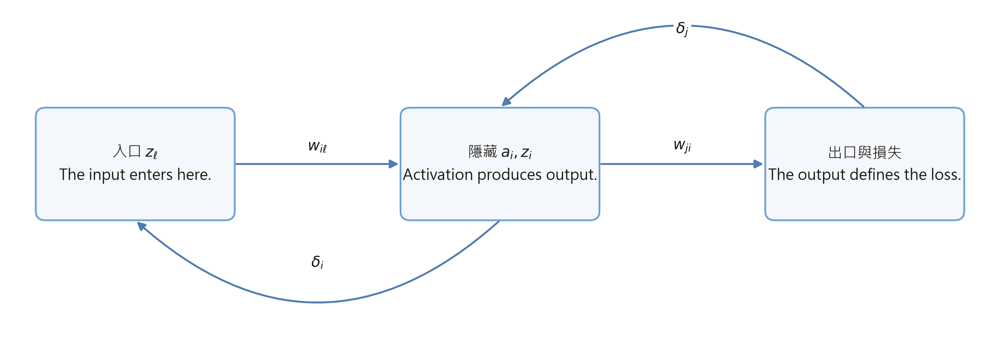

**流程說明 `lec03-bp-v2-kp06-network`**：可編輯流程示意；先看前進依賴，再看回傳或下一批的方向。位置不編碼數值。〔功能：1〕

**Caption `lec03-bp-v2-kp06-network`**: Editable dependency schematic; follow forward dependencies, then backward information or the next batch. Positions encode no numerical values.


### 權重梯度等於本層敏感度乘前層輸出（Core lesson）

i 接收前層輸出 zℓ，先算加權和 aᵢ，再經 σᵢ 得 zᵢ。δᵢ 定義為 ∂e/∂aᵢ。因 ∂aᵢ/∂wᵢℓ=zℓ，鏈式法則得到梯度 δᵢzℓ。

A neuron applies its activation to a weighted input. Define delta as sensitivity to preactivation. The chain rule gives the weight gradient as delta times the previous output.

$$
a_i=\sum_{\ell=1}^{m}w_{i\ell}z_\ell,\qquad z_i=\sigma_i(a_i)
$$

$$
\delta_i:=\frac{\partial e}{\partial a_i},\qquad\frac{\partial e}{\partial w_{i\ell}}=\delta_i z_\ell
$$


### 預設小網路的兩個梯度是二與一（Core lesson）

令入口、兩權重都為 1，目標 t=0，隱藏 σ(a)=a²，出口恆等。前向得到 aᵢ=zᵢ=zⱼ=1、e=0.5。出口 δⱼ=1；隱藏 δᵢ=1×1×2=2，故隱藏梯度 2、出口梯度 1。

With input and weights all one, a squared hidden activation gives loss 0.5. The output gradient is one and the hidden gradient is two.

$$
\delta_j=1-0=1,\quad\delta_i=1\cdot1\cdot(2\cdot1)=2
$$

$$
(w_{i\ell}^{+},w_{ji}^{+})=(1-0.1\cdot2,\,1-0.1\cdot1)=(0.8,0.9)
$$

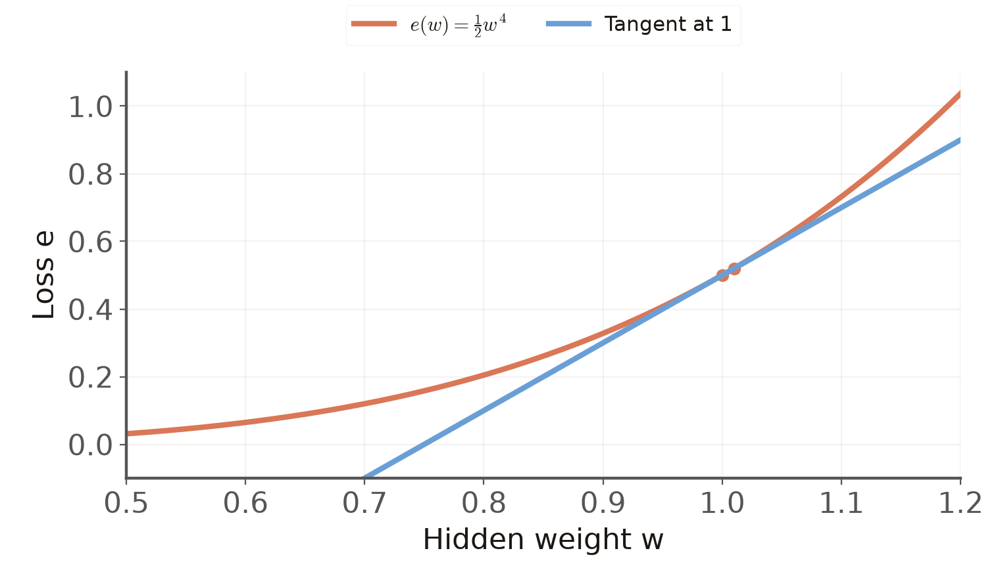

**圖說 `lec03-bp-v2-kp06-square`**：令入口、兩權重都為 1，目標 t=0，隱藏 σ(a)=a²，出口恆等。前向得到 aᵢ=zᵢ=zⱼ=1、e=0.5。出口 δⱼ=1；隱藏 δᵢ=1×1×2=2，故隱藏梯度 2、出口梯度 1。 先看圖例與輸入條件，再對照正文公式。〔功能：1、2〕

**Caption `lec03-bp-v2-kp06-square`**: With input and weights all one, a squared hidden activation gives loss 0.5. The output gradient is one and the hidden gradient is two. Read the inputs and legend first, then compare the formulas.


### 先鎖定舊權重，再練習整次更新（Core lesson）

練習：zℓ=2、wᵢℓ=0.5、wⱼᵢ=2、t=3、η=0.05，隱藏 σ(a)=a²、出口恆等。依序算前向、兩個 δ、兩個梯度與新權重。提示：反傳時使用舊的出口權重 2。

Use input two, hidden weight 0.5, output weight two, target three, and learning rate 0.05. Compute the full forward and backward passes before updating either weight.


來源公式編號：前向加權和對應式 (9)，激活輸出對應式 (10)。

Source numbering: the weighted input is equation (9), and the activation output is equation (10).

### 單一神經元先加總，再經激活函式（Extension）

式 (9) 的 m 是前層輸入數。若需要偏置，可把常數輸入 z₀=1 接上權重；本來源例子未額外設偏置。神經元示意圖保留加權輸入、加總與激活的角色。

The index m counts previous-layer inputs. A constant input can represent a bias, although the source example introduces no separate bias parameter.

$$
a_i=\sum_{\ell=1}^{m}w_{i\ell}z_\ell
$$

$$
z_i=\sigma_i(a_i)
$$

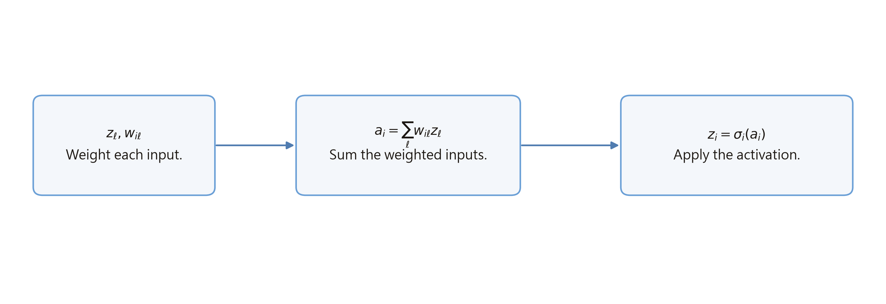

**流程說明 `lec03-bp-v2-kp06-neuron`**：可編輯流程示意；先看前進依賴，再看回傳或下一批的方向。位置不編碼數值。〔功能：1〕

**Caption `lec03-bp-v2-kp06-neuron`**: Editable dependency schematic; follow forward dependencies, then backward information or the next batch. Positions encode no numerical values.


### 隱藏敏感度要加總所有下游路徑（Extension）

隱藏層的輸出可能影響多個 j。鏈式法則要把每一條路徑貢獻相加：先把下游 δⱼ 乘 wⱼᵢ，再乘本層 σ′(aᵢ)。只取一個下游會漏算，漏乘激活導數也會錯。

A hidden output may affect several downstream neurons. Sum every downstream contribution and multiply by the local activation derivative.

$$
\delta_i=\sum_j\delta_j\frac{\partial a_j}{\partial a_i}\tag{13}
$$

$$
\frac{\partial a_j}{\partial a_i}=w_{ji}\sigma_i'(a_i)\tag{14}
$$


### 把隱藏敏感度代回，即得權重梯度（Extension）

式 (15) 與式 (16) 是同一條鏈式法則的兩種整理。σ′(aᵢ) 是神經元本地導數，Σⱼδⱼwⱼᵢ 是下游回傳資訊，zℓ 是這根權重前的輸入。

Equations (15) and (16) reorganize the same chain rule. They combine the local derivative, downstream sensitivities, and the input attached to the weight.

$$
\delta_i=\sigma_i'(a_i)\sum_j\delta_jw_{ji}\tag{15}
$$

$$
\frac{\partial e}{\partial w_{i\ell}}=z_\ell\sigma_i'(a_i)\sum_j\delta_jw_{ji}\tag{16}
$$


### 反傳只求導，最佳化器另決定更新（Extension）

所有梯度都必須在 w⁽ᵏ⁾ 計算。更新式 (17)–(19) 是梯度下降的使用方式，不是反傳的定義。也可把同樣的梯度交給動量或 Adam。

Backpropagation computes derivatives at the old parameter state. Gradient descent, momentum, or Adam can then use those derivatives.

$$
w_{i\ell}^{(k+1)}=w_{i\ell}^{(k)}-\eta^{(k)}\frac{\partial e}{\partial w_{i\ell}}\tag{17}
$$


### 輸出與隱藏更新形式不同，時點相同（Extension）

輸出層 δ 可由損失及輸出激活求出；它不總是 z−t。祕笈恆等出口加平方損失纔有 δⱼ=zⱼ−t。隱藏層用回傳式。兩式右側參數一律取更新前值。

Output delta is derived from the loss and output activation; it is not always prediction minus target. That residual formula holds in the guide because the output is the identity and the loss is squared error. Hidden layers use the backward recurrence. All parameters on the right-hand side are evaluated before updating.

$$
w_{i\ell}^{+}=w_{i\ell}-\eta z_\ell\frac{\partial e}{\partial a_i}\tag{18}
$$

$$
w_{i\ell}^{+}=w_{i\ell}-\eta z_\ell\sigma_i'(a_i)\sum_j\delta_jw_{ji}\tag{19}
$$


### 倒序是求導順序，不是邊求邊改（Extension）

Algorithm 2 的安全版本：初始化→前向→由最後層回到第一層求 δ 與梯度→一次更新全部權重→檢查停止條件。未停止則按選定規則調整 η 並繼續。來源若解讀為先改出口再回傳，會用錯參數點。

The safe algorithm initializes parameters, evaluates forward, computes gradients backward, updates all parameters, and checks a stopping condition. Reverse traversal does not authorize premature updates.


### 小幅擾動可對帳隱藏梯度（Extension）

預設例中把隱藏權重從 1 改到 1.01，保持出口權重 1。aᵢ=1.01，zᵢ=zⱼ=1.0201，e=½×1.0201²≈0.5203。差商 (½×1.01⁴−0.5)/0.01≈2.0302，接近解析梯度 2。

Perturb only the hidden weight to 1.01 while holding the output weight fixed. The resulting difference quotient is 2.0302, close to the analytic derivative two.

$$
e(1.01)=\tfrac12(1.01^2)^2\approx0.5203
$$

$$
\frac{e(1.01)-e(1)}{0.01}\approx2.0302
$$


**圖說 `lec03-bp-v2-kp06-square`**：預設例中把隱藏權重從 1 改到 1.01，保持出口權重 1。aᵢ=1.01，zᵢ=zⱼ=1.0201，e=½×1.0201²≈0.5203。差商 (½×1.01⁴−0.5)/0.01≈2.0302，接近解析梯度 2。 先看圖例與輸入條件，再對照正文公式。〔功能：1、2〕

**Caption `lec03-bp-v2-kp06-square`**: Perturb only the hidden weight to 1.01 while holding the output weight fixed. The resulting difference quotient is 2.0302, close to the analytic derivative two. Read the inputs and legend first, then compare the formulas.


### 下游有誤差，上游也可能收到零梯度（Extension）

反例：兩出口 δ₁=1、δ₂=−1，且兩連線權重皆 1。加權和 1×1+(−1)×1=0，因此本層 δᵢ=0，梯度也為零。反傳傳的是有正負的敏感度，不是責備的程度。

For two outputs with sensitivities one and minus one and both connecting weights one, the weighted sum is zero. The hidden sensitivity and its weight gradient are therefore zero. Backpropagation transmits signed sensitivities rather than the presence or magnitude of blame.

$$
\sum_j\delta_jw_{ji}=1\cdot1+(-1)\cdot1=0\Rightarrow\delta_i=0
$$


### 鍋爐房與客訴專線都只是依賴的比喻（Extension）

原鍋爐房比喻是蒸汽前送、敏感度從出口倒灌；替換場景是客服→課長→組長。侷限：δ 不是物質流量或道德責任，也可能負、相消。隱藏層不直接讀標籤，卻透過計算圖受標籤影響。

The boiler-room and customer-complaint analogies illustrate dependency paths. Delta is not a physical flow or blame; it can be negative and can cancel.


### 來源三層網路保留拓撲角色（Extension）

來源 Fig.4 是三層連續網路。投影片以可編輯原生節點及 Connector 重畫網路依賴，講義保留原圖供對照。請先看層的順序，再看各線代表的權重，勿把線長解讀成權重大小。

Source Figure 4 shows a three-layer continuous network. Slides redraw its dependency roles with editable nodes and connectors; line length does not encode a weight value.

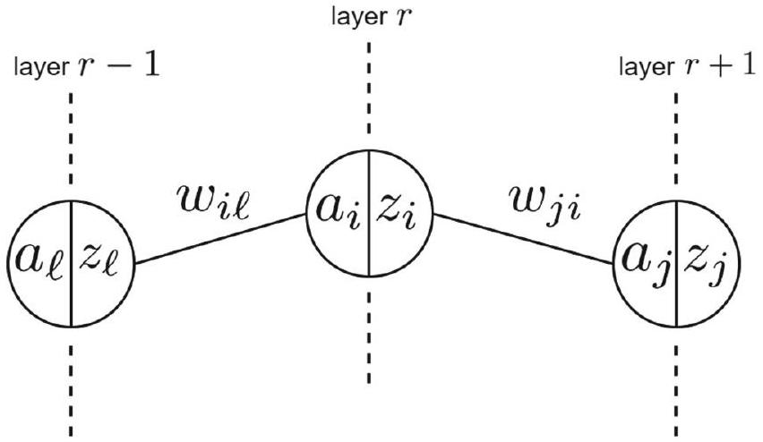

**圖說 `orig-kp6-fig4`**：來源 Fig.4 是三層連續網路。投影片以可編輯原生節點及 Connector 重畫網路依賴，講義保留原圖供對照。請先看層的順序，再看各線代表的權重，勿把線長解讀成權重大小。 先看圖例與輸入條件，再對照正文公式。〔功能：1、2〕

**Caption `orig-kp6-fig4`**: Source Figure 4 shows a three-layer continuous network. Slides redraw its dependency roles with editable nodes and connectors; line length does not encode a weight value. Read the inputs and legend first, then compare the formulas.


### 來源神經元圖區分輸入與激活（Extension）

來源 Fig.5 展示輸入加權、相加與激活。講義保留原圖，投影片重畫可編輯拓撲。先看 zℓ 進入加權和，再看 aᵢ 經 σᵢ 變成 zᵢ；不要把 aᵢ 與 zᵢ 混成同一個符號。

Source Figure 5 separates weighted inputs from activation. Read the inputs first, then the preactivation sum, and finally the postactivation output.

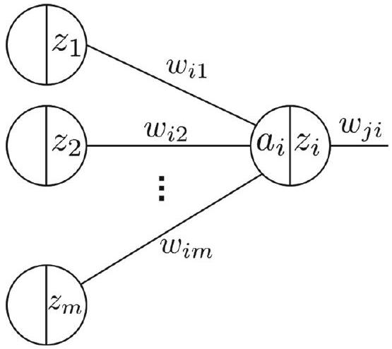

**圖說 `orig-kp6-fig5`**：來源 Fig.5 展示輸入加權、相加與激活。講義保留原圖，投影片重畫可編輯拓撲。先看 zℓ 進入加權和，再看 aᵢ 經 σᵢ 變成 zᵢ；不要把 aᵢ 與 zᵢ 混成同一個符號。 先看圖例與輸入條件，再對照正文公式。〔功能：1、2〕

**Caption `orig-kp6-fig5`**: Source Figure 5 separates weighted inputs from activation. Read the inputs first, then the preactivation sum, and finally the postactivation output. Read the inputs and legend first, then compare the formulas.

### 原題與提示（Original questions and hints）

**題 1：δᵢ 的定義是？**

How is delta defined?

- A. ∂e/∂wᵢℓ（Derivative with respect to the weight）
- B. ∂e/∂aᵢ（Derivative with respect to preactivation）
- C. ∂e/∂zᵢ（Derivative with respect to postactivation）
- D. 激活函式 σᵢ（The activation function）

提示：核對式 (12) 的分母。

Hint: Inspect the denominator in equation (12).

**題 2：對 wᵢℓ，梯度等於什麼？**

What is the gradient with respect to the weight?

- A. δᵢ×zℓ（Delta times previous output）
- B. δᵢ/zℓ（Delta divided by previous output）
- C. zℓ×σ(aᵢ)（Previous output times activation）
- D. Σⱼδⱼ（Sum of downstream deltas）

提示：先求 ∂aᵢ/∂wᵢℓ。

Hint: Differentiate the weighted sum with respect to this weight.

**題 3：隱藏層更新比輸出層多哪些結構？**

Which structure appears in hidden-layer updates?

- A. σ′(aᵢ) 與下游 δⱼ 加權和（Local activation derivative and weighted downstream deltas）
- B. 只用 zℓ（Only the previous output）
- C. 不用學習率（No learning rate）
- D. 不用鏈式法則（No chain rule）

提示：沿每條下游依賴回傳再相加。

Hint: Trace and sum all downstream dependency paths.

**題 4：Algorithm 2 的遍歷順序是？〔釐清求導〕**

Which direction does Algorithm 2 traverse? [Gradient traversal]

- A. 輸入到輸出（Input to output）
- B. 最後層回第一層（Last layer to first layer）
- C. 隨機（Random order）
- D. 只更新輸出層（Output layer only）

提示：這是 δ 求導順序；全部求完才更新，不能邊走邊改。

Hint: This is the derivative traversal; update only after all gradients are computed.


### 逐步驗算補充（Expanded numerical verification）

**先算激活前，再平方成輸出**

入口 zℓ、隱藏權重與出口權重皆為1，目標0。先求隱藏激活前輸入與輸出，再求本地導數；此時不更新權重。

Input, hidden weight, and output weight are one; target zero. Compute hidden preactivation, output, and local derivative without updating.

$$
a_i=w_{i\ell}z_\ell=1\cdot1=1,\quad z_i=a_i^2=1^2=1
$$

$$
\sigma_i\prime(a_i)=2a_i=2\cdot1=2
$$

**恆等出口加平方損失，纔得到殘差敏感度**

本例出口激活是恆等，故 ∂zⱼ/∂aⱼ=1；輸出敏感度 δⱼ=(zⱼ−t)×1=1。換損失或激活後，要重做這一步鏈式法則。

The identity output has derivative one, giving output delta one. A different loss or output activation changes this chain-rule step.

$$
a_j=z_j=w_{ji}z_i=1\cdot1=1
$$

$$
e=\tfrac12(z_j-t)^2=\tfrac12(1-0)^2=0.5
$$

**兩個梯度共享更新前的權重一**

出口敏感度1乘隱藏輸出1，得到出口梯度1；隱藏敏感度1×1×2再乘入口1，得到隱藏梯度2。然後才同時得到新權重0.9與0.8。

The output gradient is one times one. The hidden gradient is one times one times two times one. Only then are the weights updated to 0.9 and 0.8.

$$
\frac{\partial e}{\partial w_{ji}}=\delta_jz_i=1\cdot1=1
$$

$$
\frac{\partial e}{\partial w_{i\ell}}=\delta_i z_\ell=(1\cdot1\cdot2)\cdot1=2
$$

### 術語表（Glossary）

| 中文 | English |
|---|---|
| 反向傳播 | backpropagation |
| 前向傳播 | forward propagation |
| 鏈式法則 | chain rule |
| 激活前輸入 | preactivation |
| 激活函數 | activation function |
| 敏感度 | sensitivity |
| 差商 | difference quotient |

### 來源與核對（Sources and verification）

來源為本批所提供的 KP 原文與教授祕笈；數字見 numeric-validation.json。所有補充限定為定義釐清、已隱含的推導及勘誤，未新增跨章理論。

Sources are the supplied KP text and teaching guide. Numerical validation is recorded separately; corrections and scope boundaries are explicit.

歷史核對：[Rumelhart、Hinton、Williams 1986](https://doi.org/10.1038/323533a0)；本講義不聲稱其為所有反向微分觀唸的最早發明。


原圖來源：[原圖 orig-kp6-fig4](https://ndhuccc.github.io/CCC-LNS/IDL_115/Ch03-backprop-optimization/assets/orig-kp6-fig4.jpg)；[原圖 orig-kp6-fig5](https://ndhuccc.github.io/CCC-LNS/IDL_115/Ch03-backprop-optimization/assets/orig-kp6-fig5.jpg)。

Original image references are retained above; local copies keep the diagrams available offline.


## KP07：單樣本梯度以便宜換取抽樣雜訊（Single-sample gradients trade cost for noise）

> 教材程度：大學生；每單元課堂主線 12.5 分鐘，其他為完整延伸。
> Level: undergraduate; 12.5 minutes for the core lesson, with complete extensions.

### 符號表（Symbols）

| 符號 | 中文意義 | English meaning |
|---|---|---|
| $n$ | 資料筆數，正整數 | Number of training examples |
| $\mathbf{x}_i,l_i$ | 第 i 筆資料與標籤 | Example i and its label |
| $f_i(\mathbf{w})$ | 第 i 筆資料的純量損失 | Scalar loss for example i |
| $f(\mathbf{w})$ | 所有樣本損失的平均 | Mean loss over all examples |
| $i_k$ | 第 k 步隨機選取的資料索引 | Random example index at step k |
| $\eta^{(k)}$ | 學習率，第 k 步正步長 | Positive learning rate at step k |

### 全資料平均改成均勻抽一筆估計（Core lesson）

總損失 f 是 n 筆 fᵢ 的平均。全梯度需要 n 個樣本梯度；單樣本 SGD 每步均勻隨機抽一筆，以該梯度替代平均。每步便宜，但一次抽樣可能偏離全梯度。

The objective averages all example losses. Uniform single-sample SGD substitutes one gradient for the full average, reducing per-step work but adding sampling noise.

$$
f(\mathbf{w})=\frac1n\sum_{i=1}^nf_i(\mathbf{w})\tag{20}
$$

$$
\mathbf{w}^{(k+1)}=\mathbf{w}^{(k)}-\eta^{(k)}\nabla f_{i_k}(\mathbf{w}^{(k)})\tag{22}
$$


### Demo 的四筆目標平均是四（Core lesson）

Demo 目標 y=(2,1,8,5)，fᵢ(w)=½(w−yᵢ)²，∇fᵢ=w−yᵢ。在 w=0、η=0.2，全梯度 −4 更新至 0.8；抽第 1 筆梯度 −2 更新至 0.4。不要與祕笈另一組目標混用。

The demo targets are (2,1,8,5), with mean four. From zero at learning rate 0.2, the full-gradient update reaches 0.8 and sample one reaches 0.4.

$$
\bar y=(2+1+8+5)/4=4,\quad\nabla f(0)=-4
$$

$$
w_{\rm full}^{+}=0-0.2(-4)=0.8,\quad w_1^{+}=0-0.2(-2)=0.4
$$

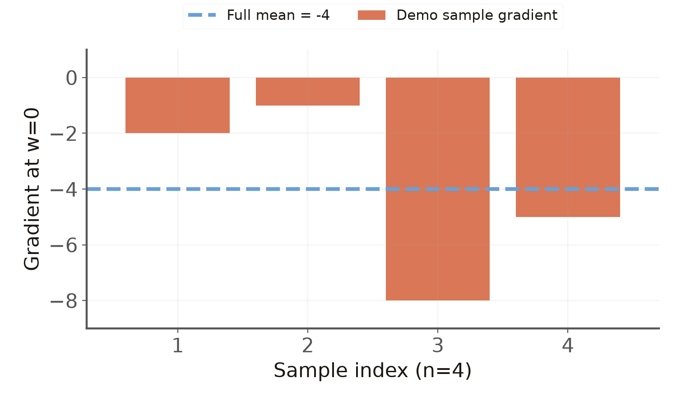

**圖說 `lec03-bp-v2-kp07-gradients`**：Demo 目標 y=(2,1,8,5)，fᵢ(w)=½(w−yᵢ)²，∇fᵢ=w−yᵢ。在 w=0、η=0.2，全梯度 −4 更新至 0.8；抽第 1 筆梯度 −2 更新至 0.4。不要與祕笈另一組目標混用。 先看圖例與輸入條件，再對照正文公式。〔功能：1、2〕

**Caption `lec03-bp-v2-kp07-gradients`**: The demo targets are (2,1,8,5), with mean four. From zero at learning rate 0.2, the full-gradient update reaches 0.8 and sample one reaches 0.4. Read the inputs and legend first, then compare the formulas.


### 單次方向可錯，期望仍可能正確（Core lesson）

練習：t=(1,3,5)、w=2、η=0.5。先算三個 w−tᵢ、平均梯度，再算抽每一筆的新 w。提示：先找平均目標 w*=3，檢查每步是否更接近它；期望正確不保證每一筆都對。

For targets (1,3,5), parameter two, and learning rate 0.5, compute each sample update. Compare its distance to the mean target three; unbiasedness does not guarantee every realized step improves.


### 均勻抽樣是無偏梯度的前提（Extension）

在固定 w，每個索引機率為 1/n，故期望等於平均。若偏向某些樣本而未校正權重，這個等式未必成立。SGD 每步成本約一筆模型前反向，full-batch 約 n 筆；成本還依模型大小而變。

At a fixed parameter state, uniform sampling makes the expected sample gradient equal the full gradient. Nonuniform sampling without correction need not preserve this equality.

$$
\nabla f(\mathbf{w})=\frac1n\sum_i\nabla f_i(\mathbf{w})\tag{21}
$$

$$
\mathbb E_i[\nabla f_i(\mathbf{w})]=\sum_i\frac1n\nabla f_i(\mathbf{w})
$$


### 帳單與試喫比喻只說明抽樣估計（Extension）

原比喻：用一張公司帳單估全公司平均；替換場景：餐廳夾一口估全選單鹹度。侷限：均勻隨機才代表平均，便利抽樣可能偏。參數每次改變，因此不是把同一固定帳單總額直接相加。

The original analogy estimates the company average from one bill. Its alternative estimates the average saltiness of the whole restaurant menu by tasting one bite. The limitation is that uniform random sampling represents the mean, while convenient sampling may be biased. Parameters change after each update, so this is not simply adding fixed bill totals.


### 祕笈另用四張帳單，平均是五（Extension）

祕笈目標 t=(2,4,6,8)，故 w*=5。在 w=0，梯度為 −2、−4、−6、−8，平均 −5。η=0.2：full-batch 到 1.0，抽第1筆到 0.4，抽第4筆到 1.6。這是另一個算例。

The guide uses different targets, (2,4,6,8), with mean five. At zero, sample gradients are -2,-4,-6,-8. The full update reaches one; samples one and four reach 0.4 and 1.6.

$$
\nabla f(0)=(-2-4-6-8)/4=-5
$$

$$
(w_{\rm full}^{+},w_1^{+},w_4^{+})=(1.0,0.4,1.6)
$$


### 在平均最優點，單筆梯度仍會抖（Extension）

在祕笈 w*=5，各梯度為 3、1、−1、−3，平均為零。抽第1筆仍會把 w 改成 5−0.2×3=4.4。這不是無偏等式失敗，而是單次估計有非零方差。

At the guide optimum five, gradients are (3,1,-1,-3). Their mean is zero, yet sampling the first example moves the parameter to 4.4 because individual gradients remain noisy.

$$
\nabla f(5)=(3+1-1-3)/4=0
$$

$$
w_1^{+}=5-0.2\cdot3=4.4
$$


### 學習率排程隨步數變，不一定自適應（Extension）

來源列 ηᵏ=1/k、1/√k、固定 η。前兩式從 k=1 起定義，不能在 k=0 除零。它們是預先指定排程；自適應通常指依資料或梯度狀態調整，兩者不要混稱。

The source lists inverse-step, inverse-square-root, and constant learning rates. The first two begin at step one. A predefined schedule should be distinguished from gradient-adaptive rates.

$$
\eta^{(k)}=1/k,\quad\eta^{(k)}=1/\sqrt{k},\quad\eta^{(k)}=\eta\qquad(k\ge1)
$$


### 三種排程的差別要由數字看（Extension）

k=1,4,9,16 時，1/k 為 1,0.25,0.1111,0.0625；1/√k 為 1,0.5,0.3333,0.25；固定為 0.2。來源四捨五入 0.063 對應 0.0625。衰減較慢不代表任何問題都更好。

At steps 1,4,9,16, the inverse-step and inverse-square-root schedules shrink at different speeds. The source value 0.063 rounds the exact value 0.0625.

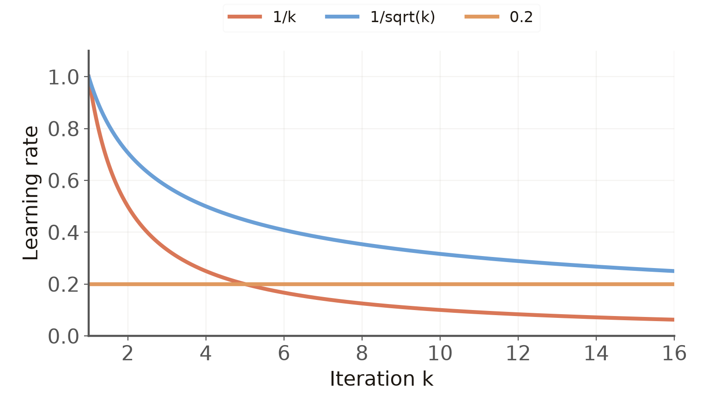

**圖說 `lec03-bp-v2-kp07-schedule`**：k=1,4,9,16 時，1/k 為 1,0.25,0.1111,0.0625；1/√k 為 1,0.5,0.3333,0.25；固定為 0.2。來源四捨五入 0.063 對應 0.0625。衰減較慢不代表任何問題都更好。 先看圖例與輸入條件，再對照正文公式。〔功能：1、2〕

**Caption `lec03-bp-v2-kp07-schedule`**: At steps 1,4,9,16, the inverse-step and inverse-square-root schedules shrink at different speeds. The source value 0.063 rounds the exact value 0.0625. Read the inputs and legend first, then compare the formulas.


### 便宜一步不保證更少步或必然收斂（Extension）

單步計算少，並不保證比 full-batch 更少迭代。固定步長下可能留有雜訊誤差；O(η) 必須說清是何種誤差與假設，不能當普遍參數距離。1/√k 也不滿足經典平方可和條件，不能單靠排程保證收斂。

Less computation per step does not guarantee fewer iterations than full-batch updating. A fixed learning rate may leave noise-related error. An error of order eta requires a specified error measure and assumptions; it is not a universal parameter-distance bound. The inverse-square-root schedule also fails the classical square-summability condition, so a schedule alone cannot guarantee convergence.


### 單樣本與小批次都常被簡稱 SGD（Extension）

本節嚴格使用 single-sample SGD，一步一筆。實務常把 mini-batch SGD 也叫 SGD。每筆梯度可由反傳取得；下一單元只改抽樣與平均筆數，不改反傳規則。來源「ML 約1998開始」不當作最早年份。

This unit uses SGD strictly for one example per step. Common usage also includes mini-batches. Backpropagation computes the example gradients; sampling changes how many are averaged.

### 原題與提示（Original questions and hints）

**題 1：式 (20) 總 cost 如何定義？**

How is the total cost defined in equation (20)?

- A. 單一樣本 loss（One sample loss）
- B. n 個 fᵢ 的平均（Mean of n sample losses）
- C. n 個 loss 最大值（Maximum sample loss）
- D. 不含資料項（Contains no data term）

提示：看求和前面的 1/n。

Hint: Inspect the factor before the sum.

**題 2：SGD 與 full-batch 的關鍵差異？**

What distinguishes SGD from full-batch updating?

- A. 用單樣本梯度而非全梯度（Uses one sample gradient instead of the full gradient）
- B. 不用梯度（Uses no gradient）
- C. 一定收斂更快（Always converges faster）
- D. 每步掃完整資料集（Scans every example each step）

提示：比較式 (21) 的求和與式 (22) 的索引。

Hint: Compare the sum in equation (21) with the index in equation (22).

**題 3：文中提到哪個學習率 schedule？**

Which learning-rate schedule is mentioned?

- A. 1/k（Inverse iteration index）
- B. k²（Squared iteration index）
- C. log k（Logarithm of the index）
- D. 只有固定 η（Only a constant rate）

提示：排程從 k=1 起，先找逐步縮小者。

Hint: Start at step one and inspect which listed schedule decreases.

**題 4：Full-batch 成本隨 n 如何變？**

How does full-gradient work scale with n?

- A. 每步全部 n 筆求和，O(n)（Sums all n examples, with linear work）
- B. 與 n 無關（Independent of n）
- C. 只需一筆（Needs one example）
- D. 只需輸出層（Needs only the output layer）

提示：固定模型一次梯度的成本，再數要算幾筆。

Hint: Hold model cost fixed and count the examples evaluated.


### 逐步驗算補充（Expanded numerical verification）

**祕笈三種更新逐一代入同一步長**

本頁只用祕笈 t=(2,4,6,8)。不要拿Demo平均4的全梯度−4代入；此處平均5的全梯度是−5。

This page uses only guide targets (2,4,6,8), with mean five. The demo mean four belongs to a different example.

$$
w_{\rm full}^+=0-0.2(-5)=1.0
$$

$$
w_1^+=0-0.2(-2)=0.4,\quad w_4^+=0-0.2(-8)=1.6
$$

**步數十六時，兩排程仍不同**

固定排程仍是0.2；原表的0.063是0.0625四捨五入。表中所有值以k=1,4,9,16代入各式，並非跟著模型梯度調整的自適應步長。

The constant rate remains 0.2. The source value 0.063 rounds 0.0625. These rates follow the iteration index rather than adapt to model gradients.

$$
1/16=0.0625,\qquad 1/\sqrt{16}=1/4=0.25
$$

### 術語表（Glossary）

| 中文 | English |
|---|---|
| 隨機梯度下降 | stochastic gradient descent |
| 全批次 | full-batch |
| 單樣本 | single-sample |
| 無偏估計 | unbiased estimation |
| 學習率排程 | learning-rate schedule |
| 方差 | variance |

### 來源與核對（Sources and verification）

來源為本批所提供的 KP 原文與教授祕笈；數字見 numeric-validation.json。所有補充限定為定義釐清、已隱含的推導及勘誤，未新增跨章理論。

Sources are the supplied KP text and teaching guide. Numerical validation is recorded separately; corrections and scope boundaries are explicit.

理論邊界核對：[Bottou、Curtis、Nocedal 的原論文](https://arxiv.org/abs/1606.04838)，§4；來源未指明的收斂量與假設不補猜。


## KP08：小批次先平均，每次更新後重算梯度（Mini-batches average gradients at the current state）

> 教材程度：大學生；每單元課堂主線 12.5 分鐘，其他為完整延伸。
> Level: undergraduate; 12.5 minutes for the core lesson, with complete extensions.

### 符號表（Symbols）

| 符號 | 中文意義 | English meaning |
|---|---|---|
| $n,b$ | 資料總數與設定批次大小，正整數 | Dataset size and requested batch size |
| $\mathcal D,\mathcal B_i$ | 資料集與第 i 個批次 | Dataset and batch i |
| $m_k$ | 當前批次實際筆數 | Actual number of examples in the current batch |
| $e_t$ | 小批次梯度減全梯度的向量誤差 | Mini-batch gradient minus full gradient |
| $\sigma^2$ | 固定 w 時 Σ||gᵢ−ḡ||²/n | Population gradient variance at a fixed parameter state |
| $L,\mu$ | 平滑常數與強凸常數 | Smoothness and strong-convexity constants |
| $t$ | 迭代次數，非目標標籤 | Iteration count, distinct from a target label |

### 一小疊平均梯度，掃完資料算一輪（Core lesson）

每次拿 b 筆平均，比一筆穩定、比全部便宜。無放回切成互斥批次，全部用過一次是 epoch。若 n=1024、b=32，每輪有 1024/32=32 次更新。b 不整除 n 時，需保留最後小批次或明示捨棄。

A mini-batch averages several gradients. An epoch processes the dataset once. With 1024 examples and batch size 32, an epoch has 32 updates; an incomplete final batch requires an explicit policy.

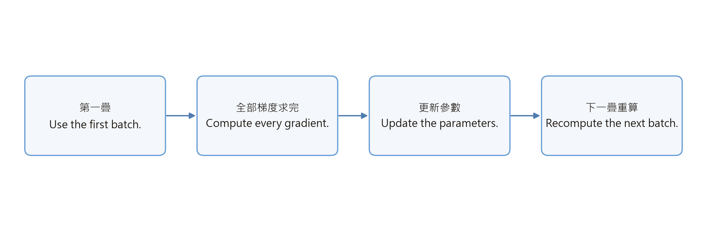

**流程說明 `lec03-bp-v2-kp08-batches`**：可編輯流程示意；先看前進依賴，再看回傳或下一批的方向。位置不編碼數值。〔功能：1〕

**Caption `lec03-bp-v2-kp08-batches`**: Editable dependency schematic; follow forward dependencies, then backward information or the next batch. Positions encode no numerical values.


### 第二疊必須在新的參數重新求梯度（Core lesson）

祕笈 t=(2,4,6,8)、w=5、η=0.5。第一疊索引 {1,2} 平均梯度 (3+1)/2=2，w→4。第二疊 {3,4} 此時梯度為 4−6=−2、4−8=−4，平均 −3，故 w→5.5。原文回到5使用過期梯度，有錯。

After the first batch moves the parameter from five to four, recompute the second batch gradients as -2 and -4. Its mean -3 moves the parameter to 5.5, correcting the source result five.

$$
w_1=5-0.5(3+1)/2=4
$$

$$
w_2=4-0.5[\,(4-6)+(4-8)\,]/2=5.5
$$


### 先寫實際批次大小，再做一次更新（Core lesson）

練習：n=6，當前 w=1 時梯度暫記 6,4,2,0,−2,−4，b=3、η=0.1。先算批次數，再選第一疊更新。提示：只給某點梯度不足以算第二疊的新梯度；若假設平方損失，需明示目標纔可走完一輪。

For six given gradients at parameter one, choose a batch of three and compute one update. To continue the epoch, specify how gradients change with the parameter; the given values alone are insufficient.


### 覆蓋全集合的切法需要處理餘數（Extension）

來源式 (23)–(24) 使用 floor(n/b) 個大小 b 的批次。只有 b 整除 n，聯集纔等於 D。保留尾批時應有 ceil(n/b) 批，最後批大小 n−b floor(n/b)。捨棄尾批則本輪未掃到所有資料。

The source floor-count partition covers the dataset only when b divides n. Retaining an incomplete batch uses a ceiling count; dropping it leaves some examples unused.

$$
\bigcup_{i=1}^{\lceil n/b\rceil}\mathcal B_i=\mathcal D\quad\text{(retain last batch)}
$$

$$
\mathcal B_i\cap\mathcal B_j=\varnothing\quad(i\ne j)\tag{24}
$$


### 尾批平均要除以當批實際筆數（Extension）

式 (25) 對完整大小 b 的批次除以 b；尾批有 mₖ 筆則除以 mₖ。平均與求和方向相同，但沿用 η 時，求和把步長放大 mₖ 倍。GPU 可平行算同一批，效率仍受硬體與模型限制。

A complete batch averages b examples; the last batch averages its actual size m_k. Sums and means have the same direction, but with unchanged eta, summing multiplies the update by m_k. GPUs can evaluate a batch in parallel; efficiency still depends on hardware and the model.

$$
\mathbf w^{(k+1)}=\mathbf w^{(k)}-\eta^{(k)}\frac1{m_k}\sum_{i\in\mathcal B_k}\nabla f_i(\mathbf w^{(k)})\tag{25}
$$


### 一疊一疊改卷只說明運算節奏（Extension）

原比喻：一張就改評分標準太吵，全班改完才調太慢；改 b 張再調是折衷。替換場景是工廠每箱抽檢後調機臺。侷限：此處參數不是現實學生評分規則；不應把最佳化器的變動當成教學評分建議。

The original analogy changes grading rules after one paper, which is noisy, or after the whole class, which is slow. Updating after b papers is the compromise. The alternative adjusts factory machinery after inspecting each box. These optimizer parameters are not real student grading rules, and the analogy does not recommend changing assessment standards.


### 小批次誤差是近似梯度減全梯度（Extension）

在固定參數 w⁽ᵗ⁾，定義 batch 平均 ḡ_B 與全資料平均 ḡ，兩者差 eₜ。均勻新抽的 batch 期望誤差零；隨機重排中後續批次與已更新參數相依，不能直接套用每步條件無偏。

Define gradient error as the batch average minus the full average at the same parameter. Fresh uniform sampling has zero expected error; later shuffled batches can depend on previous updates.

$$
\frac1b\sum_{i\in\mathcal B_{t\prime}}\nabla f_i(\mathbf w^{(t)})=\nabla f(\mathbf w^{(t)})+e_t\tag{26}
$$


### 方差分母用資料數，無放回要加修正（Extension）

令 σ²=(1/n)Σ||gᵢ−ḡ||²。獨立有放回抽 b 次，均值方差為 σ²/b。無放回均勻抽 b 個不同索引，則為 [(n−b)/(n−1)]σ²/b。原式 (29) 的 (1−b/n) 適用於另一分母定義，不能混用。

With population variance defined using divisor n, independent replacement sampling gives variance sigma-squared over b. Without replacement, multiply by (n-b)/(n-1), not by one minus b/n.

$$
\sigma^2=\frac1n\sum_i\|g_i-\bar g\|^2,\quad\mathbb E\|e\|^2=\frac{\sigma^2}{b}\quad\text{(replacement)}
$$

$$
\mathbb E\|e\|^2=\frac{n-b}{n-1}\frac{\sigma^2}{b}\quad\text{(no replacement)}
$$


### 另一種方差定義可還原原式係數（Extension）

若 S²=(1/(n−1))Σ||gᵢ−ḡ||²，則 S²=nσ²/(n−1)，無放回方差可以寫 (1−b/n)S²/b。兩種寫法是同一結果；有放回卻仍是 σ²/b，不能同時把兩式的 σ²都當 S²。

Using divisor n-1 gives S-squared instead. The source finite-population factor is then valid with S-squared, while replacement sampling still uses population variance.

$$
S^2=\frac n{n-1}\sigma^2
$$

$$
(1-b/n)\frac{S^2}{b}=\frac{n-b}{n-1}\frac{\sigma^2}{b}
$$


### 四筆例子的正確方差是五（Extension）

固定 w=5 時，g=(3,1,−1,−3)、平均0，σ²=(9+1+1+9)/4=5。b=1,2,4 的無放回方差為 5,5/3,0；有放回為5,2.5,1.25。來源3.75,1.25,0混用了分母，已勘誤。

At fixed parameter five, the four gradients have population variance five. The correct no-replacement variances for batch sizes one, two, and four are five, five-thirds, and zero.

$$
\sigma^2=(3^2+1^2+(-1)^2+(-3)^2)/4=5
$$

$$
V_{b=2}=\frac{4-2}{4-1}\frac52=\frac53
$$

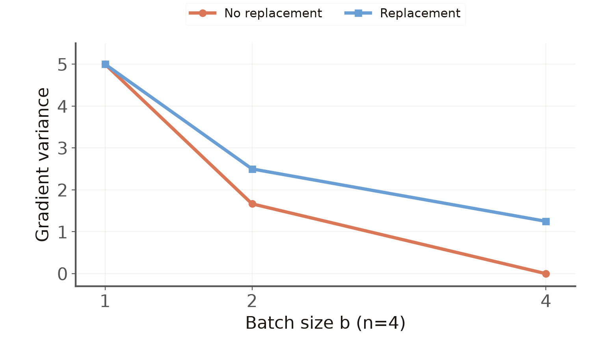

**圖說 `lec03-bp-v2-kp08-variance`**：固定 w=5 時，g=(3,1,−1,−3)、平均0，σ²=(9+1+1+9)/4=5。b=1,2,4 的無放回方差為 5,5/3,0；有放回為5,2.5,1.25。來源3.75,1.25,0混用了分母，已勘誤。 先看圖例與輸入條件，再對照正文公式。〔功能：1、2〕

**Caption `lec03-bp-v2-kp08-variance`**: At fixed parameter five, the four gradients have population variance five. The correct no-replacement variances for batch sizes one, two, and four are five, five-thirds, and zero. Read the inputs and legend first, then compare the formulas.


### 無放回方差可由六種配對逐一驗算（Extension）

b=2 的六個不同索引對，平均梯度分別2,1,0,0,−1,−2。均值為0，平方平均(4+1+0+0+1+4)/6=5/3，與公式相符。這是一個固定 w 的抽樣比較，不是同一 epoch 的連續更新。

The six equally likely pairs have means (2,1,0,0,-1,-2). Their squared mean is five-thirds. This compares samples at a fixed parameter, not successive updates within an epoch.

$$
\mathbb E\|e\|^2=(4+1+0+0+1+4)/6=5/3
$$


### 批次越大常降低雜訊，但步成本增加（Extension）

b=1 是單樣本，b=n 且無放回是全梯度。在相同固定 w 下，有放回即使 b=n 也可重複漏樣本，方差未必零。來源列32,64,128,256作為例示起點；沒有萬能大小，要考慮記憶體與吞吐。

Batch size one recovers single-sample updating; all examples without replacement recover the full gradient. At the same fixed parameter, sampling with replacement can repeat some examples and miss others even when b equals n, so variance need not vanish. The source lists 32,64,128,256 only as starting examples. No batch size is universally best; consider memory and throughput.


### 原收斂率缺誤差量與假設，先保留邊界（Extension）

來源式 (27) 為 O(1/t+||eₜ||²)，式 (28) 為 O((1−μ/L)ᵗ+||eₜ||²)。未說明非凸何種量、e 的歷史或界、η條件，因此不能作為通用定理。保留原表達並標待覈對；非凸通常需明確梯度範數等指標。

The source rate statements omit the measured error, learning-rate conditions, and treatment of gradient errors. They are retained as unverified expressions, not universal convergence theorems.

$$
\mathcal O(1/t+\|e_t\|^2)\tag{27}\quad\text{[scope unverified]}
$$

$$
\mathcal O((1-\mu/L)^t+\|e_t\|^2)\tag{28}\quad\text{[scope unverified]}
$$


### 一輪結束不保證回到原點或全批結果（Extension）

來源反轉稱5→4→5是空轉，已糾正為5→4→5.5。前後批次使用不同 w，不能把兩平均梯度當正負相消。順序改變可改變終點；epoch 是覆蓋節奏，不是一次 full-batch 更新的同義詞。

The corrected guide trajectory is five to four to 5.5. Successive batches evaluate different parameter states, so their gradients need not cancel and their order can affect the endpoint.

### 原題與提示（Original questions and hints）

**題 1：Definition 1 中 epoch 是什麼？**

What is an epoch in Definition 1?

- A. 只更新輸出層一次（One output-layer update）
- B. 所有 floor(n/b) 批各用一次（Uses each of the floor(n/b) batches once）
- C. 只跑一批（Processes one batch）
- D. 等於一步 full-batch（Equals one full-batch step）

提示：原選項預設 b整除n；有尾批時先說明保留或捨棄。

Hint: The original option assumes divisibility; state the last-batch policy otherwise.

**題 2：mini-batch 與單樣本更新差在哪？**

How does mini-batch updating differ from single-sample SGD?

- A. 對 b 筆梯度平均（Averages b gradients）
- B. 不用梯度（Uses no gradient）
- C. 只用固定 η=1（Always uses learning rate one）
- D. 只更新偏置（Updates only biases）

提示：比較式 (25) 的批內求和和除數。

Hint: Inspect the within-batch sum and its divisor.

**題 3：b 增大時梯度近似誤差通常如何？**

How does gradient estimation noise usually change as b grows?

- A. 減小，更接近 full-batch（Decreases toward the full gradient）
- B. 變大（Increases）
- C. 恆為零（Is always zero）
- D. 與 b 無關（Is independent of b）

提示：固定 w 與抽樣規則，再比較方差。

Hint: Hold the parameter and sampling rule fixed, then compare variances.

**題 4：式 (29) 與 (30) 對應哪種抽樣？**

Which sampling rules correspond to equations (29) and (30)?

- A. (29)無放回；(30)有放回（(29) without replacement; (30) with replacement）
- B. 兩者有放回（Both use replacement）
- C. (29)單樣本；(30)全批（(29) single sample; (30) full batch）
- D. 兩者相同（They are identical）

提示：辨認抽樣規則後，還必須檢查 σ² 的分母定義。

Hint: Identify replacement, then check the variance denominator definition.


### 逐步驗算補充（Expanded numerical verification）

**尾批保留時，六筆與四筆一批要兩步**

〔補充：處理原式邊界〕n=6、b=4若保留尾批，每輪兩步；尾批平均除以2。若只用floor(6/4)=1個完整批次，會漏掉2筆。

[Added: source boundary] With six examples and requested size four, retaining the remainder needs two steps and divides the final gradient sum by two.

$$
\lceil 6/4\rceil=2,\quad m_1=4,\quad m_2=6-4=2
$$

**固定梯度才能直接比較抽樣方差**

所有值都使用固定w=5的σ²=5。無放回b=n為全資料；有放回b=n仍可能重複抽樣，不能推成零方差。

Every value uses population variance five at fixed parameter five. Replacement sampling can repeat examples even when the draw count equals the dataset size.

$$
V_{b=1}=\frac{4-1}{4-1}\frac51=5,\quad V_{b=4}=\frac{4-4}{4-1}\frac54=0
$$

$$
V_{\rm replacement,b=2}=5/2=2.5,\quad V_{\rm replacement,b=4}=5/4=1.25
$$

### 術語表（Glossary）

| 中文 | English |
|---|---|
| 小批次 | mini-batch |
| 資料輪次 | epoch |
| 無放回抽樣 | sampling without replacement |
| 有放回抽樣 | sampling with replacement |
| 尾批 | incomplete final batch |
| 母體方差 | population variance |
| 強凸性 | strong convexity |

### 來源與核對（Sources and verification）

來源為本批所提供的 KP 原文與教授祕笈；數字見 numeric-validation.json。所有補充限定為定義釐清、已隱含的推導及勘誤，未新增跨章理論。

Sources are the supplied KP text and teaching guide. Numerical validation is recorded separately; corrections and scope boundaries are explicit.

理論邊界核對：[Bottou、Curtis、Nocedal 的原論文](https://arxiv.org/abs/1606.04838)，§4；來源未指明的收斂量與假設不補猜。

方差定義核對：[Penn State 自撰抽樣理論教材](https://online.stat.psu.edu/stat506/Lesson01)的分母N−1寫法。網站搜尋可讀公式，但全文抓取502；本批另以六種配對精確枚舉確認數值與兩種分母轉換。

Variance notation was checked against the university sampling materials; full-page retrieval failed, so exact enumeration additionally validates this example.


## KP09：收斂率必須連同假設與量測量解讀（Knowledge point 09）

> 程度：大學生（undergrad）。中英完整對照；4小時含40分鐘休息，16單元共200分鐘，每單元12.5分鐘精簡主線。

> Level: Undergraduate. The four-hour session includes 40 minutes of breaks; 16 units share 200 teaching minutes. Each unit has a 12.5-minute core.

**學習目標**：定義本單元的量與符號，逐步重算數值例，說明假設與失效情況。

**Learning objectives**: Define the quantities and symbols, recompute examples, and explain assumptions and failure cases.

### 收斂率先說清楚量的是什麼（A convergence rate must identify its error measure.）

凸問題可量函數誤差；非凸問題通常量駐點量。圖中曲線只是上界形狀，沒有實測軌跡。固定步長的殘留上界，不是必然誤差下限。

Convex analysis can bound objective error. Nonconvex analysis usually bounds stationarity. These curves illustrate bounds, not measured trajectories. A residual upper bound is not a necessary error floor.

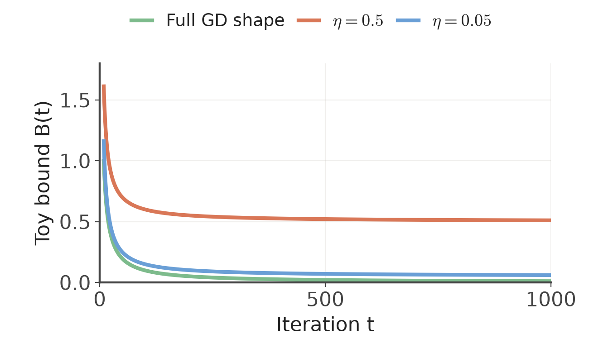

**圖說 `lec03-bp-v2-kp09-bounds`**：先看橫軸迭代次數，再比較不同解析上界的衰減項與常數項。三條曲線由10/(t+1)、10/t+0.5、10/t+0.05計算，不是實測loss；上界不構成誤差下限。〔功能：1、2〕

**Caption `lec03-bp-v2-kp09-bounds`**: Read the iteration axis, then compare decaying and constant terms. Curves use 10/(t+1), 10/t+0.5, and 10/t+0.05. These illustrative bounds are not measured losses or lower bounds.

### 固定步長的玩具上界仍保留常數（A toy bound retains a constant when the step size is fixed.）

取玩具上界 B(t)=10/t+η。代入 t=99、η=0.05，先算衰減項，再加常數。這是算式示範，不是訓練損失。

Use the illustrative bound B(t)=10/t+η. For t=99 and η=0.05, evaluate the decaying term first. This is an arithmetic example, not a measured loss.

$$
B(99)=10/99+0.05=0.101010+0.05\approx0.151010
$$

### 練習：比較每次更新的成本（Practice: compare the cost of each update.）

SGD 相對全梯度下降的主要優勢是？

What is the main advantage of SGD over full-gradient descent?

A. 更高的收斂精度

A. Higher convergence accuracy

B. 每次迭代的計算成本更低

B. Lower computational cost per iteration

C. 不需要選學習率

C. No learning-rate selection

D. 保證找到全局最優

D. Guaranteed global optimality

提示：先比較每步需要讀幾筆資料；再區分單步成本與達到目標精度的總成本。

Hint: compare how many examples each update reads. Then distinguish update cost from total cost at a target accuracy.

### 上界不是一條不能跨過的牆（An upper bound is not an uncrossable lower barrier.）

口訣：先看量測量，再看假設。O(η) 表示長期保證的量級；沒有下界，就不能說永遠到不了最優。

Read the error measure and assumptions first. O(η) describes the scale of a long-run guarantee. Without a lower bound, impossibility does not follow.

### 全梯度誤差保證需要凸與合適步長（Full-gradient objective guarantees require convexity and a suitable step size.）

凸且梯度 L-smooth，有最小化點，取 η=1/L。令 t≥0；來源式(31)是一個較寬鬆的函數誤差上界。它保證函數值逼近，不等於有限步到達。

Assume convexity, an L-Lipschitz gradient, and an attained minimum. Use η=1/L and t≥0. Source equation (31) is a loose objective-error bound. It concerns asymptotic function values.

$$
f(\mathbf{w}^{(t+1)})-f^{\ast}\leq\frac{2L\|\mathbf{w}^{(0)}-\mathbf{w}^{\ast}\|_2^2}{t+1}=\mathcal{O}(1/t)
$$

### 符號定義決定收斂敘述的意義（Symbol definitions determine what a convergence claim means.）

梯度光滑表示斜率變化受限制；強凸表示函數具有正的曲率下界。期望是對抽樣取平均，不是單次軌跡。

Smoothness limits changes in gradients. Strong convexity gives a positive curvature lower bound. Expectation averages sampling outcomes, not one trajectory.

| 符號或數值 | 中文／中間結果 | English / remaining result |
|---|---|---|
| w、w* | 參數、最小化點 | Parameter vector and minimizer |
| f*、D | 最小函數值、初始距離 | Optimal value and initial distance |
| L、μ | 光滑常數、強凸常數 | Smoothness and strong-convexity constants |
| η、G、E | 步長、梯度二階量界、期望 | Step size, second-moment bound, and expectation |

### 凸 SGD 要先建立無偏的梯度估計（Convex SGD first needs an unbiased gradient estimate.）

[補充／更正] 採 f=(1/n)Σfᵢ，均勻抽 i，則 g 是無偏估計。若用總和目標，應使用 ng。假設凸、存在 w*、且 E[‖gτ‖²|wτ]≤G²。

[Added clarification] Use the average objective and uniform sampling. The sampled gradient is unbiased. A summed objective instead requires n times that gradient. Assume convexity, a minimizer, and bounded gradient second moments.

$$
f(\mathbf{w})=\frac1n\sum_i f_i(\mathbf{w}),\quad \mathbb{E}[\mathbf{g}_\tau\mid\mathbf{w}_\tau]=\nabla f(\mathbf{w}_\tau)
$$

### 距離展開把凸誤差換成可加總的項（A distance expansion converts convex error into summable terms.）

[補充／更正] 展開更新後到最優點的平方距離。無偏性換掉隨機內積；凸性給出 ∇f(w)ᵀ(w−w*)≥f(w)−f*。

[Added clarification] Expand the squared distance after an update. Unbiasedness replaces the random inner product. Convexity bounds the objective gap by the gradient inner product.

$$
\begin{aligned}2\eta_\tau\mathbb{E}[f(\mathbf{w}_\tau)-f^{\ast}]&\leq\mathbb{E}\|\mathbf{w}_\tau-\mathbf{w}^{\ast}\|^2\\&-\mathbb{E}\|\mathbf{w}_{\tau+1}-\mathbf{w}^{\ast}\|^2+\eta_\tau^2G^2\end{aligned}
$$

### 再確認：加權平均輸出有期望函數誤差界（Pause and restate the qualified claim.）

口訣：先看量測量，再看假設。O(η) 表示長期保證的量級；沒有下界，就不能說永遠到不了最優。

Read the error measure and assumptions first. O(η) describes the scale of a long-run guarantee. Without a lower bound, impossibility does not follow.

### 加權平均輸出有期望函數誤差界（A weighted-average output has an expected objective-error bound.）

[補充／更正] 把距離項加總後抵消；對加權平均用凸性。D=‖w₁−w*‖。這不是每次軌跡或最後一步的保證。

[Added clarification] Distance terms telescope after summation. Apply convexity to the weighted average, with D as the initial distance. This does not guarantee every trajectory or the final iterate.

$$
\bar{\mathbf{w}}_t=\frac{\sum_{\tau=1}^t\eta_\tau\mathbf{w}_\tau}{\sum_{\tau=1}^t\eta_\tau},\qquad \mathbb{E}[f(\bar{\mathbf{w}}_t)-f^{\ast}]\leq\frac{D^2+G^2\sum\eta_\tau^2}{2\sum\eta_\tau}
$$

### 三種步長改變分子與分母的成長（Three step schedules change the growth of the bound.）

遞減步長使累積步長持續成長，平方步長成長較慢。固定步長留下 ηG²/2 項。圖只顯示來源玩具上界的形狀。

Diminishing steps make accumulated steps grow faster than accumulated squared steps. Fixed steps leave an ηG²/2 term. The graph only illustrates source toy bounds.

| 符號或數值 | 中文／中間結果 | English / remaining result |
|---|---|---|
| ητ=c/τ | O(1/log t) | Expected gap of the weighted average |
| ητ=c/√τ | O(log t/√t) | Expected gap of the weighted average |
| ητ=η | D²/(2ηt)+ηG²/2 | Fixed-step upper bound |

### 三種步長改變分子與分母的成長（數值表）（Read the exact values behind the comparison.）

遞減步長使累積步長持續成長，平方步長成長較慢。固定步長留下 ηG²/2 項。圖只顯示來源玩具上界的形狀。

Diminishing steps make accumulated steps grow faster than accumulated squared steps. Fixed steps leave an ηG²/2 term. The graph only illustrates source toy bounds.

| 符號或數值 | 中文／中間結果 | English / remaining result |
|---|---|---|
| ητ=c/τ | O(1/log t) | Expected gap of the weighted average |
| ητ=c/√τ | O(log t/√t) | Expected gap of the weighted average |
| ητ=η | D²/(2ηt)+ηG²/2 | Fixed-step upper bound |

### 非凸時通常只能保證接近駐點（Nonconvex analysis usually guarantees stationarity rather than global optimality.）

[補充／更正] 只假設下界與光滑，不能推出全局函數誤差。若梯度無偏、雜訊方差≤σ²、0<η≤1/L，平均平方梯度有下式；小梯度仍可能是鞍點。

[Added clarification] A lower bound and smoothness do not ensure global objective error. With unbiased gradients, variance at most σ², and 0<η≤1/L, the mean squared gradient obeys this bound. Small gradients may occur at saddles.

$$
\frac1t\sum_{\tau=1}^t\mathbb{E}\|\nabla f(\mathbf{w}_\tau)\|^2\leq\frac{2(f(\mathbf{w}_1)-f_{\inf})}{\eta t}+L\eta\sigma^2
$$

### 強凸的速率仍須標出輸出與步長（Strong-convexity rates still depend on outputs and step choices.）

強凸例：適當遞減步長及平均可得期望函數誤差 O(1/t)；非任意最後一步。固定步長得到幾何暫態加 O(η) 上界，收縮因子依步長而變。

With suitable decreasing steps and averaging, strong convexity gives O(1/t) expected objective error. An arbitrary last iterate is not implied. Fixed steps yield geometric transients plus an O(η) bound.

### 來源的強凸式需要補上適用限制（The source strong-convexity expressions need explicit qualifications.）

式(35)保留 1/(μτ) 與 O(1/t) 的來源敘述，須配合適當平均及其他條件。式(36)的 1−μ/L 不是任意固定 η 的通用係數。

Source equation (35) uses 1/(μτ) and O(1/t), requiring suitable averaging and additional assumptions. In equation (36), 1−μ/L is not universal for every constant η.

$$
\eta_\tau=\frac1{\mu\tau}:\ \mathcal{O}(1/t),\qquad\text{source shape: }\mathcal{O}((1-\mu/L)^t+\eta)
$$

### 玩具表只演示上界如何隨時間變化（The toy table illustrates how bounds change with iteration counts.）

〔程式計算〕依 10/(t+1)、10/t+η、0.9ᵗ+0.05 重算。∞ 列是解析極限。保留三種時間點，並非四條實測損失。

Computed from 10/(t+1), 10/t+η, and 0.9ᵗ+0.05. The infinity row gives analytic limits. These are not measured losses.

| 符號或數值 | 中文／中間結果 | English / remaining result |
|---|---|---|
| t | 10/(t+1) | 10/t+0.5 ; 10/t+0.05 ; 0.9ᵗ+0.05 |
| 9 | 1.000 | 1.611 ; 1.161 ; 0.437 |
| 99 | 0.100 | 0.601 ; 0.151 ; 0.050 |
| 999 ; ∞ | 0.010 ; 0 | 0.510/0.500 ; 0.060/0.050 ; 0.050/0.050 |

### 醉漢下山只比喻方向雜訊（The downhill analogy describes direction noise only.）

醉漢下山、直升機盤旋都提醒步長與雜訊。實際步幅是 ηg，不是固定 η；帶子是誤差上界量級，不是參數距離。全梯度仍可額外算，只是較貴。

The downhill and hovering analogies suggest noise and step-size effects. Actual displacement is ηg, not η. The band describes an error-bound scale, not parameter distance. Full gradients remain computable but costly.

### 練習：判斷全梯度的誤差極限（Practice: interpret the full-gradient error limit.）

全梯度下降（命題 2）在 t→∞ 時的收斂行為是？

What happens as t tends to infinity in Proposition 2?

A. 停滯在 O(η) 鄰域

A. Stagnation in an O(η) neighborhood

B. 精確收斂到 f*，誤差趨近 0

B. Objective error tends to zero

C. 發散

C. Divergence

D. 收斂率為 O(log t)

D. An O(log t) convergence rate

提示：先確認命題的凸性、光滑與步長；再看誤差上界極限。

Hint: check convexity, smoothness, and step size before taking the bound limit.

### 練習：固定步長的原題須附條件（Practice: qualify the source question about fixed steps.）

SGD 使用固定步長 ητ=η 時，長期行為是？

What is the long-run behavior of fixed-step SGD?

A. 精確到達 f*

A. Exact attainment of f*

B. 在最優點附近 O(η) 鄰域內停滯

B. Stagnation in an O(η) neighborhood

C. 步長自動歸零

C. Automatically vanishing steps

D. 比全梯度更快收斂

D. Faster convergence than full-gradient descent

提示：原選項是直覺摘要。用持續雜訊情境讀題；作答理由必須區分可能停滯與上界保證。

Hint: the source choices are intuitive summaries. Assume persistent noise and distinguish possible stagnation from an upper-bound guarantee.

### 練習：辨識遞減步長（Practice: identify diminishing step schedules.）

下列哪組步長策略能讓 SGD 的 1/t 項主導、使長期誤差趨近 0？

Which source schedule is intended to make long-run error vanish?

A. 固定 ητ=η

A. Fixed η

B. ητ=1/τ 或 1/√τ

B. 1/τ or 1/√τ

C. ητ=τ

C. τ

D. 不更新步長

D. No step-size change

提示：原題「1/t 項主導」不準確；改以累積步長與平方步長的比值判斷，並寫出保證哪個輸出。

Hint: the source phrase about a dominant 1/t term is inaccurate. Compare accumulated steps and squared steps, then identify the output.

### 練習：自己計算另一個玩具上界（Practice: evaluate another illustrative bound.）

若 B(t)=20/t+η，η=0.02，求 t=50、500 與 t→∞ 的上界。遞減步長保證是否仍有同一常數？

For B(t)=20/t+η with η=0.02, evaluate t=50, 500, and the infinite limit. Does a diminishing-step bound retain the same constant?

提示：分別算 20/t；不要把上界當作實測誤差。

Hint: evaluate 20/t separately. Do not interpret the bound as a measured error.

### 術語表（Glossary）

| 中文 | English |
|---|---|
| 函數誤差 | Objective error |
| 駐點量 | Stationarity measure |
| 期望 | Expectation |
| 加權平均迭代點 | Weighted-average iterate |
| 梯度光滑 | Gradient Lipschitz smoothness |
| 強凸 | Strong convexity |
| 無偏梯度 | Unbiased gradient |
| 收斂上界 | Convergence upper bound |

### 來源與更正（Sources and corrections）

來源：指定的KP原文與教授祕笈；本講義用自己的說法重寫。上述標成更正的說明是為修補來源錯誤與適用條件，非默默改寫。

Source: the assigned KP text and teaching guide, restated in our own words. Explicit corrections repair source errors and missing conditions.

- [Ghadimi and Lan, 2013, Theorem 2.1: distinguish stationarity and convex objective guarantees](https://arxiv.org/pdf/1309.5549)（核對日期：2026-10-13）
- [Shamir and Zhang, 2013: averaging choices and strongly convex SGD](https://proceedings.mlr.press/v28/shamir13.html)（核對日期：2026-10-13）


## KP10：AdaGrad 用逐座標平方歷史調整步幅（Knowledge point 10）

> 程度：大學生（undergrad）。中英完整對照；4小時含40分鐘休息，16單元共200分鐘，每單元12.5分鐘精簡主線。

> Level: Undergraduate. The four-hour session includes 40 minutes of breaks; 16 units share 200 teaching minutes. Each unit has a 12.5-minute core.

**學習目標**：定義本單元的量與符號，逐步重算數值例，說明假設與失效情況。

**Learning objectives**: Define the quantities and symbols, recompute examples, and explain assumptions and failure cases.

### AdaGrad 為每個座標各記一本帳（AdaGrad keeps a separate history for each coordinate.）

gₜ,j 是第 t 步、第 j 座標的樣本梯度。先累積平方，再縮放當前梯度。j 是座標索引，iₜ 是樣本索引，不能互換。s是累積平方，η是全局率，ε是防零項。

The gradient gₜ,j belongs to coordinate j at step t. Accumulate its squares before scaling the current gradient. Coordinate j and sample index iₜ must remain distinct. s accumulates squares, η is the global rate, and ε prevents zero denominators.

$$
s_{t,j}=s_{t-1,j}+g_{t,j}^2,\qquad w_{t,j}=w_{t-1,j}-\frac{\eta_t g_{t,j}}{\sqrt{\varepsilon+s_{t,j}}}
$$

### 大梯度例子的縮放可逐行算出（The large-gradient example can be checked line by line.）

取 η=0.2、ε=0，歷史梯度 3、4、12。累積平方作分母；最後一筆 12 作分子。ε=0 只用於非零分母的示例。

Use η=0.2, ε=0, and gradients 3, 4, 12. The denominator uses squared history; the numerator uses the current value 12. Zero ε is safe only in this nonzero example.

$$
s=3^2+4^2+12^2=9+16+144=169,\quad\sqrt{s}=13;\qquad a=0.2/13\approx0.015385,\quad |\Delta w|=a\cdot12\approx0.184615
$$

### 練習：辨識 AdaGrad 的累積器（Practice: identify the AdaGrad accumulator.）

AdaGrad 中 G(j,j) 的定義包含什麼？

What defines G(j,j) in AdaGrad?

A. 梯度的絕對值之和

A. A sum of absolute gradients

B. 梯度平方的累積和再開根號

B. The square root of accumulated squared gradients

C. 梯度的指數移動平均

C. An exponential gradient average

D. Hessian 對角元素

D. A Hessian diagonal entry

提示：把矩陣對角元素拆成單一座標的公式，再檢查平方和開根號的順序。

Hint: expand one diagonal entry and check the order of squaring, accumulation, and square roots.

### 勒韁調的是有效率，不保證齊步（The reins adjust effective rates without guaranteeing equal updates.）

口訣「誰跑得兇誰被勒韁」：較厚的平方帳本壓低有效學習率。實際步幅還要乘當前梯度，不能只看分母。

The reins analogy says that larger squared histories reduce effective learning rates. Actual displacement also depends on the current gradient.

### 矩陣形式與座標形式描述同一更新（Matrix and coordinate forms describe the same update.）

Gₜ 是 d×d 對角矩陣，不是 Hessian。來源式(39)把樣本與座標混用；此處改爲同一個 gₜ,j。

Gₜ is a d-by-d diagonal matrix, not the Hessian. Source equation (39) mixes sample and coordinate indices. Here both forms use the same gₜ,j.

$$
\mathbf{G}_t=\operatorname{diag}(\sqrt{\varepsilon+s_{t,1}},\ldots,\sqrt{\varepsilon+s_{t,d}}),\qquad\mathbf{w}_t=\mathbf{w}_{t-1}-\eta_t\mathbf{G}_t^{-1}\mathbf{g}_t
$$

### 符號與初始條件要逐座標設定（Symbols and initialization must be specified per coordinate.）

初始 s₀,j=0。通常 ε>0 防零；若 ε=0 且歷史梯度全零，分母是零。AdaGrad 不需要二階導數。

Initialize s₀,j=0. Positive ε prevents division by zero. With ε=0 and an entirely zero history, the denominator vanishes. AdaGrad requires no second derivatives.

| 符號或數值 | 中文／中間結果 | English / remaining result |
|---|---|---|
| iₜ、j、d | 樣本、座標、參數數量 | Sample index, coordinate index, dimension |
| gₜ,j | 在 wₜ₋₁ 計算的座標梯度 | Coordinate gradient evaluated at wₜ₋₁ |
| sₜ,j、Gₜ | 累積平方、對角縮放矩陣 | Squared-history accumulator and diagonal scaling |
| ηₜ、ε、aₜ,j | 全局率、穩定項、有效率 | Global rate, stabilizer, effective rate |

### 較小梯度歷史讓有效率較大（A smaller gradient history yields a larger effective rate.）

安靜座標的歷史是 0.3、0.4、1.2。先算平方和，再求有效率與當前步幅。這個等幅結果來自兩組梯度恰好成比例。

The quiet coordinate has history 0.3, 0.4, 1.2. Compute squares, effective rate, then displacement. Equal updates occur here because the histories are proportional.

$$
s=0.09+0.16+1.44=1.69,\quad\sqrt{s}=1.3;\qquad a=0.2/1.3\approx0.153846,\quad|\Delta w|=a\cdot1.2\approx0.184615
$$

### 長期衰減須以累積平方無界為條件（Long-run decay requires unbounded accumulated squares.）

若每步 g=1、η=1、ε=0，aₜ=1/√t。t=1、100、10000 得 1、0.1、0.01。若某座標的平方和有界，不能宣稱所有有效率必歸零。

With g=1, η=1, and ε=0, aₜ=1/√t. At 1, 100, and 10000 steps, rates are 1, 0.1, and 0.01. Bounded squared histories need not yield zero rates.

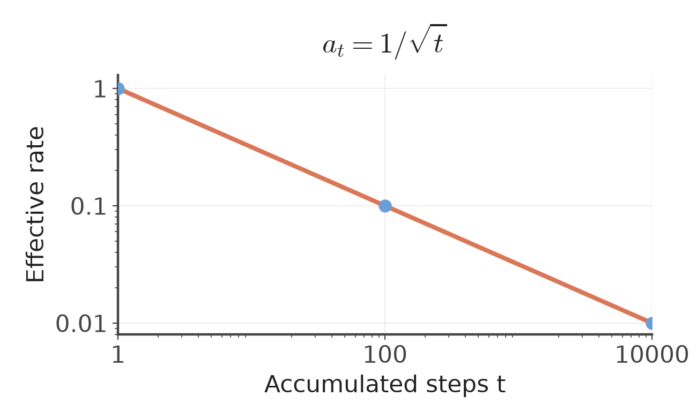

**圖說 `lec03-bp-v2-kp10-decay`**：先看累積步數，再讀有效學習率。圖按每步梯度1、η=1、ε=0的1/√t計算；只在平方和持續增加的示例下趨零。〔功能：1、2〕

**Caption `lec03-bp-v2-kp10-decay`**: Read accumulated steps before effective rates. The curve is 1/√t for unit gradients, η=1, and ε=0; its zero limit relies on growing squared history.

### 稀疏友好不等於判斷特徵重要性（Sparse-feature adaptation does not measure feature importance.）

罕見非零梯度常有較小累積器，更新可較不受壓制。勒韁、發言限時比喻只描述歷史縮放；大梯度未必重要，少發言未必有用。

Rare nonzero gradients often have smaller accumulators and less scaling suppression. Reins and speaking-time analogies describe history-based scaling, not feature importance.

### AdaGrad 累積器只增，但不凍結座標（AdaGrad accumulators grow without freezing coordinates.）

平方和不減，固定全局率下有效率不增。步幅並非只由歷史決定；可能衰減過快，也可能仍持續更新。實際訓練要看損失與更新量。

Squared histories never decrease, so effective rates do not increase with a fixed global rate. Updates also depend on current gradients. Monitor loss and displacement for excessive decay.

### 練習：判斷活躍座標的縮放（Practice: interpret scaling for an active coordinate.）

AdaGrad 對「梯度長期偏大」的維度會做什麼？

What does AdaGrad do to a coordinate with persistently large gradients?

A. 放大其有效學習率

A. Increase its effective rate

B. 壓制（衰減）其有效學習率

B. Reduce its effective rate

C. 凍結該維度

C. Freeze it

D. 重置其梯度

D. Reset its gradient

提示：區分有效率與實際步幅；觀察累積平方改變的是哪個量。

Hint: distinguish the effective learning rate from displacement. Identify the quantity changed by accumulated squares.

### 練習：辨識數值穩定項（Practice: identify the stabilizing term.）

式(39)中 ε 的作用是？

What is the role of ε in equation (39)?

A. 控制動量係數

A. Control momentum

B. 確保分母不為零，提供數值穩定

B. Prevent a zero denominator

C. 設定 batch size

C. Set batch size

D. 決定偏置修正

D. Determine bias correction

提示：代入一個從未收到非零梯度的座標，檢查分母。

Hint: consider a coordinate that has never received a nonzero gradient and inspect its denominator.

### 實作要分清平方和與動量（Implementation must separate squared history from momentum.）

錯：把 G 當二階導數，或把 ε 當動量。正：G 由一階梯度平方構成；動量平滑方向，AdaGrad 縮放座標步幅。

Incorrect: interpreting G as second derivatives or ε as momentum. Correct: G uses squared first derivatives. Momentum smooths direction; AdaGrad rescales coordinate updates.

### 練習：判斷長期訓練的風險（Practice: identify a long-training risk.）

AdaGrad 長期訓練的主要隱憂是？

What is a main risk of long AdaGrad training?

A. 學習率單調遞增

A. Monotonically increasing rates

B. 累積和只增不減，有效學習率趨近 0

B. Accumulation can drive effective rates toward zero

C. 無法處理稀疏特徵

C. Inability to handle sparse features

D. 需要計算 Hessian

D. Required Hessian computation

提示：來源選項的趨零須加「平方和無界」條件；想想哪種歷史會滿足。

Hint: the zero-rate limit requires unbounded squared history. Consider histories that satisfy this condition.

### 再確認：練習：用新歷史算一次更新（Pause and restate the qualified claim.）

口訣「誰跑得兇誰被勒韁」：較厚的平方帳本壓低有效學習率。實際步幅還要乘當前梯度，不能只看分母。

The reins analogy says that larger squared histories reduce effective learning rates. Actual displacement also depends on the current gradient.

### 練習：用新歷史算一次更新（Practice: compute an update from a new history.）

η=0.5、ε=0，某座標歷史梯度為 6、8。有效學習率與當下梯度 8 的步幅各是多少？

With η=0.5, ε=0, and gradient history 6, 8, compute the effective rate and displacement for the current gradient 8.

提示：先算 6²+8²，再開根號，最後乘當前梯度。

Hint: sum 6² and 8², take the square root, then multiply the effective rate by the current gradient.

### 術語表（Glossary）

| 中文 | English |
|---|---|
| 自適應梯度 | Adaptive gradient |
| 座標 | Coordinate |
| 累積器 | Accumulator |
| 有效學習率 | Effective learning rate |
| 對角矩陣 | Diagonal matrix |
| 數值穩定項 | Numerical stabilizer |
| 稀疏特徵 | Sparse feature |
| Hessian矩陣 | Hessian matrix |

### 來源與更正（Sources and corrections）

來源：指定的KP原文與教授祕笈；本講義用自己的說法重寫。上述標成更正的說明是為修補來源錯誤與適用條件，非默默改寫。

Source: the assigned KP text and teaching guide, restated in our own words. Explicit corrections repair source errors and missing conditions.

- [Duchi, Hazan and Singer, 2011: adaptive subgradient methods](https://jmlr.org/papers/v12/duchi11a.html)（核對日期：2026-10-13）


## KP11：RMSProp 與 Adam 管理近期梯度資訊（Knowledge point 11）

> 程度：大學生（undergrad）。中英完整對照；4小時含40分鐘休息，16單元共200分鐘，每單元12.5分鐘精簡主線。

> Level: Undergraduate. The four-hour session includes 40 minutes of breaks; 16 units share 200 teaching minutes. Each unit has a 12.5-minute core.

**學習目標**：定義本單元的量與符號，逐步重算數值例，說明假設與失效情況。

**Learning objectives**: Define the quantities and symbols, recompute examples, and explain assumptions and failure cases.

### RMSProp 會忘，Adam 再加方向記憶（RMSProp forgets old squares, and Adam adds direction memory.）

AdaGrad 保存全部平方歷史。RMSProp 用指數平均衰減舊平方；Adam 再平均梯度方向與修正零初始偏差。三者仍需選全局學習率。

AdaGrad retains all squared history. RMSProp exponentially discounts old squares. Adam also averages gradient directions and corrects zero-initialization bias. Each still needs a global learning rate.

### 第一步的零初始偏差可以逐行驗算（The first-step initialization bias can be checked directly.）

取 β₁=β₂=0.9、m₀=v₀=0、g₁=4。一維示範先更新原始矩，再除以已累積的權重 0.1。β是遺忘係數；m與v記錄梯度及平方平均。

Use β₁=β₂=0.9, m₀=v₀=0, and g₁=4. Update the moments first, then divide by the accumulated weight 0.1. β controls decay; m and v average gradients and their squares.

$$
m_1=0.9(0)+0.1(4)=0.4,\quad v_1=0.9(0)+0.1(16)=1.6;\qquad\hat m_1=0.4/0.1=4,\quad\hat v_1=1.6/0.1=16
$$

### 練習：說明偏置修正的目的（Practice: explain the purpose of bias correction.）

Adam 偏置修正（式(44)–(45)）的目的是？

What is the purpose of Adam bias correction?

A. 加速收斂到 sharp minima

A. Accelerate convergence to sharp minima

B. 補償早期迭代中 m、v 初始為 0 造成的系統性偏差

B. Compensate for zero-initialization bias in m and v

C. 增大 batch size

C. Increase batch size

D. 替代 L2 正則化

D. Replace L2 regularization

提示：先展開兩步指數平均的權重和，再比較是否加總爲一。

Hint: expand the first two exponential averages and inspect whether their weights sum to one.

### 偏置修正用已完成的更新次數（Bias correction uses the number of completed updates.）

第 t 次更新用 1−βᵗ。β=0.9 時，t=1 因子 10；t=2 因子約 5.263。來源 k+1 的矩搭 k 次方有錯位，已更正。

The t-th update uses 1−βᵗ. With β=0.9, factors are 10 at t=1 and about 5.263 at t=2. The source mismatched moment index k+1 with exponent k; this is corrected.

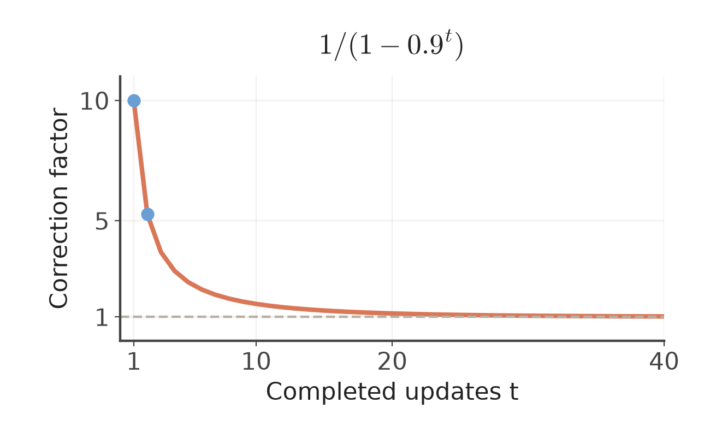

**圖說 `lec03-bp-v2-kp11-bias`**：先看已完成次數t，再看修正因子1/(1−0.9ᵗ)。首步10，第二步約5.263，之後逐漸靠近1。它是修正因子，不是loss或學習率。〔功能：1、2〕

**Caption `lec03-bp-v2-kp11-bias`**: Read completed updates t, then the factor 1/(1−0.9ᵗ). It starts at 10, becomes about 5.263, and approaches one. It is a correction factor, not loss or a learning rate.

### 二階原始矩不是方差（The second raw moment is not the variance.）

m 估計梯度一階矩；v 估計逐座標梯度平方的二階原始矩。方差需再扣掉均值平方；v 本身不能叫方差。

m estimates first gradient moments. v estimates coordinatewise second raw moments. Variance additionally subtracts the squared mean; v itself is not variance.

### RMSProp 的平方與除法都是逐座標（RMSProp squares and divides coordinate by coordinate.）

gₜ 是在 wₜ₋₁ 的梯度，v₀=0，0≤β<1。來源用 ‖g‖² 是全局純量，不能代表標準逐座標 RMSProp。這裏ε放根號內，沿用來源。

gₜ is evaluated at wₜ₋₁, with v₀=0 and 0≤β<1. The source scalar squared norm does not describe standard coordinatewise RMSProp. Here ε remains inside the root as in the source.

$$
v_{t,j}=\beta v_{t-1,j}+(1-\beta)g_{t,j}^2,\qquad w_{t,j}=w_{t-1,j}-\frac{\eta_t g_{t,j}}{\sqrt{\varepsilon+v_{t,j}}}
$$

### 兩個矩向量保留每個座標的尺度（Two moment vectors preserve the scale of each coordinate.）

所有 m、v 都是 d 維向量。逐座標平方 g⊙g 與純量 ‖g‖² 維度不同；第二個會混合所有座標的尺度。

Both m and v are d-dimensional vectors. The elementwise square g⊙g differs dimensionally from scalar ‖g‖². The scalar mixes scales across coordinates.

| 符號或數值 | 中文／中間結果 | English / remaining result |
|---|---|---|
| gₜ、mₜ、vₜ | 梯度、一階、二階原始矩向量 | Gradient and first/second raw moment vectors |
| β₁、β₂ | 各矩的遺忘係數，介於0與1 | Decay coefficients in [0,1) |
| t、ηₜ、ε | 已更新次數、全局率、穩定項 | Completed updates, global rate, stabilizer |
| m̂ₜ、v̂ₜ | 初始偏置修正矩向量 | Initialization-bias-corrected moments |

### Adam 同時平滑方向與平方尺度（Adam smooths both directions and squared scales.）

平方、平方根與除法都逐座標運算。這是偏置修正前的原始矩；來源稱「梯度方差」已改成二階原始矩。

Squaring, roots, and division operate elementwise. These are raw moments before correction. The source term gradient variance is replaced with second raw moment.

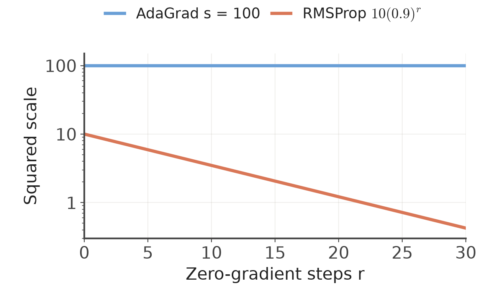

**圖說 `lec03-bp-v2-kp11-forget`**：先看初次大梯度之後的零梯度次數r，再比較累加器100與指數平均10×0.9ʳ。值屬於平方尺度估計；沒有說參數每步都移動。〔功能：1、2〕

**Caption `lec03-bp-v2-kp11-forget`**: Read zero-gradient steps after the first spike. Compare the accumulator 100 with the exponential average 10×0.9ʳ. These squared scales do not imply parameter displacement at every step.

### 公式核對：Adam 同時平滑方向與平方尺度（Check the coordinate formulas that accompany the figure.）

平方、平方根與除法都逐座標運算。這是偏置修正前的原始矩；來源稱「梯度方差」已改成二階原始矩。

Squaring, roots, and division operate elementwise. These are raw moments before correction. The source term gradient variance is replaced with second raw moment.

$$
\mathbf{m}_t=\beta_1\mathbf{m}_{t-1}+(1-\beta_1)\mathbf{g}_t;\qquad\mathbf{v}_t=\beta_2\mathbf{v}_{t-1}+(1-\beta_2)(\mathbf{g}_t\odot\mathbf{g}_t)
$$

### 核對條件：修正權重後再更新參數（Check the conditions before reading the next formula.）

m 估計梯度一階矩；v 估計逐座標梯度平方的二階原始矩。方差需再扣掉均值平方；v 本身不能叫方差。

m estimates first gradient moments. v estimates coordinatewise second raw moments. Variance additionally subtracts the squared mean; v itself is not variance.

### 修正權重後再更新參數（Correct the accumulated weight before updating parameters.）

採 Adam 原論文 ε 放根號外；來源放根號內是不同穩定方式，不可共用同一ε數值。β₁、β₂須小於1，t從1開始。

Use ε outside the root, as in the Adam paper. The source places it inside, a different stabilizing convention. The same ε values are not interchangeable. Decays are below one and t starts at one.

$$
\hat{\mathbf{m}}_t=\frac{\mathbf{m}_t}{1-\beta_1^t},\quad\hat{\mathbf{v}}_t=\frac{\mathbf{v}_t}{1-\beta_2^t};\qquad\mathbf{w}_t=\mathbf{w}_{t-1}-\eta_t\frac{\hat{\mathbf{m}}_t}{\sqrt{\hat{\mathbf{v}}_t}+\varepsilon}
$$

### 常數梯度揭示偏置來自權重不足（Constant gradients reveal missing weight at initialization.）

若每步都是同一 g，從零開始展開等比和。β爲一階或二階矩各自的係數；兩者可不同。修正消除零初始權重缺額，不保證非平穩梯度估計無偏。

With constant g, expand the geometric sum from zero. Each moment may use a different β. Correction removes missing initial weight; changing gradient distributions may still create bias.

$$
m_t=(1-\beta)\sum_{i=1}^t\beta^{t-i}g=(1-\beta^t)g;\qquad v_t=(1-\beta^t)g^2
$$

### 修正因子逐漸接近一（The correction factor gradually approaches one.）

〔程式計算〕β=0.9，依 cₜ=1/(1−0.9ᵗ) 計算。t 越大，零初始的欠缺權重越小；圖不表示 loss 或收斂率。

Computed with β=0.9 and cₜ=1/(1−0.9ᵗ). Initialization has less influence as t grows. The graph is not a loss or convergence curve.

| 符號或數值 | 中文／中間結果 | English / remaining result |
|---|---|---|
| t=1 | 0.900 ; 0.100 | c=10.00 |
| t=2 | 0.810 ; 0.190 | c≈5.26 |
| t=5 | 0.590 ; 0.410 | c≈2.44 |
| t=10 | 0.349 ; 0.651 | c≈1.54 |

### 修正因子逐漸接近一（數值表）（Read the exact values behind the comparison.）

〔程式計算〕β=0.9，依 cₜ=1/(1−0.9ᵗ) 計算。t 越大，零初始的欠缺權重越小；圖不表示 loss 或收斂率。

Computed with β=0.9 and cₜ=1/(1−0.9ᵗ). Initialization has less influence as t grows. The graph is not a loss or convergence curve.

| 符號或數值 | 中文／中間結果 | English / remaining result |
|---|---|---|
| t=1 | 0.900 ; 0.100 | c=10.00 |
| t=2 | 0.810 ; 0.190 | c≈5.26 |
| t=5 | 0.590 ; 0.410 | c≈2.44 |
| t=10 | 0.349 ; 0.651 | c≈1.54 |

### 核對條件：較晚的修正值仍可追溯（Check the conditions before reading the next formula.）

m 估計梯度一階矩；v 估計逐座標梯度平方的二階原始矩。方差需再扣掉均值平方；v 本身不能叫方差。

m estimates first gradient moments. v estimates coordinatewise second raw moments. Variance additionally subtracts the squared mean; v itself is not variance.

### 較晚的修正值仍可追溯（Later correction values remain traceable.）

〔程式計算〕β=0.9，t=20 得 βᵗ≈0.122、1−βᵗ≈0.878、c≈1.14。t→∞，βᵗ→0、分母→1、因子→1。

For β=0.9 at t=20, βᵗ≈0.122, 1−βᵗ≈0.878, and c≈1.14. As t tends to infinity, these quantities tend to zero, one, and one.

| 符號或數值 | 中文／中間結果 | English / remaining result |
|---|---|---|
| t | βᵗ | 1−βᵗ ; cₜ |
| 20 | 0.122 | 0.878 ; 1.14 |
| ∞ | 0 | 1 ; 1 |

### 一維例子的方向比值不等於實際步長（The scalar direction ratio is not the actual step size.）

用前例 g=4、β₁=β₂=0.9，暫忽略ε。未修正比值約0.316，修正後是1；真正參數步幅還要乘η。不同β不保證同樣倍數。

Using g=4 and equal decays 0.9, temporarily ignore ε. The raw ratio is about 0.316; the corrected ratio is one. Actual displacement also multiplies η. Other decay choices change this comparison.

$$
\frac{m_1}{\sqrt{v_1}}=\frac{0.4}{\sqrt{1.6}}\approx0.316228\approx0.316;\qquad\frac{\hat m_1}{\sqrt{\hat v_1}}=\frac4{\sqrt{16}}=1
$$

### 遺忘可減少舊大梯度的影響（Forgetting reduces the influence of an old large gradient.）

先 g=10 後全0：AdaGrad s=100；RMSProp 首次 v=0.1×100=10。再過10或20個零梯度，v=10×0.9ʳ 約3.49或1.22。這不意味着當下非零更新。

After g=10 followed by zeros, AdaGrad keeps s=100. RMSProp first gives v=10, then about 3.49 or 1.22 after 10 or 20 zero gradients. Forgetting does not imply nonzero updates at those times.

### 油表與體重計只比喻初始欠讀（The gauge and scale analogies describe initialization underreading.）

健忘油表記住近期平方；剛換電池體重計比喻從0啟動。真實梯度會改變，修正不會把所有歷史變成當前梯度；η仍決定保守程度。

A forgetful gauge emphasizes recent squares. A newly powered scale suggests zero initialization. Real gradients change, so correction does not replace history with the current gradient. η still controls the update scale.

### 自適應不能替代驗證或學習率選擇（Adaptation does not replace validation or learning-rate selection.）

Adam 是常用選項之一，並非所有任務默認贏家。RMSProp不無限累加；偏置修正不取代正則化、不保證全局最優，也不消除步長選擇。

Adam is a widely used option, not a universal winner. RMSProp does not accumulate forever. Bias correction neither replaces regularization nor guarantees global optimality or removes step-size selection.

### 練習：辨識 RMSProp 的改進（Practice: identify the RMSProp modification.）

RMSProp 相對 AdaGrad 的關鍵改進是？

What is the key RMSProp change relative to AdaGrad?

A. 引入 Hessian 資訊

A. Hessian information

B. 用指數移動平均取代梯度平方的累積和

B. An exponential average instead of accumulated gradient squares

C. 取消學習率

C. Elimination of learning rates

D. 改用全梯度

D. Full-gradient updates

提示：展開一筆舊平方在下一步的權重，比較是否會衰減。

Hint: track the weight of an old squared gradient through the next update.

### 練習：檢查原題的矩名稱（Practice: check moment terminology in the source question.）

Adam 同時維護哪兩種矩估計？

Which two moment estimates does Adam maintain?

A. 梯度的均值與方差（一階矩與二階矩）

A. Gradient mean and variance (first and second moments)

B. 損失的均值與方差

B. Loss mean and variance

C. 權重的均值與方差

C. Weight mean and variance

D. 激活值的均值與方差

D. Activation mean and variance

提示：選項按原文保留，但「方差」一詞須修訂。以公式判斷統計對象與是否扣掉均值平方。

Hint: source choices are preserved, but variance needs editorial correction. Inspect the estimated object and whether squared means are subtracted.

### 練習：審慎理解 Adam 的實務地位（Practice: interpret the practical role of Adam carefully.）

下列何者正確描述 Adam 在實務中的地位？

Which describes the practical role of Adam?

A. 僅用於理論研究

A. Only theoretical research

B. 現代深度學習中最廣泛使用的優化器之一

B. One of the widely used deep-learning optimizers

C. 已被 SGD 完全取代

C. Completely replaced by SGD

D. 只能用在凸優化

D. Applicable only to convex optimization

提示：區分廣泛採用與在任何任務上優於其他方法；還需公平的驗證集比較。

Hint: distinguish widespread use from universal superiority. Compare methods using a fair validation protocol.

### 實作順序先計梯度，再更新矩與參數（Implementation updates gradients, moments, and parameters in order.）

t 從1開始；平方使用逐元素乘法。ε位置須與實作文件一致。不要在梯度函式求值前先改動權重。

Start t at one and square elementwise. Match the stabilizer convention in the implementation. Evaluate the gradient before changing the parameters.

```text
t += 1
g = gradient(w)
m = b1*m + (1-b1)*g
v = b2*v + (1-b2)*(g*g)
mhat = m/(1-b1**t)
vhat = v/(1-b2**t)
w = w - eta*mhat/(sqrt(vhat)+eps)
```

### 再確認：練習：計算第二步的修正（Pause and restate the qualified claim.）

m 估計梯度一階矩；v 估計逐座標梯度平方的二階原始矩。方差需再扣掉均值平方；v 本身不能叫方差。

m estimates first gradient moments. v estimates coordinatewise second raw moments. Variance additionally subtracts the squared mean; v itself is not variance.

### 練習：計算第二步的修正（Practice: calculate the second-step correction.）

β=0.9、t=2，修正因子是多少？若未修正 m=0.58，修正後 m̂ 是多少？

With β=0.9 and t=2, find the correction factor. If raw m=0.58, what is corrected m̂?

提示：先算 0.9²，再算 1−0.9²；除法用未四捨五入的分母。

Hint: calculate 0.9² and 1−0.9² first. Use the unrounded denominator.

### 術語表（Glossary）

| 中文 | English |
|---|---|
| 指數移動平均 | Exponential moving average |
| 一階矩 | First moment |
| 二階原始矩 | Second raw moment |
| 方差 | Variance |
| 偏置修正 | Bias correction |
| 逐元素平方 | Elementwise square |
| 遺忘係數 | Decay coefficient |
| 自適應矩估計 | Adaptive moment estimation |

### 來源與更正（Sources and corrections）

來源：指定的KP原文與教授祕笈；本講義用自己的說法重寫。上述標成更正的說明是為修補來源錯誤與適用條件，非默默改寫。

Source: the assigned KP text and teaching guide, restated in our own words. Explicit corrections repair source errors and missing conditions.

- [Kingma and Ba, Adam, Algorithm 1 and initialization-bias correction](https://arxiv.org/pdf/1412.6980)（核對日期：2026-10-13）
- [Hinton course lecture 6: RMSProp](https://www.cs.toronto.edu/~tijmen/csc321/slides/lecture_slides_lec6.pdf)（核對日期：2026-10-13）


## KP12：平坦極小值是局部穩健性的條件線索（Knowledge point 12）

> 程度：大學生（undergrad）。中英完整對照；4小時含40分鐘休息，16單元共200分鐘，每單元12.5分鐘精簡主線。

> Level: Undergraduate. The four-hour session includes 40 minutes of breaks; 16 units share 200 teaching minutes. Each unit has a 12.5-minute core.

**學習目標**：定義本單元的量與符號，逐步重算數值例，說明假設與失效情況。

**Learning objectives**: Define the quantities and symbols, recompute examples, and explain assumptions and failure cases.

### 平坦描述鄰域形狀，不是單點高低（Flatness describes neighborhood shape rather than minimum loss.）

圖中兩個不同玩具函數：針谷0.01+50w²；寬碗0.08+0.5w²。先看最低點，再看相同參數偏移。這不是同一模型的測試實驗。w是參數，f是玩具損失。

The graph compares two different toy functions: 0.01+50w² and 0.08+0.5w². Compare their minima, then equal parameter displacements. This is not a test experiment on one model. Here w is a parameter and f is toy loss.

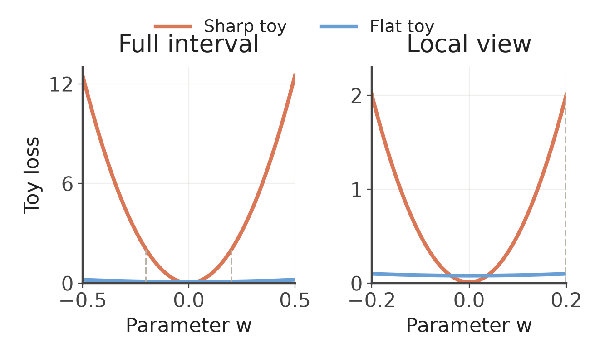

**圖說 `lec03-bp-v2-kp12-landscape`**：先比較w=0處0.01與0.08，再看虛線標記±0.2處2.01與0.10。兩條曲線與右側局部放大圖都由0.01+50w²和0.08+0.5w²精確計算；它們是不同玩具函數，不是原圖數據或同模型泛化實驗。〔功能：1、2、3〕

**Caption `lec03-bp-v2-kp12-landscape`**: Compare the minima 0.01 and 0.08, then the ±0.2 boundaries with values 2.01 and 0.10. Both panels evaluate the specified quadratics exactly. They are different toy functions, not Figure 6 data or a same-model generalization experiment.

### 同樣參數擾動可能放大不同損失（Equal parameter perturbations can produce different loss increases.）

取鄰域半徑ρ=0.2，這兩個二次式在|w|≤ρ的最大值都在邊界。代入同一w，只比較局部敏感度；沒有測試資料與泛化結論。

For ρ=0.2, each quadratic reaches its maximum on |w|≤ρ at the boundary. Evaluate the same w to compare local sensitivity. No test data or generalization conclusion is present.

$$
f_s(0.2)=0.01+50(0.04)=2.01;\qquad f_f(0.2)=0.08+0.5(0.04)=0.10
$$

### 練習：從圖辨識鄰域敏感度（Practice: identify neighborhood sensitivity from a figure.）

根據 Fig.6，flat minimum 與 sharp minimum 的主要差異是？

What chiefly distinguishes flat and sharp minima in Figure 6?

A. flat 的損失值較高

A. Flat minima have higher loss

B. flat 解的鄰域內損失幾乎不變，sharp 則急劇上升

B. Flat neighborhoods change little while sharp ones rise quickly

C. sharp 一定泛化更好

C. Sharp minima always generalize better

D. 兩者數學上完全相同

D. They are mathematically identical

提示：比較同樣橫軸偏移造成的縱軸變化；最低點的高度不是「平坦」定義。

Hint: compare vertical changes for equal horizontal shifts. Minimum height does not define flatness.

### 平坦是有條件的線索，不是保證（Flatness is a conditional clue rather than a guarantee.）

參數座標與尺度會改變測得的銳度。參數擾動與資料分佈偏移不是同一件事。泛化須用未見資料評估，不能由這兩條曲線推出。

Parameter coordinates and scales can change measured sharpness. Parameter perturbations differ from data distribution shifts. Generalization requires unseen-data evaluation and does not follow from these curves.

### 原圖六保留其尖谷與寬谷的概念（Original Figure 6 preserves the sharp-versus-flat comparison.）

先看原圖最低點附近的曲率，再比較兩側的上升。原圖沒有給出玩具式的數據；下方解析重畫只對應新增的數值例，不是假稱重現原圖。

Inspect curvature near the original minima and compare neighboring rises. The original figure provides no toy-function data. The analytic plot matches the numeric example, not an exact reconstruction of Figure 6.

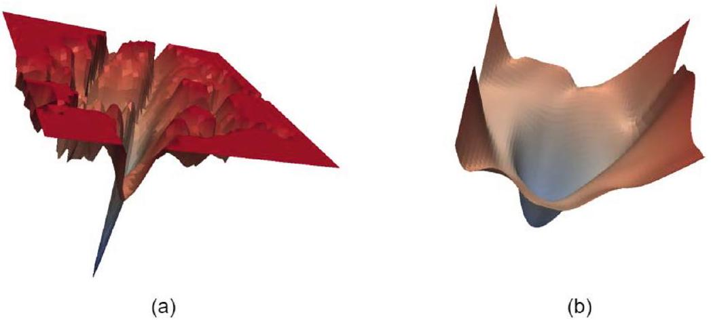

**圖說 `lec03-bp-v2-kp12-original-fig6`**：先看原圖的局部低點，再比較附近的上升形狀。保留來源圖6的尖銳與平坦概念；原圖未附解析數據，不能聲稱等於本講義二次玩具式。〔功能：1、3〕

**Caption `lec03-bp-v2-kp12-original-fig6`**: Inspect the original local minima and neighboring rises. Figure 6 retains its sharp-versus-flat concept. No analytic data were supplied, so it is not claimed to match the quadratic toy example.

### 符號區分參數鄰域與資料泛化（Symbols distinguish parameter neighborhoods from data generalization.）

這裏一維w只爲算例。真實網絡w是向量；參數鄰域受範數與尺度定義影響。測試誤差仍需另行估計。

Scalar w serves this example only. Network parameters form a vector, and neighborhood geometry depends on norms and scales. Test error must be estimated separately.

| 符號或數值 | 中文／中間結果 | English / remaining result |
|---|---|---|
| w、w* | 參數、局部極小點 | Parameter and local minimizer |
| ρ、δ | 鄰域半徑、參數擾動 | Neighborhood radius and parameter perturbation |
| L、fₛ、f𝒇 | 訓練損失、兩個玩具函數 | Training loss and two toy functions |
| flat、sharp | 鄰域低變化、鄰域快速上升 | Low versus high neighborhood sensitivity |

### SAM 的動機是同時看點與整個鄰域（SAM is motivated by the loss across a neighborhood.）

標準訓練降低當前點損失。SAM 先尋鄰域高損失，再降低這個局部最壞情況。這是目標調整，不是取代反向傳播；演算法留給後續單元。

Standard training lowers loss at the current parameters. SAM considers high-loss neighbors before reducing local worst-case loss. It changes the objective, not backpropagation. Algorithmic details follow later.

$$
\min_{\mathbf{w}}\mathcal{L}(\mathbf{w})
$$

### 二次玩具的擾動變化可以精確計算（Quadratic perturbation changes can be computed exactly.）

[補充／更正] 一般式 f(w)=b+aw²，最低點w=0，擾動δ的增量aδ²。針谷a=50、寬碗a=0.5；同一δ的增量相差100倍，總損失不固定相差100倍。

[Added clarification] For f(w)=b+aw², the minimum is at zero and a perturbation δ raises loss by aδ². Coefficients 50 and 0.5 give a 100-fold difference in increases, not necessarily total losses.

### 公式核對：二次玩具的擾動變化可以精確計算（Check the coordinate formulas that accompany the figure.）

[補充／更正] 一般式 f(w)=b+aw²，最低點w=0，擾動δ的增量aδ²。針谷a=50、寬碗a=0.5；同一δ的增量相差100倍，總損失不固定相差100倍。

[Added clarification] For f(w)=b+aw², the minimum is at zero and a perturbation δ raises loss by aδ². Coefficients 50 and 0.5 give a 100-fold difference in increases, not necessarily total losses.

$$
f(\delta)-f(0)=a\delta^2,\qquad f^{\prime\prime}(w)=2a
$$

### 保留所有原例偏移並逐項代入（Retain every source displacement and substitute explicitly.）

〔程式計算〕每列按 b+aw² 算，先平方再乘a最後加b。0.01與0.08是兩個函數的底部高度；0.51與0.085是偏移0.1後的值。

Compute each row with b+aw²: square, multiply by a, then add b. Values 0.01 and 0.08 are baseline minima. At displacement 0.1, values are 0.51 and 0.085.

| 符號或數值 | 中文／中間結果 | English / remaining result |
|---|---|---|
| |w|=0 | 0.01+50×0=0.01 | 0.08+0.5×0=0.08 |
| |w|=0.1 | 0.01+50×0.01=0.51 | 0.08+0.5×0.01=0.085 |
| |w|=0.2 | 0.01+50×0.04=2.01 | 0.08+0.5×0.04=0.10 |
| |w|=0.5 | 0.01+50×0.25=12.51 | 0.08+0.5×0.25=0.205 |

### 最低值排序與鄰域最大值排序可不同（Minimum ordering can differ from neighborhood-maximum ordering.）

兩個函數最低值差0.07；ρ=0.2內最大值2.01與0.10，相差20.1倍。這隻比較不同玩具目標，不能說普通訓練一定選針谷。

Their minima differ by 0.07. At radius 0.2, maxima are 2.01 and 0.10, a ratio of 20.1. These are different toy objectives; standard training is not guaranteed to select one.

$$
0.08-0.01=0.07,\qquad 2.01/0.10=20.1
$$

### 針尖與停車只比喻局部敏感度（The needle and parking analogies describe local sensitivity.）

保留「針尖 vs 寬碗」與停車遇風的比喻，但極小值是谷底，不是山峯。風只對應參數偏移，不能直接等同測試資料改變。

Keep the needle-versus-bowl and parking-in-wind analogies. A minimum is a valley, not a peak. Wind stands for parameter displacement, not automatically a change in test data.

### 方法類型不足以保證解的平坦度（The optimizer category alone does not guarantee flatness.）

來源的一階偏平、二階偏尖屬情境性直覺，非通用定理。重參數化可改形狀而不改模型預測；平坦度不單獨決定泛化。

The source preference for flatter first-order and sharper second-order solutions is contextual, not universal. Reparameterization can change shape without changing predictions. Flatness alone does not determine generalization.

### 練習：判斷平坦與泛化的證據強度（Practice: assess evidence linking flatness and generalization.）

關於「平坦極小值泛化更好」這個主張，正確敘述是？

How should the flatness-generalization claim be described?

A. 已被嚴格證明，無任何爭議

A. Proved without controversy

B. 有經驗支持，但文獻中仍有辯論

B. Empirically supported but still debated

C. 已被完全否定

C. Completely refuted

D. 只適用於線性模型

D. Applicable only to linear models

提示：區分經驗關聯與無條件定理，並檢查參數尺度是否固定。

Hint: distinguish empirical associations from unconditional theorems and examine whether parameter scales are fixed.

### 練習：辨識原文的方法傾向（Practice: recognize a conditional source intuition.）

一階方法（如 SGD）相對二階方法，在極小值「形狀」上的傾向是？

What shape tendency does the source attribute to first-order methods relative to second-order methods?

A. 傾向找到更尖銳的極小值

A. Sharper minima

B. 傾向找到更平坦的極小值

B. Flatter minima

C. 兩者無差異

C. No difference

D. 一階方法找不到極小值

D. Failure to find minima

提示：按原文的情境性直覺作答，另說明爲何不能當成算法類別的通用保證。

Hint: interpret the contextual source intuition and explain why optimizer categories do not supply universal guarantees.

### 公開圖與解析例具有不同出處（The published image and analytic example have distinct provenance.）

原圖保留形狀概念；解析圖由明確兩個二次式計算。原圖可能使用另一地形、不同高度或相同訓練損失，不能把解析表數字貼到原圖。

The original image preserves its shape comparison. The analytic figure computes two specified quadratics. Do not attach toy-table values to an original landscape with different or unspecified data.

### 練習：說明 SAM 的核心動機（Practice: explain the motivation for SAM.）

SAM 算法的核心動機是？

What motivates SAM?

A. 加速每次迭代的計算

A. Faster individual iterations

B. 主動尋找平坦解，懲罰鄰域內的高損失

B. Penalizing high neighborhood loss to seek flatter solutions

C. 取代反向傳播

C. Replacing backpropagation

D. 消除所有局部極小值

D. Eliminating all local minima

提示：看優化目標是否只看當前點；演算法多一次擾動步驟可能增加成本。

Hint: inspect whether the objective only evaluates the current point. An extra perturbation step may increase cost.

### 練習：改一個曲率再計算（Practice: change one curvature coefficient and calculate.）

若寬碗改成 f(w)=0.08+2w²，在 |w|=0.2 時損失是多少？還比針谷 2.01 低嗎？

If the bowl becomes f(w)=0.08+2w², evaluate |w|=0.2. Is its loss still lower than the sharp toy value 2.01?

提示：先算0.2²，再乘2，再加0.08；結論只針對這兩個函數。

Hint: square 0.2, multiply by two, then add 0.08. Limit your conclusion to these two functions.

### 術語表（Glossary）

| 中文 | English |
|---|---|
| 局部極小值 | Local minimum |
| 平坦度 | Flatness |
| 銳度 | Sharpness |
| 參數擾動 | Parameter perturbation |
| 泛化 | Generalization |
| 分佈偏移 | Distribution shift |
| 重參數化 | Reparameterization |
| 銳度感知最小化 | Sharpness-aware minimization |

### 來源與更正（Sources and corrections）

來源：指定的KP原文與教授祕笈；本講義用自己的說法重寫。上述標成更正的說明是為修補來源錯誤與適用條件，非默默改寫。

Source: the assigned KP text and teaching guide, restated in our own words. Explicit corrections repair source errors and missing conditions.

- [Foret et al., SAM: neighborhood-loss objective and empirical results](https://arxiv.org/pdf/2010.01412)（核對日期：2026-10-13）
- [Dinh et al., 2017: parameterization can alter sharpness without changing generalization](https://proceedings.mlr.press/v70/dinh17b.html)（核對日期：2026-10-13）


原圖來源：[原圖 orig-kp12-fig6](https://ndhuccc.github.io/CCC-LNS/IDL_115/Ch03-backprop-optimization/assets/orig-kp12-fig6.jpg)。

Original image references are retained above; local copies keep the diagrams available offline.


## KP13：SAM以鄰域損失改變目標（Knowledge point 13）

> 程度：大學生（undergrad）／Level: Undergraduate (undergrad)

[原教材KP13](https://ndhuccc.github.io/CCC-LNS/IDL_115/Ch03-backprop-optimization/index.html#kp13)；含教授祕笈，讀取日期2026-10-13。

本節先建立定義與假設，再算代表性例子。延伸內容保留完整推導及原練習，適合課後自讀。

Start with definitions and assumptions, then work through a representative example. Extensions preserve the detailed derivations and original exercises for independent reading.

| 符號 | 中文意義 | English meaning |
|---|---|---|
| w | 目前權重向量 | Current weight vector |
| L | 經驗損失 | Empirical loss |
| rho | 參數鄰域半徑 | Parameter-neighborhood radius |
| p,q | 共軛範數指數 | Conjugate norm exponents |
| lambda | L2懲罰係數 | L2 penalty coefficient |

### SAM降低鄰域內的最壞損失（SAM minimizes the worst loss in a parameter neighborhood）

普通訓練只評估目前參數；SAM再問附近是否有高損失點。

Ordinary training evaluates the current parameters. SAM also asks whether nearby parameters have high loss.

$\rho$是參數擾動半徑；$\mathcal L$是同一資料上的經驗損失。

$\rho$ is the parameter perturbation radius; $\mathcal L$ is empirical loss on the same data.

$$
\min_{\mathbf w}\ \max_{\|\mathbf{\epsilon}\|_p\leq\rho}\mathcal L(\mathbf w+\mathbf{\epsilon})
$$


### 梯度正規化給出線性擾動（Normalizing the gradient gives the linearized perturbation）

當$p=2$且梯度非零，沿上升方向走半徑$\rho$。

For $p=2$ and a nonzero gradient, move along the ascent direction by radius $\rho$.

例：$\rho=0.1$、$g=(3,4)$，$\|g\|_2=\sqrt{9+16}=5$。

Here $\rho=0.1$ and $g=(3,4)$, so its norm is $\sqrt{9+16}=5$.

$$
\widehat{\mathbf{\epsilon}}=0.1\frac{(3,4)}5=(0.06,0.08)
$$

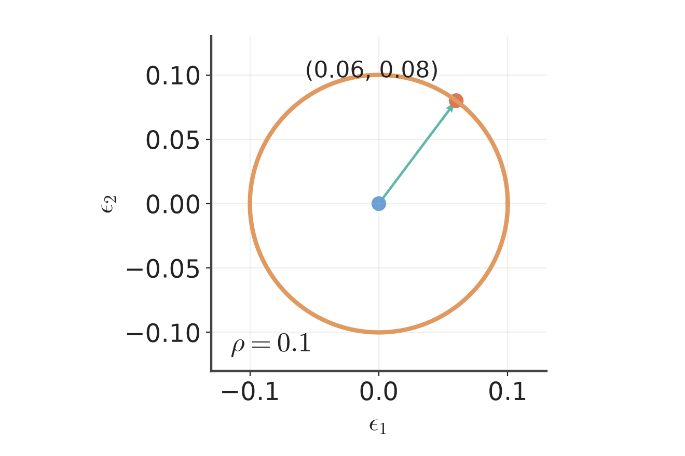
**圖說 `lec03-bp-v2-kp13-perturbation`**：SAM 的半徑0.1擾動圓，梯度(3,4)方向上的擾動為(0.06,0.08)，長度恰為0.1。

The linearized perturbation has length 0.1 and follows gradient (3,4). Inspect the radius before the endpoint.

繪圖程式：`assets/figures/src/lec03-bp-v2-kp13-16-figures.py`。


### SAM用擾動點梯度更新原參數（SAM updates the original parameters with the perturbed gradient）

用同一小批次做兩次反向傳播，第二次梯度在擾動點求得。

Use the same mini-batch for two backward passes. Compute the second gradient at the perturbed point.

- 求梯度$g$（Compute $g$.）
- 求擾動$\widehat\epsilon$（Compute the perturbation.）
- 擾動點再求梯度（Differentiate at the perturbed point.）


### 練習分清SAM梯度的評估點（Use the definitions to distinguish the alternatives）

**小練習**：第二次反向傳播應在哪個參數點進行？

**Practice**: At which parameter point should the second backward pass be evaluated?

- A. 原參數$\mathbf w$（A. The original parameters $\mathbf w$.）
- B. $\mathbf w+\widehat\epsilon$（B. The perturbed parameters $\mathbf w+\widehat\epsilon$.）
- C. $\mathbf w-\widehat\epsilon$（C. A negative perturbation $\mathbf w-\widehat\epsilon$.）
- D. 重新初始化（D. A new random initialization.）

提示：把兩次求梯度的目的與位置逐一對照。

Hint: Match the purpose of each backward pass to its evaluation point.


### 延伸：正則化是SAM目標的另一項（Regularization is a separate term in the SAM objective）

$\lambda\geq0$控制L2懲罰，與鄰域內的最大化不同。

$\lambda\geq0$ controls the L2 penalty, separately from neighborhood maximization.

式(47)含正則化；式(49)是省略這項的版本。

Equation (47) includes regularization; equation (49) omits that term.

$$
\min_{\mathbf w}\ \mathcal L_{\rm SAM}(\mathbf w)+\lambda\|\mathbf w\|_2^2
$$


### 延伸：銳度量測鄰域損失最大增幅（Sharpness measures the maximum neighborhood loss increase）

先加再減同一個目前損失，即可分成兩項。

Add and subtract the same current loss to obtain two terms.

經驗損失衡量目前點；銳度衡量附近最高增幅。

Empirical loss evaluates the current point; sharpness measures the largest nearby increase.

$$
\mathcal L_{\rm SAM}(\mathbf w)=\mathcal L(\mathbf w)+\max_{\|\mathbf{\epsilon}\|_p\leq\rho}[\mathcal L(\mathbf w+\mathbf{\epsilon})-\mathcal L(\mathbf w)]
$$


### 延伸：線性近似把內層變成向量問題（Linearization turns the inner problem into a vector problem）

梯度$g=\nabla\mathcal L(\mathbf w)$提供局部一階變化。

The gradient $g=\nabla\mathcal L(\mathbf w)$ gives the local first-order change.

小半徑下近似較合理；不是精確非線性最大化。

A small radius makes the approximation more plausible; it is not exact nonlinear maximization.

$$
\mathcal L(\mathbf w+\mathbf{\epsilon})\approx\mathcal L(\mathbf w)+\mathbf{\epsilon}^{\top}g
$$


### 延伸：對偶範數決定一般球的解（The dual norm determines the solution on a general norm ball）

對$1<p<\infty$，$1/p+1/q=1$；冪次與符號逐座標作用。

For $1<p<\infty$, $1/p+1/q=1$; powers and signs act coordinate by coordinate.

端點$p=1$或$\infty$需另處理，不直接代入端點冪次。

The cases $p=1$ and $p=\infty$ need separate treatment rather than direct substitution.

$$
\widehat{\mathbf{\epsilon}}=\rho\,\frac{\operatorname{sign}(g)|g|^{q-1}}{(\|g\|_q^q)^{1/p}}
$$


### 延伸：歐氏球上的擾動沿梯度方向（The Euclidean-ball perturbation follows the gradient）

Cauchy–Schwarz給$\epsilon^\top g\leq\rho\|g\|_2$；同方向可取等號。

Cauchy–Schwarz gives $\epsilon^\top g\leq\rho\|g\|_2$; aligned vectors attain equality.

這證明的是線性化目標；來源的星號不應暗示原目標精確解。

This solves the linearized objective; the source asterisk must not imply an exact solution of the original objective.

$$
\widehat{\mathbf{\epsilon}}=\rho\frac{g}{\|g\|_2},\qquad g\ne0
$$


### 延伸：三四五向量驗證擾動長度（The three-four-five vector verifies the perturbation length）

先算梯度長度，再逐座標縮放。

First compute the gradient norm, then scale each coordinate.

讀圖先看半徑，再看向量終點是否在圓上。

Read the radius first, then check whether the vector endpoint lies on the circle.

$$
\|\widehat\epsilon\|_2=\sqrt{0.06^2+0.08^2}=\sqrt{0.0036+0.0064}=0.1
$$


### 延伸：擾動點是原參數加上擾動（The perturbed point adds the perturbation to the current parameters）

來源假設目前參數為$(1.00,2.00)$。

The source assumes the current parameters are $(1.00,2.00)$.

此點提供第二次梯度，不是最後更新結果。

This point supplies the second gradient; it is not the final updated parameter.

$$
(1.00,2.00)+(0.06,0.08)=(1.06,2.08)
$$


### 延伸：兩點差不一定等於精確銳度（A two-point difference need not equal exact sharpness）

來源假設兩點損失為0.50與0.73，差為$0.73-0.50=0.23$。

The assumed losses are 0.50 and 0.73, giving $0.73-0.50=0.23$.

未證明擾動點是最大點，就只能稱取樣或近似損失增幅。

Unless the perturbed point is proved maximal, this is only a sampled or approximate loss increase.


### 延伸：SAM常忽略擾動對參數的導數（SAM commonly ignores the perturbation derivative）

若追蹤擾動對權重的依賴，鏈式法則還有Jacobian項。

Tracking the weight dependence of the perturbation adds a Jacobian term.

實作把擾動視為常數，減少二階計算；來源式(53)是近似。

Implementation treats the perturbation as constant to reduce second-order work; source equation (53) is approximate.

$$
\nabla_{\mathbf w}\mathcal L(\mathbf w+\widehat\epsilon(\mathbf w))\approx \left.\nabla\mathcal L\right|_{\mathbf w+\widehat\epsilon}
$$


### 延伸：第二次梯度更新仍從原點出發（The second gradient still updates from the original point）

先暫時擾動；求第二次梯度後還原，再做優化器更新。

Perturb temporarily; after the second gradient, restore the original parameters before the optimizer update.

不能把暫時上坡直接當成最終更新。

Do not treat the temporary ascent as part of the final parameter update.

- 原參數（Original parameters.）
- 暫時擾動（Temporary perturbation.）
- 還原並更新（Restore and update.）


### 延伸：零梯度時正規化公式不可用（The normalized formula is undefined at a zero gradient）

$\|g\|_2=0$時，來源公式會除以零；可令近似擾動為零。

When $\|g\|_2=0$, the source formula divides by zero; the approximate perturbation may be set to zero.

零一階資訊不表示附近完全平坦，曲率仍可能造成損失變化。

Zero first-order information does not imply a flat neighborhood; curvature may still change the loss.


### 延伸：練習保持另一組擾動半徑（Practice preserving a different perturbation radius）

原出口題：$\rho=0.2$、$g=(5,12)$，求擾動及其長度。

Source transfer question: for $\rho=0.2$ and $g=(5,12)$, compute the perturbation and its length.

提示：先算梯度範數，再套正規化式；保留精確分數後才取小數。

Hint: compute the gradient norm, then normalize it; keep exact fractions before rounding.


### 延伸：練習辨認SAM的內層問題（Use the definitions to distinguish the alternatives）

**小練習**：來源式(49)的內層最大化做什麼？

**Practice**: What does the inner maximization in source equation (49) do?

- A. 找鄰域最大損失擾動（A. Find the largest-loss perturbation in the neighborhood.）
- B. 最小化L2正則項（B. Minimize the L2 regularization term.）
- C. 對小批次取平均（C. Average over a mini-batch.）
- D. 固定擾動為零（D. Fix the perturbation at zero.）

提示：區分外層的參數選擇與內層的擾動選擇。

Hint: Distinguish outer parameter selection from inner perturbation selection.


### 延伸：練習辨認銳度的定義（Use the definitions to distinguish the alternatives）

**小練習**：式(50)的sharpness是哪一項？

**Practice**: Which expression is the sharpness term in equation (50)?

- A. 目前損失$\mathcal L(\mathbf w)$（A. The current loss $\mathcal L(\mathbf w)$.）
- B. 鄰域內最大損失增幅（B. The maximum loss increase in the neighborhood.）
- C. 權重平方範數（C. The squared weight norm.）
- D. 梯度範數（D. The gradient norm.）

提示：銳度比較的是鄰域點與目前點的損失。

Hint: Sharpness compares neighborhood loss with current loss.


### 延伸：練習辨認歐氏球線性擾動（Use the definitions to distinguish the alternatives）

**小練習**：來源式(52)在非零梯度時如何寫？

**Practice**: How is source equation (52) written for a nonzero gradient?

- A. $\rho g$（A. Multiply the gradient by $\rho$.）
- B. $\rho g/\|g\|_2$（B. Scale the unit gradient by $\rho$.）
- C. 零向量（C. Use the zero vector.）
- D. $-\rho g$（D. Use the negative scaled gradient.）

提示：同時檢查方向與長度；這是線性化解。

Hint: Check both direction and length; this is the linearized solution.


### 延伸：先看最慘鄰居再調整原參數（Inspect the worst linearized neighbor before updating）

口訣：先上坡找鄰居，再用鄰居斜率下坡。

Memory cue: ascend to the neighbor, then descend with the neighbor’s slope.

比喻侷限：鄰居只是一階近似，測試泛化仍須驗證。

Analogy limit: the neighbor is a first-order approximation; test generalization still needs verification.


### 延伸：鄰域最大化定義SAM損失（Neighborhood maximization defines the SAM loss）

式(48)對擾動做最大化，權重先保持固定。

Equation (48) maximizes over perturbations while holding weights fixed.

不加正則時，外層再最小化這個鄰域損失。

Without regularization, the outer problem minimizes this neighborhood loss.

$$
\mathcal L_{\rm SAM}(\mathbf w):=\max_{\|\mathbf{\epsilon}\|_p\leq\rho}\mathcal L(\mathbf w+\mathbf{\epsilon})
$$


### 延伸：鄰居比喻不保證測試泛化（The neighbor analogy does not guarantee test generalization）

來源把SAM比作先探最慘鄰居再下山：暫時上坡是為了評估風險。

The source analogy explores the worst neighbor before descending; temporary ascent evaluates neighborhood risk.

這是參數鄰域，不是換測試資料；降低鄰域損失也非泛化保證。

This is a parameter neighborhood, not new test data; lower neighborhood loss is not a generalization guarantee.


### 延伸：不正規化會改變擾動長度（Omitting normalization changes the perturbation length）

來源迷思把擾動寫成$\rho g$；$\rho=0.1,g=(3,4)$時得到$(0.3,0.4)$。

The source misconception uses $\rho g$; with $\rho=0.1,g=(3,4)$, it gives $(0.3,0.4)$.

這樣長度是0.5，不符合原半徑0.1；應先除以梯度範數。

The resulting length is 0.5 instead of radius 0.1; divide by the gradient norm first.

$$
\|(0.3,0.4)\|_2=\sqrt{0.09+0.16}=0.5
$$


### 延伸：參數對抗與輸入對抗不同（Parameter and input adversaries perturb different objects）

來源用對抗圖片解釋先找最壞再最小化的共同結構。

The source uses adversarial images to illustrate the shared worst-case-then-minimize structure.

SAM擾動權重；圖片對抗訓練擾動輸入，限制集合與作用物件不同。

SAM perturbs weights; adversarial image training perturbs inputs, using different constraint sets and objects.


**更正核對來源（Correction references）**：[SAM原論文](https://arxiv.org/abs/2010.01412)


## KP14：SAM兼顧成本與尺度（Knowledge point 14）

> 程度：大學生（undergrad）／Level: Undergraduate (undergrad)

[原教材KP14](https://ndhuccc.github.io/CCC-LNS/IDL_115/Ch03-backprop-optimization/index.html#kp14)；含教授祕笈，讀取日期2026-10-13。

本節先建立定義與假設，再算代表性例子。延伸內容保留完整推導及原練習，適合課後自讀。

Start with definitions and assumptions, then work through a representative example. Extensions preserve the detailed derivations and original exercises for independent reading.

| 符號 | 中文意義 | English meaning |
|---|---|---|
| m_i | 二元選擇遮罩 | Binary selection mask |
| beta | 座標選中機率 | Coordinate inclusion probability |
| alpha | SDS損失差門檻 | SDS loss-change threshold |
| T_w | 可逆尺度算子 | Invertible scale operator |

### SAM改良分別處理成本與尺度（SAM variants address computation and parameter scale）

ESAM：SWP選權重，SDS選資料，降低兩次求梯度的成本。

ESAM selects weights with SWP and data with SDS to reduce the cost of two gradient evaluations.

ASAM：讓擾動尺度配合權重，使函數保持不變的縮放可公平比較。

ASAM adapts perturbation scale to weights so function-preserving rescaling can be compared fairly.


### 遮罩縮放在期望上保留擾動（Mask scaling preserves the perturbation in expectation）

來源四維例：$\epsilon=(0.06,0.08,0.10,0.12)$，$\beta=0.5$。

The source four-dimensional example uses $\epsilon=(0.06,0.08,0.10,0.12)$ and $\beta=0.5$.

遮罩$(1,0,1,0)$只保留第1、3維；$\odot$是逐元素乘法。

The mask $(1,0,1,0)$ keeps coordinates 1 and 3; $\odot$ denotes elementwise multiplication.

$$
\widehat\epsilon=\frac{(1,0,1,0)\odot(0.06,0.08,0.10,0.12)}{0.5}=(0.12,0,0.20,0)
$$


### 練習區分選權重與選樣本（Use the definitions to distinguish the alternatives）

**小練習**：SDS的銳度敏感子集如何判定？

**Practice**: How is the sharpness-sensitive subset in SDS identified?

- A. 目前損失為零（A. The current loss is zero.）
- B. 樣本損失增幅大於門檻（B. Its sample loss increase exceeds the threshold.）
- C. 梯度範數小於門檻（C. Its gradient norm is below the threshold.）
- D. 屬於驗證集（D. It belongs to the validation set.）

提示：比較同一樣本在擾動前後的損失。

Hint: Compare the same sample’s loss before and after perturbation.


### 延伸：兩次反向傳播不代表耗時恰好兩倍（Two backward passes do not imply exactly twice the elapsed time）

Vanilla SAM通常需求兩組前向與反向計算。

Vanilla SAM usually requires two sets of forward and backward computations.

鏈式法則、記憶體與硬體會影響SWP實際省下的成本。

The chain rule, memory use, and hardware affect how much SWP actually saves.

- 第一次求擾動（First pass: perturbation.）
- 第二次求更新梯度（Second pass: update gradient.）
- 基礎優化器更新（Base optimizer update.）


### 延伸：隨機遮罩是逐座標選擇（The random mask selects coordinates individually）

$m_i\sim\mathrm{Bernoulli}(\beta)$，$0<\beta\leq1$。

$m_i\sim\mathrm{Bernoulli}(\beta)$ with $0<\beta\leq1$.

來源式(54)的向量內積會變成純量；應用逐元素乘法。

The vector inner product in source equation (54) produces a scalar; use elementwise multiplication instead.

$$
\widehat\epsilon_i=\frac{m_i}{\beta}\widehat\epsilon_i^{\rm SAM}
$$


### 延伸：期望相同不等於每次相同（Equality in expectation does not mean equality every time）

固定完整擾動後，遮罩與它獨立，才能逐座標取期望。

After fixing the full perturbation, independence of the mask permits coordinatewise expectation.

每次實現可能方向或長度不同，不保證單次仍在原半徑球上。

An individual realization may differ in direction or length and need not lie on the original radius ball.

$$
\mathbb E[\widehat\epsilon_i]=\frac{\mathbb E[m_i]}\beta\widehat\epsilon_i^{\rm SAM}=\widehat\epsilon_i^{\rm SAM}
$$


### 延伸：SDS比較每筆樣本的損失差（SDS compares each sample’s loss change）

$\ell_i$是第$i$筆損失；來源式(55)漏寫此樣本依賴。

$\ell_i$ is the loss of sample $i$; source equation (55) omits this dependence.

門檻相等的樣本需規定如何處理；也可用選取比例控制。

Specify how to handle threshold ties; a selected fraction can also control the subset.

$$
\mathcal B^+=\{i\in\mathcal B:\ell_i(\mathbf w+\widehat\epsilon)-\ell_i(\mathbf w)>\alpha\}
$$


### 延伸：四筆損失差示範銳樣本選擇（Four loss changes illustrate sensitive-sample selection）

來源給定增幅0.03、0.18、0.07、0.25，門檻$\alpha=0.10$。

The given increases are 0.03, 0.18, 0.07, and 0.25, with threshold $\alpha=0.10$.

兩筆超過門檻；樣本數比例$2/4=0.5$，不等於整步耗時恰好減半。

Two samples exceed the threshold; $2/4=0.5$ is the sample fraction, not an exact halving of total runtime.


### 延伸：SDS先評估再挑選下一次梯度（SDS evaluates loss changes before selecting the next gradient）

擾動前後損失先在整個batch評估，第二次梯度用選中子集。

Evaluate losses before and after perturbation on the batch, then use the selected subset for the second gradient.

只抽取樣本不會自動得到銳度敏感子集。

Random sampling alone does not produce a sharpness-sensitive subset.

- 取得擾動（Obtain perturbation.）
- 比較逐筆損失差（Compare sample loss changes.）
- 子集求第二次梯度（Differentiate on the subset.）


### 延伸：尺度不變先要求模型函數不變（Scale invariance first requires an unchanged model function）

$A$是保持損失函數的可逆縮放算子；不適用任意矩陣。

$A$ is an invertible rescaling operator that preserves loss; this does not cover arbitrary matrices.

正規化算子必須抵消同一種縮放。

The normalization operator must cancel that same rescaling.

$$
T_{A\mathbf w}^{-1}A=T_{\mathbf w}^{-1}
$$


### 延伸：ASAM以正規化距離定義鄰域（ASAM defines neighborhoods using normalized distance）

一般SAM固定$\|\epsilon\|_p$；ASAM固定正規化後距離。

Ordinary SAM fixes $\|\epsilon\|_p$; ASAM fixes the distance after normalization.

算子可逆與函數保持不變是此尺度性質的條件。

An invertible operator and an unchanged function are conditions of this scale property.

$$
\max_{\|T_{\mathbf w}^{-1}\epsilon\|_p\leq\rho}[\mathcal L(\mathbf w+\epsilon)-\mathcal L(\mathbf w)]
$$


### 延伸：重參數化會改變固定半徑讀數（Reparameterization changes fixed-radius sharpness）

來源$L(w)=(w-2)^2$，改寫$\widetilde w=w/2$後$\widetilde L=4(\widetilde w-1)^2$。

The source loss $L(w)=(w-2)^2$ becomes $\widetilde L=4(\widetilde w-1)^2$ after $\widetilde w=w/2$.

半徑0.1時銳度$0.1^2=0.01$與$4(0.1)^2=0.04$。

At radius 0.1, sharpness is $0.1^2=0.01$ versus $4(0.1)^2=0.04$.

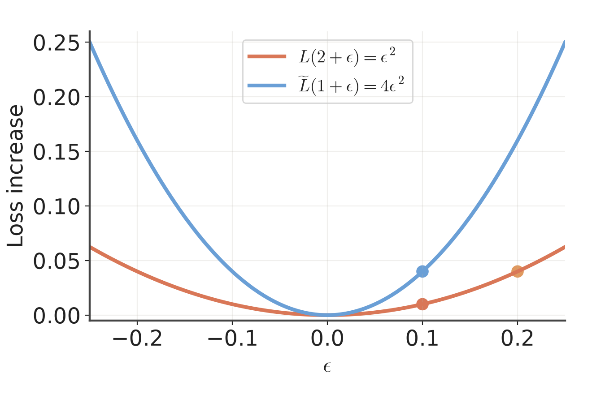
**圖說 `lec03-bp-v2-kp14-rescaling`**：同一損失經w=2乘重參數化：固定半徑0.1的銳度為0.01與0.04；自適應半徑0.2與0.1都得0.04。

Fixed-radius sharpness is 0.01 versus 0.04 after coordinate change; adaptive radii give 0.04 in both coordinates. Read the radius before comparing heights.

繪圖程式：`assets/figures/src/lec03-bp-v2-kp13-16-figures.py`。


### 延伸：自適應半徑抵消這個尺度變化（Adaptive radii cancel this scale change）

例中$T_w=|w|$；在$w=2$的半徑為$0.1\times2=0.2$。

Here $T_w=|w|$; the radius at $w=2$ is $0.1\times2=0.2$.

在$\widetilde w=1$的半徑為0.1，兩邊最大增幅相同。

At $\widetilde w=1$, the radius is 0.1, and both maximum increases agree.

$$
0.2^2=0.04=4(0.1)^2
$$


### 延伸：玩具換座標與網路重縮放須區分（A toy coordinate change differs from a network rescaling）

原例同時改寫了損失函數，用來解釋座標尺度。

The source example rewrites the loss function to explain coordinate scale.

網路ASAM定理要求同一模型函數保持不變；不能由玩具例推廣任意縮放。

The network theorem requires preserving the same model function; the toy example does not justify arbitrary rescaling.


### 延伸：練習辨認SWP遮罩分佈（Use the definitions to distinguish the alternatives）

**小練習**：SWP中的二元遮罩用何種分佈？

**Practice**: Which distribution generates the binary SWP mask?

- A. $U(0,1)$（A. A continuous uniform distribution.）
- B. Bernoulli$(\beta)$（B. A Bernoulli distribution.）
- C. 高斯（C. A Gaussian distribution.）
- D. 恆為1（D. A deterministic mask of ones.）

提示：遮罩值只有0或1，並由選中機率控制。

Hint: A mask takes only zero or one, controlled by the selection probability.


### 延伸：練習辨認ASAM的目標（Use the definitions to distinguish the alternatives）

**小練習**：ASAM相對Vanilla SAM改進什麼？

**Practice**: What does ASAM change relative to vanilla SAM?

- A. 不需要梯度（A. It removes gradients.）
- B. 函數保持不變縮放的尺度性質（B. It handles scale under function-preserving rescaling.）
- C. 只用一次反向傳播（C. It requires only one backward pass.）
- D. 取消min-max（D. It removes the min-max structure.）

提示：對照固定半徑與正規化鄰域的限制。

Hint: Compare the constraints of fixed-radius and normalized neighborhoods.


### 延伸：練習辨認期望還原的理由（Use the definitions to distinguish the alternatives）

**小練習**：遮罩擾動的期望為何可還原完整擾動？

**Practice**: Why can the expected masked perturbation recover the full perturbation?

- A. 獨立遮罩且$\mathbb E[m_i]=\beta$（A. The independent mask has mean $\beta$.）
- B. 遮罩都為1（B. Every mask coordinate is one.）
- C. $\beta=0$（C. The probability is zero.）
- D. 沒做擾動（D. No perturbation is applied.）

提示：把每一維的選中機率與$1/\beta$縮放相乘。

Hint: Multiply each coordinate’s inclusion probability by the $1/\beta$ scaling.


### 延伸：改良的保證不能互相代換（The guarantees of the variants are not interchangeable）

口訣：選權重、挑樣本、換尺度，三件事分開看。

Memory cue: selecting weights, selecting samples, and changing scale are separate operations.

計算成本與測試表現仍要依模型、資料和實作量測。

Measure computation and test performance for the actual model, data, and implementation.


### 延伸：驗屋比喻區分三種省力方法（The inspection analogy separates the three modifications）

SWP像抽幾面牆；SDS像先看哪戶漏水，再把預算花在敏感戶。

SWP samples walls; SDS identifies leaking houses before spending the budget on sensitive ones.

ASAM像按屋的尺度調尺；抽檢無偏不表示每次都精確。

ASAM adapts the ruler to house scale; unbiased sampling does not make every inspection exact.


### 延伸：較小選中機率會增加抽樣波動（Lower inclusion probability increases sampling variability）

[補充] 對固定完整擾動，Bernoulli遮罩方差由$\beta(1-\beta)$給出。

[Added] For a fixed full perturbation, the Bernoulli mask variance is $\beta(1-\beta)$.

縮放雖還原期望，卻放大單步波動；不是越少選越好。

Rescaling restores the mean but amplifies single-step variability; selecting fewer coordinates is not always better.

$$
\operatorname{Var}(\widehat\epsilon_i)=\frac{1-\beta}{\beta}(\widehat\epsilon_i^{\rm SAM})^2
$$


### 延伸：練習換一組遮罩並檢查期望（Practice changing the mask and checking expectation）

原出口題：$\beta=0.25$、$\epsilon=(0.8,0.4)$、遮罩$(0,1)$，求當次擾動。

Source transfer question: use $\beta=0.25$, $\epsilon=(0.8,0.4)$, and mask $(0,1)$ to compute the realization.

提示：先逐元素相乘再除以機率，並說明第二維的期望為何仍是0.4。

Hint: multiply elementwise before dividing by probability, then explain why the second coordinate still has mean 0.4.


### 延伸：工廠抽檢比喻也有成本限制（The factory-inspection analogy also has cost limits）

來源工廠比喻：一千顆螺絲抽比例檢查、挑共振異常者、按直徑改公差。

The source factory analogy samples a fraction of a thousand screws, selects abnormal resonance, and scales tolerance with diameter.

少選座標或樣本不直接決定實際反傳耗時，仍須量測。

Fewer coordinates or samples do not directly determine backward-pass runtime; measurement remains necessary.


**更正核對來源（Correction references）**：[ESAM原論文](https://arxiv.org/abs/2110.03141)；[ASAM原論文](https://proceedings.mlr.press/v139/kwon21b.html)


## KP15：收斂保證需要明確假設（Knowledge point 15）

> 程度：大學生（undergrad）／Level: Undergraduate (undergrad)

[原教材KP15](https://ndhuccc.github.io/CCC-LNS/IDL_115/Ch03-backprop-optimization/index.html#kp15)；含教授祕笈，讀取日期2026-10-13。

本節先建立定義與假設，再算代表性例子。延伸內容保留完整推導及原練習，適合課後自讀。

Start with definitions and assumptions, then work through a representative example. Extensions preserve the detailed derivations and original exercises for independent reading.

| 符號 | 中文意義 | English meaning |
|---|---|---|
| n | 樣本數 | Sample count |
| d | 淺網輸入維度；深網沿教材記號 | Shallow input dimension; deep notation follows the course |
| k,m | 淺層及深層寬度 | Shallow and deep widths |
| delta | 樣本分離距離下界 | Minimum input separation |
| epsilon | 目標訓練損失 | Target training loss |

### 過參數化不是無條件收斂保證（Overparameterization does not give unconditional convergence）

淺層平方激活：特定寬度與輸出符號下，局部極小值全域最優。

For shallow quadratic networks, specified width and output signs make local minima globally optimal.

深層ReLU：足夠寬度、資料分離與指定隨機初始化下，訓練損失可很小。

For deep ReLU networks, sufficient width, data separation, and specified initialization allow small training loss.


### 寬度算例只能檢查已知條件（A width example checks only the known conditions）

來源取$d=2$，所以$k\geq2d=4$；輸出需至少兩正兩負。

The source sets $d=2$, so $k\geq2d=4$; output weights need at least two positive and two negative entries.

固定輸出$\mathbf v$時訓練$W$有$kd=4\times2=8$個參數；含輸出才共12。

With fixed $\mathbf v$, training $W$ has $kd=4\times2=8$ parameters; including output weights gives 12.


### 練習分清沒有假極小值（Use the definitions to distinguish the alternatives）

**小練習**：無spurious local minima表示什麼？

**Practice**: What does the absence of spurious local minima mean?

- A. 沒有任何局部極小值（A. There are no local minima.）
- B. 局部極小值都是全域極小值（B. Every local minimum is global.）
- C. 只有鞍點（C. Only saddles exist.）
- D. 損失處處為零（D. The loss is zero everywhere.）

提示：這是對極小值品質的判斷，不是說極小值不存在。

Hint: This concerns the quality of minima, not their existence.


### 延伸：淺層命題固定輸出權重（The shallow result fixes the output weights）

$W\in\mathbb R^{k\times d}$可學，$\mathbf v\in\mathbb R^k$固定；激活逐元素平方。

$W\in\mathbb R^{k\times d}$ is trained, while $\mathbf v\in\mathbb R^k$ is fixed; activation squares each coordinate.

這不是任意深層ReLU網路的命題。

This is not a theorem for arbitrary deep ReLU networks.

$$
\mathcal L(W)=\frac1{2n}\sum_{i=1}^n(y_i-\mathbf v^\top\sigma(W\mathbf x_i))^2,\quad\sigma(a)=a^2
$$


### 延伸：特定寬度與符號消除假極小值（Specified width and signs eliminate spurious minima）

$k\geq2d$，固定輸出至少$d$個正值與$d$個負值。

$k\geq2d$, with at least $d$ positive and $d$ negative fixed output weights.

條件下全部局部極小值全域最優，鞍點具負曲率。

Under these conditions, every local minimum is global and saddles have negative curvature.

- 平方激活（Quadratic activation.）
- 足夠寬度與正負輸出（Width and mixed output signs.）
- 良好局部極小值（Benign local minima.）


### 延伸：負曲率方向不是非零梯度（Negative curvature is not a nonzero gradient）

鞍點的梯度可為零；負曲率說明存在二階下降方向。

A saddle may have zero gradient; negative curvature indicates a second-order descent direction.

理想算術中恰好停在零梯度點，普通GD不會自行移動。

In exact arithmetic, ordinary GD does not move when it is exactly at a zero-gradient point.

$$
\operatorname{vec}(U)^\top\nabla^2\mathcal L(W_s)\operatorname{vec}(U)<0
$$


### 延伸：零損失還需要額外資料條件（Zero loss requires additional data conditions）

原論文還要求幾乎所有資料輸入與$d\leq n\leq cd^2$。

The original paper additionally requires almost every input configuration and $d\leq n\leq cd^2$.

$c$是定理固定常數；不能自由選成3來宣稱$n=8$有保證。

$c$ is a fixed theorem constant; choosing it as 3 does not prove a guarantee for $n=8$.

$$
d\leq n\leq cd^2\quad\Longrightarrow\quad\min_W\mathcal L(W)=0\ \text{(under the stated data conditions)}
$$


### 延伸：原圖傳達形狀而非數據證明（The original figure illustrates geometry rather than proving a result）

原圖7描述多個局部解品質接近的直覺，不是所有網路的實驗數據。

Original figure 7 illustrates similarly good local solutions; it is not experimental data for every network.

圖說要和前頁模型假設一起讀，不能跳過條件。

Read the caption together with the model assumptions on the preceding pages.

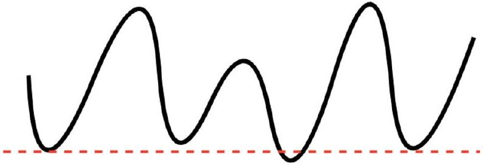
**圖說 `lec03-bp-v2-kp15-original7`**：保留來源原圖7的局部解地形示意，沒有原始曲線資料，不能視為任意網路的實測保證。

Original figure 7 is retained as a qualitative landscape illustration. Generating data are unavailable; it is not a measured guarantee for arbitrary networks.


### 延伸：相近訓練損失仍非相同泛化（Similar training losses do not imply equal generalization）

來源假設兩次初始化得$1.2\times10^{-3}$與$9\times10^{-4}$。

The source supposes two initializations yield $1.2\times10^{-3}$ and $9\times10^{-4}$.

差為$0.0012-0.0009=0.0003$；是示例，未提供測試證據。

Their difference is $0.0012-0.0009=0.0003$; these are illustrative values with no test evidence.


### 延伸：深層理論要求正規化且分離的資料（The deep result requires normalized and separated inputs）

ReLU、平方損失與指定高斯初始化；標籤需有界。

Use ReLU, squared loss, specified Gaussian initialization, and bounded labels.

原論文簡化設定固定輸入與輸出矩陣，只訓練隱藏層。

The paper’s simplified setting fixes input and output matrices and trains hidden layers.

$$
\|\mathbf x_i\|_2=1,\quad (\mathbf x_i)_{\rm last}=1/\sqrt2,\quad \|\mathbf x_i-\mathbf x_j\|_2\geq\delta
$$


### 延伸：寬度條件不是實務最小寬度（The width condition is not the minimum practical width）

足夠寬度是充分條件；$\operatorname{poly}$係數未在教材展開。

Sufficient width is a sufficient condition; the course does not specify the polynomial coefficients.

符號$d$在原論文和教材版本需對照，不能直接估硬體用量。

Align the meaning of $d$ between paper and course notation before estimating hardware.

$$
m\geq\widetilde\Omega(\operatorname{poly}(n,l,\delta^{-1})d),\quad \eta=\Theta\!\left(\frac{d\delta}{\operatorname{poly}(n,l)m}\right)
$$


### 延伸：全梯度步數對精度呈對數量級（Full-gradient iterations depend logarithmically on accuracy）

在指定條件下，以高機率取得訓練損失不高於$\epsilon$。

Under the stated conditions, training loss reaches at most $\epsilon$ with high probability.

來源式(58)只給量級，不能直接讀成精確迭代次數。

Source equation (58) gives an order, not an exact iteration count.

$$
T=\Theta\!\left(\frac{\operatorname{poly}(n,l)\log(\epsilon^{-1})}{\delta^2}\right)
$$


### 延伸：小批次理論也有寬度與步長條件（Mini-batch theory also constrains width and learning rate）

$b$是小批次大小；此結果有資料分離與初始化前提。

$b$ is mini-batch size; data separation and initialization are prerequisites.

不能只保留式(59)而刪掉方法的成立條件。

Do not retain equation (59) while removing the conditions that make it valid.

$$
\begin{aligned}m&\geq\widetilde\Omega\!\left(\frac{\operatorname{poly}(n,l,\delta^{-1})d}{b}\right)\\\eta&=\Theta\!\left(\frac{bd\delta}{\operatorname{poly}(n,l)m\log^2m}\right)\end{aligned}
$$


### 延伸：共同可擬合結構允許快收斂（A shared interpolating solution can allow rapid convergence）

來源式(59)多了$\log^2m/b$因子與高機率條件。

Source equation (59) adds a $\log^2m/b$ factor and a high-probability condition.

此特定可擬合設定不同於KP09的一般持續雜訊SGD。

This specific interpolating setting differs from the persistent-noise SGD setting in KP09.

$$
T=\Theta\!\left(\frac{\operatorname{poly}(n,l)\log(\epsilon^{-1})\log^2m}{\delta^2b}\right)
$$


### 延伸：量級玩具式不是定理係數（The complexity toy formula is not the theorem polynomial）

原祕笈為說明比例，假設$\operatorname{poly}(n,l)=n^2l$。

To illustrate ratios, the source guide assumes $\operatorname{poly}(n,l)=n^2l$.

取$n=100,l=3$得$100^2\times3=30000$；只比較玩具式。

With $n=100,l=3$, $100^2\times3=30000$; compare only this toy expression.

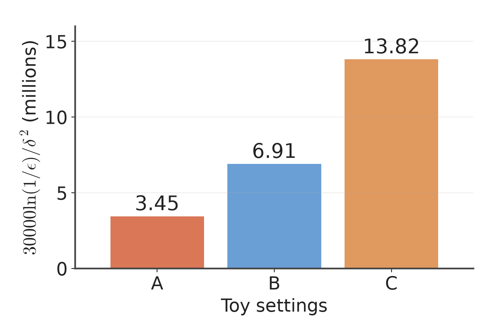
**圖說 `lec03-bp-v2-kp15-toy-complexity`**：原祕笈量級玩具式的A、B、C值約3.45、6.91、13.82百萬，比率1:2:4；不是定理給出的實際步數。

Toy settings A, B, C scale in the ratio 1:2:4. These values illustrate an assumed polynomial, not theorem iteration counts.

繪圖程式：`assets/figures/src/lec03-bp-v2-kp13-16-figures.py`。


### 延伸：精度改變百倍使對數項翻倍（A hundredfold accuracy change doubles the logarithmic term）

〔程式計算〕A：$30000\ln100/0.04\approx3.453878\times10^6$。

(computed) A gives $30000\ln100/0.04\approx3.453878\times10^6$.

B用$\epsilon=0.0001$；比值$\ln10000/\ln100=2$。

B uses $\epsilon=0.0001$; the ratio $\ln10000/\ln100=2$.

$$
\frac{\ln(1/0.0001)}{\ln(1/0.01)}=\frac{\ln10000}{\ln100}=2
$$


### 延伸：資料分離距離減半使平方項四倍（Halving separation multiplies the inverse-square factor by four）

C只把$\delta$從0.2改為0.1，其他玩具參數不變。

C changes only $\delta$ from 0.2 to 0.1, holding the other toy parameters fixed.

〔程式計算〕B約6.907755百萬、C約13.815511百萬；依同一玩具式計算。

(computed) B is about 6.907755 million and C about 13.815511 million, from the same toy formula.

$$
\frac{1/0.1^2}{1/0.2^2}=\frac{0.04}{0.01}=4
$$


### 延伸：練習辨認負曲率方向（Use the definitions to distinguish the alternatives）

**小練習**：來源命題對鞍點的說法表示什麼？

**Practice**: What does the source result about saddles imply?

- A. 梯度法必卡住（A. Gradient methods must get stuck.）
- B. 存在負曲率逃逸方向（B. A negative-curvature escape direction exists.）
- C. 必須只用二階法（C. Only second-order methods are possible.）
- D. 鞍點就是全域解（D. A saddle is a global optimum.）

提示：區分存在下降方向與演算法一定會找到它。

Hint: Distinguish existence of a descent direction from guaranteed algorithmic discovery.


### 延伸：練習辨認深層GD的步數量級（Use the definitions to distinguish the alternatives）

**小練習**：式(58)中的迭代量級為何？

**Practice**: What iteration order appears in equation (58)?

- A. $O(1/\epsilon)$（A. Inverse accuracy.）
- B. $\Theta(\mathrm{poly}(n,l)\log(1/\epsilon)/\delta^2)$（B. A polynomial factor times log accuracy over squared separation.）
- C. $O(n^2)$且與其他量無關（C. Only the squared sample count.）
- D. 恆為一步（D. Always one step.）

提示：分別檢查精度的對數項與分離度的平方項。

Hint: Inspect the logarithmic accuracy term and inverse-square separation term.


### 延伸：練習辨認原圖7的射程（Use the definitions to distinguish the alternatives）

**小練習**：原圖7想傳達什麼核心訊息？

**Practice**: What main idea does original figure 7 illustrate?

- A. 只有一個局部解（A. Only one local solution exists.）
- B. 特定設定下局部解夠好（B. Local solutions can be good in the stated setting.）
- C. 優化一定失敗（C. Optimization always fails.）
- D. 必須使用SAM（D. SAM is necessary.）

提示：先保留模型假設，再讀局部與全域的關係。

Hint: Keep the model assumptions before comparing local and global solutions.


### 延伸：低訓練損失不是測試保證（Low training loss is not a test-performance guarantee）

口訣：條件先讀，訓練可解，測試另驗。

Memory cue: read the conditions, optimize training, and test separately.

來源RKHS說法是特定分析觀點，不是任意網路loss都平滑的保證。

The source RKHS discussion is a particular analysis perspective, not a guarantee that every network loss is smooth.


### 延伸：礦坑比喻描述訓練曲面品質（The mining analogy describes training-landscape quality）

來源比喻：特定礦區的坑幾乎一樣深，局部終點未必有差的訓練損失。

The source analogy has similarly deep pits in a specified mining region, suggesting benign local training outcomes.

比喻不包含所有地形；假坑損失2.5只是來源想像對照。

The analogy does not cover all landscapes; a bad-pit loss of 2.5 is only an imagined source comparison.


### 延伸：練習判斷資料距離改變的比例（Practice the effect of changing input separation）

原出口題：$\delta$由0.5變0.25，其他量固定，式(58)的量級比例怎麼變？

Source transfer question: how does equation (58) scale if $\delta$ changes from 0.5 to 0.25 while other terms stay fixed?

提示：只比較$\delta^{-2}$；不需要猜出$\operatorname{poly}$的係數。

Hint: compare only $\delta^{-2}$; do not guess the polynomial coefficients.


### 延伸：樂團比喻不能取代模型假設（The orchestra analogy cannot replace model assumptions）

來源把參數比作樂手、樣本比作小節，正負輸出比作配對聲部。

The source compares parameters with musicians, samples with measures, and mixed-sign outputs with paired parts.

樂手多不直接構成命題；仍需指定激活、寬度、資料與初始化。

More musicians do not establish a theorem; activation, width, data, and initialization still matter.


**更正核對來源（Correction references）**：[淺網原論文](https://arxiv.org/abs/1707.04926)；[深網原論文](https://arxiv.org/abs/1811.03962)


原圖來源：[原圖 orig-kp15-fig7](https://ndhuccc.github.io/CCC-LNS/IDL_115/Ch03-backprop-optimization/assets/orig-kp15-fig7.jpg)。

Original image references are retained above; local copies keep the diagrams available offline.


## KP16：訓練成功仍須驗證泛化（Knowledge point 16）

> 程度：大學生（undergrad）／Level: Undergraduate (undergrad)

[原教材KP16](https://ndhuccc.github.io/CCC-LNS/IDL_115/Ch03-backprop-optimization/index.html#kp16)；含教授祕笈，讀取日期2026-10-13。

本節先建立定義與假設，再算代表性例子。延伸內容保留完整推導及原練習，適合課後自讀。

Start with definitions and assumptions, then work through a representative example. Extensions preserve the detailed derivations and original exercises for independent reading.

| 符號 | 中文意義 | English meaning |
|---|---|---|
| train/test | 訓練與未見測試資料 | Training and unseen test data |
| loss | 損失 | Loss |
| accuracy/error | 正確／錯誤分類比例 | Correct / incorrect classification fractions |

### 整章工具各有不同職責（The tools in this chapter have distinct roles）

反向傳播求梯度；SGD降低取樣成本；Adam調步幅；SAM改鄰域目標。

Backpropagation computes gradients; SGD reduces sampling cost; Adam adapts steps; SAM changes the neighborhood objective.

- 反傳求梯度（Backpropagate gradients.）
- SGD／Adam更新（Update with SGD or Adam.）
- SAM鄰域評估（Evaluate the SAM neighborhood.）


### 訓練與測試是兩張成績單（Training and testing are separate scorecards）

來源假設train loss=0.0008、test loss=0.41，並非實測資料。

The source assumes training loss 0.0008 and test loss 0.41; these are not measured results.

train acc=100%，test error=8%；四項各有不同意義與單位。

Training accuracy is 100% and test error 8%; the four metrics have distinct meanings and units.

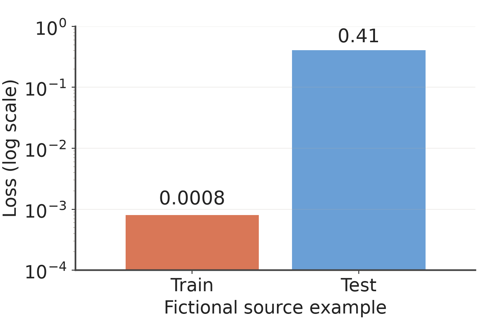
**圖說 `lec03-bp-v2-kp16-metrics`**：原祕笈假設的訓練損失0.0008與測試損失0.41，對數縱軸顯示兩種評估不同；不是實驗資料。

The fictional training loss is 0.0008 and test loss 0.41. Read the logarithmic axis and keep the scorecards separate.

繪圖程式：`assets/figures/src/lec03-bp-v2-kp13-16-figures.py`。


### 練習分清優化與泛化保證（Use the definitions to distinguish the alternatives）

**小練習**：本章收斂理論直接解釋何者？

**Practice**: What do the convergence results in this chapter directly address?

- A. 所有大模型泛化好（A. Every large model generalizes well.）
- B. 條件下的訓練優化成功（B. Successful training optimization under assumptions.）
- C. 所有模型都會過擬合（C. Every model overfits.）
- D. 理論與實務無關（D. Theory is unrelated to practice.）

提示：把定理結論的損失資料集與測試資料分開。

Hint: Separate the dataset used by the theorem from unseen test data.


### 延伸：收斂文獻涵蓋多種激活（Convergence literature studies several activations）

來源回顧平方激活、ReLU與Leaky ReLU，各有不同假設。

The source reviews quadratic, ReLU, and Leaky ReLU activations under different assumptions.

只列研究方向；沒有把不同定理合成一個普遍保證。

These are research directions, not a single universal guarantee assembled from different theorems.

- 激活類型（Activation families.）
- 平方／ReLU（Quadratic and ReLU.）
- Leaky ReLU（Leaky ReLU.）


### 延伸：架構與資料結構改變理論條件（Architecture and data structure change theoretical conditions）

ResNet：研究殘差連接的過參數化優化。

ResNet theory studies overparameterized optimization with residual connections.

結構化資料：不同於一般獨立同分布設定；假設需逐篇核對。

Structured-data theory differs from general independent sampling; inspect assumptions paper by paper.


### 延伸：損失曲面可用不同工具分析（Different tools analyze loss landscapes）

臨界點、二元分類與深線性網路的代數結構，是來源列出的方向。

Critical points, binary classification, and algebraic structure of deep linear networks are source research directions.

GD泛化誤差界與訓練收斂界不同，不能交換解釋。

A GD generalization bound differs from a training convergence bound; do not interchange them.


### 延伸：可訓練不等於完全懂大模型（Trainability does not mean a complete theory of large models）

條件下非凸問題可以有可證明的優化結果。

Nonconvex problems can have provable optimization outcomes under conditions.

理論寬度、初始化與資料假設仍可能和實務有落差。

Theoretical width, initialization, and data assumptions may still differ from practical training.


### 延伸：梯度工具和步幅工具要分開（Gradient computation and step adaptation are separate tools）

反傳是鏈式法則計算工具，沒有自行指定學習率。

Backpropagation applies the chain rule and does not choose a learning rate itself.

Adam用歷史梯度改善尺度，仍需要反傳或其他求梯度方法。

Adam adapts scale using gradient history and still requires backpropagation or another differentiation method.


### 延伸：Adam算例描述逐維尺度（The Adam example describes coordinatewise scaling）

來源某維長期梯度$g=0.2$，二階原始矩約為$g^2$。

A source coordinate has persistent gradient $g=0.2$, so its second raw moment is about $g^2$.

二階矩不是方差；偏置修正與分母穩定項見KP11。

The second moment is not variance; see KP11 for bias correction and numerical stabilization.

$$
v\approx0.2^2=0.04,\qquad\text{coordinate scale}\ \propto\frac{\eta}{\sqrt{v}+\varepsilon}
$$


### 延伸：SAM算例改變梯度評估點（The SAM example changes the gradient evaluation point）

來源仍用$\rho=0.1$與$g=(3,4)$，對照KP13的計算。

The source reuses $\rho=0.1$ and $g=(3,4)$; compare the calculation in KP13.

這不是把Adam的二階矩拿來當SAM半徑。

This does not use Adam’s second moment as the SAM radius.

$$
\widehat\epsilon=\frac{0.1(3,4)}{\sqrt{3^2+4^2}}=(0.06,0.08)
$$


**圖說 `lec03-bp-v2-kp13-perturbation`**：SAM 的半徑0.1擾動圓，梯度(3,4)方向上的擾動為(0.06,0.08)，長度恰為0.1。

The linearized perturbation has length 0.1 and follows gradient (3,4). Inspect the radius before the endpoint.

繪圖程式：`assets/figures/src/lec03-bp-v2-kp13-16-figures.py`。


### 延伸：假設的成績不能當作演算法證據（Assumed scorecards are not evidence for an algorithm）

0.0008、0.41與8%只是原教材假設，未給模型或數據集。

The values 0.0008, 0.41, and 8% are source assumptions without a specified model or dataset.

若要比較優化器，需控制模型、資料、種子與評估程序。

Comparing optimizers requires controlling the model, data, seed, and evaluation procedure.


### 延伸：零平方損失與滿分分類不同（Zero squared loss differs from perfect classification accuracy）

零平方訓練損失表示輸出精確等於目標。

Zero squared training loss means predictions exactly match the targets.

分類準確率100%只要求分類決策都對，不要求損失精確為零。

Perfect classification accuracy requires correct decisions, not exactly zero loss.


### 延伸：練習辨認收斂研究的激活範圍（Use the definitions to distinguish the alternatives）

**小練習**：來源提到哪些激活都有相關文獻？

**Practice**: Which activations are all mentioned in the source convergence literature?

- A. 平方、ReLU、Leaky ReLU（A. Quadratic, ReLU, and Leaky ReLU.）
- B. 只有sigmoid（B. Only sigmoid.）
- C. 只有tanh（C. Only tanh.）
- D. 只有線性（D. Only linear activation.）

提示：查激活分類，不推論它們有相同條件或速率。

Hint: Check the activation categories without assuming identical conditions or rates.


### 延伸：練習辨認ResNet研究的意義（Use the definitions to distinguish the alternatives）

**小練習**：來源提到ResNet收斂分析，代表什麼？

**Practice**: What does the mention of ResNet convergence analysis mean?

- A. 只有淺層全連接可分析（A. Only shallow fully connected networks can be analyzed.）
- B. 理論延伸到殘差架構（B. Theory also studies residual architectures.）
- C. ResNet不能用梯度法（C. ResNet cannot use gradient methods.）
- D. 與過參數化無關（D. It is unrelated to overparameterization.）

提示：研究範圍變廣，不表示任意ResNet都有保證。

Hint: A broader scope does not guarantee every possible ResNet.


### 延伸：練習辨認Adam結合的思想（Use the definitions to distinguish the alternatives）

**小練習**：Adam結合了哪兩種核心想法？

**Practice**: Which two main ideas does Adam combine?

- A. 線搜尋與SAM（A. Line search and SAM.）
- B. 一階矩動量與二階矩平均（B. First-moment momentum and second-moment averaging.）
- C. 只有AdaGrad（C. Only AdaGrad.）
- D. Newton法與動量（D. Newton’s method and momentum.）

提示：分別找出Adam中的方向記憶與尺度記憶。

Hint: Identify Adam’s memories for direction and coordinate scale.


### 延伸：用四個詞重述工具鏈分工（Restate the toolchain using four distinct concepts）

來源出口題：用「步長、平坦谷、訓練損失、泛化」各寫一句。

Source transfer question: write one sentence for each of step size, flat valley, training loss, and generalization.

提示：每句指出一項工具能做的事與不能保證的事。

Hint: Each sentence should identify what a tool does and what it does not guarantee.


### 延伸：訓得動與測得好要分開回答（Trainability and test performance need separate answers）

口訣：反傳讓梯度算得起，Adam調步，SAM看鄰域，測試另驗。

Memory cue: backprop enables gradients, Adam adapts steps, SAM inspects neighborhoods, and testing remains separate.

比喻：模擬考刷滿分，不保證換題情境也滿分。

Analogy: perfect practice-exam scores do not guarantee perfect scores under new questions.


### 延伸：健身房比喻提醒換資料再測（The gym analogy reminds us to test on new data）

來源比喻：這臺器材練熟，不代表換健身房仍有相同表現。

The source analogy says mastery of one machine does not guarantee the same performance in another gym.

從假設損失0.50降到0.0008只是訓練情境；8%測試錯誤須另評估。

An assumed loss change from 0.50 to 0.0008 describes training; the 8% test error requires separate evaluation.


**更正核對來源（Correction references）**：[深網理論射程核對](https://arxiv.org/abs/1811.03962)


## 術語對照（Terminology）

| 中文 | English | 本章角色 | Role in this chapter |
|---|---|---|---|
| 反向傳播 | Backpropagation | 以鏈式法則計算各層梯度 | Compute layer gradients using the chain rule. |
| 最佳化 | Optimization | 依目標調整參數 | Adjust parameters according to the objective. |
| 梯度 | Gradient | 偏導數向量 | A vector of partial derivatives. |
| 學習率 | Learning rate | 縮放更新，不等於位移長度 | Scales the update; it is not the displacement length. |
| 平滑常數 | Smoothness constant | 控制梯度變化 | Bounds changes in the gradient. |
| 線搜尋 | Line search | 每步試探或求解步長 | Tests or solves for the step size at each iteration. |
| 動量 | Momentum | 保存過去更新或方向資訊 | Retains past updates or directional information. |
| 駐點 | Stationary point | 梯度為零的點 | A point with zero gradient. |
| 鞍點 | Saddle point | 可能有下降方向而非極小值 | May have a descent direction without being a local minimum. |
| 隨機梯度下降 | Stochastic gradient descent | 以抽樣梯度更新 | Updates using sampled gradients. |
| 小批次 | Mini-batch | 多樣本梯度平均 | Averages gradients over multiple samples. |
| 資料輪次 | Epoch | 掃過本輪資料批次 | Traverses the data batches once. |
| 指數移動平均 | Exponential moving average | 給近期資訊較高權重 | Weights recent information more heavily. |
| 偏置修正 | Bias correction | 修正零初始化的矩估計 | Corrects moment estimates initialized at zero. |
| 銳度 | Sharpness | 指定鄰域內損失最大增幅 | Maximum loss increase within a specified neighborhood. |
| 過參數化 | Overparameterization | 相對資料規模有大量參數 | Uses many parameters relative to the data scale. |
| 泛化 | Generalization | 在未見資料上的表現 | Performance on unseen data. |

公開說明：簡報講者備註隨檔案下載。數值圖依來源公式重算；來源沒有生成資料的原圖保持定性定位。練習只附提示，不附答案。

Publication note: speaker notes accompany the downloadable deck. Numerical figures are recomputed from source formulas; originals without generating data remain qualitative. Exercises include hints, not answers.
