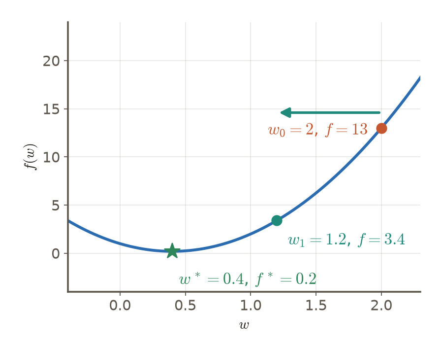

# 第3週 KP02：梯度下降與學習率（Gradient descent and the learning rate）

> 程度：大學生（undergrad）／Level: Undergraduate (undergrad)

本講義是第3章「反向傳播與最佳化」的第二個知識點（KP02），承接 KP01 留下的問題：一階方法只給方向，每一步該走多遠？先備知識是微積分的導數與向量運算；第一次出現的符號都會定義，所有數字都可以自己重算。內容依 CCC-LNS 第3章 KP02 的主文、投影片與互動算例消化後重新撰寫，讀取日期 2026-10-14；來源沒有的內容標示 `[補充]`，與來源不同之處列在最後的「來源更正與取捨」。

This is the second knowledge point (KP02) of Chapter 3, "Backpropagation and optimization". It picks up the question KP01 left open: a first-order method gives only a direction, so how far should each step go? It assumes derivatives and vector operations from calculus; every symbol is defined when it first appears and every number can be recomputed. The text is rewritten from the KP02 main text, slides and interactive examples of CCC-LNS Chapter 3 (accessed on 2026-10-14); content that the source does not contain is marked `[Added]`, and the differences from the source are listed in "Corrections to the source" at the end.

[下載本單元投影片](../slides/lec03-kp02-gradient-descent-and-learning-rate.jbd.json)

## KP02 梯度下降與學習率（Gradient descent and the learning rate）

### 學習目標（Learning objectives）

讀完之後，你能從一階近似推出負梯度更新式；能在 $f(w)=5w^2-4w+1$ 上完整手算一步並檢查損失是否下降；能用誤差倍率 $1-10\eta$ 解釋學習率太小、適中與太大三種情形；能說出 $L$-smooth 與下降引理給出的步長範圍 $0<\eta<2/L$；並能區分凸與非凸損失各自保證什麼。

After reading, you can derive the negative-gradient update from a first-order approximation; compute one full step on $f(w)=5w^2-4w+1$ and check that the loss falls; explain a too-small, a suitable and a too-large learning rate through the error factor $1-10\eta$; state the step-size range $0<\eta<2/L$ given by $L$-smoothness and the descent lemma; and tell what a convex and a non-convex loss each guarantee.

### 符號表（Symbols）

| 符號 | 中文意義 | English meaning |
|---|---|---|
| $w$ | 參數（向量；例子裡是一個數） | parameters (a vector; a single number in the examples) |
| $f(w)$ | 損失函數 | loss function |
| $w^{(k)}$ | 第 $k$ 次更新後的參數；$w^{(0)}$ 是起點 | parameters after the $k$-th update; $w^{(0)}$ is the start |
| $\Delta w$ | 更新量（位移） | the update (displacement) |
| $\nabla f$ | 梯度：損失上升最快的方向 | gradient: the direction of fastest loss increase |
| $\eta$ | 學習率：正的常數，縮放梯度 | learning rate: a positive constant that scales the gradient |
| $L$ | 梯度變化的上界常數（$L>0$） | constant bounding how fast the gradient changes ($L>0$) |
| $w^*$ | 最小點 | the minimizer |
| $e_t$ | 誤差 $w_t-w^*$ | error $w_t-w^*$ |

### 1. 只知道方向時，每一步怎麼走（Which step to take when only the direction is known）

訓練的目標是對參數向量 $w$ 最小化損失：

Training aims to minimize the loss over the parameter vector $w$:

$$
\min_{w}\ f(w)
$$

我們從隨機的起點 $w^{(0)}$ 出發，一步一步改變參數：$w^{(k+1)}=w^{(k)}+\Delta w$。問題只剩一個：每一步該怎麼選更新量 $\Delta w$？

We start from a random point $w^{(0)}$ and change the parameters step by step: $w^{(k+1)}=w^{(k)}+\Delta w$. One question remains: how should each step choose the update $\Delta w$?

位移很小的時候，損失的變化可以用一階近似估計：

When the displacement is small, the change of the loss can be estimated by a first-order approximation:

$$
f(w+\Delta w)\approx f(w)+\nabla f(w)^{\top}\Delta w
$$

若取 $\Delta w=-\eta\,\nabla f(w)$（$\eta>0$），代入得到 $\nabla f^{\top}\Delta w=-\eta\,\|\nabla f\|_2^2$，所以

Choosing $\Delta w=-\eta\,\nabla f(w)$ with $\eta>0$ gives $\nabla f^{\top}\Delta w=-\eta\,\|\nabla f\|_2^2$, hence

$$
f\big(w-\eta\nabla f(w)\big)\approx f(w)-\eta\,\|\nabla f(w)\|_2^2\ \le\ f(w)
$$

平方不會是負的，所以一階變化不會是正的：沿負梯度走，損失（在近似下）下降。把這個選擇寫成更新式，就是**梯度下降**：

A square is never negative, so the first-order change is never positive: moving along the negative gradient lowers the loss, under the approximation. Written as an update rule, this choice is **gradient descent**:

$$
w^{(k+1)}=w^{(k)}-\eta\,\nabla f\big(w^{(k)}\big)
$$

學習率 $\eta$ 只是縮放因子：真正走的距離是 $\eta\,\|\nabla f\|_2$。若目標是最大化（例如最大化機率），符號改成 $+\eta\nabla f$，叫梯度上升。但請記住推導的前提：這只是**局部近似**，位移變大時近似可能失效，所以下一節要實際檢查。

The learning rate $\eta$ is only a scaling factor: the actual distance moved is $\eta\,\|\nabla f\|_2$. If the goal is to maximize (for example a probability), the sign becomes $+\eta\nabla f$, called gradient ascent. Remember the premise of the derivation, though: it is only a **local approximation**, which can fail when the displacement grows, so the next section checks it with numbers.

### 2. 完整算一步（One complete step）

用來源的二次損失當主例子：

Take the source's quadratic loss as the main example:

$$
f(w)=5w^2-4w+1,\qquad f'(w)=10w-4
$$

最小點滿足 $f'(w^*)=0$，即 $10w^*-4=0$，所以 $w^*=0.4$；二階導數 $f''=10>0$，確認是最小值。最小損失 $f(0.4)=5(0.4)^2-4(0.4)+1=0.8-1.6+1=0.2$。

The minimizer satisfies $f'(w^*)=0$, i.e. $10w^*-4=0$, so $w^*=0.4$; the second derivative $f''=10>0$ confirms a minimum. The minimum loss is $f(0.4)=5(0.4)^2-4(0.4)+1=0.8-1.6+1=0.2$.

從 $w_0=2$ 出發：$f'(2)=10(2)-4=16$，$f(2)=5(2)^2-4(2)+1=13$。取學習率 $\eta=0.05$：

Start at $w_0=2$: $f'(2)=10(2)-4=16$ and $f(2)=5(2)^2-4(2)+1=13$. With learning rate $\eta=0.05$:

$$
w_1=w_0-\eta f'(w_0)=2-0.05\cdot16=2-0.8=1.2
$$

梯度是正的，所以參數往左移，方向對了。檢查有限步長之後的實際損失：$f(1.2)=5(1.2)^2-4(1.2)+1=7.2-4.8+1=3.4<13$，損失確實下降。只檢查負號並不夠；方向、步長與更新後的損失都要核對。

The gradient is positive, so the parameter moves left: the direction is right. Check the actual loss after the finite step: $f(1.2)=5(1.2)^2-4(1.2)+1=7.2-4.8+1=3.4<13$, so the loss did fall. Checking the minus sign alone is not enough; verify the direction, the step and the loss after the update.

**圖說 `lec03-kp02-one-step`**：先看曲線與三個點：橘點是起點，青綠點是走一步之後，星號是最小點；再看箭頭：參數往左移，離最小點更近，損失從 13 降到 3.4。〔功能：2、3〕

**Caption `lec03-kp02-one-step`**: Look at the curve and the three points first: orange is the start, teal is after one step, the star is the minimum. Then look at the arrow: the parameter moves left, closer to the minimum, and the loss falls from 13 to 3.4. [Function: 2, 3]

`[補充]` 繼續用 $\eta=0.05$ 更新。化簡後 $w_{t+1}=w_t-0.05(10w_t-4)=0.5\,w_t+0.2$，所以離最小點 $0.4$ 的距離每步減半：

`[Added]` Keep updating with $\eta=0.05$. The rule simplifies to $w_{t+1}=w_t-0.05(10w_t-4)=0.5\,w_t+0.2$, so the distance to the minimum $0.4$ halves at each step:

| $t$ | 0 | 1 | 2 | 3 | 4 | 5 |
|---|---|---|---|---|---|---|
| $w_t$ | 2 | 1.2 | 0.8 | 0.6 | 0.5 | 0.45 |
| $f(w_t)$ | 13 | 3.4 | 1 | 0.4 | 0.25 | 0.2125 |

越接近最小點，梯度越小，步子也跟著變小，所以後期下降變慢。

The closer to the minimum, the smaller the gradient, so the steps shrink too and the descent slows down later.

### 3. 學習率的三種命運（The three fates of the learning rate）

$\eta=0.05$ 走得很好，那 $\eta$ 取什麼都可以嗎？來源用同一個函數換了三個學習率。我們把更新式整理一下（`[補充]` 推導）：令誤差 $e_t=w_t-w^*=w_t-0.4$。因為 $f'(w_t)=10w_t-4=10\,e_t$，

$\eta=0.05$ went well, but does any $\eta$ work? The source tries three learning rates on the same function. Let us simplify the update (`[Added]` derivation): let the error be $e_t=w_t-w^*=w_t-0.4$. Because $f'(w_t)=10w_t-4=10\,e_t$,

$$
e_{t+1}=e_t-\eta\cdot10\,e_t=(1-10\eta)\,e_t
$$

每一步誤差都乘上固定的倍率 $1-10\eta$。起點誤差 $e_0=2-0.4=1.6$，代入三個學習率：

At every step the error is multiplied by the fixed factor $1-10\eta$. The starting error is $e_0=2-0.4=1.6$; substituting the three learning rates:

| $\eta$ | 倍率 $1-10\eta$ | $e_1$ | $e_2$ | 損失差 $5e_1^2$ | 行為 |
|---|---|---|---|---|---|
| 0.02 | 0.8 | 1.28 | 1.024 | 8.192 | 緩慢縮小 |
| 0.10 | 0 | 0 | 0 | 0 | 一步到最小點 |
| 0.25 | −1.5 | −2.4 | 3.6 | 28.8 | 正負交替、越來越大 |

| $\eta$ | Factor $1-10\eta$ | $e_1$ | $e_2$ | Loss gap $5e_1^2$ | Behavior |
|---|---|---|---|---|---|
| 0.02 | 0.8 | 1.28 | 1.024 | 8.192 | shrinks slowly |
| 0.10 | 0 | 0 | 0 | 0 | reaches the minimum in one step |
| 0.25 | −1.5 | −2.4 | 3.6 | 28.8 | alternates in sign and grows |

（損失差 $f(w_t)-f^*=5e_t^2$：把 $f(w)=5(w-0.4)^2+0.2$ 展開即可驗證。）

(The loss gap is $f(w_t)-f^*=5e_t^2$: expand $f(w)=5(w-0.4)^2+0.2$ to verify.)

**圖說 `lec03-kp02-step-regimes`**：先看綠線：倍率為 0，第 1 步誤差就是 0；再看藍線：倍率 0.8，每步只縮小 20%；最後看紅線：倍率 −1.5，每步變號並放大 1.5 倍，越走越遠。縱軸用對稱對數刻度才看得到小的誤差，讀數時以刻度標示為準。〔功能：1、2〕

**Caption `lec03-kp02-step-regimes`**: Look at the green line first: the factor is 0, so the error is 0 at step 1. Then the blue line: the factor is 0.8, so the error shrinks by only 20% per step. Finally the red line: the factor is −1.5, so every step flips the sign and multiplies the size by 1.5, moving farther away. The vertical axis is symmetric-log so that small errors are visible; read values from the tick labels. [Function: 1, 2]

所以學習率有三種命運：**太小**，安全但很慢；**適中**，穩定下降；**太大**，越過谷底，甚至越走越遠。「太大」在來源裡叫「拍皮球」。用更簡單的函數 $f(w)=w^2$（$f'(w)=2w$）看得最清楚，更新式是 $w_{k+1}=w_k-\eta(2w_k)=(1-2\eta)\,w_k$，起點 $w_0=4$（來源的互動算例）：

So the learning rate has three fates: **too small** is safe but slow; **suitable** descends steadily; **too large** jumps over the valley and can even move farther away. In the source, "too large" is called "bouncing the ball". It is clearest on the simpler function $f(w)=w^2$ with $f'(w)=2w$, whose update is $w_{k+1}=w_k-\eta(2w_k)=(1-2\eta)\,w_k$, starting at $w_0=4$ (the source's interactive example):

| $\eta$ | 倍率 $1-2\eta$ | $w_0, w_1, w_2, w_3$ | 損失 $w^2$ | 行為 |
|---|---|---|---|---|
| 0.10 | 0.8 | 4, 3.2, 2.56, 2.048 | 16, 10.24, 6.5536, 4.194304 | 縮小 |
| 1 | −1 | 4, −4, 4, −4 | 16, 16, 16, 16 | 左右拍皮球，損失不降 |
| 1.10 | −1.2 | 4, −4.8, 5.76, −6.912 | 16, 23.04, 33.1776, 47.775744 | 變號且放大，發散 |

| $\eta$ | Factor $1-2\eta$ | $w_0, w_1, w_2, w_3$ | Loss $w^2$ | Behavior |
|---|---|---|---|---|
| 0.10 | 0.8 | 4, 3.2, 2.56, 2.048 | 16, 10.24, 6.5536, 4.194304 | shrinks |
| 1 | −1 | 4, −4, 4, −4 | 16, 16, 16, 16 | bounces between two sides, the loss does not fall |
| 1.10 | −1.2 | 4, −4.8, 5.76, −6.912 | 16, 23.04, 33.1776, 47.775744 | flips sign and grows, diverges |

逐步驗算：$\eta=0.10$：$w_1=4-0.10\cdot8=3.2$，$f(3.2)=10.24<16$；$\eta=1$：$w_1=4-1\cdot8=-4$，$w_2=-4-1\cdot(-8)=4$，兩點損失都是 16；$\eta=1.10$：$w_1=4-1.10\cdot8=-4.8$，$f=23.04$，$w_2=-4.8-1.10\cdot(-9.6)=5.76$，$f=33.1776$〔程式計算〕。越過谷底不等於損失下降：$\eta=1$ 時參數兩邊來回，損失一直沒有改變。

Step-by-step checks: for $\eta=0.10$: $w_1=4-0.10\cdot8=3.2$ and $f(3.2)=10.24<16$; for $\eta=1$: $w_1=4-1\cdot8=-4$ and $w_2=-4-1\cdot(-8)=4$, both with loss 16; for $\eta=1.10$: $w_1=4-1.10\cdot8=-4.8$ with $f=23.04$, and $w_2=-4.8-1.10\cdot(-9.6)=5.76$ with $f=33.1776$ [computed by program]. Crossing the valley is not the same as lowering the loss: at $\eta=1$ the parameter bounces between two sides and the loss never changes.

### 4. 步長保證：$L$-smooth 與下降引理（A step-size guarantee: $L$-smoothness and the descent lemma）

能不能事先算出安全的 $\eta$？可以，只要知道損失「彎曲得多厲害」。**$L$-smooth** 的意思是梯度變化有上限：存在常數 $L>0$，對任意兩點 $u,v$，

Can we compute a safe $\eta$ in advance? Yes, if we know how sharply the loss can bend. **$L$-smooth** means the gradient changes at a bounded rate: there is a constant $L>0$ such that for any two points $u,v$,

$$
\|\nabla f(u)-\nabla f(v)\|_2\le L\,\|u-v\|_2
$$

$L$ 是函數的性質，在考慮的範圍內固定，不是每一步的曲率，也不是步長。它給出一個二次上界：$f(w+\Delta w)\le f(w)+\nabla f^{\top}\Delta w+\tfrac{L}{2}\|\Delta w\|_2^2$。代入 $\Delta w=-\eta\nabla f$：

$L$ is a property of the function, fixed over the region considered; it is neither the curvature at one step nor a step size. It gives a quadratic upper bound: $f(w+\Delta w)\le f(w)+\nabla f^{\top}\Delta w+\tfrac{L}{2}\|\Delta w\|_2^2$. Substituting $\Delta w=-\eta\nabla f$:

$$
f\big(w-\eta\nabla f\big)\le f(w)-\eta\|\nabla f\|_2^2+\tfrac{L\eta^2}{2}\|\nabla f\|_2^2
= f(w)-\eta\Big(1-\tfrac{L\eta}{2}\Big)\|\nabla f\|_2^2
$$

這叫**下降引理**。括號大於 0，上界才保證下降，也就是 $1-L\eta/2>0$，即 $0<\eta<2/L$。取 $\eta=1/L$ 時係數是 $\tfrac1L\cdot\tfrac12=\tfrac{1}{2L}$，每步至少下降 $\tfrac{1}{2L}\|\nabla f\|_2^2$；梯度不為零時嚴格下降，梯度為零時損失可能不變。

This is the **descent lemma**. The upper bound guarantees descent when the bracket is positive, i.e. $1-L\eta/2>0$, that is $0<\eta<2/L$. At $\eta=1/L$ the coefficient is $\tfrac1L\cdot\tfrac12=\tfrac{1}{2L}$, so each step lowers the loss by at least $\tfrac{1}{2L}\|\nabla f\|_2^2$: strictly when the gradient is nonzero, and possibly not at all when it is zero.

回到主例子：$f''=10$，所以 $L=10$，$1/L=0.1$，$2/L=0.2$。$\eta=0.10=1/L$ 一步到最小點；$\eta=0.02<0.2$ 緩慢縮小；$\eta=0.25>0.2$ 發散。三個結果與上一節完全吻合。$f(w)=w^2$ 的 $L=2$，$2/L=1$：$\eta=0.10$ 縮小，$\eta=1$ 剛好在邊界上拍皮球，$\eta=1.10$ 發散，同樣吻合（`[補充]` 對照）。

Back to the main example: $f''=10$, so $L=10$, $1/L=0.1$ and $2/L=0.2$. $\eta=0.10=1/L$ reaches the minimum in one step; $\eta=0.02<0.2$ shrinks slowly; $\eta=0.25>0.2$ diverges. The three results match exactly. For $f(w)=w^2$, $L=2$ and $2/L=1$: $\eta=0.10$ shrinks, $\eta=1$ sits on the boundary and bounces, $\eta=1.10$ diverges, again matching (`[Added]` cross-check).

要小心三個過度推論：（1）$1/L$ 是**安全選擇**，不是唯一或最大的步長，$\eta$ 在 $1/L$ 與 $2/L$ 之間仍然保證下降；（2）「每步一定嚴格下降」要求梯度不為零；（3）實務上深度網路的 $L$ 很難算出有用的值，所以才改調固定的 $\eta$（下一個 KP 起會談如何停止、如何選步長）。

Beware three over-readings: (1) $1/L$ is a **safe choice**, not the only or the largest usable step, and any $\eta$ between $1/L$ and $2/L$ still guarantees descent; (2) "strictly lower at every step" requires a nonzero gradient; (3) in practice a useful $L$ is hard to compute for deep networks, which is why we tune a fixed $\eta$ instead (later knowledge points cover when to stop and how to choose steps).

### 5. 凸與非凸：保證的不是同一件事（Convex and non-convex losses guarantee different things）

先釐清幾個名詞（`[補充]` 定義）。**凸函數**：圖上任兩點的連線不會跑到圖形下方。**駐點**：梯度為零的點，不一定是最低點。**鞍點**：梯度為零，但有些方向往下、有些方向往上。**局部最小**是附近最低，**全域最小**是所有地方最低。

First some terms (`[Added]` definitions). A **convex function**: the segment between any two points on the graph never lies below the graph. A **stationary point**: a point with zero gradient, not necessarily a minimum. A **saddle point**: zero gradient, yet some directions go down and some go up. A **local minimum** is lowest nearby; a **global minimum** is lowest everywhere.

凸損失沒有「較差的局部最低點」：每個局部最小都是全域最小（但最小點不一定只有一個）。若損失是凸的、$L$-smooth，最小值存在，且取適當步長（例如 $1/L$），損失序列不增：$f(w^{(0)})\ge f(w^{(1)})\ge\cdots\ge f(w^*)$，並趨向最小值。非凸損失（深度網路屬於這一類）可能有多個盆地與鞍點，在相同的光滑與步長條件下通常只保證**梯度趨近零**（有下界時），不保證找到最低點，也不保證逃離每個鞍點。起點會影響走向哪個盆地；He 與 Xavier 這類初始化讓訊號的尺度合理，卻不保證落進好的盆地。

A convex loss has no inferior local minimum: every local minimum is global (though the minimizer need not be unique). If the loss is convex and $L$-smooth, a minimum exists and a suitable step such as $1/L$ is used, the loss sequence is nonincreasing, $f(w^{(0)})\ge f(w^{(1)})\ge\cdots\ge f(w^*)$, and tends to the minimum. A non-convex loss, which includes deep networks, can have several basins and saddle points; under the same smoothness and step conditions it typically guarantees only that the **gradient approaches zero** (when the loss is bounded below), not that a minimum is found or that every saddle is escaped. The starting point affects which basin is reached; initializations such as He and Xavier keep signal scales reasonable without guaranteeing a good basin.

| 比較面向 | 凸、光滑、步長適當 | 非凸、光滑、步長適當 |
|---|---|---|
| 能保證什麼 | 最小值存在時，損失可趨向全域最小 | 通常至多保證梯度趨近零 |
| 損失會不會上升 | 精確梯度下可單調不增 | 同一個下降引理也適用 |
| 起點的影響 | 影響速度與路徑，最小值相同 | 可能走向不同的盆地或駐點 |

| Aspect | Convex, smooth, suitable step | Non-convex, smooth, suitable step |
|---|---|---|
| What is guaranteed | the loss can approach the global minimum when a minimum exists | typically at most that the gradient approaches zero |
| Can the loss rise? | it can stay nonincreasing with exact gradients | the same descent lemma applies |
| Effect of the start | affects speed and path, not the minimum value | can lead to different basins or stationary points |

最後一個常見迷思是「震盪就是失敗」。在非凸損失上看到更新前後來回擺動，不能直接判定成功或失敗：要分清參數的擺動、全資料損失與批次損失，下降的趨勢也不是收斂的證明。接下來的問題是：走了很多步之後，什麼時候該停？這是 KP03 的主題。

A last common misconception is "oscillation means failure". Seeing the iterates swing back and forth on a non-convex loss does not settle success or failure: distinguish parameter oscillation, full-data loss and batch loss, and a downward trend is not a convergence proof. The next question is: after many steps, when should we stop? That is the topic of KP03.

### 本單元重點整理（KP02 summary）

**一句話重點**：梯度下降沿負梯度走，學習率 $\eta$ 決定走多遠；在 $L$-smooth 的損失上 $0<\eta<2/L$ 保證每步不增，$1/L$ 是安全選擇。

**One-sentence summary**: Gradient descent moves along the negative gradient and the learning rate $\eta$ sets how far; on an $L$-smooth loss any $0<\eta<2/L$ guarantees a nonincreasing loss, and $1/L$ is a safe choice.

**白話說明**：知道下坡方向，不代表大步一定更低。步子太小走不到，太大會跨過谷底甚至越走越高；先檢查方向、步長與更新後的實際損失。$L$ 把「彎得多厲害」變成一個數，讓我們能算出安全的步長範圍；但實務上算不出 $L$，只能調 $\eta$。

**Plain explanation**: Knowing the downhill direction does not make every large step safe. Tiny steps never arrive, large steps jump over the valley and can even climb; check the direction, the step and the actual loss after the update. $L$ turns "how sharply it bends" into one number so that a safe step range can be computed; in practice $L$ cannot be computed, so we tune $\eta$.

**正式定義**：$w^{(k+1)}=w^{(k)}-\eta\nabla f(w^{(k)})$；$L$-smooth：$\|\nabla f(u)-\nabla f(v)\|_2\le L\|u-v\|_2$；下降引理：$f(w-\eta\nabla f)\le f(w)-\eta(1-\tfrac{L\eta}{2})\|\nabla f\|_2^2$。

**Formal definition**: $w^{(k+1)}=w^{(k)}-\eta\nabla f(w^{(k)})$; $L$-smooth: $\|\nabla f(u)-\nabla f(v)\|_2\le L\|u-v\|_2$; descent lemma: $f(w-\eta\nabla f)\le f(w)-\eta(1-\tfrac{L\eta}{2})\|\nabla f\|_2^2$.

**例子**：$f(w)=5w^2-4w+1$、$w_0=2$、$\eta=0.05$：$f'(2)=16$，$w_1=1.2$，損失 13 降到 3.4；誤差倍率 $1-10\eta$：$\eta=0.02,\,0.10,\,0.25$ 分別是 $0.8,\,0,\,-1.5$；$L=10$，$1/L=0.1$，$2/L=0.2$。逐步計算見第 2–4 節。

**Example**: $f(w)=5w^2-4w+1$, $w_0=2$, $\eta=0.05$: $f'(2)=16$, $w_1=1.2$, loss from 13 to 3.4; the error factor $1-10\eta$ is $0.8,\,0,\,-1.5$ for $\eta=0.02,\,0.10,\,0.25$; $L=10$, $1/L=0.1$, $2/L=0.2$. The step-by-step computations are in sections 2–4.

**常見迷思**：

- 「更新式有負號，損失就一定下降」——不一定，要看步長；$\eta=1$ 時 $f(w)=w^2$ 的損失完全不降。
- 「$\eta>1/L$ 就一定發散」——不一定，只要 $\eta<2/L$ 下降引理仍保證下降。
- 「$1/L$ 讓每一步嚴格下降」——只有梯度不為零時才嚴格下降。
- 「凸就一定收斂」——還需要 $L$-smooth、最小值存在與適當步長。
- 「震盪就是失敗，或震盪就是正常」——兩者都不能憑曲線形狀下結論。

**Common misconceptions**:

- "The minus sign guarantees the loss falls." Not necessarily; it depends on the step: at $\eta=1$ the loss of $f(w)=w^2$ never falls.
- "$\eta>1/L$ always diverges." Not necessarily; the descent lemma still guarantees descent for $\eta<2/L$.
- "$1/L$ lowers the loss strictly at every step." Only when the gradient is nonzero.
- "Convex means it always converges." It also needs $L$-smoothness, an attained minimum and a suitable step.
- "Oscillation is failure, or oscillation is normal." Neither can be concluded from the shape of a curve.

**圖**：本單元兩張圖，`lec03-kp02-one-step`（一步的驗算，功能 2、3）與 `lec03-kp02-step-regimes`（三種學習率的誤差，功能 1、2），皆以 `assets/figures/src/lec03-kp02-lr-figures.py` 用精確分數運算的資料繪製。來源的凸與非凸示意圖沒有生成資料，不重畫，改以文字與對照表說明。

**Figure**: Two figures in this unit, `lec03-kp02-one-step` (the checked step; functions 2, 3) and `lec03-kp02-step-regimes` (the error under three learning rates; functions 1, 2), both drawn by `assets/figures/src/lec03-kp02-lr-figures.py` from data computed with exact fractions. The source's qualitative convex and non-convex sketches have no generating data and are not redrawn; they are explained in text and in the comparison table.

**想深入**（選讀）：對二次函數 $f(w)=\tfrac{a}{2}w^2$，更新是 $w\leftarrow(1-\eta a)\,w$，倍率的絕對值小於 1 的條件正好是 $0<\eta<2/a$，而 $a$ 就是 $L$，所以 $2/L$ 在二次函數上是**精確**的收斂邊界，不只是充分條件。多維度時，各方向的曲率不同，最大的曲率決定能用的最大 $\eta$，其他方向就走得慢；這是 KP01 的玩具碗之字形的原因，也是後面動量與自適應方法要處理的問題。

**Going deeper** (optional): For a quadratic $f(w)=\tfrac{a}{2}w^2$ the update is $w\leftarrow(1-\eta a)\,w$ and the factor has absolute value below 1 exactly when $0<\eta<2/a$; since $a$ is $L$, the bound $2/L$ is **exact** for quadratics, not just sufficient. In several dimensions the curvatures differ per direction, the largest curvature limits the usable $\eta$, and the other directions then move slowly; this is the cause of the zigzag in KP01's toy bowl and what momentum and adaptive methods address later.

**小練習**：

1. 對 $f(w)=5w^2-4w+1$，取 $w_0=2$、$\eta=0.08$，算出 $w_1$、$w_2$，並檢查每一步損失是否下降。（提示：$w_1=2-0.08f'(2)$；再算 $f'(w_1)$。）
2. 對同一個函數（$L=10$），判斷 $\eta=0.15$ 與 $\eta=0.30$ 是否保證每步不增，並用誤差倍率 $1-10\eta$ 驗證。（提示：先比較 $\eta$ 與 $2/L$。）
3. 在非凸損失上看到相鄰兩次更新的損失忽高忽低，能直接說「訓練失敗」嗎？列出你還需要確認的三件事。（提示：想想參數、全資料損失與批次損失。）

**Practice**:

1. For $f(w)=5w^2-4w+1$ with $w_0=2$ and $\eta=0.08$, compute $w_1$ and $w_2$ and check whether the loss falls at each step. (Hint: $w_1=2-0.08f'(2)$; then compute $f'(w_1)$.)
2. For the same function ($L=10$), decide whether $\eta=0.15$ and $\eta=0.30$ guarantee a nonincreasing loss, and verify with the error factor $1-10\eta$. (Hint: compare $\eta$ with $2/L$ first.)
3. On a non-convex loss the loss alternates up and down between adjacent updates. Can you say "training failed"? List three things you still need to check. (Hint: think of parameters, full-data loss and batch loss.)

**解題示範**（以 $f(w)=w^2$、$w_0=4$、$\eta=0.4$ 示範第 2 題的判斷方法）：

1. 先求 $L$：$f''=2$，所以 $L=2$，$2/L=1$。
2. 比較：$0<\eta=0.4<1=2/L$，所以保證每步不增（$1/L=0.5$，$\eta<1/L$，是偏保守的選擇）。
3. 用倍率驗證：$1-2\eta=1-0.8=0.2$，$|0.2|<1$，所以 $w_k=4\cdot0.2^k$ 縮小。
4. 算一步：$f'(4)=8$，$w_1=4-0.4\cdot8=0.8$，$f(0.8)=0.64<f(4)=16$，損失下降，與判斷一致。

**Worked solution** (the method of exercise 2, shown with $f(w)=w^2$, $w_0=4$, $\eta=0.4$):

1. Find $L$ first: $f''=2$, so $L=2$ and $2/L=1$.
2. Compare: $0<\eta=0.4<1=2/L$, so a nonincreasing loss is guaranteed ($1/L=0.5$, and $\eta<1/L$ is a rather conservative choice).
3. Verify with the factor: $1-2\eta=1-0.8=0.2$ and $|0.2|<1$, so $w_k=4\cdot0.2^k$ shrinks.
4. Compute one step: $f'(4)=8$, $w_1=4-0.4\cdot8=0.8$ and $f(0.8)=0.64<f(4)=16$: the loss falls, consistent with the judgment.

### 來源更正與取捨（Corrections to the source）

- 來源把 Cauchy 的梯度下降年份寫成 1874，正確是 1847；來源的歷史時間線（Cauchy、Hadamard、Curry）只是背景，不構成收斂條件，本講義不放。
- 來源說取 $1/L$ 每一步「必然嚴格單調下降」；精確的說法是：$0<\eta<2/L$ 時保證不增，梯度不為零才嚴格下降。來源說「$\eta>1/L$ 會越過谷底」也過強，本講義改以 $2/L$ 為界，並以誤差倍率驗證。
- 來源說凸函數的軌跡必收斂；本講義補上 $L$-smooth、最小值存在與適當步長的條件。「震盪不等於失敗」是經驗，不是定理，本講義不當作結論。
- 來源的凸與非凸示意圖沒有生成資料，不重畫；「梯度下降是反向傳播加鏈式法則」這類說法不採用：反向傳播負責算梯度（KP06），梯度下降負責用梯度更新。

- The source gives the year of Cauchy's gradient descent as 1874; the correct year is 1847. The source's historical timeline (Cauchy, Hadamard, Curry) is background and no convergence condition, so this note omits it.
- The source says that $1/L$ makes every step "strictly monotonically decreasing"; the precise statement is that $0<\eta<2/L$ guarantees a nonincreasing loss and strict decrease needs a nonzero gradient. The claim that "$\eta>1/L$ overshoots" is also too strong; this note uses $2/L$ as the boundary and checks it with the error factor.
- The source says a convex loss always converges; this note adds the conditions of $L$-smoothness, an attained minimum and a suitable step. "Oscillation is not failure" is experience, not a theorem, so it is not taken as a conclusion here.
- The source's convex and non-convex sketches have no generating data and are not redrawn; statements such as "gradient descent is backpropagation plus the chain rule" are not adopted: backpropagation computes the gradient (KP06) and gradient descent uses it to update.

### 術語對照（Terminology）

| 中文 | English |
|---|---|
| 梯度下降／梯度上升 | gradient descent / gradient ascent |
| 學習率 | learning rate |
| 一階近似 | first-order approximation |
| 更新式 | update rule |
| 光滑（$L$-smooth） | smoothness ($L$-smooth) |
| 下降引理 | descent lemma |
| 凸函數 | convex function |
| 駐點 | stationary point |
| 鞍點 | saddle point |
| 局部最小／全域最小 | local minimum / global minimum |
| 誤差倍率 | error factor |
| 發散 | divergence |
