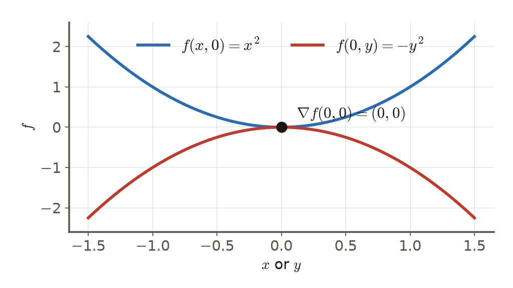

# 第3週 KP03：停止準則（Stopping criteria）

> 程度：大學生（undergrad）／Level: Undergraduate (undergrad)

本講義是第3章「反向傳播與最佳化」的第三個知識點（KP03），承接 KP02 留下的問題：梯度下降走了很多步，什麼時候該停？先備知識是微積分與 KP01–KP02；第一次出現的符號都會定義，所有數字都可以自己重算。內容依 CCC-LNS 第3章 KP03 的主文與投影片消化後重新撰寫，讀取日期 2026-10-14；來源沒有的內容標示 `[補充]`。

This is the third knowledge point (KP03) of Chapter 3. It picks up the question KP02 left open: after many gradient-descent steps, when should we stop? It assumes calculus and KP01–KP02; every symbol is defined when it first appears and every number can be recomputed. The text is rewritten from the KP03 main text and slides of CCC-LNS Chapter 3 (accessed on 2026-10-14); content that the source does not contain is marked `[Added]`.

[下載本單元投影片](../slides/lec03-kp03-stopping-criteria.jbd.json)

## KP03 停止準則（Stopping criteria）

### 學習目標（Learning objectives）

讀完之後，你能說明為什麼局部最小點的梯度為零；能列出常用的五種停止指標並說出各自回答的問題；能在同一條梯度下降路徑上算出不同準則在哪一步觸發，並解釋它們為什麼不一致；能舉出鞍點與平原兩種「看起來該停、其實不該停」的情況；並知道實務如何用組合準則、預算上限與驗證損失早停。

After reading, you can explain why the gradient is zero at a local minimum; list five common stopping indicators and the question each answers; compute on one gradient-descent path where different criteria fire and explain why they disagree; give two cases that look like "stop now" but are not (a saddle point and a plateau); and know how practice combines criteria, an iteration budget and early stopping on a validation loss.

### 符號表（Symbols）

| 符號 | 中文意義 | English meaning |
|---|---|---|
| $f$ | 損失函數（目標函數） | loss (objective) function |
| $w^{(k)}$ | 第 $k$ 步的參數 | parameters at step $k$ |
| $\nabla f$ | 梯度 | gradient |
| $\|\cdot\|_2$ | 向量的歐氏長度 | Euclidean length of a vector |
| $\varepsilon$ | 門檻：一個很小的正數 | tolerance: a small positive number |
| $K_{\max}$ | 最大迭代次數（預算） | maximum number of iterations (budget) |

### 1. 梯度為零代表什麼（What a zero gradient means）

假設 $f$ 可微，而 $w^*$ 是一個局部最小點。在最小點，沿任何方向走都不會再下降，所以每個方向的一階變化都是零，也就是

Suppose $f$ is differentiable and $w^*$ is a local minimum. At a minimum no direction goes downhill, so the first-order change along every direction is zero, i.e.

$$
\nabla f(w^*)=\mathbf 0\quad\Longleftrightarrow\quad\|\nabla f(w^*)\|_2=0
$$

這叫一階最優性條件（費馬引理的多維版本）。梯度為零的點叫**駐點**。它啟發了最直覺的停止方法：只要梯度的長度小到接近零，就宣布抵達並停下來。注意方向：局部最小**蘊含**梯度為零，反過來不成立；梯度為零只是必要條件，不是充分條件。

This is the first-order optimality condition (the multi-dimensional Fermat lemma). A point with zero gradient is called a **stationary point**. It motivates the most natural way to stop: when the length of the gradient is close to zero, declare arrival. Mind the direction: a local minimum **implies** a zero gradient, not the other way round; a zero gradient is necessary, not sufficient.

實際寫成程式，我們不可能要求梯度剛好是零，只能設一個小門檻 $\varepsilon>0$：

In code we cannot demand an exactly zero gradient; we set a small tolerance $\varepsilon>0$:

$$
\|\nabla f(w^{(k+1)})\|_2\le\varepsilon
$$

### 2. 常用的五個停止指標（Five common stopping indicators）

梯度範數只是其中一個。實務上常用下面這些，各自回答不同的問題：

The gradient norm is only one of them. Practice commonly uses the following indicators, each answering a different question:

| 指標 | 條件 | 回答的問題 |
|---|---|---|
| 梯度範數 | $\|\nabla f(w^{(k+1)})\|_2\le\varepsilon$ | 坡度夠平了嗎？ |
| 損失變化 | $\lvert f(w^{(k+1)})-f(w^{(k)})\rvert\le\varepsilon$ | 再走一步還降得動嗎？ |
| 梯度變化 | $\|\nabla f(w^{(k+1)})-\nabla f(w^{(k)})\|_2\le\varepsilon$ | 前進的方向穩定了嗎？ |
| 迭代預算 | $k\ge K_{\max}$ | 算力用完了嗎？ |
| 驗證損失 | 驗證集的損失不再改善 | 再練下去會過度擬合嗎？ |

| Indicator | Condition | The question it answers |
|---|---|---|
| gradient norm | $\|\nabla f(w^{(k+1)})\|_2\le\varepsilon$ | Is the slope flat enough? |
| loss change | $\lvert f(w^{(k+1)})-f(w^{(k)})\rvert\le\varepsilon$ | Can one more step still lower the loss? |
| gradient change | $\|\nabla f(w^{(k+1)})-\nabla f(w^{(k)})\|_2\le\varepsilon$ | Has the direction of progress become stable? |
| iteration budget | $k\ge K_{\max}$ | Has the compute run out? |
| validation loss | the validation loss stops improving | Would further training overfit? |

前三個看**訓練過程本身**，第四個看**資源**，第五個看**泛化**。深度學習常用後兩個：算一次完整訓練集的梯度很貴，而隨機梯度下降（KP07）的梯度帶有雜訊，長度永遠不會真正是零，所以只看梯度範數行不通。

The first three look at the **training process itself**, the fourth at **resources**, the fifth at **generalization**. Deep learning often relies on the last two: computing the gradient over the whole training set is expensive, and the gradient of stochastic gradient descent (KP07) is noisy, so its length never truly reaches zero and a gradient-norm test alone does not work.

### 3. 同一條路徑上，準則會停在不同的地方（On one path, the criteria stop at different places）

用 KP01 的玩具碗 $f(x,y)=\tfrac12(x^2+25y^2)$ 來看，從 $\theta_0=(10,2)$ 出發，學習率 $\eta=0.06$（KP01、KP02 已經看過這條路徑，$y$ 方向每步乘 $-0.5$，$x$ 方向每步乘 $0.94$）。程式計算各步的梯度範數與損失變化〔程式計算〕：

Take the toy bowl $f(x,y)=\tfrac12(x^2+25y^2)$ from KP01, starting at $\theta_0=(10,2)$ with learning rate $\eta=0.06$ (the path of KP01 and KP02: $y$ is multiplied by $-0.5$ and $x$ by $0.94$ at each step). The gradient norm and the loss change at each step, computed by program:

| 步 $k$ | $\|\nabla f\|_2$ | $\lvert f_{k+1}-f_k\rvert$ | $f(w^{(k)})$ |
|---|---|---|---|
| 0 | 50.99 | 43.32 | 100 |
| 10 | 5.386 | 1.688 | 14.51 |
| 28 | 1.768 | 0.182 | 1.564 |
| 29 | 1.662 | 0.161 | 1.382 |
| 64 | 0.1906 | 0.0021 | 0.0182 |

| Step $k$ | $\|\nabla f\|_2$ | $\lvert f_{k+1}-f_k\rvert$ | $f(w^{(k)})$ |
|---|---|---|---|
| 0 | 50.99 | 43.32 | 100 |
| 10 | 5.386 | 1.688 | 14.51 |
| 28 | 1.768 | 0.182 | 1.564 |
| 29 | 1.662 | 0.161 | 1.382 |
| 64 | 0.1906 | 0.0021 | 0.0182 |

取門檻 $\varepsilon=0.2$。損失變化準則在第 29 步就觸發（第 28 步到第 29 步的損失變化 $0.182\le0.2$），這時梯度範數還有 $1.662$，是門檻的 8 倍多，損失是 $1.38$，離最小值 0 還有一段距離。梯度範數準則要到第 64 步才觸發（$0.1906\le0.2$），這時損失是 $0.0182$。同一條路徑，兩個準則相差 35 步。

Take the tolerance $\varepsilon=0.2$. The loss-change criterion fires at step 29 (the change from step 28 to step 29 is $0.182\le0.2$); the gradient norm is still $1.662$, more than 8 times the tolerance, and the loss is $1.38$, some way from the minimum 0. The gradient-norm criterion fires only at step 64 ($0.1906\le0.2$), where the loss is $0.0182$. On one path the two criteria differ by 35 steps.

**圖說 `lec03-kp03-meters`**：先看虛線：它是同一個門檻 $\varepsilon=0.2$；再比較兩條線各自第一次穿過虛線的位置：藍線（損失變化）早得多，橘線（梯度範數）晚得多。縱軸是對數刻度，直線表示每步以固定比例縮小。〔功能：1、2〕

**Caption `lec03-kp03-meters`**: Look at the dashed line first: it is the same tolerance $\varepsilon=0.2$. Then compare where each line first crosses it: the blue line (loss change) much earlier, the orange line (gradient norm) much later. The vertical axis is logarithmic, so a straight line means a fixed shrink ratio per step. [Function: 1, 2]

為什麼不一致？因為損失變化量是 $\approx\eta\|\nabla f\|^2$（KP02 的一階近似），梯度範數是 $\|\nabla f\|$，前者是後者的平方再乘上學習率。梯度範數還有 $1.66$ 的時候，損失變化已經只剩 $0.16$。也就是說，「損失幾乎不降了」不等於「坡度已經平了」。

Why the disagreement? The loss change is about $\eta\|\nabla f\|^2$ (the first-order approximation of KP02), while the gradient norm is $\|\nabla f\|$: the former is the square of the latter times the learning rate. When the gradient norm is still $1.66$, the loss change is already down to $0.16$. "The loss hardly falls" does not mean "the slope is flat".

### 4. 看起來該停，其實不該停（Looks like time to stop, but it is not）

**鞍點。** 駐點不一定是最小點。取 $f(x,y)=x^2-y^2$：梯度是 $(2x,\,-2y)$，在原點 $\nabla f(0,0)=(0,0)$，梯度範數是 0，任何梯度範數準則都會立刻宣布到站。但沿 $x$ 軸 $f(x,0)=x^2$ 往兩邊上升，沿 $y$ 軸 $f(0,y)=-y^2$ 往兩邊下降：原點是個鞍點，不是最小點。高維非凸的損失曲面上鞍點很多，所以只看梯度範數會被騙。

**Saddle points.** A stationary point need not be a minimum. Take $f(x,y)=x^2-y^2$: the gradient is $(2x,\,-2y)$, so $\nabla f(0,0)=(0,0)$ and the gradient norm is 0; any gradient-norm test declares arrival at once. But along the $x$-axis $f(x,0)=x^2$ rises on both sides, and along the $y$-axis $f(0,y)=-y^2$ falls on both sides: the origin is a saddle point, not a minimum. High-dimensional non-convex loss surfaces have many saddle points, so a gradient-norm test alone can be fooled.

**圖說 `lec03-kp03-saddle`**：先看原點的黑點：兩條線都通過它，梯度為零；再比較兩條線的彎曲方向：藍線往上、紅線往下，所以它不是最小點。〔功能：3〕

**Caption `lec03-kp03-saddle`**: Look at the black dot at the origin first: both curves pass through it and the gradient is zero there. Then compare the two curvatures: the blue line bends up and the red line bends down, so it is not a minimum. [Function: 3]

**平原。** 神經網路的飽和區（例如 Sigmoid 兩端）或廣闊的平原上，曲面非常平緩，連續很多步損失只降 $0.00001$。若太早用損失變化準則停下，模型會停在半路，後面可能還有陡下坡。

**Plateaus.** In saturated regions of a neural network (for example the two ends of a sigmoid) or on a broad plateau the surface is very flat, and the loss may fall by only $0.00001$ for many steps in a row. Stopping early on the loss-change criterion leaves the model halfway, with a steep descent possibly still ahead.

**怎麼辦？** 實務上不單押一個指標：（1）**組合準則**：要求梯度範數夠小，並且損失變化連續 $N$ 步都小於門檻，或者每步的移動距離 $\|w^{(k+1)}-w^{(k)}\|\le\varepsilon_w$（許多數值最佳化軟體的做法）；（2）**預算上限**：不論如何，到 $K_{\max}$ 就停，避免無止境；（3）**驗證損失早停**：深度學習不要求訓練損失降到零，因為一直壓低訓練損失會讓模型記住訓練集的雜訊；改為每隔一段時間在驗證集上量損失，驗證損失不再改善就停，並保留驗證損失最低的那一組參數。這三者回答的是不同的問題，缺一不可。

**What to do?** In practice no single indicator is trusted alone: (1) a **composite rule**: require the gradient norm to be small and the loss change to stay below the tolerance for $N$ consecutive steps, or the step length $\|w^{(k+1)}-w^{(k)}\|\le\varepsilon_w$ (the approach of many numerical optimization packages); (2) an **iteration budget**: whatever happens, stop at $K_{\max}$ so training cannot run forever; (3) **early stopping on a validation loss**: deep learning does not require the training loss to reach zero, since pushing it ever lower makes the model memorize the noise of the training set; instead measure the loss on a validation set every so often and stop when it no longer improves, keeping the parameters with the lowest validation loss. The three answer different questions and none can be dropped.

來源有一個說法要小心：「訓練集收斂反而是壞事」說得太直接。更精確的講法是：訓練損失降低不保證泛化好，所以需要驗證損失來判斷；這也是為什麼「停在哪裡」不是純粹的數學問題。下一個問題是：停之前，每一步的步長能不能自動、安全地決定？這是 KP04 的主題。

One claim of the source needs care: "convergence on the training set is bad" is too blunt. More precisely, a lower training loss does not guarantee good generalization, so a validation loss is needed to judge; this is why "where to stop" is not a purely mathematical question. The next question is: before stopping, can each step's length be chosen automatically and safely? That is the topic of KP04.

### 本單元重點整理（KP03 summary）

**一句話重點**：沒有任何單一準則能保證到了谷底；梯度小、損失變化小、梯度變化小、預算與驗證損失各自回答不同問題，實務要組合使用。

**One-sentence summary**: No single criterion guarantees that the valley floor is reached; small gradient, small loss change, small gradient change, the budget and the validation loss each answer a different question, and practice combines them.

**白話說明**：「坡度夠平」「再走也降不動」「方向穩定」「時間到了」「再練會過擬合」是五個不同的問題。同一條路徑上它們觸發的位置可以差很多步，因為損失變化是梯度範數的平方量級；鞍點的梯度為零，平原的損失變化也接近零，都會騙過單一準則。

**Plain explanation**: "The slope is flat enough", "another step no longer lowers the loss", "the direction is stable", "time is up" and "more training overfits" are five different questions. On one path they fire many steps apart, because the loss change is of the order of the squared gradient norm; a saddle has a zero gradient and a plateau a near-zero loss change, and both fool a single criterion.

**正式定義**：局部最小 $\Rightarrow\nabla f(w^*)=\mathbf0$；梯度準則 $\|\nabla f(w^{(k+1)})\|_2\le\varepsilon$；損失準則 $|f(w^{(k+1)})-f(w^{(k)})|\le\varepsilon$；梯度變化準則 $\|\nabla f(w^{(k+1)})-\nabla f(w^{(k)})\|_2\le\varepsilon$；預算 $k\ge K_{\max}$。

**Formal definition**: local minimum $\Rightarrow\nabla f(w^*)=\mathbf0$; gradient criterion $\|\nabla f(w^{(k+1)})\|_2\le\varepsilon$; loss criterion $|f(w^{(k+1)})-f(w^{(k)})|\le\varepsilon$; gradient-change criterion $\|\nabla f(w^{(k+1)})-\nabla f(w^{(k)})\|_2\le\varepsilon$; budget $k\ge K_{\max}$.

**例子**：玩具碗、$\eta=0.06$、$\varepsilon=0.2$：損失變化準則在第 29 步觸發（$\|\nabla f\|=1.662$、$f=1.38$），梯度範數準則在第 64 步才觸發（$\|\nabla f\|=0.1906$、$f=0.0182$）；鞍點 $f=x^2-y^2$ 在原點梯度為零。逐步數字見第 3、4 節。

**Example**: toy bowl, $\eta=0.06$, $\varepsilon=0.2$: the loss-change criterion fires at step 29 ($\|\nabla f\|=1.662$, $f=1.38$), the gradient-norm criterion only at step 64 ($\|\nabla f\|=0.1906$, $f=0.0182$); the saddle $f=x^2-y^2$ has a zero gradient at the origin. The numbers are in sections 3 and 4.

**常見迷思**：

- 「梯度很小就是到了最小點」——鞍點與平原都可能梯度很小。
- 「損失不再降就是收斂」——損失變化是梯度範數的平方量級，可以比梯度小很多。
- 「訓練損失越低越好」——要看驗證損失，否則可能過度擬合。
- 「門檻 $\varepsilon$ 取越小越安全」——只是多花算力，不改變路徑。

**Common misconceptions**:

- "A small gradient means the minimum." Saddle points and plateaus can both have a small gradient.
- "The loss stops falling, so it has converged." The loss change is of the squared-gradient order and can be much smaller than the gradient.
- "The lower the training loss the better." Look at the validation loss, or the model may overfit.
- "A smaller $\varepsilon$ is always safer." It only costs more compute and does not change the path.

**圖**：本單元兩張圖，`lec03-kp03-meters`（兩個指標的觸發位置，功能 1、2）與 `lec03-kp03-saddle`（鞍點的兩個剖面，功能 3），皆以 `assets/figures/src/lec03-kp0345-figures.py` 繪製。

**Figure**: Two figures in this unit, `lec03-kp03-meters` (where two indicators fire; functions 1, 2) and `lec03-kp03-saddle` (two cross-sections of a saddle; function 3), both drawn by `assets/figures/src/lec03-kp0345-figures.py`.

**想深入**（選讀）：梯度範數準則對**隨機**梯度（KP07）為什麼失效？因為小批次梯度 $g_k=\nabla f(w^{(k)})+\xi_k$ 帶有零均值的雜訊 $\xi_k$，即使在最小點 $\nabla f=0$，$\|g_k\|$ 也不為零，所以隨機訓練改用預算與驗證損失，或把梯度範數平均後再比較。另外，要確認駐點是最小點、鞍點還是最大點，需要看二階資訊（海森矩陣的特徵值全為正才是最小點），這在深度網路中太貴（KP01），所以實務上靠驗證損失與多次訓練來間接把關。

**Going deeper** (optional): Why does the gradient-norm criterion fail for **stochastic** gradients (KP07)? A mini-batch gradient $g_k=\nabla f(w^{(k)})+\xi_k$ carries zero-mean noise $\xi_k$, so even at a minimum, where $\nabla f=0$, $\|g_k\|$ is not zero; stochastic training therefore uses the budget and the validation loss, or compares an averaged gradient norm. To tell whether a stationary point is a minimum, a saddle or a maximum one needs second-order information (all eigenvalues of the Hessian positive means a minimum), which is too expensive for deep networks (KP01), so practice guards indirectly with the validation loss and repeated runs.

**小練習**：

1. 對玩具碗、$\eta=0.06$，用 $\varepsilon=0.5$ 重新判斷：損失變化準則與梯度範數準則各在大約哪一步觸發？（提示：用第 3 節的比例：梯度範數每步約縮小 6%，損失變化的下降速度更快。）
2. 某個函數在 $(1,1)$ 的梯度是零，海森矩陣是 $\mathrm{diag}(2,-3)$。它是最小點嗎？（提示：看海森矩陣的特徵值符號，並對照 $f=x^2-y^2$。）
3. 設計一個訓練的停止規則，同時用到組合準則、預算與驗證損失，並說明每一項防止什麼問題。（提示：對照第 4 節的三個「怎麼辦」。）

**Practice**:

1. For the toy bowl with $\eta=0.06$, redo the judgment with $\varepsilon=0.5$: roughly at which step do the loss-change and gradient-norm criteria fire? (Hint: use the ratios of section 3: the gradient norm shrinks by about 6% per step, and the loss change falls faster.)
2. A function has zero gradient at $(1,1)$ and Hessian $\mathrm{diag}(2,-3)$. Is it a minimum? (Hint: look at the signs of the Hessian's eigenvalues and compare with $f=x^2-y^2$.)
3. Design a stopping rule for training that uses a composite criterion, a budget and the validation loss, and say what each part prevents. (Hint: compare with the three "what to do" items of section 4.)

**解題示範**（以第 2 題的類型示範判斷方法，函數換成 $f(x,y)=3x^2-y^2$ 在原點）：

1. 梯度：$\nabla f=(6x,\,-2y)$，在 $(0,0)$ 是 $(0,0)$，所以是駐點。
2. 海森矩陣：$\partial^2f/\partial x^2=6$、$\partial^2f/\partial y^2=-2$、混合項 0，所以 $H=\mathrm{diag}(6,-2)$，特徵值 $6>0$ 與 $-2<0$。
3. 判斷：特徵值一正一負，原點是**鞍點**，不是最小點。
4. 檢查：沿 $x$ 軸 $f(x,0)=3x^2\ge0$ 往上，沿 $y$ 軸 $f(0,y)=-y^2\le0$ 往下，與判斷一致。

**Worked solution** (the type of exercise 2, shown with $f(x,y)=3x^2-y^2$ at the origin):

1. Gradient: $\nabla f=(6x,\,-2y)$, which is $(0,0)$ at $(0,0)$, so it is a stationary point.
2. Hessian: $\partial^2f/\partial x^2=6$, $\partial^2f/\partial y^2=-2$ and the mixed term is 0, so $H=\mathrm{diag}(6,-2)$ with eigenvalues $6>0$ and $-2<0$.
3. Verdict: one positive and one negative eigenvalue, so the origin is a **saddle point**, not a minimum.
4. Check: along the $x$-axis $f(x,0)=3x^2\ge0$ goes up, along the $y$-axis $f(0,y)=-y^2\le0$ goes down, consistent with the verdict.

### 來源更正與取捨（Corrections to the source）

- 來源說「訓練損失一路逼近零，模型就會把訓練集雜訊硬背下來」，過於直接；本講義改成「訓練損失低不保證泛化好，所以需要驗證損失」。
- 來源把「梯度為零」當成最優的必要條件並進而講「準則一」會被鞍點騙，這是正確的；本講義補上「梯度為零不是充分條件」並用海森矩陣的特徵值符號判斷鞍點（`[補充]`）。
- 來源的互動算例與四儀表圖是定性示意，沒有生成資料；本講義改用玩具碗的實際數字與兩條曲線取代，並以 $\varepsilon=0.2$ 的數字展示不一致。

- The source says "if the training loss keeps approaching zero the model memorizes the noise of the training set", which is too direct; this note says "a low training loss does not guarantee good generalization, so a validation loss is needed".
- The source treats a zero gradient as necessary for optimality and warns that criterion one is fooled by saddles, which is correct; this note adds that a zero gradient is not sufficient and uses the signs of the Hessian eigenvalues to identify saddles (`[Added]`).
- The source's interactive example and four-meter figure are qualitative sketches without generating data; this note replaces them with the actual numbers of the toy bowl and two curves, showing the disagreement at $\varepsilon=0.2$.

### 術語對照（Terminology）

| 中文 | English |
|---|---|
| 停止準則 | stopping criterion |
| 一階最優性條件 | first-order optimality condition |
| 駐點 | stationary point |
| 鞍點 | saddle point |
| 平原 | plateau |
| 梯度範數 | gradient norm |
| 門檻 | tolerance |
| 迭代預算 | iteration budget |
| 驗證損失 | validation loss |
| 早停 | early stopping |
| 過度擬合 | overfitting |
