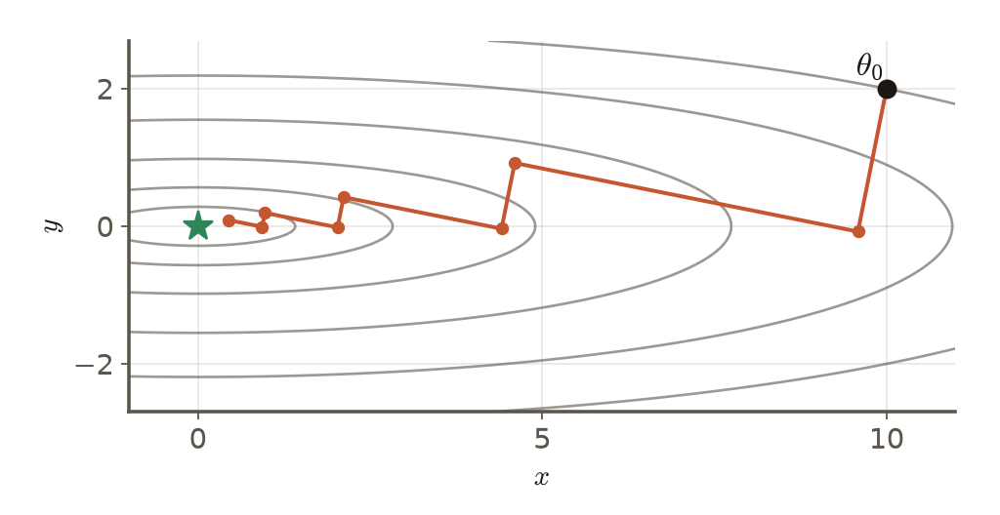

# 第3週 KP04：線搜索與最陡下降（Line search and steepest descent）

> 程度：大學生（undergrad）／Level: Undergraduate (undergrad)

本講義是第3章「反向傳播與最佳化」的第四個知識點（KP04），承接 KP03 留下的問題：停之前，每一步的步長能不能自動而安全地決定？先備知識是 KP01–KP03 與微積分；第一次出現的符號都會定義，所有數字都可以自己重算。內容依 CCC-LNS 第3章 KP04 的主文與投影片消化後重新撰寫，讀取日期 2026-10-14；來源沒有的內容標示 `[補充]`。

This is the fourth knowledge point (KP04) of Chapter 3. It picks up the question KP03 left open: before stopping, can each step's length be chosen automatically and safely? It assumes KP01–KP03 and calculus; every symbol is defined when it first appears and every number can be recomputed. The text is rewritten from the KP04 main text and slides of CCC-LNS Chapter 3 (accessed on 2026-10-14); content that the source does not contain is marked `[Added]`.

[下載本單元投影片](../slides/lec03-kp04-line-search.jbd.json)

## KP04 線搜索與最陡下降（Line search and steepest descent）

### 學習目標（Learning objectives）

讀完之後，你能說明為什麼需要線搜索；能寫出回溯線搜索的步驟與充分下降條件，並手算一個例子；能解釋為什麼從 $\eta=1$ 開始、不滿足就減半最後一定會停；能算出最陡下降（精確線搜索）的步長，說明相鄰兩步梯度互相垂直；並說出深度學習很少做完整線搜索的原因。

After reading, you can explain why line search is needed; write the steps of backtracking line search and its sufficient-decrease condition and work an example by hand; explain why starting at $\eta=1$ and halving until the condition holds always terminates; compute the step of steepest descent (exact line search) and show that adjacent gradients are orthogonal; and say why deep learning seldom runs a full line search.

### 符號表（Symbols）

| 符號 | 中文意義 | English meaning |
|---|---|---|
| $g_k=\nabla f(w^{(k)})$ | 第 $k$ 步的梯度 | the gradient at step $k$ |
| $\eta$ | 本步嘗試的步長 | the trial step length of this step |
| $c$ | 充分下降常數，$0<c<1$（本講義取 $0.1$） | sufficient-decrease constant, $0<c<1$ (this note uses $0.1$) |
| $\phi(\eta)$ | 沿下坡方向的一維函數 $\phi(\eta)=f(w-\eta g)$ | the one-dimensional function along the descent ray, $\phi(\eta)=f(w-\eta g)$ |
| $L$ | 梯度變化的上界常數（KP02） | the gradient-change bound (KP02) |
| $H$ | 海森矩陣（KP01） | the Hessian (KP01) |

### 1. 為什麼需要線搜索（Why line search）

KP02 告訴我們：只要 $0<\eta<2/L$，損失就不會上升。但深度網路的 $L$ 幾乎算不出有用的值，只能憑經驗設一個固定的 $\eta$，設大會發散、設小又太慢（KP02 的三種命運）。線搜索換一個想法：不在出發前估計全域的常數，而是**在每一步實際試一試**：沿著下坡方向試一個步長，看損失有沒有確實下降；沒有，就縮小步長再試。

KP02 told us that any $0<\eta<2/L$ keeps the loss from rising. But for a deep network a useful $L$ is almost impossible to compute, so we set a fixed $\eta$ by experience, too large and it diverges, too small and it crawls (the three fates of KP02). Line search takes a different view: instead of estimating a global constant before starting, **test at each step**: try a step length along the descent direction, check whether the loss really falls, and if not, shrink the step and try again.

### 2. 回溯：不降就減半（Backtracking: halve until it decreases）

在第 $k$ 步，梯度是 $g_k=\nabla f(w^{(k)})$。沿著下坡方向 $-g_k$ 的一維函數是 $\phi(\eta)=f(w^{(k)}-\eta g_k)$。最簡單的要求是「損失下降」：$\phi(\eta)<\phi(0)$。但只要求下降有個漏洞：如果每次只降 $10^{-16}$，序列可能在離最小點很遠的地方停滯。所以實務採用較強的**充分下降條件**（Armijo 條件）：

At step $k$ the gradient is $g_k=\nabla f(w^{(k)})$. Along the descent direction $-g_k$ the one-dimensional function is $\phi(\eta)=f(w^{(k)}-\eta g_k)$. The simplest requirement is "the loss decreases", $\phi(\eta)<\phi(0)$. But requiring only a decrease has a loophole: if each step lowers the loss by only $10^{-16}$, the sequence can stall far from the minimum. So practice uses a stronger **sufficient-decrease condition** (the Armijo condition):

$$
f\big(w^{(k)}-\eta g_k\big)\le f\big(w^{(k)}\big)-c\,\eta\,\|g_k\|_2^2,\qquad 0<c<1
$$

右邊的 $c\eta\|g_k\|_2^2$ 是「至少要降這麼多」：步長越大、梯度越陡，要求降得越多。$c$ 通常取很小的數（例如 $10^{-4}$）；本講義為了讓數字清楚取 $c=0.1$。**回溯線搜索**的步驟：

The term $c\eta\|g_k\|_2^2$ on the right says "it must fall at least this much": the longer the step and the steeper the gradient, the more it must fall. The constant $c$ is usually tiny (for example $10^{-4}$); this note takes $c=0.1$ so the numbers are readable. The steps of **backtracking line search**:

1. 令 $\eta=1$（大膽試一個大步長）。
2. 檢查充分下降條件；成立就跳到第 4 步。
3. 不成立就把步長減半，$\eta\leftarrow\eta/2$，回到第 2 步。
4. 用這個 $\eta$ 更新：$w^{(k+1)}=w^{(k)}-\eta g_k$。

1. Set $\eta=1$ (boldly try a large step).
2. Check the sufficient-decrease condition; if it holds, jump to step 4.
3. Otherwise halve the step, $\eta\leftarrow\eta/2$, and return to step 2.
4. Update with this $\eta$: $w^{(k+1)}=w^{(k)}-\eta g_k$.

為什麼從 $\eta=1$ 開始？這是慣例：牛頓法對二次函數的自然步長就是 1，以 1 當上限給模型最大膽的機會，不把步長人為限制得過於保守。

Why start at $\eta=1$? It is a convention: the natural step of Newton's method on a quadratic is 1, so using 1 as the ceiling gives the model its boldest chance without limiting the step too conservatively.

**為什麼一定會停？**（`[補充]` 推導）若 $f$ 是 $L$-smooth，下降引理（KP02）說 $f(w-\eta g)\le f(w)-\eta(1-L\eta/2)\|g\|^2$。只要 $1-L\eta/2\ge c$，也就是 $\eta\le 2(1-c)/L$，右邊就不超過 $f(w)-c\eta\|g\|^2$，充分下降條件成立。所以每次減半，步長遲早會小於 $2(1-c)/L$，回溯在有限步內停止。這要求 $g\neq0$；梯度為零時損失不會降，也就沒有什麼好搜索了。

**Why does it always stop?** (`[Added]` derivation) If $f$ is $L$-smooth, the descent lemma (KP02) says $f(w-\eta g)\le f(w)-\eta(1-L\eta/2)\|g\|^2$. As long as $1-L\eta/2\ge c$, i.e. $\eta\le 2(1-c)/L$, the right side is at most $f(w)-c\eta\|g\|^2$ and the sufficient-decrease condition holds. So after enough halvings the step falls below $2(1-c)/L$ and backtracking stops in finitely many steps. This needs $g\neq0$; when the gradient is zero the loss cannot fall and there is nothing left to search.

### 3. 完整算一遍（One complete backtracking run）

用 KP02 的主例子 $f(w)=5w^2-4w+1$（$f'(w)=10w-4$，$L=10$），從 $w_0=2$ 出發：$g=f'(2)=16$，$f(2)=13$。取 $c=0.1$，充分下降的門檻是 $13-0.1\cdot\eta\cdot16^2=13-25.6\,\eta$。

Use the main example of KP02, $f(w)=5w^2-4w+1$ ($f'(w)=10w-4$, $L=10$), starting at $w_0=2$: $g=f'(2)=16$ and $f(2)=13$. With $c=0.1$ the sufficient-decrease threshold is $13-0.1\cdot\eta\cdot16^2=13-25.6\,\eta$.

| 試的 $\eta$ | $w=2-16\eta$ | $f(w)$ | 門檻 $13-25.6\eta$ | 判定 |
|---|---|---|---|---|
| 1 | −14 | 1037 | −12.6 | 拒絕 |
| 1/2 | −6 | 205 | 0.2 | 拒絕 |
| 1/4 | −2 | 29 | 6.6 | 拒絕 |
| 1/8 | 0 | 1 | 9.8 | **接受** |

| Trial $\eta$ | $w=2-16\eta$ | $f(w)$ | Threshold $13-25.6\eta$ | Verdict |
|---|---|---|---|---|
| 1 | −14 | 1037 | −12.6 | rejected |
| 1/2 | −6 | 205 | 0.2 | rejected |
| 1/4 | −2 | 29 | 6.6 | rejected |
| 1/8 | 0 | 1 | 9.8 | **accepted** |

逐列驗算：$\eta=1$：$w=2-16=-14$，$f=5\cdot196+56+1=1037$；$\eta=\tfrac12$：$w=-6$，$f=5\cdot36+24+1=205$；$\eta=\tfrac14$：$w=-2$，$f=5\cdot4+8+1=29$；$\eta=\tfrac18$：$w=0$，$f=1\le9.8$。最後接受 $\eta=1/8$，一步從損失 13 降到 1。這與上面的推導一致：$2(1-c)/L=2\cdot0.9/10=0.18$，$\tfrac18=0.125\le0.18$ 被接受，$\tfrac14=0.25>0.18$ 被拒絕〔程式計算〕。

Row-by-row checks: $\eta=1$: $w=2-16=-14$, $f=5\cdot196+56+1=1037$; $\eta=\tfrac12$: $w=-6$, $f=5\cdot36+24+1=205$; $\eta=\tfrac14$: $w=-2$, $f=5\cdot4+8+1=29$; $\eta=\tfrac18$: $w=0$, $f=1\le9.8$. We accept $\eta=1/8$ and the loss falls from 13 to 1 in one step. This matches the derivation: $2(1-c)/L=2\cdot0.9/10=0.18$, so $\tfrac18=0.125\le0.18$ is accepted and $\tfrac14=0.25>0.18$ is rejected [computed by program].

**圖說 `lec03-kp04-backtracking`**：先看藍線：它是沿著下坡方向的損失，在 $\eta=0.1$ 附近最低；再看虛線：損失在虛線之下才算「充分下降」；最後比較四個點：只有最小的步長 $\eta=1/8$ 落在虛線之下。反直覺的地方是：最大膽的 $\eta=1$ 反而最差，「敢走」不如「肯縮」。〔功能：1、2〕

**Caption `lec03-kp04-backtracking`**: Look at the blue line first: it is the loss along the descent direction and is lowest near $\eta=0.1$. Then the dashed line: only a loss below it counts as "sufficient decrease". Finally compare the points: only the smallest step $\eta=1/8$ falls below the dashed line. The counter-intuitive part is that the boldest $\eta=1$ is the worst: being willing to shrink beats daring to leap. [Function: 1, 2]

### 4. 最陡下降：每步精算最佳步長（Steepest descent: the best step at each iteration）

回溯只要求「夠好」。**最陡下降**（精確線搜索）更徹底：每一步在下坡射線上把一維問題解到底，選出讓損失最小的步長 $\eta_k=\arg\min_{\eta\ge0}\phi(\eta)$。以前面的主例子為例，$\phi(\eta)=f(2-16\eta)=5(2-16\eta)^2-4(2-16\eta)+1$，$\phi'(\eta)=-16\,[10(2-16\eta)-4]=0$ 得 $2-16\eta=0.4$，所以 $\eta_0=0.1$，一步到最小點 $w^*=0.4$（一維二次函數一步到底）。

Backtracking asks only for "good enough". **Steepest descent** (exact line search) goes all the way: at each step it solves the one-dimensional problem on the descent ray and picks the step that minimizes the loss, $\eta_k=\arg\min_{\eta\ge0}\phi(\eta)$. For the main example, $\phi(\eta)=f(2-16\eta)=5(2-16\eta)^2-4(2-16\eta)+1$ and $\phi'(\eta)=-16\,[10(2-16\eta)-4]=0$ gives $2-16\eta=0.4$, so $\eta_0=0.1$ and one step reaches the minimum $w^*=0.4$ (a one-dimensional quadratic needs one step).

多維度就有趣了。對二次函數 $f(w)=\tfrac12 w^\top Hw$，梯度是 $g=Hw$，沿下坡射線的一維函數 $\phi(\eta)=\tfrac12(w-\eta g)^\top H(w-\eta g)$，令 $\phi'(\eta)=-g^\top H(w-\eta g)=-g^\top g+\eta\,g^\top Hg=0$，得到

In several dimensions it gets interesting. For a quadratic $f(w)=\tfrac12 w^\top Hw$ the gradient is $g=Hw$ and the one-dimensional function is $\phi(\eta)=\tfrac12(w-\eta g)^\top H(w-\eta g)$. Setting $\phi'(\eta)=-g^\top H(w-\eta g)=-g^\top g+\eta\,g^\top Hg=0$ gives

$$
\eta_k=\frac{g_k^\top g_k}{g_k^\top H g_k}
$$

回到玩具碗 $f=\tfrac12(x^2+25y^2)$，$H=\mathrm{diag}(1,25)$，$\theta_0=(10,2)$，$g_0=(10,50)$：$g_0^\top g_0=100+2500=2600$，$g_0^\top Hg_0=1\cdot100+25\cdot2500=62600$，所以 $\eta_0=2600/62600\approx0.04153$，$\theta_1=(10-0.4153,\ 2-2.0767)=(9.5847,\,-0.0767)$，損失從 100 降到 $46.01$。（`[補充]` 數字）

Back on the toy bowl $f=\tfrac12(x^2+25y^2)$ with $H=\mathrm{diag}(1,25)$, $\theta_0=(10,2)$ and $g_0=(10,50)$: $g_0^\top g_0=100+2500=2600$ and $g_0^\top Hg_0=1\cdot100+25\cdot2500=62600$, so $\eta_0=2600/62600\approx0.04153$ and $\theta_1=(10-0.4153,\ 2-2.0767)=(9.5847,\,-0.0767)$, with the loss falling from 100 to $46.01$. (`[Added]` numbers)

**相鄰兩步的梯度互相垂直。**因為 $\eta_k$ 使 $\phi'(\eta_k)=0$，而 $\phi'(\eta)=-\nabla f(w^{(k)}-\eta g_k)^\top g_k$，所以在 $\eta=\eta_k$ 時 $\nabla f(w^{(k+1)})^\top g_k=0$，即 $g_{k+1}\perp g_k$。驗算：$g_1=(9.5847,\,25\cdot(-0.0767))=(9.5847,\,-1.9169)$，$g_0^\top g_1=10\cdot9.5847+50\cdot(-1.9169)=95.847-95.847=0$〔程式計算〕。垂直的結果是路徑走成之字形：下一步的方向必須與上一步垂直，無法直接朝向最小點。步長也交替：$\eta_0=0.04153$，$\eta_1=0.52$，$\eta_2=0.04153$，$\eta_3=0.52$，……

**Adjacent gradients are orthogonal.** Because $\eta_k$ makes $\phi'(\eta_k)=0$ and $\phi'(\eta)=-\nabla f(w^{(k)}-\eta g_k)^\top g_k$, at $\eta=\eta_k$ we get $\nabla f(w^{(k+1)})^\top g_k=0$, i.e. $g_{k+1}\perp g_k$. Check: $g_1=(9.5847,\,25\cdot(-0.0767))=(9.5847,\,-1.9169)$ and $g_0^\top g_1=10\cdot9.5847+50\cdot(-1.9169)=95.847-95.847=0$ [computed by program]. The result is a zigzag path: the next direction must be perpendicular to the last one and cannot aim straight at the minimum. The steps alternate too: $\eta_0=0.04153$, $\eta_1=0.52$, $\eta_2=0.04153$, $\eta_3=0.52$, and so on.

**圖說 `lec03-kp04-zigzag`**：先看橘線的每個轉折：相鄰兩段互相垂直；再看損失：第 8 步降到 $0.2007$，比 KP01 固定 $\eta=0.06$ 的第 8 步（$18.58$）低得多。精確線搜索每步很有效，但路徑仍是之字形。〔功能：2、3〕

**Caption `lec03-kp04-zigzag`**: Look at each turn of the orange line first: adjacent segments are perpendicular. Then the loss: at step 8 it is $0.2007$, much lower than the $18.58$ of the fixed $\eta=0.06$ run of KP01 at step 8. Exact line search is very effective per step, yet the path still zigzags. [Function: 2, 3]

### 5. 為什麼深度學習很少做完整線搜索（Why deep learning seldom runs a full line search）

既然每步有效，為什麼不用？因為成本與雜訊：（1）**前向傳播的成本**：每次試探都要重新計算一次損失 $f(w-\eta g)$，也就是重新跑一次網路的前向傳播，一次梯度計算背後可能跟著好幾次前向傳播；（2）**小批次的雜訊**：深度學習用小批次估計梯度（KP07、KP08），在當前這一批資料上找到最佳步長，不代表全部資料上損失也下降；（3）**動態分支**：線搜索裡的「如果不成立就減半」是依條件執行的迴圈，會降低 GPU 平行運算的效率。

Since each step is so effective, why not use it? Cost and noise: (1) **the cost of forward passes**: every trial recomputes the loss $f(w-\eta g)$, i.e. runs the network's forward pass once more, so one gradient computation may be followed by several forward passes; (2) **mini-batch noise**: deep learning estimates the gradient on mini-batches (KP07, KP08), and the best step on the current batch does not mean the loss falls on all the data; (3) **dynamic branching**: the "halve if it fails" loop of line search is a data-dependent loop that lowers the efficiency of GPU parallelism.

所以深度學習多半改用固定的、依排程遞減的，或自適應的學習率（後面的 KP10、KP11）。線搜索仍然是重要的概念：它把「步長要看實際的局部證據」這件事講清楚，而在整批（full-batch）的問題或 L-BFGS 之類的方法中仍然常用。回溯出來的路徑仍是梯度的方向；下一個問題是：之字形（相鄰梯度互相垂直）能不能抑制？這是 KP05 動量的主題。

So deep learning mostly uses a fixed learning rate, one decayed on a schedule, or an adaptive one (KP10 and KP11 later). Line search remains an important idea: it makes clear that the step should follow observed local evidence, and it is still common for full-batch problems and in methods such as L-BFGS. The backtracked path still follows the gradient direction; the next question is whether the zigzag (adjacent gradients orthogonal) can be damped. That is the topic of KP05, momentum.

### 本單元重點整理（KP04 summary）

**一句話重點**：線搜索不預先猜步長，每步先大膽試 $\eta=1$，不滿足充分下降就減半；最陡下降每步精算最佳步長，但成本高、相鄰梯度垂直，深度學習很少用。

**One-sentence summary**: Line search does not guess the step in advance: each step tries $\eta=1$ boldly and halves it until sufficient decrease holds; steepest descent computes the best step each time, at a high cost and with orthogonal adjacent gradients, so deep learning seldom uses it.

**白話說明**：「敢走」不如「肯縮」。步子太大損失反而上升，所以每一步先試一個大步長，不行就縮；充分下降條件要求「至少降這麼多」，避免進度小到停滯。每次試探都要多算一次損失，在大模型上很貴。

**Plain explanation**: Being willing to shrink beats daring to leap. A step that is too large raises the loss, so each step tries a large one and shrinks it if needed; the sufficient-decrease condition demands "at least this much", ruling out progress so small that it stalls. Every trial costs one more loss evaluation, which is expensive on large models.

**正式定義**：$f(w^{(k)}-\eta g_k)\le f(w^{(k)})-c\eta\|g_k\|_2^2$，$0<c<1$；回溯：$\eta\leftarrow\eta/2$ 直到成立；精確線搜索 $\eta_k=\arg\min_{\eta\ge0}f(w^{(k)}-\eta g_k)$，二次函數的閉式解 $\eta_k=g_k^\top g_k/(g_k^\top Hg_k)$。

**Formal definition**: $f(w^{(k)}-\eta g_k)\le f(w^{(k)})-c\eta\|g_k\|_2^2$ with $0<c<1$; backtracking: $\eta\leftarrow\eta/2$ until it holds; exact line search $\eta_k=\arg\min_{\eta\ge0}f(w^{(k)}-\eta g_k)$, with the closed form $\eta_k=g_k^\top g_k/(g_k^\top Hg_k)$ for quadratics.

**例子**：$f=5w^2-4w+1$、$w_0=2$、$c=0.1$：$\eta=1,\tfrac12,\tfrac14$ 被拒絕（損失 1037、205、29），$\eta=\tfrac18$ 被接受（損失 1）；玩具碗上精確線搜索第一步 $\eta_0\approx0.04153$，$g_0\perp g_1$，8 步後損失 $0.2007$。逐步數字見第 3、4 節。

**Example**: $f=5w^2-4w+1$, $w_0=2$, $c=0.1$: $\eta=1,\tfrac12,\tfrac14$ are rejected (losses 1037, 205, 29) and $\eta=\tfrac18$ is accepted (loss 1); on the toy bowl exact line search starts with $\eta_0\approx0.04153$, $g_0\perp g_1$, and the loss is $0.2007$ after 8 steps. The numbers are in sections 3 and 4.

**常見迷思**：

- 「步子越大進展越快」——$\eta=1$ 常被拒絕，損失可能暴增。
- 「只要損失降一點就夠了」——可能原地假死，所以要用充分下降條件。
- 「精確線搜索一定最好」——每步效果好，但每步成本高，而且相鄰梯度垂直，路徑仍是之字形。
- 「線搜索可以直接套到小批次訓練」——小批次上的最佳步長不保證全資料上下降。

**Common misconceptions**:

- "A larger step makes faster progress." $\eta=1$ is often rejected and the loss can blow up.
- "It is enough if the loss falls a little." It can stall in place, which is why the sufficient-decrease condition is used.
- "Exact line search is always best." Each step is effective but costly, and adjacent gradients are orthogonal so the path still zigzags.
- "Line search can be applied directly to mini-batch training." The best step on a mini-batch does not guarantee a decrease on all the data.

**圖**：本單元兩張圖，`lec03-kp04-backtracking`（一維切片的接受與拒絕，功能 1、2）與 `lec03-kp04-zigzag`（最陡下降的之字形，功能 2、3），皆以 `assets/figures/src/lec03-kp0345-figures.py` 繪製。

**Figure**: Two figures in this unit, `lec03-kp04-backtracking` (acceptance and rejection on a one-dimensional slice; functions 1, 2) and `lec03-kp04-zigzag` (the zigzag of steepest descent; functions 2, 3), both drawn by `assets/figures/src/lec03-kp0345-figures.py`.

**想深入**（選讀）：嚴格的線搜索理論還有 **Wolfe 條件**：除了充分下降，再要求新位置的斜率不能還太陡（曲率條件），避免步長取得太短；它主要用在擬牛頓法（如 L-BFGS）。另外，精確線搜索對二次函數的收斂速度仍然受條件數 $\kappa$ 限制，誤差每步縮小的比例不優於 $(\kappa-1)/(\kappa+1)$（KP05 會引用），這就是之字形慢的數學原因。

**Going deeper** (optional): Rigorous line-search theory adds the **Wolfe conditions**: besides sufficient decrease, require the slope at the new point not to be too steep (a curvature condition), which prevents overly short steps; it is used mostly in quasi-Newton methods such as L-BFGS. Also, the convergence of exact line search on a quadratic is still limited by the condition number $\kappa$: the error shrinks per step by no better than $(\kappa-1)/(\kappa+1)$ (cited again in KP05), the mathematical reason the zigzag is slow.

**小練習**：

1. 對 $f(w)=5w^2-4w+1$，從 $w_0=3$ 出發做回溯線搜索，$c=0.1$：依序試 $\eta=1,\tfrac12,\tfrac14,\tfrac18$，每個都列出 $w$、$f(w)$、門檻，並找出第一個被接受的步長。（提示：$g=f'(3)=26$，門檻是 $f(3)-0.1\cdot\eta\cdot26^2$。）
2. 對 $f(w)=w^2$、$w_0=4$ 求精確線搜索的步長 $\eta_0$，並說明新位置的梯度與舊梯度的關係。（提示：$\phi(\eta)=(4-8\eta)^2$，令 $\phi'(\eta)=0$。）
3. 列出深度學習很少做完整線搜索的三個原因，各用一句話說明。（提示：成本、雜訊、平行運算。）

**Practice**:

1. For $f(w)=5w^2-4w+1$ run backtracking from $w_0=3$ with $c=0.1$: try $\eta=1,\tfrac12,\tfrac14,\tfrac18$ in turn, list $w$, $f(w)$ and the threshold for each, and find the first accepted step. (Hint: $g=f'(3)=26$ and the threshold is $f(3)-0.1\cdot\eta\cdot26^2$.)
2. For $f(w)=w^2$ and $w_0=4$ find the exact line-search step $\eta_0$ and describe how the new gradient relates to the old one. (Hint: $\phi(\eta)=(4-8\eta)^2$; set $\phi'(\eta)=0$.)
3. List three reasons why deep learning seldom runs a full line search, one sentence each. (Hint: cost, noise, parallelism.)

**解題示範**（以 $f(w)=3w^2$、$w_0=2$ 示範第 2 題的方法）：

1. 梯度：$f'(w)=6w$，$g=f'(2)=12$。
2. 一維函數：$\phi(\eta)=f(2-12\eta)=3(2-12\eta)^2$。
3. 令導數為零：$\phi'(\eta)=-72(2-12\eta)=0$，所以 $2-12\eta=0$，$\eta_0=1/6$。
4. 新位置：$w_1=2-12\cdot\tfrac16=0$，正是最小點，損失 $f(0)=0$。
5. 梯度關係：$g_1=f'(0)=0$，與舊梯度 $g_0=12$ 的內積是 0，垂直（一維時是零向量，平凡成立）。

**Worked solution** (the method of exercise 2, shown with $f(w)=3w^2$ and $w_0=2$):

1. Gradient: $f'(w)=6w$, so $g=f'(2)=12$.
2. The one-dimensional function: $\phi(\eta)=f(2-12\eta)=3(2-12\eta)^2$.
3. Set the derivative to zero: $\phi'(\eta)=-72(2-12\eta)=0$, so $2-12\eta=0$ and $\eta_0=1/6$.
4. New point: $w_1=2-12\cdot\tfrac16=0$, exactly the minimum, with loss $f(0)=0$.
5. Gradient relation: $g_1=f'(0)=0$, whose inner product with $g_0=12$ is 0: orthogonal (trivially so, since in one dimension $g_1$ is the zero vector).

### 來源更正與取捨（Corrections to the source）

- 來源說「只要 $\eta<1/L$，損失就一定下降」；與 KP02 一致，精確的範圍是 $0<\eta<2/L$ 保證不增，嚴格下降需要梯度不為零。本講義用下降引理推出回溯會在 $\eta\le2(1-c)/L$ 時成功。
- 來源說 $L$ 的計算代價是 $\mathcal O(d^3)$，沒有依據；本講義只說在深度網路中很難取得有用的 $L$。
- 來源把 Armijo 與 Wolfe 條件並列；本講義只用 Armijo（充分下降）作為回溯的條件，Wolfe 條件放在「想深入」。來源「從 $\eta=1$ 開始是因為牛頓步長為 1」本講義當作慣例說明。
- 來源的一維切片圖是定性示意；本講義用 $f=5w^2-4w+1$ 的實際數字重畫。

- The source says "any $\eta<1/L$ lowers the loss"; consistent with KP02, the precise range is that $0<\eta<2/L$ guarantees a nonincreasing loss and strict decrease needs a nonzero gradient. This note uses the descent lemma to show that backtracking succeeds once $\eta\le2(1-c)/L$.
- The source says computing $L$ costs $\mathcal O(d^3)$, which has no basis; this note says only that a useful $L$ is hard to obtain in deep networks.
- The source lists the Armijo and Wolfe conditions together; this note uses only Armijo (sufficient decrease) as the backtracking condition and puts the Wolfe conditions under "Going deeper". The source's "start at $\eta=1$ because the Newton step is 1" is presented here as a convention.
- The source's one-dimensional slice figure is qualitative; this note redraws it with the actual numbers of $f=5w^2-4w+1$.

### 術語對照（Terminology）

| 中文 | English |
|---|---|
| 線搜索 | line search |
| 回溯 | backtracking |
| 充分下降條件（Armijo） | sufficient-decrease (Armijo) condition |
| 最陡下降 | steepest descent |
| 精確線搜索 | exact line search |
| 條件數 | condition number |
| 擬牛頓法 | quasi-Newton method |
| 前向傳播 | forward pass |
| 整批 | full-batch |
