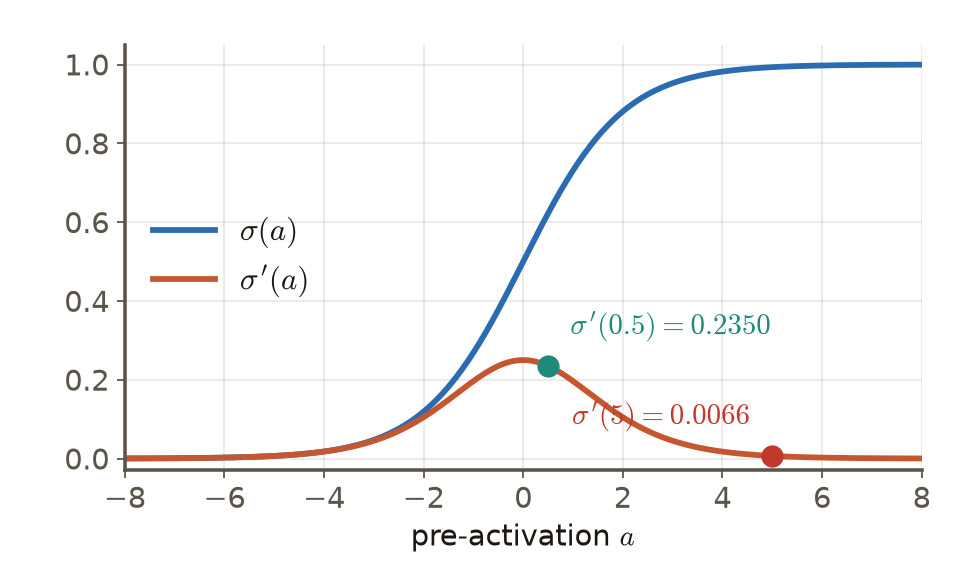

# 第3週 KP06：反向傳播（Backpropagation）

> 程度：大學生（undergrad）／Level: Undergraduate (undergrad)

本講義是第3章「反向傳播與最佳化」的第六個知識點（KP06），承接 KP05 留下的問題：前面五個 KP 都把梯度當成「已經算好」，這個梯度到底是怎麼算出來的？先備知識是微積分的鏈式法則與偏導數、KP01–KP05；第一次出現的符號都會定義，所有數字都可以自己重算。內容依 CCC-LNS 第3章 KP06 的主文與投影片消化後重新撰寫，讀取日期 2026-10-14；來源沒有的內容標示 `[補充]`。

This is the sixth knowledge point (KP06) of Chapter 3. It picks up the question KP05 left open: the first five knowledge points treated the gradient as "already computed", so how is it actually computed? It assumes the chain rule and partial derivatives from calculus and KP01–KP05; every symbol is defined when it first appears and every number can be recomputed. The text is rewritten from the KP06 main text and slides of CCC-LNS Chapter 3 (accessed on 2026-10-14); content that the source does not contain is marked `[Added]`.

[下載本單元投影片](../slides/lec03-kp06-backpropagation.jbd.json)

## KP06 反向傳播（Backpropagation）

### 學習目標（Learning objectives）

讀完之後，你能說明隱藏層為什麼看得到損失卻看不到標籤、以及為什麼逐一擾動參數的成本是 $O(W^2)$；能寫出單一神經元的前向計算與 $\partial e/\partial w_{i\ell}=\delta_i z_\ell$；能手算一個小網路的前向與反向，並用中心差分檢查；能寫出隱藏層的 $\delta_i=\sigma'(a_i)\sum_j\delta_jw_{ji}$，並解釋梯度消失；也能說出反向傳播與最佳化器各自負責什麼。

After reading, you can explain why a hidden layer sees the loss but not the labels and why perturbing the parameters one at a time costs $O(W^2)$; write the forward computation of one neuron and $\partial e/\partial w_{i\ell}=\delta_i z_\ell$; compute the forward and backward pass of a small network by hand and check it with a central difference; write the hidden-layer rule $\delta_i=\sigma'(a_i)\sum_j\delta_jw_{ji}$ and explain vanishing gradients; and say what backpropagation and the optimizer are each responsible for.

### 符號表（Symbols）

| 符號 | 中文意義 | English meaning |
|---|---|---|
| $e$ | 一筆資料的損失（本講義用平方損失） | the loss of one example (squared loss in this note) |
| $z_\ell$ | 前一層神經元 $\ell$ 的輸出（第一層就是輸入 $x_\ell$） | output of neuron $\ell$ in the previous layer (the input $x_\ell$ for the first layer) |
| $w_{i\ell}$ | 從神經元 $\ell$ 連到神經元 $i$ 的權重 | weight from neuron $\ell$ to neuron $i$ |
| $a_i=\sum_\ell w_{i\ell}z_\ell$ | 神經元 $i$ 的活化前加權和 | pre-activation weighted sum of neuron $i$ |
| $z_i=\sigma(a_i)$ | 神經元 $i$ 的輸出，$\sigma$ 是活化函數 | output of neuron $i$; $\sigma$ is the activation function |
| $\delta_i=\partial e/\partial a_i$ | 誤差敏感度：損失對 $a_i$ 的偏導 | error sensitivity: the partial derivative of the loss with respect to $a_i$ |
| $W$ | 網路的參數總數 | total number of parameters of the network |

### 1. 隱藏層看得到損失，卻看不到標籤（A hidden layer sees the loss but not the labels）

單層模型（例如線性迴歸）最簡單：輸出直接和標準答案比，梯度一步就推得出來。多層網路不一樣：隱藏層的神經元只把訊號傳給下游，從不直接接觸標籤與損失，它的參數透過下游一連串的運算才影響損失。問題是：每個參數該對損失負多少責任，也就是梯度，怎麼算？

A single-layer model (linear regression, say) is simple: the output is compared directly with the answer and the gradient follows in one step. A multilayer network is different: a hidden neuron only passes signals downstream and never meets the label or the loss directly, so its parameters affect the loss through a long chain of operations. The question is: how much responsibility does each parameter bear for the loss, i.e. what is its gradient?

最直接的辦法是**逐一擾動**：對每個參數 $w$ 算 $\big(e(w+\epsilon)-e(w)\big)/\epsilon$。每擾動一個參數就要重跑一次完整的前向傳播，一次前向的成本是 $O(W)$，$W$ 個參數就是 $O(W^2)$。網路有 $W=10^6$ 個參數時，這是 $10^6\times10^6=10^{12}$ 次運算，而且只是更新一步所需要的梯度，完全不可行。

The most direct way is to **perturb one parameter at a time**: for each parameter $w$ compute $\big(e(w+\epsilon)-e(w)\big)/\epsilon$. Each perturbed parameter needs a full forward pass, a forward pass costs $O(W)$, and $W$ parameters give $O(W^2)$. For $W=10^6$ that is $10^6\times10^6=10^{12}$ operations just for the gradient of one update step: completely infeasible.

反向傳播（1986 年由 Rumelhart、Hinton 與 Williams 系統化並普及，更早還有別人的研究）用微積分的鏈式法則解決這件事：**一次前向傳播**（算出每個神經元的 $a$ 與 $z$ 並保存下來）加**一次反向傳播**（由後往前算梯度），就能得到全部參數的精確梯度。一次反向的成本和一次前向在同一個量級（常數倍，通常 2–3 倍），所以總成本是 $O(W)$：對 $W=10^6$ 約是幾次 $10^6$ 量級的運算（`[補充]` 估計），比 $10^{12}$ 少了五個數量級。

Backpropagation (systematized and popularized in 1986 by Rumelhart, Hinton and Williams, with earlier work by others) solves this with the chain rule: **one forward pass** (computing and storing every neuron's $a$ and $z$) plus **one backward pass** (computing gradients from back to front) gives the exact gradient of all parameters. A backward pass costs the same order as a forward pass (a constant factor, typically 2–3), so the total is $O(W)$: for $W=10^6$ a few times $10^6$ operations (`[Added]` estimate), five orders of magnitude below $10^{12}$.

### 2. 單一神經元：把偏導拆成局部因子（One neuron: splitting the derivative into local factors）

先看一個神經元 $i$ 的前向計算（兩步）：

First, the forward computation of one neuron $i$ (two steps):

$$
a_i=\sum_{\ell=1}^{m}w_{i\ell}\,z_\ell,\qquad z_i=\sigma(a_i)
$$

損失 $e$ 對權重 $w_{i\ell}$ 的偏導，用鏈式法則先經過 $a_i$：

The partial derivative of the loss $e$ with respect to the weight $w_{i\ell}$ goes through $a_i$ by the chain rule:

$$
\frac{\partial e}{\partial w_{i\ell}}=\frac{\partial e}{\partial a_i}\cdot\frac{\partial a_i}{\partial w_{i\ell}}=\delta_i\cdot z_\ell
$$

其中第二個因子很乾淨：因為 $a_i=\sum_\ell w_{i\ell}z_\ell$，所以 $\partial a_i/\partial w_{i\ell}=z_\ell$。第一個因子我們起個名字，叫**誤差敏感度** $\delta_i:=\partial e/\partial a_i$，意思是「這個神經元的活化前加權和 $a_i$ 動一點，損失會動多少」。於是

The second factor is clean: since $a_i=\sum_\ell w_{i\ell}z_\ell$, $\partial a_i/\partial w_{i\ell}=z_\ell$. We give the first factor a name, the **error sensitivity** $\delta_i:=\partial e/\partial a_i$: how much the loss moves when the pre-activation $a_i$ of this neuron moves a little. Hence

**權重的梯度 ＝ 這個神經元的誤差敏感度 $\delta_i$ × 流進這條連線的前層訊號 $z_\ell$。**

**The gradient of a weight = the error sensitivity $\delta_i$ of this neuron × the incoming signal $z_\ell$ on this connection.**

這句話無論神經元在輸出層或第十個隱藏層都成立。為什麼把 $\delta$ 定義在 $a_i$ 而不是 $z_i$？因為這樣第二個因子就只是 $z_\ell$，乾淨得不需要再展開。這也解釋了為什麼前向傳播要把每一層的 $z$ 存起來：反向時要用。

This holds whether the neuron is in the output layer or in the tenth hidden layer. Why define $\delta$ at $a_i$ rather than $z_i$? Because then the second factor is just $z_\ell$, needing no further expansion. This also explains why the forward pass stores every layer's $z$: the backward pass needs them.

### 3. 手算一遍（A complete hand computation）

用來源的最小例子：一個輸入 $x=1$，兩個權重 $w_1=2$、$w_2=3$，標準答案 $y=0$，活化函數取恆等 $\sigma(a)=a$（所以 $\sigma'=1$），損失 $e=\tfrac12(\hat y-y)^2$。網路是 $a=w_1x$、$z=a$、$\hat y=w_2z$。

Take the source's smallest example: one input $x=1$, two weights $w_1=2$ and $w_2=3$, the target $y=0$, identity activation $\sigma(a)=a$ (so $\sigma'=1$) and loss $e=\tfrac12(\hat y-y)^2$. The network is $a=w_1x$, $z=a$ and $\hat y=w_2z$.

**前向**（由前往後，並保存數值）：$a=2\cdot1=2$，$z=2$，$\hat y=3\cdot2=6$，$e=\tfrac12(6-0)^2=18$。

**Forward** (front to back, storing the values): $a=2\cdot1=2$, $z=2$, $\hat y=3\cdot2=6$ and $e=\tfrac12(6-0)^2=18$.

**反向**（由後往前，分攤責任）：輸出端的敏感度 $\delta_{\text{out}}=\partial e/\partial\hat y=\hat y-y=6$。

**Backward** (back to front, assigning responsibility): the sensitivity at the output is $\delta_{\text{out}}=\partial e/\partial\hat y=\hat y-y=6$.

- $w_2$ 連在 $z$ 到 $\hat y$：梯度 $=\delta_{\text{out}}\cdot z=6\cdot2=12$。
- 隱藏單元的敏感度：$\delta_a=\delta_{\text{out}}\cdot w_2\cdot\sigma'(a)=6\cdot3\cdot1=18$。
- $w_1$ 連在 $x$ 到 $a$：梯度 $=\delta_a\cdot x=18\cdot1=18$。

- $w_2$ connects $z$ to $\hat y$: gradient $=\delta_{\text{out}}\cdot z=6\cdot2=12$.
- The hidden sensitivity: $\delta_a=\delta_{\text{out}}\cdot w_2\cdot\sigma'(a)=6\cdot3\cdot1=18$.
- $w_1$ connects $x$ to $a$: gradient $=\delta_a\cdot x=18\cdot1=18$.

**檢查**：中心差分（第 5 節）取 $\epsilon=0.001$：$e(w_1\!+\!\epsilon)=\tfrac12(3\cdot2.001)^2=18.0180045$，$e(w_1\!-\!\epsilon)=\tfrac12(3\cdot1.999)^2=17.9820045$，差除以 $2\epsilon$ 得 $(18.0180045-17.9820045)/0.002=18$，與手算的 18 相符〔程式計算〕。

**Check**: with the central difference (section 5) and $\epsilon=0.001$: $e(w_1\!+\!\epsilon)=\tfrac12(3\cdot2.001)^2=18.0180045$ and $e(w_1\!-\!\epsilon)=\tfrac12(3\cdot1.999)^2=17.9820045$; the difference over $2\epsilon$ is $(18.0180045-17.9820045)/0.002=18$, matching the hand result 18 [computed by program].

每個因子都有因果的角色：$6$ 是「輸出差了多少」，$3$ 是「$z$ 透過 $w_2$ 影響輸出的強度」，$1$ 是活化的斜率（恆等函數斜率為 1），最後的 $x=1$ 是「流進 $w_1$ 的訊號」。沒有一個只是死背的裝飾。

Every factor has a causal role: $6$ is "how far off the output is", $3$ is "how strongly $z$ influences the output through $w_2$", $1$ is the activation slope (the identity has slope 1), and the final $x=1$ is "the signal flowing into $w_1$". None is a memorized ornament.

### 4. 隱藏層的 $\delta$：下游責任倒灌回來（Hidden-layer $\delta$: downstream responsibility flows back）

如果神經元 $i$ 在隱藏層，它的 $a_i$ 動一點，會先改變 $z_i=\sigma(a_i)$，再透過連到下游每個神經元 $j$ 的權重 $w_{ji}$ 改變 $a_j$。局部關係是 $\partial a_j/\partial a_i=w_{ji}\,\sigma'(a_i)$。對所有下游 $j$ 做多變數鏈式法則的加總：

If neuron $i$ is in a hidden layer, a small move of $a_i$ first changes $z_i=\sigma(a_i)$ and then, through the weight $w_{ji}$ to every downstream neuron $j$, changes $a_j$. The local relation is $\partial a_j/\partial a_i=w_{ji}\,\sigma'(a_i)$. Summing over all downstream $j$ by the multivariable chain rule:

$$
\delta_i=\sum_j\delta_j\frac{\partial a_j}{\partial a_i}=\sigma'(a_i)\sum_j\delta_j\,w_{ji}
$$

矩陣寫法（整層一起算）：$\delta^{(\ell)}=\big(W^{(\ell+1)\top}\delta^{(\ell+1)}\big)\odot\sigma'(a^{(\ell)})$，其中 $\odot$ 是逐項相乘。直覺是：下游的責任 $\delta_j$ 沿著連線以權重 $w_{ji}$ 加權倒灌回來，再經過這個神經元自己的局部斜率 $\sigma'(a_i)$「過濾」。輸出層沒有下游，它的 $\delta$ 直接來自損失（平方損失、恆等輸出時是 $\hat y-y$）。有了 $\delta_i$，權重梯度就是 $\delta_iz_\ell$，一層一層往前遞推。

In matrix form (a whole layer at once): $\delta^{(\ell)}=\big(W^{(\ell+1)\top}\delta^{(\ell+1)}\big)\odot\sigma'(a^{(\ell)})$, with $\odot$ the elementwise product. The intuition: the downstream responsibility $\delta_j$ flows back along the connections, weighted by $w_{ji}$, and is "filtered" by the neuron's own local slope $\sigma'(a_i)$. The output layer has no downstream, so its $\delta$ comes directly from the loss ($\hat y-y$ for squared loss with identity output). Given $\delta_i$ the weight gradient is $\delta_iz_\ell$, and the recursion runs layer by layer toward the front.

**用 sigmoid 算一個數字**（`[補充]`）。取 $\sigma(a)=1/(1+e^{-a})$，$x=1$，$w_1=0.5$，$w_2=2$，目標 $y=1$，輸出端是恆等，$e=\tfrac12(\hat y-y)^2$。前向：$a=0.5$，$z=\sigma(0.5)=0.6225$，$\hat y=2\cdot0.6225=1.2449$，$e=\tfrac12(0.2449)^2=0.0300$。反向：$\delta_{\text{out}}=\hat y-y=0.2449$；$\partial e/\partial w_2=\delta_{\text{out}}\,z=0.2449\cdot0.6225=0.1525$；sigmoid 的斜率 $\sigma'(a)=z(1-z)=0.6225\cdot0.3775=0.2350$，所以 $\delta_a=\sigma'(a)\,w_2\,\delta_{\text{out}}=0.2350\cdot2\cdot0.2449=0.1151$；$\partial e/\partial w_1=\delta_a\,x=0.1151$。中心差分（$\epsilon=10^{-4}$）算出 $0.1151$，差距小於 $10^{-9}$〔程式計算〕。

**A number with a sigmoid** (`[Added]`). Take $\sigma(a)=1/(1+e^{-a})$, $x=1$, $w_1=0.5$, $w_2=2$, target $y=1$, identity output and $e=\tfrac12(\hat y-y)^2$. Forward: $a=0.5$, $z=\sigma(0.5)=0.6225$, $\hat y=2\cdot0.6225=1.2449$ and $e=\tfrac12(0.2449)^2=0.0300$. Backward: $\delta_{\text{out}}=\hat y-y=0.2449$; $\partial e/\partial w_2=\delta_{\text{out}}\,z=0.2449\cdot0.6225=0.1525$; the sigmoid slope is $\sigma'(a)=z(1-z)=0.6225\cdot0.3775=0.2350$, so $\delta_a=\sigma'(a)\,w_2\,\delta_{\text{out}}=0.2350\cdot2\cdot0.2449=0.1151$; and $\partial e/\partial w_1=\delta_a\,x=0.1151$. A central difference ($\epsilon=10^{-4}$) gives $0.1151$, agreeing to better than $10^{-9}$ [computed by program].

**圖說 `lec03-kp06-sigmoid`**：先看橘線：斜率最大是 0.25（$a=0$），越往兩側越接近 0；再比較兩個標記點：$a=0.5$ 時斜率 0.2350，$a=5$ 時只剩 $0.0066$。這就是**梯度消失**：若神經元飽和（$|a|$ 很大），$\sigma'(a_i)\approx0$，不管下游的 $\delta_j$ 多大，$\delta_i$ 都被壓成接近 0，更前面的層學不到東西。〔功能：2、3〕

**Caption `lec03-kp06-sigmoid`**: Look at the orange line first: the slope peaks at 0.25 ($a=0$) and approaches 0 on both sides. Then compare the two marked points: the slope is 0.2350 at $a=0.5$ but only $0.0066$ at $a=5$. This is the **vanishing gradient**: when a neuron saturates ($|a|$ large), $\sigma'(a_i)\approx0$ and $\delta_i$ is squeezed to nearly 0 however large the downstream $\delta_j$ is, so earlier layers learn nothing. [Function: 2, 3]

### 5. 怎麼確定算對了：梯度檢查（How to be sure it is right: gradient checking）

反向傳播的公式很容易在實作時寫錯，所以要有獨立的檢查：用**中心差分**估計導數，再與反向傳播的結果比較：

Backpropagation formulas are easy to implement wrongly, so an independent check is needed: estimate the derivative with a **central difference** and compare it with the result of backpropagation:

$$
\frac{\partial e}{\partial w}\approx\frac{e(w+\epsilon)-e(w-\epsilon)}{2\epsilon}
$$

為什麼用中心而不是前向差分 $\big(e(w+\epsilon)-e(w)\big)/\epsilon$？由泰勒展開，$e(w\pm\epsilon)=e\pm\epsilon e'+\tfrac{\epsilon^2}{2}e''\pm\cdots$，兩側相減時偶數階項（$e''$ 那一項）互相抵消，誤差是 $O(\epsilon^2)$；前向差分的誤差是 $O(\epsilon)$。為什麼 $\epsilon$ 不能無限小？浮點數的捨入誤差約與 $1/\epsilon$ 成正比，$\epsilon$ 太小時捨入誤差會壓過截斷誤差，所以常取 $10^{-4}$ 到 $10^{-5}$。

Why a central rather than a forward difference $\big(e(w+\epsilon)-e(w)\big)/\epsilon$? By the Taylor expansion $e(w\pm\epsilon)=e\pm\epsilon e'+\tfrac{\epsilon^2}{2}e''\pm\cdots$, so subtracting the two sides cancels the even-order terms (the $e''$ term) and the error is $O(\epsilon^2)$, while the forward difference has error $O(\epsilon)$. Why not an infinitely small $\epsilon$? Floating-point round-off grows roughly like $1/\epsilon$ and overwhelms the truncation error for tiny $\epsilon$, so $10^{-4}$ to $10^{-5}$ is typical.

自動微分（autograd，例如 PyTorch）則是另一個獨立的證人：它自動做反向傳播。實務上的驗證流程是：先固定小網路、損失與數值，再比較**手算梯度、autograd 與有限差分**三者；人類的責任是檢視差異、重跑測試，並能解釋任何不一致。Autograd 是獨立證人，不取代理解。

Automatic differentiation (autograd, for example in PyTorch) is another independent witness: it carries out backpropagation automatically. A practical verification routine fixes a small network, loss and values and compares **the hand gradient, autograd and finite differences**; the human's responsibility is to review the differences, rerun the tests and be able to explain any mismatch. Autograd is an independent witness, not a replacement for understanding.

最後釐清分工：**反向傳播只負責算出梯度** $\nabla_\theta L$；怎麼用這個梯度（單筆還是整批、要不要動量、步長多大）是最佳化器的事（KP01–KP05 與後面幾個 KP）。下一個問題是：資料有上百萬筆時，連算一次完整的梯度都很貴，怎麼辦？這是 KP07 的主題。

Finally the division of labor: **backpropagation only computes the gradient** $\nabla_\theta L$; how to use it (one example or all, momentum or not, how large a step) is the optimizer's business (KP01–KP05 and the next knowledge points). The next question: with millions of examples even one full gradient is expensive; what then? That is the topic of KP07.

### 本單元重點整理（KP06 summary）

**一句話重點**：反向傳播用鏈式法則把偏導拆成「誤差敏感度 $\delta$ × 流進的訊號 $z$」，一次前向加一次反向就算出全部梯度，成本是 $O(W)$；它只算梯度，更新是最佳化器的事。

**One-sentence summary**: Backpropagation uses the chain rule to split each partial derivative into "error sensitivity $\delta$ × incoming signal $z$"; one forward and one backward pass give the whole gradient at cost $O(W)$; it only computes the gradient, and the update belongs to the optimizer.

**白話說明**：前向傳播算出每個神經元的值並保存下來；反向傳播從損失開始，把「責任」沿著連線往回分：下游的責任乘上權重加總，再乘上自己的局部斜率，就是這個神經元的 $\delta$；權重的梯度是 $\delta$ 乘上流進來的訊號。

**Plain explanation**: The forward pass computes and stores every neuron's value; the backward pass starts at the loss and passes "responsibility" back along the connections: downstream responsibility times the weights, summed, times the neuron's own local slope is its $\delta$; the weight's gradient is $\delta$ times the incoming signal.

**正式定義**：$a_i=\sum_\ell w_{i\ell}z_\ell$，$z_i=\sigma(a_i)$；$\delta_i=\partial e/\partial a_i$；$\partial e/\partial w_{i\ell}=\delta_iz_\ell$；隱藏層 $\delta_i=\sigma'(a_i)\sum_j\delta_jw_{ji}$；梯度檢查 $\big(e(w+\epsilon)-e(w-\epsilon)\big)/(2\epsilon)$。

**Formal definition**: $a_i=\sum_\ell w_{i\ell}z_\ell$, $z_i=\sigma(a_i)$; $\delta_i=\partial e/\partial a_i$; $\partial e/\partial w_{i\ell}=\delta_iz_\ell$; hidden layer $\delta_i=\sigma'(a_i)\sum_j\delta_jw_{ji}$; gradient check $\big(e(w+\epsilon)-e(w-\epsilon)\big)/(2\epsilon)$.

**例子**：$x=1$、$w_1=2$、$w_2=3$、$y=0$：$\hat y=6$、$e=18$、$\delta_{\text{out}}=6$、$\partial e/\partial w_2=12$、$\partial e/\partial w_1=18$；sigmoid 例：$\delta_a=0.1151$、$\partial e/\partial w_1=0.1151$；$\sigma'(5)=0.0066$。逐步計算見第 3–5 節。

**Example**: $x=1$, $w_1=2$, $w_2=3$, $y=0$: $\hat y=6$, $e=18$, $\delta_{\text{out}}=6$, $\partial e/\partial w_2=12$, $\partial e/\partial w_1=18$; the sigmoid example: $\delta_a=0.1151$ and $\partial e/\partial w_1=0.1151$; $\sigma'(5)=0.0066$. The step-by-step computations are in sections 3–5.

**常見迷思**：

- 「反向傳播就是梯度下降」——不是，它只算梯度；用梯度更新參數的是最佳化器。
- 「隱藏層能直接看到標籤」——不能，它透過下游的 $\delta$ 間接得知責任。
- 「梯度消失只是慢」——飽和使 $\sigma'\approx0$，前面的層幾乎收不到訊號。
- 「autograd 通過就不用懂原理」——它是獨立證人，不取代理解；錯誤的損失或輸入它也會忠實地算。

**Common misconceptions**:

- "Backpropagation is gradient descent." No: it only computes the gradient; the optimizer uses it to update.
- "A hidden layer sees the labels directly." It does not; it learns its responsibility indirectly through the downstream $\delta$.
- "A vanishing gradient is merely slow." Saturation makes $\sigma'\approx0$ and earlier layers receive almost no signal.
- "If autograd passes there is no need to understand." It is an independent witness, not a replacement for understanding; it faithfully differentiates a wrong loss or wrong input too.

**圖**：本單元一張圖，`lec03-kp06-sigmoid`（sigmoid 與斜率，功能 2、3），以 `assets/figures/src/lec03-kp0608-figures.py` 繪製。前向與反向的計算流程以文字與公式描述；簡報中改用原生節點與連線呈現。

**Figure**: One figure in this unit, `lec03-kp06-sigmoid` (the sigmoid and its slope; functions 2, 3), drawn by `assets/figures/src/lec03-kp0608-figures.py`. The forward and backward flow is described in words and formulas here and drawn with native nodes and connectors in the deck.

**想深入**（選讀）：反向傳播的核心效率在於**重用**：每個 $\delta_j$ 只算一次，供前一層所有神經元共用，所以總成本只是前向的常數倍。這也是它被叫做「反向模式自動微分」的原因：輸出只有一個（損失）、輸入有很多個（參數）時，反向模式一次掃描就得到全部梯度。代價是記憶體：前向要保存每層的 $a$ 與 $z$，網路越深、批次越大，用量越高（實務上用「重新計算」的技巧換取記憶體）。

**Going deeper** (optional): The efficiency of backpropagation lies in **reuse**: each $\delta_j$ is computed once and shared by all neurons of the previous layer, so the total cost is only a constant multiple of the forward pass. This is also why it is called reverse-mode automatic differentiation: with one output (the loss) and many inputs (the parameters), a single reverse sweep yields all gradients. The price is memory: the forward pass must store every layer's $a$ and $z$, and usage grows with depth and batch size (in practice a recomputation trick trades compute for memory).

**小練習**：

1. 網路 $a=w_1x$、$z=a$、$\hat y=w_2z$，取 $x=1$、$w_1=1$、$w_2=2$、$y=3$、損失 $e=\tfrac12(\hat y-y)^2$。算出前向值與 $\partial e/\partial w_2$、$\partial e/\partial w_1$。（提示：先算 $\hat y$ 與 $\delta_{\text{out}}=\hat y-y$，再套 $\delta\times z$。）
2. 某隱藏神經元的 $a_i=5$，下游只有一個神經元，$w_{ji}=2$、$\delta_j=0.5$，活化函數是 sigmoid。算 $\delta_i$，並與 $a_i=0$ 的情形比較。（提示：$\sigma'(5)=0.0066$，$\sigma'(0)=0.25$。）
3. 說明為什麼逐一擾動參數的成本是 $O(W^2)$，而反向傳播是 $O(W)$。（提示：每次擾動要一次完整前向；反向傳播重用 $\delta$。）

**Practice**:

1. For the network $a=w_1x$, $z=a$, $\hat y=w_2z$ with $x=1$, $w_1=1$, $w_2=2$, $y=3$ and loss $e=\tfrac12(\hat y-y)^2$, compute the forward values and $\partial e/\partial w_2$ and $\partial e/\partial w_1$. (Hint: first $\hat y$ and $\delta_{\text{out}}=\hat y-y$, then apply $\delta\times z$.)
2. A hidden neuron has $a_i=5$, a single downstream neuron with $w_{ji}=2$ and $\delta_j=0.5$, and a sigmoid activation. Compute $\delta_i$ and compare with the case $a_i=0$. (Hint: $\sigma'(5)=0.0066$ and $\sigma'(0)=0.25$.)
3. Explain why perturbing parameters one at a time costs $O(W^2)$ while backpropagation costs $O(W)$. (Hint: each perturbation needs a full forward pass; backpropagation reuses $\delta$.)

**解題示範**（以 $x=2$、$w_1=1$、$w_2=3$、$y=0$ 示範第 1 題的算法）：

1. 前向：$a=w_1x=1\cdot2=2$，$z=a=2$，$\hat y=w_2z=3\cdot2=6$，$e=\tfrac12(6-0)^2=18$。
2. 輸出敏感度：$\delta_{\text{out}}=\hat y-y=6$。
3. $w_2$ 的梯度：$\delta_{\text{out}}\cdot z=6\cdot2=12$。
4. 隱藏敏感度：$\delta_a=\delta_{\text{out}}\cdot w_2\cdot\sigma'(a)=6\cdot3\cdot1=18$；$w_1$ 的梯度：$\delta_a\cdot x=18\cdot2=36$。
5. 檢查：這個網路 $\hat y=6w_1$（$w_2=3$、$x=2$），所以 $e=18w_1^2$，$\partial e/\partial w_1=36w_1=36$，與步驟 4 一致。

**Worked solution** (the method of exercise 1, shown with $x=2$, $w_1=1$, $w_2=3$ and $y=0$):

1. Forward: $a=w_1x=1\cdot2=2$, $z=a=2$, $\hat y=w_2z=3\cdot2=6$ and $e=\tfrac12(6-0)^2=18$.
2. Output sensitivity: $\delta_{\text{out}}=\hat y-y=6$.
3. Gradient of $w_2$: $\delta_{\text{out}}\cdot z=6\cdot2=12$.
4. Hidden sensitivity: $\delta_a=\delta_{\text{out}}\cdot w_2\cdot\sigma'(a)=6\cdot3\cdot1=18$; gradient of $w_1$: $\delta_a\cdot x=18\cdot2=36$.
5. Check: this network has $\hat y=6w_1$ (with $w_2=3$ and $x=2$), so $e=18w_1^2$ and $\partial e/\partial w_1=36w_1=36$, consistent with step 4.

### 來源更正與取捨（Corrections to the source）

- 來源說反向傳播「本質是分層系統裡的梯度下降加遞迴求導」。本講義改為：反向傳播只負責算梯度；用梯度更新參數的是最佳化器（梯度下降等）。
- 來源把反向傳播歸為 Rumelhart 等人在 1986 年提出；本講義改為「1986 年系統化並普及」，更早還有其他研究者的工作。
- 來源用「O(W) 對 O(W²)」說明成本，本講義補上推導：逐一擾動要 $W$ 次前向、每次 $O(W)$；反向傳播一次前向加一次反向，約是前向的 2–3 倍（`[補充]` 的量級估計）。
- 來源的「第 3 週驗證實作」（用 AI agent 寫 PyTorch 比較程式）本講義只在第 5 節以文字保留其精神：手算、autograd、有限差分三者互相比對，人類負責檢視與解釋。

- The source says backpropagation is "essentially gradient descent in a layered system plus recursive differentiation". This note says instead: backpropagation only computes the gradient; the optimizer (gradient descent and others) uses it to update the parameters.
- The source attributes backpropagation to Rumelhart et al. in 1986; this note says "systematized and popularized in 1986", with earlier work by others.
- The source explains the cost as "O(W) versus O(W²)"; this note adds the derivation: perturbing one parameter at a time needs $W$ forward passes of $O(W)$ each; backpropagation needs one forward and one backward pass, about 2–3 times a forward pass (`[Added]` order-of-magnitude estimate).
- The source's "Week 3 verification lab" (asking an AI agent to write a PyTorch comparison) is kept here only in spirit, in section 5: compare the hand gradient, autograd and finite differences, with the human responsible for review and explanation.

### 術語對照（Terminology）

| 中文 | English |
|---|---|
| 反向傳播 | backpropagation |
| 前向傳播 | forward pass |
| 鏈式法則 | chain rule |
| 誤差敏感度 | error sensitivity |
| 活化函數 | activation function |
| 活化前加權和 | pre-activation |
| 梯度消失 | vanishing gradient |
| 有限差分／中心差分 | finite difference / central difference |
| 自動微分 | automatic differentiation (autograd) |
| 責任分攤 | credit assignment |
