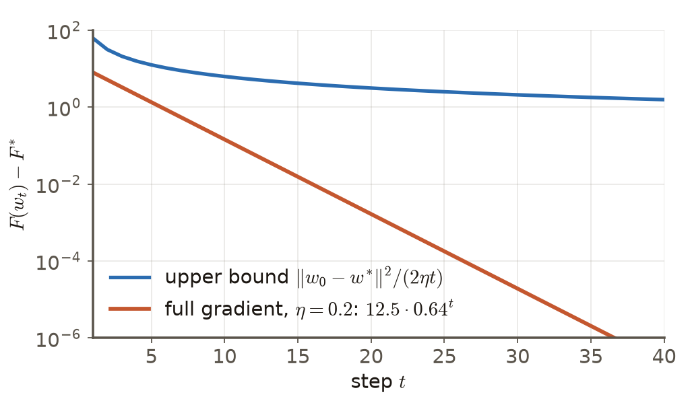
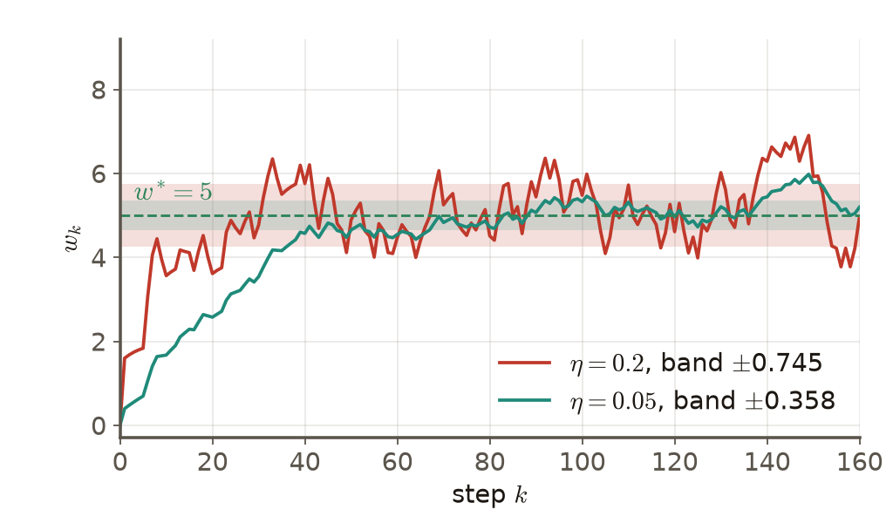
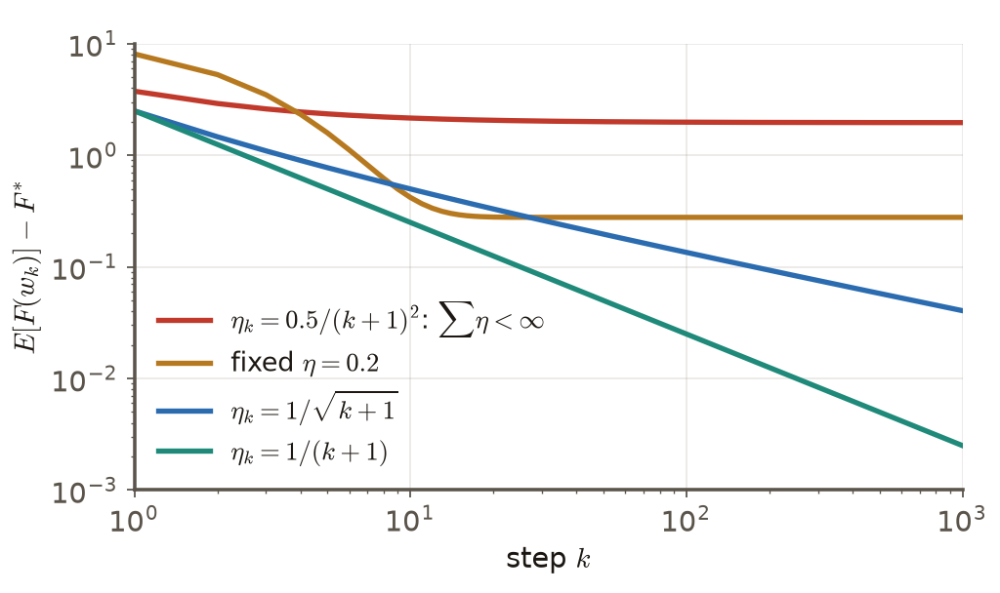

# 第3週 KP09：SGD 收斂分析（SGD convergence analysis）

> 程度：大學生（undergrad）／Level: Undergraduate (undergrad)

> **自主學習 / Self-study**：本單元為自主學習內容，課堂不講授，請自行閱讀。

本講義是第3章「反向傳播與最佳化」的第九個知識點（KP09），承接 KP08 留下的問題：雜訊存在時，「收斂」到底是什麼意思？先備知識是期望與變異數、KP01–KP08；第一次出現的符號都會定義，所有數字都可以自己重算。內容依 CCC-LNS 第3章 KP09 的主文與投影片消化後重新撰寫，讀取日期 2026-10-14；來源沒有的內容標示 `[補充]`。

This is the ninth knowledge point (KP09) of Chapter 3. It picks up the question KP08 left open: with noise present, what does "convergence" actually mean? It assumes expectation and variance and KP01–KP08; every symbol is defined when it first appears and every number can be recomputed. The text is rewritten from the KP09 main text and slides of CCC-LNS Chapter 3 (accessed on 2026-10-14); content that the source does not contain is marked `[Added]`.

[下載本單元投影片](../slides/lec03-kp09-sgd-convergence.jbd.json)

## KP09 SGD 收斂分析（SGD convergence analysis）

### 學習目標（Learning objectives）

讀完之後，你能說出「殘差」與「收斂率」的意思，並寫出全梯度下降在凸、光滑時的 $O(1/t)$ 上界與強凸時的線性收斂；能推出固定步長 SGD 的誤差遞推式，算出它長期停留的帶寬 $\sigma\sqrt{\eta/(2-\eta)}$ 與殘差平台 $\eta\sigma^2/(2(2-\eta))$；能說出遞減步長要滿足的兩個 Robbins–Monro 條件，並判斷給定的步長序列是否通過；也能說明為什麼深度學習願意接受一個 $O(\eta)$ 的殘差。

After reading, you can say what the "residual" and the "convergence rate" are and write the $O(1/t)$ bound of full gradient descent for convex smooth functions and its linear convergence under strong convexity; derive the error recursion of fixed-step SGD and compute the band width $\sigma\sqrt{\eta/(2-\eta)}$ and the residual plateau $\eta\sigma^2/(2(2-\eta))$ where it settles; state the two Robbins–Monro conditions on a decreasing step and decide whether a given step sequence passes; and explain why deep learning is willing to accept an $O(\eta)$ residual.

### 符號表（Symbols）

| 符號 | 中文意義 | English meaning |
|---|---|---|
| $F(w)$ | 訓練損失：$n$ 筆樣本損失 $f_i(w)$ 的平均 | training loss: the average of the $n$ example losses $f_i(w)$ |
| $w^{\ast},\,F^{\ast}$ | 最小點與最小損失 | the minimizer and the minimum loss |
| $F(w)-F^{\ast}$ | 殘差：離最低損失還差多少 | residual: how far the loss is above its minimum |
| $L$ | 梯度的 Lipschitz 常數（光滑度，$L$-smooth） | Lipschitz constant of the gradient ($L$-smooth) |
| $\mu$ | 強凸係數（曲率的下界） | strong convexity constant (a lower bound on the curvature) |
| $\eta,\ \eta_k$ | 固定步長；第 $k$ 步的步長 | fixed step size; step size at step $k$ |
| $e_k=w_k-w^{\ast}$ | 第 $k$ 步的誤差 | the error at step $k$ |
| $\xi_k$ | 第 $k$ 步抽樣帶來的雜訊（平均 0、方差 $\sigma^2$） | the sampling noise at step $k$ (mean 0, variance $\sigma^2$) |
| $\sigma^2$ | 單筆梯度在 $w^{\ast}$ 的方差 | variance of the single-example gradient at $w^{\ast}$ |

### 1. 沒有雜訊時，「收斂」是什麼意思（What convergence means without noise）

KP08 結尾問：有雜訊時，收斂是什麼意思？要回答，先得有一把沒有雜訊時的尺。這把尺是**殘差**：$F(w_t)-F^{\ast}$，也就是目前的損失比最低損失高出多少。**收斂率**說的是殘差隨步數 $t$ 縮小得多快。

KP08 ended by asking what convergence means with noise. To answer that, we first need a ruler for the noiseless case. The ruler is the **residual** $F(w_t)-F^{\ast}$: how far the current loss is above the minimum loss. The **convergence rate** says how fast the residual shrinks with the number of steps $t$.

全梯度下降每步用全部資料算出確定的方向。若 $F$ 是凸函數，而且梯度是 $L$-Lipschitz（$L$-smooth），步長取 $\eta\le1/L$，標準結果是

Full gradient descent uses all the data for a deterministic direction at each step. If $F$ is convex and its gradient is $L$-Lipschitz ($L$-smooth), and the step satisfies $\eta\le1/L$, the standard result is

$$
F(w_t)-F^{\ast}\ \le\ \frac{\|w_0-w^{\ast}\|^2}{2\eta\,t}\ =\ O\!\left(\frac1t\right)
$$

右邊隨 $t\to\infty$ 趨近 0，所以全梯度下降能精確到達最低損失。注意這是**上界**（保證最壞也不會比它差），不是實際速度。

The right side goes to 0 as $t\to\infty$, so full gradient descent can reach the minimum loss exactly. Note that this is an **upper bound** (a guarantee that the worst case is no worse), not the actual speed.

用四筆樣本的例子（$f_i(w)=\tfrac12(w-a_i)^2$，$a=(2,4,6,8)$，$w^{\ast}=5$）。平均損失是 $F(w)=\tfrac12(w-5)^2+2.5$，所以 $F^{\ast}=2.5$，殘差正好是 $\tfrac12(w-5)^2$；曲率處處是 1，所以 $L=\mu=1$。取 $w_0=0$、$\eta=0.2$：每步 $w-5$ 乘上 $1-\eta=0.8$，殘差乘上 $0.8^2=0.64$：

Take the four-example problem ($f_i(w)=\tfrac12(w-a_i)^2$, $a=(2,4,6,8)$, $w^{\ast}=5$). The average loss is $F(w)=\tfrac12(w-5)^2+2.5$, so $F^{\ast}=2.5$ and the residual is exactly $\tfrac12(w-5)^2$; the curvature is 1 everywhere, so $L=\mu=1$. With $w_0=0$ and $\eta=0.2$ each step multiplies $w-5$ by $1-\eta=0.8$ and the residual by $0.8^2=0.64$:

| $t$ | 0 | 1 | 5 | 10 | 20 |
|---|---|---|---|---|---|
| 誤差 $\lvert w_t-5\rvert$（error） | 5 | 4 | 1.638 | 0.537 | 0.0576 |
| 殘差 $12.5\cdot0.64^t$（residual） | 12.5 | 8 | 1.342 | 0.1441 | 0.00166 |
| 上界 $62.5/t$（bound） | — | 62.5 | 12.5 | 6.25 | 3.125 |

殘差每步乘上固定的比例 0.64，這叫**線性收斂**（在半對數圖上是一條直線），比 $O(1/t)$ 快得多。要殘差降到 0.01 以下，實際只要 16 步，但上界保證要 $t\ge6250$ 才夠〔程式計算〕。強凸（$\mu>0$）正是這個差別的原因：曲率有下界，離最小點越近，梯度縮得越快；一般只是凸的函數沒有這項保證，才退回 $O(1/t)$。

The residual is multiplied by a fixed ratio 0.64 per step, which is called **linear convergence** (a straight line on a semi-log plot) and is far faster than $O(1/t)$. To get the residual below 0.01 takes 16 steps in reality, but the bound only guarantees it for $t\ge6250$ [computed by program]. Strong convexity ($\mu>0$) is the reason for the difference: the curvature has a lower bound, so the gradient shrinks faster the closer we get to the minimum; a merely convex function has no such guarantee and falls back to $O(1/t)$.

**圖說 `lec03-kp09-rates`**：先看橘線：縱軸是對數，所以直線代表每步乘上固定比例，$t=40$ 時殘差約 $2.2\times10^{-7}$；再看藍線：$\|w_0-w^{\ast}\|^2/(2\eta t)$ 只緩慢下降，$t=40$ 時還有約 1.56。兩條線的距離說明：上界是保證，不是預測。〔功能：1、2〕

**Caption `lec03-kp09-rates`**: Look at the orange line first: the vertical axis is logarithmic, so a straight line means a fixed ratio per step, and the residual is about $2.2\times10^{-7}$ at $t=40$. Then the blue line: $\|w_0-w^{\ast}\|^2/(2\eta t)$ falls slowly and is still about 1.56 at $t=40$. The gap between the lines shows that a bound is a guarantee, not a prediction. [Function: 1, 2]

### 2. 固定步長的 SGD：停在一條帶子裡（Fixed-step SGD stays in a band）

上一節的全梯度殘差一路縮到 0。現在步長仍是 $\eta=0.2$，但每步只用一筆樣本 $i_k$（KP07）。令 $e_k=w_k-w^{\ast}$。一步更新 $w_{k+1}=w_k-\eta(w_k-a_{i_k})$ 兩邊減去 5，得到

The full-gradient residual of the last section shrinks all the way to 0. Now keep $\eta=0.2$ but use a single example $i_k$ per step (KP07). Let $e_k=w_k-w^{\ast}$. Subtracting 5 from both sides of the update $w_{k+1}=w_k-\eta(w_k-a_{i_k})$ gives

$$
e_{k+1}=(1-\eta)\,e_k+\eta\,\xi_k,\qquad \xi_k=a_{i_k}-w^{\ast}\in\{-3,-1,1,3\}
$$

$\xi_k$ 是抽樣的雜訊：平均 0，方差 $\sigma^2=5$（它是單筆梯度在最小點的方差：該處梯度是 $3,1,-1,-3$）。第一項把舊誤差縮小，第二項每步又注入新的雜訊。取期望：平均誤差是 $(1-\eta)^ke_0$，和全梯度一樣縮到 0。看變異數 $v_k=\mathrm{Var}(e_k)$：因為各步的 $\xi_k$ 彼此獨立，

Here $\xi_k$ is the sampling noise with mean 0 and variance $\sigma^2=5$ (the variance of the single-example gradient at the minimum, where the gradients are $3,1,-1,-3$). The first term shrinks the old error and the second injects fresh noise at every step. In expectation the mean error is $(1-\eta)^ke_0$, which goes to 0 just like the full gradient. For the variance $v_k=\mathrm{Var}(e_k)$, since the $\xi_k$ of different steps are independent,

$$
v_{k+1}=(1-\eta)^2\,v_k+\eta^2\sigma^2\ \Longrightarrow\ v_{\infty}=\frac{\eta^2\sigma^2}{1-(1-\eta)^2}=\frac{\eta\,\sigma^2}{2-\eta}
$$

縮小與注入兩股力量在 $v_\infty$ 平衡，之後 $v_k$ 不再變。所以長期的誤差標準差是 $\sigma\sqrt{\eta/(2-\eta)}$，殘差的期望是 $\tfrac12v_\infty=\eta\sigma^2/(2(2-\eta))$。$\eta=0.2$：標準差 $2.236\times\sqrt{0.2/1.8}=0.745$，殘差期望 $0.2778$。程式用 40000 次獨立模擬驗算：第 100 步的平均殘差是 0.2775，與精確值 0.2778 吻合；一條 30 萬步的長軌跡，標準差是 0.747〔程式計算〕。

The shrinking and the injection balance at $v_\infty$ and $v_k$ stops changing. So the long-run standard deviation of the error is $\sigma\sqrt{\eta/(2-\eta)}$ and the expected residual is $\tfrac12v_\infty=\eta\sigma^2/(2(2-\eta))$. For $\eta=0.2$: the standard deviation is $2.236\times\sqrt{0.2/1.8}=0.745$ and the expected residual is $0.2778$. A program checked this with 40000 independent simulations: the average residual at step 100 is 0.2775, matching the exact 0.2778, and one long trajectory of 300000 steps has standard deviation 0.747 [computed by program].

**圖說 `lec03-kp09-band`**：先看紅色軌跡：第 8 步第一次進入帶內，之後在 $5\pm0.745$ 附近來回，沒有停下；再看綠色：$\eta=0.05$ 帶寬縮到 $\pm0.358$，但要到第 41 步才第一次進帶。這就是 KP02 的取捨在雜訊下的樣子：小步長帶窄、走得慢。〔功能：1、2〕

**Caption `lec03-kp09-band`**: Look at the red trajectory first: it first enters the band at step 8 and then keeps moving around $5\pm0.745$ without settling. Then the green one: with $\eta=0.05$ the band narrows to $\pm0.358$, but it only enters at step 41. This is the trade-off of KP02 under noise: a small step gives a narrow band and slow progress. [Function: 1, 2]

下表是不同 $\eta$ 的結果（誤差縮到十分之一所需的步數，由 $0.8$、$1-\eta$ 的冪算出）：

The table below shows the results for different $\eta$ (the number of steps to cut the error to a tenth, from powers of $1-\eta$):

| $\eta$ | 帶寬（標準差）Band (std) | 殘差平台 Residual plateau | 誤差縮到 1/10 的步數 Steps to 1/10 |
|---|---|---|---|
| 0.4 | 1.118 | 0.625 | 5 |
| 0.2 | 0.745 | 0.278 | 11 |
| 0.1 | 0.513 | 0.132 | 22 |
| 0.05 | 0.358 | 0.064 | 45 |

$\eta$ 小時，$\eta\sigma^2/(2(2-\eta))\approx\eta\sigma^2/4$，所以**殘差平台約與 $\eta$ 成正比**（這就是 $O(\eta)$），而**帶寬（以 $w$ 的距離計）與 $\sqrt\eta$ 成正比**。把 $\eta$ 從 0.1 減半到 0.05，平台從 0.132 降到 0.064（約一半），誤差縮到十分之一的步數從 22 增到 45（約兩倍）〔程式計算〕。

For small $\eta$, $\eta\sigma^2/(2(2-\eta))\approx\eta\sigma^2/4$, so **the residual plateau is roughly proportional to $\eta$** (that is the $O(\eta)$), while **the band width, measured as a distance in $w$, is proportional to $\sqrt\eta$**. Halving $\eta$ from 0.1 to 0.05 lowers the plateau from 0.132 to 0.064 (about half) and raises the number of steps to a tenth of the error from 22 to 45 (about double) [computed by program].

雜訊為什麼不會自己熄？在 $w^{\ast}$，真正的梯度 $\nabla F(w^{\ast})=0$，但單筆梯度是 $3,1,-1,-3$，不是 0。每步仍被推一下，推的幅度是 $\eta$ 乘上這個數，固定的 $\eta$ 讓推力永遠不縮小。所以固定步長的 SGD 不會停在 $w^{\ast}$；它會收斂到一個**分布**（一條帶子），而不是一個點。

Why does the noise not die out by itself? At $w^{\ast}$ the true gradient $\nabla F(w^{\ast})=0$, but the single-example gradients are $3,1,-1,-3$, not 0. Each step still gets a push of size $\eta$ times that number, and a fixed $\eta$ never lets the push shrink. So fixed-step SGD does not stop at $w^{\ast}$; it converges to a **distribution** (a band), not to a point.

### 3. 遞減步長與 Robbins–Monro 條件（Decreasing steps and the Robbins–Monro conditions）

既然帶子的厚度跟 $\eta$ 有關，很自然的做法是讓 $\eta_k$ 隨步數縮小。但縮得太快，迭代走到半路就停下。Robbins 與 Monro 在 1951 年的隨機逼近理論給出兩個條件：

Since the thickness of the band depends on $\eta$, the natural move is to let $\eta_k$ shrink with the step number. But if it shrinks too fast, the iterate stops halfway. The stochastic approximation theory of Robbins and Monro (1951) gives two conditions:

$$
\sum_{k=0}^{\infty}\eta_k=\infty\qquad\text{and}\qquad\sum_{k=0}^{\infty}\eta_k^2<\infty
$$

第一個條件管**走得到**：在四筆樣本的例子裡，平均誤差是 $e_0\prod_k(1-\eta_k)$，在 $0<\eta_k<1$ 時這個乘積趨近 0 若且唯若 $\sum\eta_k=\infty$。若 $\sum\eta_k$ 有限，迭代的總路程有限，起點太遠就永遠走不到。第二個條件管**雜訊退場**：第 $k$ 步注入的雜訊方差是 $\eta_k^2\sigma^2$，加總有限，累積的雜訊就不會一直堆高。

The first condition is about **being able to get there**: in the four-example problem the mean error is $e_0\prod_k(1-\eta_k)$, and for $0<\eta_k<1$ this product goes to 0 if and only if $\sum\eta_k=\infty$. If $\sum\eta_k$ is finite, the total distance the iterate can travel is finite and a far start is never reached. The second condition is about **the noise leaving**: the noise variance injected at step $k$ is $\eta_k^2\sigma^2$, and when the sum is finite the accumulated noise cannot keep piling up.

用四種步長在同一個例子上檢查（變異數遞推 $v_{k+1}=(1-\eta_k)^2v_k+\eta_k^2\sigma^2$ 的精確值，另用模擬驗算）：

Check four step sequences on the same problem (exact values of the variance recursion $v_{k+1}=(1-\eta_k)^2v_k+\eta_k^2\sigma^2$, checked by simulation):

| 步長 $\eta_k$ | $\sum\eta_k$ | $\sum\eta_k^2$ | 結果 Result |
|---|---|---|---|
| 固定 0.2 | $\infty$ | $\infty$ | 停在 0.278 |
| $1/(k+1)$ | $\infty$ | $\pi^2/6=1.645$ | 殘差 $2.5/k$ |
| $1/\sqrt{k+1}$ | $\infty$ | $\infty$ | 較慢，約 $1.25/\sqrt k$ |
| $0.5/(k+1)^2$ | $0.5\pi^2/6=0.82$ | $0.27$ | 停在 1.96 |

$\eta_k=1/(k+1)$ 有一個漂亮的解釋：第一步 $\eta_0=1$，直接把 $w_1$ 設成抽到的樣本；之後每步 $w_{k+1}=\tfrac{k}{k+1}w_k+\tfrac1{k+1}a_{i_k}$ 正是**已抽樣本的平均**。平均 $k$ 筆獨立樣本，誤差方差是 $\sigma^2/k=5/k$，殘差是 $\tfrac12\cdot5/k=2.5/k$：$k=10,100,1000$ 時是 $0.25,0.025,0.0025$，與精確遞推完全相同，模擬在 $k=100$ 得 0.0254。最後一列 $0.5/(k+1)^2$：乘積 $\prod(1-\eta_k)=0.358$，平均誤差停在 $-5\times0.358=-1.79$，殘差中僅這一項就有 $\tfrac12\cdot1.79^2=1.60$，加上方差部分共 1.96：走不到最小點〔程式計算〕。

$\eta_k=1/(k+1)$ has a neat interpretation: the first step $\eta_0=1$ sets $w_1$ to the drawn example, and then each step $w_{k+1}=\tfrac{k}{k+1}w_k+\tfrac1{k+1}a_{i_k}$ is exactly **the average of the examples drawn so far**. The mean of $k$ independent examples has error variance $\sigma^2/k=5/k$ and residual $\tfrac12\cdot5/k=2.5/k$: $0.25,0.025,0.0025$ at $k=10,100,1000$, identical to the exact recursion, and the simulation gives 0.0254 at $k=100$. The last row $0.5/(k+1)^2$: the product $\prod(1-\eta_k)=0.358$, so the mean error stays at $-5\times0.358=-1.79$; this term alone contributes $\tfrac12\cdot1.79^2=1.60$ to the residual and with the variance part the total is 1.96: the minimum is never reached [computed by program].

第三列 $1/\sqrt{k+1}$ 不滿足 $\sum\eta_k^2<\infty$（調和級數發散），但這個題目仍收斂，只是慢，約 $1.25/\sqrt k$。所以 Robbins–Monro 是**充分條件**的經典形式，不是必要條件：在這個強凸的玩具題，只要 $\eta_k\to0$ 且 $\sum\eta_k=\infty$ 雜訊就退得了場，只是退得慢。

The third row $1/\sqrt{k+1}$ fails $\sum\eta_k^2<\infty$ (the harmonic series diverges), yet this problem still converges, only slowly, at about $1.25/\sqrt k$. So Robbins–Monro is the classical form of a **sufficient** condition, not a necessary one: in this strongly convex toy, $\eta_k\to0$ together with $\sum\eta_k=\infty$ is enough for the noise to leave, only slowly.

**圖說 `lec03-kp09-decay`**：先看綠線 $1/(k+1)$：對數對數圖上斜率 $-1$ 的直線；再看橘線：固定 $\eta=0.2$ 在 0.278 變成水平線，這就是停滯；藍線 $1/\sqrt{k+1}$ 斜率約 $-1/2$，更平；紅線 $0.5/(k+1)^2$ 一開始就水平，卡在約 1.96。〔功能：1、2〕

**Caption `lec03-kp09-decay`**: Look at the green line $1/(k+1)$ first: a straight line of slope $-1$ on the log-log plot. Then the orange line: fixed $\eta=0.2$ turns horizontal at 0.278, which is the stagnation. The blue line $1/\sqrt{k+1}$ has slope about $-1/2$ and is flatter. The red line $0.5/(k+1)^2$ is horizontal from the start and stuck near 1.96. [Function: 1, 2]

一般的收斂率（來源引述的標準結果）：強凸時用 $\eta_k\propto1/k$ 得 $O(1/t)$，與這裡的 $2.5/k$ 相符；一般凸且梯度有界時用 $\eta_k\propto1/\sqrt k$，得 $O(1/\sqrt t)$ 量級（至多多一個對數因子，且針對迭代的平均值）。但步長的比例常數要選對：用 $\eta_k=c/(k+1)$，$c\mu>1/2$ 才有 $1/k$ 的速度；$c=0.4$ 時殘差只以約 $k^{-0.8}$ 下降，$c=1$ 與 $c=2$ 都是 $1/k$，但 $c=2$ 的常數 $3.33$ 比 $c=1$ 的 $2.5$ 差〔程式計算，`[補充]`〕。

General rates (the standard results the source quotes): under strong convexity $\eta_k\propto1/k$ gives $O(1/t)$, consistent with the $2.5/k$ here; for a convex function with bounded gradients $\eta_k\propto1/\sqrt k$ gives a rate of order $O(1/\sqrt t)$ (up to a logarithmic factor, and for the average of the iterates). The proportionality constant must be chosen well: with $\eta_k=c/(k+1)$ one needs $c\mu>1/2$ for the $1/k$ speed; at $c=0.4$ the residual falls only like $k^{-0.8}$, while $c=1$ and $c=2$ are both $1/k$ but the constant $3.33$ of $c=2$ is worse than the $2.5$ of $c=1$ [computed by program, `[Added]`].

### 4. 取捨：為什麼深度學習接受 $O(\eta)$ 的殘差（The trade-off: why deep learning accepts an $O(\eta)$ residual）

遞減步長可以把殘差壓到 0，為什麼實務上常常還是用一個不小的 $\eta$？理由是每步的價格。全梯度每步要掃全部 $n$ 筆樣本；SGD 每步只算一筆（或一個小批次，KP08）。在玩具題裡，要殘差 $\le0.01$：全梯度要 16 步，每步 $n$ 筆樣本梯度，共 $16n$ 筆；$\eta_k=1/(k+1)$ 的 SGD 要 $2.5/k\le0.01$，即 $k=250$ 筆。兩者的交會在 $n\approx15.6$，$n=10^6$ 時是 $1.6\times10^7$ 對 250，相差 64000 倍〔程式計算〕。這是玩具模型的算術：它假設樣本是同一個分布的獨立抽樣，$\sigma^2$ 不隨 $n$ 變，不是一般定理；真實問題的損失有非凸、曲率不均等因素，KP10 開始處理。

A decreasing step can squeeze the residual to 0, so why does practice often still use a fairly large $\eta$? The reason is the price of each step. Full gradient scans all $n$ examples per step; SGD computes one example (or one mini-batch, KP08). In the toy problem, to get the residual $\le0.01$: full gradient needs 16 steps of $n$ example-gradients each, $16n$ in all; SGD with $\eta_k=1/(k+1)$ needs $2.5/k\le0.01$, that is $k=250$ examples. The break-even is at $n\approx15.6$, and at $n=10^6$ it is $1.6\times10^7$ against 250, a factor of 64000 [computed by program]. This is the arithmetic of a toy model: it assumes independent draws from one distribution with $\sigma^2$ not changing with $n$, and it is not a general theorem; real losses are non-convex and have uneven curvature, which KP10 starts to treat.

另一方面，前期用較大的 $\eta$ 走得快，後期再把 $\eta$ 降下來壓窄帶子，是常見的兩階段做法（學習率排程）。收斂的判斷也跟著變：SGD 拿不到便宜的全梯度，不能用「全梯度範數小於門檻」停止（KP03），實務上改看驗證損失是否進入平台，或對損失做移動平均。

On the other hand, a larger $\eta$ early on moves fast and a smaller $\eta$ later narrows the band; this two-stage practice is the usual learning-rate schedule. The test for convergence changes too: SGD has no cheap full gradient, so "the full-gradient norm is below a threshold" (KP03) cannot be used as the stopping rule, and in practice one watches whether the validation loss reaches a plateau, or takes a moving average of the loss.

這一頁用到的所有 $\eta$ 都是**一個全域數字**。若損失在不同方向的彎曲程度差很多，例如 KP02 的碗 $f(x,y)=\tfrac12(x^2+25y^2)$，一個 $\eta$ 要同時遷就最陡的方向，在平緩方向就走得很慢。一個全域的學習率顧得了所有維度嗎？這是 KP10 的主題。

Every $\eta$ in this section is **one global number**. If the loss curves very differently along different directions, such as the bowl $f(x,y)=\tfrac12(x^2+25y^2)$ of KP02, a single $\eta$ has to accommodate the steepest direction and is slow along the flat one. Can one global learning rate serve every dimension? That is the topic of KP10.

### 本單元重點整理（KP09 summary）

**一句話重點**：凸且光滑時，全梯度下降的殘差以 $O(1/t)$ 為界，強凸時線性縮小；固定步長的 SGD 停在最小點附近、殘差約與 $\eta$ 成正比的帶子裡，不會歸零；步長遞減且滿足 $\sum\eta_k=\infty$、$\sum\eta_k^2<\infty$ 才能讓雜訊退場。

**One-sentence summary**: For convex smooth functions the residual of full gradient descent is bounded by $O(1/t)$ and shrinks linearly under strong convexity; fixed-step SGD stays in a band around the minimum with a residual roughly proportional to $\eta$ and does not go to 0; only a decreasing step with $\sum\eta_k=\infty$ and $\sum\eta_k^2<\infty$ lets the noise leave.

**白話說明**：全梯度每步方向確定，一步一步往谷底走，走得到。SGD 每步只看一筆，方向帶雜訊，步長固定就像每步都被推一下，在谷底附近晃來晃去。要停下來，推力得越來越小；但推力也不能縮得太快，不然人還沒到谷底就走不動了。

**Plain explanation**: Full gradient has a definite direction at every step and walks to the bottom. SGD looks at one example per step, so its direction is noisy; a fixed step is like being pushed at every step and wobbling around the bottom. To stop, the push has to get smaller and smaller, but not so fast that you cannot move before reaching the bottom.

**正式定義**：殘差 $F(w)-F^{\ast}$；全梯度（凸、$L$-smooth、$\eta\le1/L$）：$F(w_t)-F^{\ast}\le\|w_0-w^{\ast}\|^2/(2\eta t)$；SGD 在四筆樣本例的誤差遞推 $e_{k+1}=(1-\eta)e_k+\eta\xi_k$，長期標準差 $\sigma\sqrt{\eta/(2-\eta)}$、殘差期望 $\eta\sigma^2/(2(2-\eta))$；Robbins–Monro：$\sum\eta_k=\infty$ 且 $\sum\eta_k^2<\infty$。

**Formal definition**: residual $F(w)-F^{\ast}$; full gradient (convex, $L$-smooth, $\eta\le1/L$): $F(w_t)-F^{\ast}\le\|w_0-w^{\ast}\|^2/(2\eta t)$; the error recursion of SGD on the four-example problem $e_{k+1}=(1-\eta)e_k+\eta\xi_k$ with long-run standard deviation $\sigma\sqrt{\eta/(2-\eta)}$ and expected residual $\eta\sigma^2/(2(2-\eta))$; Robbins–Monro: $\sum\eta_k=\infty$ and $\sum\eta_k^2<\infty$.

**例子**：$\eta=0.2$：全梯度殘差 $12.5\cdot0.64^t$（$t=10$ 時 0.144）；固定步長 SGD 帶寬 $0.745$、殘差平台 $0.278$；$\eta_k=1/(k+1)$ 殘差 $2.5/k$。逐步計算見第 1–3 節。

**Example**: $\eta=0.2$: the full-gradient residual is $12.5\cdot0.64^t$ (0.144 at $t=10$); fixed-step SGD has band width $0.745$ and residual plateau $0.278$; $\eta_k=1/(k+1)$ gives residual $2.5/k$. The computations are in sections 1–3.

**常見迷思**：

- 「SGD 永遠不收斂」——固定步長的 SGD 收斂到一個分布（一條帶子）；遞減步長滿足條件時，它收斂到最小點。
- 「固定步長最後會收斂到最小點」——帶子的寬度由 $\eta$ 決定，多迭代只是在帶內繼續晃。
- 「$O(1/t)$ 就是實際速度」——它只是上界；強凸時全梯度是線性收斂，快得多。
- 「步長縮得越快越好」——$\sum\eta_k$ 有限時，迭代走不到最小點（$0.5/(k+1)^2$ 卡在 1.96）。

**Common misconceptions**:

- "SGD never converges." Fixed-step SGD converges to a distribution (a band); with a decreasing step satisfying the conditions it converges to the minimum.
- "A fixed step eventually converges to the minimum." The width of the band is set by $\eta$ and more iterations only keep wobbling inside it.
- "$O(1/t)$ is the actual speed." It is only an upper bound; under strong convexity full gradient converges linearly, much faster.
- "The faster the step shrinks the better." When $\sum\eta_k$ is finite the iterate cannot reach the minimum ($0.5/(k+1)^2$ is stuck at 1.96).

**圖**：本單元三張圖，`lec03-kp09-rates`（上界與實際速度，功能 1、2）、`lec03-kp09-band`（固定步長的帶子，功能 1、2）、`lec03-kp09-decay`（四種步長的殘差，功能 1、2），都以 `assets/figures/src/lec03-kp09-figures.py` 繪製。

**Figure**: Three figures in this unit: `lec03-kp09-rates` (the bound versus the actual speed; functions 1, 2), `lec03-kp09-band` (the band of a fixed step; functions 1, 2) and `lec03-kp09-decay` (the residual of four step sequences; functions 1, 2), all drawn by `assets/figures/src/lec03-kp09-figures.py`.

**想深入**（選讀）：（1）SGD 的一般上界：若 $F$ 凸、$\mathbb E\|g\|^2\le\beta^2$，固定步長 $\eta$ 下，迭代平均 $\bar w_t$ 滿足 $\mathbb E[F(\bar w_t)]-F^{\ast}\le\|w_0-w^{\ast}\|^2/(2\eta t)+\eta\beta^2/2$。第一項是全梯度的 $O(1/t)$，第二項是與 $t$ 無關的 $O(\eta)$，正是來源的「$O(1/t+\eta)$」；證明是把 $\|w_{k+1}-w^{\ast}\|^2$ 展開、取期望、用凸性與 $\beta^2$ 逐步相加，細節見凸最佳化教科書。（2）$\sum\eta_k^2<\infty$ 是經典的充分條件；對一般凸函數，標準分析的上界形如 $(D^2+\beta^2\sum\eta_k^2)/(2\sum\eta_k)$，所以 $\sum\eta_k=\infty$ 且 $\sum\eta_k^2/\sum\eta_k\to0$ 就夠，$1/\sqrt k$ 屬於這一類。

**Going deeper** (optional): (1) The general SGD bound: if $F$ is convex and $\mathbb E\|g\|^2\le\beta^2$, then with a fixed step $\eta$ the average iterate $\bar w_t$ satisfies $\mathbb E[F(\bar w_t)]-F^{\ast}\le\|w_0-w^{\ast}\|^2/(2\eta t)+\eta\beta^2/2$. The first term is the $O(1/t)$ of full gradient and the second is an $O(\eta)$ independent of $t$, which is the source's "$O(1/t+\eta)$"; the proof expands $\|w_{k+1}-w^{\ast}\|^2$, takes expectations and adds the steps up with convexity and $\beta^2$; see a convex optimization textbook for the details. (2) $\sum\eta_k^2<\infty$ is the classical sufficient condition; for general convex functions the standard bound has the form $(D^2+\beta^2\sum\eta_k^2)/(2\sum\eta_k)$, so $\sum\eta_k=\infty$ and $\sum\eta_k^2/\sum\eta_k\to0$ are enough, and $1/\sqrt k$ belongs to this class.

**小練習**：

1. 判斷 $\eta_k=1/(k+1)^{0.7}$ 與 $\eta_k=1/(k+1)^{0.4}$ 是否滿足 Robbins–Monro 條件。（提示：$\sum1/(k+1)^p$ 在 $p\le1$ 時發散、$p>1$ 時收斂；$\eta_k^2$ 的指數是 $2p$。）
2. 四筆樣本、固定步長 $\eta=0.1$：算帶寬（標準差）與殘差平台。若要殘差平台不超過 0.05，$\eta$ 最大是多少？（提示：解 $5\eta/(2(2-\eta))\le0.05$。）
3. $n=10^6$，全梯度要 16 步，遞減步長 SGD 要 250 筆樣本梯度，兩者相差幾倍？這個比較依賴什麼假設？（提示：全梯度每步用 $n$ 筆。）

**Practice**:

1. Decide whether $\eta_k=1/(k+1)^{0.7}$ and $\eta_k=1/(k+1)^{0.4}$ satisfy the Robbins–Monro conditions. (Hint: $\sum1/(k+1)^p$ diverges for $p\le1$ and converges for $p>1$; the exponent of $\eta_k^2$ is $2p$.)
2. Four examples, fixed step $\eta=0.1$: compute the band width (standard deviation) and the residual plateau. What is the largest $\eta$ for a plateau of at most 0.05? (Hint: solve $5\eta/(2(2-\eta))\le0.05$.)
3. $n=10^6$, full gradient needs 16 steps and SGD with a decreasing step needs 250 example-gradients: by what factor do they differ, and what does the comparison assume? (Hint: full gradient uses $n$ examples per step.)

**解題示範**（判斷 $\eta_k=2/(k+2)$ 是否滿足 Robbins–Monro，並在四筆樣本的例子上算出殘差）：

1. 前幾項：$\eta_0=1,\ \eta_1=2/3,\ \eta_2=1/2,\ \eta_3=2/5$，都在 $(0,1]$ 內。
2. 第一個條件：$\sum_{k\ge0}\frac2{k+2}=2\sum_{m\ge2}\frac1m$，調和級數發散，所以 $\sum\eta_k=\infty$（前 $10^6$ 項已經是 26.79，而且還在增長）。
3. 第二個條件：$\sum_{k\ge0}\frac4{(k+2)^2}=4\left(\frac{\pi^2}{6}-1\right)=4\times0.6449=2.5797<\infty$（前 $10^6$ 項的和也是 2.5797）。兩個條件都滿足。
4. 套到四筆樣本：變異數遞推 $v_{k+1}=\left(\frac{k}{k+2}\right)^2v_k+\frac{4\sigma^2}{(k+2)^2}$，因為 $1-\eta_k=\frac{k}{k+2}$。精確遞推得殘差 $\tfrac12v_k$：$k=10,100,1000$ 時是 $0.3182,\ 0.03317,\ 0.003332$；模擬在 $k=100$ 得 0.0335。
5. 與理論值比較：此類步長 $\eta_k=c/k$（$c=2$）的殘差約為 $\dfrac{c^2\sigma^2}{2(2c-1)\,k}=\dfrac{20}{6k}=\dfrac{3.33}{k}$，$k=100$ 時 0.0333，與 0.03317 吻合。
6. 結論：$2/(k+2)$ 滿足兩個條件，殘差是 $O(1/k)$；常數 3.33 比 $\eta_k=1/(k+1)$ 的 2.5 大，所以 $c=1$ 在這題更好。

**Worked solution** (decide whether $\eta_k=2/(k+2)$ satisfies Robbins–Monro and compute the residual on the four-example problem):

1. The first terms: $\eta_0=1,\ \eta_1=2/3,\ \eta_2=1/2,\ \eta_3=2/5$, all in $(0,1]$.
2. First condition: $\sum_{k\ge0}\frac2{k+2}=2\sum_{m\ge2}\frac1m$; the harmonic series diverges, so $\sum\eta_k=\infty$ (the first $10^6$ terms already give 26.79 and it keeps growing).
3. Second condition: $\sum_{k\ge0}\frac4{(k+2)^2}=4\left(\frac{\pi^2}{6}-1\right)=4\times0.6449=2.5797<\infty$ (the first $10^6$ terms also sum to 2.5797). Both conditions hold.
4. Apply to the four examples: the variance recursion is $v_{k+1}=\left(\frac{k}{k+2}\right)^2v_k+\frac{4\sigma^2}{(k+2)^2}$ because $1-\eta_k=\frac{k}{k+2}$. The exact recursion gives the residual $\tfrac12v_k$: $0.3182,\ 0.03317,\ 0.003332$ at $k=10,100,1000$; the simulation gives 0.0335 at $k=100$.
5. Compare with theory: for steps $\eta_k=c/k$ (here $c=2$) the residual is about $\dfrac{c^2\sigma^2}{2(2c-1)\,k}=\dfrac{20}{6k}=\dfrac{3.33}{k}$, which is 0.0333 at $k=100$, matching 0.03317.
6. Conclusion: $2/(k+2)$ satisfies both conditions and the residual is $O(1/k)$; its constant 3.33 is larger than the 2.5 of $\eta_k=1/(k+1)$, so $c=1$ is better on this problem.

### 來源更正與取捨（Corrections to the source）

- 來源把全梯度的上界寫成 $2L\|w_0-w^{\ast}\|^2/(t+1)$，並說步長 $\eta\le1/L$ 就成立。這個常數只在 $\eta$ 接近 $1/L$ 時成立：標準結果是 $\|w_0-w^{\ast}\|^2/(2\eta t)$，$\eta=1/L$ 時是 $L\|w_0-w^{\ast}\|^2/(2t)$，$\eta$ 很小時上界更大。本講義改用含 $\eta$ 的標準形式；在四筆樣本的例子（$\eta=0.2$）兩種形式的數值都成立，但後者才有一般性。同時補上強凸時的線性收斂（每步 $\times0.64$）。
- 來源說停滯帶的「厚度正比於 $\eta$」。精確地說：殘差平台 $\propto\eta$（$O(\eta)$），以 $w$ 的距離計的帶寬 $\propto\sqrt\eta$（$\sigma\sqrt{\eta/(2-\eta)}$）。固定步長的 SGD 不是「不收斂」，是收斂到一個分布；本講義用四筆樣本的精確遞推與模擬驗證。
- 來源把 $\eta_k\propto1/\sqrt k$ 列為「滿足 Robbins–Monro」的策略。它不滿足 $\sum\eta_k^2<\infty$（調和級數發散）；它的 $O(1/\sqrt t)$ 來自另一類分析（針對迭代平均），本講義如實分開，並說明 Robbins–Monro 是充分而非必要條件。
- 來源說在 $n=10^7$、$B=128$ 時全梯度走 1 步的時間 SGD「更新了 10 萬步」、「一步需數小時」。$10^7/128=78125$，約 7.8 萬而非 10 萬；「數小時」沒有依據，刪除。本講義改用玩具題的樣本梯度次數比較（16 步 $\times n$ 對 250 筆），並註明假設。
- 來源說泛化誤差下限約 $O(1/\sqrt n)\approx10^{-3}$，最佳化到 $10^{-9}$ 是「毫無意義的過擬合」；以及固定步長的抖動有「隨機退火、跳出尖銳極小」的隱式正則化作用。前者過度簡化（取決於問題），後者在文獻上有爭議，本講義都不採用，尖銳與平坦留給 KP12。
- 命題 3 的完整證明不放進講義主文，只在「想深入」說明證明的方向與結果的形式。

- The source writes the full-gradient bound as $2L\|w_0-w^{\ast}\|^2/(t+1)$ and says it holds for $\eta\le1/L$. That constant holds only when $\eta$ is close to $1/L$: the standard result is $\|w_0-w^{\ast}\|^2/(2\eta t)$, which is $L\|w_0-w^{\ast}\|^2/(2t)$ at $\eta=1/L$ and larger for very small $\eta$. This note uses the standard form with $\eta$; on the four-example problem ($\eta=0.2$) both forms hold numerically, but only the latter is general. It also adds the linear convergence under strong convexity (a factor $0.64$ per step).
- The source says the "thickness of the band is proportional to $\eta$". Precisely: the residual plateau is $\propto\eta$ ($O(\eta)$) while the band width measured as a distance in $w$ is $\propto\sqrt\eta$ ($\sigma\sqrt{\eta/(2-\eta)}$). Fixed-step SGD does not "fail to converge"; it converges to a distribution. This note checks it with the exact recursion and simulation on the four examples.
- The source lists $\eta_k\propto1/\sqrt k$ as a strategy "satisfying Robbins–Monro". It does not satisfy $\sum\eta_k^2<\infty$ (the harmonic series diverges); its $O(1/\sqrt t)$ comes from another kind of analysis (for the average of the iterates). This note keeps them apart and states that Robbins–Monro is sufficient, not necessary.
- The source says that at $n=10^7$, $B=128$ SGD has made "100000 updates" in the time of one full-gradient step, and that one such step "takes hours". $10^7/128=78125$, about 78 thousand rather than 100 thousand; "hours" has no basis and is dropped. This note compares numbers of example-gradients in the toy problem ($16$ steps $\times n$ against 250) and states the assumptions.
- The source says the generalization error floor is about $O(1/\sqrt n)\approx10^{-3}$ and that optimizing to $10^{-9}$ is "meaningless overfitting", and that the jitter of a fixed step acts as implicit regularization like simulated annealing that escapes sharp minima. The former oversimplifies (it depends on the problem) and the latter is disputed in the literature; neither is adopted, and sharp versus flat is left to KP12.
- The full proof of Proposition 3 is not in the main text; "Going deeper" only gives its direction and the form of the result.

### 術語對照（Terminology）

| 中文 | English |
|---|---|
| 殘差 | residual |
| 收斂率 | convergence rate |
| 上界 | upper bound |
| 凸／強凸 | convex / strongly convex |
| 光滑（$L$-smooth） | smooth ($L$-smooth) |
| 線性收斂 | linear convergence |
| 停滯（停滯帶） | stagnation (stagnation band) |
| 平穩分布 | stationary distribution |
| 遞減步長 | decreasing step size |
| Robbins–Monro 條件 | Robbins–Monro conditions |
| 學習率排程 | learning-rate schedule |
