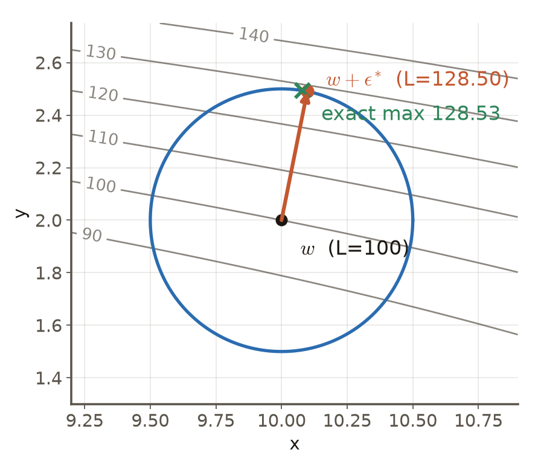

# 第3週 KP13：Vanilla SAM（Vanilla SAM）

> 程度：大學生（undergrad）／Level: Undergraduate (undergrad)

> **自主學習 / Self-study**：本單元為自主學習內容，課堂不講授，請自行閱讀。

本講義是第3章「反向傳播與最佳化」的第十三個知識點（KP13），承接 KP12 留下的問題：尖銳的解泛化脆弱，訓練時怎麼把「尖銳」也算進目標？先備知識是梯度、一階泰勒展開、Cauchy–Schwarz 不等式、KP02 的梯度下降；第一次出現的符號都會定義，所有數字都可以自己重算。內容依 CCC-LNS 第3章 KP13 的主文與投影片消化後重新撰寫，讀取日期 2026-10-14；來源沒有的內容標示 `[補充]`。

This is the thirteenth knowledge point (KP13) of Chapter 3. It picks up the question KP12 left open: sharp solutions generalize badly, so how do we put "sharpness" into the training objective? It assumes gradients, the first-order Taylor expansion, the Cauchy–Schwarz inequality and the gradient descent of KP02; every symbol is defined when it first appears and every number can be recomputed. The text is rewritten from the KP13 main text and slides of CCC-LNS Chapter 3 (accessed on 2026-10-14); content that the source does not contain is marked `[Added]`.

[下載本單元投影片](../slides/lec03-kp13-vanilla-sam.jbd.json)

## KP13 Vanilla SAM（Vanilla SAM）

### 學習目標（Learning objectives）

讀完之後，你能寫出 SAM 的 min-max 目標，並把它拆成「經驗損失加銳度」；能用一階泰勒展開加 Cauchy–Schwarz 推出 $p=2$ 時的最壞擾動 $\epsilon^{\ast}=\rho\,g/\|g\|_2$，並說出一般 $p$ 的對偶範數形式；能在玩具碗上手算一步 SAM 更新，與一般梯度下降逐項對照；也能說出它每步的代價、忽略了哪一項，以及這個近似在哪些條件下不可靠。

After reading, you can write the min-max objective of SAM and split it into "empirical loss plus sharpness"; derive the worst perturbation $\epsilon^{\ast}=\rho\,g/\|g\|_2$ for $p=2$ from a first-order Taylor expansion and the Cauchy–Schwarz inequality, and state the dual-norm form for general $p$; compute one SAM update by hand on the toy bowl and compare it term by term with plain gradient descent; and say what it costs per step, which term it drops, and when the approximation is unreliable.

### 符號表（Symbols）

| 符號 | 中文意義 | English meaning |
|---|---|---|
| $w$ | 權重（向量） | weights (a vector) |
| $L(w)$ | 訓練損失（經驗損失） | training (empirical) loss |
| $g=\nabla L(w)$ | $w$ 處的梯度 | gradient at $w$ |
| $\epsilon$ | 加在權重上的擾動 | perturbation added to the weights |
| $\rho$ | 擾動半徑，$\rho\ge0$ | perturbation radius |
| $p,\ q$ | 範數的階數，與它的對偶階數，$1/p+1/q=1$ | norm order and its dual order |
| $\epsilon^{\ast}$ | 最壞擾動（內層最大化的解） | worst perturbation (solution of the inner maximization) |
| $\eta$ | 學習率（步長） | learning rate (step size) |
| $g_{adv}$ | 在 $w+\epsilon^{\ast}$ 處的梯度 | gradient at $w+\epsilon^{\ast}$ |
| $H$ | Hessian（二階導數矩陣） | Hessian (matrix of second derivatives) |

### 1. 把「平坦」寫成目標（From flatness to an objective）

一般訓練只最小化 $L(w)$。$L$ 只回報「這一個點」的損失，看不到周圍的地形：兩個損失相同的解，一個四周平緩，一個四周陡峭，$L$ 分不出來。KP12 說過，陡峭的解在資料稍有改變時容易變壞。要把「周圍」放進目標，最直接的問法是：在 $w$ 附近走一小段，最壞會變成多糟？

Ordinary training minimizes only $L(w)$. $L$ reports the loss at one point and cannot see the terrain around it: two solutions with the same loss, one surrounded by gentle ground and one by steep ground, look identical. KP12 explained that steep solutions tend to get worse when the data change a little. To bring the surroundings into the objective, the most direct question is: if we step a little away from $w$, how bad can the loss get?

**SAM**（sharpness-aware minimization，銳度感知最小化）把這個問法寫成 min-max 問題：

**SAM** (sharpness-aware minimization) writes this question as a min-max problem:

$$
\min_{w}\ \max_{\|\epsilon\|_p\le\rho}\ L(w+\epsilon)
$$

內層的 $\max$ 在半徑為 $\rho$ 的球裡找讓損失最大的擾動 $\epsilon$（最壞的鄰居）；外層的 $\min$ 調整 $w$，把「最壞的鄰居」的損失壓低。把內層的最大值 $L_{\mathrm{SAM}}(w)$ 減去 $L(w)$，剩下的就是**銳度**（sharpness）：鄰域內損失最多還能再升多少。於是

The inner $\max$ searches the ball of radius $\rho$ for the perturbation $\epsilon$ that raises the loss most (the worst neighbor); the outer $\min$ adjusts $w$ to push the loss of that worst neighbor down. Subtracting $L(w)$ from the inner maximum $L_{\mathrm{SAM}}(w)$ leaves the **sharpness**: how much more the loss can rise inside the neighborhood. Hence

$$
L_{\mathrm{SAM}}(w)=\underbrace{L(w)}_{\text{經驗損失 empirical loss}}+\underbrace{\max_{\|\epsilon\|_p\le\rho}\big(L(w+\epsilon)-L(w)\big)}_{\text{銳度 sharpness}}
$$

這個等式只是移項，沒有近似。它說明 SAM 同時要求兩件事：訓練損失低，而且鄰域內損失升得不多。$\rho$ 是你決定要看多遠的超參數；$\rho\to0$ 時鄰域縮成一個點，銳度為 $0$，目標退回 $L(w)$。來源還把目標寫成帶 $L_2$ 正則化的形式 $L_{\mathrm{SAM}}(w)+\lambda\|w\|_2^2$，那只是在上面再加一項權重衰減，與銳度的部分無關。

This identity is just a rearrangement, no approximation. It says SAM asks for two things at once: a low training loss, and a loss that does not rise much in the neighborhood. $\rho$ is a hyperparameter that decides how far you look; as $\rho\to0$ the neighborhood shrinks to a point, the sharpness is $0$ and the objective returns to $L(w)$. The source also writes the objective with an $L_2$ regularizer, $L_{\mathrm{SAM}}(w)+\lambda\|w\|_2^2$; that merely adds weight decay on top and has nothing to do with the sharpness part.

**主例子**：玩具碗 $f(x,y)=\tfrac12(x^2+25y^2)$，起點 $w=(10,2)$，$\rho=0.5$，$p=2$；後面的學習率取 $\eta=0.02$（KP14 沿用同一組設定）。起點的損失是 $f=\tfrac12(100+100)=100$。因為碗是二次函數，內層最大值可以精確解出：$L_{\mathrm{SAM}}(w)=128.53$，所以銳度是 $28.53$〔程式計算〕。也就是說，在起點走 $0.5$ 步以內，損失最多還能再升 $28.53$。

**Main example**: the toy bowl $f(x,y)=\tfrac12(x^2+25y^2)$, start $w=(10,2)$, $\rho=0.5$, $p=2$; later steps use $\eta=0.02$ (KP14 keeps the same setting). The loss at the start is $f=\tfrac12(100+100)=100$. Because the bowl is quadratic, the inner maximum can be solved exactly: $L_{\mathrm{SAM}}(w)=128.53$, so the sharpness is $28.53$ [computed by program]. In other words, within $0.5$ of the start the loss can rise by another $28.53$.

要守住說法：SAM 懲罰的是「鄰域最壞損失」。這個目標在實證上常常改善泛化，但沒有定理保證它找到平坦的解，更不保證測試誤差一定下降。

Keep the claim modest: SAM penalizes the worst loss in a neighborhood. Empirically this often improves generalization, but no theorem guarantees that it finds a flat solution, let alone that the test error always falls.

### 2. 內層最大化的閉式解（The closed-form worst perturbation）

直接在深度網路的損失上找最大值很難。但 $\rho$ 很小時，損失在鄰域內近似一個平面：做一階泰勒展開，$L(w+\epsilon)\approx L(w)+\epsilon^{\top}g$，其中 $g=\nabla L(w)$。$L(w)$ 與 $\epsilon$ 無關，所以內層問題變成

Finding the maximum directly on the loss of a deep network is hard. But when $\rho$ is small the loss is nearly a plane inside the neighborhood: a first-order Taylor expansion gives $L(w+\epsilon)\approx L(w)+\epsilon^{\top}g$ with $g=\nabla L(w)$. $L(w)$ does not depend on $\epsilon$, so the inner problem becomes

$$
\max_{\|\epsilon\|_2\le\rho}\ \epsilon^{\top}g
$$

由 Cauchy–Schwarz 不等式，$\epsilon^{\top}g\le\|\epsilon\|_2\|g\|_2\le\rho\|g\|_2$，等號成立的條件是 $\epsilon$ 與 $g$ 同方向，而且長度剛好是 $\rho$。所以最壞擾動就是沿著梯度方向走 $\rho$ 那麼遠：

By the Cauchy–Schwarz inequality, $\epsilon^{\top}g\le\|\epsilon\|_2\|g\|_2\le\rho\|g\|_2$, with equality exactly when $\epsilon$ points along $g$ and has length $\rho$. So the worst perturbation is to walk a distance $\rho$ along the gradient:

$$
\epsilon^{\ast}=\rho\,\frac{g}{\|g\|_2}
$$

白話：「一階看起來往哪裡走損失升得最快」就是梯度方向，$\rho$ 決定走多遠。注意 $\|\epsilon^{\ast}\|_2=\rho$ 與梯度大小無關，梯度再大再小，擾動的長度都一樣。

In plain words: "the direction in which the loss rises fastest, to first order" is the gradient direction, and $\rho$ decides how far to go. Note that $\|\epsilon^{\ast}\|_2=\rho$ no matter how large the gradient is.

**在碗上算**：起點的梯度是 $g=(x,\,25y)=(10,\,50)$，$\|g\|_2=\sqrt{100+2500}=50.99$，所以

**On the bowl**: the gradient at the start is $g=(x,\,25y)=(10,\,50)$ and $\|g\|_2=\sqrt{100+2500}=50.99$, so

$$
\epsilon^{\ast}=0.5\cdot\frac{(10,\,50)}{50.99}=(0.098,\ 0.490),\qquad \|\epsilon^{\ast}\|_2=0.5
$$

走到最壞的鄰居 $w+\epsilon^{\ast}=(10.098,\,2.490)$，那裡的損失是 $128.50$〔程式計算〕。真正的最大值是 $128.53$（二次函數的精確解，在圓周上，方向與 $\epsilon^{\ast}$ 只差 $2.1$ 度）。兩者只差 $0.02$：一階近似挑方向挑得很準。

At the worst neighbor $w+\epsilon^{\ast}=(10.098,\,2.490)$ the loss is $128.50$ [computed by program]. The true maximum is $128.53$ (the exact solution for a quadratic, on the circle, in a direction only $2.1$ degrees away from $\epsilon^{\ast}$). The two differ by $0.02$: the first-order approximation picks the direction very well.

用隨機方向驗證 Cauchy–Schwarz：在圓周上取 200000 個隨機的 $\epsilon$，$\epsilon^{\top}g$ 的最大值是 $25.495$，恰好等於 $\rho\|g\|_2=0.5\times50.99$，沒有任何一個超過〔程式計算〕。

Checking Cauchy–Schwarz with random directions: among 200000 random $\epsilon$ on the circle the maximum of $\epsilon^{\top}g$ is $25.495$, exactly $\rho\|g\|_2=0.5\times50.99$, and none exceeds it [computed by program].

**圖說 `lec03-kp13-worst-perturbation`**：先看灰色等高線：損失往右上方升高，所以梯度指向右上；再看藍圈，它是半徑 $\rho=0.5$ 的鄰域邊界；橘色箭頭從 $w$ 出發，長度恰為 $\rho$，指向圓周上最靠近「更高等高線」的位置；綠色叉號幾乎落在箭頭尖端。圖的座標比例是 $1:1$，所以圓看起來是圓。〔功能：1、2、3〕

**Caption `lec03-kp13-worst-perturbation`**: Look at the gray contour lines first: the loss rises toward the upper right, so the gradient points there. The blue circle is the boundary of the neighborhood of radius $\rho=0.5$. The orange arrow starts at $w$ and has length exactly $\rho$, ending at the point on the circle closest to the higher contours; the green cross sits almost on its tip. The axes are scaled $1:1$, so the circle looks like a circle. [Function: 1, 2, 3]

**一階近似估計的是方向，不是值。**用 $L(w)+\rho\|g\|_2=100+25.495=125.495$ 來估鄰域最壞損失，會低估 $3.03$：被忽略的是二階項 $\tfrac12\epsilon^{\ast\top}H\epsilon^{\ast}=3.01$，加上方向的微小誤差 $0.02$〔程式計算〕。所以「SAM 的銳度約等於 $\rho\|g\|_2$」只在 $\rho$ 很小時成立（見第 5 節）。

**The first-order approximation estimates the direction, not the value.** Using $L(w)+\rho\|g\|_2=100+25.495=125.495$ as the worst loss in the neighborhood underestimates it by $3.03$: the neglected piece is the second-order term $\tfrac12\epsilon^{\ast\top}H\epsilon^{\ast}=3.01$ plus the small direction error $0.02$ [computed by program]. So "the sharpness of SAM is about $\rho\|g\|_2$" holds only for small $\rho$ (see section 5).

**一般的 $p$**：範數換成 $\|\epsilon\|_p\le\rho$ 時，同樣的推導用 Hölder 不等式取代 Cauchy–Schwarz。令 $q$ 滿足 $1/p+1/q=1$（$q$ 稱為對偶階數），解是

**General $p$**: with the constraint $\|\epsilon\|_p\le\rho$ the same derivation uses Hölder's inequality in place of Cauchy–Schwarz. Let $q$ satisfy $1/p+1/q=1$ ($q$ is the dual order); the solution is

$$
\epsilon^{\ast}=\rho\,\frac{\mathrm{sign}(g)\,|g|^{\,q-1}}{\big(\|g\|_q^{\,q}\big)^{1/p}}
$$

運算都是逐元素的。$p=2$ 時 $q=2$，回到上面的式子。$p=\infty$ 時 $q=1$，$\epsilon^{\ast}=\rho\,\mathrm{sign}(g)$，每個坐標各走 $\rho$。碗上的檢查：$p=3$（$q=1.5$）得 $\epsilon^{\ast}=(0.217,\,0.486)$，$\|\epsilon^{\ast}\|_3=0.5$，$\epsilon^{\ast\top}g=26.469=\rho\|g\|_q$；$p=\infty$ 得 $(0.5,\,0.5)$，$\epsilon^{\ast\top}g=30=\rho\|g\|_1$〔程式計算〕。一般的 $p$ 只在這裡出現；本單元其餘部分與常見的實作都取 $p=2$。

All operations are element-wise. For $p=2$ we have $q=2$ and the formula above returns. For $p=\infty$ we have $q=1$ and $\epsilon^{\ast}=\rho\,\mathrm{sign}(g)$: every coordinate moves by $\rho$. Checks on the bowl: $p=3$ ($q=1.5$) gives $\epsilon^{\ast}=(0.217,\,0.486)$, $\|\epsilon^{\ast}\|_3=0.5$ and $\epsilon^{\ast\top}g=26.469=\rho\|g\|_q$; $p=\infty$ gives $(0.5,\,0.5)$ and $\epsilon^{\ast\top}g=30=\rho\|g\|_1$ [computed by program]. General $p$ appears only here; the rest of this unit and most implementations take $p=2$.

### 3. 兩步更新（The two-step update）

有了 $\epsilon^{\ast}$，外層要對 $w$ 最小化 $\Phi(w)=L\big(w+\epsilon^{\ast}(w)\big)$。注意 $\epsilon^{\ast}$ 本身依賴 $w$。用連鎖律，

With $\epsilon^{\ast}$ in hand, the outer problem minimizes $\Phi(w)=L\big(w+\epsilon^{\ast}(w)\big)$ over $w$. Note that $\epsilon^{\ast}$ itself depends on $w$. By the chain rule,

$$
\nabla\Phi(w)=\Big(I+\frac{d\epsilon^{\ast}}{dw}\Big)^{\!\top}\,\nabla L\big(w+\epsilon^{\ast}\big)
$$

$d\epsilon^{\ast}/dw$ 內含 Hessian $H$（因為 $g$ 對 $w$ 的導數就是 $H$），要多算二階資訊。SAM 的做法是**直接忽略**這一項：

$d\epsilon^{\ast}/dw$ contains the Hessian $H$ (the derivative of $g$ with respect to $w$ is $H$), which would need second-order information. SAM simply **drops** that term:

$$
\nabla\Phi(w)\ \approx\ g_{adv}:=\nabla L(w)\big|_{\,w+\epsilon^{\ast}}
$$

也就是「在 $w+\epsilon^{\ast}$ 這一點取梯度」。完整的一步是：

That is, "take the gradient at the point $w+\epsilon^{\ast}$". One full step is:

1. 在 $w$ 做一次前向與反向，得到 $g=\nabla L(w)$。
2. 算 $\epsilon^{\ast}=\rho\,g/\|g\|_2$，走到 $w+\epsilon^{\ast}$。
3. 在 $w+\epsilon^{\ast}$ 再做一次前向與反向，得到 $g_{adv}$。
4. 回到原來的 $w$，用 $g_{adv}$ 下降：$w\leftarrow w-\eta\,g_{adv}$。

1. Run a forward and backward pass at $w$ to get $g=\nabla L(w)$.
2. Compute $\epsilon^{\ast}=\rho\,g/\|g\|_2$ and move to $w+\epsilon^{\ast}$.
3. Run a second forward and backward pass at $w+\epsilon^{\ast}$ to get $g_{adv}$.
4. Return to the original $w$ and descend with $g_{adv}$: $w\leftarrow w-\eta\,g_{adv}$.

關鍵是第 4 步：梯度在 $w+\epsilon^{\ast}$ 算出來，更新卻套用在 $w$ 上。`[補充]` 小批次訓練時，兩次傳遞用同一個小批次；實作上還要把 $\epsilon^{\ast}$ 當成常數（不對它反向傳播），這正好對應「忽略 $d\epsilon^{\ast}/dw$」。

The key is step 4: the gradient is computed at $w+\epsilon^{\ast}$ but the update is applied to $w$. `[Added]` With mini-batches both passes use the same mini-batch, and in an implementation $\epsilon^{\ast}$ is treated as a constant (no backpropagation through it), which is exactly "dropping $d\epsilon^{\ast}/dw$".

**碗上的第 1 步**（$\eta=0.02$）〔程式計算〕：

**Step 1 on the bowl** ($\eta=0.02$) [computed by program]:

| | 一般梯度下降 | SAM |
|---|---|---|
| 用的梯度 | $g=(10,\ 50)$ | $g_{adv}=(10.098,\ 62.257)$ |
| 新的 $w$ | $(9.800,\ 1.000)$ | $(9.798,\ 0.755)$ |
| 新的 $L(w)$ | $60.52$ | $55.12$ |
| 新位置的鄰域最壞損失 | $76.79$ | $68.45$ |

| | Plain gradient descent | SAM |
|---|---|---|
| gradient used | $g=(10,\ 50)$ | $g_{adv}=(10.098,\ 62.257)$ |
| new $w$ | $(9.800,\ 1.000)$ | $(9.798,\ 0.755)$ |
| new $L(w)$ | $60.52$ | $55.12$ |
| worst loss in the neighborhood of the new point | $76.79$ | $68.45$ |

SAM 的梯度範數是 $63.07$，是原梯度 $50.99$ 的 $1.24$ 倍：$w+\epsilon^{\ast}$ 在更陡的位置，所以在這個碗上 SAM 的一步比較大，$y$ 方向走得比較多。這是碗的性質，不是 SAM 的一般規律。

The gradient norm of SAM is $63.07$, $1.24$ times the original $50.99$: $w+\epsilon^{\ast}$ lies on steeper ground, so on this bowl the SAM step is larger and moves more in $y$. This is a property of the bowl, not a general rule of SAM.

### 4. 在碗上跑一百步（A hundred steps on the bowl）

同樣的起點與 $\eta=0.02$，兩種方法各跑 100 步，每一步都算出「鄰域最壞損失」（用二次函數的精確解，不是一階估計）〔程式計算〕：

Same start and $\eta=0.02$; run both methods for 100 steps and compute the worst loss in the neighborhood at every step (with the exact solution for the quadratic, not the first-order estimate) [computed by program]:

| 步數 $k$ | 一般梯度下降：$L(w)$ / 鄰域最壞損失 | SAM：$L(w)$ / 鄰域最壞損失 |
|---|---|---|
| 0 | 100 / 128.53 | 100 / 128.53 |
| 1 | 60.52 / 76.79 | 55.12 / 68.45 |
| 10 | 33.38 / 37.91 | 32.73 / 37.22 |
| 30 | 14.88 / 18.62 | 13.71 / 17.40 |
| 60 | 4.43 / 7.74 | 3.46 / 6.72 |
| 100 | 0.879 / 4.04 | 0.813 / 5.98 |

| Step $k$ | Plain GD: $L(w)$ / worst loss | SAM: $L(w)$ / worst loss |
|---|---|---|
| 0 | 100 / 128.53 | 100 / 128.53 |
| 1 | 60.52 / 76.79 | 55.12 / 68.45 |
| 10 | 33.38 / 37.91 | 32.73 / 37.22 |
| 30 | 14.88 / 18.62 | 13.71 / 17.40 |
| 60 | 4.43 / 7.74 | 3.46 / 6.72 |
| 100 | 0.879 / 4.04 | 0.813 / 5.98 |

前 84 步 SAM 的鄰域最壞損失較低（第 30 步與第 60 步，一般梯度下降分別是 SAM 的 $1.07$ 倍與 $1.15$ 倍），第 85 步起被反超。原因是 $y$ 方向在 SAM 下會變得不穩定。$y$ 很小時，$\epsilon^{\ast}$ 的 $y$ 分量約為 $12.5\,y/x$（因為 $\epsilon^{\ast}_y=\rho\cdot25y/\|g\|_2$，而 $\|g\|_2\approx x$），於是 $y\leftarrow y-25\eta\,(y+\epsilon^{\ast}_y)=y\,(0.5-6.25/x)$。只要 $x>4.17$，括號的絕對值小於 $1$，$y$ 持續縮小（第 40 步只剩約 $10^{-15}$，已接近浮點數的誤差）；$x$ 降到 $4.17$ 以下（第 41 步）後，括號的絕對值大於 $1$，殘留的 $y$ 每步被放大，第 60 步與第 80 步的倍率是 $-1.88$ 與 $-3.43$，到第 85 步前後長到 $0.06$ 到 $0.16$。長大以後，$\epsilon^{\ast}$ 的長度仍是 $\rho$，不會隨梯度縮小，$y$ 的更新近似為 $y\leftarrow y-25\eta\,(y+\rho\,\mathrm{sign}(y))$，會在兩個點之間來回跳：令 $y\to-y$，解得 $|y|=25\eta\rho/(2-25\eta)=0.167$（$\eta=0.02$）。實跑到第 400 步，$y$ 的確在 $\pm0.1667$ 之間交替，$L(w)=0.347$，鄰域最壞損失停在 $5.56$；一般梯度下降的 $L(w)$ 降到 $4.8\times10^{-6}$，鄰域最壞損失降到理論下限 $\tfrac12\cdot25\cdot\rho^2=3.125$〔程式計算〕。

For the first 84 steps SAM's worst loss in the neighborhood is lower (at steps 30 and 60 plain GD is $1.07$ and $1.15$ times that of SAM), and from step 85 on it is overtaken. The reason is that the $y$ direction becomes unstable under SAM. When $y$ is small, the $y$ component of $\epsilon^{\ast}$ is about $12.5\,y/x$ (because $\epsilon^{\ast}_y=\rho\cdot25y/\|g\|_2$ and $\|g\|_2\approx x$), so $y\leftarrow y-25\eta\,(y+\epsilon^{\ast}_y)=y\,(0.5-6.25/x)$. As long as $x>4.17$ the bracket has absolute value below $1$ and $y$ keeps shrinking (about $10^{-15}$ at step 40, already near floating-point error); once $x$ falls below $4.17$ (step 41) the bracket exceeds $1$ in absolute value and the residual $y$ is amplified every step, by $-1.88$ and $-3.43$ at steps 60 and 80, growing to $0.06$ to $0.16$ around step 85. Once it has grown, the length of $\epsilon^{\ast}$ is still $\rho$; it does not shrink with the gradient, so the $y$ update is approximately $y\leftarrow y-25\eta\,(y+\rho\,\mathrm{sign}(y))$, which bounces between two points: setting $y\to-y$ gives $|y|=25\eta\rho/(2-25\eta)=0.167$ ($\eta=0.02$). Running to step 400, $y$ indeed alternates between $\pm0.1667$, with $L(w)=0.347$ and a worst loss stuck at $5.56$; plain GD reaches $L(w)=4.8\times10^{-6}$ and a worst loss at the theoretical floor $\tfrac12\cdot25\cdot\rho^2=3.125$ [computed by program].

**圖說 `lec03-kp13-worst-loss`**：先看兩條線在前 80 步幾乎重疊、橘線略低；再看橘線在第 85 步附近的小跳升，那是 $y$ 方向的來回跳動被放大的時刻；最後看虛線下限 $3.125$：兩者都不可能低於它。縱軸是對數刻度。這張圖不是「SAM 比較好」的證據：碗只有一個谷，沒有平坦與尖銳的對比；它只展示機制與固定步長下的行為。〔功能：1、2〕

**Caption `lec03-kp13-worst-loss`**: First see that the two lines almost coincide for the first 80 steps, with the orange one slightly lower. Then look at the small jump of the orange line near step 85: that is the moment when the back-and-forth in $y$ grows. Finally look at the dashed floor $3.125$, below which neither can go. The vertical axis is logarithmic. This figure is not evidence that "SAM is better": the bowl has a single valley, no contrast between flat and sharp; it only shows the mechanism and the behavior under a fixed step size. [Function: 1, 2]

### 5. 代價與限制（Cost and limits）

**代價**：每步要做兩次前向加反向（第 1 步求 $g$，第 3 步求 $g_{adv}$），所以計算量大約是一般訓練的兩倍。實際的牆鐘時間依實作、硬體與批次大小而異；來源給的「$1.9$ 到 $2.0$ 倍」只是一個典型的量級，不是定值。後續怎麼降低這個代價，是 KP14 的主題。

**Cost**: every step runs two forward-plus-backward passes (step 1 for $g$, step 3 for $g_{adv}$), so the computation is about twice that of ordinary training. The actual wall-clock time depends on the implementation, hardware and batch size; the "$1.9$ to $2.0$ times" in the source is a typical order of magnitude, not a constant. How to reduce this cost is the topic of KP14.

**限制 1，忽略 $d\epsilon^{\ast}/dw$ 的誤差**：在碗上，起點的真實梯度（有限差分驗證）是 $(10.076,\,62.368)$，SAM 用的 $g_{adv}=(10.098,\,62.257)$，相對誤差 $0.18\%$；第 30 步誤差為 $0$（梯度只有 $x$ 分量）；第 100 步（$y$ 方向來回跳動時）升到 $11\%$〔程式計算〕。所以「次要」不是普遍的結論，這個誤差在碗底較大。

**Limit 1: the error of dropping $d\epsilon^{\ast}/dw$.** On the bowl the true gradient at the start (checked by finite differences) is $(10.076,\,62.368)$ and the $g_{adv}=(10.098,\,62.257)$ used by SAM, a relative error of $0.18\%$; at step 30 the error is $0$ (the gradient has only an $x$ component); at step 100 (when $y$ bounces back and forth) it rises to $11\%$ [computed by program]. So "minor" is not a general conclusion; the error is larger near the bottom.

**限制 2，$\rho$ 要調，而且一階近似只在 $\rho$ 小時準**：起點（$L=100$）上，隨 $\rho$ 變大，$L(w+\epsilon^{\ast})$ 與精確最大值的差，以及一階估計 $L+\rho\|g\|_2$ 的低估量，都迅速變大〔程式計算〕：

**Limit 2: $\rho$ must be tuned, and the first-order approximation is accurate only for small $\rho$.** At the start ($L=100$), as $\rho$ grows, the gap between $L(w+\epsilon^{\ast})$ and the exact maximum, and the underestimate of the first-order value $L+\rho\|g\|_2$, grow quickly [computed by program]:

| $\rho$ | 一階估計 $L+\rho\|g\|_2$ | $L(w+\epsilon^{\ast})$ | 精確最大值 | 精確值減 $L(w+\epsilon^{\ast})$ |
|---|---|---|---|---|
| 0.1 | 105.10 | 105.22 | 105.22 | 0.0002 |
| 0.5 | 125.50 | 128.50 | 128.53 | 0.021 |
| 1 | 150.99 | 163.03 | 163.17 | 0.145 |
| 2 | 201.98 | 250.13 | 251.02 | 0.885 |
| 5 | 354.95 | 655.91 | 663.97 | 8.06 |

| $\rho$ | first-order estimate $L+\rho\|g\|_2$ | $L(w+\epsilon^{\ast})$ | exact maximum | exact minus $L(w+\epsilon^{\ast})$ |
|---|---|---|---|---|
| 0.1 | 105.10 | 105.22 | 105.22 | 0.0002 |
| 0.5 | 125.50 | 128.50 | 128.53 | 0.021 |
| 1 | 150.99 | 163.03 | 163.17 | 0.145 |
| 2 | 201.98 | 250.13 | 251.02 | 0.885 |
| 5 | 354.95 | 655.91 | 663.97 | 8.06 |

看出兩件事：$\epsilon^{\ast}$ 的方向很穩（$\rho=5$ 時也只差 $8.06$，相對 $664$ 很小），但「值」的一階估計很快就失準。另外 $\rho$ 太大會跨出一個谷、抹掉有用的結構，所以 $\rho$ 要依資料與模型調整，沒有通用值。本單元的 $\rho=0.5$ 是為了讓玩具碗上的效果看得見，不是建議值。`[補充]` SAM 原論文把 $\rho$ 當作要調的超參數，在 $0.01$ 到 $0.5$ 之間的幾個值中搜尋。

Two things stand out: the direction of $\epsilon^{\ast}$ is robust (even at $\rho=5$ the gap is only $8.06$ against $664$), but the first-order estimate of the value fails quickly. Also a $\rho$ that is too large steps out of a valley and erases useful structure, so $\rho$ must be tuned to the data and the model; there is no universal value. The $\rho=0.5$ of this unit only makes the effect visible on the toy bowl and is not a recommendation. `[Added]` The original SAM paper treats $\rho$ as a hyperparameter to be tuned, searching among a few values between $0.01$ and $0.5$.

**限制 3，在極小點，一階估計的銳度是 $0$**：在 $w=0$ 這個極小點，$g=0$，所以 $\rho\|g\|_2=0$；但真正的鄰域最壞損失是 $\tfrac12\cdot25\cdot\rho^2=3.125$，銳度並不是 $0$〔程式計算〕。「銳度約等於梯度範數」的說法在極小點完全失效：極小點的銳度要靠二階（曲率）資訊。SAM 的更新不會因此失靈，因為它在 $w+\epsilon^{\ast}$ 取梯度，那一點的梯度不為零；但這也是第 4 節固定步長下來回跳動的來源。

**Limit 3: at a minimum the first-order sharpness is $0$.** At the minimum $w=0$ we have $g=0$ and so $\rho\|g\|_2=0$, yet the true worst loss in the neighborhood is $\tfrac12\cdot25\cdot\rho^2=3.125$, so the sharpness is not $0$ [computed by program]. The statement "sharpness is about the gradient norm" breaks down completely at a minimum: the sharpness there needs second-order (curvature) information. The SAM update does not break, because it takes the gradient at $w+\epsilon^{\ast}$ where the gradient is nonzero; but this is also the source of the back-and-forth under a fixed step size in section 4.

**限制 4，$p=2$ 是常見的選擇，不是定理**：實務上多半取 $p=2$，因為它的 $\epsilon^{\ast}$ 最簡單；其他的 $p$ 也可以，但哪一個比較好要看資料，沒有一般結論。

**Limit 4: $p=2$ is a common choice, not a theorem.** In practice $p=2$ is the usual pick because its $\epsilon^{\ast}$ is the simplest; other $p$ are possible, but which is better depends on the data and there is no general conclusion.

這一節留下兩個問題給 KP14：第二次梯度能不能省掉？$\rho$ 是一個固定的長度，不管各個參數的尺度，這樣合理嗎？

This section leaves two questions for KP14: can the second gradient be avoided? And $\rho$ is one fixed length regardless of the scale of each parameter; is that reasonable?

### 本單元重點整理（KP13 summary）

**一句話重點**：SAM 把目標改成鄰域最壞損失 $\min_w\max_{\|\epsilon\|_p\le\rho}L(w+\epsilon)$，它等於經驗損失加銳度；內層用一階近似得 $p=2$ 時 $\epsilon^{\ast}=\rho\,g/\|g\|_2$，更新是在 $w+\epsilon^{\ast}$ 取梯度、再套用在 $w$ 上，每步約兩次前向加反向，並忽略 $d\epsilon^{\ast}/dw$。

**One-sentence summary**: SAM turns the objective into the worst loss in a neighborhood, $\min_w\max_{\|\epsilon\|_p\le\rho}L(w+\epsilon)$, which equals the empirical loss plus the sharpness; the first-order approximation of the inner problem gives $\epsilon^{\ast}=\rho\,g/\|g\|_2$ for $p=2$, and the update takes the gradient at $w+\epsilon^{\ast}$ and applies it at $w$, costing about two forward-plus-backward passes per step and dropping $d\epsilon^{\ast}/dw$.

**白話說明**：一般訓練只問「我站的這一點有多低」。SAM 多問一句：「如果我被推到旁邊最壞的那一點，會有多高」。最壞的那一點，一階來看就是順著梯度走 $\rho$ 那麼遠。它在那個最壞的地方看一次坡度，然後回到原地，往那個坡度的反方向走一小步。

**Plain explanation**: Ordinary training asks only "how low is the point I stand on?" SAM adds: "if I am pushed to the worst point nearby, how high is it?" To first order the worst point is a distance $\rho$ along the gradient. SAM looks at the slope there once, returns to where it was, and takes a small step against that slope.

**正式定義**：$\min_w\max_{\|\epsilon\|_p\le\rho}L(w+\epsilon)=\min_w\big[L(w)+\max_{\|\epsilon\|_p\le\rho}(L(w+\epsilon)-L(w))\big]$；$p=2$：$\epsilon^{\ast}=\rho\,g/\|g\|_2$，$g_{adv}=\nabla L(w+\epsilon^{\ast})$，$w\leftarrow w-\eta\,g_{adv}$。

**Formal definition**: $\min_w\max_{\|\epsilon\|_p\le\rho}L(w+\epsilon)=\min_w\big[L(w)+\max_{\|\epsilon\|_p\le\rho}(L(w+\epsilon)-L(w))\big]$; for $p=2$: $\epsilon^{\ast}=\rho\,g/\|g\|_2$, $g_{adv}=\nabla L(w+\epsilon^{\ast})$, $w\leftarrow w-\eta\,g_{adv}$.

**例子**：碗 $f=\tfrac12(x^2+25y^2)$、起點 $(10,2)$、$\rho=0.5$、$\eta=0.02$：$g=(10,50)$，$\epsilon^{\ast}=(0.098,0.490)$，$g_{adv}=(10.098,62.257)$，一步後 $w=(9.798,0.755)$（一般梯度下降是 $(9.800,1.000)$）；鄰域最壞損失 $128.53$，其中銳度 $28.53$。逐步計算見第 2、3 節與解題示範。

**Example**: bowl $f=\tfrac12(x^2+25y^2)$, start $(10,2)$, $\rho=0.5$, $\eta=0.02$: $g=(10,50)$, $\epsilon^{\ast}=(0.098,0.490)$, $g_{adv}=(10.098,62.257)$, and after one step $w=(9.798,0.755)$ (plain gradient descent gives $(9.800,1.000)$); the worst loss in the neighborhood is $128.53$, of which the sharpness is $28.53$. The step-by-step computation is in sections 2 and 3 and in the worked solution.

**常見迷思**：

- 「SAM 保證找到平坦解」——它只是懲罰鄰域最壞損失，實證上常改善泛化，沒有保證；碗上的實驗也看到固定步長下會在碗底來回跳動。
- 「$\epsilon^{\ast}$ 是內層問題的精確解」——它是一階近似的解；碗上差 $0.02$，$\rho$ 越大差越多。
- 「SAM 剛好是兩倍時間」——每步兩次前向加反向，實際時間依實作而異。
- 「$\rho$ 越大越安全」——太大會跨出一個谷，一階近似也會失準。

**Common misconceptions**:

- "SAM guarantees a flat solution." It only penalizes the worst loss in a neighborhood and often improves generalization empirically; there is no guarantee, and on the bowl we saw it bounce at the bottom under a fixed step size.
- "$\epsilon^{\ast}$ is the exact solution of the inner problem." It is the solution of the first-order approximation; on the bowl it is off by $0.02$, and by more as $\rho$ grows.
- "SAM takes exactly twice as long." It runs two forward-plus-backward passes per step; the actual time depends on the implementation.
- "A larger $\rho$ is safer." Too large a $\rho$ steps out of a valley and the first-order approximation fails too.

**圖**：本單元兩張圖，`lec03-kp13-worst-perturbation`（鄰域圓與 $\epsilon^{\ast}$，功能 1、2、3）與 `lec03-kp13-worst-loss`（兩種方法的鄰域最壞損失，功能 1、2），以 `assets/figures/src/lec03-kp13-figures.py` 繪製，數字都由同一支程式印出。

**Figure**: Two figures in this unit, `lec03-kp13-worst-perturbation` (the neighborhood circle and $\epsilon^{\ast}$; functions 1, 2, 3) and `lec03-kp13-worst-loss` (the worst loss of the two methods; functions 1, 2), drawn by `assets/figures/src/lec03-kp13-figures.py`, which prints every number from the same program.

**想深入**（選讀）：`[補充]` 內層最大化的精確解可以寫成信賴域子問題：對二次函數 $f(w)=\tfrac12w^{\top}Hw$，最大值在圓周上，$\epsilon=(\lambda I-H)^{-1}Hw$，其中 $\lambda>\lambda_{\max}(H)$ 使 $\|\epsilon\|=\rho$；本講義的「精確最大值」就是這樣用二分法解出來的。另外，若把忽略的 $d\epsilon^{\ast}/dw$ 項加回來，需要 Hessian 與向量的乘積（可以用有限差分或自動微分取得），代價比第二次梯度更高，所以 vanilla SAM 不這麼做。

**Going deeper** (optional): `[Added]` The exact solution of the inner maximization is a trust-region subproblem: for a quadratic $f(w)=\tfrac12w^{\top}Hw$ the maximum lies on the circle at $\epsilon=(\lambda I-H)^{-1}Hw$, with $\lambda>\lambda_{\max}(H)$ chosen so that $\|\epsilon\|=\rho$; the "exact maximum" of this note is solved that way by bisection. Also, putting back the dropped $d\epsilon^{\ast}/dw$ term would need Hessian-vector products (obtainable by finite differences or automatic differentiation), at a higher price than the second gradient, which is why vanilla SAM does not do it.

**小練習**：

1. 某一點的梯度是 $g=(3,4)$，$\rho=0.5$，$p=2$：求 $\epsilon^{\ast}$，驗證 $\|\epsilon^{\ast}\|_2=\rho$，並算一階的銳度估計 $\rho\|g\|_2$。（提示：$\|g\|_2=5$。）
2. 一維 $L(w)=\tfrac12kw^2$：寫出 $\epsilon^{\ast}$（只有正負兩個方向）與 SAM 的梯度 $g_{adv}$。取尖銳的 $k=20$、平坦的 $k=0.6$，$w=1$，$\rho=0.3$：兩者的 $g_{adv}$ 各是普通梯度的幾倍？一階估計 $k\,w\rho$ 與精確的銳度 $k(w\rho+\rho^2/2)$ 差多少？（提示：$g=kw$，$\epsilon^{\ast}=\rho\,\mathrm{sign}(g)$。）
3. 同樣 $g=(3,-4)$、$\rho=0.5$：分別取 $p=2$ 與 $p=\infty$，求 $\epsilon^{\ast}$ 與 $\epsilon^{\ast\top}g$，並說明為什麼 $p=\infty$ 的 $\|\epsilon^{\ast}\|_2$ 大於 $\rho$。（提示：$p=\infty$ 時 $\epsilon^{\ast}=\rho\,\mathrm{sign}(g)$。）

**Practice**:

1. At some point the gradient is $g=(3,4)$, $\rho=0.5$, $p=2$: find $\epsilon^{\ast}$, verify $\|\epsilon^{\ast}\|_2=\rho$ and compute the first-order sharpness estimate $\rho\|g\|_2$. (Hint: $\|g\|_2=5$.)
2. One dimension, $L(w)=\tfrac12kw^2$: write $\epsilon^{\ast}$ (only two directions, plus or minus) and the SAM gradient $g_{adv}$. Take a sharp $k=20$ and a flat $k=0.6$, with $w=1$ and $\rho=0.3$: by what factor is each $g_{adv}$ larger than the ordinary gradient? How far is the first-order estimate $k\,w\rho$ from the exact sharpness $k(w\rho+\rho^2/2)$? (Hint: $g=kw$, $\epsilon^{\ast}=\rho\,\mathrm{sign}(g)$.)
3. With $g=(3,-4)$ and $\rho=0.5$: take $p=2$ and $p=\infty$, find $\epsilon^{\ast}$ and $\epsilon^{\ast\top}g$, and explain why $\|\epsilon^{\ast}\|_2$ exceeds $\rho$ for $p=\infty$. (Hint: for $p=\infty$, $\epsilon^{\ast}=\rho\,\mathrm{sign}(g)$.)

**解題示範**（在玩具碗上，$w=(4,1)$，$\rho=0.5$，$\eta=0.02$，$p=2$：算一步 SAM，並與一般梯度下降比較）：

1. 梯度：$g=(x,\,25y)=(4,\ 25)$，$\|g\|_2=\sqrt{16+625}=\sqrt{641}=25.318$。
2. 最壞擾動：$\epsilon^{\ast}=0.5\cdot(4,25)/25.318=(0.0790,\ 0.4937)$，長度 $\sqrt{0.0790^2+0.4937^2}=0.5$。
3. 走到最壞的鄰居：$w+\epsilon^{\ast}=(4.0790,\ 1.4937)$。鄰域最壞損失：$L(w)=\tfrac12(16+25)=20.5$；$L(w+\epsilon^{\ast})=\tfrac12(4.0790^2+25\cdot1.4937^2)=36.209$；一階估計 $20.5+0.5\cdot25.318=33.159$，比 $L(w+\epsilon^{\ast})$ 低 $3.05$（精確最大值是 $36.233$）。
4. 在那裡取梯度：$g_{adv}=(4.0790,\ 25\cdot1.4937)=(4.0790,\ 37.343)$。
5. SAM 更新：$w\leftarrow(4,1)-0.02\cdot(4.0790,\ 37.343)=(3.9184,\ 0.2531)$。
6. 一般梯度下降：$(4,1)-0.02\cdot(4,25)=(3.9200,\ 0.5000)$。
7. 對照：$L$ 從 $20.5$ 降到 SAM 的 $8.478$（一般梯度下降 $10.808$）；新位置的鄰域最壞損失，SAM 是 $14.976$，一般梯度下降是 $20.340$〔程式計算〕。SAM 的梯度範數 $\|g_{adv}\|_2=37.56$，是 $\|g\|_2=25.32$ 的 $1.48$ 倍，所以 $y$ 方向多走了：$y$ 從 $1$ 降到 $0.253$，一般梯度下降只降到 $0.5$。

**Worked solution** (on the toy bowl, $w=(4,1)$, $\rho=0.5$, $\eta=0.02$, $p=2$: compute one SAM step and compare it with plain gradient descent):

1. Gradient: $g=(x,\,25y)=(4,\ 25)$, $\|g\|_2=\sqrt{16+625}=\sqrt{641}=25.318$.
2. Worst perturbation: $\epsilon^{\ast}=0.5\cdot(4,25)/25.318=(0.0790,\ 0.4937)$, of length $\sqrt{0.0790^2+0.4937^2}=0.5$.
3. Move to the worst neighbor: $w+\epsilon^{\ast}=(4.0790,\ 1.4937)$. Worst loss in the neighborhood: $L(w)=\tfrac12(16+25)=20.5$; $L(w+\epsilon^{\ast})=\tfrac12(4.0790^2+25\cdot1.4937^2)=36.209$; the first-order estimate is $20.5+0.5\cdot25.318=33.159$, which is $3.05$ below $L(w+\epsilon^{\ast})$ (the exact maximum is $36.233$).
4. Take the gradient there: $g_{adv}=(4.0790,\ 25\cdot1.4937)=(4.0790,\ 37.343)$.
5. SAM update: $w\leftarrow(4,1)-0.02\cdot(4.0790,\ 37.343)=(3.9184,\ 0.2531)$.
6. Plain gradient descent: $(4,1)-0.02\cdot(4,25)=(3.9200,\ 0.5000)$.
7. Comparison: $L$ falls from $20.5$ to $8.478$ for SAM ($10.808$ for plain gradient descent); the worst loss in the neighborhood of the new point is $14.976$ for SAM and $20.340$ for plain gradient descent [computed by program]. The gradient norm of SAM is $\|g_{adv}\|_2=37.56$, $1.48$ times $\|g\|_2=25.32$, so it moves further in $y$: $y$ falls from $1$ to $0.253$, against $0.5$ for plain gradient descent.

### 來源更正與取捨（Corrections to the source）

- 來源稱 SAM「迫使權重遷移至平坦盆地，實現卓越的測試泛化」，並說它「成功換取平坦谷底與高泛化力」。這些沒有定理支持。本講義改為「懲罰鄰域最壞損失，實證上常改善泛化，不保證找到平坦解」；碗上的實驗也顯示，固定步長下 SAM 會在碗底來回跳動，鄰域最壞損失反而比一般梯度下降高（$5.56$ 對 $3.125$）。
- 來源稱 SAM 在 ImageNet、CIFAR、ViT、NLP 等任務「穩定提升 1% 到 3% 準確率」，並稱測試誤差「顯著降低」「對噪聲標籤與分佈偏移魯棒性強」。這是沒有出處與條件的籠統數字，本講義不採用。
- 來源稱每步「牆上時間約增加 $1.9$ 到 $2.0$ 倍」。每步確實是兩次前向加反向，但實際時間依實作、硬體與批次大小而異，本講義只說「約兩次前向加反向，不一定剛好兩倍」。
- 來源把 $\epsilon^{\ast}$ 說成「精確推向最陡峭的懸崖邊界」。它是一階近似的解，不是內層問題的精確解；碗上差 $0.02$，$\rho$ 增大時差距增大（第 5 節的表）。
- 來源說忽略的二階項「次要」。碗上的相對誤差是起點 $0.18\%$、第 30 步 $0$、第 100 步 $11\%$，因此不是處處次要；本講義如實報告這些數字。
- 來源說實務常設 $\rho\in[0.01,0.1]$，又在對照表說「通常設 0.05 左右」，並稱 $p=2$ 是「強烈推薦」。$\rho$ 與 $p$ 都要依資料與模型調整，沒有通用值；本講義的 $\rho=0.5$ 只是為了讓玩具碗上的效果看得見。`[補充]` SAM 原論文把 $\rho$ 當作要調的超參數，在 $0.01$ 到 $0.5$ 之間的幾個值中搜尋。
- 來源說 SAM「直接將 PAC-Bayes 泛化誤差界中的平坦度先驗融入損失目標」。這個說法沒有在來源中展開推導，本講義不採用；式 (47) 的 $L_2$ 正則化形式只在第 1 節簡述，它只是額外的權重衰減。
- 來源在「四大鐵律」把「$\rho\to0$ 退化為 SGD」與「$\rho$ 過大使一階近似失效」並列。這兩句本講義保留，並用第 5 節的表驗證了後者。
- 來源把 LookSAM、ESAM、GSAM、ASAM 等加速與改良版本放在本單元；這些屬於 KP14 的內容，本講義只在第 5 節留下問題，不展開，也不採用來源對各方法的敘述。
- 來源的互動模擬頁與四題選擇題不放進講義；其中「$\|\epsilon^{\ast}\|_2$ 恆等於 $\rho$」的觀察（梯度 $(5,12)$、長度 $13$、$\rho=0.2$）與本講義第 2 節的說明一致。

- The source says SAM "forces the weights to migrate to a flat basin and achieves outstanding test generalization", and "successfully trades for a flat valley and high generalization". No theorem supports this. This note says "penalizes the worst loss in a neighborhood, often improves generalization empirically, does not guarantee a flat solution"; the experiment on the bowl also shows that under a fixed step size SAM bounces at the bottom, with a higher worst loss than plain gradient descent ($5.56$ against $3.125$).
- The source says SAM "steadily improves accuracy by 1% to 3%" on ImageNet, CIFAR, ViT and NLP tasks, and that the test error "drops significantly" with "strong robustness to noisy labels and distribution shift". These are sweeping numbers with no reference or conditions and are not adopted.
- The source says the wall-clock time per step "increases by about $1.9$ to $2.0$ times". A step does run two forward-plus-backward passes, but the actual time depends on the implementation, hardware and batch size; this note only says "about two forward-plus-backward passes, not necessarily exactly twice".
- The source says $\epsilon^{\ast}$ "pushes exactly to the edge of the steepest cliff". It is the solution of a first-order approximation, not the exact solution of the inner problem; on the bowl it is off by $0.02$, and by more as $\rho$ grows (the table in section 5).
- The source calls the dropped second-order term "minor". The relative error on the bowl is $0.18\%$ at the start, $0$ at step 30 and $11\%$ at step 100, so it is not minor everywhere; this note reports these numbers as they are.
- The source says practitioners usually set $\rho\in[0.01,0.1]$, says in its comparison table "usually around 0.05", and calls $p=2$ "strongly recommended". Both $\rho$ and $p$ must be tuned to the data and model; there is no universal value, and the $\rho=0.5$ of this note only makes the effect visible on the toy bowl. `[Added]` The original SAM paper treats $\rho$ as a hyperparameter to tune, searching among a few values between $0.01$ and $0.5$.
- The source says SAM "directly builds the flatness prior of PAC-Bayes generalization bounds into the loss". The source does not develop this claim and this note does not adopt it; the $L_2$-regularized form of its equation (47) is only mentioned in section 1, where it is just extra weight decay.
- In its "four maxims" the source places "$\rho\to0$ degenerates to SGD" next to "a too large $\rho$ breaks the first-order approximation". This note keeps both statements and checks the latter with the table in section 5.
- The source puts speed-up and improved variants such as LookSAM, ESAM, GSAM and ASAM into this unit; they belong to KP14, so this note only leaves a question in section 5 and neither develops them nor adopts the source's description of each.
- The interactive simulator and the four multiple-choice questions of the source are not carried into this note; its observation that $\|\epsilon^{\ast}\|_2$ always equals $\rho$ (gradient $(5,12)$, length $13$, $\rho=0.2$) agrees with the explanation in section 2.

### 術語對照（Terminology）

| 中文 | English |
|---|---|
| 銳度感知最小化 | sharpness-aware minimization (SAM) |
| 銳度 | sharpness |
| 擾動 | perturbation |
| 擾動半徑 | perturbation radius |
| 最壞擾動 | worst-case perturbation |
| 內層最大化／外層最小化 | inner maximization / outer minimization |
| 一階泰勒展開 | first-order Taylor expansion |
| 對偶範數 | dual norm |
| 柯西–施瓦茲不等式 | Cauchy–Schwarz inequality |
| 鄰域 | neighborhood |
| 信賴域子問題 | trust-region subproblem |
| 有限差分 | finite difference |
