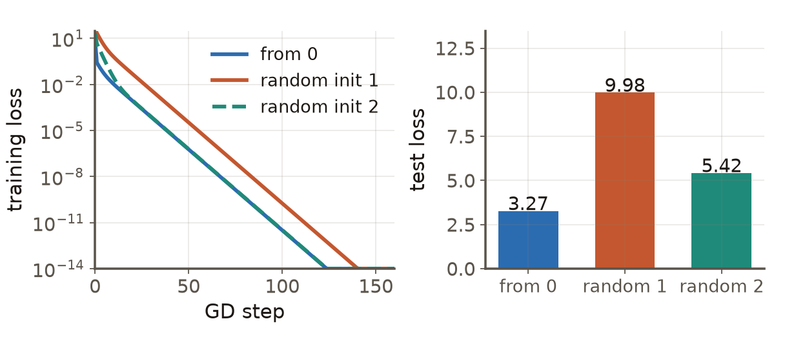
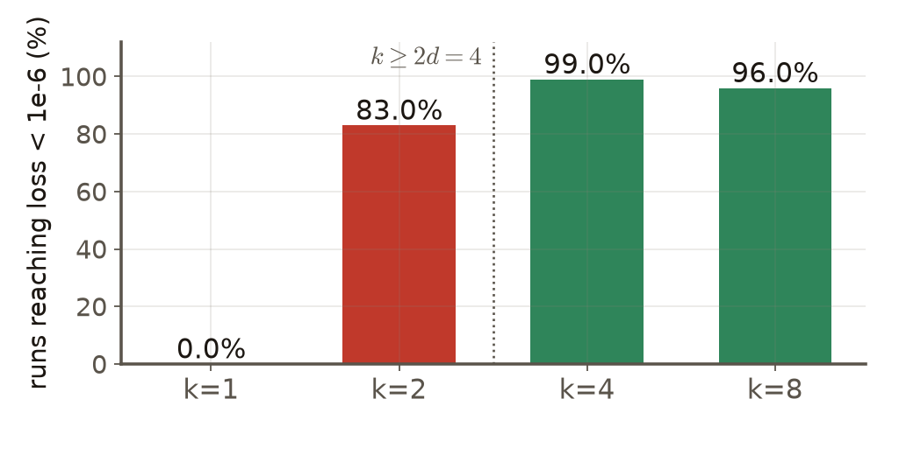
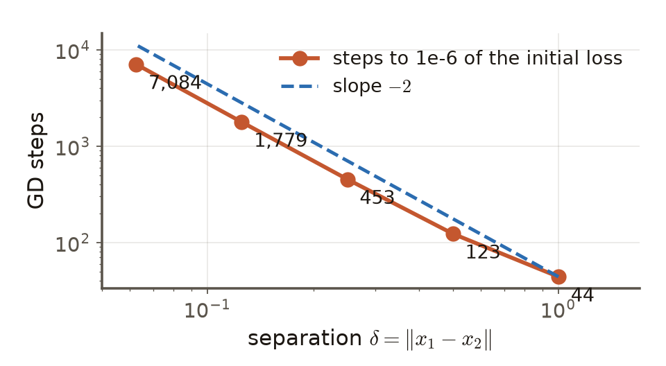

# 第3週 KP15：過參數化網路的收斂保證（Convergence guarantees for over-parameterized networks）

> 程度：大學生（undergrad）／Level: Undergraduate (undergrad)

本講義是第3章「反向傳播與最佳化」的第十五個知識點（KP15），承接 KP14 留下的問題：前面的方法（GD、SGD、Adam、SAM）在非凸的損失上為什麼練得動、保證了什麼？先備知識是線性代數的秩與零空間、KP02 的 GD 收斂分析與 KP12 的銳度；第一次出現的符號都會定義，所有實驗都附程式，數字可以自己重算。內容依 CCC-LNS 第3章 KP15 的主文與投影片消化後重新撰寫，讀取日期 2026-10-14；來源對定理的敘述我沒有逐一對照原論文，凡是引用定理之處都寫成「來源所述」。

This is the fifteenth knowledge point (KP15) of Chapter 3. It picks up the question KP14 left open: GD, SGD, Adam and SAM are applied to non-convex losses, so why do they train at all and what do we get a guarantee for? It assumes rank and null space from linear algebra, the GD analysis of KP02 and the sharpness of KP12; every symbol is defined when it first appears and every experiment comes with code, so the numbers can be recomputed. The text is rewritten from the KP15 main text and slides of CCC-LNS Chapter 3 (accessed 2026-10-14); I did not check the theorems against the original papers, so wherever a theorem is quoted it is phrased as "the source states".

[下載本單元投影片](../slides/lec03-kp15-overparameterized-convergence.jbd.json)

## KP15 過參數化網路的收斂保證（Convergence guarantees for over-parameterized networks）

### 學習目標（Learning objectives）

讀完之後，你能說出過參數化的意思，並用最小平方的例子說明為什麼會有無窮多個零訓練損失的解、GD 會落在哪一個；能說出「淺層二次啟用網路」與「深層 ReLU 網路」兩個收斂結果各自需要什麼條件、結論是什麼；能解釋為什麼資料分離度越小、GD 需要的步數越多；也能說明這些保證針對的是訓練損失，不是測試表現。

After reading, you can say what over-parameterization means and use least squares to explain why there are infinitely many zero-training-loss solutions and which one GD lands on; state the conditions and the conclusion of the two convergence results, the shallow quadratic-activation network and the deep ReLU network; explain why a smaller data separation needs more GD steps; and say why these guarantees are about the training loss and not about test performance.

### 符號表（Symbols）

| 符號 | 中文意義 | English meaning |
|---|---|---|
| $n$ | 訓練樣本的筆數 | number of training examples |
| $p$ | 可訓練參數的個數 | number of trainable parameters |
| $d$ | 輸入的維度 | input dimension |
| $k$ | 隱藏層的寬度（神經元個數） | hidden-layer width (number of neurons) |
| $m$ | 深層網路每層的寬度 | width of each layer of the deep network |
| $X\in\mathbb R^{n\times p}$ | 資料矩陣，每列是一筆樣本 | data matrix, one example per row |
| $X^{+}$ | 偽逆（Moore–Penrose pseudo-inverse） | Moore–Penrose pseudo-inverse |
| $\delta$ | 不同樣本之間的最小距離（資料分離度） | the smallest distance between two different examples (data separation) |
| $\varepsilon$ | 目標訓練損失（要降到多小） | target training loss (how small we want it) |

### 1. 過參數化：解不唯一（Over-parameterization: the solution is not unique）

**過參數化**（over-parameterized）是參數比資料多：$p>n$。最簡單的例子是線性模型的最小平方。損失 $L(w)=\tfrac12\|Xw-y\|^2$，$X$ 是 $n\times p$ 的矩陣，$p>n$ 且 $X$ 的秩是 $n$。方程式 $Xw=y$ 有 $p$ 個未知數、只有 $n$ 條限制，所以滿足它的 $w$ 構成一個維度 $p-n$ 的平面：每一個點的訓練損失都是 0。

**Over-parameterized** means more parameters than data: $p>n$. The simplest example is least squares for a linear model. The loss is $L(w)=\tfrac12\|Xw-y\|^2$ with $X$ an $n\times p$ matrix, $p>n$ and $\operatorname{rank}X=n$. The equation $Xw=y$ has $p$ unknowns and only $n$ constraints, so the solutions form a plane of dimension $p-n$ on which the training loss is 0 everywhere.

用一組小數字看看：$n=3$、$p=10$，資料矩陣 $X$ 取標準常態亂數（種子 3），真正的權重是 $w_{\text{true}}=(2,0,\dots,0)$，$y=Xw_{\text{true}}$，所以 $X$ 的列張成的空間裡，零損失的解有 $p-n=7$ 個自由度。GD 的更新是 $w\leftarrow w-\eta X^{\!\top}(Xw-y)$；注意每一步的改變量 $-\eta X^{\!\top}(Xw-y)$ 都落在 $X$ 的列空間裡，所以 $w$ 在零空間方向上的分量永遠不會被更新。把它寫成式子：若 GD 收斂，結果是

$$
w_{\infty}=w_0+X^{+}\,(y-Xw_0),
$$

也就是「初始點加上把殘差補起來所需的最小修正」。從 $w_0=0$ 出發得到**最小範數解** $X^{+}y$。

Take a small set of numbers: $n=3$, $p=10$, a data matrix $X$ of standard-normal random numbers (seed 3), the true weights $w_{\text{true}}=(2,0,\dots,0)$ and $y=Xw_{\text{true}}$, so the zero-loss solutions have $p-n=7$ degrees of freedom. The GD update is $w\leftarrow w-\eta X^{\!\top}(Xw-y)$; every change $-\eta X^{\!\top}(Xw-y)$ lies in the row space of $X$, so the component of $w$ along the null space is never updated. In symbols, if GD converges the result is

$$
w_{\infty}=w_0+X^{+}\,(y-Xw_0),
$$

the initial point plus the smallest correction that fills the residual. Starting from $w_0=0$ gives the **minimum-norm solution** $X^{+}y$.

程式（`lec03-kp15-figures.py`）用 $\eta=1/\lambda_{\max}(XX^{\!\top})=1/28.07=0.0356$ 跑 GD：從 0 出發 48 步、從第一個隨機初始點出發 65 步，訓練損失就降到 $10^{-6}$ 以下（初始是 8.43），最後都是 0。三個結果都符合上面的公式（與 $w_0+X^{+}(y-Xw_0)$ 的差是 0）。但它們是三個**不同**的解：範數 0.85、2.47、1.73，在新資料上的測試損失（$x\sim\mathcal N(0,I)$ 時等於 $\|w-w_{\text{true}}\|^2$）分別是 3.27、9.98、5.42。三個解的訓練損失都是 0，測試損失卻差到三倍。

The program (`lec03-kp15-figures.py`) runs GD with $\eta=1/\lambda_{\max}(XX^{\!\top})=1/28.07=0.0356$: from 0 in 48 steps and from the first random initial point in 65 steps the training loss falls below $10^{-6}$ (it starts at 8.43) and ends at 0. All three results match the formula above (the difference from $w_0+X^{+}(y-Xw_0)$ is 0). But they are three **different** solutions: norms 0.85, 2.47, 1.73, and the test losses on new data (for $x\sim\mathcal N(0,I)$ it equals $\|w-w_{\text{true}}\|^2$) are 3.27, 9.98, 5.42. All three have training loss 0 and the test loss differs by a factor of three.

**圖說 `lec03-kp15-interpolants`**：左圖的三條線幾乎重疊地一路降到 0：只看訓練損失，三個解沒有差別。右圖是同樣三個解的測試損失，高低差三倍。最佳化成功（左）與泛化好壞（右）是兩件事。

**Caption `lec03-kp15-interpolants`**: The three curves on the left fall to 0 almost on top of each other: judged by the training loss alone the three solutions are the same. The right panel shows the test losses of the same three solutions, a factor of three apart. Succeeding in optimization (left) and generalizing well (right) are two different things.

### 2. 非凸時的保證：淺層二次啟用網路（The non-convex case: a shallow quadratic-activation network）

最小平方是凸的，保證很容易。神經網路是非凸的，一個簡單的擔憂是：GD 會不會卡在 $\nabla L=0$ 但損失很高的點？來源引用的第一個結果（Proposition 4，來源歸於 Du & Lee 2018 等）處理最小的非凸網路：單一隱藏層、二次啟用 $\sigma(z)=z^2$，

$$
f(x)=\sum_{j=1}^{k}v_j\,(w_j^{\!\top}x)^2,\qquad L(W)=\frac1{2n}\sum_{i=1}^{n}\big(y_i-f(x_i)\big)^2 .
$$

來源所述的條件：寬度 $k\ge 2d$，輸出權重 $v$ 固定且至少有 $d$ 個正數與 $d$ 個負數；結論有三點：（1）所有局部極小都是全域極小，沒有「假的」局部極小；（2）每個鞍點都有嚴格的負曲率方向（Hessian 有負特徵值），所以可以逃離；（3）樣本數滿足 $d\le n\le c\,d^2$ 時，全域最小損失是 0。

Least squares is convex and the guarantee is easy. A neural network is non-convex, and the natural worry is: can GD get stuck at a point with $\nabla L=0$ but a high loss? The first result quoted by the source (Proposition 4, attributed to Du & Lee 2018 and others) treats the smallest non-convex network: one hidden layer with the quadratic activation $\sigma(z)=z^2$,

$$
f(x)=\sum_{j=1}^{k}v_j\,(w_j^{\!\top}x)^2,\qquad L(W)=\frac1{2n}\sum_{i=1}^{n}\big(y_i-f(x_i)\big)^2 .
$$

The conditions as the source states them: width $k\ge 2d$, fixed output weights $v$ with at least $d$ positive and $d$ negative entries; the conclusions are three: (1) every local minimum is a global minimum, there are no "bad" local minima; (2) every saddle point has a direction of strictly negative curvature (the Hessian has a negative eigenvalue), so it can be escaped; (3) when the number of samples satisfies $d\le n\le c\,d^2$ the global minimum of the loss is 0.

這個網路其實是 $f(x)=x^{\!\top}Mx$，$M=\sum_j v_j\,w_jw_j^{\!\top}$，我們可以自己做一個小實驗看寬度的作用。取 $d=2$、$n=3$，隨機的 $x_i$ 與隨機標籤 $y_i$；三個條件 $x_i^{\!\top}Mx_i=y_i$ 決定唯一的對稱矩陣 $M^{\ast}$。寬度 $k=1$（$v=+1$）只能做出 $M=w w^{\!\top}$（半正定、秩 1），$k=2$（$v=(+1,-1)$）只能做出「一個正、一個負」的 $M$（行列式不大於 0），$k\ge4$（兩正兩負以上）任何對稱的 $M$ 都做得出來。所以**能不能做到零損失**，在 $k=1$ 是看不到的，在 $k=2$ 要看資料，在 $k\ge2d=4$ 一定可以。

This network is really $f(x)=x^{\!\top}Mx$ with $M=\sum_j v_j\,w_jw_j^{\!\top}$, and we can run a small experiment to see the role of the width. Take $d=2$, $n=3$, random $x_i$ and random labels $y_i$; the three conditions $x_i^{\!\top}Mx_i=y_i$ determine a unique symmetric matrix $M^{\ast}$. Width $k=1$ ($v=+1$) can only produce $M=w w^{\!\top}$ (positive semidefinite, rank 1), $k=2$ ($v=(+1,-1)$) can only produce an $M$ with "one positive and one negative" eigenvalue (determinant at most 0), and $k\ge4$ (two positive and two negative or more) can produce any symmetric $M$. So whether **zero loss is reachable** is never true at $k=1$, depends on the data at $k=2$, and is always true at $k\ge2d=4$.

實驗設定：10 組資料（挑條件數小於 12、讓 12 000 步足夠看到結果的種子）、每組 10 個隨機初始點，共 100 次，$\eta=0.03$，12 000 步；損失小於 $10^{-6}$ 算「到達零損失」。結果：$k=1$ 為 0%（10 組資料裡沒有一組可以零損失）；$k=2$ 為 83%（10 組資料裡 9 組可以零損失，所以上限是 90%，沒到的是卡在高損失的初始點）；$k=4$ 為 99%、$k=8$ 為 96%。$k=4,8$ 的 5 次沒到的，都是步長太大而發散；把 $\eta$ 降到 0.01、跑 60 000 步重做，這 5 次全部到達零損失。

The set-up: 10 data sets (seeds whose condition number is below 12, so that 12 000 steps are enough to see the end), 10 random initial points each, 100 runs in all, $\eta=0.03$, 12 000 steps; a run "reaches zero loss" when the loss is below $10^{-6}$. Results: $k=1$ 0% (none of the 10 data sets can reach zero loss); $k=2$ 83% (9 of the 10 data sets can reach zero loss, so the ceiling is 90%, and the missing runs are stuck at a high loss from their initial point); $k=4$ 99% and $k=8$ 96%. The 5 runs at $k=4,8$ that did not arrive all diverged because the step was too large; redone with $\eta=0.01$ and 60 000 steps, all 5 reach zero loss.

**圖說 `lec03-kp15-width`**：先看左邊兩根紅柱：寬度不夠（$k<2d$），零損失不一定做得到，GD 就算再好也到不了；再看右邊兩根綠柱：寬度到 $k\ge2d=4$ 之後幾乎每次都到達零損失，沒到的是步長問題，不是「假的局部極小」。這是一個**實驗**，不是證明；它與定理一致，但 $d=2$、$n=3$ 的玩具規模不能代表真實網路。

**Caption `lec03-kp15-width`**: Look at the two red bars on the left first: with too little width ($k<2d$) zero loss may be unreachable, and no GD can arrive however good it is; then the two green bars on the right: from $k\ge2d=4$ on nearly every run reaches zero loss, and the few that did not were a step-size problem, not "bad local minima". This is an **experiment**, not a proof; it agrees with the theorem, but a toy of size $d=2$, $n=3$ does not stand for a real network.

### 3. 深層 ReLU 網路：多項式步數內收斂（Deep ReLU networks: convergence in a polynomial number of steps）

第二個結果（Proposition 5，來源歸於 Allen-Zhu、Li、Song 2019）處理 $l$ 層、每層寬度 $m$ 的全連接 ReLU 網路，損失是均方誤差。來源所述的條件有三類：（1）資料：每個輸入的範數為 1，任兩個不同樣本的距離至少是 $\delta>0$（**資料分離度**）；（2）初始化：權重是高斯隨機，變異數 $2/m$；（3）寬度與步長：$m$ 至少要是 $n$、$l$、$1/\delta$ 的某個多項式倍，學習率取得夠小。結論：全批次 GD 在

$$
T=\Theta\!\Big(\frac{\mathrm{poly}(n,l)\,\log(1/\varepsilon)}{\delta^{2}}\Big)
$$

步之後，以很高的機率訓練損失小於 $\varepsilon$；小批次 SGD 有類似的結論，步數再除以批次大小 $b$ 並多一個 $\log^2 m$ 因子。

The second result (Proposition 5, attributed by the source to Allen-Zhu, Li and Song 2019) treats a fully connected ReLU network with $l$ layers of width $m$ and the mean squared error as the loss. The conditions as the source states them are of three kinds: (1) data: every input has norm 1 and two different samples are at least $\delta>0$ apart (the **data separation**); (2) initialization: Gaussian random weights with variance $2/m$; (3) width and step: $m$ at least a certain polynomial of $n$, $l$ and $1/\delta$, and a learning rate small enough. Conclusion: after

$$
T=\Theta\!\Big(\frac{\mathrm{poly}(n,l)\,\log(1/\varepsilon)}{\delta^{2}}\Big)
$$

steps of full-batch GD the training loss is below $\varepsilon$ with high probability; mini-batch SGD has a similar conclusion with the steps divided by the batch size $b$ and an extra $\log^2 m$ factor.

這條式子有三個值得讀的地方。第一，步數是**多項式**而不是指數：非凸並不代表要花指數時間。第二，$\varepsilon$ 只出現在 $\log(1/\varepsilon)$：每把目標縮小十倍，只多固定的步數，這跟 KP09 強凸時 GD 的線性收斂一樣，所以來源說它「像線性收斂」；嚴格地說，那是一個對 $\varepsilon$ 的對數依賴。第三，$1/\delta^2$：兩筆不同的樣本靠得越近，需要的步數越多。

Three things in this formula are worth reading. First, the number of steps is a **polynomial**, not exponential: non-convex does not mean exponential time. Second, $\varepsilon$ appears only in $\log(1/\varepsilon)$: shrinking the target tenfold costs a fixed number of extra steps, as in the linear convergence of GD in KP09 for the strongly convex case, which is why the source says it is "like linear convergence"; strictly speaking it is a logarithmic dependence on $\varepsilon$. Third, $1/\delta^2$: the closer two different samples are, the more steps are needed.

第三點我們可以在最小平方裡看到類比（它**不是** Proposition 5，只是同樣的幾何）：兩筆樣本 $x_1$、$x_2=x_1+\delta z$（$p=50$，標籤 $+1$ 與 $-1$）。GD 的收斂速度由 $XX^{\!\top}$ 的最小特徵值決定，而它約與 $\delta^2$ 成正比，所以步數約與 $1/\delta^2$ 成正比。程式算出 $\delta=1,\,0.5,\,0.25,\,0.125,\,0.0625$ 時，降到初始損失百萬分之一所需的步數是 44、123、453、1 779、7 084；$\delta$ 每減半，步數的倍數是 2.80、3.68、3.93、3.98，趨近 4。

The third point has an analogue in least squares (it is **not** Proposition 5, only the same geometry): two samples $x_1$ and $x_2=x_1+\delta z$ ($p=50$, labels $+1$ and $-1$). The speed of GD is set by the smallest eigenvalue of $XX^{\!\top}$, which is roughly proportional to $\delta^2$, so the number of steps is roughly proportional to $1/\delta^2$. The program gives, for $\delta=1,\,0.5,\,0.25,\,0.125,\,0.0625$, the steps to bring the loss down to a millionth of its initial value: 44, 123, 453, 1 779, 7 084; each halving of $\delta$ multiplies the steps by 2.80, 3.68, 3.93, 3.98, approaching 4.

**圖說 `lec03-kp15-separation`**：橘線是量到的步數，藍色虛線是斜率 $-2$ 的參考線；$\delta$ 小的那一側橘線與虛線平行，也就是步數隨 $\delta$ 縮小到原來的 $1/2$ 就變成 4 倍。兩筆不同標籤的樣本幾乎重合時，要把它們分開就很慢。

**Caption `lec03-kp15-separation`**: The orange line is the measured number of steps and the blue dashed line is a reference of slope $-2$; on the side of small $\delta$ the two are parallel, that is, halving $\delta$ multiplies the steps by 4. When two samples with different labels almost coincide, separating them is slow.

### 4. 條件式的結論，與它沒說的事（A conditional conclusion, and what it does not say）

把兩個結果並排看：它們都是「**若**寬度夠、初始化是隨機的、資料可以分開、步長夠小，**則**訓練損失可以降到任意小」。這是一個**有條件**的結論：條件不成立（寬度太窄、資料有重複卻標籤不同、步長過大）時，它什麼都沒有說。第 2 節的實驗正好示範了這一點：$k=1$ 零損失根本不存在；$k\ge4$ 時沒到的幾次是因為步長太大。

Put the two results side by side: both say "**if** the width is enough, the initialization is random, the data can be told apart and the step is small enough, **then** the training loss can be made as small as we like". This is a **conditional** conclusion: when the conditions fail (too narrow, duplicated data with different labels, too large a step) it says nothing. The experiment of section 2 showed exactly this: at $k=1$ zero loss does not even exist, and at $k\ge4$ the runs that missed did so because the step was too large.

更重要的是，這兩個結果保證的是**訓練損失**。第 1 節已經看到：訓練損失同樣是 0 的解，測試損失可以差三倍。所以「最佳化會成功」不能推出「模型會預測得好」；這個缺口就是下一個知識點（KP16）要處理的。

More importantly, both results guarantee the **training loss**. Section 1 already showed that solutions with the same training loss 0 can differ threefold in test loss. So "optimization will succeed" does not give "the model will predict well"; that gap is what the next knowledge point (KP16) deals with.

### 本單元重點整理（KP15 summary）

**一句話重點**：參數比資料多時，零訓練損失的解有無窮多個，GD 落在哪一個由初始點決定（$w_0+X^{+}(y-Xw_0)$）；在寬度夠、初始化隨機、資料可分、步長夠小等條件下，淺層二次啟用網路沒有假局部極小，深層 ReLU 網路的 GD 在多項式步數（約 $\log(1/\varepsilon)/\delta^{2}$）內把訓練損失降到 $\varepsilon$；這些都是訓練損失的有條件保證，不是泛化保證。

**One-sentence summary**: With more parameters than data there are infinitely many zero-training-loss solutions and the initial point decides which one GD lands on ($w_0+X^{+}(y-Xw_0)$); under conditions such as enough width, random initialization, separable data and a small step, a shallow quadratic-activation network has no bad local minima and GD on a deep ReLU network brings the training loss to $\varepsilon$ in a polynomial number of steps (about $\log(1/\varepsilon)/\delta^{2}$); these are conditional guarantees for the training loss, not generalization guarantees.

**白話說明**：參數多到可以把每筆訓練資料都擬合時，「答案」不是一個點而是一大片。梯度法只要能走進這一片，訓練損失就是 0，來源的兩個定理說的是在什麼條件下它走得進去、要走幾步。但是這一片裡的每個點考試成績不一樣，定理沒有告訴你你會走到哪個。

**Plain explanation**: When there are enough parameters to fit every training example, the "answer" is not a point but a whole region. As long as a gradient method can walk into the region the training loss is 0, and the two theorems of the source say under which conditions it can and how many steps it takes. But the points in the region do not all score the same on the exam, and the theorems do not tell you which one you will reach.

**正式定義**：過參數化 $p>n$；最小平方中 GD 收斂到 $w_{\infty}=w_0+X^{+}(y-Xw_0)$；淺層二次啟用網路 $f(x)=\sum_j v_j(w_j^{\!\top}x)^2$，$k\ge2d$ 且 $v$ 至少 $d$ 正 $d$ 負時（來源所述）無假局部極小、鞍點有嚴格負曲率；深層 ReLU 在資料分離度 $\delta$、寬度夠大、隨機初始化下，GD 需 $T=\Theta(\mathrm{poly}(n,l)\log(1/\varepsilon)/\delta^{2})$ 步（來源所述）。

**Formal definition**: Over-parameterization $p>n$; in least squares GD converges to $w_{\infty}=w_0+X^{+}(y-Xw_0)$; for the shallow quadratic-activation network $f(x)=\sum_j v_j(w_j^{\!\top}x)^2$ with $k\ge2d$ and at least $d$ positive and $d$ negative $v_j$ there are no bad local minima and saddles have strictly negative curvature (as the source states); for a deep ReLU network with data separation $\delta$, large enough width and random initialization, GD needs $T=\Theta(\mathrm{poly}(n,l)\log(1/\varepsilon)/\delta^{2})$ steps (as the source states).

**例子**：$n=3$、$p=10$ 的最小平方：GD 從 0、兩個隨機點出發都到零訓練損失，測試損失 3.27、9.98、5.42；$d=2$、$n=3$ 的二次網路：$k=1,2,4,8$ 到零損失的比例 0%、83%、99%、96%；$\delta=1\to0.0625$：44→7 084 步。逐步計算見第 1–3 節。

**Example**: Least squares with $n=3$, $p=10$: GD from 0 and from two random points all reach zero training loss, with test losses 3.27, 9.98, 5.42; the quadratic network with $d=2$, $n=3$: the fractions reaching zero loss at $k=1,2,4,8$ are 0%, 83%, 99%, 96%; $\delta=1\to0.0625$: 44→7 084 steps. The computations are in sections 1–3.

**常見迷思**：

- 「過參數化的網路一定會過擬合」——最佳化與泛化是兩個問題；過參數化讓訓練損失容易到 0，泛化好壞要另外檢驗。
- 「所有局部極小都等於全域極小（對任何網路都成立）」——只有定理的條件下才成立，例如淺層二次啟用網路且 $k\ge2d$；$k=1$ 就連零損失都不存在。
- 「收斂保證等於泛化保證」——保證的是訓練損失；測試表現不在定理裡。
- 「步數是 $\log(1/\varepsilon)$，所以一定很快」——常數裡有 $\mathrm{poly}(n,l)$ 與 $1/\delta^{2}$，在資料靠得很近時很大。

**Common misconceptions**:

- "An over-parameterized network always over-fits." Optimization and generalization are two problems; over-parameterization makes zero training loss easy to reach, and whether it generalizes must be checked separately.
- "Every local minimum is a global minimum (for any network)." Only under the conditions of the theorem, for example the shallow quadratic-activation network with $k\ge2d$; at $k=1$ even zero loss does not exist.
- "A convergence guarantee is a generalization guarantee." What is guaranteed is the training loss; test performance is not in the theorem.
- "The number of steps is $\log(1/\varepsilon)$, so it is always fast." The constant contains $\mathrm{poly}(n,l)$ and $1/\delta^{2}$, which is large when samples are close together.

**圖**：本單元三張圖，`lec03-kp15-interpolants`（三個零訓練損失的解，功能 1、3）、`lec03-kp15-width`（寬度與零損失的比例，功能 2）、`lec03-kp15-separation`（資料分離度與步數，功能 2），以 `assets/figures/src/lec03-kp15-figures.py` 繪製（深色 SVG 供簡報）。

**Figure**: Three figures in this unit, `lec03-kp15-interpolants` (three solutions with zero training loss; functions 1, 3), `lec03-kp15-width` (width versus the fraction reaching zero loss; function 2) and `lec03-kp15-separation` (data separation versus steps; function 2), drawn by `assets/figures/src/lec03-kp15-figures.py` (dark SVG for the deck).

**想深入**（選讀）：（1）過參數化最小平方裡，GD 收斂到 $w_0+X^{+}(y-Xw_0)$ 的原因是：每一步的更新量都在 $X$ 的列空間裡，零空間分量不動；所以從 0 出發得到最小範數解，這是一種「隱式偏好」，但它是否對應好的泛化要看資料。（2）Proposition 5 的證明概念是：寬度夠大時，GD 走的路徑上網路幾乎像線性模型（神經正切核的觀點），損失沿路徑的下降與最小平方一樣呈線性收斂；這與「特徵不再學習」的批評是同一件事的兩面，不在本講義範圍。（3）統計物理對高維曲面臨界點的論證（Choromanska 等人 2015，來源引用）是類比與經驗觀察，不是一般網路上的定理 [補充]。

**Going deeper** (optional): (1) In over-parameterized least squares GD converges to $w_0+X^{+}(y-Xw_0)$ because every update lies in the row space of $X$ and the null-space component does not move; so starting from 0 gives the minimum-norm solution, an "implicit preference", but whether it corresponds to good generalization depends on the data. (2) The idea behind the proof of Proposition 5 is that when the width is large enough the network is almost a linear model along the GD path (the neural-tangent-kernel view) and the loss falls linearly as in least squares; the criticism that "features no longer learn" is the other face of the same fact, and is beyond this note. (3) The statistical-physics argument about critical points of high-dimensional surfaces (Choromanska et al. 2015, cited by the source) is an analogy and an empirical observation, not a theorem for general networks [補充].

**小練習**：

1. 一筆樣本 $x=(1,2)$、$y=3$、真實權重 $w_{\text{true}}=(1,1)$。GD 從 $w_0=(0,0)$ 與 $w_0=(2,0)$ 出發，各收斂到哪一點？它們的測試損失 $\|w-w_{\text{true}}\|^2$ 各是多少？（提示：$w_\infty=w_0+x\,(y-x\!\cdot\!w_0)/\|x\|^2$。）
2. 二次網路 $f(x)=x^{\!\top}Mx$，$d=2$。若三個樣本決定的 $M^{\ast}=\begin{pmatrix}2&0\\0&1\end{pmatrix}$（兩個正特徵值），寬度 $k=2$、$v=(+1,-1)$ 能做到零損失嗎？$k=4$、$v=(+1,+1,-1,-1)$ 呢？（提示：$k=2$ 的 $M$ 至多一個正特徵值。）
3. 若 $\delta$ 從 0.2 縮小到 0.05，依 $T\propto1/\delta^{2}$，所需步數大約變成幾倍？（提示：$(0.2/0.05)^2$。）

**Practice**:

1. One sample $x=(1,2)$, $y=3$, true weights $w_{\text{true}}=(1,1)$. GD starts at $w_0=(0,0)$ and at $w_0=(2,0)$; to which point does each converge, and what are their test losses $\|w-w_{\text{true}}\|^2$? (Hint: $w_\infty=w_0+x\,(y-x\!\cdot\!w_0)/\|x\|^2$.)
2. The quadratic network $f(x)=x^{\!\top}Mx$ with $d=2$. If the three samples determine $M^{\ast}=\begin{pmatrix}2&0\\0&1\end{pmatrix}$ (two positive eigenvalues), can width $k=2$ with $v=(+1,-1)$ reach zero loss? And $k=4$ with $v=(+1,+1,-1,-1)$? (Hint: the $M$ of $k=2$ has at most one positive eigenvalue.)
3. If $\delta$ shrinks from 0.2 to 0.05, by about what factor does the number of steps grow according to $T\propto1/\delta^{2}$? (Hint: $(0.2/0.05)^2$.)

**解題示範**（第 1 題的算法，$w_0=(2,0)$）：

1. 先檢查 $y=x\!\cdot\!w_{\text{true}}=1+2=3$，符合。
2. $x\!\cdot\!w_0=2\cdot1+0\cdot2=2$，殘差 $y-x\!\cdot\!w_0=3-2=1$；$\|x\|^2=1+4=5$。
3. $w_\infty=w_0+x\cdot1/5=(2,0)+(0.2,0.4)=(2.2,\,0.4)$。
4. 驗算：$x\!\cdot\!w_\infty=2.2+0.8=3=y$，訓練損失 0 ✓。
5. 測試損失：$w_\infty-w_{\text{true}}=(1.2,\,-0.6)$，平方和 $1.44+0.36=1.8$。
6. 對照 $w_0=(0,0)$：$w_\infty=x\cdot3/5=(0.6,\,1.2)$，訓練損失 0，測試損失 $(-0.4)^2+0.2^2=0.16+0.04=0.2$。兩個解訓練損失同為 0，測試損失 0.2 與 1.8，差 9 倍。

**Worked solution** (the method of exercise 1, for $w_0=(2,0)$):

1. First check $y=x\!\cdot\!w_{\text{true}}=1+2=3$, which holds.
2. $x\!\cdot\!w_0=2\cdot1+0\cdot2=2$, the residual is $y-x\!\cdot\!w_0=3-2=1$; $\|x\|^2=1+4=5$.
3. $w_\infty=w_0+x\cdot1/5=(2,0)+(0.2,0.4)=(2.2,\,0.4)$.
4. Check: $x\!\cdot\!w_\infty=2.2+0.8=3=y$, so the training loss is 0 ✓.
5. Test loss: $w_\infty-w_{\text{true}}=(1.2,\,-0.6)$, sum of squares $1.44+0.36=1.8$.
6. For comparison $w_0=(0,0)$: $w_\infty=x\cdot3/5=(0.6,\,1.2)$, training loss 0 and test loss $(-0.4)^2+0.2^2=0.16+0.04=0.2$. The two solutions both have training loss 0 and test losses 0.2 and 1.8, a factor of 9 apart.

### 來源更正與取捨（Corrections to the source）

1. **局部極小的說法**：來源說在過參數化下「所有局部極小都等同全域極小」，並寫成一般結論。這只在定理的條件下成立（例如淺層二次啟用網路、$k\ge2d$）；本講義限縮成條件式，並用 $k=1$ 的例子說明條件不成立時零損失根本不存在。Choromanska 等人 2015 的論證是統計物理的類比，不是任意網路上的定理 [補充]，只在「想深入」提及。
2. **「線性收斂」**：來源把 $T=\Theta(\log(1/\varepsilon))$ 稱為線性收斂，嚴格地說，它是對精度 $\varepsilon$ 的對數依賴（誤差每步乘固定倍數）；本講義照這個意思寫，並指出常數含 $\mathrm{poly}(n,l)$ 與 $1/\delta^{2}$。
3. **網路型態不一致**：來源 KP15 把 Proposition 5 寫成全連接 ReLU 網路，KP16 卻稱為深層殘差網路；本講義依 KP15 的敘述（全連接 ReLU，$l$ 層、寬度 $m$），並提醒殘差網路的結果是另外的文獻（Du et al. 2019 等）[補充]。
4. **「所有鞍點都能被一階法快速逃離」**：來源說有負曲率就「必能迅速逃離」。負曲率保證存在下降方向，但逃離的速度與機率要看演算法與雜訊；本講義只寫「有嚴格負曲率方向」。
5. **定理細節未逐一核對**：Proposition 4 的作者歸屬（Du & Lee 2018、Soltanolkotabi 等）、$d\le n\le cd^2$ 與機率 $1-e^{-\Omega(\log^2 m)}$ 都照來源敘述，沒有對照原論文；因此全部寫成「來源所述」。
6. **不採用的內容**：來源的互動實驗室與選擇題不採用；「寬度與深度各自是過參數化的兩種來源」的分類保留一句話，沒有更多主張。
7. **本講義的補充**：第 1 節的最小平方公式與數字、第 2 節的寬度實驗（含為什麼要挑條件良好的資料與步長太大會發散）、第 3 節的 $1/\delta^{2}$ 類比，都是我設計並用程式驗證的，標為補充，不是來源的結果。

### 術語對照（Terminology）

| 中文 | English |
|---|---|
| 過參數化 | over-parameterization |
| 最小範數解 | minimum-norm solution |
| 偽逆 | pseudo-inverse |
| 零空間 | null space |
| 假的局部極小 | spurious (bad) local minimum |
| 鞍點 | saddle point |
| 負曲率方向 | direction of negative curvature |
| 資料分離度 | data separation |
| 對數依賴 | logarithmic dependence |
| 神經正切核 | neural tangent kernel (NTK) |
