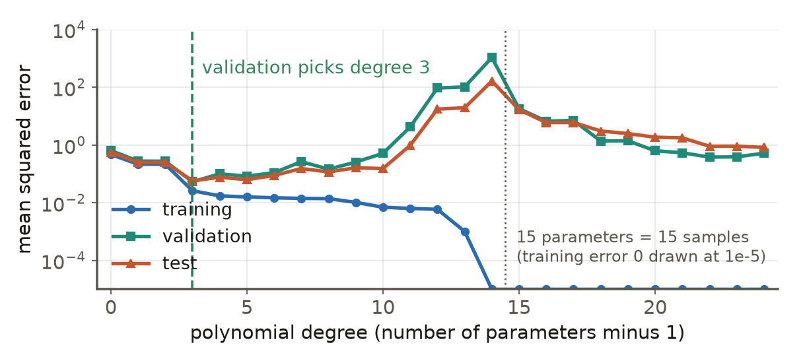

# 第3週 KP16：全章總結（Chapter 3 synthesis）

> 程度：大學生（undergrad）／Level: Undergraduate (undergrad)

本講義是第3章「反向傳播與最佳化」的第十六個知識點（KP16），也是最後一個，承接 KP15 留下的問題：訓練損失可以練到 0，這樣就夠了嗎？先備知識是 KP01–KP15；第一次出現的符號都會定義，實驗附程式，數字可以自己重算。內容依 CCC-LNS 第3章 KP16（§7.3 與 §8）的主文與投影片消化後重新撰寫，讀取日期 2026-10-14；來源列舉的文獻我沒有逐篇核對，所以只當作「來源列舉的方向」，不當事實斷言。

This is the sixteenth and last knowledge point (KP16) of Chapter 3. It picks up the question KP15 left open: the training loss can be driven to 0, is that enough? It assumes KP01–KP15; every symbol is defined when it first appears and the experiment comes with code, so the numbers can be recomputed. The text is rewritten from the KP16 main text and slides of CCC-LNS Chapter 3 (§7.3 and §8; accessed 2026-10-14); I did not check the works the source lists one by one, so they are treated as "directions the source lists" and not as asserted facts.

[下載本單元投影片](../slides/lec03-kp16-chapter-synthesis.jbd.json)

## KP16 全章總結（Chapter 3 synthesis）

### 學習目標（Learning objectives）

讀完之後，你能說出其他收斂理論的共同形式（「假設 ⇒ 訓練損失小」）；能把一個訓練問題對到本章的工具（算梯度、走得穩、算得起、步長自適應、看鄰域、有條件的收斂保證）；能說出本章已經回答了什麼、仍然開放的是什麼；也能說明訓練集、驗證集、測試集各回答什麼問題，為什麼不能用訓練損失選模型。

After reading, you can state the common form of the other convergence theories ("assumptions ⇒ small training loss"); map a training problem to the tools of this chapter (computing the gradient, moving steadily, affording the gradient, adaptive steps, looking at the neighbourhood, conditional convergence guarantees); say what the chapter has answered and what is still open; and explain what the training, validation and test sets each answer and why the training loss cannot be used to choose a model.

### 符號表（Symbols）

| 符號 | 中文意義 | English meaning |
|---|---|---|
| 訓練集 | 用來調參數的資料 | the data used to fit the parameters |
| 驗證集 | 用來選模型與超參數的資料 | the data used to choose the model and hyper-parameters |
| 測試集 | 最後才用一次、評估保留資料表現的資料 | the data used once at the end to evaluate held-out performance |
| MSE | 均方誤差（mean squared error） | mean squared error |
| $d$ | 多項式的次數（參數個數是 $d+1$） | the degree of the polynomial (it has $d+1$ parameters) |

### 1. 其他收斂理論：條件式的光譜（Other convergence theories: a spectrum of conditional results）

KP15 的兩個結果只是來源列舉的許多收斂理論中的兩個。來源 §7.3 把其他工作分成三個方向：（1）**啟用函式**：二次啟用、ReLU、Leaky ReLU（在線性可分資料上）；（2）**網路架構**：殘差連接、非獨立同分布的資料流；（3）**幾何與界**：臨界點的刻畫、分類中交叉熵損失的隱式偏置（在線性可分資料上，無正則化的 GD 收斂到最大間隔方向）、寬網路下 GD 的誤差界。這些我沒有逐篇核對，條件各不相同 [補充]。

The two results of KP15 are only two among the many convergence theories the source lists. §7.3 of the source sorts the other works into three directions: (1) **activations**: quadratic, ReLU, Leaky ReLU (on linearly separable data); (2) **architectures**: residual connections, data streams that are not i.i.d.; (3) **geometry and bounds**: the characterization of critical points, the implicit bias of the cross-entropy loss in classification (on linearly separable data, unregularized GD converges to the max-margin direction) and error bounds for GD on wide networks. I did not check these one by one and their conditions differ [補充].

它們的共同形式與 KP15 一樣：

$$
\text{假設（寬度、初始化、資料、平滑性、步長）}\ \Longrightarrow\ L_{\text{train}}(w_T)\le\varepsilon,
$$

而**不是**「$\Longrightarrow L_{\text{test}}$ 很小」。讀任何一個這類結果，先問兩件事：它的假設我的問題滿足嗎？它保證的是訓練損失還是別的量？

Their common form is the same as in KP15:

$$
\text{assumptions (width, initialization, data, smoothness, step)}\ \Longrightarrow\ L_{\text{train}}(w_T)\le\varepsilon,
$$

and **not** "$\Longrightarrow L_{\text{test}}$ is small". When reading any such result, ask two things first: does my problem satisfy its assumptions? Is what it guarantees the training loss or another quantity?

### 2. 全章工具鏈：問題對工具（The toolchain of the chapter: problems and tools）

整章可以看成一串問題，每個知識點回答其中一個：

| 問題 | 工具 | 知識點 |
|---|---|---|
| 訓練是什麼問題？ | 把訓練看成在參數空間搜尋，只用便宜的一階梯度 | KP01 |
| 一步該走多遠、往哪走？ | 梯度下降與學習率（$0<\eta<2/L$）、停止準則、線搜索、動量 | KP02–KP05 |
| 梯度怎麼算？ | 反向傳播（鏈式法則，成本 $O(W)$） | KP06 |
| 算得起嗎？ | SGD、小批次與 epoch；固定步長停在 $O(\eta)$ 的帶子，遞減步長讓雜訊退場 | KP07–KP09 |
| 步長能逐座標自動調嗎？ | AdaGrad、RMSProp、Adam（偏差修正） | KP10–KP11 |
| 只看這一點的損失夠嗎？ | 平坦極小值的動機；SAM 的鄰域最壞損失；高效與自適應 SAM | KP12–KP14 |
| 非凸為什麼還練得動？ | 過參數化下有條件的收斂保證 | KP15 |
| 練好之後呢？ | 驗證與測試證據（本單元） | KP16 |

The whole chapter can be read as a chain of questions, each knowledge point answering one of them:

| Question | Tool | Knowledge points |
|---|---|---|
| What problem is training? | See training as a search in parameter space using only the cheap first-order gradient | KP01 |
| How far and in which direction per step? | Gradient descent and the learning rate ($0<\eta<2/L$), stopping criteria, line search, momentum | KP02–KP05 |
| How is the gradient computed? | Backpropagation (chain rule, cost $O(W)$) | KP06 |
| Can we afford it? | SGD, mini-batches and epochs; a fixed step stops in a band of size $O(\eta)$ and a decreasing step lets the noise fade | KP07–KP09 |
| Can the step adapt per coordinate? | AdaGrad, RMSProp, Adam (bias correction) | KP10–KP11 |
| Is the loss at this one point enough? | The motivation of flat minima; the worst loss of SAM in a neighbourhood; efficient and adaptive SAM | KP12–KP14 |
| Why does a non-convex problem still train? | Conditional convergence guarantees under over-parameterization | KP15 |
| And after training? | Validation and test evidence (this unit) | KP16 |

這條鏈上有兩個特徵：每個工具都有它的**代價與適用條件**（動量的穩定上限、SGD 的雜訊、Adam 不一定最好、SAM 貴一倍、定理要寬度夠），也沒有任何一個工具回答了所有問題。

Two features run through the chain: every tool has its **cost and conditions** (the stability limit of momentum, the noise of SGD, Adam is not always the best, SAM costs twice as much, a theorem needs enough width), and no tool answers every question.

### 3. 已回答與仍開放（What is answered and what is still open）

**已回答**：（1）梯度可以便宜地算出來（反向傳播）；（2）在一個明確的條件下，GD 與 SGD 的行為可以分析（學習率的範圍、雜訊帶、遞減步長）；（3）自適應步長與鄰域最壞損失是有明確推導的設計；（4）在過參數化、隨機初始化、資料可分等條件下，訓練損失可以被證明降到任意小。

**仍開放**：（1）**為什麼會泛化**：KP15 的實驗已經看到，三個零訓練損失的解測試損失差三倍，定理並沒有說會走到哪一個；（2）**平坦度是不是泛化的原因**：KP12 的重新縮放例子說明曲率與參數化有關，SAM 常有幫助但不保證；（3）**最佳化器怎麼比較**：KP11 說，這要靠控制資料、模型、種子、排程與算力的實驗，沒有一個通用的排行榜。

**Answered**: (1) The gradient can be computed cheaply (backpropagation); (2) under explicit conditions the behaviour of GD and SGD can be analysed (the range of the learning rate, the noise band, decreasing steps); (3) adaptive steps and the worst loss in a neighbourhood are designs with explicit derivations; (4) under over-parameterization, random initialization and separable data the training loss can be proved to become as small as we like.

**Still open**: (1) **why models generalize**: the experiment of KP15 saw three zero-training-loss solutions whose test losses differ threefold, and the theorem does not say which one is reached; (2) **whether flatness is the cause of generalization**: the rescaling example of KP12 showed curvature depends on the parametrization, and SAM often helps but is not guaranteed; (3) **how to compare optimizers**: KP11 said it takes experiments that control the data, model, seeds, schedule and compute, and there is no universal leaderboard.

### 4. 訓練、驗證、測試各回答不同問題（Training, validation and test answer different questions）

三個集合各有一個工作：**訓練集**調參數（回答：訓練目標有沒有下降）；**驗證集**選模型與超參數（回答：在受控比較下誰比較好）；**測試集**最後才碰一次（回答：沒碰過的資料上表現如何）。如果用訓練損失選模型，會選到最會背資料的那一個。

Each of the three sets has one job: the **training set** fits the parameters (it answers whether the training objective went down); the **validation set** chooses the model and the hyper-parameters (it answers who is better under a controlled comparison); the **test set** is touched only once at the end (it answers how performance is on data never seen). If the training loss is used to choose the model, the one that memorizes best is chosen.

一個可以自己重算的例子：真實曲線 $\sin(3x)$，$x\in[-1,1]$，標籤雜訊標準差 $0.2$（所以最好的測試 MSE 是 $0.2^2=0.04$）。取 15 筆訓練、15 筆驗證、2 000 筆測試，用次數 $d=0,1,\dots,24$ 的多項式做最小平方（參數 $d+1$ 個；超過 15 個時取最小範數解，這又接到 KP15）。結果（`lec03-kp16-figures.py`）：

- 訓練 MSE 隨次數**一路下降**，$d\ge14$（參數 $\ge15$）時是 0。
- 驗證與測試 MSE 在 $d=3$ 附近最低：訓練 $0.0260$、驗證 $0.0533$、測試 $0.0571$，接近雜訊下限 $0.04$。
- $d=14$（參數剛好等於 15 筆資料）：訓練 0、驗證 $1\,072.06$、測試 $164.76$，最糟。
- $d=24$（參數比資料多）：訓練 0、驗證 $0.5197$、測試 $0.8247$；比 $d=14$ 好很多，但仍比 $d=3$ 差。
- 依訓練損失選會選到 $d=14$（測試 164.76）；依驗證損失選到 $d=3$（測試 $0.0571$）。
- 選中的驗證損失 $0.0533$ 比它的測試損失 $0.0571$ 略低：從 25 個模型裡挑最低的驗證數字有一點樂觀，所以最後的數字要用**沒碰過**的測試集。

An example you can recompute: the true curve is $\sin(3x)$ on $x\in[-1,1]$ with label noise of standard deviation $0.2$ (so the best possible test MSE is $0.2^2=0.04$). Take 15 training, 15 validation and 2 000 test points and fit polynomials of degree $d=0,1,\dots,24$ by least squares ($d+1$ parameters; beyond 15 the minimum-norm solution is taken, which links back to KP15). The results (`lec03-kp16-figures.py`):

- The training MSE **falls with the degree all the way**, and is 0 for $d\ge14$ (parameters $\ge15$).
- The validation and test MSE are lowest near $d=3$: training $0.0260$, validation $0.0533$, test $0.0571$, close to the noise floor $0.04$.
- $d=14$ (exactly as many parameters as the 15 samples): training 0, validation $1\,072.06$, test $164.76$, the worst.
- $d=24$ (more parameters than data): training 0, validation $0.5197$, test $0.8247$; much better than $d=14$ but still worse than $d=3$.
- Choosing by the training loss picks $d=14$ (test 164.76); choosing by the validation loss picks $d=3$ (test $0.0571$).
- The chosen validation loss $0.0533$ is slightly below its test loss $0.0571$: picking the lowest validation number out of 25 models is a little optimistic, so the final number must come from a test set that was **never touched**.

**圖說 `lec03-kp16-three-sets`**：先看藍線（訓練）：它只會往下，到 15 個參數時貼到 0；再看綠線與橘線（驗證與測試）：它們先降後升，在 $d=3$ 的虛線處最低，到 $d=14$ 衝到最高，之後在參數比資料多時回落一部分。三條線在 $d\le3$ 幾乎重疊，分開之後才看得出訓練損失騙人。

**Caption `lec03-kp16-three-sets`**: Look at the blue line (training) first: it only goes down and reaches 0 at 15 parameters; then the green and orange lines (validation and test): they fall and then rise, are lowest at the dashed line $d=3$, peak at $d=14$ and then come back down part of the way once there are more parameters than data. The three lines almost overlap for $d\le3$ and it is only after they part that one can see the training loss misleading.

### 本單元重點整理（KP16 summary）

**一句話重點**：其他收斂理論都是「假設 ⇒ 訓練損失小」的條件式結論；本章的工具各回答一個問題（算梯度、走得穩、算得起、自適應、看鄰域、為什麼練得動），都有代價與條件；最後訓練結果只是一個檢查點，驗證集用來選、測試集最後才碰一次，不能用訓練損失選模型。

**One-sentence summary**: The other convergence theories are all conditional conclusions of the form "assumptions ⇒ small training loss"; each tool of the chapter answers one question (computing the gradient, moving steadily, affording it, adapting, looking at the neighbourhood, why it trains), each with costs and conditions; a training result is only a checkpoint: the validation set is for choosing, the test set is touched once at the end, and the training loss must not be used to choose a model.

**白話說明**：這章像一條裝配線：先學會算出往哪走（梯度），再學怎麼走得穩、走得起、走得聰明，最後問走到底了沒有。走到底的證明只保證「訓練資料上錯誤很小」；要知道這個模型對沒看過的資料好不好，要另外拿沒用來調它的資料來考。

**Plain explanation**: The chapter is like an assembly line: first learn to compute which way to go (the gradient), then how to go steadily, affordably and cleverly, and finally ask whether we have arrived. A proof of arrival only guarantees "the error on the training data is small"; to know whether the model does well on data it has not seen, you have to examine it on data that was not used to adjust it.

**正式定義**：訓練集、驗證集、測試集互斥；模型選擇 $\hat d=\arg\min_d \mathrm{MSE}_{\text{val}}(d)$，最後報告 $\mathrm{MSE}_{\text{test}}(\hat d)$；只用 $\mathrm{MSE}_{\text{train}}$ 選模型會偏向參數最多的模型（在本例是 $d\ge14$）。

**Formal definition**: The training, validation and test sets are disjoint; model selection is $\hat d=\arg\min_d \mathrm{MSE}_{\text{val}}(d)$ and what is reported at the end is $\mathrm{MSE}_{\text{test}}(\hat d)$; choosing with $\mathrm{MSE}_{\text{train}}$ alone is biased toward the model with the most parameters (here $d\ge14$).

**例子**：$\sin(3x)$、雜訊 $0.2$、15/15/2000 筆：依驗證選 $d=3$（測試 $0.0571$）；依訓練選 $d=14$（測試 $164.76$）。逐步結果見第 4 節。

**Example**: $\sin(3x)$, noise $0.2$, 15/15/2000 points: choosing by validation gives $d=3$ (test $0.0571$); choosing by training gives $d=14$ (test $164.76$). The step-by-step results are in section 4.

**常見迷思**：

- 「收斂定理證明了模型會預測得好」——定理保證訓練損失；測試表現要靠驗證與測試證據。
- 「驗證集的數字就是最終表現」——從多個候選裡挑最低的驗證數字略偏樂觀；最後要用沒碰過的測試集。
- 「訓練損失越低越好」——本例中訓練損失一路降，測試損失卻先降後升再回落。
- 「這章的最佳工具是 Adam 加 SAM」——每個工具回答不同的問題，且都有條件；沒有通用最佳。

**Common misconceptions**:

- "A convergence theorem proves the model will predict well." A theorem guarantees the training loss; test performance takes validation and test evidence.
- "The validation number is the final performance." Picking the lowest validation number among several candidates is slightly optimistic; the final number must come from a test set that was never touched.
- "The lower the training loss the better." In this example the training loss falls all the way while the test loss first falls, then rises and then comes back down.
- "The best tool of this chapter is Adam plus SAM." Each tool answers a different question and has its conditions; there is no universal best.

**圖**：本單元一張圖，`lec03-kp16-three-sets`（訓練、驗證、測試誤差隨次數的變化，功能 2、3），以 `assets/figures/src/lec03-kp16-figures.py` 繪製；全章地圖在簡報用原生節點與連線呈現，講義以第 2 節的表呈現。

**Figure**: One figure in this unit, `lec03-kp16-three-sets` (training, validation and test errors against the degree; functions 2, 3), drawn by `assets/figures/src/lec03-kp16-figures.py`; the map of the whole chapter is drawn with native nodes and connectors in the deck and as the table of section 2 in this note.

**想深入**（選讀）：（1）圖中 $d>14$ 之後測試 MSE 回落，是「過參數化之後誤差再下降」的現象，與參數比資料多時取最小範數解有關；它說明「參數多就一定過擬合」不是定律，但也不保證比 $d=3$ 好 [補充]。（2）模型選擇的樂觀偏差：從 $K$ 個候選裡挑驗證最低的，期望會低於真實誤差；$K$ 越大越明顯，所以實務上驗證集不能無限次使用。（3）「測試集只碰一次」是規範，不是技術限制；碰多次就等於把它變成第二個驗證集。

**Going deeper** (optional): (1) The fall of the test MSE after $d>14$ in the figure is the "error comes down again after over-parameterization" phenomenon and is linked to taking the minimum-norm solution when there are more parameters than data; it shows "more parameters always over-fit" is not a law, but it does not guarantee a result better than $d=3$ either [補充]. (2) The optimism of model selection: choosing the lowest validation score out of $K$ candidates has an expectation below the true error, more so for larger $K$, which is why in practice a validation set cannot be used an unlimited number of times. (3) "The test set is touched once" is a discipline, not a technical restriction; touching it many times turns it into a second validation set.

**小練習**：

1. 把下列五個問題配到本章的工具：「誰該為損失負責？」「怎麼便宜地估計梯度？」「怎麼壓住來回震盪？」「怎麼懲罰壞鄰居？」「還需要什麼證據才能說模型好？」（提示：反向傳播、SGD 或小批次、動量或 Adam、SAM、驗證與測試。）
2. 兩個模型的（訓練，驗證，測試）MSE 是 A：$(0.02,\,0.30,\,—)$、B：$(0.10,\,0.12,\,—)$。依訓練、依驗證各會選誰？為什麼不能直接報告 B 的 $0.12$ 當最終表現？（提示：驗證集已經用來選了。）
3. 只有 15 筆資料，次數 $d=14$ 的多項式有幾個參數？它能做到訓練 MSE 為 0 嗎？它的測試表現在本例是多少？（提示：$d+1$；見第 4 節。）

**Practice**:

1. Match the following five questions to the tools of the chapter: "Who is responsible for the loss?", "How do we estimate the gradient cheaply?", "How do we damp the zig-zag?", "How do we penalize a bad neighbour?", "What further evidence do we need before saying the model is good?" (Hint: backpropagation, SGD or mini-batches, momentum or Adam, SAM, validation and test.)
2. The (training, validation, test) MSE of two models are A: $(0.02,\,0.30,\,—)$, B: $(0.10,\,0.12,\,—)$. Whom does one choose by training and by validation? Why can the $0.12$ of B not be reported directly as the final performance? (Hint: the validation set has already been used for choosing.)
3. With only 15 data points, how many parameters does a polynomial of degree $d=14$ have? Can it reach training MSE 0? What is its test performance in this example? (Hint: $d+1$; see section 4.)

**解題示範**（第 2 題）：

1. 依訓練損失：A 的 $0.02<$ B 的 $0.10$，選 A。
2. 依驗證損失：B 的 $0.12<$ A 的 $0.30$，選 B。
3. 兩者矛盾的原因：A 的訓練 0.02 與驗證 0.30 差了 15 倍，是「背資料」的樣子；B 的訓練與驗證接近，沒有明顯的過擬合。所以選驗證，也就是 B。
4. 為什麼不能把 $0.12$ 當最終表現：驗證集已經參與了「選 B」這個決定，$0.12$ 是挑出來的最低值之一，略偏樂觀；最後要用沒碰過的測試集報告 B 的測試 MSE。
5. 檢查：選擇用了驗證集（1 次），報告用了測試集（1 次），兩者分開 ✓。

**Worked solution** (exercise 2):

1. By the training loss: A's $0.02<$ B's $0.10$, so choose A.
2. By the validation loss: B's $0.12<$ A's $0.30$, so choose B.
3. The reason they disagree: A's training 0.02 and validation 0.30 differ by a factor of 15, which looks like memorizing; B's training and validation are close, with no clear over-fitting. So choose by validation, that is B.
4. Why $0.12$ cannot be reported as the final performance: the validation set took part in the decision "choose B", and $0.12$ is the lowest of the candidates, slightly optimistic; the test MSE of B must be reported on a test set that was never touched.
5. Check: the validation set was used once for choosing and the test set once for reporting, kept apart ✓.

### 來源更正與取捨（Corrections to the source）

1. **工具鏈的數目**：來源把全章說成「六階工具鏈」並分成六個階段；本章實際有十六個知識點，本講義改用「問題對工具」的表（第 2 節），不是新的事實，只是換了整理方式。
2. **Proposition 5 的網路型態**：來源 KP15 寫成全連接 ReLU 網路，KP16 稱為深層殘差網路；本講義依 KP15 的敘述，並把殘差網路的結果列為另一個方向（第 1 節）[補充]。
3. **§7.3 的文獻條目**：Du & Lee、Allen-Zhu 等人、Brutzkus 等人、Soudry 等人、Arora 等人、Kawaguchi、Ge 等人、Trager 等人的結論，我都沒有對照原論文，只當作來源列舉的方向，並且註明條件（例如隱式偏置在線性可分資料上）；不當作一般事實。
4. **「ResNet 使梯度能跨越數百層穩定傳播」之類的敘述**：來源以比喻方式說明，沒有提供條件；本講義不採用。
5. **「最佳化器大對決」互動頁與選擇題**：不採用；比較最佳化器的規範沿用 KP11（受控實驗，不是排行榜）。
6. **來源口號**（「正確計算。審慎移動。謹慎主張。」）不採用；本講義用第 3 節的「已回答／仍開放」取代。
7. **本講義的補充**：第 4 節的多項式實驗（15/15/2000 筆、$d=0$–$24$）是我設計並用程式驗證的，用來具體說明「訓練損失不能用來選模型」，標為補充，不是來源的結果。

### 術語對照（Terminology）

| 中文 | English |
|---|---|
| 訓練集 | training set |
| 驗證集 | validation set |
| 測試集 | test set |
| 模型選擇 | model selection |
| 隱式偏置 | implicit bias |
| 最大間隔 | maximum margin |
| 條件式結論 | conditional conclusion |
| 泛化 | generalization |
| 過擬合 | over-fitting |
| 最小範數解 | minimum-norm solution |
