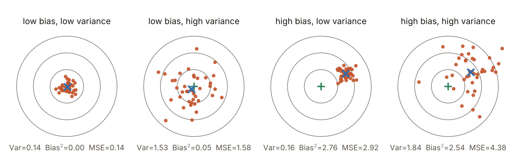
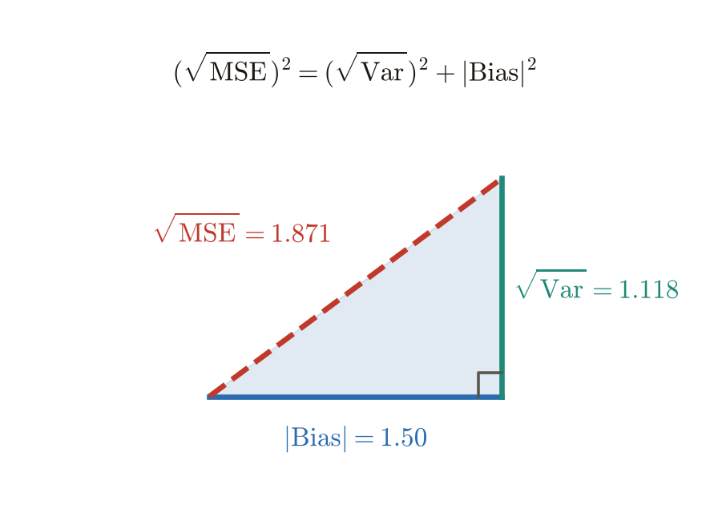
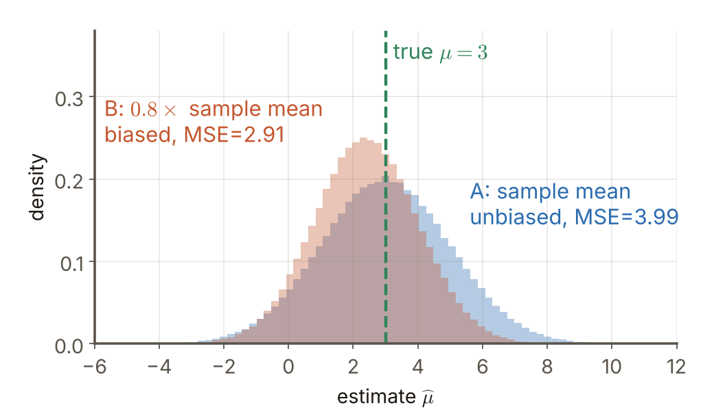

# 第4週 KP02：偏差、變異與 MSE（Bias, variance and MSE）

> 程度：大學生（undergrad）／Level: Undergraduate (undergrad)

本講義是第4章「正則化與過擬合」的第二個知識點（KP02），承接 KP01 的結論：評估要誠實，測試資料不能偷看。評估之後的下一個問題是：一個估計「好不好」，到底怎麼量？先備知識是期望與變異數的定義；第一次出現的符號都會定義，所有數字都可以自己重算。內容依 CCC-LNS 第5章 KP02 的主文與教授祕笈消化後重新撰寫，讀取日期 2026-10-20；來源沒有的內容標示 `[補充]`。

This is the second knowledge point (KP02) of Chapter 4. It picks up the conclusion of KP01: evaluation must be honest and the test data must not be peeked at. The next question after evaluation is: how do we measure whether an estimate is good? It assumes the definitions of expectation and variance; every symbol is defined when it first appears and every number can be recomputed. The text is rewritten from the KP02 main text and the professor's guide of CCC-LNS Chapter 5 (accessed on 2026-10-20); content that the source does not contain is marked `[Added]`.

[下載本單元投影片](../slides/lec04-kp02-bias-variance-mse.jbd.json)

## KP02 偏差、變異與 MSE（Bias, variance and MSE）

### 學習目標（Learning objectives）

讀完之後，你能寫出變異數、偏差與 MSE 的定義；能用一組小數字算出三者並驗算 $\mathrm{MSE}=\mathrm{Var}+\mathrm{Bias}^2$；能自己寫出這條恆等式的證明，並說明交叉項為什麼等於 0；能用直角三角形解讀「準」與「穩」；也能舉出一個「無偏卻比有偏更差」的例子，說明為什麼正則化有時刻意引進一點偏差。

After reading, you can write the definitions of variance, bias and MSE; compute the three on a small set of numbers and check $\mathrm{MSE}=\mathrm{Var}+\mathrm{Bias}^2$; prove the identity yourself and explain why the cross term is 0; read "accurate" and "stable" from a right triangle; and give an example of an unbiased estimator that is worse than a biased one, which is why regularization sometimes introduces a little bias on purpose.

### 符號表（Symbols）

| 符號 | 中文意義 | English meaning |
|---|---|---|
| $X$ | 要猜的真實值（一個固定的數） | the true value to be estimated (a fixed number) |
| $\widehat X$ | 估計值（一個隨機變數，每次估計結果不同） | the estimate (a random variable that differs from one estimation to the next) |
| $\mathbb E(\cdot)$ | 期望（對估計過程的隨機性取平均） | expectation (averaging over the randomness of the estimation) |
| $\mathrm{Var}(\widehat X)$ | 變異數：落點相對於自己平均的分散 | variance: the spread of the estimate around its own mean |
| $\mathrm{Bias}(\widehat X)$ | 偏差：平均落點與真實值的差 | bias: the difference between the mean estimate and the true value |
| $\mathrm{MSE}(\widehat X)$ | 均方誤差：落點與真實值的平方距離的平均 | mean squared error: the average squared distance from the true value |

### 1. 用飛鏢看三種量法（Three ways to measure, seen as darts）

想像每一次估計是射一支飛鏢，靶心是真實值 $X$。落點有兩種不同的毛病：一是整團落點的**平均**離靶心很遠（不準），二是落點彼此**很散**（不穩）。三個量各自量一件事：

Think of each estimate as one dart thrown at the bull's-eye, which is the true value $X$. The landing points can go wrong in two different ways: the **average** of the whole cluster is far from the bull's-eye (not accurate), or the points are **spread out** (not stable). Three quantities each measure one thing:

$$
\mathrm{Var}(\widehat X)=\mathbb E\big((\widehat X-\mathbb E\widehat X)^2\big),\qquad
\mathrm{Bias}(\widehat X)=\mathbb E\widehat X-X,\qquad
\mathrm{MSE}(\widehat X)=\mathbb E\big((\widehat X-X)^2\big)
$$

變異數只看落點相對於**自己的平均**有多散，完全不管靶心在哪裡；偏差只看平均落點離靶心多遠，帶正負號；MSE 看每一支鏢離**靶心**的平方距離，同時受到兩種毛病影響。這三個量也適用於「同一個學習演算法在不同訓練資料上訓練出來的預測」：訓練資料換一批，預測就換一個落點。

The variance looks only at how spread out the points are around **their own mean** and ignores where the bull's-eye is; the bias looks only at how far the mean landing point is from the bull's-eye, with a sign; the MSE looks at the squared distance of each dart from the **bull's-eye** and is affected by both problems. The three quantities also apply to "the prediction of one learning algorithm trained on different training sets": a new training set gives a new landing point.

**真的算一遍：四支飛鏢。**真實值 $X=10$，四次估計是 $7,\,9,\,8,\,10$，把這四個值當作等機率的全部可能（每個機率 $1/4$）：

**Work it out: four darts.** The true value is $X=10$ and four estimates are $7,\,9,\,8,\,10$, treated as all the possible outcomes with probability $1/4$ each:

- 平均 $\mathbb E\widehat X=(7+9+8+10)/4=8.5$。
- 偏差 $\mathrm{Bias}=8.5-10=-1.5$，所以 $\mathrm{Bias}^2=2.25$。平均落點偏低。
- 變異數 $\mathrm{Var}=\big((7-8.5)^2+(9-8.5)^2+(8-8.5)^2+(10-8.5)^2\big)/4=(2.25+0.25+0.25+2.25)/4=1.25$。
- MSE $=\big((7-10)^2+(9-10)^2+(8-10)^2+(10-10)^2\big)/4=(9+1+4+0)/4=3.5$。
- 驗算：$\mathrm{Var}+\mathrm{Bias}^2=1.25+2.25=3.5=\mathrm{MSE}$ 〔程式計算〕。

- The mean is $\mathbb E\widehat X=(7+9+8+10)/4=8.5$.
- The bias is $\mathrm{Bias}=8.5-10=-1.5$, so $\mathrm{Bias}^2=2.25$: the mean landing point is too low.
- The variance is $\mathrm{Var}=\big((7-8.5)^2+(9-8.5)^2+(8-8.5)^2+(10-8.5)^2\big)/4=(2.25+0.25+0.25+2.25)/4=1.25$.
- The MSE is $\big((7-10)^2+(9-10)^2+(8-10)^2+(10-10)^2\big)/4=(9+1+4+0)/4=3.5$.
- Check: $\mathrm{Var}+\mathrm{Bias}^2=1.25+2.25=3.5=\mathrm{MSE}$ [computed by program].

這裡的變異數用的是除以 $n$（把四個值當成整個分布）的形式，不是統計軟體預設的除以 $n-1$ 的樣本變異數。換成除以 $n-1$ 會得到 $1.667$，恆等式就不會剛好成立。本單元的 $\mathrm{Var}$ 一律指「對隨機性取期望」的變異數。

The variance here uses the divide-by-$n$ form (the four values are treated as the whole distribution), not the sample variance with $n-1$ that statistics software uses by default. Dividing by $n-1$ would give $1.667$ and the identity would no longer hold exactly. In this unit $\mathrm{Var}$ always means the variance taken as an expectation over the randomness.

下面這張圖把「偏差」與「變異」做成 $2\times2$ 的四種靶：每塊靶用固定亂數種子射 40 支鏢，落點是二維的，所以每塊靶的 $\mathrm{Var}$ 與 $\mathrm{Bias}^2$ 都是兩個座標方向的總和。

The figure below makes bias and variance into four boards in a $2\times2$ grid: each board has 40 darts from a fixed random seed. The landing points are two-dimensional, so the $\mathrm{Var}$ and $\mathrm{Bias}^2$ of a board are the sums over the two coordinate directions.

**圖說 `lec04-kp02-darts`**：先看左上角的靶：鏢又集中又對準，$\mathrm{MSE}=0.143$ 最小。再看同一列的右邊：整團鏢往一側偏，$\mathrm{Bias}^2$ 從 0.003 升到 2.764，但 $\mathrm{Var}$ 幾乎沒變（0.141 對 0.156）。同一欄往下，鏢散開，$\mathrm{Var}$ 升到 1.528 與 1.835，$\mathrm{Bias}^2$ 不變。右下角兩種毛病都有，$\mathrm{MSE}=4.380$ 最大。四塊靶都滿足 $\mathrm{MSE}=\mathrm{Var}+\mathrm{Bias}^2$〔程式計算，固定亂數種子〕。〔功能：1、2〕

**Caption `lec04-kp02-darts`**: Look at the top-left board first: the darts are tight and on target, and $\mathrm{MSE}=0.143$ is the smallest. Then look right along the same row: the whole cluster shifts to one side, $\mathrm{Bias}^2$ rises from 0.003 to 2.764 while $\mathrm{Var}$ hardly changes (0.141 versus 0.156). Going down the same column the darts spread out, $\mathrm{Var}$ rises to 1.528 and 1.835 and $\mathrm{Bias}^2$ stays. The bottom-right board has both problems and the largest $\mathrm{MSE}=4.380$. All four boards satisfy $\mathrm{MSE}=\mathrm{Var}+\mathrm{Bias}^2$ [computed by program, fixed random seed]. [Function: 1, 2]

### 2. 為什麼可以拆開：交叉項消失（Why it splits: the cross term vanishes）

四支鏢的驗算不是巧合，它對任何分布都成立。證明只用一個技巧：在 $\widehat X-X$ 裡加一個、減一個平均值 $m=\mathbb E\widehat X$。

The four-dart check is no coincidence; it holds for any distribution. The proof uses one trick: add and subtract the mean $m=\mathbb E\widehat X$ inside $\widehat X-X$.

$$
\widehat X-X=\underbrace{(\widehat X-m)}_{\text{隨機的部分 random part}}+\underbrace{(m-X)}_{\text{固定的數 a fixed number}}
$$

平方後取期望，展開成三項：

Square it and take the expectation; it expands into three terms:

$$
\mathbb E\big((\widehat X-X)^2\big)=\mathbb E\big((\widehat X-m)^2\big)+2(m-X)\,\mathbb E\big(\widehat X-m\big)+(m-X)^2
$$

第一項就是 $\mathrm{Var}(\widehat X)$，第三項就是 $\mathrm{Bias}^2$（$m-X$ 是固定的數，期望不改變它）。中間的**交叉項**含有 $\mathbb E(\widehat X-m)=\mathbb E\widehat X-m=0$：落點相對於自己平均的偏離，平均起來必然為 0。所以交叉項消失，剩下

The first term is $\mathrm{Var}(\widehat X)$ and the third is $\mathrm{Bias}^2$ ($m-X$ is a fixed number and the expectation does not change it). The middle **cross term** contains $\mathbb E(\widehat X-m)=\mathbb E\widehat X-m=0$: the deviations from one's own mean must average to 0. So the cross term vanishes and what remains is

$$
\mathrm{MSE}(\widehat X)=\mathrm{Var}(\widehat X)+\big(\mathrm{Bias}(\widehat X)\big)^2
$$

用四支鏢驗算交叉項：$2(m-X)\,\mathbb E(\widehat X-m)=2\cdot(-1.5)\cdot\big((-1.5+0.5-0.5+1.5)/4\big)=2\cdot(-1.5)\cdot0=0$ 〔程式計算〕。

Check the cross term on the four darts: $2(m-X)\,\mathbb E(\widehat X-m)=2\cdot(-1.5)\cdot\big((-1.5+0.5-0.5+1.5)/4\big)=2\cdot(-1.5)\cdot0=0$ [computed by program].

**直角三角形的畫法。**式子是平方的和，所以它是畢氏定理。直角三角形的兩股是 $\sqrt{\mathrm{Var}}$ 與 $|\mathrm{Bias}|$，斜邊是 $\sqrt{\mathrm{MSE}}$：$(\sqrt{\mathrm{MSE}})^2=(\sqrt{\mathrm{Var}})^2+|\mathrm{Bias}|^2$。四支鏢的例子裡，兩股是 $1.118$ 與 $1.5$，斜邊是 $\sqrt{3.5}=1.871$ 〔程式計算〕。「準」與「穩」是兩條互相垂直的軸，不是二選一：斜邊永遠比任何一股長，只要其中一個毛病在，MSE 就不會小於它。

**Drawing it as a right triangle.** The formula is a sum of squares, so it is the Pythagorean theorem. The two legs are $\sqrt{\mathrm{Var}}$ and $|\mathrm{Bias}|$ and the hypotenuse is $\sqrt{\mathrm{MSE}}$: $(\sqrt{\mathrm{MSE}})^2=(\sqrt{\mathrm{Var}})^2+|\mathrm{Bias}|^2$. In the four-dart example the legs are $1.118$ and $1.5$ and the hypotenuse is $\sqrt{3.5}=1.871$ [computed by program]. "Accurate" and "stable" are two perpendicular axes, not a choice between two: the hypotenuse is always longer than either leg, so as long as one problem is present the MSE cannot be smaller than it.

**圖說 `lec04-kp02-triangle`**：先看藍色的底邊 $|\mathrm{Bias}|=1.50$ 與綠色的直邊 $\sqrt{\mathrm{Var}}=1.118$，再看紅色虛線的斜邊 $\sqrt{\mathrm{MSE}}=1.871$。把三個長度各自平方，得 $2.25+1.25=3.5$，正是上一節算出的三個數。圖上的式子寫的是平方後的關係；來源的圖把斜邊標成「$\mathrm{MSE}^2$」，那是筆誤，見文末的更正。〔功能：1、2〕

**Caption `lec04-kp02-triangle`**: Look at the blue base $|\mathrm{Bias}|=1.50$ and the green vertical leg $\sqrt{\mathrm{Var}}=1.118$ first, then at the red dashed hypotenuse $\sqrt{\mathrm{MSE}}=1.871$. Squaring the three lengths gives $2.25+1.25=3.5$, exactly the three numbers of the previous section. The formula on the figure states the relation for the squared quantities; the source figure labels the hypotenuse "$\mathrm{MSE}^2$", which is a slip, see the corrections at the end. [Function: 1, 2]

### 3. 無偏不一定最好（Unbiased is not always best）

直覺常說「偏差小最重要」。反例很容易造：用 $n=4$ 筆獨立觀測估計一個平均數 $\mu=3$，每筆觀測的標準差是 $\sigma=4$（`[補充]`，來源只用文字描述這個反轉，沒有數字）。

Intuition often says "a small bias matters most". A counterexample is easy to build: estimate a mean $\mu=3$ from $n=4$ independent observations, each with standard deviation $\sigma=4$ (`[Added]`; the source describes this reversal only in words, with no numbers).

- 估計器 A：樣本平均 $\bar x$。它**無偏**：$\mathrm{Bias}=0$；變異數 $\sigma^2/n=16/4=4$；所以 $\mathrm{MSE}_A=4$。
- 估計器 B：把樣本平均**縮小**成 $0.8\,\bar x$。它**有偏**：$\mathrm{Bias}=0.8\mu-\mu=-0.6$，$\mathrm{Bias}^2=0.36$；變異數 $0.8^2\cdot4=2.56$；所以 $\mathrm{MSE}_B=2.56+0.36=2.92$。
- B 的 MSE 比 A 小：$2.92<4$。用亂數模擬 200000 次，A 的 MSE 是 $3.986$、B 的是 $2.910$（偏差 $-0.599$、變異數 $2.551$），與理論值吻合〔程式計算，固定亂數種子〕。

- Estimator A: the sample mean $\bar x$. It is **unbiased**: $\mathrm{Bias}=0$; the variance is $\sigma^2/n=16/4=4$; so $\mathrm{MSE}_A=4$.
- Estimator B: **shrink** the sample mean to $0.8\,\bar x$. It is **biased**: $\mathrm{Bias}=0.8\mu-\mu=-0.6$ and $\mathrm{Bias}^2=0.36$; the variance is $0.8^2\cdot4=2.56$; so $\mathrm{MSE}_B=2.56+0.36=2.92$.
- B has the smaller MSE: $2.92<4$. A simulation of 200000 runs gives an MSE of $3.986$ for A and $2.910$ for B (bias $-0.599$, variance $2.551$), matching the theory [computed by program, fixed random seed].

縮小一點，變異數降得比偏差平方升得多：縮小因子 $k$ 把變異數乘上 $k^2$，偏差平方變成 $(k-1)^2\mu^2$。這個例子裡最佳的 $k$ 是 $\mu^2/(\mu^2+\sigma^2/n)=9/13=0.692$，MSE 降到 $2.769$ 〔程式計算〕。要注意：這個最佳值用到了真實的 $\mu$，實務上不知道；它只是說明「存在一個比無偏更好的有偏估計」。

Shrinking a little lowers the variance by more than it raises the squared bias: a shrink factor $k$ multiplies the variance by $k^2$ and makes the squared bias $(k-1)^2\mu^2$. In this example the best $k$ is $\mu^2/(\mu^2+\sigma^2/n)=9/13=0.692$ and the MSE drops to $2.769$ [computed by program]. Note that this best value uses the true $\mu$, which is unknown in practice; it only shows that "a biased estimator better than the unbiased one exists".

**圖說 `lec04-kp02-shrink`**：先看寬而矮的分布 A：中心剛好在真實的 $\mu=3$，但向兩側拖得很開，$\mathrm{MSE}=4$。再看窄而高的分布 B：中心偏左到 $2.4$，但集中得多，$\mathrm{MSE}=2.92$。B 犧牲了一點準，換到更多的穩。這正是正則化的想法：訓練資料有限時，把模型「縮」一點，用一點偏差換大量變異的下降。〔功能：2、3〕

**Caption `lec04-kp02-shrink`**: Look at the wide, low distribution A first: its centre sits exactly at the true $\mu=3$ but it spreads far to both sides, $\mathrm{MSE}=4$. Then the narrow, tall distribution B: its centre is shifted left to $2.4$ but it is much more concentrated, $\mathrm{MSE}=2.92$. B gives up a little accuracy for more stability. This is the idea of regularization: when the training data are limited, "shrink" the model a little and trade a bit of bias for a large drop in variance. [Function: 2, 3]

換個場景：體重計每天量你的體重。若它系統性少報 2 公斤、但每天都很穩，你知道怎麼修正；若它沒有偏差、但每次讀數亂跳 5 公斤，你就很難判斷體重的趨勢。MSE 把這兩種毛病放在同一把尺上。

A different setting: a bathroom scale weighs you every day. If it systematically reads 2 kg low but is very steady, you know how to correct it; if it has no bias but its reading jumps by 5 kg at random, you can hardly tell the trend of your weight. The MSE puts both problems on one ruler.

接下來的問題是：我們量到的資料不只有真實的規律，還混了雜訊。即使有了最好的模型，誤差最低能低到哪裡？這是 KP03 的主題。

The next question: the data we measure carry not only the true pattern but also noise. Even with the best possible model, how low can the error go? That is the topic of KP03.

### 本單元重點整理（KP02 summary）

**一句話重點**：估計的好壞要分兩件事量：準（偏差）與穩（變異數），MSE 把它們合成 $\mathrm{MSE}=\mathrm{Var}+\mathrm{Bias}^2$；因為「準」可以拿去換「穩」，無偏的估計不一定最好。

**One-sentence summary**: The quality of an estimate is measured on two things, accuracy (bias) and stability (variance), and the MSE combines them as $\mathrm{MSE}=\mathrm{Var}+\mathrm{Bias}^2$; because accuracy can be traded for stability, an unbiased estimate is not necessarily the best.

**白話說明**：把每次估計看成一支飛鏢。整團偏離靶心叫偏差，鏢之間很散叫變異。只看靶心距離分不出是「瞄歪」還是「手抖」，把兩個分開看，才知道該怎麼改。

**Plain explanation**: See each estimate as a dart. The whole cluster being off the bull's-eye is the bias and the darts being spread apart is the variance. The distance from the bull's-eye alone cannot tell "aimed wrong" from "shaky hand"; seeing the two separately tells you what to fix.

**正式定義**：$\mathrm{Var}(\widehat X)=\mathbb E\big((\widehat X-\mathbb E\widehat X)^2\big)$；$\mathrm{Bias}(\widehat X)=\mathbb E\widehat X-X$；$\mathrm{MSE}(\widehat X)=\mathbb E\big((\widehat X-X)^2\big)=\mathrm{Var}(\widehat X)+\mathrm{Bias}(\widehat X)^2$，交叉項 $2(m-X)\,\mathbb E(\widehat X-m)=0$。

**Formal definition**: $\mathrm{Var}(\widehat X)=\mathbb E\big((\widehat X-\mathbb E\widehat X)^2\big)$; $\mathrm{Bias}(\widehat X)=\mathbb E\widehat X-X$; $\mathrm{MSE}(\widehat X)=\mathbb E\big((\widehat X-X)^2\big)=\mathrm{Var}(\widehat X)+\mathrm{Bias}(\widehat X)^2$, with the cross term $2(m-X)\,\mathbb E(\widehat X-m)=0$.

**例子**：$X=10$，估計 $7,9,8,10$：平均 $8.5$、$\mathrm{Bias}=-1.5$（平方 $2.25$）、$\mathrm{Var}=1.25$、$\mathrm{MSE}=3.5=1.25+2.25$。無偏的樣本平均 $\mathrm{MSE}=4$，縮小 0.8 倍的有偏估計 $\mathrm{MSE}=2.92$。逐步計算見第 1、3 節。

**Example**: $X=10$ and estimates $7,9,8,10$: mean $8.5$, $\mathrm{Bias}=-1.5$ (squared $2.25$), $\mathrm{Var}=1.25$, $\mathrm{MSE}=3.5=1.25+2.25$. The unbiased sample mean has $\mathrm{MSE}=4$ and the biased estimator shrunk by 0.8 has $\mathrm{MSE}=2.92$. The computations are in sections 1 and 3.

**常見迷思**：

- 「MSE 就是變異數」——不是，它還包含偏差的平方。
- 「無偏一定最好」——要看 MSE：變異數很大的無偏估計可能輸給稍微有偏、很穩的估計。
- 「變異數大就是資料雜訊大」——不一定，也可能是估計器對訓練樣本太敏感，那就是過擬合的徵兆（KP05）。
- 「直角三角形的斜邊是 $\mathrm{MSE}$」——斜邊是 $\sqrt{\mathrm{MSE}}$，平方後才是加法。

**Common misconceptions**:

- "MSE is just the variance." No: it also contains the squared bias.
- "Unbiased is always best." Look at the MSE: an unbiased estimate with a large variance can lose to a slightly biased, very stable one.
- "A large variance means noisy data." Not necessarily: the estimator may also be too sensitive to the training sample, which is a sign of overfitting (KP05).
- "The hypotenuse of the right triangle is $\mathrm{MSE}$." The hypotenuse is $\sqrt{\mathrm{MSE}}$; the addition holds after squaring.

**圖**：本單元三張圖，`lec04-kp02-darts`（四塊靶：偏差與變異的 $2\times2$ 組合，功能 1、2）、`lec04-kp02-triangle`（直角三角形，功能 1、2）與 `lec04-kp02-shrink`（無偏與縮小估計的分布，功能 2、3），以 `assets/figures/src/lec04-kp02-figures.py` 繪製，每個數字都由程式印出。

**Figures**: Three figures in this unit, `lec04-kp02-darts` (four boards: the $2\times2$ combinations of bias and variance; functions 1, 2), `lec04-kp02-triangle` (the right triangle; functions 1, 2) and `lec04-kp02-shrink` (the distributions of the unbiased and the shrunk estimator; functions 2, 3), drawn by `assets/figures/src/lec04-kp02-figures.py`; every number is printed by the program.

**想深入**（選讀）：在學習問題裡，$\widehat X$ 換成「某個學習演算法在隨機抽到的訓練集上做出的預測」，$X$ 換成真實函數在那一點的值，同一條恆等式照樣成立：期望是對「訓練集怎麼抽」取的。於是模型太簡單時（欠擬合），預測的平均離真實值遠，偏差大；模型太複雜時（過擬合），預測隨訓練集大幅晃動，變異大。KP05 會用實驗把這件事算出來，KP07 起的正則化就是用少量偏差換變異的下降。

**Going deeper** (optional): In a learning problem replace $\widehat X$ by "the prediction a learning algorithm makes on a randomly drawn training set" and $X$ by the value of the true function at that point; the same identity still holds, with the expectation taken over "how the training set is drawn". When the model is too simple (underfitting) the mean prediction is far from the truth and the bias is large; when the model is too complex (overfitting) the prediction swings widely with the training set and the variance is large. KP05 computes this in an experiment, and the regularization from KP07 on trades a little bias for a drop in variance.

**小練習**：

1. 真實值 $X=5$，四次估計是 $4,\,6,\,7,\,7$。算 $\mathrm{Var}$、$\mathrm{Bias}$ 與 $\mathrm{MSE}$，並驗算 $\mathrm{MSE}=\mathrm{Var}+\mathrm{Bias}^2$。（提示：先求平均；$\mathrm{Var}$ 用除以 4 的形式。）
2. 估計器 C 是 $0.5\bar x$，條件同第 3 節（$\mu=3$、$\sigma=4$、$n=4$）。算它的 $\mathrm{Bias}$、$\mathrm{Var}$、$\mathrm{MSE}$，它比 A 好還是差？（提示：縮小因子 $k=0.5$：$\mathrm{Var}=k^2\sigma^2/n$，$\mathrm{Bias}=(k-1)\mu$。）
3. 兩個估計器的 $\mathrm{Var}$ 與 $\mathrm{Bias}$ 分別是（$\mathrm{Var}=1$，$\mathrm{Bias}=2$）與（$\mathrm{Var}=4$，$\mathrm{Bias}=0$）。哪一個 MSE 小？畫出兩個估計器各自的直角三角形，斜邊長各是多少？（提示：$\mathrm{MSE}=\mathrm{Var}+\mathrm{Bias}^2$，斜邊 $=\sqrt{\mathrm{MSE}}$。）

**Practice**:

1. The true value is $X=5$ and four estimates are $4,\,6,\,7,\,7$. Compute $\mathrm{Var}$, $\mathrm{Bias}$ and $\mathrm{MSE}$ and verify $\mathrm{MSE}=\mathrm{Var}+\mathrm{Bias}^2$. (Hint: find the mean first; use the divide-by-4 form of $\mathrm{Var}$.)
2. Estimator C is $0.5\bar x$ under the conditions of section 3 ($\mu=3$, $\sigma=4$, $n=4$). Compute its $\mathrm{Bias}$, $\mathrm{Var}$ and $\mathrm{MSE}$: is it better or worse than A? (Hint: shrink factor $k=0.5$: $\mathrm{Var}=k^2\sigma^2/n$, $\mathrm{Bias}=(k-1)\mu$.)
3. Two estimators have ($\mathrm{Var}=1$, $\mathrm{Bias}=2$) and ($\mathrm{Var}=4$, $\mathrm{Bias}=0$). Which has the smaller MSE? Draw the right triangle of each: what is the hypotenuse of each? (Hint: $\mathrm{MSE}=\mathrm{Var}+\mathrm{Bias}^2$ and the hypotenuse is $\sqrt{\mathrm{MSE}}$.)

**解題示範**（以第 2 題的方法，改用 $k=0.9$ 示範）：

1. 縮小因子 $k=0.9$，所以估計器是 $0.9\bar x$。
2. 偏差：$(k-1)\mu=(0.9-1)\cdot3=-0.3$，平方 $0.09$。
3. 變異數：$k^2\sigma^2/n=0.81\cdot16/4=3.24$。
4. $\mathrm{MSE}=3.24+0.09=3.33$。
5. 比較：$3.33<4$，輕輕縮小一點就已經比無偏的 A 好；這個 $k$ 還沒有到最佳值 $0.692$（MSE $2.769$）。

**Worked solution** (the method of exercise 2, shown with $k=0.9$):

1. The shrink factor is $k=0.9$, so the estimator is $0.9\bar x$.
2. Bias: $(k-1)\mu=(0.9-1)\cdot3=-0.3$ and its square is $0.09$.
3. Variance: $k^2\sigma^2/n=0.81\cdot16/4=3.24$.
4. $\mathrm{MSE}=3.24+0.09=3.33$.
5. Compare: $3.33<4$; even a light shrink already beats the unbiased A; this $k$ has not yet reached the best value $0.692$ (MSE $2.769$).

### 來源更正與取捨（Corrections to the source）

- 來源的直角三角形圖把斜邊標成「$\mathrm{MSE}^2=\mathrm{Var}+\mathrm{Bias}^2$」。這個標示不對：畢氏關係成立在平方之後，兩股是 $\sqrt{\mathrm{Var}}$ 與 $|\mathrm{Bias}|$，斜邊是 $\sqrt{\mathrm{MSE}}$。本講義的圖按這個關係重畫。
- 來源的變異數用除以 $n$ 的形式（把有限個值當作整個分布）；本講義明說這一點，並指出換成除以 $n-1$ 時恆等式不會剛好成立。
- 來源只用文字說「無偏可能輸給有偏」，沒有數字。本講義 `[補充]` 一個可重算的例子（樣本平均對縮小 0.8 倍），並註明最佳縮小因子要用到真實的 $\mu$。
- 來源的飛鏢圖是示意圖，沒有數字；本講義的四塊靶是用固定亂數種子模擬的二維落點，數字由程式印出，不是來源的數字。

- The source's right-triangle figure labels the hypotenuse "$\mathrm{MSE}^2=\mathrm{Var}+\mathrm{Bias}^2$". That label is wrong: the Pythagorean relation holds after squaring, with legs $\sqrt{\mathrm{Var}}$ and $|\mathrm{Bias}|$ and hypotenuse $\sqrt{\mathrm{MSE}}$. The figure of this note is redrawn on that relation.
- The source's variance uses the divide-by-$n$ form (a finite set of values treated as the whole distribution); this note says so and points out that with $n-1$ the identity does not hold exactly.
- The source says "unbiased can lose to biased" only in words, with no numbers. This note `[Added]` a recomputable example (the sample mean versus the sample mean shrunk by 0.8) and notes that the best shrink factor needs the true $\mu$.
- The source's dartboard figure is a sketch with no numbers; the four boards here are two-dimensional landing points simulated with a fixed random seed, and the numbers are printed by the program, not taken from the source.

### 術語對照（Terminology）

| 中文 | English |
|---|---|
| 偏差 | bias |
| 變異數 | variance |
| 均方誤差 | mean squared error (MSE) |
| 交叉項 | cross term |
| 無偏估計 | unbiased estimator |
| 縮小（收縮） | shrinkage |
| 期望 | expectation |
