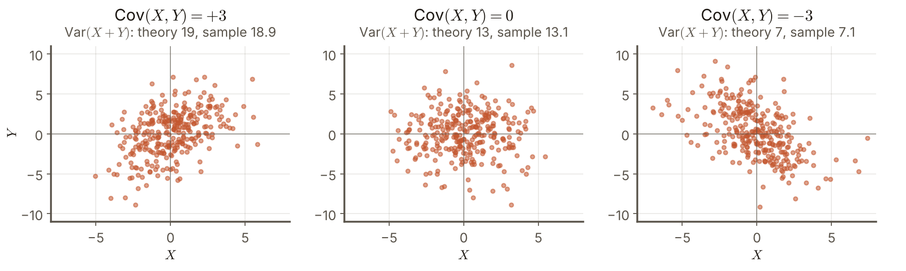
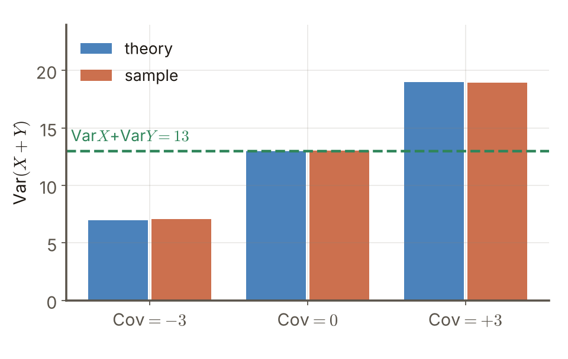
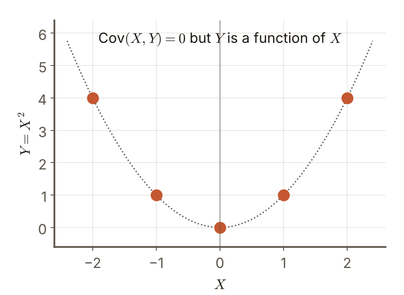

# 第4週 KP03：共變異數與線性組合（Covariance and linear combinations）

> 程度：大學生（undergrad）／Level: Undergraduate (undergrad)

本講義是第4章「正則化與過擬合」的第三個知識點（KP03），承接 KP02 留下的問題：實際的估計常常是把好幾個量加在一起，加起來之後變異數怎麼算？先備知識是期望、變異數與 KP02 的 $\mathrm{MSE}=\mathrm{Var}+\mathrm{Bias}^2$；第一次出現的符號都會定義，所有數字都可以自己重算。內容依 CCC-LNS 第5章 KP03 的主文與教授祕笈消化後重新撰寫，讀取日期 2026-10-20；來源沒有的內容標示 `[補充]`。

This is the third knowledge point (KP03) of Chapter 4. It picks up the question KP02 left open: real estimates often add several quantities together, so how is the variance computed after adding? It assumes expectation, variance and the $\mathrm{MSE}=\mathrm{Var}+\mathrm{Bias}^2$ of KP02; every symbol is defined when it first appears and every number can be recomputed. The text is rewritten from the KP03 main text and the professor's guide of CCC-LNS Chapter 5 (accessed on 2026-10-20); content that the source does not contain is marked `[Added]`.

[下載本單元投影片](../slides/lec04-kp03-covariance-and-linear-combinations.jbd.json)

## KP03 共變異數與線性組合（Covariance and linear combinations）

### 學習目標（Learning objectives）

讀完之後，你能寫出共變異數的定義，並說明正、零、負三種符號各代表什麼；能寫出並推導 $\mathrm{Var}(aX+bY)$ 的公式，用一組小數字算出同向放大、反向抵銷與獨立三種情況；能舉出「共變異數為 0 卻不獨立」的例子；能用相關係數把共變異數換成沒有單位的量；也能把公式推廣到 $k$ 個量，並推出等權平均的特例 $s/k+(k-1)c/k$。

After reading, you can write the definition of covariance and say what the positive, zero and negative signs mean; write and derive the formula for $\mathrm{Var}(aX+bY)$ and compute, on a small set of numbers, the cases of amplifying (same direction), cancelling (opposite direction) and independence; give an example of "covariance 0 but not independent"; use the correlation coefficient to turn the covariance into a quantity without units; and extend the formula to $k$ quantities and derive the equal-weights special case $s/k+(k-1)c/k$.

### 符號表（Symbols）

| 符號 | 中文意義 | English meaning |
|---|---|---|
| $X,\,Y$ | 兩個隨機變數 | two random variables |
| $\mathrm{Cov}(X,Y)$ | 共變異數：兩個量「一起動」的程度 | covariance: how much the two quantities move together |
| $a,\,b$ | 線性組合的係數（常數） | the coefficients (constants) of the linear combination |
| $\rho$ | 相關係數：把共變異數除以兩個標準差，介於 $-1$ 到 $1$ | correlation coefficient: the covariance divided by the two standard deviations, between $-1$ and $1$ |
| $X_1,\dots,X_k$ | $k$ 個隨機變數（例如 $k$ 個模型的預測誤差） | $k$ random variables (for example the prediction errors of $k$ models) |
| $s,\,c$ | 每個量的變異數 $s$；任兩個量的共變異數 $c$ | the variance $s$ of each quantity; the covariance $c$ of any two quantities |

### 1. 共變異數：兩個量一起動的程度（Covariance: how much two quantities move together）

想像兩個人一起盪鞦韆：同步往前擺，合力會放大；一個往前、一個往後，合力會抵銷。共變異數量的就是這種「同步」或「反向」的程度。把 $X$ 與 $Y$ 各自減掉自己的平均，再看兩者的乘積平均起來是正是負：

Think of two people on swings: swinging forward together amplifies the pull, while one swinging forward and the other backward cancels it. The covariance measures this kind of "in step" or "opposite". Subtract each variable's own mean and look at whether the average of their product is positive or negative:

$$
\mathrm{Cov}(X,Y)=\mathbb E\big((X-\mathbb EX)(Y-\mathbb EY)\big)=\mathbb E(XY)-\mathbb E(X)\,\mathbb E(Y)
$$

兩個寫法相等：把乘積展開，$\mathbb E(XY)-\mathbb EX\,\mathbb EY-\mathbb EY\,\mathbb EX+\mathbb EX\,\mathbb EY=\mathbb E(XY)-\mathbb EX\,\mathbb EY$。把 $Y$ 換成 $X$，$\mathrm{Cov}(X,X)=\mathrm{Var}(X)$：變異數是共變異數的特例。

The two forms are equal: expand the product, $\mathbb E(XY)-\mathbb EX\,\mathbb EY-\mathbb EY\,\mathbb EX+\mathbb EX\,\mathbb EY=\mathbb E(XY)-\mathbb EX\,\mathbb EY$. Replacing $Y$ by $X$ gives $\mathrm{Cov}(X,X)=\mathrm{Var}(X)$: the variance is a special case of the covariance.

符號的意思是：**正**表示 $X$ 偏大時 $Y$ 也傾向偏大（同向）；**負**表示 $X$ 偏大時 $Y$ 傾向偏小（反向）；**零**表示兩者之間沒有線性的共同變動。

The sign means: **positive** means that when $X$ is large $Y$ also tends to be large (same direction); **negative** means that when $X$ is large $Y$ tends to be small (opposite direction); **zero** means there is no linear co-movement between them.

### 2. 線性組合的變異數（The variance of a linear combination）

把兩個量加權相加，$aX+bY$。它的變異數**不是**各自變異數的簡單加總：

Add two quantities with weights, $aX+bY$. Its variance is **not** the plain sum of the individual variances:

$$
\mathrm{Var}(aX+bY)=a^2\,\mathrm{Var}(X)+b^2\,\mathrm{Var}(Y)+2ab\,\mathrm{Cov}(X,Y)
$$

**推導**：令 $X'=X-\mathbb EX$、$Y'=Y-\mathbb EY$，則 $aX+bY$ 減掉自己的平均就是 $aX'+bY'$，所以

**Derivation**: let $X'=X-\mathbb EX$ and $Y'=Y-\mathbb EY$; then $aX+bY$ minus its own mean is $aX'+bY'$, so

$$
\mathrm{Var}(aX+bY)=\mathbb E\big((aX'+bY')^2\big)=a^2\,\mathbb E(X'^2)+b^2\,\mathbb E(Y'^2)+2ab\,\mathbb E(X'Y')
$$

三項分別是 $a^2\mathrm{Var}(X)$、$b^2\mathrm{Var}(Y)$ 與 $2ab\,\mathrm{Cov}(X,Y)$。係數要**平方**，而且中間多一個共變異數項；它的符號由 $ab$ 與 $\mathrm{Cov}$ 一起決定。

The three terms are $a^2\mathrm{Var}(X)$, $b^2\mathrm{Var}(Y)$ and $2ab\,\mathrm{Cov}(X,Y)$. The coefficients are **squared** and there is an extra covariance term in the middle; its sign is decided by $ab$ and $\mathrm{Cov}$ together.

**真的算一遍：同向放大、反向抵銷。**設 $\mathrm{Var}(X)=4$、$\mathrm{Var}(Y)=9$，取 $a=b=1$：

**Work it out: amplify and cancel.** Let $\mathrm{Var}(X)=4$ and $\mathrm{Var}(Y)=9$, and take $a=b=1$:

- $\mathrm{Cov}=-3$（反向）：$\mathrm{Var}(X+Y)=4+9+2(-3)=7$。比各自相加的 $13$ 小，波動被抵銷。
- $\mathrm{Cov}=0$（獨立時）：$\mathrm{Var}(X+Y)=4+9=13$，剛好是各自相加。
- $\mathrm{Cov}=+3$（同向）：$\mathrm{Var}(X+Y)=4+9+2(3)=19$。比 $13$ 大，波動被放大〔程式計算〕。

- $\mathrm{Cov}=-3$ (opposite direction): $\mathrm{Var}(X+Y)=4+9+2(-3)=7$. Smaller than the plain sum $13$: the fluctuation is cancelled.
- $\mathrm{Cov}=0$ (as for independent variables): $\mathrm{Var}(X+Y)=4+9=13$, exactly the plain sum.
- $\mathrm{Cov}=+3$ (same direction): $\mathrm{Var}(X+Y)=4+9+2(3)=19$. Larger than $13$: the fluctuation is amplified [computed by program].

係數的符號也會改變結果：取 $a=2$、$b=-1$（做差而不是做和），$\mathrm{Cov}=+3$ 時是 $16+9-12=13$，$\mathrm{Cov}=-3$ 時是 $16+9+12=37$〔程式計算〕。同樣的兩個量，做和時同向放大，做差時同向反而抵銷。這也是投資組合要選「反向動」的資產的原因：兩家店的營收若一冷一熱，合併報表的波動會比各自相加小。

The sign of the coefficients also changes the outcome: with $a=2$ and $b=-1$ (a difference instead of a sum), $\mathrm{Cov}=+3$ gives $16+9-12=13$ and $\mathrm{Cov}=-3$ gives $16+9+12=37$ [computed by program]. For the same two quantities, a same-direction pair amplifies in a sum and cancels in a difference. This is why a portfolio picks assets that move in opposite directions: if the revenues of two shops are one cold and one hot, the combined report fluctuates less than the plain sum of the two.

**圖說 `lec04-kp03-scatter`**：先看中間（$\mathrm{Cov}=0$）：點雲呈橫向的橢圓，$\mathrm{Var}(X+Y)$ 的理論值是 $13$，取樣值 $13.1$。再看左邊（$\mathrm{Cov}=+3$）：點雲向右上傾斜，理論值 $19$、取樣值 $18.9$。最後看右邊（$\mathrm{Cov}=-3$）：點雲向右下傾斜，理論值 $7$、取樣值 $7.1$。圖中只畫前 300 個點，統計量用 20000 個取樣點算出，亂數種子固定〔程式計算〕。〔功能：1、2〕

**Caption `lec04-kp03-scatter`**: Look at the middle panel ($\mathrm{Cov}=0$) first: the cloud is a horizontal ellipse, and the theoretical $\mathrm{Var}(X+Y)$ is $13$ with a sample value of $13.1$. Then the left panel ($\mathrm{Cov}=+3$): the cloud tilts up to the right, theory $19$ and sample $18.9$. Finally the right panel ($\mathrm{Cov}=-3$): the cloud tilts down to the right, theory $7$ and sample $7.1$. Only the first 300 points are drawn; the statistics use 20000 sampled points with a fixed random seed [computed by program]. [Function: 1, 2]

**圖說 `lec04-kp03-bars`**：先看綠色虛線 $13$（各自相加）：中間的長條剛好落在它上面。左邊的長條（$\mathrm{Cov}=-3$）降到 $7$，右邊的長條（$\mathrm{Cov}=+3$）升到 $19$；每組的藍色（理論）與橘色（取樣）幾乎一樣高。差別完全來自 $2ab\,\mathrm{Cov}$ 這一項，與兩個變異數本身無關。〔功能：2〕

**Caption `lec04-kp03-bars`**: Look at the green dashed line $13$ (the plain sum) first: the middle bar sits exactly on it. The left bar ($\mathrm{Cov}=-3$) drops to $7$ and the right bar ($\mathrm{Cov}=+3$) rises to $19$; in each group the blue (theory) and orange (sample) bars are almost equally tall. The whole difference comes from the term $2ab\,\mathrm{Cov}$ and has nothing to do with the two variances themselves. [Function: 2]

### 3. 共變異數為零，不等於獨立（Zero covariance does not mean independence）

兩個變數若**獨立**，則 $\mathbb E(XY)=\mathbb EX\,\mathbb EY$，所以 $\mathrm{Cov}=0$。反過來不成立：$\mathrm{Cov}=0$ 只表示沒有**線性**的共同變動。

If two variables are **independent**, then $\mathbb E(XY)=\mathbb EX\,\mathbb EY$ and therefore $\mathrm{Cov}=0$. The converse fails: $\mathrm{Cov}=0$ only says that there is no **linear** co-movement.

**反例**（`[補充]`，來源只用文字提示「一個是另一個的平方」）：令 $X$ 在 $\{-2,-1,0,1,2\}$ 上等機率取值，$Y=X^2$。

**Counterexample** (`[Added]`; the source only hints in words at "one is the square of the other"): let $X$ take the values $-2,-1,0,1,2$ with equal probability and $Y=X^2$.

- $\mathbb EX=0$，$\mathbb EY=(4+1+0+1+4)/5=2$。
- $\mathbb E(XY)=\mathbb E(X^3)=(-8-1+0+1+8)/5=0$，所以 $\mathrm{Cov}(X,Y)=0-0\cdot2=0$。
- 但 $Y$ 完全由 $X$ 決定：$P(Y=4)=2/5=0.4$，而 $P(Y=4\mid X=2)=1$。兩者不獨立〔程式計算〕。

- $\mathbb EX=0$ and $\mathbb EY=(4+1+0+1+4)/5=2$.
- $\mathbb E(XY)=\mathbb E(X^3)=(-8-1+0+1+8)/5=0$, so $\mathrm{Cov}(X,Y)=0-0\cdot2=0$.
- Yet $Y$ is completely determined by $X$: $P(Y=4)=2/5=0.4$ while $P(Y=4\mid X=2)=1$. They are not independent [computed by program].

**圖說 `lec04-kp03-parabola`**：先看五個點全部落在虛線拋物線上：給定 $X$，$Y$ 完全確定。再看左右對稱：$X$ 為負與為正的點一樣多、一樣高，往右上與往左上的「傾斜」互相抵銷，所以線性的共同變動為 0。共變異數量不到這種彎曲的關係。〔功能：1、3〕

**Caption `lec04-kp03-parabola`**: Look first at the five points all lying on the dashed parabola: given $X$, $Y$ is completely determined. Then note the left-right symmetry: there are as many points at negative $X$ as at positive $X$, at the same heights, so the "tilt" up to the right and up to the left cancel and the linear co-movement is 0. The covariance cannot see this kind of curved relation. [Function: 1, 3]

**相關係數**（`[補充]`）：共變異數有單位（$X$ 與 $Y$ 單位的乘積），所以數字的大小不能直接比。把它除以兩個標準差，得到沒有單位、介於 $-1$ 與 $1$ 之間的相關係數：

**Correlation coefficient** (`[Added]`): the covariance has units (the product of the units of $X$ and $Y$), so its size cannot be compared directly. Dividing by the two standard deviations gives the correlation coefficient, without units and between $-1$ and $1$:

$$
\rho=\frac{\mathrm{Cov}(X,Y)}{\sqrt{\mathrm{Var}(X)\,\mathrm{Var}(Y)}}
$$

前面的例子：$\rho=\pm3/\sqrt{4\cdot9}=\pm3/6=\pm0.5$〔程式計算〕。$\rho=0$ 的限制和共變異數一樣：只表示沒有線性關係。

In the example above: $\rho=\pm3/\sqrt{4\cdot9}=\pm3/6=\pm0.5$ [computed by program]. The caveat of $\rho=0$ is the same as for the covariance: it only means no linear relation.

### 4. 推廣到 $k$ 個量，與等權平均（Extension to $k$ quantities and the equal-weights average）

把 $k$ 個量加權相加：

Add $k$ quantities with weights:

$$
\mathrm{Var}\Big(\sum_{i=1}^k a_iX_i\Big)=\sum_{i=1}^k a_i^2\,\mathrm{Var}(X_i)+\sum_{i\ne j}a_ia_j\,\mathrm{Cov}(X_i,X_j)
$$

第二個和是對所有**有順序的**配對 $(i,j)$、$i\ne j$ 求和，所以每一對 $\{i,j\}$ 出現兩次：$(i,j)$ 與 $(j,i)$。$k=3$ 時有 $3\cdot2=6$ 個有順序的配對，等於 $2\times\binom32=6$ 對；與 $k=2$ 的公式比較，$2ab\,\mathrm{Cov}$ 的 2 就是這個「兩次」〔程式計算〕。

The second sum runs over all **ordered** pairs $(i,j)$ with $i\ne j$, so each pair $\{i,j\}$ appears twice: as $(i,j)$ and as $(j,i)$. For $k=3$ there are $3\cdot2=6$ ordered pairs, equal to $2\times\binom32=6$ pairs; compared with the formula for $k=2$, the 2 in $2ab\,\mathrm{Cov}$ is exactly this "twice" [computed by program].

**等權平均的特例**（`[補充]`的推導，來源只給結果）：取 $a_i=1/k$，假設每個量的變異數都是 $s$，任兩個不同量的共變異數都是 $c$。第一個和有 $k$ 項，每項是 $s/k^2$；第二個和有 $k(k-1)$ 個有順序的配對，每項是 $c/k^2$：

**The equal-weights special case** (derivation `[Added]`; the source gives only the result): take $a_i=1/k$, assume every quantity has variance $s$ and any two different quantities have covariance $c$. The first sum has $k$ terms of $s/k^2$ each; the second sum has $k(k-1)$ ordered pairs of $c/k^2$ each:

$$
\mathrm{Var}\Big(\frac1k\sum_{i=1}^kX_i\Big)=k\cdot\frac s{k^2}+k(k-1)\cdot\frac c{k^2}=\frac sk+\frac{(k-1)\,c}k
$$

用數字驗算：$k=4$、$s=1$、$c=0.5$：$1/4+3\cdot0.5/4=0.25+0.375=0.625$；用 200000 次模擬，平均的變異數是 $0.628$〔程式計算，固定亂數種子〕。兩個極端：若彼此獨立（$c=0$），變異數是 $s/k$，隨 $k$ 變大而縮小；若彼此高度相關（$c$ 接近 $s$），變異數幾乎不降，$k\to\infty$ 時它趨近 $c$。

Check with numbers: $k=4$, $s=1$, $c=0.5$: $1/4+3\cdot0.5/4=0.25+0.375=0.625$; a simulation of 200000 runs gives $0.628$ for the variance of the average [computed by program, fixed random seed]. Two extremes: if they are independent ($c=0$) the variance is $s/k$ and shrinks as $k$ grows; if they are highly correlated ($c$ close to $s$) the variance hardly drops, and as $k\to\infty$ it approaches $c$.

這個式子 KP16 會再用到：把許多模型的預測平均（bagging），能不能降低變異，完全看 $c$ 有多大。接下來的問題是：既然變異數量的是「估計的波動」，那資料本身還有多少不可避免的波動，使得任何模型的誤差都不可能是 0？這是 KP04 的主題。

KP16 will reuse this formula: whether averaging the predictions of many models (bagging) can reduce the variance depends entirely on how large $c$ is. The next question: since the variance measures the "fluctuation of an estimate", how much unavoidable fluctuation does the data itself have, so that no model's error can be 0? That is the topic of KP04.

### 本單元重點整理（KP03 summary）

**一句話重點**：兩個量加權相加，變異數是 $a^2\mathrm{Var}(X)+b^2\mathrm{Var}(Y)+2ab\,\mathrm{Cov}(X,Y)$：同向的共變異數放大波動、反向的抵銷；共變異數為 0 只表示沒有線性關係，不保證獨立。

**One-sentence summary**: For a weighted sum of two quantities the variance is $a^2\mathrm{Var}(X)+b^2\mathrm{Var}(Y)+2ab\,\mathrm{Cov}(X,Y)$: a same-direction covariance amplifies the fluctuation and an opposite-direction one cancels it; covariance 0 only means no linear relation and does not guarantee independence.

**白話說明**：兩個量一起動，合起來的波動不只是各自波動相加，還要看它們是同步還是反向。同步會疊加，反向會互相抵掉；這個「同步程度」就是共變異數。

**Plain explanation**: When two quantities move together, the combined fluctuation is not just the sum of the two; it depends on whether they are in step or opposed. In step they pile up, opposed they cancel; this "degree of being in step" is the covariance.

**正式定義**：$\mathrm{Cov}(X,Y)=\mathbb E(XY)-\mathbb EX\,\mathbb EY$；$\mathrm{Var}(aX+bY)=a^2\mathrm{Var}(X)+b^2\mathrm{Var}(Y)+2ab\,\mathrm{Cov}(X,Y)$；$k$ 個量：$\sum a_i^2\mathrm{Var}(X_i)+\sum_{i\ne j}a_ia_j\mathrm{Cov}(X_i,X_j)$（有順序的配對，每對算兩次）；等權平均：$s/k+(k-1)c/k$。

**Formal definition**: $\mathrm{Cov}(X,Y)=\mathbb E(XY)-\mathbb EX\,\mathbb EY$; $\mathrm{Var}(aX+bY)=a^2\mathrm{Var}(X)+b^2\mathrm{Var}(Y)+2ab\,\mathrm{Cov}(X,Y)$; for $k$ quantities: $\sum a_i^2\mathrm{Var}(X_i)+\sum_{i\ne j}a_ia_j\mathrm{Cov}(X_i,X_j)$ (ordered pairs, each pair counted twice); equal-weights average: $s/k+(k-1)c/k$.

**例子**：$\mathrm{Var}(X)=4$、$\mathrm{Var}(Y)=9$：$\mathrm{Cov}=-3$ 時 $\mathrm{Var}(X+Y)=7$，$\mathrm{Cov}=0$ 時 $13$，$\mathrm{Cov}=+3$ 時 $19$；$X\in\{-2,\dots,2\}$、$Y=X^2$：$\mathrm{Cov}=0$ 卻不獨立；$k=4,s=1,c=0.5$：平均的變異數 $0.625$。逐步計算見第 2–4 節。

**Example**: $\mathrm{Var}(X)=4$ and $\mathrm{Var}(Y)=9$: $\mathrm{Var}(X+Y)=7$ at $\mathrm{Cov}=-3$, $13$ at $\mathrm{Cov}=0$ and $19$ at $\mathrm{Cov}=+3$; $X\in\{-2,\dots,2\}$ and $Y=X^2$: $\mathrm{Cov}=0$ but not independent; $k=4,s=1,c=0.5$: the variance of the average is $0.625$. The computations are in sections 2–4.

**常見迷思**：

- 「$\mathrm{Var}(aX+bY)=a\,\mathrm{Var}(X)+b\,\mathrm{Var}(Y)$」——錯：係數要平方，而且不能漏掉 $2ab\,\mathrm{Cov}$ 這一項。
- 「共變異數為 0 就是獨立」——錯：只保證沒有線性關係，$Y=X^2$ 就是反例。
- 「共變異數越大，關係越強」——不一定：它受單位影響；要比較用相關係數 $\rho$。
- 「把越多個量平均，變異數一定縮到 $s/k$」——只有彼此獨立才成立；有共同的相關 $c$，再怎麼平均都降不到 $c$ 以下。

**Common misconceptions**:

- "$\mathrm{Var}(aX+bY)=a\,\mathrm{Var}(X)+b\,\mathrm{Var}(Y)$." Wrong: the coefficients are squared and the term $2ab\,\mathrm{Cov}$ cannot be dropped.
- "Covariance 0 means independent." Wrong: it only guarantees no linear relation; $Y=X^2$ is a counterexample.
- "A larger covariance means a stronger relation." Not necessarily: it depends on units; use the correlation coefficient $\rho$ to compare.
- "Averaging more quantities always shrinks the variance to $s/k$." That holds only for independent quantities; with a common correlation $c$ no amount of averaging goes below $c$.

**圖**：本單元三張圖，`lec04-kp03-scatter`（共變異數正、零、負的散布圖，功能 1、2）、`lec04-kp03-bars`（$\mathrm{Var}(X+Y)$ 的理論與取樣，功能 2）與 `lec04-kp03-parabola`（共變異數為 0 卻不獨立，功能 1、3），以 `assets/figures/src/lec04-kp03-figures.py` 繪製，每個數字都由程式印出。

**Figures**: Three figures in this unit, `lec04-kp03-scatter` (scatter plots for positive, zero and negative covariance; functions 1, 2), `lec04-kp03-bars` (the theoretical and sampled $\mathrm{Var}(X+Y)$; function 2) and `lec04-kp03-parabola` (covariance 0 but not independent; functions 1, 3), drawn by `assets/figures/src/lec04-kp03-figures.py`; every number is printed by the program.

**想深入**（選讀）：式子的另一個寫法是矩陣形式：把 $k$ 個量的所有變異數與共變異數排成 $k\times k$ 的共變異數矩陣 $\Sigma$，權重排成向量 $\mathbf a$，則 $\mathrm{Var}(\mathbf a^\top\mathbf X)=\mathbf a^\top\Sigma\,\mathbf a$。對角線是各自的變異數，非對角線是共變異數。等權平均的特例就是 $\mathbf a=(1/k,\dots,1/k)$ 代入，$\Sigma$ 的對角線全是 $s$、其餘全是 $c$。後面講權重的 Hessian 與特徵方向（KP12）時，這個矩陣寫法會再出現。

**Going deeper** (optional): The formula has a matrix form: arrange all variances and covariances of the $k$ quantities in the $k\times k$ covariance matrix $\Sigma$ and the weights in a vector $\mathbf a$; then $\mathrm{Var}(\mathbf a^\top\mathbf X)=\mathbf a^\top\Sigma\,\mathbf a$. The diagonal holds the individual variances and the off-diagonal entries are the covariances. The equal-weights special case substitutes $\mathbf a=(1/k,\dots,1/k)$ into a $\Sigma$ whose diagonal is all $s$ and whose other entries are all $c$. This matrix form returns when KP12 discusses the Hessian of the weights and its eigen-directions.

**小練習**：

1. $\mathrm{Var}(X)=1$、$\mathrm{Var}(Y)=4$、$\mathrm{Cov}(X,Y)=1$。算 $\mathrm{Var}(X+Y)$、$\mathrm{Var}(X-Y)$ 與相關係數 $\rho$。（提示：做差時 $ab=-1$。）
2. $X$ 在 $\{-1,0,1\}$ 上等機率取值，$Y=X^2$。算 $\mathrm{Cov}(X,Y)$，並說明 $X$ 與 $Y$ 是否獨立。（提示：$\mathbb E(XY)=\mathbb E(X^3)$；比較 $P(Y=1)$ 與 $P(Y=1\mid X=1)$。）
3. 把 $k=5$ 個預測誤差平均，每個的變異數 $s=2$。算 $c=0$、$c=1$、$c=2$ 三種情況的變異數，並說明哪一種情況下平均幾乎沒有幫助。（提示：$s/k+(k-1)c/k$。）

**Practice**:

1. $\mathrm{Var}(X)=1$, $\mathrm{Var}(Y)=4$ and $\mathrm{Cov}(X,Y)=1$. Compute $\mathrm{Var}(X+Y)$, $\mathrm{Var}(X-Y)$ and the correlation coefficient $\rho$. (Hint: for a difference $ab=-1$.)
2. $X$ takes the values $-1,0,1$ with equal probability and $Y=X^2$. Compute $\mathrm{Cov}(X,Y)$ and say whether $X$ and $Y$ are independent. (Hint: $\mathbb E(XY)=\mathbb E(X^3)$; compare $P(Y=1)$ with $P(Y=1\mid X=1)$.)
3. Average $k=5$ prediction errors, each with variance $s=2$. Compute the variance for $c=0$, $c=1$ and $c=2$, and say in which case averaging helps hardly at all. (Hint: $s/k+(k-1)c/k$.)

**解題示範**（以 $\mathrm{Var}(X)=2$、$\mathrm{Var}(Y)=3$、$\mathrm{Cov}=-1$，$a=1$、$b=2$ 示範第 1 題的算法）：

1. 公式：$\mathrm{Var}(aX+bY)=a^2\mathrm{Var}(X)+b^2\mathrm{Var}(Y)+2ab\,\mathrm{Cov}$。
2. 代入：$a^2\mathrm{Var}(X)=1\cdot2=2$，$b^2\mathrm{Var}(Y)=4\cdot3=12$。
3. 共變異數項：$2ab\,\mathrm{Cov}=2\cdot1\cdot2\cdot(-1)=-4$。
4. 相加：$2+12-4=10$。
5. 檢查：沒有共變異數項時是 $14$，反向的 $-4$ 讓它降到 $10$，方向合理。

**Worked solution** (the method of exercise 1, shown with $\mathrm{Var}(X)=2$, $\mathrm{Var}(Y)=3$, $\mathrm{Cov}=-1$, $a=1$, $b=2$):

1. The formula: $\mathrm{Var}(aX+bY)=a^2\mathrm{Var}(X)+b^2\mathrm{Var}(Y)+2ab\,\mathrm{Cov}$.
2. Substitute: $a^2\mathrm{Var}(X)=1\cdot2=2$ and $b^2\mathrm{Var}(Y)=4\cdot3=12$.
3. The covariance term: $2ab\,\mathrm{Cov}=2\cdot1\cdot2\cdot(-1)=-4$.
4. Add: $2+12-4=10$.
5. Check: without the covariance term it would be $14$; the opposite-direction $-4$ lowers it to $10$, which is the expected direction.

### 來源更正與取捨（Corrections to the source）

- 來源的公式 (13) 對 $\sum_{j\ne i}$ 寫得很簡略。本講義明說這是對**有順序的**配對求和，每一對出現兩次，與 $k=2$ 時的 $2ab\,\mathrm{Cov}$ 一致。
- 來源說 $\mathrm{Cov}=0$ 表示「沒有線性共變」，這句話是對的；本講義補上一個可重算的反例（$X\in\{-2,\dots,2\}$、$Y=X^2$），避免讀者把它讀成「獨立」。
- 來源只給 $\mathrm{Var}(aX+bY)$ 的結果；本講義補上推導（令 $X'=X-\mathbb EX$ 展開），以及 $k$ 個量的等權平均特例 $s/k+(k-1)c/k$ 的推導，這是 KP16 會用到的式子。
- 相關係數 $\rho$ 與 $a=2,b=-1$ 的例子是 `[補充]`；來源只用文字說「要比較用相關係數」。

- The source's formula (13) writes $\sum_{j\ne i}$ rather tersely. This note says explicitly that it sums over **ordered** pairs, so each pair appears twice, consistent with the $2ab\,\mathrm{Cov}$ of the case $k=2$.
- The source says $\mathrm{Cov}=0$ means "no linear co-movement", which is correct; this note adds a recomputable counterexample ($X\in\{-2,\dots,2\}$, $Y=X^2$) so the reader does not read it as "independent".
- The source gives only the result for $\mathrm{Var}(aX+bY)$; this note adds the derivation (expand with $X'=X-\mathbb EX$) and the derivation of the equal-weights special case $s/k+(k-1)c/k$ for $k$ quantities, the formula that KP16 will use.
- The correlation coefficient $\rho$ and the $a=2,b=-1$ example are `[Added]`; the source says only in words "use the correlation coefficient to compare".

### 術語對照（Terminology）

| 中文 | English |
|---|---|
| 共變異數 | covariance |
| 線性組合 | linear combination |
| 相關係數 | correlation coefficient |
| 獨立 | independent |
| 共變異數矩陣 | covariance matrix |
| 有順序的配對 | ordered pair |
