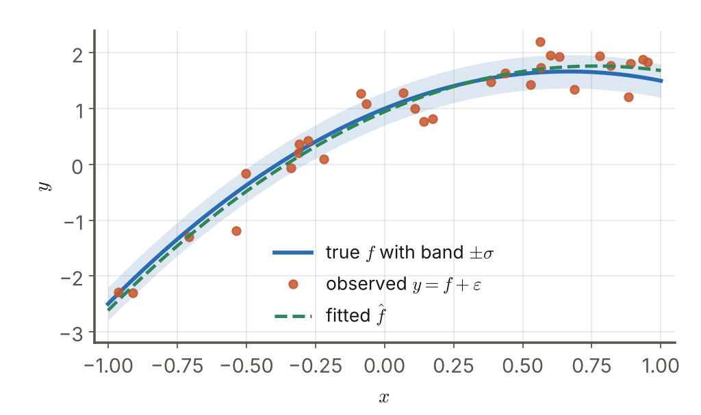
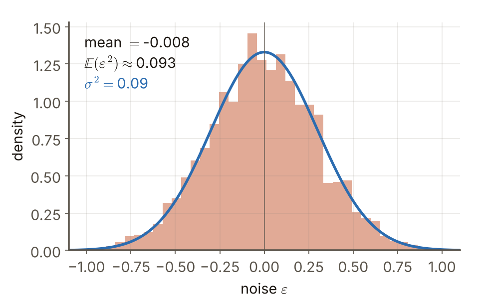

# 第4週 KP04：真實模型與雜訊地板（The true model and the noise floor）

> 程度：大學生（undergrad）／Level: Undergraduate (undergrad)

本講義是第4章「正則化與過擬合」的第四個知識點（KP04），承接 KP03 留下的問題：變異數量的是估計的波動，那資料本身還有多少不可避免的波動，使得任何模型的誤差都不可能是 0？先備知識是期望與變異數、KP02 的 $\mathrm{MSE}=\mathrm{Var}+\mathrm{Bias}^2$ 與 KP03 的共變異數；第一次出現的符號都會定義，所有數字都可以自己重算。內容依 CCC-LNS 第5章 KP04 的主文與教授祕笈消化後重新撰寫，讀取日期 2026-10-20；來源沒有的內容標示 `[補充]`。

This is the fourth knowledge point (KP04) of Chapter 4. It picks up the question KP03 left open: the variance measures the fluctuation of an estimate, so how much unavoidable fluctuation does the data itself carry, so that no model can have zero error? It assumes expectation and variance, the $\mathrm{MSE}=\mathrm{Var}+\mathrm{Bias}^2$ of KP02 and the covariance of KP03; every symbol is defined when it first appears and every number can be recomputed. The text is rewritten from the KP04 main text and the professor's guide of CCC-LNS Chapter 5 (accessed on 2026-10-20); content that the source does not contain is marked `[Added]`.

[下載本單元投影片](../slides/lec04-kp04-true-model-and-noise-floor.jbd.json)

## KP04 真實模型與雜訊地板（The true model and the noise floor）

### 學習目標（Learning objectives）

讀完之後，你能寫出觀測模型 $y=f+\varepsilon$ 與雜訊的兩個性質 $\mathbb E(\varepsilon)=0$、$\mathbb E(\varepsilon^2)=\sigma^2$；能用體溫計的例子算出平方偏差，並說明三次讀數的平均不等於期望 $\sigma^2$、要多次量測才會收斂；能推出「任何不偷看這筆雜訊的預測，平均平方誤差都不會低於 $\sigma^2$」；能說明為什麼訓練誤差遠低於 $\sigma^2$ 是過擬合的警訊；也能指出高斯分布在這裡其實不是必要條件。

After reading, you can write the observation model $y=f+\varepsilon$ and the two properties of the noise, $\mathbb E(\varepsilon)=0$ and $\mathbb E(\varepsilon^2)=\sigma^2$; compute the squared deviations in a thermometer example and explain why the average of three readings is not the expectation $\sigma^2$ and many measurements are needed for it to converge; derive that "any prediction that does not peek at this noise has a mean squared error of at least $\sigma^2$"; explain why a training error far below $\sigma^2$ is a sign of overfitting; and point out that the Gaussian distribution is not actually required here.

### 符號表（Symbols）

| 符號 | 中文意義 | English meaning |
|---|---|---|
| $f$ | 真實模型在某個輸入上的輸出（看不到） | the output of the true model at an input (unobservable) |
| $\varepsilon$ | 雜訊：每次觀測加上去的隨機誤差 | noise: the random error added to each observation |
| $y$ | 觀測值 $y=f+\varepsilon$（看得到） | the observation $y=f+\varepsilon$ (observable) |
| $\sigma^2$ | 雜訊的變異數 | the variance of the noise |
| $\hat f$ | 用資料學出來的估計模型 | the estimated model learned from data |
| $g$ | 任意一個預測（可以是任何模型的輸出） | any prediction (the output of any model) |

### 1. 我們只看得到被雜訊弄髒的 $y$（We only see $y$, contaminated by noise）

我們想學一個**真實模型** $f$：它把輸入對應到真正的輸出。但 $f$ 看不到；每次觀測拿到的是加了一個隨機誤差的 $y$：

We want to learn a **true model** $f$ that maps an input to the real output. But $f$ cannot be seen; each observation gives a $y$ with a random error added:

$$
y_i=f_i+\varepsilon_i
$$

下標 $i$ 是第 $i$ 筆觀測。雜訊的假設只有兩條：平均為 0，變異數是 $\sigma^2$，也就是 $\mathbb E(\varepsilon_i)=0$，$\mathrm{Var}(\varepsilon_i)=\sigma^2$。平均為 0，所以觀測值的期望就是真值 $\mathbb E(y_i)=f_i$：雜訊不偏向任何一邊，把很多次觀測平均起來，會回到 $f$。學習的目標是用資料學出估計模型 $\hat f$ 去逼近 $f$，而不是去貼合每一個 $y$。

The subscript $i$ marks the $i$-th observation. The noise has only two assumptions: mean 0 and variance $\sigma^2$, that is $\mathbb E(\varepsilon_i)=0$ and $\mathrm{Var}(\varepsilon_i)=\sigma^2$. Since the mean is 0, the expectation of the observation is the true value, $\mathbb E(y_i)=f_i$: the noise favours neither side, and averaging many observations returns to $f$. The goal of learning is to approach $f$ with an estimated model $\hat f$ learned from data, not to fit every single $y$.

下面這張圖是本章後面會一直用到的一組玩具資料：真實模型 $f(x)=1+2x-1.5x^2$，雜訊標準差 $\sigma=0.3$（所以 $\sigma^2=0.09$），$n=30$ 個觀測點，亂數種子固定。

The figure below shows the toy data that the rest of this chapter keeps using: the true model $f(x)=1+2x-1.5x^2$ and noise standard deviation $\sigma=0.3$ (so $\sigma^2=0.09$), with $n=30$ observed points and a fixed random seed.

**圖說 `lec04-kp04-model`**：先看藍色的真實曲線與它周圍淺藍的 $\pm\sigma$ 帶：觀測點圍著曲線散開，大多數落在帶內或帶的附近。再看綠色虛線：用 30 個點擬合的二次曲線，係數 $(-1.411,\,2.151,\,0.945)$，接近真實的 $(-1.5,\,2,\,1)$，但不完全相等：它只能從被雜訊弄髒的點去猜 $f$〔程式計算〕。〔功能：1、2〕

**Caption `lec04-kp04-model`**: Look at the blue true curve and the light blue $\pm\sigma$ band around it first: the observed points scatter around the curve, most of them inside or near the band. Then the green dashed line: the quadratic fitted to 30 points has coefficients $(-1.411,\,2.151,\,0.945)$, close to the true $(-1.5,\,2,\,1)$ but not equal: it can only guess $f$ from points contaminated by noise [computed by program]. [Function: 1, 2]

### 2. 雜訊的二階矩：$\mathbb E(\varepsilon^2)=\sigma^2$（The second moment of the noise）

因為 $\mathbb E(\varepsilon)=0$，雜訊的平方的期望就是它的變異數：$\mathbb E(\varepsilon^2)=\mathrm{Var}(\varepsilon)+\big(\mathbb E\varepsilon\big)^2=\sigma^2+0=\sigma^2$。這個量就是「每次觀測平均被雜訊弄偏多少（平方）」。

Since $\mathbb E(\varepsilon)=0$, the expectation of the squared noise is its variance: $\mathbb E(\varepsilon^2)=\mathrm{Var}(\varepsilon)+\big(\mathbb E\varepsilon\big)^2=\sigma^2+0=\sigma^2$. This quantity is "by how much (squared) each observation is thrown off by the noise on average".

**真的算一遍：體溫計。**真實體溫 $f=37.0$，體溫計的雜訊標準差 $\sigma=0.2$，所以 $\sigma^2=0.04$。量三次得到 $36.9,\;37.2,\;37.0$：

**Work it out: a thermometer.** The true body temperature is $f=37.0$ and the thermometer noise has standard deviation $\sigma=0.2$, so $\sigma^2=0.04$. Three readings are $36.9,\;37.2,\;37.0$:

- 雜訊（讀數減真值）是 $-0.1,\;+0.2,\;0$。
- 平方偏差是 $0.01,\;0.04,\;0$，平均 $(0.01+0.04+0)/3=0.0167$。
- 這個 $0.0167$ 和期望 $\sigma^2=0.04$ 差很多：三次讀數太少，平均還在隨機地跳〔程式計算〕。
- 繼續量下去（`[補充]`，用固定亂數種子模擬）：量 10 次平均 $0.0439$，量 100 次 $0.0312$，量 1000 次 $0.0375$，量 10000 次 $0.0394$，一路靠近 $0.04$。

- The noise (reading minus truth) is $-0.1,\;+0.2,\;0$.
- The squared deviations are $0.01,\;0.04,\;0$ with mean $(0.01+0.04+0)/3=0.0167$.
- This $0.0167$ is far from the expectation $\sigma^2=0.04$: three readings are too few and the average still jumps around at random [computed by program].
- Keep measuring (`[Added]`, simulated with a fixed random seed): 10 readings average $0.0439$, 100 readings $0.0312$, 1000 readings $0.0375$ and 10000 readings $0.0394$, creeping toward $0.04$.

**圖說 `lec04-kp04-thermo`**：先看紅點：三次讀數的平均是 $0.0167$，離虛線很遠。再沿橫軸（對數刻度）往右看：量到幾十次時曲線還在 $0.03$ 到 $0.055$ 之間跳動，到 $10^4$ 次時才貼近虛線 $0.04$。期望是「做無限多次的平均」，少數幾次的樣本平均不能拿來代替它。〔功能：2、3〕

**Caption `lec04-kp04-thermo`**: Look at the red dot first: the average of the three readings is $0.0167$, far from the dashed line. Then follow the horizontal axis (log scale) to the right: after a few dozen readings the curve still jumps between $0.03$ and $0.055$, and only at $10^4$ readings does it settle near the dashed line $0.04$. The expectation is "the average over infinitely many repetitions", and a sample average of a few readings cannot stand in for it. [Function: 2, 3]

**圖說 `lec04-kp04-hist`**：先看藍色的鐘形曲線，它是 $\mathcal N(0,\sigma^2)$ 的密度；橘色直方圖是 2000 個取樣，輪廓幾乎貼著曲線。再看左上角的數字：樣本平均 $-0.008\approx0$，$\mathbb E(\varepsilon^2)$ 的樣本值 $0.093$，接近 $\sigma^2=0.09$〔程式計算，固定亂數種子〕。〔功能：1、2〕

**Caption `lec04-kp04-hist`**: Look at the blue bell curve first, the density of $\mathcal N(0,\sigma^2)$; the orange histogram is 2000 samples whose outline hugs the curve. Then the numbers at the top left: the sample mean $-0.008\approx0$ and the sample value of $\mathbb E(\varepsilon^2)$ is $0.093$, close to $\sigma^2=0.09$ [computed by program, fixed random seed]. [Function: 1, 2]

### 3. 誤差地板：為什麼低不過 $\sigma^2$（The error floor: why it cannot go below $\sigma^2$）

假設我們在某個輸入上有任何一個預測 $g$（可以是任何模型、任何方法的輸出），再取一筆**新的**觀測 $y=f+\varepsilon$，而這筆新雜訊 $\varepsilon$ 沒有被 $g$ 用過（$g$ 是用別的資料算出來的，與 $\varepsilon$ 獨立）。把 $y-g$ 拆成 $(f-g)+\varepsilon$，和 KP02 一樣平方、取期望：

Suppose that at some input we have any prediction $g$ (the output of any model or method) and take a **new** observation $y=f+\varepsilon$ whose noise $\varepsilon$ was not used by $g$ ($g$ was computed from other data and is independent of $\varepsilon$). Split $y-g$ into $(f-g)+\varepsilon$, square and take the expectation as in KP02:

$$
\mathbb E\big((y-g)^2\big)=\mathbb E\big((f-g)^2\big)+2\,\mathbb E\big((f-g)\,\varepsilon\big)+\mathbb E(\varepsilon^2)
$$

交叉項：$f-g$ 與 $\varepsilon$ 獨立，所以 $\mathbb E\big((f-g)\varepsilon\big)=\mathbb E(f-g)\,\mathbb E(\varepsilon)=0$。剩下

The cross term: $f-g$ and $\varepsilon$ are independent, so $\mathbb E\big((f-g)\varepsilon\big)=\mathbb E(f-g)\,\mathbb E(\varepsilon)=0$. What remains is

$$
\mathbb E\big((y-g)^2\big)=\underbrace{\mathbb E\big((f-g)^2\big)}_{\ge 0\text{：預測離真值多遠 how far the prediction is from the truth}}+\;\sigma^2\;\ge\;\sigma^2
$$

所以就算預測**完美**（$g=f$），在新觀測上的均方誤差也是 $\sigma^2$；它再怎麼改進，也只能把第一項降到 0，第二項是資料本身的雜訊，動不了。這就是**雜訊地板**。這個推導是 KP05 的準備；KP05 會把它寫成對一整個測試集的版本。

So even a **perfect** prediction ($g=f$) has a mean squared error of $\sigma^2$ on a new observation; improving it can only bring the first term to 0, and the second term is the noise of the data itself, which cannot be moved. This is the **noise floor**. The derivation prepares for KP05, which writes it for a whole test set.

用玩具資料驗算（200000 個新點，固定亂數種子）：真實的 $f$ 在新觀測上的均方誤差是 $0.0905$，貼著 $\sigma^2=0.09$。用 30 個點擬合出的二次曲線是 $0.0992$，比地板高一點，多出來的就是第一項（估計曲線離 $f$ 的距離）。另找一個粗略的預測 $g=0.9+2.1x-1.2x^2$：$\mathbb E((f-g)^2)=0.0114$，加上 $\sigma^2$ 得 $0.1014$；直接算 $\mathbb E((y-g)^2)=0.1016$，兩者吻合〔程式計算〕。

Check on the toy data (200000 new points, fixed random seed): the true $f$ has a mean squared error of $0.0905$ on new observations, hugging $\sigma^2=0.09$. The quadratic fitted to 30 points has $0.0992$, a little above the floor, and the excess is the first term (the distance of the fitted curve from $f$). Take also a rough prediction $g=0.9+2.1x-1.2x^2$: $\mathbb E((f-g)^2)=0.0114$ and adding $\sigma^2$ gives $0.1014$; computing $\mathbb E((y-g)^2)$ directly gives $0.1016$, in agreement [computed by program].

**高斯不是必要的。**來源把雜訊寫成高斯分布 $\mathcal N(0,\sigma^2)$。上面的推導只用到「平均為 0」與「變異數有限」，沒有用到高斯。高斯的形狀要到 KP06 的 Stein 引理才會被用到；在雜訊地板這裡，任何平均 0、變異數有限的雜訊，結論都一樣。

**Gaussian is not needed.** The source writes the noise as a Gaussian distribution $\mathcal N(0,\sigma^2)$. The derivation above uses only "mean 0" and "finite variance", not the Gaussian shape. The Gaussian form is used only later, in the Stein lemma of KP06; for the noise floor, any noise with mean 0 and finite variance gives the same conclusion.

### 4. 反轉：訓練誤差低於地板是警訊（Reversal: training error below the floor is a warning）

直覺是「訓練誤差越小越好」。但既然新觀測的誤差有地板 $\sigma^2$，訓練誤差若**遠低於** $\sigma^2$，那不是打敗了雜訊，而是模型把訓練點上的雜訊也背下來了。

Intuition says "the smaller the training error the better". But since the error on a new observation has the floor $\sigma^2$, a training error **far below** $\sigma^2$ has not beaten the noise: the model has memorised the noise on the training points.

極端的例子（`[補充]`）：用最近鄰預測，也就是對任何輸入，直接回傳訓練集中離它最近那一點的 $y$。它在每個訓練點上都完全重現觀測，訓練誤差是 $0$，遠低於 $\sigma^2=0.09$。但用 20000 個新點檢查，它的均方誤差是 $0.1952$，大約是 $2\sigma^2$：因為預測用了一筆舊的雜訊，新點又帶一筆新的雜訊，兩份雜訊都算進去。相對地，老老實實的二次擬合訓練誤差是 $0.0817$、新點誤差是 $0.0992$ 〔程式計算〕。

An extreme example (`[Added]`): the nearest-neighbour predictor returns, for any input, the $y$ of the training point closest to it. It reproduces every training observation exactly, so its training error is $0$, far below $\sigma^2=0.09$. But checked on 20000 new points its mean squared error is $0.1952$, about $2\sigma^2$: the prediction carries one old noise value and the new point carries a fresh one, so both noises are counted. The honest quadratic fit, by comparison, has a training error of $0.0817$ and a new-point error of $0.0992$ [computed by program].

要注意方向：訓練誤差「略低於」$\sigma^2$ 是正常的（模型的參數會多少吸收一點訓練點上的雜訊，本例二次擬合是 $0.0817<0.09$，KP07 會量化這件事）；「遠低於」才是警訊。下一個問題是：我們量到的測試誤差是用**帶雜訊的 $y$** 算出來的，而真正想知道的是預測離**真實的 $f$** 有多遠，兩者差多少？能不能從前者推回後者？這是 KP05 的主題。

Mind the direction: a training error "slightly below" $\sigma^2$ is normal (the parameters of a model absorb a little of the noise on the training points; the quadratic fit here has $0.0817<0.09$, and KP07 quantifies this); "far below" is the warning. The next question: the test error we measure is computed with the **noisy $y$**, while what we really want to know is how far the prediction is from the **true $f$**; how large is the difference, and can we get back from the former to the latter? That is the topic of KP05.

### 本單元重點整理（KP04 summary）

**一句話重點**：我們只看得到帶雜訊的觀測 $y=f+\varepsilon$（$\mathbb E\varepsilon=0$、$\mathbb E\varepsilon^2=\sigma^2$），所以任何沒偷看這筆雜訊的預測，在新觀測上的均方誤差都不會低於 $\sigma^2$；訓練誤差遠低於 $\sigma^2$ 是把雜訊背下來的警訊。

**One-sentence summary**: We only see the noisy observation $y=f+\varepsilon$ ($\mathbb E\varepsilon=0$, $\mathbb E\varepsilon^2=\sigma^2$), so any prediction that did not peek at this noise has a mean squared error of at least $\sigma^2$ on a new observation; a training error far below $\sigma^2$ is a warning that the noise has been memorised.

**白話說明**：像隔著一層毛玻璃看風景：風景是 $f$，毛玻璃上的水珠是 $\varepsilon$，你看到的是 $y$。再好的眼睛也看不穿玻璃，所以宣稱把誤差壓到 0 的模型，其實是在把水珠也畫進風景裡。

**Plain explanation**: Like looking at a landscape through frosted glass: the landscape is $f$, the droplets on the glass are $\varepsilon$ and what you see is $y$. No eye, however sharp, sees through the glass, so a model that claims zero error is painting the droplets into the landscape.

**正式定義**：$y_i=f_i+\varepsilon_i$，$\mathbb E(\varepsilon_i)=0$，$\mathbb E(\varepsilon_i^2)=\sigma^2$，$\mathbb E(y_i)=f_i$；對與新雜訊獨立的預測 $g$：$\mathbb E\big((y-g)^2\big)=\mathbb E\big((f-g)^2\big)+\sigma^2\ge\sigma^2$。

**Formal definition**: $y_i=f_i+\varepsilon_i$, $\mathbb E(\varepsilon_i)=0$, $\mathbb E(\varepsilon_i^2)=\sigma^2$, $\mathbb E(y_i)=f_i$; for a prediction $g$ independent of the new noise: $\mathbb E\big((y-g)^2\big)=\mathbb E\big((f-g)^2\big)+\sigma^2\ge\sigma^2$.

**例子**：$f=37.0$、$\sigma=0.2$：讀數 $36.9,37.2,37.0$ 的平方偏差平均 $0.0167$，期望是 $0.04$，量 $10^4$ 次後 $0.0394$；玩具資料 $\sigma^2=0.09$：真實 $f$ 在新點的誤差 $0.0905$，最近鄰訓練誤差 $0$、新點誤差 $0.1952$。逐步計算見第 2–4 節。

**Example**: $f=37.0$ and $\sigma=0.2$: the readings $36.9,37.2,37.0$ have a mean squared deviation of $0.0167$ while the expectation is $0.04$, and after $10^4$ readings it is $0.0394$; toy data with $\sigma^2=0.09$: the true $f$ has an error of $0.0905$ on new points, and nearest neighbour has a training error of $0$ and a new-point error of $0.1952$. The computations are in sections 2–4.

**常見迷思**：

- 「模型夠複雜就能把誤差壓到比 $\sigma^2$ 還低」——在新資料上不可能；訓練誤差壓得很低是背雜訊。
- 「訓練誤差小，模型就強」——要同時看新資料上的誤差。
- 「雜訊一定是高斯分布」——地板只需要平均 0、變異數有限；高斯到 KP06 才用到。
- 「三次讀數的平均平方偏差，就是 $\sigma^2$」——它只是樣本，要量很多次才靠近期望。

**Common misconceptions**:

- "A complex enough model can push the error below $\sigma^2$." Not on new data; a very low training error means the noise has been memorised.
- "A small training error means a strong model." Look at the error on new data as well.
- "The noise must be Gaussian." The floor needs only mean 0 and finite variance; the Gaussian form is used first in KP06.
- "The mean squared deviation of three readings is $\sigma^2$." It is only a sample; many readings are needed to approach the expectation.

**圖**：本單元三張圖，`lec04-kp04-model`（真實曲線、雜訊帶、觀測點與擬合曲線，功能 1、2）、`lec04-kp04-hist`（雜訊直方圖與高斯密度，功能 1、2）與 `lec04-kp04-thermo`（體溫計的累積平均收斂到 $\sigma^2$，功能 2、3），以 `assets/figures/src/lec04-kp04-figures.py` 繪製，每個數字都由程式印出。

**Figures**: Three figures in this unit, `lec04-kp04-model` (the true curve, the noise band, the observed points and the fitted curve; functions 1, 2), `lec04-kp04-hist` (the noise histogram and the Gaussian density; functions 1, 2) and `lec04-kp04-thermo` (the running average of the thermometer converging to $\sigma^2$; functions 2, 3), drawn by `assets/figures/src/lec04-kp04-figures.py`; every number is printed by the program.

**想深入**（選讀）：地板的推導裡要求預測 $g$ 與新雜訊獨立。這在「新資料」上成立，在「訓練資料」上不成立：訓練點的 $y$ 本身就被用來算 $\hat f$，所以 $\hat f$ 與那些點的雜訊**相關**，交叉項不再為 0，訓練誤差就可以低於 $\sigma^2$。這個交叉項到底多大，正是 KP06 的 Stein 引理與 KP07 的敏感度要回答的問題。

**Going deeper** (optional): The derivation of the floor requires the prediction $g$ to be independent of the new noise. That holds on "new data" and fails on "training data": the $y$ of a training point is itself used to compute $\hat f$, so $\hat f$ is **correlated** with the noise on those points, the cross term is no longer 0 and the training error can fall below $\sigma^2$. How large this cross term is is exactly the question the Stein lemma of KP06 and the sensitivity of KP07 answer.

**小練習**：

1. 體溫計 $f=37.0$、$\sigma=0.3$，三次讀數 $36.8,\;37.4,\;37.1$。算三個平方偏差與它們的平均，並與 $\sigma^2$ 比較。（提示：先減去 $37.0$ 再平方。）
2. 某資料的 $\sigma^2=0.25$。預測 $g$ 滿足 $\mathbb E((f-g)^2)=0.04$。算它在新觀測上的均方誤差，並說出任何預測能達到的最小值。（提示：$\mathbb E((y-g)^2)=\mathbb E((f-g)^2)+\sigma^2$。）
3. 同一份資料（$\sigma^2=0.25$）上，模型 P 的訓練誤差 $0.01$、新資料誤差 $0.60$；模型 Q 的訓練誤差 $0.22$、新資料誤差 $0.29$。哪一個比較可能背了雜訊？哪一個比較可信？（提示：和 $\sigma^2$ 比較兩個誤差。）

**Practice**:

1. A thermometer has $f=37.0$ and $\sigma=0.3$, with three readings $36.8,\;37.4,\;37.1$. Compute the three squared deviations and their mean and compare with $\sigma^2$. (Hint: subtract $37.0$ first and then square.)
2. A data set has $\sigma^2=0.25$. A prediction $g$ satisfies $\mathbb E((f-g)^2)=0.04$. Compute its mean squared error on new observations and state the smallest value any prediction can reach. (Hint: $\mathbb E((y-g)^2)=\mathbb E((f-g)^2)+\sigma^2$.)
3. On the same data ($\sigma^2=0.25$), model P has a training error of $0.01$ and a new-data error of $0.60$; model Q has a training error of $0.22$ and a new-data error of $0.29$. Which is more likely to have memorised the noise, and which is more trustworthy? (Hint: compare both errors with $\sigma^2$.)

**解題示範**（以讀數 $36.9,\;37.5,\;37.2$、$\sigma=0.3$ 示範第 1 題的算法）：

1. 雜訊（讀數減 $37.0$）：$-0.1,\;+0.5,\;+0.2$。
2. 平方偏差：$0.01,\;0.25,\;0.04$。
3. 平均：$(0.01+0.25+0.04)/3=0.30/3=0.10$。
4. 和 $\sigma^2=0.09$ 比：$0.10$ 與它接近；三次的樣本平均本來就會上下跳，不必因為差一點就懷疑 $\sigma$。

**Worked solution** (the method of exercise 1, shown with readings $36.9,\;37.5,\;37.2$ and $\sigma=0.3$):

1. The noise (reading minus $37.0$): $-0.1,\;+0.5,\;+0.2$.
2. The squared deviations: $0.01,\;0.25,\;0.04$.
3. The mean: $(0.01+0.25+0.04)/3=0.30/3=0.10$.
4. Compare with $\sigma^2=0.09$: $0.10$ is close to it; a sample average of three jumps around anyway, so a small gap is no reason to doubt $\sigma$.

### 來源更正與取捨（Corrections to the source）

- 來源把雜訊寫成高斯分布 $\mathcal N(0,\sigma^2)$，並把地板的結論寫在同一段。本講義指出：地板只需要平均 0 與有限的變異數；高斯分布要到 KP06 才會被用到。
- 來源的體溫計例子列出三次讀數 $36.9,37.2,37.0$，並說預測誤差的平均「至少是 $0.04$」，但沒有算這三次讀數本身的平方偏差。本講義算出它是 $0.0167$，**不是** $0.04$：$0.04$ 是期望，樣本平均要量很多次才會靠近，並用模擬展示收斂，避免讀者把三次的結果誤當成 $\sigma^2$。
- 來源只用文字說明地板；本講義補上推導（加一個、減一個 $f$，交叉項因獨立而為 0），並說明它只對與新雜訊獨立的預測成立，對訓練點不成立。
- 最近鄰的反例、玩具資料上的數字與「略低是正常、遠低才是警訊」的區分是 `[補充]`；來源只說「訓練誤差壓到比 $\sigma^2$ 還低是過擬合的警訊」。

- The source writes the noise as a Gaussian $\mathcal N(0,\sigma^2)$ and states the conclusion about the floor in the same passage. This note points out that the floor needs only mean 0 and finite variance; the Gaussian distribution is used first in KP06.
- The source's thermometer example lists three readings $36.9,37.2,37.0$ and says the average prediction error is "at least $0.04$", but it does not compute the squared deviation of those three readings. This note computes it as $0.0167$, **not** $0.04$: $0.04$ is the expectation and the sample average needs many readings to approach it; a simulation shows the convergence so that the reader does not mistake the three-reading result for $\sigma^2$.
- The source explains the floor only in words; this note adds the derivation (add and subtract $f$, with the cross term 0 by independence) and says that it holds only for predictions independent of the new noise, not for the training points.
- The nearest-neighbour counterexample, the numbers on the toy data and the distinction "slightly below is normal, far below is the warning" are `[Added]`; the source says only that "a training error below $\sigma^2$ is a sign of overfitting".

### 術語對照（Terminology）

| 中文 | English |
|---|---|
| 真實模型 | true model |
| 雜訊 | noise |
| 觀測值 | observation |
| 雜訊地板（誤差下限） | noise floor (error lower bound) |
| 估計模型 | estimated model |
| 最近鄰 | nearest neighbour |
| 二階矩 | second moment |
