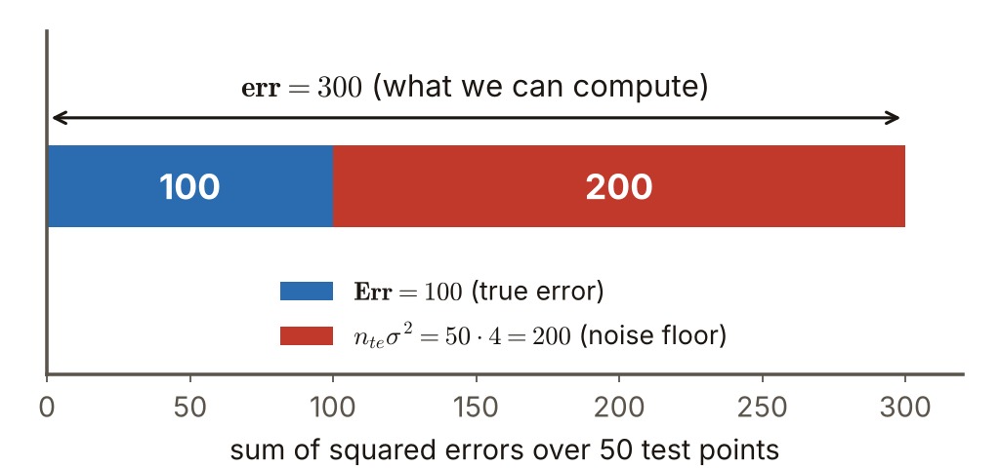

# 第4週 KP05：測試誤差的拆解（Test-error decomposition）

> 程度：大學生（undergrad）／Level: Undergraduate (undergrad)

本講義是第4週「正則化與過擬合」的第五個知識點（KP05），承接 KP04 留下的問題：我們只看得到帶雜訊的 $y$，看不到真實輸出 $f$，那麼算得出來的誤差，能不能還原成想知道的真實誤差？先備知識是期望與獨立、KP01（資料切分）、KP02（MSE 的拆解）與 KP04（$y=f+\varepsilon$ 與雜訊地板 $\sigma^2$）；第一次出現的符號都會定義，所有數字都可以自己重算。內容依 CCC-LNS 第5章 KP5 的主文與教授祕笈消化後重新撰寫，讀取日期 2026-10-20；來源沒有的內容標示 `[補充]`。

This is the fifth knowledge point (KP05) of Week 4, "Regularization and overfitting". It picks up the question KP04 left open: we only see the noisy $y$ and never the true output $f$, so can an error we can compute be turned back into the true error we care about? It assumes expectation and independence, KP01 (data splits), KP02 (the MSE decomposition) and KP04 ($y=f+\varepsilon$ and the noise floor $\sigma^2$); every symbol is defined when it first appears and every number can be recomputed. The text is rewritten from the KP5 main text and professor's guide of CCC-LNS Chapter 5 (accessed on 2026-10-20); content that the source does not contain is marked `[Added]`.

[下載本單元投影片](../slides/lec04-kp05-test-error-decomposition.jbd.json)

## KP05 測試誤差的拆解（Test-error decomposition）

### 學習目標（Learning objectives）

讀完之後，你能說出為什麼沒參與訓練的點，預測 $\hat f_0$ 與觀測 $y_0$ 互相獨立；能一步一步推出 $\mathbb E\big((\hat f_0-y_0)^2\big)=\mathbb E\big((\hat f_0-f_0)^2\big)+\sigma^2$，並指出交叉項在哪一步消失；能把它加總成 $\mathbf{err}=\mathbf{Err}+n_{te}\sigma^2$，用它從算得出的誤差反推真實誤差；也能說明為什麼最小化 $\mathbf{err}$ 等於最小化 $\mathbf{Err}$，以及這個結論在什麼條件下會失效。

After reading, you can say why, for a point that took no part in training, the prediction $\hat f_0$ and the observation $y_0$ are independent; derive step by step $\mathbb E\big((\hat f_0-y_0)^2\big)=\mathbb E\big((\hat f_0-f_0)^2\big)+\sigma^2$ and point out where the cross term vanishes; sum it into $\mathbf{err}=\mathbf{Err}+n_{te}\sigma^2$ and use it to recover the true error from a computable one; and explain why minimizing $\mathbf{err}$ is the same as minimizing $\mathbf{Err}$, and when that conclusion fails.

### 符號表（Symbols）

| 符號 | 中文意義 | English meaning |
|---|---|---|
| $(\mathbf x_0,\,y_0)$ | 一個沒參與訓練的測試點（輸入與觀測標籤） | one test point that took no part in training (input and observed label) |
| $f_0$ | 這一點的真實輸出，看不到 | the true output at this point, unobservable |
| $\varepsilon_0$ | 這一點的雜訊，$y_0=f_0+\varepsilon_0$，平均 0、變異數 $\sigma^2$ | the noise at this point, $y_0=f_0+\varepsilon_0$, mean 0 and variance $\sigma^2$ |
| $\hat f_0$ | 訓練好的模型在這一點的預測 | the prediction of the trained model at this point |
| $n_{te}$ | 測試點的個數 | number of test points |
| $\mathbf{err}$ | 經驗誤差：$\sum_i(\hat f_i-y_i)^2$，算得出來 | empirical error $\sum_i(\hat f_i-y_i)^2$, computable |
| $\mathbf{Err}$ | 真實誤差：$\sum_i(\hat f_i-f_i)^2$，看不到 | true error $\sum_i(\hat f_i-f_i)^2$, not observable |

### 1. 為什麼測試點的誤差可以乾淨拆開（Why the error at a test point splits cleanly）

KP04 說我們只看得到 $y=f+\varepsilon$。想知道模型好不好，真正該量的是 $\hat f$ 離 $f$ 多遠，可是 $f$ 看不到；手上能算的是 $\hat f$ 離 $y$ 多遠。這兩個量差多少？答案取決於一件事：預測和這筆觀測有沒有「串通」。

KP04 said that we only see $y=f+\varepsilon$. To judge a model we should measure how far $\hat f$ is from $f$, but $f$ is invisible; what we can compute is how far $\hat f$ is from $y$. How do the two differ? The answer depends on one thing: whether the prediction and this observation have "colluded".

測試點沒有參與訓練，所以模型的參數只由訓練資料決定，與這一點的雜訊 $\varepsilon_0$ 無關。換句話說，$\hat f_0$ 是訓練資料的函數，$\varepsilon_0$ 是另一次抽出來的雜訊，兩者**獨立**。這正是 KP01 要求測試集與訓練集互斥的理由。

The test point took no part in training, so the parameters of the model are fixed by the training data alone and know nothing about the noise $\varepsilon_0$ of this point. In other words, $\hat f_0$ is a function of the training data and $\varepsilon_0$ is a separate draw of noise: the two are **independent**. This is exactly why KP01 insisted that the test set be disjoint from the training set.

把 $y_0=f_0+\varepsilon_0$ 代入，$\hat f_0-y_0=(\hat f_0-f_0)-\varepsilon_0$。平方展開，再取期望：

Substitute $y_0=f_0+\varepsilon_0$: then $\hat f_0-y_0=(\hat f_0-f_0)-\varepsilon_0$. Square and take the expectation:

$$
\mathbb E\big((\hat f_0-y_0)^2\big)=\mathbb E\big((\hat f_0-f_0)^2\big)-2\,\mathbb E\big(\varepsilon_0(\hat f_0-f_0)\big)+\mathbb E\big(\varepsilon_0^2\big)
$$

三項各自處理。第三項是 KP04 的結論 $\mathbb E(\varepsilon_0^2)=\sigma^2$。第二項是**交叉項**：因為 $\varepsilon_0$ 與 $\hat f_0-f_0$ 獨立，期望值可以拆開，$\mathbb E\big(\varepsilon_0(\hat f_0-f_0)\big)=\mathbb E(\varepsilon_0)\,\mathbb E(\hat f_0-f_0)=0\cdot\mathbb E(\hat f_0-f_0)=0$。交叉項就在這裡消失，它靠的是獨立，也靠雜訊平均為 0。結果是：

Treat the three terms one at a time. The third is the result of KP04, $\mathbb E(\varepsilon_0^2)=\sigma^2$. The second is the **cross term**: since $\varepsilon_0$ and $\hat f_0-f_0$ are independent, the expectation factors, $\mathbb E\big(\varepsilon_0(\hat f_0-f_0)\big)=\mathbb E(\varepsilon_0)\,\mathbb E(\hat f_0-f_0)=0\cdot\mathbb E(\hat f_0-f_0)=0$. The cross term vanishes here; it needs independence and it needs the noise to have mean 0. The result is:

$$
\mathbb E\big((\hat f_0-y_0)^2\big)=\mathbb E\big((\hat f_0-f_0)^2\big)+\sigma^2
$$

用一個可以口算的小例子驗證。令 $f_0=2$、模型預測 $\hat f_0=2.5$，雜訊只取兩個值 $\varepsilon_0=\pm1$，各佔一半，所以 $\sigma^2=1$。觀測值是 $y_0=1$ 或 $3$。誤差平方：$(2.5-1)^2=2.25$ 與 $(2.5-3)^2=0.25$，平均 $(2.25+0.25)/2=1.25$。公式右邊：$(2.5-2)^2+1=0.25+1=1.25$，兩邊相等。交叉項是 $-2\,\varepsilon_0(\hat f_0-f_0)=-2\cdot(\pm1)\cdot0.5=\mp1$，兩種情況各一半，平均為 0〔程式計算〕。

Check it on a small example you can do in your head. Let $f_0=2$ and the model predict $\hat f_0=2.5$; the noise takes only two values, $\varepsilon_0=\pm1$, each with probability one half, so $\sigma^2=1$. The observation is $y_0=1$ or $3$. The squared errors are $(2.5-1)^2=2.25$ and $(2.5-3)^2=0.25$, with mean $(2.25+0.25)/2=1.25$. The right side of the formula is $(2.5-2)^2+1=0.25+1=1.25$: equal. The cross term is $-2\,\varepsilon_0(\hat f_0-f_0)=-2\cdot(\pm1)\cdot0.5=\mp1$, half of the time each, so its mean is 0 [computed by program].

### 2. 加總之後：經驗誤差與真實誤差（Summing up: empirical and true error）

一個點的結論可以加總到整個測試集。對 $n_{te}$ 個測試點，把各點的式子相加：

The conclusion for one point can be summed over the whole test set. For $n_{te}$ test points, add up the formula of every point:

$$
\underbrace{\sum_{i=1}^{n_{te}}(\hat f_i-y_i)^2}_{\mathbf{err}}\;\approx\;\underbrace{\sum_{i=1}^{n_{te}}(\hat f_i-f_i)^2}_{\mathbf{Err}}+n_{te}\,\sigma^2
$$

左邊 $\mathbf{err}$ 是**經驗誤差**：有測試標籤 $y_i$ 就算得出來。右邊第一項 $\mathbf{Err}$ 是**真實誤差**：模型離真實輸出多遠，我們真正想知道，但需要 $f_i$，看不到。第二項 $n_{te}\sigma^2$ 是 $n_{te}$ 個點各貢獻一份的雜訊地板。這裡的 $\approx$ 代表「期望意義下相等，單一測試集上只是接近」，因為單一測試集裡的 $\varepsilon_i$ 是隨機的；測試點越多，兩邊越接近。移項就得到：

The left side $\mathbf{err}$ is the **empirical error**: it can be computed as soon as we have the test labels $y_i$. The first term on the right, $\mathbf{Err}$, is the **true error**: how far the model is from the true outputs, which is what we really want but which needs $f_i$ and cannot be seen. The second term $n_{te}\sigma^2$ is the noise floor, one share per point. The $\approx$ means "equal in expectation and only close on a single test set", because the $\varepsilon_i$ of one test set are random; with more test points the two sides come closer. Moving terms gives:

$$
\mathbf{Err}\approx\mathbf{err}-n_{te}\,\sigma^2
$$

注意 $\mathbf{err}$ 與 $\mathbf{Err}$ 在本章是**加總**，不是平均。要換成每個點的平均，兩邊都除以 $n_{te}$。

Note that in this chapter $\mathbf{err}$ and $\mathbf{Err}$ are **sums**, not means. Divide both sides by $n_{te}$ to get per-point averages.

**數值例（來源的例子）**：$n_{te}=50$、$\sigma^2=4$，在測試集上算出 $\mathbf{err}=300$。雜訊地板是 $50\times4=200$，所以 $\mathbf{Err}=300-200=100$。每點平均：經驗誤差 $300/50=6$，真實誤差 $100/50=2$，差的 $4$ 剛好是 $\sigma^2$。

**Numerical example (from the source)**: $n_{te}=50$ and $\sigma^2=4$, and the test set gives $\mathbf{err}=300$. The noise floor is $50\times4=200$, so $\mathbf{Err}=300-200=100$. Per point: the empirical error is $300/50=6$, the true error is $100/50=2$, and the difference $4$ is exactly $\sigma^2$.

**圖說 `lec04-kp05-bar`**：先看最上面的雙向箭頭：整條 300 是你在測試集上實際算出來的 $\mathbf{err}$；再看顏色：藍色 100 是真實誤差，紅色 200 是不管模型多好都甩不掉的雜訊地板。紅段比藍段長，提醒你：直接看 $\mathbf{err}$ 會把模型看得比實際差很多。〔功能：1、2〕

**Caption `lec04-kp05-bar`**: Look first at the double arrow on top: the full 300 is the $\mathbf{err}$ you actually compute on the test set; then look at the colors: blue 100 is the true error and red 200 is the noise floor that no model can shed. The red part is longer than the blue one, a reminder that reading $\mathbf{err}$ directly makes the model look much worse than it is. [Function: 1, 2]

### 3. 用模擬看見這條等式（Seeing the identity in a simulation）

等式靠獨立性成立，我們可以直接用電腦試。真實模型取 $f(x)=1+2x-1.5x^2$，雜訊 $\sigma=0.3$（所以 $\sigma^2=0.09$）。重複 300 次：每次抽 15 個訓練點，擬合一條直線 $\hat f$，再抽 20000 個**新的**測試點，同時算 $\text{mean}(\hat f-y)^2$（算得出來的）與 $\text{mean}(\hat f-f)^2+\sigma^2$（需要 $f$，模擬中我們知道）。

The identity rests on independence, so we can simply try it on a computer. Take the true model $f(x)=1+2x-1.5x^2$ with noise $\sigma=0.3$ (so $\sigma^2=0.09$). Repeat 300 times: draw 15 training points, fit a straight line $\hat f$, then draw 20000 **fresh** test points and compute both $\text{mean}(\hat f-y)^2$ (computable) and $\text{mean}(\hat f-f)^2+\sigma^2$ (needs $f$, which we know in a simulation).

結果〔程式計算〕：300 次的平均，$\text{mean}(\hat f-y)^2=0.3501$；$\text{mean}(\hat f-f)^2=0.2601$，加上 $\sigma^2=0.09$ 得 $0.3501$，兩者相同。單次之間最大差距只有 $0.0077$。再看交叉項：對 400000 個新點，$\text{mean}\big(\varepsilon(\hat f-f)\big)=-0.00003$，接近 0，而 $\text{mean}(\varepsilon^2)=0.0900$，正好是 $\sigma^2$。

The results [computed by program]: averaged over the 300 repeats, $\text{mean}(\hat f-y)^2=0.3501$; $\text{mean}(\hat f-f)^2=0.2601$, and adding $\sigma^2=0.09$ gives $0.3501$: the same. The largest gap in a single repeat is only $0.0077$. As for the cross term, over 400000 fresh points $\text{mean}\big(\varepsilon(\hat f-f)\big)=-0.00003$, close to 0, and $\text{mean}(\varepsilon^2)=0.0900$, exactly $\sigma^2$.

**圖說 `lec04-kp05-mc`**：先看虛線 $y=x$：點落在線上代表「算得出來的誤差」等於「真實誤差加雜訊地板」；再看點的散布：不同訓練集擬合出的直線好壞不同，點沿著對角線拉開，但沒有離開對角線。直線本身是個有偏差的模型（真實函數是拋物線），等式照樣成立：它只要求測試點獨立，不要求模型正確。〔功能：2〕

**Caption `lec04-kp05-mc`**: Look first at the dashed line $y=x$: a dot on the line means "the computable error" equals "the true error plus the noise floor"; then look at the spread: the lines fitted on different training sets are of different quality, so the dots stretch along the diagonal but do not leave it. The straight line is a biased model (the truth is a parabola) and the identity holds all the same: it requires independent test points, not a correct model. [Function: 2]

### 4. 為什麼最小化 err 就是最小化 Err，以及何時失效（Why minimizing err is minimizing Err, and when it fails）

既然 $\mathbf{Err}\approx\mathbf{err}-n_{te}\sigma^2$，而 $n_{te}\sigma^2$ 是只由資料決定、與模型無關的常數，比較兩個模型時它在兩邊同時扣掉，排名不變。所以在**獨立的測試集**上，選 $\mathbf{err}$ 最小的模型，就是選 $\mathbf{Err}$ 最小的模型。這是測試誤差能當泛化指標的理論依據。

Since $\mathbf{Err}\approx\mathbf{err}-n_{te}\sigma^2$ and $n_{te}\sigma^2$ is a constant that depends on the data only and not on the model, it is subtracted from both models alike when we compare them and the ranking does not change. So on an **independent test set**, choosing the model with the smallest $\mathbf{err}$ is choosing the one with the smallest $\mathbf{Err}$. This is the theoretical basis for using test error as a measure of generalization.

這個結論有一個前提：測試點真的沒被用過。只要測試資料跑進訓練，或被拿來挑超參數（KP01 的兩種作弊），$\hat f_0$ 就會和 $y_0$ 的雜訊「串通」，$\mathbb E\big(\varepsilon_0(\hat f_0-f_0)\big)$ 不再是 0，交叉項不消失，$\mathbf{err}$ 會偏小，我們會把模型看得比實際好。那麼，**參與了訓練的點**，誤差該怎麼修正？這是 KP06 的主題。

The conclusion has one premise: the test points were truly never used. As soon as test data enter training, or are used to choose hyper-parameters (the two kinds of cheating in KP01), $\hat f_0$ "colludes" with the noise of $y_0$, $\mathbb E\big(\varepsilon_0(\hat f_0-f_0)\big)$ is no longer 0, the cross term does not vanish, $\mathbf{err}$ comes out too small and we judge the model better than it is. How, then, do we correct the error of **points that took part in training**? That is the topic of KP06.

### 本單元重點整理（KP05 summary）

**一句話重點**：對沒參與訓練的點，預測與觀測獨立，交叉項為 0，所以 $\mathbf{err}\approx\mathbf{Err}+n_{te}\sigma^2$；雜訊地板是與模型無關的常數，最小化 $\mathbf{err}$ 就是最小化 $\mathbf{Err}$。

**One-sentence summary**: For points that took no part in training the prediction and the observation are independent and the cross term is 0, so $\mathbf{err}\approx\mathbf{Err}+n_{te}\sigma^2$; the noise floor is a constant independent of the model, so minimizing $\mathbf{err}$ is minimizing $\mathbf{Err}$.

**白話說明**：改別班的考卷比較誠實：學生的答案不會迎合你的教法。同樣地，沒訓練過的點，誤差只有兩個來源：模型離真相多遠，加上資料本身的雜訊。把雜訊的那份扣掉，就是模型真正的表現。

**Plain explanation**: Grading another class's exam is more honest: the students' answers do not cater to your teaching. In the same way, an untrained point has only two sources of error: how far the model is from the truth, plus the noise in the data itself. Take out the noise share and what is left is the true performance of the model.

**正式定義**：$\mathbb E\big((\hat f_0-y_0)^2\big)=\mathbb E\big((\hat f_0-f_0)^2\big)+\sigma^2$（需要 $\hat f_0\perp\varepsilon_0$ 與 $\mathbb E(\varepsilon_0)=0$）；$\mathbf{err}=\sum_{i=1}^{n_{te}}(\hat f_i-y_i)^2$、$\mathbf{Err}=\sum_{i=1}^{n_{te}}(\hat f_i-f_i)^2$、$\mathbf{Err}\approx\mathbf{err}-n_{te}\sigma^2$。

**Formal definition**: $\mathbb E\big((\hat f_0-y_0)^2\big)=\mathbb E\big((\hat f_0-f_0)^2\big)+\sigma^2$ (needs $\hat f_0\perp\varepsilon_0$ and $\mathbb E(\varepsilon_0)=0$); $\mathbf{err}=\sum_{i=1}^{n_{te}}(\hat f_i-y_i)^2$, $\mathbf{Err}=\sum_{i=1}^{n_{te}}(\hat f_i-f_i)^2$, $\mathbf{Err}\approx\mathbf{err}-n_{te}\sigma^2$.

**例子**：$n_{te}=50$、$\sigma^2=4$、$\mathbf{err}=300$：$\mathbf{Err}=300-50\cdot4=100$；每點 $6$ 與 $2$。兩點分布例：$f_0=2$、$\hat f_0=2.5$、$\varepsilon_0=\pm1$：$1.25=0.25+1$。模擬：$0.3501=0.2601+0.09$。逐步計算見第 1–3 節。

**Example**: $n_{te}=50$, $\sigma^2=4$, $\mathbf{err}=300$: $\mathbf{Err}=300-50\cdot4=100$; per point $6$ and $2$. Two-point distribution: $f_0=2$, $\hat f_0=2.5$, $\varepsilon_0=\pm1$: $1.25=0.25+1$. Simulation: $0.3501=0.2601+0.09$. The computations are in sections 1–3.

**常見迷思**：

- 「經驗誤差越小，真實誤差一定越小」——只有測試點獨立時才成立；測試資料一旦參與訓練或選參數，等式就垮了。
- 「$\sigma^2$ 可以忽略」——它讓 $\mathbf{err}$ 永遠比 $\mathbf{Err}$ 大 $n_{te}\sigma^2$，看到 $\mathbf{err}$ 不為零不代表模型有問題。
- 「這條式子可以直接用在訓練集上」——訓練點的 $\hat f_i$ 與 $y_i$ 不獨立，需要 KP06 的修正。
- 「模型要正確，等式才成立」——不需要；直線擬合拋物線，等式照樣成立（第 3 節）。

**Common misconceptions**:

- "The smaller the empirical error, the smaller the true error." This holds only when the test points are independent; once test data take part in training or in choosing parameters, the identity collapses.
- "$\sigma^2$ can be ignored." It keeps $\mathbf{err}$ above $\mathbf{Err}$ by $n_{te}\sigma^2$ always; a nonzero $\mathbf{err}$ does not mean something is wrong with the model.
- "This formula can be applied to the training set directly." For a training point $\hat f_i$ and $y_i$ are not independent and KP06's correction is needed.
- "The model must be correct for the identity to hold." No: a straight line fitted to a parabola satisfies it all the same (section 3).

**圖**：本單元兩張圖，`lec04-kp05-bar`（$\mathbf{err}$ 拆成 $\mathbf{Err}$ 與雜訊地板，功能 1、2）與 `lec04-kp05-mc`（模擬驗證等式，功能 2），以 `assets/figures/src/lec04-kp05-figures.py` 繪製。獨立性的因果關係在簡報中以原生節點與連線呈現。

**Figure**: Two figures in this unit, `lec04-kp05-bar` ($\mathbf{err}$ split into $\mathbf{Err}$ and the noise floor; functions 1, 2) and `lec04-kp05-mc` (a simulation verifying the identity; function 2), drawn by `assets/figures/src/lec04-kp05-figures.py`. The causal role of independence is drawn with native nodes and connectors in the deck.

**想深入**（選讀）：式子成立只需要 $\mathbb E(\varepsilon_0)=0$ 與有限變異數，不需要雜訊是高斯分布；高斯性要到 KP06 的 Stein 引理才會用到。另外，這裡的期望同時對「訓練集」與「測試點的雜訊」取；固定一組訓練集時，等式在測試點數很大的極限下成立，對很小的測試集只是近似。

**Going deeper** (optional): The identity needs only $\mathbb E(\varepsilon_0)=0$ and a finite variance, not Gaussian noise; Gaussianity is first used by Stein's lemma in KP06. Also, the expectation here is taken over both the "training set" and the "noise of the test point"; for one fixed training set the identity holds in the limit of many test points and is only approximate for a very small test set.

**小練習**：

1. $n_{te}=80$、$\sigma^2=0.25$，測試集上算出 $\mathbf{err}=64$。求 $\mathbf{Err}$，以及每點平均的 $\mathbf{err}$ 與 $\mathbf{Err}$。（提示：先算雜訊地板 $n_{te}\sigma^2$。）
2. 單點：$f_0=5$、$\hat f_0=4$，雜訊只取 $\pm2$ 各一半。算 $\mathbb E\big((\hat f_0-y_0)^2\big)$，再用 $(\hat f_0-f_0)^2+\sigma^2$ 驗算，並寫出交叉項的兩個值。（提示：$y_0=3$ 或 $7$；$\sigma^2=4$。）
3. 同一個測試集 40 點、$\sigma^2=1.5$：模型 A 的 $\mathbf{err}=120$，模型 B 的 $\mathbf{err}=135$。分別求兩者的 $\mathbf{Err}$，並說明排名有沒有改變。（提示：兩個模型扣掉同一個 $n_{te}\sigma^2$。）

**Practice**:

1. $n_{te}=80$, $\sigma^2=0.25$, and the test set gives $\mathbf{err}=64$. Find $\mathbf{Err}$ and the per-point means of $\mathbf{err}$ and $\mathbf{Err}$. (Hint: compute the noise floor $n_{te}\sigma^2$ first.)
2. One point: $f_0=5$, $\hat f_0=4$, the noise takes only $\pm2$ with probability one half each. Compute $\mathbb E\big((\hat f_0-y_0)^2\big)$, check it with $(\hat f_0-f_0)^2+\sigma^2$, and write down the two values of the cross term. (Hint: $y_0=3$ or $7$; $\sigma^2=4$.)
3. The same test set of 40 points, $\sigma^2=1.5$: model A has $\mathbf{err}=120$ and model B has $\mathbf{err}=135$. Find $\mathbf{Err}$ of both and say whether the ranking changes. (Hint: both models lose the same $n_{te}\sigma^2$.)

**解題示範**（以 $n_{te}=60$、$\sigma^2=0.5$、$\mathbf{err}=45$ 示範第 1 題的算法）：

1. 雜訊地板：$n_{te}\sigma^2=60\cdot0.5=30$。
2. 真實誤差：$\mathbf{Err}=\mathbf{err}-n_{te}\sigma^2=45-30=15$。
3. 每點平均：$\mathbf{err}/n_{te}=45/60=0.75$；$\mathbf{Err}/n_{te}=15/60=0.25$。
4. 檢查：$0.25+\sigma^2=0.25+0.5=0.75$，等於每點的經驗誤差。

**Worked solution** (the method of exercise 1, shown with $n_{te}=60$, $\sigma^2=0.5$ and $\mathbf{err}=45$):

1. Noise floor: $n_{te}\sigma^2=60\cdot0.5=30$.
2. True error: $\mathbf{Err}=\mathbf{err}-n_{te}\sigma^2=45-30=15$.
3. Per-point means: $\mathbf{err}/n_{te}=45/60=0.75$; $\mathbf{Err}/n_{te}=15/60=0.25$.
4. Check: $0.25+\sigma^2=0.25+0.5=0.75$, equal to the per-point empirical error.

### 來源更正與取捨（Corrections to the source）

- 來源把 $\mathbf{err}$、$\mathbf{Err}$ 都寫成加總，卻又在例子裡直接說「每點平均」。本講義明確標出兩者是加總，並另給每點平均，避免單位混淆。
- 來源的式子寫成等號。單一測試集上，雜訊是隨機的，嚴格說是期望意義下相等；本講義用 $\approx$ 標出，並在第 3 節用模擬展示偏差有多小。
- 來源把交叉項消失歸因於「$y_0\perp\hat f_0$ 且 $\mathbb E(y_0-f_0)=0$」。本講義改寫成 $\varepsilon_0\perp\hat f_0$ 與 $\mathbb E(\varepsilon_0)=0$，兩者等價，但這樣更看得出各自的作用。
- 兩點分布的口算例、第 3 節的模擬與「模型不必正確」的說明是 `[補充]`；它們只用到期望與獨立。

- The source writes $\mathbf{err}$ and $\mathbf{Err}$ as sums but speaks of "per-point means" in its example. This note states clearly that both are sums and gives per-point means separately to avoid confusion of units.
- The source writes the formula with an equality sign. On a single test set the noise is random, so strictly it is equality in expectation; this note marks it with $\approx$ and shows in section 3 by simulation how small the gap is.
- The source attributes the vanishing of the cross term to "$y_0\perp\hat f_0$ and $\mathbb E(y_0-f_0)=0$". This note rewrites it as $\varepsilon_0\perp\hat f_0$ and $\mathbb E(\varepsilon_0)=0$; the two are equivalent, but this form shows what each part does.
- The two-point example, the simulation of section 3 and the remark that the model need not be correct are `[Added]`; they use only expectation and independence.

### 術語對照（Terminology）

| 中文 | English |
|---|---|
| 經驗誤差 | empirical error |
| 真實誤差 | true error |
| 雜訊地板 | noise floor |
| 交叉項 | cross term |
| 獨立 | independent |
| 期望 | expectation |
| 測試點 | test point |
| 不可約誤差 | irreducible error |
