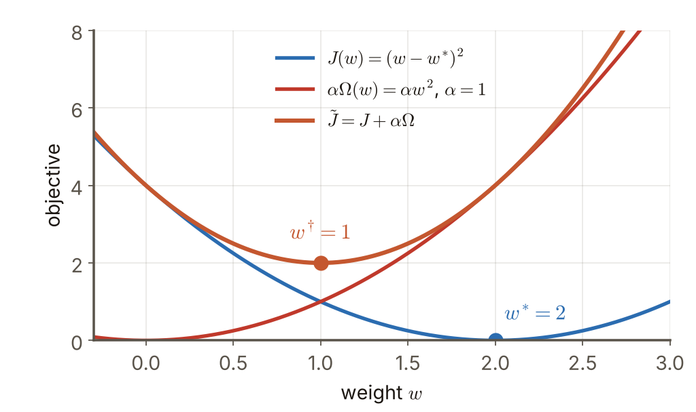
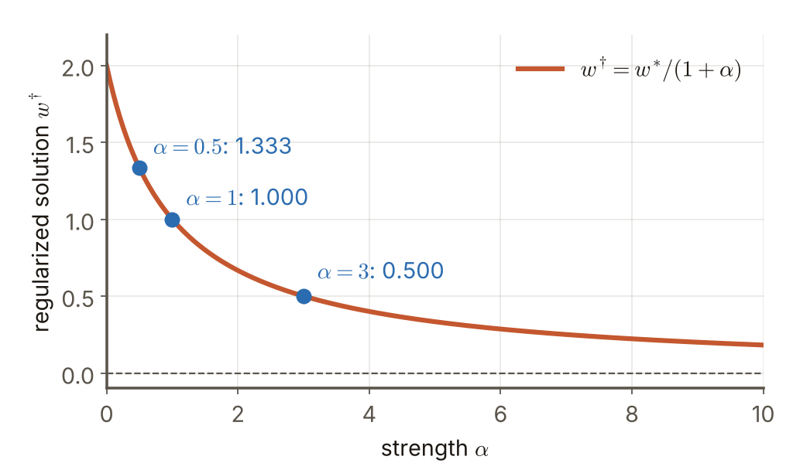

# 第4週 KP07：正則化與稀疏性（Regularization and sparsity）

> 程度：大學生（undergrad）／Level: Undergraduate (undergrad)

本講義是第4章「正則化與過擬合」的第七個知識點（KP07），承接 KP06 留下的問題：交叉驗證只能從現成的候選裡挑模型，那能不能在訓練時，直接在目標函數裡把複雜度壓住？先備知識是 KP05 的過擬合、KP06 的交叉驗證，以及單變數微分；第一次出現的符號都會定義，所有數字都可以自己重算。內容依 CCC-LNS 第5章 KP11 的主文與教授祕笈消化後重新撰寫，讀取日期 2026-10-20；來源沒有的內容標示 `[補充]`。

This is the seventh knowledge point (KP07) of Chapter 4. It picks up the question KP06 left open: cross-validation can only pick among ready-made candidates, so can we press the complexity down directly inside the objective while training? It assumes the overfitting of KP05, the cross-validation of KP06 and single-variable differentiation; every symbol is defined when it first appears and every number can be recomputed. The text is rewritten from the KP11 main text and professor's guide of CCC-LNS Chapter 5 (accessed on 2026-10-20); content that the source does not contain is marked `[Added]`.

[下載本單元投影片](../slides/lec04-kp07-regularization-and-sparsity.jbd.json)

## KP07 正則化與稀疏性（Regularization and sparsity）

### 學習目標（Learning objectives）

讀完之後，你能說出為什麼只最小化訓練誤差會過擬合，並寫出正則化目標 $\tilde J=J+\alpha\Omega$ 各項的意思；能用一組數字算出兩個模型在不同 $\alpha$ 下的總目標並判斷誰占便宜；能對一個權重推導出 $w^{\dagger}=w^{\ast}/(1+\alpha)$；也能算出 $\ell_0$、 $\ell_1$、 $\ell_2$，並說明「稀疏」為什麼等於自動做特徵選擇。

After reading, you can explain why minimizing only the training error overfits and say what each term of the regularized objective $\tilde J=J+\alpha\Omega$ means; compute the total objective of two models for different $\alpha$ and judge which one has the advantage; derive $w^{\dagger}=w^{\ast}/(1+\alpha)$ for a single weight; and compute $\ell_0$, $\ell_1$ and $\ell_2$ and explain why "sparse" amounts to automatic feature selection.

### 符號表（Symbols）

| 符號 | 中文意義 | English meaning |
|---|---|---|
| $J(\mathbf{x};\theta)$ | 經驗誤差（例如均方誤差），只看訓練資料 | empirical error (for example mean squared error) on the training data |
| $\Omega(\mathbf{x})$ | 複雜度懲罰：參數越「大」或越「多」，值越大 | complexity penalty: larger when the parameters are larger or more numerous |
| $\alpha>0$ | 正則化強度：懲罰在總目標裡占多重 | regularization strength: how heavily the penalty weighs in the total |
| $\tilde J$ | 正則化後的總目標 $J+\alpha\Omega$ | the regularized objective $J+\alpha\Omega$ |
| $w^{\ast}$, $w^{\dagger}$ | 無正則化的解；有正則化的解 | the unregularized solution; the regularized solution |
| $\|\mathbf{x}\|_0,\ \|\mathbf{x}\|_1,\ \|\mathbf{x}\|_2$ | 非零個數；絕對值和；平方和的平方根 | number of nonzeros; sum of absolute values; square root of the sum of squares |

### 1. 為什麼要把複雜度放進目標（Why put complexity into the objective）

KP05 的結論是：模型越複雜，訓練誤差一路下降，但新資料上的誤差先降後升。如果訓練時只最小化訓練誤差，我們就等於假裝「模型太複雜」沒有代價，所以一定會越訓練越複雜、越容易過擬合。要修正，就得讓目標函數自己知道「複雜」要付出代價。

KP05 concluded that the more complex the model, the lower the training error falls, while the error on new data first falls and then rises. If training minimizes only the training error, we pretend that being too complex costs nothing, so training always drifts towards more complex models and overfitting. To fix this, the objective itself has to know that complexity must be paid for.

**正則化**的做法是找一個容易計算的函數 $\Omega$ 來「衡量」複雜度，然後把它加進目標：

**Regularization** finds an easy-to-compute function $\Omega$ to "play the role" of that complexity term and adds it to the objective:

$$
\min_{\mathbf{x}}\;\tilde J(\mathbf{x};\theta):=J(\mathbf{x};\theta)+\alpha\Omega(\mathbf{x}),\qquad \alpha>0
$$

$J$ 管「貼合資料」， $\alpha\Omega$ 管「保持簡單」， $\alpha$ 是兩者在天平上的權重。 $\alpha=0$ 回到原本的最小化； $\alpha$ 很大時，模型被迫非常簡單。

$J$ takes care of "fitting the data", $\alpha\Omega$ takes care of "staying simple", and $\alpha$ is the weight of the two on the scale. $\alpha=0$ returns to the original minimization; with a very large $\alpha$ the model is forced to be very simple.

用一組數字看天平怎麼傾斜。複雜模型 $J=10$、 $\Omega=4$；簡單模型 $J=11$、 $\Omega=1$（它對訓練資料貼得稍差）：

A set of numbers shows how the scale tips. A complex model has $J=10$, $\Omega=4$; a simple model has $J=11$, $\Omega=1$ (it fits the training data a little worse):

| $\alpha$ | 複雜模型 $10+4\alpha$ | 簡單模型 $11+\alpha$ | 誰的總目標較低 |
|---|---|---|---|
| $0$ | $10$ | $11$ | 複雜模型 |
| $0.5$ | $12$ | $11.5$ | 簡單模型 |
| $2$ | $18$ | $13$ | 簡單模型，差距擴大到 $5$ |

| $\alpha$ | Complex model $10+4\alpha$ | Simple model $11+\alpha$ | Which total is lower |
|---|---|---|---|
| $0$ | $10$ | $11$ | complex model |
| $0.5$ | $12$ | $11.5$ | simple model |
| $2$ | $18$ | $13$ | simple model, the gap grows to $5$ |

兩個模型的總目標相等的 $\alpha$ 滿足 $10+4\alpha=11+\alpha$，即 $\alpha=1/3$〔程式計算〕。 $\alpha$ 超過 $1/3$ 之後，簡單模型就勝出。正則化不是把訓練誤差變小，而是改變「誰是贏家」。

The two totals are equal when $10+4\alpha=11+\alpha$, that is $\alpha=1/3$ [computed by program]. Beyond $\alpha=1/3$ the simple model wins. Regularization does not make the training error smaller; it changes who the winner is.

### 2. 一個權重的完整例子（A complete one-weight example）

取最小的例子：只有一個權重 $w$，經驗誤差 $J(w)=(w-w^{\ast})^2$， $w^{\ast}=2$ 是無正則化的最佳解；懲罰取 $\Omega(w)=w^2$。總目標 $\tilde J(w)=(w-w^{\ast})^2+\alpha w^2$ 是開口向上的拋物線，微分為零的位置就是最小點：

Take the smallest example: a single weight $w$ with empirical error $J(w)=(w-w^{\ast})^2$, where $w^{\ast}=2$ is the unregularized optimum, and penalty $\Omega(w)=w^2$. The total $\tilde J(w)=(w-w^{\ast})^2+\alpha w^2$ is an upward parabola whose minimum is where the derivative is zero:

$$
\frac{d\tilde J}{dw}=2(w-w^{\ast})+2\alpha w=0\;\Longrightarrow\;w^{\dagger}=\frac{w^{\ast}}{1+\alpha}
$$

$\alpha=0$ 時 $w^{\dagger}=w^{\ast}$； $\alpha$ 越大， $w^{\dagger}$ 被拉得越靠近 $0$，但永遠不會剛好等於 $0$。代入 $w^{\ast}=2$：

At $\alpha=0$, $w^{\dagger}=w^{\ast}$; the larger $\alpha$ is, the closer $w^{\dagger}$ is pulled to $0$, but it never equals $0$ exactly. With $w^{\ast}=2$:

| $\alpha$ | $w^{\dagger}=2/(1+\alpha)$ | $J=(w^{\dagger}-2)^2$ | $\alpha\Omega=\alpha(w^{\dagger})^2$ | $\tilde J$ |
|---|---|---|---|---|
| $0$ | $2.0000$ | $0$ | $0$ | $0$ |
| $0.5$ | $1.3333$ | $0.4444$ | $0.8889$ | $1.3333$ |
| $1$ | $1.0000$ | $1.0000$ | $1.0000$ | $2.0000$ |
| $3$ | $0.5000$ | $2.2500$ | $0.7500$ | $3.0000$ |
| $9$ | $0.2000$ | $3.2400$ | $0.3600$ | $3.6000$ |

注意兩件事（數字皆由程式算出並用網格搜尋驗證，網格最小點與公式一致）：（1）第三欄 $J$ 隨 $\alpha$ 上升，也就是**訓練誤差一定變大**，這是刻意付出的代價；（2） $\tilde J$ 的最小值 $\alpha w^{\ast2}/(1+\alpha)$ 也隨 $\alpha$ 上升，但上升得越來越慢。

Note two things (all numbers are computed by program and checked by a grid search whose minimum agrees with the formula): (1) the column $J$ grows with $\alpha$, that is the **training error always gets larger**, a price paid on purpose; (2) the minimum of $\tilde J$, $\alpha w^{\ast2}/(1+\alpha)$, also grows with $\alpha$, but ever more slowly.

**圖說 `lec04-kp07-tradeoff`**：先看藍色曲線的最低點 $w^{\ast}=2$（只顧資料），再看紅色曲線的最低點 $0$（只顧簡單），最後看橘色曲線：它的最低點 $w^{\dagger}=1$ 夾在兩者之間，這就是天平的平衡點。〔功能：1、2〕

**Caption `lec04-kp07-tradeoff`**: Look first at the minimum of the blue curve, $w^{\ast}=2$ (data only), then at the minimum of the red curve, $0$ (simplicity only), and finally at the orange curve: its minimum $w^{\dagger}=1$ lies between the two, the balance point of the scale. [Function: 1, 2]

**圖說 `lec04-kp07-shrink`**：先看三個標出數值的點，再看曲線右端： $\alpha=10$ 時 $w^{\dagger}=0.18$，仍然大於 $0$。這條曲線說明 $\ell_2$ 型懲罰「只縮小、不歸零」。〔功能：1、2〕

**Caption `lec04-kp07-shrink`**: Look at the three labelled points first, then at the right end of the curve: at $\alpha=10$, $w^{\dagger}=0.18$, still above $0$. The curve shows that an $\ell_2$-type penalty shrinks but never zeroes. [Function: 1, 2]

為什麼這樣做有幫助？回到 KP02 的 $\mathrm{MSE}=\mathrm{Var}+\mathrm{Bias}^2$：把解從 $w^{\ast}$ 拉向 $0$，等於故意引進一點**偏差**（bias），換來解對訓練資料波動的敏感度大幅下降（變異下降）。只要變異下降得比偏差平方上升得多，測試誤差就變小。這正是 KP02 那個「稍微有偏、非常穩定的估計勝過無偏卻亂跳的估計」的反轉。

Why does this help? Go back to $\mathrm{MSE}=\mathrm{Var}+\mathrm{Bias}^2$ of KP02: pulling the solution from $w^{\ast}$ toward $0$ introduces a little **bias** on purpose and in return lowers the sensitivity of the solution to fluctuations of the training data (lower variance). If the variance drops by more than the squared bias rises, the test error gets smaller. This is the reversal of KP02: a slightly biased, very stable estimate can beat an unbiased but jumpy one.

### 3. 三種量法與稀疏性（Three ways to measure, and sparsity）

$\Omega$ 該怎麼選？最常見的是向量 $\mathbf{x}=(x_1,\dots,x_d)$ 的三種「大小」：

How should $\Omega$ be chosen? The three most common "sizes" of a vector $\mathbf{x}=(x_1,\dots,x_d)$ are:

$$
\|\mathbf{x}\|_0=\sum_{j=1}^{d}\mathbb{I}(x_j\neq0),\qquad \|\mathbf{x}\|_1=\sum_{j=1}^{d}|x_j|,\qquad \|\mathbf{x}\|_2=\sqrt{\sum_{j=1}^{d}x_j^2}
$$

其中 $\mathbb{I}(\cdot)$ 在條件成立時為 $1$、否則為 $0$。用 $\mathbf{x}=(3,0,-4,0)$ 算：$\|\mathbf{x}\|_0=2$（兩個非零）、$\|\mathbf{x}\|_1=3+4=7$、$\|\mathbf{x}\|_2=\sqrt{9+16}=5$。換成 $\mathbf{y}=(1,1,1,1)$：$\|\mathbf{y}\|_0=4$、$\|\mathbf{y}\|_1=4$、$\|\mathbf{y}\|_2=2$〔程式計算〕。$\ell_0$ 只數「有幾個特徵在用」，$\ell_1$ 與 $\ell_2$ 還看它們有多大。

where $\mathbb{I}(\cdot)$ is $1$ when the condition holds and $0$ otherwise. For $\mathbf{x}=(3,0,-4,0)$: $\|\mathbf{x}\|_0=2$ (two nonzeros), $\|\mathbf{x}\|_1=3+4=7$, $\|\mathbf{x}\|_2=\sqrt{9+16}=5$. For $\mathbf{y}=(1,1,1,1)$: $\|\mathbf{y}\|_0=4$, $\|\mathbf{y}\|_1=4$, $\|\mathbf{y}\|_2=2$ [computed by program]. $\ell_0$ only counts "how many features are in use"; $\ell_1$ and $\ell_2$ also look at how large they are.

**稀疏**（sparse）的意思是：解裡有很多分量**恰好等於零**。權重為零的特徵對預測完全沒有影響，所以稀疏解等於**自動做了特徵選擇**，模型也更好解讀、更便宜。來源提出兩個支持稀疏的直覺：

**Sparse** means that many components of the solution are **exactly zero**. A feature with weight zero has no effect on the prediction at all, so a sparse solution performs **feature selection automatically**, and the model is easier to read and cheaper to run. The source gives two intuitions in favour of sparsity:

- **Bet on sparsity**（押寶在稀疏）：如果問題本來就是稀疏的，稀疏方法會表現很好；如果問題不稀疏，沒有任何方法能做得好，所以押稀疏沒有太大損失。這是常見的經驗說法，不是定理（來源未給出處）。
- **Occam 剃刀**：解釋力相同時，較簡單的模型比較可能是對的。

- **Bet on sparsity**: if the problem is sparse, a sparse method does very well; if it is not sparse, no method does well, so betting on sparsity loses little. This is a common rule of thumb, not a theorem (the source gives no reference).
- **Occam's razor**: with equal explanatory power, the simpler model is more likely to be right.

哪一種範數能產生稀疏解？光看這一節還不知道：上面一個權重的例子用的是 $\ell_2$ 型懲罰， $w^{\dagger}$ 只縮小、不歸零。直接最小化 $\ell_0$ 才是「數特徵個數」，但它不是連續函數，找最佳解是 NP-hard，所以實務上用 $\ell_1$（KP09）；$\ell_2$ 的收縮方式則留給 KP08。

Which norm produces sparse solutions? This section does not say yet: the one-weight example above used an $\ell_2$-type penalty and $w^{\dagger}$ only shrinks without reaching zero. Minimizing $\ell_0$ directly is what "counting features" means, but it is not continuous and finding the optimum is NP-hard, so in practice $\ell_1$ is used (KP09); how $\ell_2$ shrinks is left to KP08.

最後一個實務問題： $\alpha$ 要取多大？太小等於沒正則化，太大會讓模型過於簡單（欠擬合）。 $\alpha$ 不能用訓練誤差挑（它永遠偏好  $\alpha=0$），要用 KP06 的驗證集或交叉驗證來選。

One last practical question: how large should $\alpha$ be? Too small is no regularization; too large makes the model too simple (underfitting). $\alpha$ cannot be picked by the training error (which always prefers $\alpha=0$); choose it with the validation set or cross-validation of KP06.

接下來的問題： $\ell_2$ 懲罰在一個有很多參數、彼此相關的真實問題裡，是把每個方向縮小同樣的比例嗎？這是 KP08 的主題。

The next question: in a real problem with many correlated parameters, does an $\ell_2$ penalty shrink every direction by the same factor? That is the topic of KP08.

### 本單元重點整理（KP07 summary）

**一句話重點**：只最小化訓練誤差會越訓越複雜，正則化改成最小化  $\tilde J=J+\alpha\Omega$，用好算的懲罰  $\Omega$ 衡量複雜度，$\alpha$ 控制取捨； $\ell_2$ 只縮小， $\ell_1$ 能產生精確的零（稀疏）。

**One-sentence summary**: Minimizing only the training error drifts towards ever more complex models, so regularization minimizes $\tilde J=J+\alpha\Omega$, using an easy penalty $\Omega$ to measure the complexity, with $\alpha$ controlling the trade-off; $\ell_2$ only shrinks, while $\ell_1$ can produce exact zeros (sparsity).

**白話說明**：只追求練習卷滿分，會把雜訊也背下來。正則化像在總成績裡扣「小抄分」：複雜度越高扣越多， $\alpha$ 是扣分的力度。

**Plain explanation**: Chasing a perfect score on the practice paper memorizes the noise as well. Regularization is like deducting "crib-note points" from the total grade: the more complex, the more is deducted, and $\alpha$ is the severity of the deduction.

**正式定義**： $\tilde J(\mathbf{x};\theta)=J(\mathbf{x};\theta)+\alpha\Omega(\mathbf{x})$， $\alpha>0$； $\|\mathbf{x}\|_0$ 數非零、 $\|\mathbf{x}\|_1=\sum|x_j|$、 $\|\mathbf{x}\|_2=\sqrt{\sum x_j^2}$；單權重例： $J=(w-w^{\ast})^2$、 $\Omega=w^2$ 給  $w^{\dagger}=w^{\ast}/(1+\alpha)$。

**Formal definition**:  $\tilde J(\mathbf{x};\theta)=J(\mathbf{x};\theta)+\alpha\Omega(\mathbf{x})$, $\alpha>0$;  $\|\mathbf{x}\|_0$ counts nonzeros,  $\|\mathbf{x}\|_1=\sum|x_j|$, $\|\mathbf{x}\|_2=\sqrt{\sum x_j^2}$; one-weight example: $J=(w-w^{\ast})^2$, $\Omega=w^2$ give $w^{\dagger}=w^{\ast}/(1+\alpha)$.

**例子**：複雜模型 $(J,\Omega)=(10,4)$、簡單模型 $(11,1)$：$\alpha=0.5$ 時 $12$ 對 $11.5$，$\alpha=2$ 時 $18$ 對 $13$；單權重 $w^{\ast}=2$： $\alpha=0.5,1,3$ 的 $w^{\dagger}=1.333,\,1.000,\,0.500$。逐步計算見第 1–2 節。

**Example**: complex model $(J,\Omega)=(10,4)$, simple model $(11,1)$: $12$ versus $11.5$ at $\alpha=0.5$ and $18$ versus $13$ at $\alpha=2$; one weight with $w^{\ast}=2$: $w^{\dagger}=1.333,\,1.000,\,0.500$ at $\alpha=0.5,1,3$. The computations are in sections 1–2.

**常見迷思**：

- 「正則化讓訓練誤差變小」——相反，它一定讓 $J$ 變大（第 2 節的表），換來的是測試誤差變小。
- 「 $\alpha$ 越大越好」——太大會欠擬合，要用驗證集挑。
- 「 $\ell_2$ 也會產生精確的零」——只縮小、不歸零；產生零的是 $\ell_1$（KP09）。
- 「 $\Omega$ 就是模型的複雜度」—— $\Omega$ 只是容易計算的**替身**（代理），不同的 $\Omega$ 會偏好不同的解（KP08、KP09）。

**Common misconceptions**:

- "Regularization lowers the training error." The opposite: it always raises $J$ (the table of section 2) in exchange for a lower test error.
- "The larger $\alpha$ the better." Too large underfits; choose it on a validation set.
- "$\ell_2$ also produces exact zeros." It only shrinks; $\ell_1$ produces zeros (KP09).
- "$\Omega$ is the complexity of the model." $\Omega$ is only an easy-to-compute **surrogate**; different choices of $\Omega$ prefer different solutions (KP08, KP09).

**圖**：本單元兩張圖，`lec04-kp07-tradeoff`（ $J$、 $\alpha\Omega$ 與總目標及其最低點，功能 1、2）與 `lec04-kp07-shrink`（ $w^{\dagger}$ 隨  $\alpha$ 變化，功能 1、2），以 `assets/figures/src/lec04-kp07-figures.py` 繪製。天平的概念與 $\ell_0$、 $\ell_1$、 $\ell_2$ 的比較在簡報中以原生節點呈現。

**Figure**: Two figures in this unit, `lec04-kp07-tradeoff` ($J$, $\alpha\Omega$ and the total with its minimum; functions 1, 2) and `lec04-kp07-shrink` ($w^{\dagger}$ against $\alpha$; functions 1, 2), drawn by `assets/figures/src/lec04-kp07-figures.py`. The balance idea and the comparison of $\ell_0$, $\ell_1$, $\ell_2$ are drawn with native nodes in the deck.

**想深入**（選讀）：把  $\Omega$ 看成約束也可以：最小化 $J$ 並要求 $\Omega(\mathbf{x})\le r$，與最小化 $J+\alpha\Omega$ 在適當的 $r$ 與 $\alpha$ 下給出同一組解（拉格朗日乘數的對偶）； $\alpha$ 越大，等價的 $r$ 越小。這個幾何視角是 KP09 菱形與圓形的來源。`[補充]`

**Going deeper** (optional): $\Omega$ can also be read as a constraint: minimizing $J$ subject to $\Omega(\mathbf{x})\le r$ gives the same solution as minimizing $J+\alpha\Omega$ for suitable $r$ and $\alpha$ (Lagrange duality); the larger $\alpha$, the smaller the equivalent $r$. This geometric view is the origin of the diamond and the circle in KP09. `[Added]`

**小練習**：

1. 複雜模型  $(J,\Omega)=(8,5)$、簡單模型  $(10,2)$：$\alpha$ 為多少時兩者的總目標相等？ $\alpha=2$ 時誰勝？（提示：解  $8+5\alpha=10+2\alpha$。）
2. $J(w)=(w-3)^2$、 $\Omega(w)=w^2$、 $\alpha=2$：求 $w^{\dagger}$，並算出此時的 $J$、 $\alpha\Omega$、 $\tilde J$。（提示：套用  $w^{\dagger}=w^{\ast}/(1+\alpha)$， $w^{\ast}=3$。）
3. $\mathbf{x}=(0,-2,0,5,1)$：算  $\|\mathbf{x}\|_0$、 $\|\mathbf{x}\|_1$、 $\|\mathbf{x}\|_2$。（提示： $\ell_2$ 要開根號。）

**Practice**:

1. Complex model $(J,\Omega)=(8,5)$, simple model $(10,2)$: for which $\alpha$ are the totals equal? Who wins at $\alpha=2$? (Hint: solve $8+5\alpha=10+2\alpha$.)
2. $J(w)=(w-3)^2$, $\Omega(w)=w^2$, $\alpha=2$: find $w^{\dagger}$ and compute $J$, $\alpha\Omega$ and $\tilde J$ there. (Hint: use $w^{\dagger}=w^{\ast}/(1+\alpha)$ with $w^{\ast}=3$.)
3. $\mathbf{x}=(0,-2,0,5,1)$: compute $\|\mathbf{x}\|_0$, $\|\mathbf{x}\|_1$ and $\|\mathbf{x}\|_2$. (Hint: $\ell_2$ needs a square root.)

**解題示範**（第 1 題）：

1. 令兩個總目標相等： $8+5\alpha=10+2\alpha$。
2. 移項： $3\alpha=2$，所以  $\alpha=2/3\approx0.667$，此時兩者都是  $8+5\cdot\tfrac23=11.333$。
3.  $\alpha=2$：複雜模型  $8+5\cdot2=18$，簡單模型  $10+2\cdot2=14$，簡單模型勝。
4. 檢查： $\alpha<2/3$ 時複雜模型較低（例如  $\alpha=0$： $8<10$），符合「 $\alpha$ 超過門檻簡單模型才勝出」。

**Worked solution** (exercise 1):

1. Set the two totals equal: $8+5\alpha=10+2\alpha$.
2. Rearrange: $3\alpha=2$, so $\alpha=2/3\approx0.667$, where both equal $8+5\cdot\tfrac23=11.333$.
3. $\alpha=2$: complex $8+5\cdot2=18$, simple $10+2\cdot2=14$; the simple model wins.
4. Check: for $\alpha<2/3$ the complex model is lower (for example $\alpha=0$: $8<10$), consistent with "the simple model wins only beyond the threshold".

### 來源更正與取捨（Corrections to the source）

- 來源說正則化項「模仿」複雜度項。本講義明說： $\Omega$ 只是**代理**（surrogate），並不等於模型真正的複雜度，一般情況只是啟發式。
- 來源的互動示範寫「 $\Omega=w^2$， $w^{\dagger}=w^{\ast}/(1+\alpha)$」，這要搭配  $J=(w-w^{\ast})^2$（係數不含  $1/2$）才成立；若寫成  $\tfrac12(w-w^{\ast})^2$，答案會變成  $w^{\ast}/(1+2\alpha)$。本講義明列  $J$ 的形式。
- 來源的「bet on sparsity」沒有給出處，它是常見的經驗準則而不是定理，本講義照此標示。
- 來源說「 $\ell_1$ 與  $\ell_{2,1}$ 產生稀疏解」， $\ell_{2,1}$（按群組的混合範數）超出本章範圍，不展開。

- The source says the regularization term "imitates" the complexity term. This note says plainly that $\Omega$ is only a **surrogate** and not equal to the true complexity of the model; in general it is a heuristic.
- The source's interactive demo writes "$\Omega=w^2$, $w^{\dagger}=w^{\ast}/(1+\alpha)$", which holds only with $J=(w-w^{\ast})^2$ (no factor $\tfrac12$); with $\tfrac12(w-w^{\ast})^2$ the answer becomes $w^{\ast}/(1+2\alpha)$. This note states the form of $J$ explicitly.
- The source's "bet on sparsity" has no reference; it is a common rule of thumb, not a theorem, and is labelled as such here.
- The source says "$\ell_1$ and $\ell_{2,1}$ produce sparse solutions"; $\ell_{2,1}$ (a group mixed norm) is beyond this chapter and is not expanded.

### 術語對照（Terminology）

| 中文 | English |
|---|---|
| 正則化 | regularization |
| 正則化強度 | regularization strength |
| 複雜度懲罰 | complexity penalty |
| 代理（替代函數） | surrogate |
| 稀疏／稀疏性 | sparse / sparsity |
| 特徵選擇 | feature selection |
| 範數 | norm |
| 偏差與變異 | bias and variance |
| 奧坎剃刀 | Occam's razor |
