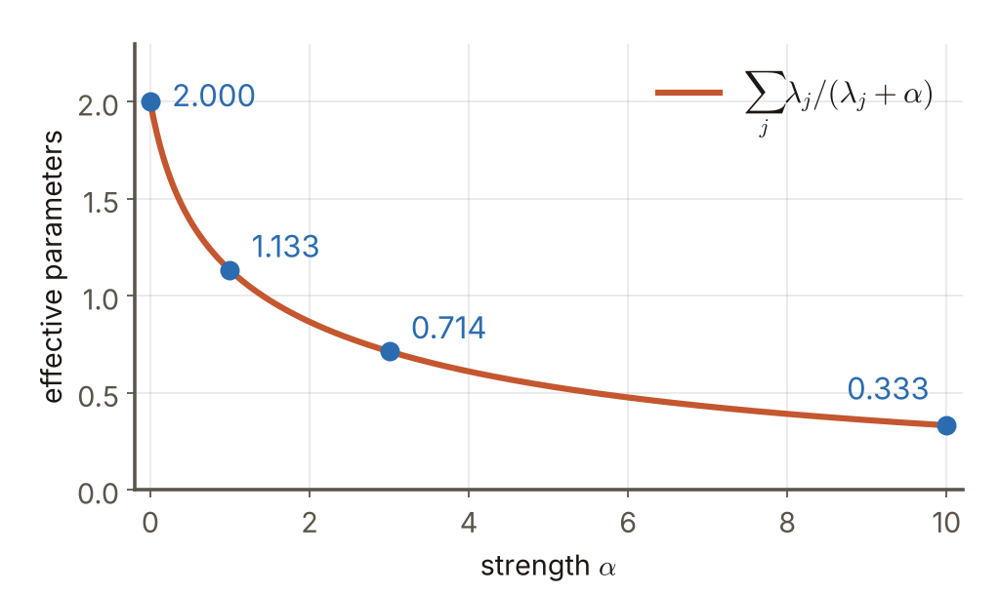

# 第4週 KP08：L2 正則化與權重衰減（L2 regularization and weight decay）

> 程度：大學生（undergrad）／Level: Undergraduate (undergrad)

本講義是第4週「正則化與過擬合」的第八個知識點（KP08），承接 KP07 留下的問題：$\ell_2$ 懲罰在有很多參數的問題裡，是不是把每個參數縮小同樣的比例？先備知識是 KP07 的 $\tilde J=J+\alpha\Omega$ 與單變數微分。第一次出現的符號都會定義，所有數字都可以自己重算。本講義的內容取自 CCC-LNS 第5章 KP12 與 KP14 主文及教授祕笈，讀取日期 2026-10-20，並依大學部程度縮減（去掉矩陣與特徵分解的推導）；來源沒有的補充一律標記 `[補充]`。

This is the eighth knowledge point (KP08) of Week 4, "Regularization and overfitting". It picks up the question KP07 left open: in a problem with many parameters, does an $\ell_2$ penalty shrink every parameter by the same factor? It assumes $\tilde J=J+\alpha\Omega$ of KP07 and single-variable differentiation. Every symbol is defined when it first appears and every number can be recomputed. The content is taken from the main text and professor's guide of CCC-LNS Chapter 5, KP12 and KP14 (accessed on 2026-10-20) and shortened for undergraduates (the matrix and eigendecomposition derivations are removed); everything not in the source is marked `[Added]`.

[下載本單元投影片](../slides/lec04-kp08-l2-regularization-shrinkage.jbd.json)

## KP08 L2 正則化與權重衰減（L2 regularization and weight decay）

### 學習目標（Learning objectives）

讀完之後，你能對一個參數推導出 $\ell_2$ 正則化的解 $x^{\dagger}=\dfrac{\lambda}{\lambda+\alpha}x^{\ast}$，並說明陡的方向（$\lambda$ 大）幾乎保留、平的方向（$\lambda$ 小）被壓小；能用一組數字算出收縮後的解與有效參數量；能說明為什麼 $\ell_2$ 只縮小、不歸零；也能寫出權重衰減的更新式 $\mathbf{w}\leftarrow(1-\eta\alpha)\mathbf{w}-\eta\nabla J$，說明為什麼叫「衰減」，以及大權重為什麼會把 $\tanh$ 推進平坦的飽和區。

After reading, you can derive for one parameter the $\ell_2$-regularized solution $x^{\dagger}=\dfrac{\lambda}{\lambda+\alpha}x^{\ast}$ and explain why steep directions (large $\lambda$) are almost kept while flat directions (small $\lambda$) are pressed down; compute the shrunk solution and the effective number of parameters from a set of numbers; explain why $\ell_2$ only shrinks and never zeroes; and write the weight-decay update $\mathbf{w}\leftarrow(1-\eta\alpha)\mathbf{w}-\eta\nabla J$, say why it is called "decay", and why large weights push $\tanh$ into its flat saturated region.

### 符號表（Symbols）

| 符號 | 中文意義 | English meaning |
|---|---|---|
| $x^{\ast}$ | 無正則化的最佳解（$J$ 最小的位置） | the unregularized optimum (where $J$ is smallest) |
| $x^{\dagger}$ | $\ell_2$ 正則化後的解 | the solution after $\ell_2$ regularization |
| $\lambda$ | 陡度：沿某個方向離開 $x^{\ast}$ 時，$J$ 上升有多快（$J$ 在該方向的二階導數） | steepness: how fast $J$ rises when leaving $x^{\ast}$ along a direction (the second derivative of $J$ in that direction) |
| $\alpha>0$ | $\ell_2$ 懲罰的強度 | strength of the $\ell_2$ penalty |
| $\lambda/(\lambda+\alpha)$ | 收縮因子：解被留下的比例 | the shrink factor: the fraction of the solution that is kept |
| $\mathbf{w}$ | 網路的權重（向量） | weights of the network (a vector) |
| $\eta$ | 學習率 | learning rate |

### 1. 一個參數的 $\ell_2$ 正則化（$\ell_2$ regularization of one parameter）

KP07 的結尾問：$\ell_2$ 懲罰把解推到哪裡？先把目標寫清楚。本單元的 $\ell_2$ 目標是

KP07 ended by asking where an $\ell_2$ penalty pushes the solution. First, the objective of this unit:

$$
\tilde J(x)=J(x)+\frac{\alpha}{2}x^2
$$

懲罰項前面多一個 $\tfrac12$，只是為了微分時把 $2$ 消掉。這個 $\alpha$ 與 KP07 的 $\alpha\Omega$（$\Omega=x^2$）差一個因子 $2$：本單元的 $\alpha$ 等於 KP07 的 $2\alpha$。

The factor $\tfrac12$ in front of the penalty only cancels the $2$ when differentiating. This $\alpha$ differs from the $\alpha\Omega$ of KP07 (with $\Omega=x^2$) by a factor of $2$: the $\alpha$ of this unit equals twice the KP07 $\alpha$.

在無正則化的最佳解 $x^{\ast}$ 附近，$J$ 可以用一條開口向上的拋物線來近似，陡度是 $\lambda$：$J(x)\approx J(x^{\ast})+\tfrac12\lambda(x-x^{\ast})^2$。代入 $\tilde J$ 並令微分為零：

Near the unregularized optimum $x^{\ast}$, $J$ can be approximated by an upward parabola of steepness $\lambda$: $J(x)\approx J(x^{\ast})+\tfrac12\lambda(x-x^{\ast})^2$. Substitute it into $\tilde J$ and set the derivative to zero:

$$
\lambda(x-x^{\ast})+\alpha x=0
\;\Longrightarrow\;
x^{\dagger}=\frac{\lambda}{\lambda+\alpha}\,x^{\ast}
$$

解就是 $x^{\ast}$ 乘上一個介於 $0$ 與 $1$ 之間的**收縮因子** $\lambda/(\lambda+\alpha)$。$\alpha=0$ 時因子是 $1$（沒有正則化）；$\alpha$ 越大，因子越小，解越被拉向原點。

The solution is $x^{\ast}$ times a **shrink factor** $\lambda/(\lambda+\alpha)$ between $0$ and $1$. At $\alpha=0$ the factor is $1$ (no regularization); the larger $\alpha$, the smaller the factor and the more the solution is pulled toward the origin.

核對 KP07：KP07 的一個權重例子 $J=(w-w^{\ast})^2$，二階導數是 $2$，所以 $\lambda=2$；懲罰 $\alpha_{\text{K}}w^2=\tfrac{2\alpha_{\text{K}}}{2}w^2$，所以本單元的 $\alpha=2\alpha_{\text{K}}$。因子是 $\dfrac{2}{2+2\alpha_{\text{K}}}=\dfrac{1}{1+\alpha_{\text{K}}}$，正好是 KP07 的 $w^{\dagger}=w^{\ast}/(1+\alpha_{\text{K}})$。$\alpha_{\text{K}}=0.5,\,1,\,3$ 時分別是 $0.6667,\,0.5000,\,0.2500$〔程式計算〕。

Check against KP07. In the one-weight example of KP07, $J=(w-w^{\ast})^2$ has second derivative $2$, so $\lambda=2$; the penalty is $\alpha_{\text{K}}w^2=\tfrac{2\alpha_{\text{K}}}{2}w^2$, so $\alpha=2\alpha_{\text{K}}$ here. The factor is $\dfrac{2}{2+2\alpha_{\text{K}}}=\dfrac{1}{1+\alpha_{\text{K}}}$, exactly the $w^{\dagger}=w^{\ast}/(1+\alpha_{\text{K}})$ of KP07. For $\alpha_{\text{K}}=0.5,\,1,\,3$ it is $0.6667,\,0.5000,\,0.2500$ [computed by program].

### 2. 陡的方向少縮，平的方向多縮（Steep directions shrink less, flat ones more）

有很多參數時，$J$ 沿不同方向的陡度 $\lambda$ 不同。上一節的算式可以**分別套在每個方向**上，所以每個方向有自己的收縮因子，不是把所有權重乘同一個數。

With many parameters, $J$ has a different steepness $\lambda$ along each direction. The formula of the last section can be applied **to each direction separately**, so each direction has its own shrink factor; it is not one number applied to all the weights.

為什麼是這個比例？$\lambda\gg\alpha$（陡）：往原點走一步，$J$ 馬上大漲，懲罰省下的那點不夠補，所以這個方向幾乎不動，因子接近 $1$。$\lambda\ll\alpha$（平）：沿這個方向走很遠 $J$ 也變不多，懲罰贏了，所以這個方向被大幅壓縮，因子接近 $0$。$\lambda=\alpha$ 時因子剛好是 $\tfrac12$。

Why this ratio? For $\lambda\gg\alpha$ (steep), a step toward the origin makes $J$ jump, the little the penalty saves cannot pay for it, so this direction hardly moves and the factor is close to $1$. For $\lambda\ll\alpha$ (flat), going far along the direction hardly changes $J$, so the penalty wins and the direction is compressed strongly, with a factor close to $0$. At $\lambda=\alpha$ the factor is exactly $\tfrac12$.

用兩個方向 $\lambda_1=4$、$\lambda_2=0.5$、$\alpha=1$ 算一遍：

Compute it with two directions, $\lambda_1=4$, $\lambda_2=0.5$, and $\alpha=1$:

- 方向 1：$4/(4+1)=0.8$。
- 方向 2：$0.5/(0.5+1)=0.3333$。
- 若 $x^{\ast}$ 沿這兩個方向的分量是 $(10,10)$，則 $x^{\dagger}=(0.8\cdot10,\ 0.3333\cdot10)=(8,\ 3.3333)$。

- Direction 1: $4/(4+1)=0.8$.
- Direction 2: $0.5/(0.5+1)=0.3333$.
- If the components of $x^{\ast}$ along the two directions are $(10,10)$, then $x^{\dagger}=(0.8\cdot10,\ 0.3333\cdot10)=(8,\ 3.3333)$.

陡的方向 1 只少了 $20\%$，平的方向 2 少了約 $67\%$。

The steep direction 1 loses only $20\%$, the flat direction 2 about $67\%$.

**圖說 `lec04-kp08-ellipse`**：先看橘色等高線，它通過 $\mathbf{x}^{\dagger}$，是 $J$ 在 $\mathbf{x}^{\dagger}$ 的高度；灰色虛線通過原點，是 $J(\mathbf{0})=225$ 的高度。再看兩段摺線：藍色是 $\mathbf{x}^{\ast}$ 在 $\mathbf{u}_1$、$\mathbf{u}_2$ 上的兩個分量（$10$、$10$），橘色是 $\mathbf{x}^{\dagger}$ 的分量（$8$、$3.33$）。沿橢圓長軸的 $\mathbf{u}_2$ 方向縮得多，沿短軸的 $\mathbf{u}_1$ 縮得少：橢圓越扁的方向（$J$ 越平）被壓得越厲害。〔功能：1、3〕

**Caption `lec04-kp08-ellipse`**: Look first at the orange contour: it passes through $\mathbf{x}^{\dagger}$ and is the level of $J$ at $\mathbf{x}^{\dagger}$; the grey dashed contour passes through the origin and is the level $J(\mathbf{0})=225$. Then follow the two broken lines: the blue one is the two components of $\mathbf{x}^{\ast}$ along $\mathbf{u}_1$ and $\mathbf{u}_2$ ($10$ and $10$), the orange one is those of $\mathbf{x}^{\dagger}$ ($8$ and $3.33$). The direction along the long axis of the ellipse, $\mathbf{u}_2$, shrinks a lot and the one along the short axis, $\mathbf{u}_1$, shrinks little: the flatter the ellipse in a direction ($J$ flatter), the stronger the compression. [Function: 1, 3]

再看收縮因子怎麼隨 $\alpha$ 變。$\lambda=4$ 與 $\lambda=0.5$ 兩條曲線都從 $1$ 出發往下掉，但平的方向掉得快得多：

Now see how the shrink factor depends on $\alpha$. Both curves, $\lambda=4$ and $\lambda=0.5$, start at $1$ and fall, but the flat direction falls much faster:

**圖說 `lec04-kp08-factor`**：先看虛線 $\alpha=1$ 上的兩個點，$0.800$ 與 $0.333$，就是上面算出的兩個因子；再沿著兩條曲線往右看，$\alpha=10$ 時分別剩 $0.286$ 與 $0.048$。曲線永遠大於 $0$：因子每一點都是正的，所以這個縮小不會剛好歸零。〔功能：1、2〕

**Caption `lec04-kp08-factor`**: Look first at the two points on the dashed line $\alpha=1$, $0.800$ and $0.333$, the two factors computed above; then follow the curves to the right, where at $\alpha=10$ they have fallen to $0.286$ and $0.048$. The curves stay above $0$ everywhere: every factor is positive, so this shrinking never reaches exactly zero. [Function: 1, 2]

### 3. 有效參數量（Effective number of parameters）

每個方向還剩多少，加起來就是模型還剩多少「有效」的自由度。定義**有效參數量**（effective degrees of freedom）為所有收縮因子的和：

How much each direction keeps, added up, is how much "effective" freedom the model keeps. The **effective number of parameters** (effective degrees of freedom) is defined as the sum of all the shrink factors:

$$
\mathrm{df}(\alpha)=\sum_{j}\frac{\lambda_j}{\lambda_j+\alpha}
$$

$\alpha=0$ 時每個因子都是 $1$，所以 $\mathrm{df}$ 等於參數個數（全部自由）；$\alpha\to\infty$ 時每個因子趨近 $0$，$\mathrm{df}\to0$。上面的例子在 $\alpha=1$ 是 $0.8+0.3333=1.1333$：原本 $2$ 個參數，正則化後大約只剩 $1.13$ 個。表中是更多的 $\alpha$ 值〔程式計算〕：

At $\alpha=0$ every factor is $1$, so $\mathrm{df}$ equals the number of parameters (all free); as $\alpha\to\infty$ every factor tends to $0$ and $\mathrm{df}\to0$. In the example above, at $\alpha=1$ it is $0.8+0.3333=1.1333$: of the original $2$ parameters, about $1.13$ remain after regularization. The table has more values of $\alpha$ [computed by program]:

| $\alpha$ | 方向 1（$\lambda=4$） | 方向 2（$\lambda=0.5$） | $\mathrm{df}(\alpha)$ |
|---|---|---|---|
| $0$ | $1.0000$ | $1.0000$ | $2.0000$ |
| $0.5$ | $0.8889$ | $0.5000$ | $1.3889$ |
| $1$ | $0.8000$ | $0.3333$ | $1.1333$ |
| $3$ | $0.5714$ | $0.1429$ | $0.7143$ |
| $10$ | $0.2857$ | $0.0476$ | $0.3333$ |

| $\alpha$ | direction 1 ($\lambda=4$) | direction 2 ($\lambda=0.5$) | $\mathrm{df}(\alpha)$ |
|---|---|---|---|
| $0$ | $1.0000$ | $1.0000$ | $2.0000$ |
| $0.5$ | $0.8889$ | $0.5000$ | $1.3889$ |
| $1$ | $0.8000$ | $0.3333$ | $1.1333$ |
| $3$ | $0.5714$ | $0.1429$ | $0.7143$ |
| $10$ | $0.2857$ | $0.0476$ | $0.3333$ |

**圖說 `lec04-kp08-dof`**：先看左端的 $2.000$（完全沒有正則化），再看三個標出數值的點，曲線不是一條直線：$\alpha$ 從 $0$ 加到 $1$ 就掉了 $0.87$，從 $1$ 加到 $10$ 才又掉 $0.80$。有效參數量由所有因子的和決定，通常是非線性下降。〔功能：1、2〕

**Caption `lec04-kp08-dof`**: Look first at the $2.000$ at the left end (no regularization at all), then at the three labelled points: the curve is not a straight line; going from $\alpha=0$ to $1$ already drops $0.87$, while going from $1$ to $10$ drops another $0.80$. The effective number of parameters is the sum of all the factors and usually falls non-linearly. [Function: 1, 2]

這就是 $\ell_2$ 真的在「壓低複雜度」的證據：$\alpha$ 越大，模型的有效參數越少，越不容易跟著雜訊走。還有一件事要看清楚：每個因子 $\lambda_j/(\lambda_j+\alpha)$ 對任何 $\lambda_j>0$ 與有限的 $\alpha$ 都嚴格大於 $0$。$\ell_2$ 縮小所有方向，但不會讓任何一個分量剛好變成零，所以它**不會自動做特徵選擇**。

This is the evidence that $\ell_2$ really "presses the complexity down": the larger $\alpha$, the fewer effective parameters the model has and the less it follows the noise. One more thing to see clearly: every factor $\lambda_j/(\lambda_j+\alpha)$ is strictly larger than $0$ for any $\lambda_j>0$ and finite $\alpha$. $\ell_2$ shrinks all directions but never makes a component exactly zero, so it **does not perform feature selection by itself**.

### 4. 套到神經網路：權重衰減（Applying it to a neural network: weight decay）

把 $\ell_2$ 套在神經網路所有的權重 $\mathbf{w}$ 上，就是**權重衰減**（weight decay）：

Applying $\ell_2$ to all the weights $\mathbf{w}$ of a neural network is **weight decay**:

$$
\tilde J(\mathbf{w})=J(\mathbf{w})+\frac{\alpha}{2}\|\mathbf{w}\|_2^2
$$

為什麼叫「衰減」？把梯度寫出來：$\nabla\tilde J=\nabla J+\alpha\mathbf{w}$，所以學習率 $\eta$ 的一步梯度下降是

Why "decay"? Write the gradient: $\nabla\tilde J=\nabla J+\alpha\mathbf{w}$, so one gradient-descent step with learning rate $\eta$ is

$$
\mathbf{w}\leftarrow\mathbf{w}-\eta\big(\nabla J+\alpha\mathbf{w}\big)=(1-\eta\alpha)\,\mathbf{w}-\eta\,\nabla J(\mathbf{w})
$$

這個式子有兩部分：先把權重整體乘上一個略小於 1 的係數 $(1-\eta\alpha)$（每一步都「衰減」一點），再照原本的梯度 $-\eta\nabla J$ 修正。`[補充]` 例：$\eta=0.1$、$\alpha=0.5$，目前 $w=2$、資料梯度 $\partial J/\partial w=1$，則 $w\leftarrow(1-0.05)\cdot2-0.1\cdot1=1.8$；用原式驗算：$2-0.1\,(1+0.5\cdot2)=1.8$〔程式計算〕。沒有衰減時，同一步會是 $2-0.1=1.9$，所以衰減讓權重多縮小了 $0.1=\eta\alpha w$。網路的 $J$ 不是二次函數，所以前三節的公式只在 $\mathbf{w}^{\ast}$ 附近近似成立，但「大權重被往回拉、平的方向被壓得多」的直覺仍然適用。

The formula has two parts: first multiply the weights as a whole by a factor slightly below 1, $(1-\eta\alpha)$ (each step "decays" them a little), then correct with the usual gradient $-\eta\nabla J$. `[Added]` Example: $\eta=0.1$, $\alpha=0.5$, currently $w=2$ and the data gradient is $\partial J/\partial w=1$, then $w\leftarrow(1-0.05)\cdot2-0.1\cdot1=1.8$; check with the original form: $2-0.1\,(1+0.5\cdot2)=1.8$ [computed by program]. Without the decay the same step would give $2-0.1=1.9$, so the decay shrinks the weight by an extra $0.1=\eta\alpha w$. The loss $J$ of a network is not quadratic, so the formulas of the first three sections hold only approximately near $\mathbf{w}^{\ast}$, but the intuition "large weights are pulled back and flat directions are pressed more" still applies.

在 PyTorch 裡，這就是優化器的 `weight_decay` 參數，例如 `torch.optim.SGD(model.parameters(), lr=0.1, weight_decay=1e-4)`，它在每一步把 `weight_decay * w` 加到梯度上，對應上面的 $\alpha$。`[補充]` 這段程式在本課程環境沒有實際執行。

In PyTorch this is the `weight_decay` argument of the optimizer, for example `torch.optim.SGD(model.parameters(), lr=0.1, weight_decay=1e-4)`; at each step it adds `weight_decay * w` to the gradient, which corresponds to the $\alpha$ above. `[Added]` This snippet was not run in this course's environment.

接著問：壓小權重為什麼對神經網路特別有用？來源給的理由是：大權重會把非線性的激活函數推進**飽和區**。以 $\tanh(wx)$ 為例，$|\tanh|>0.95$ 就當作飽和；因為 $\tanh(1.832)=0.95$，所以只要 $|wx|>1.832$ 就飽和：

Next, why is keeping the weights small especially useful for a neural network? The source's reason: large weights push a nonlinear activation function into its **saturated region**. Take $\tanh(wx)$ and call $|\tanh|>0.95$ saturated; since $\tanh(1.832)=0.95$, it is saturated as soon as $|wx|>1.832$:

| $w$ | 飽和的輸入範圍 | 在 $x\in[-3,3]$ 中飽和的比例 |
|---|---|---|
| 0.5 | $\lvert x\rvert>3.664$ | 0% |
| 1 | $\lvert x\rvert>1.832$ | 38.9% |
| 4 | $\lvert x\rvert>0.458$ | 84.7% |

| $w$ | Saturated input range | Share of $x\in[-3,3]$ that is saturated |
|---|---|---|
| 0.5 | $\lvert x\rvert>3.664$ | 0% |
| 1 | $\lvert x\rvert>1.832$ | 38.9% |
| 4 | $\lvert x\rvert>0.458$ | 84.7% |

〔程式計算〕$w$ 小時，$\tanh(wx)$ 在整個範圍內都近似一條斜直線（網路接近線性）；$w$ 大時，曲線在 $x=0$ 附近急轉，兩側變平：輸入稍微變一點，輸出可能從 $-1$ 跳到 $+1$，而兩側又幾乎不再隨輸入改變。這樣的函數很「彎」，足以貼合訓練雜訊，也讓反向傳播的梯度在平坦處趨近於 0。權重衰減讓網路待在接近線性的區域，泛化通常更好。

[Computed by program.] When $w$ is small, $\tanh(wx)$ looks like a sloped straight line over the whole range (the network is close to linear); when $w$ is large the curve turns sharply near $x=0$ and flattens on both sides: a small change of the input can send the output from $-1$ to $+1$, while farther out it hardly responds at all. Such a function is very "bent", enough to fit the training noise, and the backpropagated gradient goes to 0 on the flat parts. Weight decay keeps the network in the nearly linear region, and generalization is usually better.

**圖說 `lec04-kp08-saturation`**：先看綠色曲線（$w=0.5$）：整段都落在紅色虛線之內，沒有進入飽和區；再看藍色曲線（$w=1$），它在 $|x|>1.832$ 後碰到紅色帶；最後看橘色曲線（$w=4$），$|x|>0.458$ 就已經貼在 $\pm1$ 上。三條曲線的差別只有一個權重的大小。〔功能：1、2〕

**Caption `lec04-kp08-saturation`**: Look at the green curve ($w=0.5$) first: it stays inside the red dashed lines over the whole range and never reaches saturation; then the blue curve ($w=1$), which touches the red band after $|x|>1.832$; finally the orange curve ($w=4$), which already lies on $\pm1$ for $|x|>0.458$. The three curves differ in the size of one weight only. [Function: 1, 2]

$\ell_2$ 只縮小、不歸零。如果想要精確的零（自動做特徵選擇），要怎麼辦？這是 KP09 的主題，答案是換成 $\ell_1$ 懲罰。

$\ell_2$ only shrinks and never zeroes. What if we want exact zeros (automatic feature selection)? That is the topic of KP09, and the answer is to switch to an $\ell_1$ penalty.

### 本單元重點整理（KP08 summary）

**一句話重點**：$\ell_2$ 正則化把每個方向的解乘上 $\lambda_j/(\lambda_j+\alpha)$：陡的方向幾乎保留，平的方向被壓小，有效參數量 $\sum_j\lambda_j/(\lambda_j+\alpha)$ 隨 $\alpha$ 下降；套到神經網路權重上就是權重衰減，每一步先把權重乘上 $(1-\eta\alpha)$。

**One-sentence summary**: $\ell_2$ regularization multiplies the solution along each direction by $\lambda_j/(\lambda_j+\alpha)$: steep directions are almost kept, flat directions are pressed down, and the effective number of parameters $\sum_j\lambda_j/(\lambda_j+\alpha)$ falls as $\alpha$ grows; applied to the weights of a neural network it is weight decay, which multiplies the weights by $(1-\eta\alpha)$ at every step.

**白話說明**：想像站在一個山谷，一個方向很陡、一個方向很平。$\ell_2$ 像一條把你往原點拉的彈簧：陡的方向一動就爬坡，所以彈簧拉不動你；平的方向走多遠都差不多，彈簧就把你拉過去。權重衰減則是每走一步，先讓整個人往原點縮一點點。

**Plain explanation**: Imagine standing in a valley, one direction steep and one flat. $\ell_2$ is like a spring pulling you toward the origin: in the steep direction any move is uphill, so the spring cannot move you; in the flat direction it costs about the same wherever you stand, so the spring pulls you along. Weight decay shrinks you a tiny bit toward the origin before every step.

**正式定義**：$\tilde J(x)=J(x)+\tfrac{\alpha}{2}x^2$；$x^{\dagger}=\dfrac{\lambda}{\lambda+\alpha}x^{\ast}$；$\mathrm{df}(\alpha)=\sum_j\lambda_j/(\lambda_j+\alpha)$；權重衰減 $\mathbf{w}\leftarrow(1-\eta\alpha)\mathbf{w}-\eta\nabla J$。

**Formal definition**: $\tilde J(x)=J(x)+\tfrac{\alpha}{2}x^2$; $x^{\dagger}=\dfrac{\lambda}{\lambda+\alpha}x^{\ast}$; $\mathrm{df}(\alpha)=\sum_j\lambda_j/(\lambda_j+\alpha)$; weight decay $\mathbf{w}\leftarrow(1-\eta\alpha)\mathbf{w}-\eta\nabla J$.

**例子**：$\lambda=(4,\,0.5)$、$\alpha=1$：因子 $0.8,\ 0.3333$，有效參數量 $1.1333$；分量 $(10,10)$ 收縮成 $(8,\ 3.3333)$。權重衰減：$\eta=0.1$、$\alpha=0.5$、$w=2$、$\partial J/\partial w=1$，一步後 $w=1.8$（沒有衰減是 $1.9$）。逐步計算見第 2–4 節。

**Example**: $\lambda=(4,\,0.5)$, $\alpha=1$: factors $0.8,\ 0.3333$, effective number of parameters $1.1333$; the components $(10,10)$ shrink to $(8,\ 3.3333)$. Weight decay: $\eta=0.1$, $\alpha=0.5$, $w=2$, $\partial J/\partial w=1$ gives $w=1.8$ after one step ($1.9$ without decay). The computations are in sections 2–4.

**常見迷思**：

- 「$\ell_2$ 把所有權重乘同一個因子」——因子是 $\lambda_j/(\lambda_j+\alpha)$，每個方向不同。
- 「$\ell_2$ 會產生稀疏解」——每個因子都大於 $0$，只縮小、不歸零；產生零的是 $\ell_1$（KP09）。
- 「有效參數量隨 $\alpha$ 線性下降」——它是所有因子的和，是非線性下降（第 3 節的表）。
- 「$\alpha$ 的大小有絕對意義」——要和 $\lambda_j$ 相比才有意義（比值決定因子）。
- 「權重衰減是新的方法」——它就是把 $\ell_2$ 套在網路的權重上；差別只在於網路的 $J$ 不是二次函數，公式只是近似。

**Common misconceptions**:

- "$\ell_2$ multiplies all weights by the same factor." The factor is $\lambda_j/(\lambda_j+\alpha)$, different for each direction.
- "$\ell_2$ produces sparse solutions." Every factor is above $0$; it only shrinks and never zeroes; $\ell_1$ produces zeros (KP09).
- "The effective number of parameters falls linearly with $\alpha$." It is the sum of all the factors and falls non-linearly (the table of section 3).
- "The size of $\alpha$ has an absolute meaning." It only means something when compared with $\lambda_j$ (the ratio sets the factor).
- "Weight decay is a new method." It is $\ell_2$ applied to the weights of a network; the only difference is that the loss $J$ of a network is not quadratic, so the formulas are approximate.

**圖**：本單元四張圖，`lec04-kp08-ellipse`（轉過角度的二次目標、$\mathbf{x}^{\ast}$、$\mathbf{x}^{\dagger}$ 與兩個方向，功能 1、3）、`lec04-kp08-factor`（收縮因子隨 $\alpha$ 變化，功能 1、2）、`lec04-kp08-dof`（有效參數量隨 $\alpha$ 變化，功能 1、2）與 `lec04-kp08-saturation`（不同權重下的 $\tanh$ 飽和區，功能 1、2），前三張以 `assets/figures/src/lec04-kp08-figures.py`、最後一張以 `assets/figures/src/lec04-kp08-saturation-figures.py` 繪製。

**Figure**: Four figures in this unit, `lec04-kp08-ellipse` (the rotated quadratic objective, $\mathbf{x}^{\ast}$, $\mathbf{x}^{\dagger}$ and the two directions; functions 1, 3), `lec04-kp08-factor` (shrink factor against $\alpha$; functions 1, 2), `lec04-kp08-dof` (effective number of parameters against $\alpha$; functions 1, 2) and `lec04-kp08-saturation` (the saturated region of $\tanh$ for different weights; functions 1, 2), the first three drawn by `assets/figures/src/lec04-kp08-figures.py` and the last by `assets/figures/src/lec04-kp08-saturation-figures.py`.

**小練習**：

1. $\lambda=(9,\,1)$、$\alpha=3$：求兩個收縮因子與有效參數量；若 $x^{\ast}$ 沿兩個方向的分量是 $(6,\,6)$，求 $x^{\dagger}$。（提示：因子 $=\lambda/(\lambda+\alpha)$，有效參數量是兩個因子相加。）
2. 在 $\alpha=1$ 時，$\lambda=2$ 與 $\lambda=0.2$ 的方向各被縮小到原來的幾分之幾？$\lambda=2$ 的方向要 $\alpha$ 多大因子才是 $\tfrac12$？（提示：因子是 $\tfrac12$ 等於 $\alpha=\lambda$。）
3. 權重衰減：$\eta=0.1$、$\alpha=0.5$、$w=2$、$\partial J/\partial w=-1$。求一步後的 $w$，並說明為什麼權重剛好不動。（提示：用 $(1-\eta\alpha)w-\eta\,\partial J/\partial w$。）
4. $w=2$ 時，$\tanh(wx)$ 在 $|x|$ 多大以上算飽和（$|\tanh|>0.95$）？（提示：$|wx|>1.832$。）

**Practice**:

1. $\lambda=(9,\,1)$, $\alpha=3$: find the two shrink factors and the effective number of parameters; if the components of $x^{\ast}$ along the two directions are $(6,\,6)$, find $x^{\dagger}$. (Hint: factor $=\lambda/(\lambda+\alpha)$; the effective number is the sum of the two factors.)
2. At $\alpha=1$, by what fraction are the directions $\lambda=2$ and $\lambda=0.2$ shrunk? For the direction $\lambda=2$, at which $\alpha$ is the factor $\tfrac12$? (Hint: a factor of $\tfrac12$ means $\alpha=\lambda$.)
3. Weight decay: $\eta=0.1$, $\alpha=0.5$, $w=2$, $\partial J/\partial w=-1$. Find $w$ after one step and explain why the weight does not move. (Hint: use $(1-\eta\alpha)w-\eta\,\partial J/\partial w$.)
4. For $w=2$, from which $|x|$ on is $\tanh(wx)$ saturated ($|\tanh|>0.95$)? (Hint: $|wx|>1.832$.)

**解題示範**（第 1 題）：

1. 方向 1：$9/(9+3)=0.75$；方向 2：$1/(1+3)=0.25$。
2. 有效參數量：$0.75+0.25=1.00$，原本 $2$ 個參數只剩 $1$ 個。
3. 收縮後的分量：$(0.75\cdot6,\ 0.25\cdot6)=(4.5,\ 1.5)$。
4. 檢查：陡的方向（$\lambda=9$）保留 $75\%$，平的方向（$\lambda=1$）只剩 $25\%$，符合「陡的保留、平的壓小」。

**Worked solution** (exercise 1):

1. Direction 1: $9/(9+3)=0.75$; direction 2: $1/(1+3)=0.25$.
2. Effective number of parameters: $0.75+0.25=1.00$; of the original $2$ parameters only $1$ remains.
3. Shrunk components: $(0.75\cdot6,\ 0.25\cdot6)=(4.5,\ 1.5)$.
4. Check: the steep direction ($\lambda=9$) keeps $75\%$ and the flat direction ($\lambda=1$) only $25\%$, consistent with "steep ones kept, flat ones pressed down".

### 來源更正與取捨（Corrections to the source）

- 來源用矩陣（Hessian 與特徵分解）寫出 $\mathbf{x}^{\dagger}=(\mathbf{H}+\alpha\mathbf{I})^{-1}\mathbf{H}\mathbf{x}^{\ast}$。本講義為了大學部程度，只保留「每個方向各乘 $\lambda_j/(\lambda_j+\alpha)$」的結果，並用單一參數的微分推出來；二次近似只在 $\mathbf{x}^{\ast}$ 附近成立，對神經網路只當作近似與直覺。
- 來源的懲罰是 $\tfrac{\alpha}{2}\|\mathbf{x}\|_2^2$，KP07 的是 $\alpha\Omega$。兩者差一個因子 $2$（$\alpha=2\alpha_{\text{K}}$），本講義在第 1 節核對過數字。
- 來源的重點與教授祕笈說「強特徵幾乎保留，弱特徵趨近零」。這是相對於 $\alpha$ 的說法：$\alpha=1$ 時平的方向因子是 $0.3333$，只是少了約三分之二，不是接近零；要接近零需要 $\alpha\gg\lambda_j$。
- 來源的例子寫 $\mathbf{x}^{\ast}=(10,10)$、$\mathbf{x}^{\dagger}\approx(8,\,3.33)$，沒有說這是沿兩個方向的分量。本講義明說。
- 「$\alpha$ 大或小」要和 $\lambda_j$ 比，而 $\lambda_j$ 受特徵的尺度影響；實務上通常先把特徵標準化再比較 $\alpha$。`[補充]`

- The source writes $\mathbf{x}^{\dagger}=(\mathbf{H}+\alpha\mathbf{I})^{-1}\mathbf{H}\mathbf{x}^{\ast}$ with matrices (the Hessian and an eigendecomposition). For undergraduates this note keeps only the result "multiply each direction by $\lambda_j/(\lambda_j+\alpha)$", derived with the derivative of a single parameter; the quadratic approximation holds only near $\mathbf{x}^{\ast}$ and for a neural network serves only as an approximation and an intuition.
- The source's penalty is $\tfrac{\alpha}{2}\|\mathbf{x}\|_2^2$, KP07's is $\alpha\Omega$. They differ by a factor of $2$ ($\alpha=2\alpha_{\text{K}}$), checked with numbers in section 1.
- The source's takeaways and the professor's guide say "strong features are almost kept, weak features go to zero". That is relative to $\alpha$: at $\alpha=1$ the flat-direction factor is $0.3333$, a loss of about two thirds, not near zero; near zero needs $\alpha\gg\lambda_j$.
- The source's example has $\mathbf{x}^{\ast}=(10,10)$ and $\mathbf{x}^{\dagger}\approx(8,\,3.33)$ without saying that these are the components along the two directions. This note says so.
- "$\alpha$ large or small" must be compared with $\lambda_j$, which depends on the scale of the features; in practice the features are usually standardized before comparing $\alpha$. `[Added]`

### 術語對照（Terminology）

| 中文 | English |
|---|---|
| $\ell_2$ 正則化／嶺迴歸 | $\ell_2$ regularization / ridge regression |
| 權重衰減 | weight decay |
| 收縮因子 | shrink factor |
| 有效參數量（有效自由度） | effective number of parameters (effective degrees of freedom) |
| 二次近似 | quadratic (second-order Taylor) approximation |
| 陡度（曲率） | steepness (curvature) |
| 飽和區 | saturated region |
| 學習率 | learning rate |
