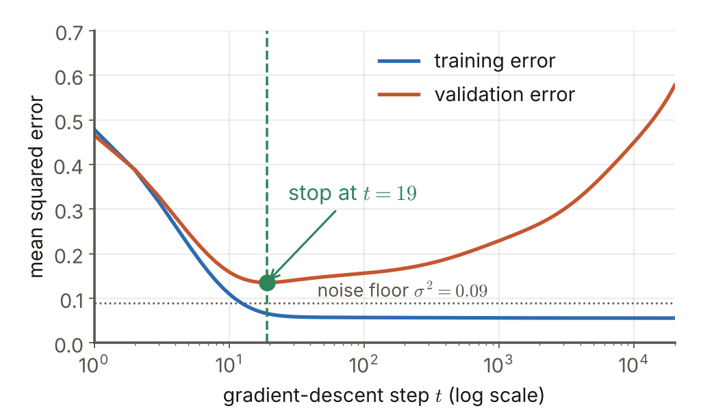

# 第4週 KP10：早停法（Early stopping）

> 程度：大學生（undergrad）／Level: Undergraduate (undergrad)

本講義是第4週「正則化與過擬合」的第十個知識點（KP10），承接 KP09 留下的問題：$\ell_2$ 與 $\ell_1$ 都是靠**改目標函數**來限制模型，那能不能完全不改目標，只靠「少訓練幾步」得到類似的正則化？先備知識是 KP05 的訓練與驗證誤差曲線、KP08 的 $\ell_2$ 收縮與權重衰減；第一次出現的符號都會定義，所有數字都可以自己重算。內容依 CCC-LNS 第5章 KP15 主文與教授祕笈消化後重新撰寫，並依大學部程度縮減（只保留結果與數字例，不推導）；讀取日期 2026-10-20；來源沒有的內容標示 `[補充]`。

This is the tenth knowledge point (KP10) of Week 4, "Regularization and overfitting". It picks up the question KP09 left open: $\ell_2$ and $\ell_1$ both limit the model by **changing the objective**, so can we get a similar regularization without changing the objective at all, just by training fewer steps? It assumes the training and validation error curves of KP05 and the $\ell_2$ shrinkage and weight decay of KP08; every symbol is defined when it first appears and every number can be recomputed. The text is rewritten from the KP15 main text and professor's guide of CCC-LNS Chapter 5 and shortened for undergraduates (results and numerical examples only, no derivations) (accessed on 2026-10-20); content that the source does not contain is marked `[Added]`.

[下載本單元投影片](../slides/lec04-kp10-early-stopping.jbd.json)

## KP10 早停法（Early stopping）

### 學習目標（Learning objectives）

讀完之後，你能說出早停法的做法：監控驗證誤差、保留最佳權重、用耐心值決定何時放棄；能說明為什麼「少訓練幾步」也是一種正則化（曲率大的方向先到位，曲率小的方向還沒走完）；能用 $\alpha\approx1/(t\eta)$ 把早停的步數換算成大概相當的權重衰減強度；也能說明這個對應只是近似，並用數字找出它在哪裡失靈。

After reading, you can state how early stopping works: monitor the validation error, keep the best weights and let a patience value decide when to give up; explain why "training fewer steps" is also a kind of regularization (high-curvature directions arrive first, low-curvature directions have not finished); use $\alpha\approx1/(t\eta)$ to convert the number of steps of early stopping into a roughly equivalent weight-decay strength; and explain that the correspondence is only approximate and find with numbers where it fails.

### 符號表（Symbols）

| 符號 | 中文意義 | English meaning |
|---|---|---|
| $t$ | 梯度下降已走的步數 | number of gradient-descent steps taken |
| $\eta$ | 學習率 | learning rate |
| $\mathbf{w}^{(t)}$ | 第 $t$ 步的權重，$\mathbf{w}^{(0)}=\mathbf 0$ | weights after $t$ steps, $\mathbf{w}^{(0)}=\mathbf 0$ |
| $\mathbf{w}^{*}$ | 只看資料的最佳解（損失的最低點） | the data-only optimum (the minimum of the loss) |
| $\lambda_j$ | 損失沿第 $j$ 個方向的陡度（曲率），與 KP08 的 $\lambda$ 同義 | steepness (curvature) of the loss along direction $j$, the same $\lambda$ as in KP08 |
| $\alpha$ | 權重衰減的強度 | strength of the weight decay |

### 1. 少訓練也是正則化：早停法的做法（Training less is regularization too: how early stopping works）

KP09 結束時的問題是：不改目標，能不能得到正則化？KP05 已經給了線索：訓練誤差一路下降，但新資料上的誤差先降後升，最低點就是該停的位置。**早停法**（early stopping）就是照這條曲線做：訓練時持續監控驗證誤差，驗證誤差開始上升時就停，並把驗證誤差最低那一刻的權重拿來用。

KP09 ended with a question: can we get regularization without changing the objective? KP05 already gave the clue: the training error falls all the way while the error on new data first falls and then rises, and the minimum is where to stop. **Early stopping** follows that curve: during training keep monitoring the validation error, stop when the validation error starts to rise, and use the weights from the moment of the lowest validation error.

實務上有三個細節。（1）每隔固定步數檢查一次驗證誤差，不必每一步都檢查；（2）每次出現新的最低值就**存下當時的權重**；（3）驗證誤差有雜訊，一次沒進步不代表已經過頭，所以設一個**耐心值**（patience）：連續幾次檢查都沒有創新低，才真的停，並退回存下的最佳權重。`[補充]`

There are three practical details. (1) Check the validation error every fixed number of steps, not at every step; (2) whenever a new minimum appears, **save the weights of that moment**; (3) the validation error is noisy, so one check without progress does not mean we have gone too far; set a **patience** value: stop only when several consecutive checks fail to set a new minimum, and go back to the saved best weights. `[Added]`

用一個固定亂數種子的算例看看 `[補充]`：20 筆帶雜訊的訓練資料（$y=\sin(1.5\pi x)+$ 標準差 0.3 的雜訊）、13 個 Legendre 多項式特徵，權重從 $\mathbf 0$ 出發做梯度下降。驗證誤差在第 $t=19$ 步最低，為 $0.1353$（訓練誤差 $0.0659$）；繼續訓練到 $t=20000$ 時，訓練誤差降到 $0.0556$，驗證誤差卻升到 $0.5772$〔程式計算〕。若每 10 步檢查一次、耐心值設 20 次（200 步），程式在 $t=220$ 停下，退回 $t=20$ 的權重，驗證誤差 $0.1354$。

Look at a computed example with a fixed random seed `[Added]`: 20 noisy training points ($y=\sin(1.5\pi x)+$ noise of standard deviation 0.3) and 13 Legendre polynomial features, gradient descent from $\mathbf 0$. The validation error is lowest at step $t=19$, at $0.1353$ (training error $0.0659$); training on to $t=20000$ drives the training error down to $0.0556$ while the validation error rises to $0.5772$ [computed by program]. With a check every 10 steps and a patience of 20 checks (200 steps), the program stops at $t=220$ and goes back to the weights of $t=20$, whose validation error is $0.1354$.

**圖說 `lec04-kp10-valcurve`**：先看藍色曲線（訓練誤差）：一路下降到 $0.056$ 附近就幾乎不動；再看橘色曲線（驗證誤差）：先和訓練誤差一起下降，到綠色點 $t=19$ 達到最低 $0.135$，之後緩緩上升到 $0.577$。最後比較兩條線在右端的差距：差得越多，過擬合越嚴重。虛線是雜訊地板 $\sigma^2=0.09$。這是 `[補充]` 的算例。〔功能：1、2〕

**Caption `lec04-kp10-valcurve`**: Look at the blue curve (training error) first: it falls to about $0.056$ and then hardly moves. Then the orange curve (validation error): it falls together with the training error, reaches its minimum $0.135$ at the green dot $t=19$ and then slowly rises to $0.577$. Last, compare the gap between the two lines at the right end: the larger the gap, the stronger the overfitting. The dotted line is the noise floor $\sigma^2=0.09$. This is an `[Added]` computed example. [Function: 1, 2]

### 2. 為什麼少走幾步就是正則化（Why taking fewer steps is regularization）

先看梯度下降從原點（所有權重為 $0$）出發會怎麼走。在二次損失上，每一步會把「離最佳解還剩的距離」在每個方向各縮掉 $\eta\lambda_j$ 的比例，所以走了 $t$ 步之後，第 $j$ 個方向已經走完最佳解的 $1-(1-\eta\lambda_j)^t$ 倍（條件是 $0<\eta\lambda_j<2$，否則會發散）。`[補充]` 兩個極端很直觀：$t=0$ 時每個方向都沒動；$t\to\infty$ 時走到 $\mathbf{w}^{*}$。**曲率大的方向（$\lambda_j$ 大）先走完，曲率小的方向最慢。**所以停在中途，就是「大曲率方向已經到位、小曲率方向還只走了一部分」。

First see how gradient descent moves from the origin (all weights $0$). On a quadratic loss each step removes a fraction $\eta\lambda_j$ of the remaining distance to the optimum in each direction, so after $t$ steps direction $j$ has covered $1-(1-\eta\lambda_j)^t$ of the way to the optimum (the condition is $0<\eta\lambda_j<2$, otherwise it diverges). `[Added]` The two extremes are intuitive: at $t=0$ no direction has moved; as $t\to\infty$ the weights reach $\mathbf{w}^{*}$. **Directions of large curvature (large $\lambda_j$) finish first, directions of small curvature are the slowest.** So stopping midway means "the large-curvature directions are in place and the small-curvature ones have covered only part of the way".

這和 KP08 的 $\ell_2$ 很像：$\ell_2$ 也是「陡的方向保留得多、平的方向壓得多」。例：兩個方向 $\lambda=(1,\,0.25)$、$\mathbf{w}^{*}=(1.8,\,2.6)$、$\eta=0.1$、$t=10$：第一方向走了 $1-0.9^{10}=0.6513$，第二方向走了 $1-0.975^{10}=0.2237$，所以 $\mathbf{w}^{(10)}=(0.6513\cdot1.8,\ 0.2237\cdot2.6)=(1.1724,\ 0.5815)$；程式一步一步迭代 10 次，得到同樣的結果〔程式計算〕。`[補充]`

This resembles the $\ell_2$ of KP08: $\ell_2$ also "keeps steep directions and presses flat ones". Example: two directions $\lambda=(1,\,0.25)$, $\mathbf{w}^{*}=(1.8,\,2.6)$, $\eta=0.1$, $t=10$: the first direction has covered $1-0.9^{10}=0.6513$ and the second $1-0.975^{10}=0.2237$, so $\mathbf{w}^{(10)}=(0.6513\cdot1.8,\ 0.2237\cdot2.6)=(1.1724,\ 0.5815)$; iterating the step 10 times in a program gives the same result [computed by program]. `[Added]`

### 3. 和權重衰減對照：$\alpha\approx1/(t\eta)$（Compared with weight decay: $\alpha\approx1/(t\eta)$）

KP08 說權重衰減（強度 $\alpha$）在每個方向保留 $\lambda_j/(\lambda_j+\alpha)$。把「早停保留的比例」與「權重衰減保留的比例」並排，在曲率不大的方向上兩者近似相等，這時

KP08 said that weight decay (strength $\alpha$) keeps $\lambda_j/(\lambda_j+\alpha)$ of each direction. Putting "the share kept by early stopping" next to "the share kept by weight decay", the two are approximately equal in directions of moderate curvature, and then

$$
\alpha\approx\frac{1}{t\eta},\qquad t\approx\frac{1}{\alpha\eta}
$$

這個關係式在這裡直接給出結果，不推導。`[補充]` 換句話說：**少訓練 = 更強的正則化**。例：$\eta=0.1$、在 $t=10$ 步停止，對應 $\alpha\approx1/(10\cdot0.1)=1$：「訓練 10 步就停」大約等於「用 $\alpha=1$ 的權重衰減一直訓練到收斂」。

The relation is given here as a result, without derivation. `[Added]` In other words, **training less = stronger regularization**. Example: $\eta=0.1$ and stopping at $t=10$ correspond to $\alpha\approx1/(10\cdot0.1)=1$: "train for 10 steps and stop" is roughly "train to convergence with weight decay $\alpha=1$".

用上一節的玩具題直接比較 `[補充]`：$\alpha=1$ 的權重衰減給出 $\mathbf{w}^{\dagger}=(\tfrac{1.8}{1+1},\ \tfrac{0.25}{0.25+1}\cdot2.6)=(0.9,\ 0.52)$（這裡 $\tfrac{1}{1+1}$ 是 $\lambda=1$ 的因子），而早停的 $\mathbf{w}^{(10)}=(1.1724,\ 0.5815)$；兩者的距離是 $0.279$，只有 $|\mathbf{w}^{*}|=3.162$ 的 $8.8\%$〔程式計算〕。第二個方向（小曲率）幾乎貼在一起，第一個方向（大曲率）有差距。

Compare directly on the toy problem of the last section `[Added]`: weight decay with $\alpha=1$ gives $\mathbf{w}^{\dagger}=(\tfrac{1.8}{1+1},\ \tfrac{0.25}{0.25+1}\cdot2.6)=(0.9,\ 0.52)$ (here $\tfrac{1}{1+1}$ is the factor for $\lambda=1$) while early stopping has $\mathbf{w}^{(10)}=(1.1724,\ 0.5815)$; their distance is $0.279$, only $8.8\%$ of $|\mathbf{w}^{*}|=3.162$ [computed by program]. The second direction (small curvature) lies almost on top of each other, the first direction (large curvature) has a gap.

**圖說 `lec04-kp10-paths`**：灰色橢圓是損失的等高線，綠色星號是最佳解 $\mathbf{w}^{*}$。先看橘色的點（梯度下降每一步）：從原點出發，先朝橢圓短軸方向（曲率大的 $w_1$）快速前進，再慢慢往長軸方向（曲率小的 $w_2$）爬；圈起來的是 $t=10$。再看藍色虛線：這是權重衰減的最佳解隨 $\alpha$ 從大到小的軌跡，方塊是 $\alpha=1$。兩條路徑形狀相近，在 $\alpha=1$、$t=10$ 附近靠得很近但沒有重合。〔功能：1、3〕

**Caption `lec04-kp10-paths`**: The grey ellipses are the contours of the loss and the green star is the optimum $\mathbf{w}^{*}$. First follow the orange dots (every gradient-descent step): starting at the origin, they first move quickly along the short axis of the ellipse (the high-curvature $w_1$) and then slowly climb along the long axis (the low-curvature $w_2$); the circle marks $t=10$. Then the blue dashed line: it is the trajectory of the weight-decay optimum as $\alpha$ goes from large to small, and the square is $\alpha=1$. The two paths have similar shapes and come close near $\alpha=1$, $t=10$ without coinciding. [Function: 1, 3]

### 4. 這個對應有多準，實務怎麼用（How exact is the correspondence, and the practical recipe）

上面的 $\alpha\approx1/(t\eta)$ 要打折扣。對每個方向，真正要對上的是 $(1-\eta\lambda)^t$ 與 $\alpha/(\lambda+\alpha)$；用 $\eta=0.1$、$t=10$、$\alpha=1$ 算：

The $\alpha\approx1/(t\eta)$ above has to be discounted. In every direction what must match are $(1-\eta\lambda)^t$ and $\alpha/(\lambda+\alpha)$; with $\eta=0.1$, $t=10$, $\alpha=1$:

| $\lambda$ | $\eta\lambda$ | $(1-\eta\lambda)^{10}$ | $\alpha/(\lambda+\alpha)$ | 早停保留 | 權重衰減保留 |
|---|---|---|---|---|---|
| 0.1 | 0.01 | 0.9044 | 0.9091 | 0.0956 | 0.0909 |
| 0.25 | 0.025 | 0.7763 | 0.8000 | 0.2237 | 0.2000 |
| 0.5 | 0.05 | 0.5987 | 0.6667 | 0.4013 | 0.3333 |
| 1 | 0.1 | 0.3487 | 0.5000 | 0.6513 | 0.5000 |
| 4 | 0.4 | 0.0060 | 0.2000 | 0.9940 | 0.8000 |

| $\lambda$ | $\eta\lambda$ | $(1-\eta\lambda)^{10}$ | $\alpha/(\lambda+\alpha)$ | Kept by early stopping | Kept by weight decay |
|---|---|---|---|---|---|
| 0.1 | 0.01 | 0.9044 | 0.9091 | 0.0956 | 0.0909 |
| 0.25 | 0.025 | 0.7763 | 0.8000 | 0.2237 | 0.2000 |
| 0.5 | 0.05 | 0.5987 | 0.6667 | 0.4013 | 0.3333 |
| 1 | 0.1 | 0.3487 | 0.5000 | 0.6513 | 0.5000 |
| 4 | 0.4 | 0.0060 | 0.2000 | 0.9940 | 0.8000 |

〔程式計算〕小曲率（$\lambda=0.1$）兩邊只差 $0.0047$；$\lambda$ 越大差距越大，到 $\lambda=4$ 時早停幾乎走完（$0.994$），權重衰減還只保留 $0.8$。**同一組 $(t,\alpha)$ 不可能讓所有方向同時對上**：要對上一個方向，就必須調整 $\alpha$，而別的方向就會對不上。所以等價是整體趨勢上的，不是逐一方向的恆等式。

[Computed by program.] For small curvature ($\lambda=0.1$) the two differ by only $0.0047$; the larger $\lambda$ is the larger the gap, and at $\lambda=4$ early stopping has almost finished ($0.994$) while weight decay still keeps only $0.8$. **One pair $(t,\alpha)$ cannot match all directions at once**: matching one direction requires adjusting $\alpha$, and then other directions no longer match. So the equivalence holds as a general trend, not as an identity direction by direction.

所以實務上怎麼用？（1）保留一份驗證集（KP01），每隔幾步量驗證誤差；（2）存下最低驗證誤差時的權重；（3）設耐心值，連續幾次沒進步才停，然後退回最佳權重；（4）學習率要夠小，否則梯度下降本身就發散。要注意驗證集也被用來選停止點，所以它對最終的測試誤差已經略為樂觀，真正的測試集仍然要另外保留（KP01、KP04）。早停法的好處是幾乎不花額外計算（反而少算），代價是需要一份驗證資料，且「停止點」成了一個要看資料決定的超參數。

So how is it used in practice? (1) Keep a validation set (KP01) and measure the validation error every few steps; (2) save the weights of the lowest validation error; (3) set a patience value, stop only after several consecutive checks without progress and go back to the best weights; (4) keep the learning rate small enough, otherwise gradient descent itself diverges. Note that the validation set was also used to choose the stopping point, so it is slightly optimistic about the final test error and a real test set must still be kept apart (KP01, KP04). The benefit of early stopping is that it costs almost no extra computation (it even computes less); the price is that a validation set is needed and the "stopping point" becomes a hyperparameter decided by the data.

到這裡，我們處理的是**一個模型**的複雜度：改目標、少訓練。下一個問題是：訓練時能不能隨機關掉一部分神經元，逼網路不要過度依賴任何一個？這是 KP11 Dropout 的主題。

So far we have been controlling the complexity of **one model**: change the objective, train less. The next question: can we switch off a random part of the neurons during training, so that the network cannot depend too much on any single one? That is the topic of KP11, dropout.

### 本單元重點整理（KP10 summary）

**一句話重點**：早停法監控驗證誤差、在最低點停下並保留最佳權重；二次損失上，梯度下降從 $\mathbf 0$ 走 $t$ 步在每個方向保留 $1-(1-\eta\lambda_j)^t$（大曲率先到位），大致相當於權重衰減 $\alpha\approx1/(t\eta)$：少訓練就是更強的正則化。

**One-sentence summary**: Early stopping monitors the validation error, stops at its minimum and keeps the best weights; on a quadratic loss, $t$ gradient-descent steps from $\mathbf 0$ keep $1-(1-\eta\lambda_j)^t$ of each direction (large curvature arrives first), which is roughly weight decay with $\alpha\approx1/(t\eta)$: training less is stronger regularization.

**白話說明**：煮麵不是煮越久越好：太少會硬（欠擬合），太久會爛（過擬合）。早停就是「撈起來的時機」；權重衰減則像一開始就少放一點麵。兩者都讓碗裡的麵軟硬度差不多，但前者靠時間、後者靠份量。

**Plain explanation**: Cooking noodles longer is not always better: too short and they are hard (underfitting), too long and they are mushy (overfitting). Early stopping is "the moment to take them out"; weight decay is like putting in a little less noodle in the first place. Both bring the softness in the bowl to a similar level, the first by time and the second by amount.

**正式定義**：第 $j$ 個方向保留 $1-(1-\eta\lambda_j)^t$（$\mathbf{w}^{(0)}=\mathbf 0$、二次損失、$0<\eta\lambda_j<2$）；權重衰減保留 $\lambda_j/(\lambda_j+\alpha)$；近似對應 $\alpha\approx1/(t\eta)$。

**Formal definition**: direction $j$ keeps $1-(1-\eta\lambda_j)^t$ ($\mathbf{w}^{(0)}=\mathbf 0$, quadratic loss, $0<\eta\lambda_j<2$); weight decay keeps $\lambda_j/(\lambda_j+\alpha)$; approximate correspondence $\alpha\approx1/(t\eta)$.

**例子**：$\eta=0.1$、$t=10$ 對應 $\alpha\approx1$；$\lambda=0.5$ 時 $(0.95)^{10}=0.5987$ 對 $1/1.5=0.6667$，$\lambda=0.1$ 時 $0.9044$ 對 $0.9091$，$\lambda=4$ 時 $0.0060$ 對 $0.2000$。逐步計算見第 3–4 節。

**Example**: $\eta=0.1$, $t=10$ correspond to $\alpha\approx1$; for $\lambda=0.5$, $(0.95)^{10}=0.5987$ against $1/1.5=0.6667$, for $\lambda=0.1$, $0.9044$ against $0.9091$, for $\lambda=4$, $0.0060$ against $0.2000$. The computations are in sections 3–4.

**常見迷思**：

- 「早停只看訓練誤差」——看的是**驗證**誤差；訓練誤差一路下降，看它不知道何時該停。
- 「停得越早越好」——太早會欠擬合；要停在驗證誤差最低點。
- 「$\alpha\approx1/(t\eta)$ 是精確等價」——它是小 $\eta\lambda$、二次近似下的近似，大曲率方向對不上。
- 「早停沒有超參數」——停止點與耐心值要靠驗證資料決定；學習率也必須夠小。

**Common misconceptions**:

- "Early stopping looks only at the training error." It looks at the **validation** error; the training error falls all the way and does not tell when to stop.
- "The earlier the better." Too early underfits; stop at the lowest validation error.
- "$\alpha\approx1/(t\eta)$ is an exact equivalence." It is an approximation for small $\eta\lambda$ under a quadratic model; large-curvature directions do not match.
- "Early stopping has no hyperparameter." The stopping point and the patience are decided with validation data, and the learning rate must be small enough.

**圖**：本單元兩張圖，`lec04-kp10-valcurve`（訓練與驗證誤差隨步數變化與早停點，功能 1、2）與 `lec04-kp10-paths`（二次損失上梯度下降與權重衰減的路徑，功能 1、3），以 `assets/figures/src/lec04-kp10-figures.py` 繪製。每個方向保留比例的比較在簡報中以原生節點與表格呈現。

**Figure**: Two figures in this unit, `lec04-kp10-valcurve` (training and validation error against steps with the stopping point; functions 1, 2) and `lec04-kp10-paths` (paths of gradient descent and of weight decay on a quadratic loss; functions 1, 3), drawn by `assets/figures/src/lec04-kp10-figures.py`. The comparison of the kept share per direction is drawn with native nodes and a table in the deck.

**小練習**：

1. $\eta=0.05$、在 $t=40$ 步停止：對應的權重衰減強度 $\alpha\approx$ 多少？反過來，要對應 $\alpha=0.25$，$\eta=0.05$ 時該停在第幾步？（提示：$\alpha\approx1/(t\eta)$、$t\approx1/(\alpha\eta)$。）
2. 單一方向 $\lambda=2$、$\eta=0.1$、$t=5$、取 $\alpha=1/(t\eta)$：算早停保留的比例 $1-(1-\eta\lambda)^t$ 與權重衰減保留的比例 $\lambda/(\lambda+\alpha)$，兩者相差多少？（提示：先算 $\alpha$，再算 $0.8^5$。）
3. 每次檢查得到的驗證誤差依序是 $0.40,\,0.25,\,0.18,\,0.15,\,0.16,\,0.17,\,0.18,\,0.19$，耐心值是 3 次：在第幾次檢查停止？退回哪一次的權重？（提示：連續 3 次沒有創新低才停。）

**Practice**:

1. $\eta=0.05$, stopping at $t=40$: what weight-decay strength $\alpha\approx$ does it correspond to? Conversely, to correspond to $\alpha=0.25$ at $\eta=0.05$, at which step should one stop? (Hint: $\alpha\approx1/(t\eta)$ and $t\approx1/(\alpha\eta)$.)
2. One direction with $\lambda=2$, $\eta=0.1$, $t=5$ and $\alpha=1/(t\eta)$: compute the share kept by early stopping $1-(1-\eta\lambda)^t$ and the share kept by weight decay $\lambda/(\lambda+\alpha)$; by how much do they differ? (Hint: compute $\alpha$ first, then $0.8^5$.)
3. The validation errors at the successive checks are $0.40,\,0.25,\,0.18,\,0.15,\,0.16,\,0.17,\,0.18,\,0.19$ and the patience is 3 checks: at which check does training stop, and the weights of which check are restored? (Hint: stop only after 3 consecutive checks without a new minimum.)

**解題示範**（以 $\eta=0.1$、$t=20$、一個 $\lambda=0.1$ 的方向示範第 1、2 題的算法）：

1. 對應強度：$\alpha\approx1/(t\eta)=1/(20\cdot0.1)=0.5$。
2. 早停要對上的量：$(1-\eta\lambda)^t=(1-0.01)^{20}=0.99^{20}=0.8179$。
3. 權重衰減的量：$\alpha/(\lambda+\alpha)=0.5/(0.1+0.5)=0.8333$。
4. 兩者差 $0.8333-0.8179=0.0154$，小曲率（$\eta\lambda=0.01$）時對得相當好。
5. 保留比例：早停 $1-0.8179=0.1821$；權重衰減 $1-0.8333=0.1667$。

**Worked solution** (the method of exercises 1 and 2, shown with $\eta=0.1$, $t=20$ and one direction with $\lambda=0.1$):

1. Corresponding strength: $\alpha\approx1/(t\eta)=1/(20\cdot0.1)=0.5$.
2. The quantity early stopping must match: $(1-\eta\lambda)^t=(1-0.01)^{20}=0.99^{20}=0.8179$.
3. The quantity of weight decay: $\alpha/(\lambda+\alpha)=0.5/(0.1+0.5)=0.8333$.
4. They differ by $0.8333-0.8179=0.0154$, a good match for small curvature ($\eta\lambda=0.01$).
5. Kept shares: early stopping $1-0.8179=0.1821$; weight decay $1-0.8333=0.1667$.

### 來源更正與取捨（Corrections to the source）

- 來源把早停與權重衰減的對應寫成一個矩陣等式，並說「取對數並 Taylor 近似」得到 $\alpha\approx1/(t\eta)$。這個等式是**逐一方向**的：同一組 $(t,\alpha)$ 不可能讓所有 $\lambda_j$ 同時成立（例：$\lambda=0.1$ 與 $\lambda=4$ 在 $t=10$、$\alpha=1$ 時差距分別是 $0.0047$ 與 $0.194$）。本講義明說它只是近似，條件是 $\eta\lambda_j$ 不大且 $\lambda_j\ll\alpha$；為了大學部程度，推導從略。
- 來源只說「二次近似與小學習率下成立」；本講義補上穩定條件 $0<\eta\lambda_j<2$，否則梯度下降發散，保留比例的式子不再成立。
- 來源說早停「對應 $\mathbf{Err}$ 的最低點」。本講義保留，並補充兩點：驗證誤差只是新資料誤差的估計，而且驗證集被用來選停止點後，不能再當作無偏的測試誤差（KP01、KP04）。

- The source writes the correspondence between early stopping and weight decay as one matrix equality and says that "taking logarithms and a Taylor approximation" give $\alpha\approx1/(t\eta)$. That equality is **direction by direction**: one pair $(t,\alpha)$ cannot make all $\lambda_j$ hold at once (for example $\lambda=0.1$ and $\lambda=4$ differ by $0.0047$ and $0.194$ at $t=10$, $\alpha=1$). This note says plainly that it is only an approximation, valid when $\eta\lambda_j$ is not large and $\lambda_j\ll\alpha$; for undergraduates the derivation is omitted.
- The source says only "holds under a quadratic approximation and a small learning rate"; this note adds the stability condition $0<\eta\lambda_j<2$, otherwise gradient descent diverges and the formula for the kept share no longer holds.
- The source says early stopping "corresponds to the minimum of the true error". This note keeps that and adds two points: the validation error is only an estimate of the error on new data, and once the validation set has been used to choose the stopping point it can no longer serve as an unbiased test error (KP01, KP04).

### 術語對照（Terminology）

| 中文 | English |
|---|---|
| 早停法 | early stopping |
| 耐心值 | patience |
| 驗證誤差 | validation error |
| 權重衰減 | weight decay |
| 曲率（陡度） | curvature (steepness) |
| 學習率 | learning rate |
| 二次損失 | quadratic loss |
