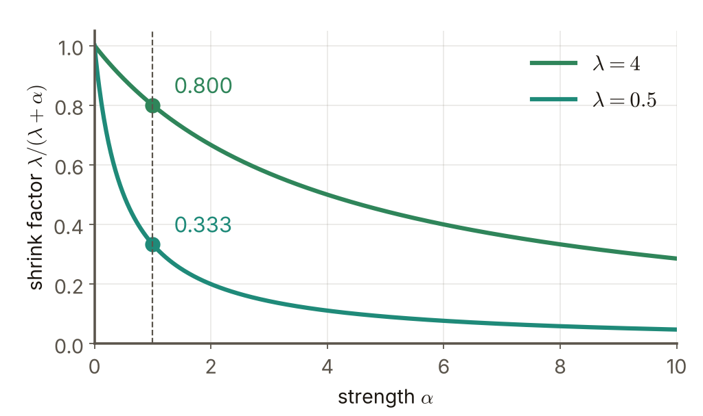

# 第4週 KP12：L2 正則化與收縮（L2 regularization and shrinkage）

> 程度：大學生（undergrad）／Level: Undergraduate (undergrad)

本講義是第4章「正則化與過擬合」的第十二個知識點（KP12），承接 KP11 留下的問題：$\ell_2$ 懲罰在有很多參數、彼此相關的問題裡，是不是把每個方向縮小同樣的比例？先備知識是 KP11 的 $\tilde J=J+\alpha\Omega$、KP07 的敏感度，以及線性代數裡矩陣的特徵分解（對稱矩陣可以對角化）。本講義的內容取自 CCC-LNS 第5章 KP12 主文與教授祕笈，讀取日期 2026-10-20；來源沒有的補充一律標記 `[補充]`。

This is the twelfth knowledge point (KP12) of Chapter 4. It picks up the question KP11 left open: in a problem with many correlated parameters, does an $\ell_2$ penalty shrink every direction by the same factor? It assumes $\tilde J=J+\alpha\Omega$ of KP11, the sensitivity of KP07 and the eigendecomposition of a matrix (a symmetric matrix can be diagonalized). The content is taken from CCC-LNS Chapter 5, KP12 main text and the professor's guide, read on 2026-10-20; everything not in the source is marked `[Added]`.

[下載本單元投影片](../slides/lec04-kp12-l2-regularization-shrinkage.jbd.json)

## KP12 L2 正則化與收縮（L2 regularization and shrinkage）

### 學習目標（Learning objectives）

讀完之後，你能寫出 $\ell_2$ 正則化的解 $\mathbf{x}^{\dagger}=(\mathbf{H}+\alpha\mathbf{I})^{-1}\mathbf{H}\mathbf{x}^{\ast}$ 並說出它從哪個近似推出來；能用特徵分解說明每個特徵方向被乘上 $\lambda_j/(\lambda_j+\alpha)$；能用一組數字算出收縮後的解與有效參數量；也能說明為什麼 $\ell_2$ 只縮小、不歸零，並把有效參數量接回 KP07 的複雜度。

After reading, you can write the $\ell_2$-regularized solution $\mathbf{x}^{\dagger}=(\mathbf{H}+\alpha\mathbf{I})^{-1}\mathbf{H}\mathbf{x}^{\ast}$ and say which approximation it comes from; use the eigendecomposition to show that each eigen-direction is multiplied by $\lambda_j/(\lambda_j+\alpha)$; compute the shrunk solution and the effective number of parameters from a set of numbers; and explain why $\ell_2$ only shrinks and never zeroes, linking the effective number of parameters back to the complexity of KP07.

### 符號表（Symbols）

| 符號 | 中文意義 | English meaning |
|---|---|---|
| $\mathbf{x}^{\ast}$ | 無正則化的最佳解，滿足 $\nabla J(\mathbf{x}^{\ast})=\mathbf{0}$ | the unregularized optimum, with $\nabla J(\mathbf{x}^{\ast})=\mathbf{0}$ |
| $\mathbf{x}^{\dagger}$ | $\ell_2$ 正則化後的解 | the solution after $\ell_2$ regularization |
| $\mathbf{H}$ | $J$ 在 $\mathbf{x}^{\ast}$ 的 Hessian（二階導數矩陣），對稱且半正定 | the Hessian (matrix of second derivatives) of $J$ at $\mathbf{x}^{\ast}$, symmetric and positive semidefinite |
| $\mathbf{U},\ \mathbf{\Lambda}$ | 特徵分解 $\mathbf{H}=\mathbf{U}\mathbf{\Lambda}\mathbf{U}^{\top}$：$\mathbf{U}$ 的欄是特徵方向，$\mathbf{\Lambda}=\mathrm{diag}(\lambda_1,\dots,\lambda_d)$ | eigendecomposition $\mathbf{H}=\mathbf{U}\mathbf{\Lambda}\mathbf{U}^{\top}$: the columns of $\mathbf{U}$ are the eigen-directions, $\mathbf{\Lambda}=\mathrm{diag}(\lambda_1,\dots,\lambda_d)$ |
| $\lambda_j$ | 第 $j$ 個特徵值：沿該方向離開 $\mathbf{x}^{\ast}$ 時 $J$ 上升有多快（曲率） | the $j$-th eigenvalue: how fast $J$ rises when moving away from $\mathbf{x}^{\ast}$ along that direction (curvature) |
| $\alpha>0$ | $\ell_2$ 懲罰的強度 | strength of the $\ell_2$ penalty |
| $\lambda_j/(\lambda_j+\alpha)$ | 第 $j$ 個方向的收縮因子 | the shrink factor of the $j$-th direction |

### 1. 從無正則化的解出發（Starting from the unregularized solution）

KP11 的結尾問：$\ell_2$ 懲罰把解推到哪裡？先把目標寫清楚。本單元的 $\ell_2$ 目標是

KP11 ended by asking where an $\ell_2$ penalty pushes the solution. First, the objective of this unit:

$$
\tilde J(\mathbf{x})=J(\mathbf{x})+\frac{\alpha}{2}\|\mathbf{x}\|_2^2
$$

懲罰項前面多一個 $\tfrac12$，只是為了微分時把 $2$ 消掉：$\nabla\big(\tfrac{\alpha}{2}\|\mathbf{x}\|_2^2\big)=\alpha\mathbf{x}$。這個 $\alpha$ 與 KP11 的 $\alpha\Omega$（$\Omega=\|\mathbf{x}\|_2^2$）差一個因子 $2$：本單元的 $\alpha$ 等於 KP11 的 $2\alpha$，下面第 2 節會用數字核對。

The factor $\tfrac12$ in front of the penalty only cancels the $2$ when differentiating: $\nabla\big(\tfrac{\alpha}{2}\|\mathbf{x}\|_2^2\big)=\alpha\mathbf{x}$. This $\alpha$ differs from the $\alpha\Omega$ of KP11 (with $\Omega=\|\mathbf{x}\|_2^2$) by a factor of $2$: the $\alpha$ of this unit equals twice the KP11 $\alpha$, which section 2 checks with numbers.

$J$ 一般很複雜，沒法直接解 $\nabla\tilde J=\mathbf{0}$。做法是在無正則化的解 $\mathbf{x}^{\ast}$ 附近，把 $J$ 換成它的二次 Taylor 近似。因為 $\nabla J(\mathbf{x}^{\ast})=\mathbf{0}$，一次項消失：

$J$ is generally complicated, so $\nabla\tilde J=\mathbf{0}$ cannot be solved directly. The method is to replace $J$ near the unregularized solution $\mathbf{x}^{\ast}$ by its second-order Taylor approximation. Because $\nabla J(\mathbf{x}^{\ast})=\mathbf{0}$, the first-order term vanishes:

$$
J(\mathbf{x})\approx J(\mathbf{x}^{\ast})+\tfrac12(\mathbf{x}-\mathbf{x}^{\ast})^{\top}\mathbf{H}(\mathbf{x}-\mathbf{x}^{\ast})
$$

把它代入 $\tilde J$ 並令梯度為零：

Substitute it into $\tilde J$ and set the gradient to zero:

$$
\mathbf{H}(\mathbf{x}-\mathbf{x}^{\ast})+\alpha\mathbf{x}=\mathbf{0}
\;\Longrightarrow\;
(\mathbf{H}+\alpha\mathbf{I})\,\mathbf{x}=\mathbf{H}\mathbf{x}^{\ast}
\;\Longrightarrow\;
\mathbf{x}^{\dagger}=(\mathbf{H}+\alpha\mathbf{I})^{-1}\mathbf{H}\,\mathbf{x}^{\ast}
$$

$\mathbf{H}$ 半正定，所以只要 $\alpha>0$，$\mathbf{H}+\alpha\mathbf{I}$ 一定可逆，解存在且唯一。$\alpha=0$ 時 $\mathbf{x}^{\dagger}=\mathbf{x}^{\ast}$（只要 $\mathbf{H}$ 可逆）；$\alpha$ 越大，解越被拉向原點。

$\mathbf{H}$ is positive semidefinite, so for $\alpha>0$ the matrix $\mathbf{H}+\alpha\mathbf{I}$ is always invertible and the solution exists and is unique. At $\alpha=0$, $\mathbf{x}^{\dagger}=\mathbf{x}^{\ast}$ (when $\mathbf{H}$ is invertible); the larger $\alpha$, the more the solution is pulled toward the origin.

只有一個參數時，$\mathbf{H}$ 就是一個數 $\lambda$，公式變成 $x^{\dagger}=\dfrac{\lambda}{\lambda+\alpha}x^{\ast}$：一個固定比例的縮小。多個參數的問題更有趣：$\mathbf{H}$ 的各個方向 $\lambda$ 不同，縮小的比例會不會也不同？這是下一節的問題。

With a single parameter, $\mathbf{H}$ is just a number $\lambda$ and the formula becomes $x^{\dagger}=\dfrac{\lambda}{\lambda+\alpha}x^{\ast}$: shrinking by a fixed ratio. A problem with several parameters is more interesting: the directions of $\mathbf{H}$ have different $\lambda$, so is the ratio different too? That is the question of the next section.

### 2. 沿特徵方向收縮（Shrinking along the eigen-directions）

承接上一節：把 $\mathbf{H}$ 做特徵分解 $\mathbf{H}=\mathbf{U}\mathbf{\Lambda}\mathbf{U}^{\top}$，則 $\mathbf{H}+\alpha\mathbf{I}=\mathbf{U}(\mathbf{\Lambda}+\alpha\mathbf{I})\mathbf{U}^{\top}$，代入得

Continuing from the previous section: take the eigendecomposition $\mathbf{H}=\mathbf{U}\mathbf{\Lambda}\mathbf{U}^{\top}$, so that $\mathbf{H}+\alpha\mathbf{I}=\mathbf{U}(\mathbf{\Lambda}+\alpha\mathbf{I})\mathbf{U}^{\top}$, and substitute:

$$
\mathbf{x}^{\dagger}=\mathbf{U}(\mathbf{\Lambda}+\alpha\mathbf{I})^{-1}\mathbf{\Lambda}\,\mathbf{U}^{\top}\mathbf{x}^{\ast}
$$

這個式子分三步讀：（1）$\mathbf{U}^{\top}\mathbf{x}^{\ast}$ 把 $\mathbf{x}^{\ast}$ 轉到特徵方向的座標；（2）中間的對角矩陣把第 $j$ 個座標乘上 $\lambda_j/(\lambda_j+\alpha)$；（3）最左邊的 $\mathbf{U}$ 再轉回原來的座標。**每個特徵方向的收縮比例不同**，不是把所有權重乘同一個數。

Read the formula in three steps: (1) $\mathbf{U}^{\top}\mathbf{x}^{\ast}$ rotates $\mathbf{x}^{\ast}$ into eigen-direction coordinates; (2) the diagonal matrix in the middle multiplies the $j$-th coordinate by $\lambda_j/(\lambda_j+\alpha)$; (3) the leftmost $\mathbf{U}$ rotates back to the original coordinates. **The shrink ratio differs from one eigen-direction to the next**; it is not one number applied to all the weights.

為什麼是這個比例？$\lambda_j$ 是沿第 $j$ 個方向離開 $\mathbf{x}^{\ast}$ 時 $J$ 上升的速度。$\lambda_j\gg\alpha$：往原點走一步，$J$ 馬上大漲，懲罰省下的那點不夠補，所以這個方向幾乎不動，因子接近 $1$。$\lambda_j\ll\alpha$：沿這個方向走很遠 $J$ 也變不多，懲罰贏了，所以這個方向被大幅壓縮，因子接近 $0$。$\lambda_j=\alpha$ 時因子剛好是 $\tfrac12$。

Why this ratio? $\lambda_j$ is how fast $J$ rises when leaving $\mathbf{x}^{\ast}$ along the $j$-th direction. For $\lambda_j\gg\alpha$, a step toward the origin makes $J$ jump, the little the penalty saves cannot pay for it, so this direction hardly moves and the factor is close to $1$. For $\lambda_j\ll\alpha$, going far along the direction hardly changes $J$, so the penalty wins and the direction is compressed strongly, with a factor close to $0$. At $\lambda_j=\alpha$ the factor is exactly $\tfrac12$.

用兩個特徵值 $\lambda_1=4$、$\lambda_2=0.5$、$\alpha=1$ 算一遍：

Compute it with two eigenvalues, $\lambda_1=4$, $\lambda_2=0.5$, and $\alpha=1$:

- 方向 1：$4/(4+1)=0.8$。
- 方向 2：$0.5/(0.5+1)=0.3333$。
- 若 $\mathbf{x}^{\ast}$ 在特徵方向座標裡是 $(10,10)$，則 $\mathbf{x}^{\dagger}=(0.8\cdot10,\ 0.3333\cdot10)=(8,\ 3.3333)$。

- Direction 1: $4/(4+1)=0.8$.
- Direction 2: $0.5/(0.5+1)=0.3333$.
- If $\mathbf{x}^{\ast}$ is $(10,10)$ in the eigen-direction coordinates, then $\mathbf{x}^{\dagger}=(0.8\cdot10,\ 0.3333\cdot10)=(8,\ 3.3333)$.

陡的方向 1 只少了 $20\%$，平的方向 2 少了約 $67\%$。為了確認「特徵方向」這個說法在座標轉過以後仍然成立，我們把同一個 $\mathbf{H}$ 轉了 $-25^{\circ}$，使它不再是對角矩陣：$\mathbf{H}=\begin{pmatrix}3.3749&-1.3406\\-1.3406&1.1251\end{pmatrix}$，此時 $\mathbf{x}^{\ast}=(13.2893,\ 4.8369)$。直接算 $(\mathbf{H}+\alpha\mathbf{I})^{-1}\mathbf{H}\mathbf{x}^{\ast}=(8.6592,\ -0.3599)$，把它轉回特徵方向座標得到 $(8,\ 3.3333)$，與上面逐方向相乘的結果一致，最大差距 $8.9\times10^{-16}$（浮點誤差）〔程式計算〕。同時在 $\mathbf{x}^{\dagger}$ 處 $\nabla\tilde J$ 的兩個分量都是 $0$，確認它真的是最小點。

The steep direction 1 loses only $20\%$, the flat direction 2 about $67\%$. To confirm that "eigen-direction" still means what it says after the coordinates are rotated, we rotated the same $\mathbf{H}$ by $-25^{\circ}$ so that it is no longer diagonal: $\mathbf{H}=\begin{pmatrix}3.3749&-1.3406\\-1.3406&1.1251\end{pmatrix}$, and now $\mathbf{x}^{\ast}=(13.2893,\ 4.8369)$. Computing $(\mathbf{H}+\alpha\mathbf{I})^{-1}\mathbf{H}\mathbf{x}^{\ast}$ directly gives $(8.6592,\ -0.3599)$; rotated back to the eigen-direction coordinates it is $(8,\ 3.3333)$, equal to the direction-by-direction result above, with a maximum difference of $8.9\times10^{-16}$ (floating-point error) [computed by program]. At $\mathbf{x}^{\dagger}$ both components of $\nabla\tilde J$ are $0$, which confirms that it is the minimum.

**圖說 `lec04-kp12-ellipse`**：先看橘色等高線，它通過 $\mathbf{x}^{\dagger}$，是 $J$ 在 $\mathbf{x}^{\dagger}$ 的高度；灰色虛線通過原點，是 $J(\mathbf{0})=225$ 的高度。再看兩段摺線：藍色是 $\mathbf{x}^{\ast}$ 在 $\mathbf{u}_1$、$\mathbf{u}_2$ 上的兩個分量（$10$、$10$），橘色是 $\mathbf{x}^{\dagger}$ 的分量（$8$、$3.33$）。沿橢圓長軸的 $\mathbf{u}_2$ 方向縮得多，沿短軸的 $\mathbf{u}_1$ 縮得少：橢圓越扁的方向（$J$ 越平）被壓得越厲害。〔功能：1、3〕

**Caption `lec04-kp12-ellipse`**: Look first at the orange contour: it passes through $\mathbf{x}^{\dagger}$ and is the level of $J$ at $\mathbf{x}^{\dagger}$; the grey dashed contour passes through the origin and is the level $J(\mathbf{0})=225$. Then follow the two broken lines: the blue one is the two components of $\mathbf{x}^{\ast}$ along $\mathbf{u}_1$ and $\mathbf{u}_2$ ($10$ and $10$), the orange one is those of $\mathbf{x}^{\dagger}$ ($8$ and $3.33$). The direction along the long axis of the ellipse, $\mathbf{u}_2$, shrinks a lot and the one along the short axis, $\mathbf{u}_1$, shrinks little: the flatter the ellipse in a direction ($J$ flatter), the stronger the compression. [Function: 1, 3]

再看收縮因子怎麼隨 $\alpha$ 變。$\lambda=4$ 與 $\lambda=0.5$ 兩條曲線都從 $1$ 出發往下掉，但平的方向掉得快得多：

Now see how the shrink factor depends on $\alpha$. Both curves, $\lambda=4$ and $\lambda=0.5$, start at $1$ and fall, but the flat direction falls much faster:

**圖說 `lec04-kp12-factor`**：先看虛線 $\alpha=1$ 上的兩個點，$0.800$ 與 $0.333$，就是上面算出的兩個因子；再沿著兩條曲線往右看，$\alpha=10$ 時分別剩 $0.286$ 與 $0.048$。曲線永遠大於 $0$：因子每一點都是正的，所以這個縮小不會剛好歸零。〔功能：1、2〕

**Caption `lec04-kp12-factor`**: Look first at the two points on the dashed line $\alpha=1$, $0.800$ and $0.333$, the two factors computed above; then follow the curves to the right, where at $\alpha=10$ they have fallen to $0.286$ and $0.048$. The curves stay above $0$ everywhere: every factor is positive, so this shrinking never reaches exactly zero. [Function: 1, 2]

最後核對與 KP11 的關係。KP11 的一個權重例子 $J=(w-w^{\ast})^2$ 的二階導數是 $\mathbf{H}=2$，懲罰 $\alpha_{\text{K}}w^2=\tfrac{2\alpha_{\text{K}}}{2}w^2$，所以本單元的 $\alpha=2\alpha_{\text{K}}$，因子 $\dfrac{2}{2+2\alpha_{\text{K}}}=\dfrac{1}{1+\alpha_{\text{K}}}$，正好是 KP11 的 $w^{\dagger}=w^{\ast}/(1+\alpha_{\text{K}})$。$\alpha_{\text{K}}=0.5,\,1,\,3$ 時分別是 $0.6667,\,0.5000,\,0.2500$，兩種寫法的數字相同〔程式計算〕。

Finally, the relation to KP11. In the one-weight example of KP11, $J=(w-w^{\ast})^2$ has second derivative $\mathbf{H}=2$ and the penalty is $\alpha_{\text{K}}w^2=\tfrac{2\alpha_{\text{K}}}{2}w^2$, so $\alpha=2\alpha_{\text{K}}$ here and the factor is $\dfrac{2}{2+2\alpha_{\text{K}}}=\dfrac{1}{1+\alpha_{\text{K}}}$, exactly the $w^{\dagger}=w^{\ast}/(1+\alpha_{\text{K}})$ of KP11. For $\alpha_{\text{K}}=0.5,\,1,\,3$ it is $0.6667,\,0.5000,\,0.2500$, the same numbers in both notations [computed by program].

那麼「縮小」到底讓模型少了多少自由？這是下一節的問題。

So how much freedom does the model lose by shrinking? That is the question of the next section.

### 3. 有效參數量與它的意義（Effective number of parameters and what it means）

承接上一節：每個方向還剩多少，加起來就是模型還剩多少「有效」的自由度。定義**有效參數量**（effective degrees of freedom）為所有收縮因子的和：

Continuing from the previous section: how much each direction keeps, added up, is how much "effective" freedom the model keeps. The **effective number of parameters** (effective degrees of freedom) is defined as the sum of all the shrink factors:

$$
\mathrm{df}(\alpha)=\sum_{j=1}^{d}\frac{\lambda_j}{\lambda_j+\alpha}
$$

$\alpha=0$ 時每個因子都是 $1$，所以 $\mathrm{df}=d$（全部參數都自由）；$\alpha\to\infty$ 時每個因子趨近 $0$，$\mathrm{df}\to0$。上面的例子在 $\alpha=1$ 是 $0.8+0.3333=1.1333$：原本 $2$ 個參數，正則化後大約只剩 $1.13$ 個。表中是更多的 $\alpha$ 值〔程式計算〕：

At $\alpha=0$ every factor is $1$, so $\mathrm{df}=d$ (all parameters free); as $\alpha\to\infty$ every factor tends to $0$ and $\mathrm{df}\to0$. In the example above, at $\alpha=1$ it is $0.8+0.3333=1.1333$: of the original $2$ parameters, about $1.13$ remain after regularization. The table has more values of $\alpha$ [computed by program]:

| $\alpha$ | 方向 1（$\lambda=4$） | 方向 2（$\lambda=0.5$） | $\mathrm{df}(\alpha)$ |
|---|---|---|---|
| $0$ | $1.0000$ | $1.0000$ | $2.0000$ |
| $0.5$ | $0.8889$ | $0.5000$ | $1.3889$ |
| $1$ | $0.8000$ | $0.3333$ | $1.1333$ |
| $3$ | $0.5714$ | $0.1429$ | $0.7143$ |
| $10$ | $0.2857$ | $0.0476$ | $0.3333$ |

| $\alpha$ | direction 1 ($\lambda=4$) | direction 2 ($\lambda=0.5$) | $\mathrm{df}(\alpha)$ |
|---|---|---|---|
| $0$ | $1.0000$ | $1.0000$ | $2.0000$ |
| $0.5$ | $0.8889$ | $0.5000$ | $1.3889$ |
| $1$ | $0.8000$ | $0.3333$ | $1.1333$ |
| $3$ | $0.5714$ | $0.1429$ | $0.7143$ |
| $10$ | $0.2857$ | $0.0476$ | $0.3333$ |

**圖說 `lec04-kp12-dof`**：先看左端的 $2.000$（完全沒有正則化），再看三個標出數值的點，曲線不是一條直線：$\alpha$ 從 $0$ 加到 $1$ 就掉了 $0.87$，從 $1$ 加到 $10$ 才又掉 $0.80$。有效參數量由所有因子的和決定，通常是非線性下降。〔功能：1、2〕

**Caption `lec04-kp12-dof`**: Look first at the $2.000$ at the left end (no regularization at all), then at the three labelled points: the curve is not a straight line; going from $\alpha=0$ to $1$ already drops $0.87$, while going from $1$ to $10$ drops another $0.80$. The effective number of parameters is the sum of all the factors and usually falls non-linearly. [Function: 1, 2]

這個「有效參數量」不是只方便記的名字，它真的接得回 KP07。`[補充]` 在線性模型 $\hat{\mathbf{y}}=\mathbf{X}\mathbf{w}$、損失 $J=\tfrac12\|\mathbf{y}-\mathbf{X}\mathbf{w}\|^2$ 的情形，$J$ 本來就是二次函數，Taylor 近似是**精確**的，$\mathbf{H}=\mathbf{X}^{\top}\mathbf{X}$，$\ell_2$ 正則化就是 ridge 迴歸 $\mathbf{w}_{\alpha}=(\mathbf{X}^{\top}\mathbf{X}+\alpha\mathbf{I})^{-1}\mathbf{X}^{\top}\mathbf{y}$，而且它等於 $(\mathbf{H}+\alpha\mathbf{I})^{-1}\mathbf{H}\mathbf{w}_{\text{OLS}}$。用 $n=30$ 筆、$p=3$ 個特徵（欄位尺度 $3,\,1,\,0.3$）的模擬資料驗證：$\alpha=1$ 與 $\alpha=10$ 時兩種算法的解最大差距分別是 $4.4\times10^{-16}$ 與 $2.2\times10^{-16}$。KP07 的敏感度總和是帽子矩陣 $\mathbf{X}(\mathbf{X}^{\top}\mathbf{X}+\alpha\mathbf{I})^{-1}\mathbf{X}^{\top}$ 的跡：$\alpha=0$ 時是 $3.0000=p$（KP07 的結果），$\alpha=1$ 是 $2.6527$，$\alpha=10$ 是 $1.8099$，都等於 $\sum_j\lambda_j/(\lambda_j+\alpha)$，其中 $\lambda_j$ 取 $\mathbf{X}^{\top}\mathbf{X}$ 的特徵值（$249.527,\ 18.9156,\ 2.4113$）〔程式計算〕。

This "effective number of parameters" is not just a handy name; it connects back to KP07. `[Added]` For a linear model $\hat{\mathbf{y}}=\mathbf{X}\mathbf{w}$ with loss $J=\tfrac12\|\mathbf{y}-\mathbf{X}\mathbf{w}\|^2$, $J$ is already quadratic, the Taylor approximation is **exact**, $\mathbf{H}=\mathbf{X}^{\top}\mathbf{X}$, and $\ell_2$ regularization is ridge regression $\mathbf{w}_{\alpha}=(\mathbf{X}^{\top}\mathbf{X}+\alpha\mathbf{I})^{-1}\mathbf{X}^{\top}\mathbf{y}$, which equals $(\mathbf{H}+\alpha\mathbf{I})^{-1}\mathbf{H}\mathbf{w}_{\text{OLS}}$. A simulation with $n=30$ samples and $p=3$ features (column scales $3,\,1,\,0.3$) verifies it: at $\alpha=1$ and $\alpha=10$ the two ways of computing the solution differ by at most $4.4\times10^{-16}$ and $2.2\times10^{-16}$. The sum of sensitivities of KP07 is the trace of the hat matrix $\mathbf{X}(\mathbf{X}^{\top}\mathbf{X}+\alpha\mathbf{I})^{-1}\mathbf{X}^{\top}$: at $\alpha=0$ it is $3.0000=p$ (the result of KP07), at $\alpha=1$ it is $2.6527$, at $\alpha=10$ it is $1.8099$, each equal to $\sum_j\lambda_j/(\lambda_j+\alpha)$ with $\lambda_j$ the eigenvalues of $\mathbf{X}^{\top}\mathbf{X}$ ($249.527,\ 18.9156,\ 2.4113$) [computed by program].

於是 KP10 的複雜度懲罰 $2\sigma^2\sum_i\partial\widehat f_i/\partial y_i$ 在 ridge 裡就是 $2\sigma^2\,\mathrm{df}(\alpha)$：加大 $\alpha$ 讓 $\mathrm{df}$ 下降，懲罰項跟著下降。KP11 說 $\Omega$ 只是複雜度的「代理」；對線性模型加 $\ell_2$ 懲罰，這個代理與敏感度總和之間有精確的對應，這是正則化真的在壓複雜度的最乾淨例子。

So the complexity penalty $2\sigma^2\sum_i\partial\widehat f_i/\partial y_i$ of KP10 is $2\sigma^2\,\mathrm{df}(\alpha)$ in ridge: raising $\alpha$ lowers $\mathrm{df}$ and the penalty term with it. KP11 said $\Omega$ is only a "surrogate" of the complexity; for a linear model with an $\ell_2$ penalty there is an exact correspondence between the surrogate and the sum of sensitivities, the cleanest example of regularization really pressing the complexity down.

還有一件事要看清楚：每個因子 $\lambda_j/(\lambda_j+\alpha)$ 對任何 $\lambda_j>0$ 與有限的 $\alpha$ 都嚴格大於 $0$。$\ell_2$ 縮小所有方向，但不會讓任何一個分量剛好變成零，所以它**不會自動做特徵選擇**。下一個問題：想要精確的零，要怎麼辦？這是 KP13 的主題，答案是換成 $\ell_1$ 懲罰。

One more thing to see clearly: every factor $\lambda_j/(\lambda_j+\alpha)$ is strictly larger than $0$ for any $\lambda_j>0$ and finite $\alpha$. $\ell_2$ shrinks all directions but never makes a component exactly zero, so it **does not perform feature selection by itself**. The next question: what if we want exact zeros? That is the topic of KP13, and the answer is to switch to an $\ell_1$ penalty.

### 本單元重點整理（KP12 summary）

**一句話重點**：在二次近似下，$\ell_2$ 正則化的解是 $\mathbf{x}^{\dagger}=(\mathbf{H}+\alpha\mathbf{I})^{-1}\mathbf{H}\mathbf{x}^{\ast}$，也就是沿 Hessian 的每個特徵方向乘上 $\lambda_j/(\lambda_j+\alpha)$：陡的方向幾乎保留，平的方向被壓小，有效參數量 $\sum_j\lambda_j/(\lambda_j+\alpha)$ 隨 $\alpha$ 下降。

**One-sentence summary**: Under the quadratic approximation, the $\ell_2$-regularized solution is $\mathbf{x}^{\dagger}=(\mathbf{H}+\alpha\mathbf{I})^{-1}\mathbf{H}\mathbf{x}^{\ast}$, that is, each Hessian eigen-direction is multiplied by $\lambda_j/(\lambda_j+\alpha)$: steep directions are almost kept, flat directions are pressed down, and the effective number of parameters $\sum_j\lambda_j/(\lambda_j+\alpha)$ falls as $\alpha$ grows.

**白話說明**：想像站在一個山谷，一個方向很陡、一個方向很平。$\ell_2$ 像一條把你往原點拉的彈簧：陡的方向一動就爬坡，所以彈簧拉不動你；平的方向走多遠都差不多，彈簧就把你拉過去。

**Plain explanation**: Imagine standing in a valley, one direction steep and one flat. $\ell_2$ is like a spring pulling you toward the origin: in the steep direction any move is uphill, so the spring cannot move you; in the flat direction it costs about the same wherever you stand, so the spring pulls you along.

**正式定義**：$\tilde J(\mathbf{x})=J(\mathbf{x})+\tfrac{\alpha}{2}\|\mathbf{x}\|_2^2$；$\mathbf{H}=\mathbf{U}\mathbf{\Lambda}\mathbf{U}^{\top}$；$\mathbf{x}^{\dagger}=\mathbf{U}(\mathbf{\Lambda}+\alpha\mathbf{I})^{-1}\mathbf{\Lambda}\mathbf{U}^{\top}\mathbf{x}^{\ast}$；$\mathrm{df}(\alpha)=\sum_j\lambda_j/(\lambda_j+\alpha)$。

**Formal definition**: $\tilde J(\mathbf{x})=J(\mathbf{x})+\tfrac{\alpha}{2}\|\mathbf{x}\|_2^2$; $\mathbf{H}=\mathbf{U}\mathbf{\Lambda}\mathbf{U}^{\top}$; $\mathbf{x}^{\dagger}=\mathbf{U}(\mathbf{\Lambda}+\alpha\mathbf{I})^{-1}\mathbf{\Lambda}\mathbf{U}^{\top}\mathbf{x}^{\ast}$; $\mathrm{df}(\alpha)=\sum_j\lambda_j/(\lambda_j+\alpha)$.

**例子**：$\lambda=(4,\,0.5)$、$\alpha=1$：因子 $0.8,\ 0.3333$，有效參數量 $1.1333$；$\mathbf{x}^{\ast}=(10,10)$（特徵方向座標）收縮成 $(8,\ 3.3333)$。逐步計算見第 2–3 節。

**Example**: $\lambda=(4,\,0.5)$, $\alpha=1$: factors $0.8,\ 0.3333$, effective number of parameters $1.1333$; $\mathbf{x}^{\ast}=(10,10)$ (in eigen-direction coordinates) shrinks to $(8,\ 3.3333)$. The computations are in sections 2–3.

**常見迷思**：

- 「$\ell_2$ 把所有權重乘同一個因子」——因子是 $\lambda_j/(\lambda_j+\alpha)$，每個特徵方向不同。
- 「$\ell_2$ 會產生稀疏解」——每個因子都大於 $0$，只縮小、不歸零；產生零的是 $\ell_1$（KP13）。
- 「有效參數量隨 $\alpha$ 線性下降」——它是所有因子的和，是非線性下降（第 3 節的表）。
- 「$\alpha$ 的大小有絕對意義」——要和 $\mathbf{H}$ 的特徵值相比才有意義（$\lambda_j$ 與 $\alpha$ 的比值決定因子）。

**Common misconceptions**:

- "$\ell_2$ multiplies all weights by the same factor." The factor is $\lambda_j/(\lambda_j+\alpha)$, different for each eigen-direction.
- "$\ell_2$ produces sparse solutions." Every factor is above $0$; it only shrinks and never zeroes; $\ell_1$ produces zeros (KP13).
- "The effective number of parameters falls linearly with $\alpha$." It is the sum of all the factors and falls non-linearly (the table of section 3).
- "The size of $\alpha$ has an absolute meaning." It only means something when compared with the eigenvalues of $\mathbf{H}$ (the ratio of $\lambda_j$ to $\alpha$ sets the factor).

**圖**：本單元三張圖，`lec04-kp12-ellipse`（轉過角度的二次目標、$\mathbf{x}^{\ast}$、$\mathbf{x}^{\dagger}$ 與兩個特徵方向，功能 1、3）、`lec04-kp12-factor`（收縮因子隨 $\alpha$ 變化，功能 1、2）與 `lec04-kp12-dof`（有效參數量隨 $\alpha$ 變化，功能 1、2），以 `assets/figures/src/lec04-kp12-figures.py` 繪製。

**Figure**: Three figures in this unit, `lec04-kp12-ellipse` (the rotated quadratic objective, $\mathbf{x}^{\ast}$, $\mathbf{x}^{\dagger}$ and the two eigen-directions; functions 1, 3), `lec04-kp12-factor` (shrink factor against $\alpha$; functions 1, 2) and `lec04-kp12-dof` (effective number of parameters against $\alpha$; functions 1, 2), drawn by `assets/figures/src/lec04-kp12-figures.py`.

**想深入**（選讀）：把 $\alpha$ 對特徵值做比較，可以把特徵值分成兩群：$\lambda_j\gg\alpha$ 的方向由資料決定，$\lambda_j\ll\alpha$ 的方向是資料幾乎沒限制的方向，$\ell_2$ 把它們壓向 $0$。這解釋了為什麼資料很少、特徵彼此高度相關（$\mathbf{X}^{\top}\mathbf{X}$ 有很小的特徵值）時，ridge 特別有效：小特徵值方向上的最小平方解對雜訊極度敏感，正是 KP07 說的高敏感度。`[補充]`

**Going deeper** (optional): Comparing $\alpha$ with the eigenvalues splits the directions into two groups: those with $\lambda_j\gg\alpha$ are determined by the data, those with $\lambda_j\ll\alpha$ are barely constrained by the data, and $\ell_2$ presses them toward $0$. This explains why ridge works especially well with little data and highly correlated features ($\mathbf{X}^{\top}\mathbf{X}$ has very small eigenvalues): the least-squares solution along a small-eigenvalue direction is extremely sensitive to noise, which is exactly the high sensitivity of KP07. `[Added]`

**小練習**：

1. $\lambda=(9,\,1)$、$\alpha=3$：求兩個收縮因子與有效參數量；若 $\mathbf{x}^{\ast}$ 在特徵方向座標裡是 $(6,\,6)$，求 $\mathbf{x}^{\dagger}$。（提示：因子 $=\lambda/(\lambda+\alpha)$，有效參數量是兩個因子相加。）
2. 在 $\alpha=1$ 時，$\lambda=2$ 與 $\lambda=0.2$ 的方向各被縮小到原來的幾分之幾？$\lambda=2$ 的方向要 $\alpha$ 多大因子才是 $\tfrac12$？（提示：因子是 $\tfrac12$ 等於 $\alpha=\lambda$。）
3. KP11 的例子 $J(w)=(w-3)^2$ 搭配 $\alpha_{\text{K}}w^2$，$\alpha_{\text{K}}=2$：先求 $\mathbf{H}$ 與本單元的 $\alpha$，再用 $\lambda/(\lambda+\alpha)$ 求 $w^{\dagger}$，並與 $w^{\ast}/(1+\alpha_{\text{K}})$ 比較。（提示：$\mathbf{H}=J''=2$，$\alpha=2\alpha_{\text{K}}$。）

**Practice**:

1. $\lambda=(9,\,1)$, $\alpha=3$: find the two shrink factors and the effective number of parameters; if $\mathbf{x}^{\ast}$ is $(6,\,6)$ in the eigen-direction coordinates, find $\mathbf{x}^{\dagger}$. (Hint: factor $=\lambda/(\lambda+\alpha)$; the effective number is the sum of the two factors.)
2. At $\alpha=1$, by what fraction are the directions $\lambda=2$ and $\lambda=0.2$ shrunk? For the direction $\lambda=2$, at which $\alpha$ is the factor $\tfrac12$? (Hint: a factor of $\tfrac12$ means $\alpha=\lambda$.)
3. The KP11 example $J(w)=(w-3)^2$ with $\alpha_{\text{K}}w^2$ and $\alpha_{\text{K}}=2$: find $\mathbf{H}$ and this unit's $\alpha$, then find $w^{\dagger}$ from $\lambda/(\lambda+\alpha)$ and compare it with $w^{\ast}/(1+\alpha_{\text{K}})$. (Hint: $\mathbf{H}=J''=2$, $\alpha=2\alpha_{\text{K}}$.)

**解題示範**（第 1 題）：

1. 方向 1：$9/(9+3)=0.75$；方向 2：$1/(1+3)=0.25$。
2. 有效參數量：$0.75+0.25=1.00$，原本 $2$ 個參數只剩 $1$ 個。
3. 收縮後的座標：$(0.75\cdot6,\ 0.25\cdot6)=(4.5,\ 1.5)$。
4. 檢查：陡的方向（$\lambda=9$）保留 $75\%$，平的方向（$\lambda=1$）只剩 $25\%$，符合「陡的保留、平的壓小」。

**Worked solution** (exercise 1):

1. Direction 1: $9/(9+3)=0.75$; direction 2: $1/(1+3)=0.25$.
2. Effective number of parameters: $0.75+0.25=1.00$; of the original $2$ parameters only $1$ remains.
3. Shrunk coordinates: $(0.75\cdot6,\ 0.25\cdot6)=(4.5,\ 1.5)$.
4. Check: the steep direction ($\lambda=9$) keeps $75\%$ and the flat direction ($\lambda=1$) only $25\%$, consistent with "steep ones kept, flat ones pressed down".

### 來源更正與取捨（Corrections to the source）

- 來源在 $\mathbf{x}^{\ast}$ 附近用二次 Taylor 近似，之後的公式都寫成「$=$」。本講義明說：只有 $J$ 本身是二次函數（例如線性模型加平方損失）時才精確；對神經網路只在 $\mathbf{x}^{\ast}$ 附近成立，而且訓練過程中 Hessian 會改變，所以對一般的 $J$ 只當作近似與直覺。
- 來源的懲罰是 $\tfrac{\alpha}{2}\|\mathbf{x}\|_2^2$，KP11 的是 $\alpha\Omega$。兩者差一個因子 $2$（$\alpha=2\alpha_{\text{K}}$），本講義在第 1–2 節核對過數字。
- 來源的重點與教授祕笈說「強特徵幾乎保留，弱特徵趨近零」。這是相對於 $\alpha$ 的說法：$\alpha=1$ 時平的方向因子是 $0.3333$，只是少了約三分之二，不是接近零；要接近零需要 $\alpha\gg\lambda_j$。
- 來源的例子寫 $\mathbf{x}^{\ast}=(10,10)$、$\mathbf{x}^{\dagger}\approx(8,\,3.33)$，沒有說這是特徵方向座標。本講義明說；若 $\mathbf{H}$ 轉過 $-25^{\circ}$，原座標裡是 $(13.2893,\ 4.8369)\to(8.6592,\ -0.3599)$。
- 來源把 $\sum_j\lambda_j/(\lambda_j+\alpha)$ 稱為有效參數量。它與 KP07 敏感度總和（帽子矩陣的跡）相等只在線性模型加 $\ell_2$（ridge）時成立，這一點是本講義的 `[補充]`，用模擬資料驗證。
- 「$\alpha$ 大或小」要和 $\mathbf{H}$ 的特徵值比，而特徵值受特徵的尺度影響；實務上通常先把特徵標準化再比較 $\alpha$。`[補充]`

- The source uses the second-order Taylor approximation near $\mathbf{x}^{\ast}$ and then writes the later formulas with "$=$". This note says plainly that this is exact only when $J$ itself is quadratic (for example a linear model with squared loss); for a neural network it holds only near $\mathbf{x}^{\ast}$ and the Hessian changes during training, so for a general $J$ it serves as an approximation and an intuition.
- The source's penalty is $\tfrac{\alpha}{2}\|\mathbf{x}\|_2^2$, KP11's is $\alpha\Omega$. They differ by a factor of $2$ ($\alpha=2\alpha_{\text{K}}$), checked with numbers in sections 1–2.
- The source's takeaways and the professor's guide say "strong features are almost kept, weak features go to zero". That is relative to $\alpha$: at $\alpha=1$ the flat-direction factor is $0.3333$, a loss of about two thirds, not near zero; near zero needs $\alpha\gg\lambda_j$.
- The source's example has $\mathbf{x}^{\ast}=(10,10)$ and $\mathbf{x}^{\dagger}\approx(8,\,3.33)$ without saying that these are eigen-direction coordinates. This note says so; with $\mathbf{H}$ rotated by $-25^{\circ}$ the original coordinates are $(13.2893,\ 4.8369)\to(8.6592,\ -0.3599)$.
- The source calls $\sum_j\lambda_j/(\lambda_j+\alpha)$ the effective number of parameters. That it equals the sum of sensitivities of KP07 (the trace of the hat matrix) holds only for a linear model with $\ell_2$ (ridge); this is an `[Added]` item of this note, verified with simulated data.
- "$\alpha$ large or small" must be compared with the eigenvalues of $\mathbf{H}$, which depend on the scale of the features; in practice the features are usually standardized before comparing $\alpha$. `[Added]`

### 術語對照（Terminology）

| 中文 | English |
|---|---|
| $\ell_2$ 正則化／嶺迴歸 | $\ell_2$ regularization / ridge regression |
| 吉洪諾夫正則化 | Tikhonov regularization |
| Hessian 矩陣 | Hessian matrix |
| 特徵分解 | eigendecomposition |
| 特徵值／特徵方向 | eigenvalue / eigen-direction |
| 收縮因子 | shrink factor |
| 有效參數量（有效自由度） | effective number of parameters (effective degrees of freedom) |
| 二次近似 | quadratic (second-order Taylor) approximation |
| 曲率 | curvature |
| 帽子矩陣 | hat matrix |
