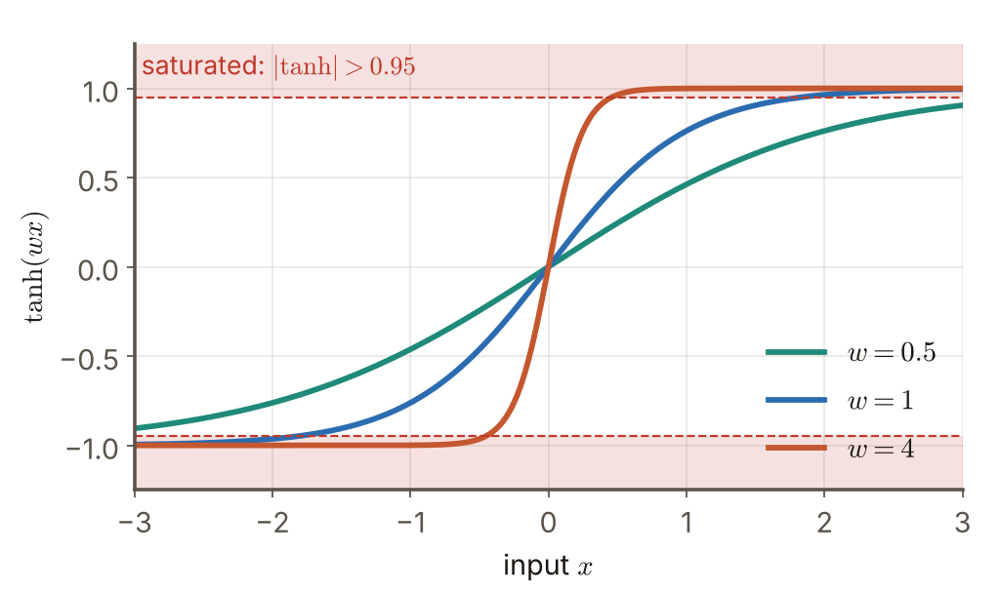
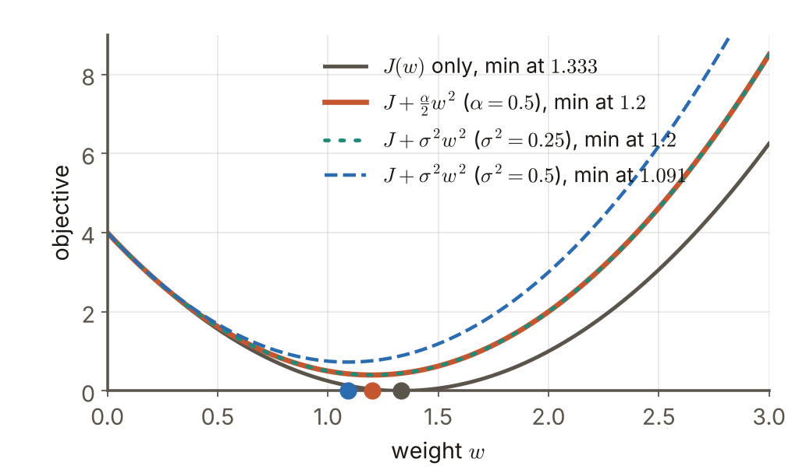

# 第4週 KP14：權重衰減與輸入雜訊（Weight decay and input noise）

> 程度：大學生（undergrad）／Level: Undergraduate (undergrad)

本講義是第4章「正則化與過擬合」的第十四個知識點（KP14），承接 KP13 留下的問題：$\ell_1$ 能給出精確的零，那把最常用的 $\ell_2$ 放到神經網路的權重上，究竟是什麼意思？還有沒有別的做法也能讓模型變平滑？先備知識是 KP11–KP13、偏導數與期望；第一次出現的符號都會定義，所有數字都可以自己重算。內容依 CCC-LNS 第5章 KP14 主文與教授祕笈消化後重新撰寫，讀取日期 2026-10-20；來源沒有的內容標示 `[補充]`。

This is the fourteenth knowledge point (KP14) of Chapter 4. It picks up the question KP13 left open: $\ell_1$ can give exact zeros, so what does it mean to put the most common penalty, $\ell_2$, on the weights of a neural network, and are there other ways to make a model smooth? It assumes KP11–KP13, partial derivatives and expectation; every symbol is defined when it first appears and every number can be recomputed. The text is rewritten from the KP14 main text and professor's guide of CCC-LNS Chapter 5 (accessed on 2026-10-20); content that the source does not contain is marked `[Added]`.

[下載本單元投影片](../slides/lec04-kp14-weight-decay-and-input-noise.jbd.json)

## KP14 權重衰減與輸入雜訊（Weight decay and input noise）

### 學習目標（Learning objectives）

讀完之後，你能寫出權重衰減的目標函數與它的梯度下降更新式，並說明為什麼叫「衰減」；能解釋大權重如何把 $\tanh$ 或 sigmoid 推進平坦的飽和區；能對輸入加雜訊後用二階 Taylor 展開，得到「多出一項輸入梯度的平方」；能用一組小數字算出兩種懲罰相等，並說出這個等價只是近似、成立的條件是什麼。

After reading, you can write the weight-decay objective and its gradient-descent update and explain why it is called "decay"; explain how large weights push $\tanh$ or sigmoid into the flat saturated region; add noise to the input and use a second-order Taylor expansion to obtain an extra term, the squared input gradient; compute on a small set of numbers that the two penalties are equal; and say that this equivalence is only approximate and under which conditions it holds.

### 符號表（Symbols）

| 符號 | 中文意義 | English meaning |
|---|---|---|
| $\mathbf{w}$ | 網路的權重（向量） | weights of the network (a vector) |
| $J(\mathbf{w})$ | 原本的損失（只看資料） | the original loss (data only) |
| $\alpha$ | 權重衰減的強度，$\alpha\ge0$ | strength of the weight decay, $\alpha\ge0$ |
| $\eta$ | 學習率 | learning rate |
| $\hat y(\mathbf{x})$ | 模型對輸入 $\mathbf{x}$ 的預測 | the model's prediction for input $\mathbf{x}$ |
| $\varepsilon$ | 加在輸入上的雜訊，$\varepsilon\sim\mathcal N(\mathbf 0,\sigma^2\mathbf I)$ | noise added to the input, $\varepsilon\sim\mathcal N(\mathbf 0,\sigma^2\mathbf I)$ |
| $\sigma^2$ | 輸入雜訊的變異數 | variance of the input noise |
| $\nabla_{\mathbf{x}}\hat y$ | 預測對輸入的梯度 | gradient of the prediction with respect to the input |

### 1. 把 $\ell_2$ 套在權重上：權重衰減（Putting $\ell_2$ on the weights: weight decay）

KP13 結束時留下的問題是：$\ell_1$ 會把一些權重壓成精確的零，而最常用的 $\ell_2$ 只縮小、不歸零。把 KP11 的框架 $J+\alpha\Omega$ 取 $\Omega=\tfrac12\|\mathbf{w}\|_2^2$，套在神經網路所有的權重上，就是**權重衰減**（weight decay）：

KP13 ended with a question: $\ell_1$ presses some weights to exact zeros, while the most common $\ell_2$ only shrinks and never reaches zero. Take the framework $J+\alpha\Omega$ of KP11 with $\Omega=\tfrac12\|\mathbf{w}\|_2^2$ and apply it to all the weights of a neural network; that is **weight decay**:

$$
\tilde J(\mathbf{w})=J(\mathbf{w})+\frac{\alpha}{2}\|\mathbf{w}\|_2^2
$$

為什麼叫「衰減」？把梯度寫出來：$\nabla\tilde J=\nabla J+\alpha\mathbf{w}$，所以學習率 $\eta$ 的一步梯度下降是

Why "decay"? Write the gradient: $\nabla\tilde J=\nabla J+\alpha\mathbf{w}$, so one gradient-descent step with learning rate $\eta$ is

$$
\mathbf{w}\leftarrow\mathbf{w}-\eta\big(\nabla J+\alpha\mathbf{w}\big)=(1-\eta\alpha)\,\mathbf{w}-\eta\,\nabla J(\mathbf{w})
$$

這個式子有兩部分：先把權重整體乘上一個略小於 1 的係數 $(1-\eta\alpha)$（每一步都「衰減」一點），再照原本的梯度 $-\eta\nabla J$ 修正。`[補充]` 例：$\eta=0.1$、$\alpha=0.5$，目前 $w=2$、資料梯度 $\partial J/\partial w=1$，則 $w\leftarrow(1-0.05)\cdot2-0.1\cdot1=1.8$；用原式驗算：$2-0.1\,(1+0.5\cdot2)=1.8$〔程式計算〕。沒有衰減時，同一步會是 $2-0.1=1.9$，所以衰減讓權重多縮小了 $0.1=\eta\alpha w$。

The formula has two parts: first multiply the weights as a whole by a factor slightly below 1, $(1-\eta\alpha)$ (each step "decays" them a little), then correct with the usual gradient $-\eta\nabla J$. `[Added]` Example: $\eta=0.1$, $\alpha=0.5$, currently $w=2$ and the data gradient is $\partial J/\partial w=1$, then $w\leftarrow(1-0.05)\cdot2-0.1\cdot1=1.8$; check with the original form: $2-0.1\,(1+0.5\cdot2)=1.8$ [computed by program]. Without the decay the same step would give $2-0.1=1.9$, so the decay shrinks the weight by an extra $0.1=\eta\alpha w$.

收斂時的解就是 KP12 的結果：在 $J$ 的二次近似下，沿 Hessian 的每個特徵方向把原本的最佳解 $\mathbf{w}^{*}$ 乘上 $\lambda_j/(\lambda_j+\alpha)$，即 $\mathbf{w}^{\dagger}=\mathbf U(\mathbf\Lambda+\alpha\mathbf I)^{-1}\mathbf\Lambda\,\mathbf U^{\top}\mathbf{w}^{*}$。所以權重衰減不是新的數學，而是同一個 $\ell_2$ 收縮套到網路權重上；差別只在於網路的 $J$ 不是二次函數，這個公式只在 $\mathbf{w}^{*}$ 附近近似成立。

At convergence the solution is the result of KP12: under a quadratic approximation of $J$, each Hessian eigendirection of the unregularized optimum $\mathbf{w}^{*}$ is multiplied by $\lambda_j/(\lambda_j+\alpha)$, i.e. $\mathbf{w}^{\dagger}=\mathbf U(\mathbf\Lambda+\alpha\mathbf I)^{-1}\mathbf\Lambda\,\mathbf U^{\top}\mathbf{w}^{*}$. So weight decay is not new mathematics but the same $\ell_2$ shrinkage applied to network weights; the only difference is that the loss $J$ of a network is not quadratic, so the formula holds only approximately near $\mathbf{w}^{*}$.

### 2. 為什麼要壓小權重：飽和區（Why keep weights small: saturation）

接著問：壓小權重為什麼對神經網路特別有用？來源給的理由是：大權重會把非線性的激活函數推進**飽和區**。以 $\tanh(wx)$ 為例，$|\tanh|>0.95$ 就當作飽和；因為 $\tanh(1.832)=0.95$，所以只要 $|wx|>1.832$ 就飽和：

Next, why is keeping the weights small especially useful for a neural network? The source's reason: large weights push a nonlinear activation function into its **saturated region**. Take $\tanh(wx)$ and call $|\tanh|>0.95$ saturated; since $\tanh(1.832)=0.95$, it is saturated as soon as $|wx|>1.832$:

| $w$ | 飽和的輸入範圍 | 在 $x\in[-3,3]$ 中飽和的比例 |
|---|---|---|
| 0.5 | $\lvert x\rvert>3.664$ | 0% |
| 1 | $\lvert x\rvert>1.832$ | 38.9% |
| 4 | $\lvert x\rvert>0.458$ | 84.7% |

| $w$ | Saturated input range | Share of $x\in[-3,3]$ that is saturated |
|---|---|---|
| 0.5 | $\lvert x\rvert>3.664$ | 0% |
| 1 | $\lvert x\rvert>1.832$ | 38.9% |
| 4 | $\lvert x\rvert>0.458$ | 84.7% |

〔程式計算〕$w$ 小時，$\tanh(wx)$ 在整個範圍內都近似一條斜直線（網路接近線性）；$w$ 大時，曲線在 $x=0$ 附近急轉，兩側變平：輸入稍微變一點，輸出可能從 $-1$ 跳到 $+1$，而兩側又幾乎不再隨輸入改變。這樣的函數很「彎」，足以貼合訓練雜訊，也讓反向傳播的梯度在平坦處趨近於 0。權重衰減讓網路待在接近線性的區域，泛化通常更好。

[Computed by program.] When $w$ is small, $\tanh(wx)$ looks like a sloped straight line over the whole range (the network is close to linear); when $w$ is large the curve turns sharply near $x=0$ and flattens on both sides: a small change of the input can send the output from $-1$ to $+1$, while farther out it hardly responds at all. Such a function is very "bent", enough to fit the training noise, and the backpropagated gradient goes to 0 on the flat parts. Weight decay keeps the network in the nearly linear region, and generalization is usually better.

**圖說 `lec04-kp14-saturation`**：先看綠色曲線（$w=0.5$）：整段都落在紅色虛線之內，沒有進入飽和區；再看藍色曲線（$w=1$），它在 $|x|>1.832$ 後碰到紅色帶；最後看橘色曲線（$w=4$），$|x|>0.458$ 就已經貼在 $\pm1$ 上。三條曲線的差別只有一個權重的大小。〔功能：1、2〕

**Caption `lec04-kp14-saturation`**: Look at the green curve ($w=0.5$) first: it stays inside the red dashed lines over the whole range and never reaches saturation; then the blue curve ($w=1$), which touches the red band after $|x|>1.832$; finally the orange curve ($w=4$), which already lies on $\pm1$ for $|x|>0.458$. The three curves differ in the size of one weight only. [Function: 1, 2]

### 3. 另一條路：在輸入上加雜訊（Another route: add noise to the input）

上一節說「小權重 = 平滑」，那有沒有不碰權重、也能得到平滑的方法？有：訓練時對輸入加一點隨機雜訊。每次把 $\mathbf{x}$ 換成 $\mathbf{x}+\varepsilon$，$\varepsilon\sim\mathcal N(\mathbf 0,\sigma^2\mathbf I)$，並要求模型在雜訊下仍然預測得準。目標變成損失的期望：

The last section said "small weights = smooth"; is there a way to get smoothness without touching the weights? Yes: add a little random noise to the input during training. Each time replace $\mathbf{x}$ by $\mathbf{x}+\varepsilon$, $\varepsilon\sim\mathcal N(\mathbf 0,\sigma^2\mathbf I)$, and ask the model to still predict well under the noise. The objective becomes the expected loss:

$$
\tilde J=\mathbb E_{\varepsilon}\Big[\big(\hat y(\mathbf{x}+\varepsilon)-y\big)^2\Big]
$$

當 $\sigma^2$ 小時，可以把 $\hat y(\mathbf{x}+\varepsilon)$ 在 $\mathbf{x}$ 處做二階 Taylor 展開：$\hat y(\mathbf{x}+\varepsilon)\approx\hat y+\nabla_{\mathbf{x}}\hat y^{\top}\varepsilon+\tfrac12\varepsilon^{\top}\nabla^2_{\mathbf{x}}\hat y\,\varepsilon$。代入平方、取期望（$\mathbb E\varepsilon=\mathbf 0$、$\mathbb E[\varepsilon\varepsilon^{\top}]=\sigma^2\mathbf I$、三次項為 0、四次項忽略），整理後得到

When $\sigma^2$ is small, expand $\hat y(\mathbf{x}+\varepsilon)$ to second order around $\mathbf{x}$: $\hat y(\mathbf{x}+\varepsilon)\approx\hat y+\nabla_{\mathbf{x}}\hat y^{\top}\varepsilon+\tfrac12\varepsilon^{\top}\nabla^2_{\mathbf{x}}\hat y\,\varepsilon$. Substitute into the square and take the expectation ($\mathbb E\varepsilon=\mathbf 0$, $\mathbb E[\varepsilon\varepsilon^{\top}]=\sigma^2\mathbf I$, the cubic term vanishes, the quartic term is ignored); after rearranging,

$$
\tilde J\approx(\hat y-y)^2+\sigma^2\,\|\nabla_{\mathbf{x}}\hat y\|_2^2+(\hat y-y)\,\sigma^2\,\mathrm{tr}\big(\nabla^2_{\mathbf{x}}\hat y\big)
$$

（對訓練集的每一筆再取平均即可。）中間那一項 $\sigma^2\|\nabla_{\mathbf{x}}\hat y\|_2^2$ 是新增的懲罰：它懲罰**預測對輸入的敏感度**。輸入動一點、輸出就大動的模型被罰得重，所以雜訊訓練出來的模型比較平滑。這也是資料增強與雜訊注入能改善泛化的原因。

(Then average over the training examples.) The middle term $\sigma^2\|\nabla_{\mathbf{x}}\hat y\|_2^2$ is the new penalty: it punishes the **sensitivity of the prediction to the input**. A model whose output moves a lot when the input moves a little is punished heavily, so a model trained with noise is smoother. This is also why data augmentation and noise injection improve generalization.

最後一項 $(\hat y-y)\,\sigma^2\,\mathrm{tr}(\nabla^2\hat y)$ 的符號不一定。它含有殘差 $\hat y-y$，在最佳解附近（預測已經很準、殘差接近 0）或模型對 $\mathbf{x}$ 是線性（曲率為 0）時就消失，所以常被略去，只留下梯度懲罰。

The last term $(\hat y-y)\,\sigma^2\,\mathrm{tr}(\nabla^2\hat y)$ can have either sign. It contains the residual $\hat y-y$, so near the optimum (the prediction is already accurate and the residual is close to 0) or for a model that is linear in $\mathbf{x}$ (zero curvature) it vanishes, which is why it is often dropped and only the gradient penalty is kept.

線性模型 $\hat y=wx$ 時，$\nabla_x\hat y=w$、曲率為 0，上式是**精確**的，不必近似：$\mathbb E[(w(x+\varepsilon)-y)^2]=(wx-y)^2+\sigma^2w^2$（交叉項 $2(wx-y)w\,\mathbb E\varepsilon=0$）。以 $x=1.5$、$y=2$、$w=2$、$\sigma^2=0.25$ 為例：$(3-2)^2+0.25\cdot4=2$；用 200 萬次隨機雜訊模擬，平均是 $2.001$〔程式計算，固定亂數種子〕。`[補充]`

For a linear model $\hat y=wx$ we have $\nabla_x\hat y=w$ and zero curvature, and the formula is **exact**, with no approximation: $\mathbb E[(w(x+\varepsilon)-y)^2]=(wx-y)^2+\sigma^2w^2$ (the cross term $2(wx-y)w\,\mathbb E\varepsilon=0$). With $x=1.5$, $y=2$, $w=2$, $\sigma^2=0.25$: $(3-2)^2+0.25\cdot4=2$; a simulation with 2 million noise draws averages $2.001$ [computed by program, fixed random seed]. `[Added]`

### 4. 兩條路的對照，與它們的極限（The two routes side by side, and their limits）

回到權重衰減：線性模型 $\hat y=wx$ 的權重衰減懲罰是 $\tfrac{\alpha}{2}w^2$，輸入雜訊的懲罰是 $\sigma^2w^2$。取 $w=2$、$\alpha=0.5$、$\sigma^2=0.25$：

Back to weight decay: for the linear model $\hat y=wx$ the weight-decay penalty is $\tfrac{\alpha}{2}w^2$ and the input-noise penalty is $\sigma^2w^2$. Take $w=2$, $\alpha=0.5$, $\sigma^2=0.25$:

$$
\frac{\alpha}{2}w^2=\frac12\cdot0.5\cdot4=1,\qquad \sigma^2w^2=0.25\cdot4=1
$$

兩者相等。對任何 $w$，只要 $\tfrac{\alpha}{2}=\sigma^2$，也就是 $\alpha=2\sigma^2$，兩條懲罰曲線就完全重合（線性模型），所以在 $\alpha\approx2\sigma^2$ 時兩種做法效果類似。`[補充]` 用同一組玩具題驗證：一筆資料 $(x,y)=(1.5,2)$、$J(w)=(1.5w-2)^2$，只看資料的最佳解是 $w^{*}=4/3=1.333$。加權重衰減（$\alpha=0.5$）後，$4.5w-6+0.5w=0$，最低點 $w=1.2$；加輸入雜訊（$\sigma^2=0.25$）後，$4.5w-6+0.5w=0$，最低點也是 $1.2$；雜訊加大到 $\sigma^2=0.5$，最低點降到 $6/5.5=1.091$〔程式計算〕。

The two are equal. For any $w$, as long as $\tfrac{\alpha}{2}=\sigma^2$, i.e. $\alpha=2\sigma^2$, the two penalty curves coincide completely (linear model), so at $\alpha\approx2\sigma^2$ the two methods have a similar effect. `[Added]` Check with the same toy problem: one data point $(x,y)=(1.5,2)$, $J(w)=(1.5w-2)^2$, whose data-only optimum is $w^{*}=4/3=1.333$. With weight decay ($\alpha=0.5$): $4.5w-6+0.5w=0$, minimum at $w=1.2$; with input noise ($\sigma^2=0.25$): $4.5w-6+0.5w=0$, minimum also at $1.2$; raising the noise to $\sigma^2=0.5$ lowers the minimum to $6/5.5=1.091$ [computed by program].

**圖說 `lec04-kp14-penalty`**：先看只有 $J$ 的那條曲線，最低點在 $w^{*}=1.333$；再看加權重衰減（$\alpha=0.5$）的曲線，最低點左移到 $1.2$；然後找虛線（雜訊 $\sigma^2=0.25$）：它與權重衰減的曲線疊在一起，最低點同樣是 $1.2$；最後看雜訊加大到 $\sigma^2=0.5$ 的曲線，最低點是 $1.091$。這是 `[補充]` 的玩具例。〔功能：1、2〕

**Caption `lec04-kp14-penalty`**: Look at the curve with $J$ only first; its minimum is at $w^{*}=1.333$. Then the curve with weight decay ($\alpha=0.5$): the minimum moves left to $1.2$. Next find the dotted curve (noise $\sigma^2=0.25$): it lies on top of the weight-decay curve and has the same minimum $1.2$. Last, the curve with noise raised to $\sigma^2=0.5$ has its minimum at $1.091$. This is an `[Added]` toy example. [Function: 1, 2]

要小心的是，這個等價有三個極限。（1）它是**近似**：只用了二階 Taylor 展開，要求雜訊小；$\sigma^2$ 大時高階項不能略。（2）它在**線性模型**才精確；對一般網路，輸入雜訊的懲罰是 $\sigma^2\|\nabla_{\mathbf{x}}\hat y\|^2$（輸出對**輸入**的敏感度），權重衰減的懲罰是 $\tfrac{\alpha}{2}\|\mathbf{w}\|^2$（權重的大小），兩者只是方向相近，不是同一個式子。（3）展開式還有曲率項，只在殘差小或模型線性時才消失。來源另外提到，對**權重**加雜訊也有類似效果，等於對 $\mathbf{w}$ 的梯度做懲罰；本講義只提到這個結論，不推導。

Be careful: the equivalence has three limits. (1) It is **approximate**: only a second-order Taylor expansion was used and the noise must be small; for large $\sigma^2$ the higher-order terms cannot be dropped. (2) It is exact only for a **linear model**; for a general network the input-noise penalty is $\sigma^2\|\nabla_{\mathbf{x}}\hat y\|^2$ (the sensitivity of the output to the **input**) while the weight-decay penalty is $\tfrac{\alpha}{2}\|\mathbf{w}\|^2$ (the size of the weights), which point in a similar direction but are not the same expression. (3) The expansion also has a curvature term that vanishes only when the residual is small or the model is linear. The source adds that noise on the **weights** has a similar effect, equivalent to penalizing the gradient with respect to $\mathbf{w}$; this note only mentions that conclusion and does not derive it.

到這裡，無論是權重衰減還是輸入雜訊，我們都在**改目標函數**。下一個問題是：能不能完全不改目標，只靠「少訓練幾步」得到同樣的收縮？這是 KP15 早停法的主題。

So far, both weight decay and input noise **change the objective**. The next question: can we get the same shrinkage without changing the objective at all, just by training fewer steps? That is the topic of KP15, early stopping.

### 本單元重點整理（KP14 summary）

**一句話重點**：權重衰減就是把 $\ell_2$ 套在網路權重上，目標 $J+\tfrac{\alpha}{2}\|\mathbf{w}\|^2$，梯度下降每步先乘 $(1-\eta\alpha)$ 再修正，並讓激活函數遠離飽和區；對輸入加雜訊的二階展開多出 $\sigma^2\|\nabla_{\mathbf{x}}\hat y\|^2$，線性模型時與權重衰減在 $\alpha=2\sigma^2$ 對上，但只是近似。

**One-sentence summary**: Weight decay applies $\ell_2$ to the network weights with objective $J+\tfrac{\alpha}{2}\|\mathbf{w}\|^2$; each gradient-descent step first multiplies by $(1-\eta\alpha)$ and then corrects, and it keeps the activations away from saturation; the second-order expansion of input noise adds $\sigma^2\|\nabla_{\mathbf{x}}\hat y\|^2$, which matches weight decay at $\alpha=2\sigma^2$ for a linear model, but only approximately.

**白話說明**：權重衰減像一個限速器，不讓權重長太大；輸入雜訊像路面的小顛簸，逼模型不要對小擾動反應過度。兩種做法都讓模型的輸出變得平滑。

**Plain explanation**: Weight decay is like a speed limiter that keeps the weights from growing too large; input noise is like small bumps in the road that force the model not to over-react to small disturbances. Both make the output of the model smooth.

**正式定義**：$\tilde J(\mathbf{w})=J(\mathbf{w})+\tfrac{\alpha}{2}\|\mathbf{w}\|_2^2$；更新 $\mathbf{w}\leftarrow(1-\eta\alpha)\mathbf{w}-\eta\nabla J$；輸入雜訊 $\mathbb E[(\hat y(\mathbf{x}+\varepsilon)-y)^2]\approx(\hat y-y)^2+\sigma^2\|\nabla_{\mathbf{x}}\hat y\|^2+(\hat y-y)\sigma^2\mathrm{tr}\nabla^2\hat y$；線性模型 $\hat y=wx$ 精確為 $(wx-y)^2+\sigma^2w^2$。

**Formal definition**: $\tilde J(\mathbf{w})=J(\mathbf{w})+\tfrac{\alpha}{2}\|\mathbf{w}\|_2^2$; update $\mathbf{w}\leftarrow(1-\eta\alpha)\mathbf{w}-\eta\nabla J$; input noise $\mathbb E[(\hat y(\mathbf{x}+\varepsilon)-y)^2]\approx(\hat y-y)^2+\sigma^2\|\nabla_{\mathbf{x}}\hat y\|^2+(\hat y-y)\sigma^2\mathrm{tr}\nabla^2\hat y$; for the linear model $\hat y=wx$ it is exactly $(wx-y)^2+\sigma^2w^2$.

**例子**：$w=2$、$\alpha=0.5$、$\sigma^2=0.25$：權重衰減懲罰 $\tfrac12\cdot0.5\cdot4=1$，雜訊懲罰 $0.25\cdot4=1$；一筆資料 $(1.5,2)$ 的最低點由 $1.333$ 變成 $1.2$（兩者相同）。逐步計算見第 3–4 節。

**Example**: $w=2$, $\alpha=0.5$, $\sigma^2=0.25$: the weight-decay penalty is $\tfrac12\cdot0.5\cdot4=1$ and the noise penalty is $0.25\cdot4=1$; for one data point $(1.5,2)$ the minimum moves from $1.333$ to $1.2$ (identically for both). The computations are in sections 3–4.

**常見迷思**：

- 「權重衰減只適用於線性迴歸」——它廣泛用於神經網路，$\mathbf{w}$ 就是網路的權重。
- 「輸入雜訊和權重衰減完全等價」——只在二階展開、小雜訊、線性模型時對得上（$\alpha=2\sigma^2$）。
- 「權重越小，模型一定越弱」——適度的衰減通常讓測試表現更好；衰減過頭才會欠擬合。
- 「權重衰減只是讓權重變小」——它同時讓激活函數離開飽和區，模型更接近線性。

**Common misconceptions**:

- "Weight decay applies only to linear regression." It is widely used in neural networks, where $\mathbf{w}$ is the weights of the network.
- "Input noise and weight decay are exactly equivalent." They match only under the second-order expansion, small noise and a linear model ($\alpha=2\sigma^2$).
- "Smaller weights always mean a weaker model." Moderate decay usually improves test performance; only excessive decay underfits.
- "Weight decay merely makes the weights smaller." It also takes the activations out of saturation, making the model closer to linear.

**圖**：本單元兩張圖，`lec04-kp14-saturation`（$\tanh(wx)$ 在不同權重下的曲線與飽和區，功能 1、2）與 `lec04-kp14-penalty`（權重衰減與輸入雜訊的目標曲線與最低點，功能 1、2），以 `assets/figures/src/lec04-kp14-figures.py` 繪製。權重衰減與輸入雜訊的推導流程在簡報中以原生節點與連線呈現。

**Figure**: Two figures in this unit, `lec04-kp14-saturation` (the curves $\tanh(wx)$ for different weights with the saturated region; functions 1, 2) and `lec04-kp14-penalty` (the objective curves and minima for weight decay and input noise; functions 1, 2), drawn by `assets/figures/src/lec04-kp14-figures.py`. The derivation flow of weight decay and input noise is drawn with native nodes and connectors in the deck.

**想深入**（選讀）：「對每筆資料加雜訊」和「把資料換成多份帶雜訊的副本」是同一件事：資料增強（旋轉、平移、加雜訊）可以看成讓模型在輸入附近的一小團點上都預測得準，其中的梯度懲罰解釋了為什麼這樣能平滑。另外，輸入的 Hessian 項 $\mathrm{tr}\nabla^2\hat y$ 在深度網路裡很難算，實務上通常直接把雜訊加進訓練、而不去寫出懲罰項。`[補充]`

**Going deeper** (optional): "adding noise to each example" is the same as "replacing the data by several noisy copies": data augmentation (rotation, shift, noise) can be seen as asking the model to predict well on a small cloud of points around each input, and the gradient penalty explains why this smooths the model. The Hessian term $\mathrm{tr}\nabla^2\hat y$ is hard to compute in a deep network, so in practice the noise is simply added during training without writing out the penalty. `[Added]`

**小練習**：

1. 線性模型 $\hat y=wx$，$w=3$、$\alpha=0.4$、$\sigma^2=0.2$：算出權重衰減懲罰 $\tfrac{\alpha}{2}w^2$ 與輸入雜訊懲罰 $\sigma^2w^2$，兩者相等嗎？要讓它們相等，$\alpha$ 應該取多少？（提示：令 $\tfrac{\alpha}{2}=\sigma^2$。）
2. $\eta=0.2$、$\alpha=0.5$，目前 $w=4$、資料梯度 $\partial J/\partial w=2$：用 $(1-\eta\alpha)w-\eta\nabla J$ 算一步後的 $w$，再用 $w-\eta(\nabla J+\alpha w)$ 驗算。（提示：$1-\eta\alpha=0.9$。）
3. 一筆資料 $(x,y)=(2,3)$、模型 $\hat y=wx$，只看資料的最佳解是多少？加權重衰減 $\alpha=1$ 後（目標 $(2w-3)^2+\tfrac12w^2$）最低點是多少？（提示：令導數 $4(2w-3)+w=0$。）

**Practice**:

1. Linear model $\hat y=wx$, $w=3$, $\alpha=0.4$, $\sigma^2=0.2$: compute the weight-decay penalty $\tfrac{\alpha}{2}w^2$ and the input-noise penalty $\sigma^2w^2$; are they equal? What $\alpha$ makes them equal? (Hint: set $\tfrac{\alpha}{2}=\sigma^2$.)
2. $\eta=0.2$, $\alpha=0.5$, currently $w=4$ and the data gradient is $\partial J/\partial w=2$: compute the new $w$ after one step with $(1-\eta\alpha)w-\eta\nabla J$ and check it with $w-\eta(\nabla J+\alpha w)$. (Hint: $1-\eta\alpha=0.9$.)
3. One data point $(x,y)=(2,3)$ with model $\hat y=wx$: what is the data-only optimum? What is the minimum after adding weight decay with $\alpha=1$ (objective $(2w-3)^2+\tfrac12w^2$)? (Hint: set the derivative $4(2w-3)+w=0$.)

**解題示範**（以 $w=2$、$\eta=0.1$、$\alpha=0.5$、$\partial J/\partial w=1$ 示範第 2 題的算法）：

1. 衰減係數：$1-\eta\alpha=1-0.05=0.95$。
2. 衰減後的權重：$0.95\cdot2=1.9$。
3. 資料梯度的修正：$-\eta\cdot1=-0.1$，所以新的 $w=1.9-0.1=1.8$。
4. 驗算：$w-\eta(\nabla J+\alpha w)=2-0.1\,(1+0.5\cdot2)=2-0.2=1.8$，兩種寫法一致。
5. 比較：沒有衰減時 $2-0.1=1.9$；衰減多縮小了 $\eta\alpha w=0.1$。

**Worked solution** (the method of exercise 2, shown with $w=2$, $\eta=0.1$, $\alpha=0.5$, $\partial J/\partial w=1$):

1. Decay factor: $1-\eta\alpha=1-0.05=0.95$.
2. Weight after decay: $0.95\cdot2=1.9$.
3. Correction by the data gradient: $-\eta\cdot1=-0.1$, so the new $w=1.9-0.1=1.8$.
4. Check: $w-\eta(\nabla J+\alpha w)=2-0.1\,(1+0.5\cdot2)=2-0.2=1.8$; the two forms agree.
5. Comparison: without decay $2-0.1=1.9$; the decay shrinks by an extra $\eta\alpha w=0.1$.

### 來源更正與取捨（Corrections to the source）

- 來源的式 (53) 寫成 $J+\sigma^2\mathbb E((\hat y-y)\nabla^2\hat y)+\sigma^2\mathbb E\|\nabla\hat y\|^2$：第二項缺了跡（trace），$\nabla^2\hat y$ 是矩陣，要取 $\mathrm{tr}(\nabla^2\hat y)$ 才是純量。本講義補上 $\mathrm{tr}$，並說明這一項含殘差 $\hat y-y$，在最佳解附近或模型線性時消失；來源只留下第三項的敘述，我們補上條件。
- 來源說輸入雜訊「效果類似 $\ell_2$ 正則化」。這只是近似：二階 Taylor 展開、小雜訊；精確的等價只在線性模型成立（懲罰 $\sigma^2w^2$ 對上 $\tfrac{\alpha}{2}w^2$，$\alpha=2\sigma^2$），本講義用一筆資料的玩具題驗算，並明說一般網路兩者不是同一個式子。
- 來源說權重衰減「讓激活保持在接近線性的區域」，並說兩種做法都讓模型更平滑。本講義保留，並補上 $\tanh$ 的數值例（飽和比例 0%、38.9%、84.7%）作為證據；這個說法描述的是趨勢，不是定理。
- 來源提到「對權重加雜訊也有類似效果，對 $\mathbf{w}$ 的梯度做懲罰」，沒有推導；本講義只引述結論，不展開。
- 來源的式 (51) 是在 $J$ 的二次近似下的解；網路的 $J$ 不是二次的，所以只在 $\mathbf{w}^{*}$ 附近近似成立，本講義註明。

- The source's formula (53) reads $J+\sigma^2\mathbb E((\hat y-y)\nabla^2\hat y)+\sigma^2\mathbb E\|\nabla\hat y\|^2$: the second term lacks the trace, since $\nabla^2\hat y$ is a matrix and only $\mathrm{tr}(\nabla^2\hat y)$ is a scalar. This note adds $\mathrm{tr}$ and explains that this term contains the residual $\hat y-y$, vanishing near the optimum or for a linear model; the source discusses only the third term, and the conditions are added here.
- The source says input noise has "an effect similar to $\ell_2$ regularization". This is only approximate: second-order Taylor expansion and small noise; the exact equivalence holds only for a linear model (penalty $\sigma^2w^2$ against $\tfrac{\alpha}{2}w^2$, $\alpha=2\sigma^2$), which this note checks on a one-point toy problem while stating that for a general network the two are not the same expression.
- The source says weight decay "keeps the activations in a nearly linear region" and that both methods make the model smoother. This note keeps that and adds a $\tanh$ numerical example (saturated shares 0%, 38.9%, 84.7%) as evidence; the statement describes a tendency, not a theorem.
- The source mentions that "noise on the weights has a similar effect, penalizing the gradient with respect to $\mathbf{w}$" without derivation; this note only quotes the conclusion and does not expand it.
- The source's formula (51) is the solution under a quadratic approximation of $J$; the loss of a network is not quadratic, so it holds only approximately near $\mathbf{w}^{*}$, as noted here.

### 術語對照（Terminology）

| 中文 | English |
|---|---|
| 權重衰減 | weight decay |
| 輸入雜訊 | input noise |
| 雜訊注入 | noise injection |
| 資料增強 | data augmentation |
| 飽和區 | saturated region |
| 激活函數 | activation function |
| 泰勒展開 | Taylor expansion |
| 梯度懲罰 | gradient penalty |
| 平滑 | smooth |
| 跡 | trace |
