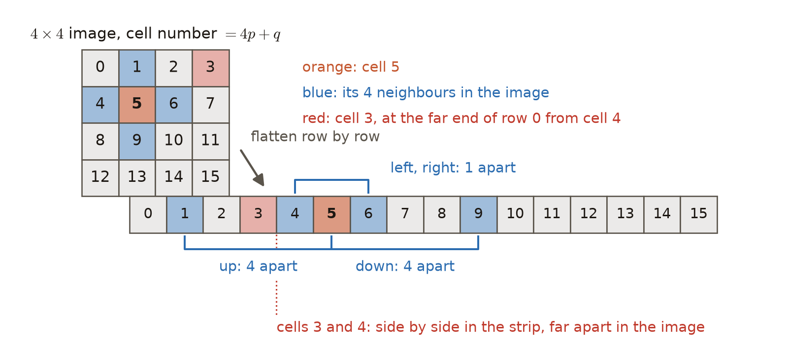
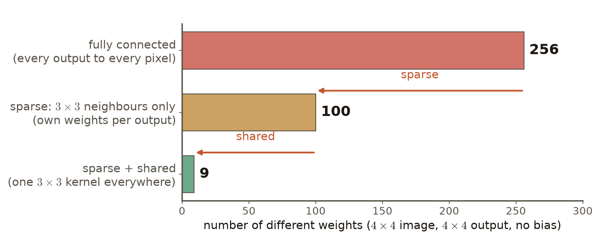
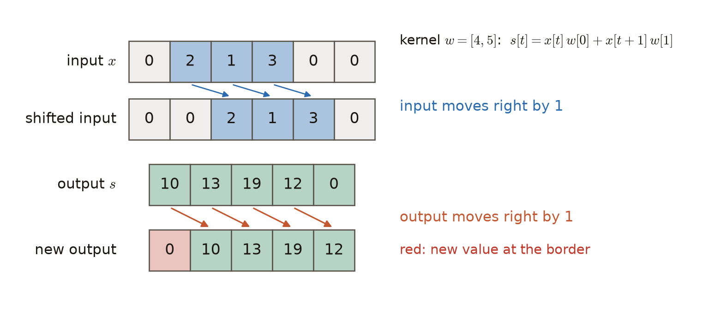

# 第6週 KP01：攤平與局部掃描（Flattening versus local scanning）

> 程度：大學生
>
> Level: Undergraduate (undergrad)

本講義是第6週「卷積與池化」的第一個知識點（KP01），也是這一週的開場。第2週的多層感知器由全連接層組成，第3週用反向傳播與梯度下降學出它的權重，第4週看到權重太多容易過擬合。這一週的資料換成照片。照片要怎麼交給網路，才不會丟掉最重要的資訊，又不會讓權重多到難以訓練？

This is the first knowledge point (KP01) of Week 6, "Convolution and pooling", and it opens the week. The multilayer perceptron (MLP) of Week 2 is built from fully connected layers, Week 3 learned its weights with backpropagation and gradient descent, and Week 4 showed that too many weights invite overfitting. This week the data are photographs. How should a photograph be given to a network so that the most important information is not lost and the weights do not become too many to train?

本週的路線如下。KP01 說明「先排成一條向量再全連接」會丟掉什麼，以及只看鄰居、共用權重的接法。KP02（自主學習）看第一個成功的例子 LeNet；KP03 把一層拆成三個步驟；KP04 把「滑著乘加」寫成精確算式。

The route of the week is as follows. KP01 explains what "lay it out as one vector, then connect everything" loses, and introduces the layer that looks only at neighbours and reuses its weights. KP02 (self-study) looks at the first successful example, LeNet; KP03 splits one layer into three steps; KP04 writes the sliding multiply-and-add as an exact formula.

KP05–KP07 談這種接法的性質與輸出大小，KP08–KP09 談池化，KP10（自主學習）把它們放進同一個觀點。經典架構留給第7週。

KP05–KP07 cover the properties of this layer and the size of its output, KP08–KP09 cover pooling, and KP10 (self-study) puts them under one point of view. Classic architectures are left to Week 7.

先備知識是第2週的全連接層與第3週的「權重是學出來的」。第一次出現的詞與符號都會定義。所有數字都由 `assets/figures/src/lec06-kp01-figures.py` 算出，可以自己重算。

The prerequisites are the fully connected layer of Week 2 and the idea of Week 3 that weights are learned. Every term and symbol is defined when it first appears. Every number is computed by `assets/figures/src/lec06-kp01-figures.py` and can be recomputed.

[下載本單元投影片](../slides/lec06-kp01-cnn-vs-flatten-mlp.jbd.json)

[Download the slides of this unit (English)](../slides/lec06-kp01-cnn-vs-flatten-mlp-en.jbd.json)

## KP01 攤平與局部掃描（Flattening versus local scanning）

### 學習目標（Learning objectives）

讀完之後，你能說明把影像排成一條向量再交給全連接層，為什麼會失去「誰和誰相鄰」的資訊。你能在一張小影像上，用一個小核親手算出特徵圖的幾個數。你能分別算出全連接、只接鄰居、再加上共用權重這三種接法的權重個數，並說出兩個限制各省下哪一段。你也能用一個小例子說明輸入平移時特徵圖怎麼跟著平移，並分清「跟著移」與「完全不變」。

After reading, you can explain why laying an image out as one vector and giving it to a fully connected layer loses the information about which pixels are neighbours. You can compute a few numbers of a feature map by hand with a small kernel on a small image. You can count the weights of three layers, fully connected, neighbours only, and neighbours only with shared weights, and say which part each of the two restrictions removes. You can also use a small example to show how the feature map shifts when the input shifts, and tell "moving with the input" apart from "not changing at all".

### 符號表（Symbols）

| 符號 | 中文意義 | English meaning |
|---|---|---|
| $H,\ W$ | 影像的高與寬（列數與行數） | height and width of the image (numbers of rows and columns) |
| $I[p,q]$ | 影像第 $p$ 列、第 $q$ 行的畫素值 | pixel value of the image at row $p$, column $q$ |
| $K[m,n]$ | 核第 $m$ 列、第 $n$ 行的權重，大小 $k\times k$ | weight of the kernel at row $m$, column $n$; size $k\times k$ |
| $k$ | 核的邊長 | side length of the kernel |
| $s[i,j]$ | 特徵圖在輸出位置 $(i,j)$ 的值 | value of the feature map at the output position $(i,j)$ |
| $m,\ n$ | 求和時掃過核各格的指標 | summation indices that sweep the cells of the kernel |
| $x[t],\ w[m],\ s[t]$ | 一維的輸入、核與輸出 | 1-D input, kernel and output |
| $\star$ | 第 2 節的滑動乘加（KP04 會正式命名） | the sliding multiply-and-add of Section 2 (named formally in KP04) |

本講義的指標一律從 $0$ 開始數。參數個數一律不含偏置 `[補充]`。

All indices in this note start at $0$. Parameter counts never include biases `[Added]`.

### 1. 攤平後，網路分不出誰和誰相鄰（After flattening, the network cannot tell which pixels are neighbours）

一張灰階影像是 $H\times W$ 的格子，每一格叫一個**畫素**，存一個亮度數字。影像裡的邊緣、紋理，都是由相鄰畫素的亮暗差構成的局部圖案。所以「誰和誰相鄰」是影像最重要的資訊之一。

A grayscale image is an $H\times W$ grid; each cell is called a **pixel** and stores one brightness number. The edges and textures in an image are local patterns made of brightness differences between neighbouring pixels. So which pixels are neighbours is one of the most important pieces of information in an image.

第2週的**全連接層**要求輸入是一條向量：每個輸出都和每個輸入相連，每條連線各有一個權重。要把影像交給它，最直接的做法是**攤平**：把格子一列接一列排成長度 $HW$ 的向量。$4\times 4$ 影像攤平後，第 $p$ 列第 $q$ 行的畫素排在第 $4p+q$ 個位置 `[補充]`。

The **fully connected layer** of Week 2 needs a vector as input: every output is connected to every input, and each connection has its own weight. The most direct way to give it an image is to **flatten** it: lay the grid out row after row as a vector of length $HW$. After flattening a $4\times 4$ image, the pixel at row $p$, column $q$ sits at position $4p+q$ `[Added]`.

**圖說 `lec06-kp01-flatten-neighbors`**：先看左上的 $4\times 4$ 影像：橘色的第 $5$ 格，上下左右是藍色的 $1$、$9$、$4$、$6$。再看下方攤平後的長條：左右鄰居 $4$、$6$ 仍然緊貼著 $5$，上下鄰居 $1$、$9$ 卻各隔了 $4$ 格。最後看紅色的第 $3$ 格：在影像裡它在第 $0$ 列最右端，離第 $4$ 格很遠，在長條裡卻和第 $4$ 格相鄰。

**Caption `lec06-kp01-flatten-neighbors`**: First look at the $4\times 4$ image at the top left: the orange cell $5$ has the blue neighbours $1$, $9$, $4$ and $6$ above, below, left and right. Then look at the flattened strip below: the left and right neighbours $4$ and $6$ still sit next to $5$, but the upper and lower neighbours $1$ and $9$ are each $4$ cells away. Finally look at the red cell $3$: in the image it is at the right end of row $0$, far from cell $4$, yet in the strip it sits right next to cell $4$.

攤平本身沒有丟掉任何數字，問題出在全連接層。全連接層對輸入位置一視同仁：把向量的位置任意重排，再把權重跟著重排，算出來的結果完全一樣 `[補充]`。所以對它來說，「第 $5$ 格和第 $9$ 格是上下鄰居」這件事根本不存在。

Flattening itself loses no numbers; the problem lies in the fully connected layer. It treats all input positions alike: shuffle the positions of the vector, shuffle the weights the same way, and the result is exactly the same `[Added]`. So for this layer the fact that cells $5$ and $9$ are upper and lower neighbours simply does not exist.

結果有兩個代價。第一，局部圖案只能從大量資料裡硬學，同一個邊緣出現在不同位置，要用不同的權重各學一次。第二，權重的個數是輸入數乘輸出數，影像一大就非常多。

This has two costs. First, local patterns can only be learned the hard way from a lot of data: the same edge at different positions has to be learned again with different weights. Second, the number of weights is the number of inputs times the number of outputs, which becomes huge for a large image.

常見錯誤：以為攤平後的多層感知器一定分不出手寫數字。它其實分得出來，只是要學的權重多，局部圖案也學得辛苦。

Common error: thinking that an MLP on flattened images can never recognise handwritten digits. It can, but it has many weights to learn and learns local patterns the hard way.

### 2. 不攤平：讓一個小核在原圖上滑（Without flattening: slide a small kernel over the image）

另一種做法是不攤平，直接在原本的格子上運算。準備一小組權重，排成 $k\times k$ 的格子，叫做**核**，也叫**濾波器**。把核蓋在影像的一小塊上，對齊的格子相乘再全部加總，得到一個數。核每次往右或往下挪一格，再算一次。

The other way is not to flatten and to compute on the original grid. Prepare a small set of weights arranged as a $k\times k$ grid, called a **kernel**, also called a **filter**. Lay the kernel over a small patch of the image, multiply the aligned cells and add everything up: that gives one number. Move the kernel one cell to the right or down each time and compute again.

這些數照位置排成一張新的格子，叫做**特徵圖**。核的左上角對齊影像的 $(i,j)$ 時，算出的數寫成：

These numbers, arranged by position, form a new grid called the **feature map**. When the top-left corner of the kernel lines up with $(i,j)$ of the image, the number is written as:

$$
s[i,j]=\sum_{m=0}^{k-1}\sum_{n=0}^{k-1} I[i+m,\,j+n]\,K[m,n]
$$

求和指標 $m,n$ 只負責掃過核的每一格，和輸出位置 $(i,j)$ 無關；被乘到的畫素是第 $p=i+m$ 列、第 $q=j+n$ 行。核要完整落在影像內，這種輸出叫**有效輸出**。$5\times 5$ 的影像配 $3\times 3$ 的核，每個方向只有 $5-3+1=3$ 個位置，所以特徵圖是 $3\times 3$。這個式子在 KP04 會有正式的名字，並和教科書的寫法比較。

The summation indices $m,n$ only sweep the cells of the kernel and have nothing to do with the output position $(i,j)$; the pixel being multiplied is at row $p=i+m$, column $q=j+n$. The kernel must lie completely inside the image, and such an output is called the **valid output**. A $5\times 5$ image with a $3\times 3$ kernel has only $5-3+1=3$ positions in each direction, so the feature map is $3\times 3$. KP04 gives this formula its formal name and compares it with the textbook form.

主例子是 $5\times 5$ 的棋盤格影像：第 $p$ 列第 $q$ 行在 $p+q$ 為偶數時是 $1$，否則是 $0$。核的四個角與中央是 $1$，其餘是 $0$。

The main example is a $5\times 5$ checkerboard image: the pixel at row $p$, column $q$ is $1$ when $p+q$ is even and $0$ otherwise. The kernel has $1$ at its four corners and its centre, and $0$ elsewhere.

![左邊是 5 乘 5 的棋盤格影像，左上 3 乘 3 的窗被框起來；中間是四角與中央為 1 的 3 乘 3 核；右邊是 3 乘 3 特徵圖，四角與中央是 5，其餘是 0；底下寫出 s[0,0] 的九項乘加等於 5](../assets/figures/lec06-kp01-sliding-kernel.png)

**圖說 `lec06-kp01-sliding-kernel`**：圖中的 $\star$ 表示第 2 節的滑動乘加。先看左邊框起來的左上 $3\times 3$ 窗，再看中間的核：核的五個 $1$ 剛好都蓋在影像的 $1$ 上。九項乘加裡只有核為 $1$ 的五項不是 $0$，所以 $s[0,0]=I[0,0]+I[0,2]+I[1,1]+I[2,0]+I[2,2]=5$，就是右邊特徵圖框起來的那一格。窗往右挪一格時，核的五個 $1$ 全落在 $0$ 上，所以 $s[0,1]=0$。

**Caption `lec06-kp01-sliding-kernel`**: The $\star$ in the figure stands for the sliding multiply-and-add of Section 2. First look at the framed $3\times 3$ window at the top left of the image, then at the kernel in the middle: its five $1$s all land on $1$s of the image. Of the nine products, only the five where the kernel is $1$ are nonzero, so $s[0,0]=I[0,0]+I[0,2]+I[1,1]+I[2,0]+I[2,2]=5$, the framed cell of the feature map on the right. When the window moves one cell to the right, the five $1$s of the kernel all land on $0$s, so $s[0,1]=0$.

整張特徵圖三列是 $[5,0,5]$、$[0,5,0]$、$[5,0,5]$。核像一個圖案偵測器：窗裡的圖案和核一致時，輸出最大。

The whole feature map has the rows $[5,0,5]$, $[0,5,0]$ and $[5,0,5]$. The kernel acts as a pattern detector: the output is largest where the pattern in the window matches the kernel.

用這種運算當主要零件的網路，叫做**卷積神經網路**；做這種運算的層叫**卷積層**。和全連接層相比，它到底省下多少？

A network whose main building block is this operation is called a **convolutional neural network** (CNN), and a layer that performs it is called a **convolutional layer**. Compared with a fully connected layer, how much does it save?

### 3. 兩個限制把 256 個權重降到 9 個（Two restrictions cut 256 weights down to 9）

為了公平比較，固定同一個任務：輸入是 $4\times 4$ 影像，輸出也是 $4\times 4$，每個畫素位置各有一個輸出。這叫**同尺寸**輸出。第 2 節的窗以左上角對齊，只算有效輸出，輸出會比輸入小。為了讓輸出和輸入一樣大，這裡改讓每個輸出的 $3\times 3$ 窗以它自己的位置為中心；靠近邊緣的窗有一部分落在影像外，那部分不接線 `[補充]`。KP07 會講怎麼在邊緣補值。

To compare fairly, fix one task: the input is a $4\times 4$ image and the output is also $4\times 4$, one output per pixel position. This is called a **same-size** output. The windows of Section 2 are aligned by their top-left corner and give only the valid output, which is smaller than the input. To make the output as large as the input, here the $3\times 3$ window of each output is centred on its own position instead; near the border part of the window falls outside the image, and that part is not connected `[Added]`. KP07 explains how to fill in values at the border.

下面的「連線」指一個輸入畫素送進一個輸出的一條路徑，每條連線乘上一個權重。三種接法依序是：

Below, a connection means one path from one input pixel into one output; each connection is multiplied by one weight. The three layers, in order, are:

- 全連接：每個輸出接全部 $16$ 個畫素，共 $16\times 16=256$ 條連線，每條各有一個權重，所以有 $256$ 個權重。
- 只接鄰居：每個輸出只接 $3\times 3$ 窗裡真正存在的畫素。四個角各接 $4$ 個、其他 $8$ 個邊緣位置各接 $6$ 個、中間 $4$ 個各接 $9$ 個，共 $16+48+36=100$ 條連線。每條仍有自己的權重，所以有 $100$ 個權重。
- 只接鄰居並共用權重：所有輸出共用同一個 $3\times 3$ 核。連線仍是 $100$ 條，但只用 $9$ 個不同的數，所以只有 $9$ 個權重。

- Fully connected: every output connects to all $16$ pixels, giving $16\times 16=256$ connections, each with its own weight, so $256$ weights.
- Neighbours only: every output connects only to the pixels that really exist in its $3\times 3$ window. The four corners connect to $4$ each, the other $8$ border positions to $6$ each, and the $4$ inner positions to $9$ each, giving $16+48+36=100$ connections. Each still has its own weight, so $100$ weights.
- Neighbours only with shared weights: all outputs share one $3\times 3$ kernel. There are still $100$ connections, but they use only $9$ different numbers, so only $9$ weights.

**圖說 `lec06-kp01-weight-counts`**：先看最上面的紅條：全連接有 $256$ 個權重。往下看第一個箭頭：只接鄰居，砍到 $100$ 個。再看第二個箭頭：所有位置共用一個核，再砍到 $9$ 個。橫軸是不同權重的個數，三條都是同一個 $4\times 4$ 輸入、$4\times 4$ 輸出的任務。

**Caption `lec06-kp01-weight-counts`**: First look at the red bar at the top: the fully connected layer has $256$ weights. Then follow the first arrow down: connecting only neighbours cuts this to $100$. Then the second arrow: sharing one kernel at every position cuts it further to $9$. The horizontal axis is the number of different weights, and all three bars solve the same task with a $4\times 4$ input and a $4\times 4$ output.

兩個限制各有名字。每個輸出只接一小塊鄰近輸入、其他連線一律不存在，叫**稀疏連接**；它把 $256$ 降到 $100$。所有位置用同一組核權重，叫**權重共享**；它把 $100$ 降到 $9$。卷積層就是加上這兩個限制的全連接層，不是另一種數學。

Each restriction has a name. Letting every output connect only to a small patch of nearby inputs, with all other connections absent, is called **sparse connectivity**; it cuts $256$ to $100$. Using the same kernel weights at every position is called **parameter sharing**; it cuts $100$ to $9$. A convolutional layer is simply a fully connected layer with these two restrictions, not a different kind of mathematics.

這兩個限制也是在看資料之前就放進模型的假設。這種假設叫**歸納偏置**，可以看成一種很強的先驗。稀疏連接假設「有用的圖案是局部的」；權重共享假設「同一種圖案可能出現在任何位置，意義都一樣」。對照片來說，這兩個假設大致成立，所以模型用較少的權重就能學。權重少，也減輕第4週談的過擬合風險。

These two restrictions are also assumptions put into the model before it sees any data. Such an assumption is called an **inductive bias**, and it can be seen as a very strong prior. Sparse connectivity assumes that useful patterns are local; parameter sharing assumes that the same pattern can appear anywhere with the same meaning. For photographs both assumptions roughly hold, so the model can learn with fewer weights. Fewer weights also reduce the risk of overfitting discussed in Week 4.

影像變大時，差距更明顯。$28\times 28$ 的灰階手寫數字接 $512$ 個隱藏單元，全連接層要 $784\times 512=401{,}408$ 個權重。$224\times 224$ 的彩色照片每個畫素有紅、綠、藍 $3$ 個數，共 $150{,}528$ 個數；接 $512$ 個單元要 $77{,}070{,}336$ 個權重。改用 $64$ 個核、每個核是 $3\times 3\times 3$（最後的 $3$ 對應每個畫素的那 $3$ 個顏色數），只要 $64\times 27=1{,}728$ 個權重，而且這個數和影像多大無關。

The gap grows with the image. A $28\times 28$ grayscale handwritten digit connected to $512$ hidden units needs $784\times 512=401{,}408$ weights in a fully connected layer. A $224\times 224$ colour photograph has $3$ numbers per pixel, red, green and blue, so $150{,}528$ numbers; connecting it to $512$ units needs $77{,}070{,}336$ weights. With $64$ kernels of size $3\times 3\times 3$ instead (the last $3$ stands for the $3$ colour numbers of each pixel), only $64\times 27=1{,}728$ weights are needed, and this number does not depend on the size of the image.

上面兩種層的輸出大小不同，所以這兩個數不宜直接相除 `[補充]`。同尺寸的公平比較就是 $4\times 4$ 的例子。多個核與彩色通道的細節留給 KP07。

The outputs of these two layers have different sizes, so the two numbers should not simply be divided `[Added]`. The fair same-size comparison is the $4\times 4$ example. The details of several kernels and colour channels are left to KP07.

常見錯誤 `[補充]`：把連線數和權重數混為一談。共用權重之後，連線仍有 $100$ 條，只是它們共用 $9$ 個數。

Common error `[Added]`: confusing the number of connections with the number of weights. After sharing, there are still $100$ connections; they just share $9$ numbers.

### 4. 輸入平移，特徵圖跟著平移（Shift the input and the feature map shifts with it）

共用權重除了省權重，還帶來一個性質。用最簡單的一維例子來看：訊號 $x$ 放在一列 $6$ 格上，三格非零的值是 $2,1,3$，其餘是 $0$；核是 $w=[4,5]$。一維的滑動乘加是 $s[t]=x[t]\,w[0]+x[t+1]\,w[1]$ `[補充]`。

Besides saving weights, sharing brings a property. Look at the simplest 1-D example: a signal $x$ placed on a row of $6$ cells, with nonzero values $2,1,3$ and zeros elsewhere; the kernel is $w=[4,5]$. The 1-D sliding multiply-and-add is $s[t]=x[t]\,w[0]+x[t+1]\,w[1]$ `[Added]`.

$x=[0,2,1,3,0,0]$ 的輸出是 $s=[10,13,19,12,0]$，例如 $s[1]=2\cdot4+1\cdot5=13$。把輸入整體右移一格，變成 $[0,0,2,1,3,0]$，輸出是 $[0,10,13,19,12]$ `[補充]`。舊輸出的 $10,13,19,12$ 也整體右移了一格。最左邊多出來的 $0$ 是邊界的新值，原本最右邊的 $0$ 則被擠出範圍。

For $x=[0,2,1,3,0,0]$ the output is $s=[10,13,19,12,0]$; for example $s[1]=2\cdot4+1\cdot5=13$. Shift the whole input right by one cell to get $[0,0,2,1,3,0]$; the output is $[0,10,13,19,12]$ `[Added]`. The old outputs $10,13,19,12$ have also shifted right by one cell as a whole. The new $0$ on the left is a new value at the border, and the old $0$ on the right has been pushed out.

**圖說 `lec06-kp01-shift-equivariance`**：先看上面兩列：藍色的 $2,1,3$ 整體右移一格。再看下面兩列：綠色的 $10,13,19,12$ 也整體右移一格。最後看紅色那一格：它是邊界上新算出的值，不是舊輸出搬過來的。

**Caption `lec06-kp01-shift-equivariance`**: First look at the top two rows: the blue $2,1,3$ move right by one cell as a whole. Then look at the bottom two rows: the green $10,13,19,12$ also move right by one cell as a whole. Finally look at the red cell: it is a new value computed at the border, not an old output moved over.

為什麼會這樣？每個輸出都用同一個核，算法只看窗裡的數字，不看窗在哪裡。所以同一段圖案移到哪裡，就在那裡算出同樣的數。這個性質叫**平移等變**：輸入平移多少，輸出就跟著平移多少。

Why does this happen? Every output uses the same kernel, and the computation looks only at the numbers in the window, not at where the window is. So wherever the same pattern moves, the same numbers are computed there. This property is called **translation equivariance**: when the input shifts by some amount, the output shifts by the same amount.

平移等變不是「輸出不變」。輸入平移時輸出完全不變，叫**平移不變**；卷積層本身沒有這個性質。KP08–KP09 的池化只對小位移帶來近似的不變，而且只在局部成立。

Translation equivariance does not mean that the output stays the same. An output that does not change at all when the input shifts is called **translation invariant**; a convolutional layer alone does not have this property. The pooling of KP08–KP09 brings only approximate invariance to small shifts, and only locally.

平移等變的成立有條件 `[補充]`：核每次只挪一格（KP07 稱為步幅 $1$），而且只看離邊界夠遠的位置。上面的例子裡，邊界那一格就不符合。KP06 會再仔細談這個性質。

Translation equivariance holds under conditions `[Added]`: the kernel moves one cell at a time (KP07 calls this a stride of $1$), and only positions far enough from the border are considered. In the example above, the border cell does not satisfy this. KP06 looks at this property more carefully.

到這裡，我們知道了不攤平、只接鄰居、共用權重的好處。可是用小核掃描影像，具體要接成什麼樣的網路？KP02 用 LeNet 給出第一個完整的例子，KP03 再把一層卷積層拆開來看。

At this point we know the benefits of not flattening, connecting only neighbours and sharing weights. But what kind of network do we actually build from small kernels that scan an image? KP02 gives the first complete example with LeNet, and KP03 takes one convolutional layer apart.

### 本單元重點整理（KP01 summary）

**一句話重點**：攤平後的全連接層分不出誰和誰相鄰，還要為每條連線各學一個權重；卷積層只接鄰居（稀疏連接）並全圖共用一個核（權重共享），權重少很多，而且輸入平移時特徵圖跟著平移（平移等變）。

**One-sentence summary**: A fully connected layer on a flattened image cannot tell which pixels are neighbours and must learn one weight per connection; a convolutional layer connects only neighbours (sparse connectivity) and shares one kernel over the whole image (parameter sharing), so it has far fewer weights, and its feature map shifts when the input shifts (translation equivariance).

**白話說明**：與其讓每個輸出各看整張影像、各學一套權重，不如讓所有輸出用同一個小核，各看自己附近的一小塊。只看附近，所以連線少；大家用同一個核，所以只要學一組數字；圖案移到哪裡，核就在那裡算出同樣的數。

**Plain explanation**: Instead of letting every output look at the whole image with its own set of weights, let all outputs use the same small kernel, each on a small patch near itself. Looking only nearby means few connections; sharing one kernel means only one set of numbers to learn; and wherever a pattern moves, the kernel computes the same numbers there.

**正式定義**：滑動乘加 $s[i,j]=\sum_{m=0}^{k-1}\sum_{n=0}^{k-1} I[i+m,\,j+n]\,K[m,n]$，核完整落在影像內時，$H\times W$ 的影像得到 $(H-k+1)\times(W-k+1)$ 的特徵圖。

同尺寸輸出時，$H\times W$ 影像的全連接層有 $(HW)^2$ 個權重，共用一個 $k\times k$ 核的卷積層只有 $k^2$ 個權重。

平移等變：輸入平移後再算輸出，等於先算輸出再平移（步幅 $1$、離邊界夠遠時成立）。

**Formal definition**: The sliding multiply-and-add is $s[i,j]=\sum_{m=0}^{k-1}\sum_{n=0}^{k-1} I[i+m,\,j+n]\,K[m,n]$; when the kernel lies completely inside the image, an $H\times W$ image gives an $(H-k+1)\times(W-k+1)$ feature map.

With a same-size output, a fully connected layer on an $H\times W$ image has $(HW)^2$ weights, while a convolutional layer that shares one $k\times k$ kernel has only $k^2$ weights.

Translation equivariance: shifting the input and then computing the output equals computing the output and then shifting it (for a stride of $1$, away from the border).

**例子**：同尺寸的 $4\times 4$ 任務，全連接 $256$ 個權重、只接鄰居 $100$ 個、再共用 $9$ 個。$5\times 5$ 棋盤格配四角與中央為 $1$ 的核，特徵圖三列是 $[5,0,5]$、$[0,5,0]$、$[5,0,5]$。一維輸入右移一格，輸出 $10,13,19,12$ 也右移一格。逐步計算見第 2–4 節。

**Example**: For the same-size $4\times 4$ task, the fully connected layer has $256$ weights, neighbours only $100$, and with sharing $9$. A $5\times 5$ checkerboard with the kernel that is $1$ at its corners and centre gives a feature map with rows $[5,0,5]$, $[0,5,0]$ and $[5,0,5]$. When the 1-D input shifts right by one cell, the outputs $10,13,19,12$ also shift right by one cell. The step-by-step computations are in Sections 2–4.

**常見迷思**：

- 「攤平後的多層感知器一定分不出影像。」錯，分得出來，只是權重多、局部圖案難學。
- 「卷積層是和全連接層無關的新東西。」錯，它是加上稀疏連接與權重共享兩個限制的全連接層。
- 「共用權重後只剩 $9$ 條連線。」錯，連線仍是 $100$ 條，只是共用 $9$ 個數。
- 「平移等變就是輸出不變。」錯，等變是輸出跟著移；不變是輸出完全不動，卷積層本身沒有。

**Common misconceptions**:

- "An MLP on flattened images can never recognise images." Wrong: it can, but it has many weights and learns local patterns the hard way.
- "A convolutional layer is something unrelated to a fully connected layer." Wrong: it is a fully connected layer with the two restrictions of sparse connectivity and parameter sharing.
- "After sharing, only $9$ connections are left." Wrong: there are still $100$ connections; they share $9$ numbers.
- "Translation equivariance means the output does not change." Wrong: equivariance means the output moves with the input; invariance means it does not move at all, which a convolutional layer alone does not have.

**圖**：本單元有四張圖。

- `lec06-kp01-flatten-neighbors`：攤平後鄰居被拆開。
- `lec06-kp01-sliding-kernel`：小核在棋盤格上滑出特徵圖。
- `lec06-kp01-weight-counts`：三種接法的權重個數。
- `lec06-kp01-shift-equivariance`：輸入右移，輸出跟著右移。

四張圖與文中數字都由同一支程式產生：`lec06-kp01-figures.py`。

**Figure**: Four figures in this unit.

- `lec06-kp01-flatten-neighbors`: flattening separates neighbours.
- `lec06-kp01-sliding-kernel`: a small kernel slides over a checkerboard and produces a feature map.
- `lec06-kp01-weight-counts`: the number of weights of the three layers.
- `lec06-kp01-shift-equivariance`: the input moves right and the output follows.

All four figures and every number in the text come from one program: `lec06-kp01-figures.py`.

**想深入**（選讀）`[補充]`：同尺寸輸出、$k\times k$ 窗時，只接鄰居的連線數最多是 $HWk^2$，邊緣的窗蓋到影像外，所以實際更少，例如 $4\times 4$ 時是 $100$ 而不是 $16\times 9=144$。KP05 會把稀疏連接與權重共享寫成一般的計數式。

**Going deeper** (optional) `[Added]`: with a same-size output and a $k\times k$ window, the neighbours-only layer has at most $HWk^2$ connections; the border windows reach outside the image, so the actual number is smaller, for example $100$ rather than $16\times 9=144$ for $4\times 4$. KP05 writes sparse connectivity and parameter sharing as general counting formulas.

**小練習**：

1. 輸入與輸出都是 $8\times 8$（同尺寸），窗是 $3\times 3$。分別算出全連接、只接鄰居、只接鄰居並共用權重這三種接法的權重個數。（提示：只接鄰居時，分成四個角、其他邊緣位置與內部三類來數。）
2. `[補充]` 一張 $5\times 5$ 影像一列接一列攤平，第 $p$ 列第 $q$ 行排在第 $5p+q$ 個位置。$(2,3)$ 排在第幾個？它的上下鄰居在第幾個，和它相隔幾格？列出所有在攤平後相鄰、在影像裡卻分別在兩列兩端的位置。
3. `[補充]` $4\times 4$ 影像四列是 $[1,0,0,1]$、$[0,1,1,0]$、$[0,1,1,0]$、$[1,0,0,1]$，核兩列是 $[1,0]$、$[0,1]$。用第 2 節的式子算出 $3\times 3$ 的特徵圖。
4. `[補充]` 一維訊號 $[0,0,5,5,0,0]$ 用核 $[1,-1]$ 做第 4 節的滑動乘加。再把訊號右移一格成 $[0,0,0,5,5,0]$，重算一次。輸出是平移等變還是平移不變？

**Practice**:

1. The input and the output are both $8\times 8$ (same size) and the window is $3\times 3$. Count the weights of the fully connected layer, the neighbours-only layer and the neighbours-only layer with shared weights. (Hint: for neighbours only, count the four corners, the other border positions and the inner positions separately.)
2. `[Added]` A $5\times 5$ image is flattened row after row, and the pixel at row $p$, column $q$ goes to position $5p+q$. Where does $(2,3)$ go? Where are its upper and lower neighbours, and how far away are they? List all pairs of positions that are next to each other after flattening but lie at opposite ends of two rows in the image.
3. `[Added]` A $4\times 4$ image has rows $[1,0,0,1]$, $[0,1,1,0]$, $[0,1,1,0]$, $[1,0,0,1]$, and the kernel has rows $[1,0]$ and $[0,1]$. Use the formula of Section 2 to compute the $3\times 3$ feature map.
4. `[Added]` Apply the sliding multiply-and-add of Section 4 with the kernel $[1,-1]$ to the 1-D signal $[0,0,5,5,0,0]$. Then shift the signal right by one cell to $[0,0,0,5,5,0]$ and compute again. Is the output translation equivariant or translation invariant?

**第 1 題解答** `[補充]`：

1. 全連接：$64$ 個輸出各接 $64$ 個畫素，共 $64\times 64=4{,}096$ 個權重。
2. 只接鄰居：四個角各接 $4$ 個，共 $16$；其他邊緣位置有 $4\times 6=24$ 個，各接 $6$ 個，共 $144$；內部 $6\times 6=36$ 個各接 $9$ 個，共 $324$。合計 $16+144+324=484$ 條連線，也就是 $484$ 個權重。
3. 共用權重：連線仍是 $484$ 條，但只有一個 $3\times 3$ 核，所以是 $9$ 個權重。

**Solution to question 1** `[Added]`:

1. Fully connected: $64$ outputs each connect to $64$ pixels, giving $64\times 64=4{,}096$ weights.
2. Neighbours only: the four corners connect to $4$ each, $16$ in total; the other $4\times 6=24$ border positions connect to $6$ each, $144$ in total; the $6\times 6=36$ inner positions connect to $9$ each, $324$ in total. Altogether $16+144+324=484$ connections, that is, $484$ weights.
3. Shared weights: there are still $484$ connections, but only one $3\times 3$ kernel, so $9$ weights.

**第 2 題解答** `[補充]`：

1. $(2,3)$ 排在 $5\cdot2+3=13$。
2. 上鄰居 $(1,3)$ 在 $8$，下鄰居 $(3,3)$ 在 $18$，都和它相隔 $5$ 格，也就是一列的長度。
3. 第 $p$ 列最右端的 $(p,4)$ 排在第 $5p+4$ 個，下一列最左端的 $(p+1,0)$ 排在第 $5p+5$ 個，兩者在攤平後相鄰，在影像裡卻分在兩列的兩端。$p$ 可以是 $0,1,2,3$，所以共有四對：$4$ 與 $5$、$9$ 與 $10$、$14$ 與 $15$、$19$ 與 $20$。

**Solution to question 2** `[Added]`:

1. $(2,3)$ goes to $5\cdot2+3=13$.
2. The upper neighbour $(1,3)$ is at $8$ and the lower neighbour $(3,3)$ at $18$; both are $5$ cells away, the length of one row.
3. The rightmost pixel $(p,4)$ of row $p$ sits at position $5p+4$, and the leftmost pixel $(p+1,0)$ of the next row sits at position $5p+5$; they are next to each other after flattening but at opposite ends of two rows in the image. Since $p$ can be $0,1,2,3$, there are four pairs: $4$ and $5$, $9$ and $10$, $14$ and $15$, $19$ and $20$.

**第 3 題解答** `[補充]`：

1. 核只有左上與右下是 $1$，所以 $s[i,j]=I[i,j]+I[i+1,j+1]$。
2. 第 $0$ 列：$s[0,0]=1+1=2$，$s[0,1]=0+1=1$，$s[0,2]=0+0=0$。
3. 第 $1$ 列：$s[1,0]=0+1=1$，$s[1,1]=1+1=2$，$s[1,2]=1+0=1$。
4. 第 $2$ 列：$s[2,0]=0+0=0$，$s[2,1]=1+0=1$，$s[2,2]=1+1=2$。
5. 特徵圖三列是 $[2,1,0]$、$[1,2,1]$、$[0,1,2]$。主對角線上最大，因為那裡的圖案和核一樣，是由左上往右下的斜線。

**Solution to question 3** `[Added]`:

1. Only the top-left and bottom-right entries of the kernel are $1$, so $s[i,j]=I[i,j]+I[i+1,j+1]$.
2. Row $0$: $s[0,0]=1+1=2$, $s[0,1]=0+1=1$, $s[0,2]=0+0=0$.
3. Row $1$: $s[1,0]=0+1=1$, $s[1,1]=1+1=2$, $s[1,2]=1+0=1$.
4. Row $2$: $s[2,0]=0+0=0$, $s[2,1]=1+0=1$, $s[2,2]=1+1=2$.
5. The feature map has rows $[2,1,0]$, $[1,2,1]$ and $[0,1,2]$. It is largest on the main diagonal, because there the pattern matches the kernel: a line from top left to bottom right.

**第 4 題解答** `[補充]`：

1. 原訊號：$s[t]=x[t]\cdot1+x[t+1]\cdot(-1)$，輸出是 $[0,-5,0,5,0]$。例如 $s[1]=0\cdot1+5\cdot(-1)=-5$，代表由暗變亮的邊緣。
2. 右移後：輸出是 $[0,0,-5,0,5]$。
3. 兩個非零的值 $-5$ 與 $5$ 都右移了一格，所以是平移等變，不是平移不變。最右邊原本的 $0$ 被擠出範圍。

**Solution to question 4** `[Added]`:

1. Original signal: $s[t]=x[t]\cdot1+x[t+1]\cdot(-1)$, and the output is $[0,-5,0,5,0]$. For example $s[1]=0\cdot1+5\cdot(-1)=-5$, which marks an edge from dark to bright.
2. After the shift: the output is $[0,0,-5,0,5]$.
3. The two nonzero values $-5$ and $5$ have both moved right by one cell, so the output is translation equivariant, not translation invariant. The old $0$ at the right end has been pushed out.

### 來源更正與取捨（Corrections to the source）

本講義依 CCC-LNS IDL_115 第4章 KP01（主文、教授講解與簡報）重新撰寫，該教材的第4章就是本課的第6週。來源的讀取日期是 2026-10-27。來源沒有的內容，都在出現的地方標示 `[補充]`。

- 來源的表格把 $4\times 4$ 同尺寸、只接鄰居不共享的接法算成 $16\times 9=144$，把邊緣窗蓋到影像外的部分也算成連線。只算真正接到畫素的連線，應為 $100$。第 1 題的 $8\times 8$ 同理是 $484$，不是 $64\times 9=576$。
- 來源目錄把這個性質寫成「平移等價」。一般用語是「平移等變」，本講義統一使用。來源也區分了等變與不變，本講義沿用這個區分。
- 來源的滑動示意圖中，$5\times 5$ 棋盤格配四角與中央為 $1$ 的核，中央格寫 $4$。重算是 $5$，因為核的五個 $1$ 都落在影像的 $1$ 上；整張特徵圖三列是 $[5,0,5]$、$[0,5,0]$、$[5,0,5]$。
- 來源簡報的中文寫參數量下降 $4{,}400$ 倍以上，英文寫 $44{,}000$ 倍，兩者不一致；來源寫的約 $77\times 10^6$，精確值是 $77{,}070{,}336$。本講義只寫精確的 $77{,}070{,}336$ 與 $1{,}728$，不寫倍數。來源另把 $401{,}408$ 與 $576$ 並列比較，但兩種層的輸出大小不同，本講義改用同尺寸的 $4\times 4$ 例子比較。
- 來源的章節路線圖是原教科書整章的路線（權重初始化、里程碑架構），不是本課第6週的內容。本講義導言改用本週實際的 KP01–KP10，經典架構留給第7週。
- 來源說平移等變「數學上可嚴格證明」，本講義補上成立條件：步幅 $1$、離邊界夠遠。來源說「池化之後才平移不變」，本講義改寫成池化只帶來對小位移的近似不變，細節留給 KP09。
- 來源的符號 $X$、$W$、$Y$ 改為 $I$、$K$、$s$，與 KP04 一致；影像的指標改用 $p,q$，讓 $i,j$ 只代表輸出位置。指標從 $0$ 開始，與來源的公式相同。來源的公式含偏置 $b$，來源的參數個數則都沒有算偏置；本講義的公式省略 $b$，並把「參數個數不含偏置」明寫成約定（標為補充）。
- 取捨：來源的信紙、樂譜、焊槍等比喻不採用，只保留 $4\times 4$ 主例子。第 4 節的一維例子沿用 KP04 的 $x=[2,1,3]$、$w=[4,5]$。沿用來源的部分：$4\times 4$ 三種接法的比較、第 1 題的 $8\times 8$ 題目、棋盤格與核的滑動例子、$28\times 28$ 與 $224\times 224$ 的權重數。

This note is rewritten from KP01 of CCC-LNS IDL_115 Chapter 4 (main text, teaching notes and slides); Chapter 4 of that material is Week 6 of this course. The source was accessed on 2026-10-27. Content that the source does not contain is marked `[Added]` where it appears.

- The source's table counts the same-size $4\times 4$ neighbours-only layer without sharing as $16\times 9=144$, counting the parts of the border windows outside the image as connections. Counting only connections that reach a pixel gives $100$. Likewise the $8\times 8$ case of Practice 1 is $484$, not $64\times 9=576$.
- The source's table of contents calls this property "translation equivalence". The standard term is translation equivariance, used throughout this note. The source also distinguishes equivariance from invariance, and this note keeps that distinction.
- In the source's sliding figure, the $5\times 5$ checkerboard with the kernel that is $1$ at its corners and centre shows $4$ in the centre cell. The recomputed value is $5$, because all five $1$s of the kernel land on $1$s of the image; the whole feature map has rows $[5,0,5]$, $[0,5,0]$ and $[5,0,5]$.
- The Chinese text of the source's slides says the parameter count drops more than $4{,}400$ times, the English text says $44{,}000$ times, and the two disagree; the source's about $77\times 10^6$ is exactly $77{,}070{,}336$. This note gives only the exact numbers $77{,}070{,}336$ and $1{,}728$, without a ratio. The source also compares $401{,}408$ with $576$ side by side, but the two layers have outputs of different sizes, so this note compares with the same-size $4\times 4$ example instead.
- The source's chapter roadmap follows the whole chapter of the original textbook (weight initialisation, milestone architectures), not Week 6 of this course. The introduction of this note uses the actual KP01–KP10 of the week and leaves classic architectures to Week 7.
- The source says translation equivariance "can be proved rigorously"; this note adds the conditions under which it holds: a stride of $1$ and positions far enough from the border. The source says translation invariance appears after pooling; this note says instead that pooling brings only approximate invariance to small shifts, with details left to KP09.
- The source's symbols $X$, $W$, $Y$ are renamed $I$, $K$, $s$, consistent with KP04; the image is indexed by $p,q$ so that $i,j$ only denote output positions. Indices start at $0$, as in the source's formula. The source's formula includes a bias $b$, while none of the source's parameter counts includes biases; this note drops $b$ from the formula and states the convention that parameter counts exclude biases (marked as added).
- Choices: the source's analogies of a letter, a music score and a welding torch are not used; only the $4\times 4$ main example is kept. The 1-D example of Section 4 reuses $x=[2,1,3]$ and $w=[4,5]$ from KP04. Taken from the source: the comparison of the three $4\times 4$ layers, the $8\times 8$ task of Practice 1, the checkerboard-and-kernel sliding example, and the weight counts for $28\times 28$ and $224\times 224$.

### 術語對照（Terminology）

| 中文 | English |
|---|---|
| 畫素 | pixel |
| 攤平 | flatten |
| 全連接層 | fully connected layer |
| 多層感知器 | multilayer perceptron (MLP) |
| 核（濾波器） | kernel (filter) |
| 特徵圖 | feature map |
| 卷積神經網路 | convolutional neural network (CNN) |
| 卷積層 | convolutional layer |
| 同尺寸輸出 | same-size output |
| 連線 | connection |
| 稀疏連接 | sparse connectivity |
| 權重共享 | parameter sharing (weight sharing) |
| 歸納偏置 | inductive bias |
| 先驗 | prior |
| 有效輸出 | valid output |
| 平移等變 | translation equivariance |
| 平移不變 | translation invariance |
| 步幅 | stride |
| 池化 | pooling |
| 過擬合 | overfitting |
| 反向傳播 | backpropagation |
| 梯度下降 | gradient descent |
| 課程來源教材（CCC-LNS） | course source material (CCC-LNS) |
