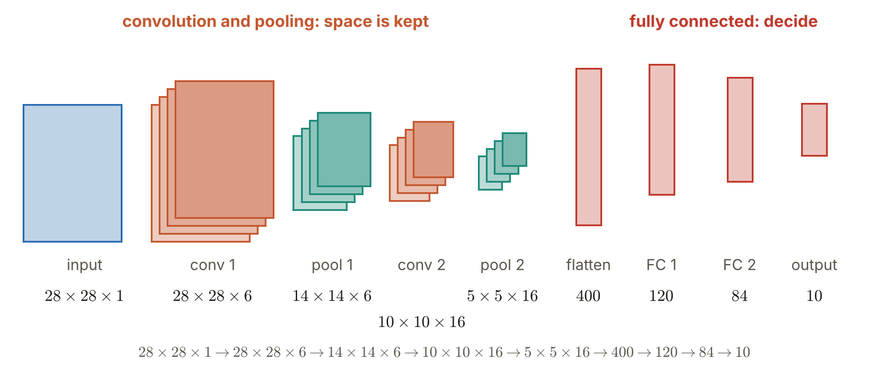
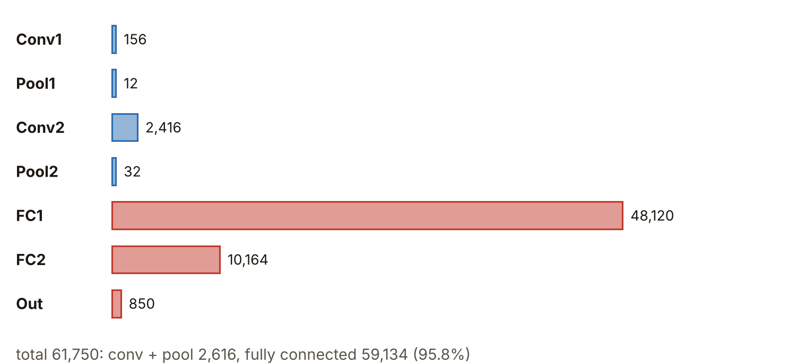

# 第6週 KP02：LeNet 與典型 CNN 骨架（LeNet and the classic CNN skeleton）

> 程度：大學生
>
> Level: Undergraduate (undergrad)

本講義是第6週「卷積與池化」的第二個知識點（KP02），屬於自主學習。前面的 KP01 到 KP10 把零件一個一個拆開看過：卷積、步幅與填補、偵測器、池化。這一節把零件裝回去，看第一個成功的完整卷積網路 LeNet 長什麼樣子：特徵圖的尺寸怎麼一路變化、參數在哪裡、為什麼「先卷積池化、最後才全連接」成了後世二十年的骨架。

This is the second knowledge point (KP02) of Week 6, "Convolution and pooling", and it is for self-study. KP01 to KP10 took the parts apart one at a time: convolution, stride and padding, the detector, pooling. This note puts the parts back together and looks at the first successful complete convolutional network, LeNet: how the size of the feature maps changes layer by layer, where the parameters are, and why "convolve and pool first, fully connect last" became the skeleton of the next twenty years.

先備知識是 KP05 的權重共享、KP07 的輸出邊長公式與 KP08 的池化。第一次出現的詞與符號都會定義。所有數字都由 `assets/figures/src/lec06-kp02-figures.py` 算出，可以自己重算。

The prerequisites are the parameter sharing of KP05, the output-side formula of KP07 and the pooling of KP08. Every term and symbol is defined when it first appears. Every number is computed by `assets/figures/src/lec06-kp02-figures.py`, so you can recompute it yourself.

[下載本單元投影片](../slides/lec06-kp02-lenet-cnn-skeleton.jbd.json)

[Download the slides of this unit (English)](../slides/lec06-kp02-lenet-cnn-skeleton-en.jbd.json)

## KP02 LeNet 與典型 CNN 骨架（LeNet and the classic CNN skeleton）

### 學習目標（Learning objectives）

讀完之後，你能說出 neocognitron、1989 年的反向傳播卷積網路與 LeNet-5 各是什麼，並用尺寸口訣 $28\times28\times6\to14\times14\to10\times10\times16\to5\times5\to120\to84\to10$ 寫出 LeNet 每一層的尺寸，並用 KP07 的公式驗算。你能逐層算出參數個數，說出總數與全連接層所占的比例。你能解釋為什麼全連接層要放在最後，並把 LeNet 和一開始就攤平的 MLP 比較。你也能說出 AlexNet 與 VGG 沿用了 LeNet 的哪一部分。

After reading, you can say what the neocognitron, the 1989 backpropagation-trained convolutional network and LeNet-5 each are, write the size of every LeNet layer with the size rule $28\times28\times6\to14\times14\to10\times10\times16\to5\times5\to120\to84\to10$, and verify it with the formula of KP07. You can compute the number of parameters layer by layer and say the total and the share of the fully connected layers. You can explain why the fully connected layers come last and compare LeNet with an MLP that flattens at the very beginning. You can also say which part of LeNet AlexNet and VGG kept.

### 符號表（Symbols）

| 符號 | 中文意義 | English meaning |
|---|---|---|
| $n$ | 輸入特徵圖的邊長 | side of the input feature map |
| $k$ | 卷積核的邊長 | side of the convolution kernel |
| $p,\ s$ | 填補圈數與步幅 | padding and stride |
| $c_{\mathrm{in}},\ c_{\mathrm{out}}$ | 輸入通道數與輸出通道數（核的個數） | input channels and output channels (number of kernels) |
| $N_{\mathrm{in}},\ N_{\mathrm{out}}$ | 全連接層的輸入個數與輸出個數 | inputs and outputs of a fully connected layer |
| $P$ | 一層的參數個數 | number of parameters of a layer |

本講義的指標一律從 $0$ 開始數，與 KP01 相同。參數個數把偏置也算進去：每個輸出一個偏置。

Indices start at $0$, as in KP01. The parameter counts include the bias: one bias per output.

### 1. 從 neocognitron 到 LeNet：手寫數字的標準答案（From the neocognitron to LeNet: the standard answer for handwritten digits）

深度學習不是 2012 年才突然出現的。1980 年，日本學者福島邦彥（Kunihiko Fukushima）提出 **neocognitron**，模仿生物視覺皮層：簡單細胞（S 細胞）抓局部的方向，複雜細胞（C 細胞）容許局部的平移。它已經有「分層抽取、局部感受野」的雛形，但還沒有用反向傳播訓練。

Deep learning did not suddenly appear in 2012. In 1980 the Japanese researcher Kunihiko Fukushima proposed the **neocognitron**, modelled on the visual cortex: simple cells (S-cells) catch local orientations and complex cells (C-cells) tolerate local shifts. It already had the outline of "hierarchical extraction with local receptive fields", but it was not trained with backpropagation.

1989 年，Yann LeCun 的團隊第一次把反向傳播用在卷積網路上，做手寫郵遞區號辨識，濾波器的權重由梯度端到端訓練出來，不是手刻的。1998 年，LeCun、Bottou、Bengio 與 Haffner 發表 **LeNet-5**，同時推出 $28\times28$ 的手寫數字基準資料集 **MNIST**（Modified NIST）。它從此成為深度學習最常被拿來示範的資料集。

In 1989 the team of Yann LeCun applied backpropagation to a convolutional network for the first time, for handwritten zip-code recognition, and the filter weights were trained end to end by the gradient instead of being hand-made. In 1998 LeCun, Bottou, Bengio and Haffner published **LeNet-5** together with the $28\times28$ handwritten-digit benchmark **MNIST** (Modified NIST). It has been the most commonly used demonstration dataset of deep learning ever since.

### 2. LeNet 的流水線：五步尺寸口訣（The LeNet pipeline: the five-step size rule）

輸入是 $28\times28$ 的灰階手寫數字，單通道。流水線只有兩段：前面「卷積、池化」交替，把圖案抽成特徵；最後把特徵攤平，交給全連接層做決策。

The input is a $28\times28$ grey-scale handwritten digit with one channel. The pipeline has only two parts: in front, "convolution and pooling" alternate to extract the patterns into features; at the end the features are flattened and handed to fully connected layers for the decision.

1. **Conv1**：$6$ 個 $5\times5$ 的核，填補 $2$ 圈，步幅 $1$。邊長 $(28+2\cdot2-5)/1+1=28$，輸出 $28\times28\times6$。
2. **Pool1**：$2\times2$、步幅 $2$ 的平均池化。邊長減半，輸出 $14\times14\times6$。
3. **Conv2**：$16$ 個 $5\times5$ 的核，沒有填補。邊長 $(14-5)/1+1=10$，輸出 $10\times10\times16$。
4. **Pool2**：$2\times2$、步幅 $2$。輸出 $5\times5\times16$。
5. **攤平與全連接**：$5\times5\times16=400$ 個數，依序接 $120$、$84$、$10$。最後的 $10$ 個輸出對應數字 $0$ 到 $9$。

1. **Conv1**: $6$ kernels of $5\times5$, padding $2$, stride $1$. The side is $(28+2\cdot2-5)/1+1=28$ and the output is $28\times28\times6$.
2. **Pool1**: average pooling with $2\times2$ and stride $2$. The side is halved and the output is $14\times14\times6$.
3. **Conv2**: $16$ kernels of $5\times5$, no padding. The side is $(14-5)/1+1=10$ and the output is $10\times10\times16$.
4. **Pool2**: $2\times2$ with stride $2$. The output is $5\times5\times16$.
5. **Flatten and fully connect**: $5\times5\times16=400$ numbers, followed in turn by $120$, $84$ and $10$. The final $10$ outputs correspond to the digits $0$ to $9$.

**圖說 `lec06-kp02-pipeline`**：先看左邊的方塊：邊長一路縮小，從 $28$ 到 $14$、$10$、$5$，疊起來的片數（通道）從 $1$ 變 $6$，再變 $16$。再看右邊的細長條：攤平成 $400$ 之後只剩一條向量，依序是 $120$、$84$、$10$。最後看底下一行：它就是尺寸口訣。

**Caption `lec06-kp02-pipeline`**: First look at the blocks on the left: the side shrinks from $28$ to $14$, $10$ and $5$, while the number of stacked sheets (channels) goes from $1$ to $6$ and then $16$. Then the thin bars on the right: after flattening to $400$ there is only a vector, in turn $120$, $84$ and $10$. Finally the bottom line: it is the size rule.

尺寸口訣：

$$28\times28\times6\xrightarrow{\text{pool}}14\times14\xrightarrow{\text{conv}}10\times10\times16\xrightarrow{\text{pool}}5\times5\xrightarrow{\text{FC}}120\to84\to10$$

Size rule:

$$28\times28\times6\xrightarrow{\text{pool}}14\times14\xrightarrow{\text{conv}}10\times10\times16\xrightarrow{\text{pool}}5\times5\xrightarrow{\text{FC}}120\to84\to10$$

觀察趨勢：解析度一路腰斬（$28\to14\to10\to5$），通道數一路增加（$1\to6\to16$）。每一層的數字個數是 $784\to4{,}704\to1{,}176\to1{,}600\to400$ `[補充]`：卷積讓個數先增加（通道變多），池化再把它壓回去。

The trend: the resolution is cut down all the way ($28\to14\to10\to5$) while the number of channels grows ($1\to6\to16$). The number of values per stage is $784\to4{,}704\to1{,}176\to1{,}600\to400$ `[Added]`: convolution first increases the count (more channels) and pooling presses it back.

### 3. 參數怎麼數：卷積層便宜，全連接層昂貴（Counting parameters: convolution is cheap and fully connected layers are expensive）

卷積層的參數個數是 $P=k\cdot k\cdot c_{\mathrm{in}}\cdot c_{\mathrm{out}}+c_{\mathrm{out}}$：每個核有 $k\cdot k\cdot c_{\mathrm{in}}$ 個權重，共 $c_{\mathrm{out}}$ 個核，再各加一個偏置。全連接層是 $P=N_{\mathrm{in}}\cdot N_{\mathrm{out}}+N_{\mathrm{out}}$。逐層來算：

The number of parameters of a convolution layer is $P=k\cdot k\cdot c_{\mathrm{in}}\cdot c_{\mathrm{out}}+c_{\mathrm{out}}$: every kernel has $k\cdot k\cdot c_{\mathrm{in}}$ weights, there are $c_{\mathrm{out}}$ kernels, and each gets a bias. A fully connected layer has $P=N_{\mathrm{in}}\cdot N_{\mathrm{out}}+N_{\mathrm{out}}$. Layer by layer:

| 層 | 算式 | 參數個數 |
|---|---|---|
| Conv1 | $5\cdot5\cdot1\cdot6+6$ | $156$ |
| Pool1 | 每張特徵圖 $2$ 個（係數與偏置）$\times6$ | $12$ |
| Conv2 | $5\cdot5\cdot6\cdot16+16$ | $2{,}416$ |
| Pool2 | $2\times16$ | $32$ |
| FC1 | $400\cdot120+120$ | $48{,}120$ |
| FC2 | $120\cdot84+84$ | $10{,}164$ |
| Output | $84\cdot10+10$ | $850$ |

| Layer | Formula | Parameters |
|---|---|---|
| Conv1 | $5\cdot5\cdot1\cdot6+6$ | $156$ |
| Pool1 | $2$ per feature map (coefficient and bias) $\times6$ | $12$ |
| Conv2 | $5\cdot5\cdot6\cdot16+16$ | $2{,}416$ |
| Pool2 | $2\times16$ | $32$ |
| FC1 | $400\cdot120+120$ | $48{,}120$ |
| FC2 | $120\cdot84+84$ | $10{,}164$ |
| Output | $84\cdot10+10$ | $850$ |

總數是 $61{,}750$。前四層（卷積與池化）一共只有 $2{,}616$ 個，後三層（全連接）有 $59{,}134$ 個，占 $95.8\%$。池化的 $12$ 與 $32$ 是原始 LeNet 的設計：每張特徵圖有一個可學的係數與偏置；KP08 的平均池化沒有權重，若用那樣的池化，總數是 $61{,}706$，全連接的比例仍是 $95.8\%$ `[補充]`。

The total is $61{,}750$. The first four layers (convolution and pooling) have only $2{,}616$ parameters together and the last three (fully connected) have $59{,}134$, a share of $95.8\%$. The $12$ and $32$ of pooling come from the original LeNet design: every feature map has one learnable coefficient and a bias; the average pooling of KP08 has no weights, and with such pooling the total is $61{,}706$ and the share of the fully connected layers is still $95.8\%$ `[Added]`.

**圖說 `lec06-kp02-params`**：先看上面四條藍色短條：卷積與池化層的參數都很少。再看下面三條紅色長條：FC1 一條就有 $48{,}120$，比前四層加起來的 $2{,}616$ 多十幾倍。最後看底下一行：全連接層占了 $95.8\%$。

**Caption `lec06-kp02-params`**: First look at the four short blue bars on top: the convolution and pooling layers have very few parameters. Then the three long red bars below: FC1 alone has $48{,}120$, more than ten times the $2{,}616$ of the first four layers together. Finally the bottom line: the fully connected layers take $95.8\%$.

這就是為什麼後來的網路（例如 ResNet）會用 KP10 的全域平均池化取代肥大的全連接層：參數幾乎都擠在那裡。

This is why later networks (for example ResNet) replace the fat fully connected layers with the global average pooling of KP10: nearly all the parameters are crowded there.

### 4. 為什麼先卷積、最後才全連接（Why convolve first and fully connect last）

三個理由，都是前面幾個知識點的總結。

There are three reasons, all of them a summary of the previous knowledge points.

**理由一：結構的順序就是先驗。** 左邊的卷積與池化，神經元只有局部感受野，權重在整個平面共享，專心抓邊緣、轉角等基礎形狀；這就是 KP10 說的無限強先驗。到了右邊，空間圖案已經變成高度抽象的特徵組合，這時才攤平，交給全連接層權衡全域的關係。

**Reason 1: the order of the structure is the prior.** In the convolution and pooling on the left, the neurons have only local receptive fields and the weights are shared over the whole plane, concentrating on basic shapes such as edges and corners; this is the infinitely strong prior of KP10. On the right the spatial patterns have become highly abstract combinations of features, and only then is the map flattened and handed to the fully connected layers to weigh global relations.

**理由二：階層化的特徵。** 淺層卷積抓方向、邊緣與紋理；深層把小局部拼成零件，例如眼睛、輪子；最後的全連接層判斷整個物件。這符合自然影像由小到大、層層組合的本質。

**Reason 2: hierarchical features.** Shallow convolutions catch orientations, edges and textures; deeper ones put small parts together into components such as eyes and wheels; the final fully connected layers judge the whole object. This matches the nature of natural images, which are composed layer by layer from small to large.

**理由三：算力與參數的最佳分配。** 解析度高的地方用參數極少的卷積核（便宜）；特徵圖縮到很小才用全連接層，避免對整張圖全連接帶來的參數爆炸。若在 Pool1 之後就攤平，$14\times14\times6=1{,}176$ 個數接 $120$ 個神經元，FC1 要 $1{,}176\cdot120+120=141{,}240$ 個參數，是原來 $48{,}120$ 的約 $2.9$ 倍 `[補充]`。

**Reason 3: the best allocation of computation and parameters.** Where the resolution is high, use convolution kernels with very few parameters (cheap); use fully connected layers only when the feature map has shrunk to a small size, to avoid the explosion of parameters of connecting the whole image. If one flattens right after Pool1, the $14\times14\times6=1{,}176$ numbers feeding $120$ neurons make FC1 need $1{,}176\cdot120+120=141{,}240$ parameters, about $2.9$ times the original $48{,}120$ `[Added]`.

常見錯誤：以為一開始就攤平，後面再多層全連接也能補回來。攤平那一刻，鄰居關係就丟了，後面的層救不回來。

Common error: thinking that if one flattens at the very beginning, many fully connected layers afterwards can make up for it. The neighbour relations are lost at the moment of flattening and the later layers cannot recover them.

### 5. LeNet 對 MLP，以及它留給後世的骨架（LeNet versus an MLP and the skeleton it left behind）

拿一個一開始就攤平的 MLP 來比：$784\to120\to84\to10$，同樣的隱藏層寬度。參數是 $784\cdot120+120=94{,}200$、$10{,}164$、$850$，總共 $105{,}214$ `[補充]`。LeNet 是 $61{,}750$，少了 $43{,}464$ 個，約 $41.3\%$。

Compare with an MLP that flattens at the very beginning: $784\to120\to84\to10$ with the same hidden widths. Its parameters are $784\cdot120+120=94{,}200$, $10{,}164$ and $850$, in total $105{,}214$ `[Added]`. LeNet has $61{,}750$, which is $43{,}464$ fewer, about $41.3\%$.

| 維度 | 一開始就攤平的 MLP | LeNet |
|---|---|---|
| 空間處理的時機 | 第 $0$ 步就攤平，鄰居關係被丟掉 | 保留到最後一段才攤平 |
| 特徵抽取 | 每個畫素有各自的全域權重 | $5\times5$ 的核在整張圖共享 |
| 參數（MNIST） | $105{,}214$ | $61{,}750$ |
| 平移 | 移一個畫素就像全新的樣本 | 卷積自帶平移等變 |
| 歸納偏置 | 幾乎沒有，全靠資料學 | 強：局部性與空間重複 |

| Aspect | MLP that flattens first | LeNet |
|---|---|---|
| When space is handled | flattens at step $0$ and loses the neighbour relations | keeps it until the last part to flatten |
| Feature extraction | every pixel has its own global weights | a $5\times5$ kernel shared over the whole image |
| Parameters (MNIST) | $105{,}214$ | $61{,}750$ |
| Shift | a one-pixel shift looks like a brand-new sample | convolution has translation equivariance built in |
| Inductive bias | almost none, everything is learned from data | strong: locality and spatial repetition |

這張骨架為什麼還在被沿用？2012 年奪下 ImageNet 冠軍的 **AlexNet**，本質上是跑在 GPU 上、更深更寬的 LeNet：同樣是多層卷積與池化串接，最後接 $4096\to4096\to1000$ 的全連接層，並加上 ReLU 與 Dropout。2014 年的 **VGG** 把「卷積、池化減半」的迴圈模組化，統一用 $3\times3$ 的核堆疊，但「先抽特徵、再決策」的邏輯源自 LeNet。這兩個網路是下一週的主題。

Why is this skeleton still used? **AlexNet**, which won ImageNet in 2012, is in essence a deeper and wider LeNet running on GPUs: again many convolution and pooling layers in series followed at the end by fully connected layers $4096\to4096\to1000$, with ReLU and Dropout added. **VGG** of 2014 modularised the loop "convolution, then halve by pooling" and stacked $3\times3$ kernels throughout, yet the logic "extract features first, then decide" comes from LeNet. These two networks are the topic of next week.

### 本單元重點整理（KP02 summary）

**一句話重點**：LeNet 是「前面卷積與池化交替抽空間特徵，結尾才攤平交給全連接層決策」的黃金原型；尺寸 $28\to14\to10\to5$ 一路縮小、通道 $1\to6\to16$ 增加，參數總共 $61{,}750$，其中 $95.8\%$ 擠在全連接層。

**One-sentence summary**: LeNet is the golden prototype of "convolution and pooling alternate in front to extract spatial features and only at the end the map is flattened for the fully connected layers to decide"; the size shrinks $28\to14\to10\to5$ while the channels grow $1\to6\to16$, and of the $61{,}750$ parameters in total, $95.8\%$ are crowded into the fully connected layers.

**白話說明**：像看一張拼圖：先用小窗口一塊一塊看（卷積），每看完一輪就把圖縮小（池化），等看懂了零件，才退後一步看整體做決定（全連接）。若一開始就把拼圖打散排成一長條，鄰居的關係就沒了。

**Plain explanation**: like looking at a jigsaw: first look piece by piece through a small window (convolution) and shrink the picture after every round (pooling); once the parts are understood, step back and look at the whole to decide (fully connected). If one scatters the puzzle into one long strip at the beginning, the neighbour relations are gone.

**正式定義**：卷積層 $P=k^2c_{\mathrm{in}}c_{\mathrm{out}}+c_{\mathrm{out}}$，全連接層 $P=N_{\mathrm{in}}N_{\mathrm{out}}+N_{\mathrm{out}}$；邊長 $\lfloor(n+2p-k)/s\rfloor+1$。

**Formal definition**: a convolution layer has $P=k^2c_{\mathrm{in}}c_{\mathrm{out}}+c_{\mathrm{out}}$, a fully connected layer $P=N_{\mathrm{in}}N_{\mathrm{out}}+N_{\mathrm{out}}$; the side is $\lfloor(n+2p-k)/s\rfloor+1$.

**例子**：Conv1 是 $5\cdot5\cdot1\cdot6+6=156$ 個參數，FC1 是 $400\cdot120+120=48{,}120$ 個；一開始就攤平的 MLP $784\to120\to84\to10$ 有 $105{,}214$ 個參數，LeNet 只有 $61{,}750$。

**Example**: Conv1 has $5\cdot5\cdot1\cdot6+6=156$ parameters and FC1 has $400\cdot120+120=48{,}120$; an MLP that flattens first, $784\to120\to84\to10$, has $105{,}214$ parameters and LeNet only $61{,}750$.

**常見迷思**：

- 「深度學習是 2012 年才突然出現的。」錯，neocognitron（1980）、反向傳播卷積網路（1989）與 LeNet-5（1998）早就有了。
- 「LeNet 的參數主要在卷積層。」錯，卷積與池化只有 $2{,}616$ 個，全連接層占 $95.8\%$。
- 「一開始就攤平，後面多放幾層全連接也一樣好。」錯，攤平時鄰居關係就丟了，而且參數更多。
- 「池化層和卷積層一樣有很多參數。」錯，原始 LeNet 的池化每張圖只有 $2$ 個，現代的平均或最大池化是零。

**Common misconceptions**:

- "Deep learning suddenly appeared in 2012." Wrong: the neocognitron (1980), the backpropagation-trained convolutional network (1989) and LeNet-5 (1998) were already there.
- "The parameters of LeNet are mainly in the convolution layers." Wrong: convolution and pooling have only $2{,}616$ and the fully connected layers take $95.8\%$.
- "Flattening at the beginning and adding more fully connected layers afterwards is just as good." Wrong: the neighbour relations are lost at flattening, and there are more parameters.
- "Pooling layers have as many parameters as convolution layers." Wrong: pooling in the original LeNet has only $2$ per map and modern average or max pooling has zero.

**圖**：本單元有兩張圖。

- `lec06-kp02-pipeline`：LeNet 的流水線與每一層的尺寸。
- `lec06-kp02-params`：各層的參數個數。

兩張圖與文中數字都由同一支程式產生：`lec06-kp02-figures.py`。

**Figures**: this unit has two figures.

- `lec06-kp02-pipeline`: the LeNet pipeline and the size of every layer.
- `lec06-kp02-params`: the number of parameters of every layer.

Both figures and the numbers in the text come from the same program: `lec06-kp02-figures.py`.

**想深入**（選讀）`[補充]`：原始論文的第二個卷積層（C3）並不是「$16$ 個核各看全部 $6$ 張圖」。它用一張連接表：$6$ 張輸出圖各連 $3$ 張相鄰的輸入圖，$6$ 張各連 $4$ 張相鄰的，$3$ 張各連 $4$ 張不相鄰的，$1$ 張連全部 $6$ 張。參數是 $6\cdot(3\cdot25+1)+6\cdot(4\cdot25+1)+3\cdot(4\cdot25+1)+1\cdot(6\cdot25+1)=1{,}516$，比全連接的 $2{,}416$ 少。換上 $1{,}516$ 以後，全網路是 $60{,}850$ 個參數，也就是常聽到的「約六萬」。連接表的目的是少一些參數，並讓不同的特徵圖看不同組合的輸入；現代的實作多半直接全連接，簡單，也容易用矩陣運算加速。

**Going deeper** (optional) `[Added]`: the second convolution layer (C3) of the original paper is not "$16$ kernels each looking at all $6$ maps". It uses a connection table: $6$ output maps each connect to $3$ adjacent input maps, $6$ each to $4$ adjacent ones, $3$ each to $4$ non-adjacent ones, and $1$ to all $6$. The parameters are $6\cdot(3\cdot25+1)+6\cdot(4\cdot25+1)+3\cdot(4\cdot25+1)+1\cdot(6\cdot25+1)=1{,}516$, fewer than the fully connected $2{,}416$. With $1{,}516$ the whole network has $60{,}850$ parameters, the often-quoted "about sixty thousand". The aim of the table is to save some parameters and to make different feature maps see different combinations of inputs; modern implementations mostly connect everything, which is simple and easy to speed up with matrix operations.

**小練習**：

1. 輸入改成 $32\times32\times1$（原論文的做法），Conv1 用 $6$ 個 $5\times5$ 的核、不填補，其他不變。逐層寫出輸出尺寸與攤平後的長度。
2. `[補充]` Conv2 的輸入是 $14\times14\times6$，輸出是 $10\times10\times16$。作為卷積層，它的權重有多少個（不算偏置）？如果改成一個全連接層，把 $14\times14\times6$ 全部接到 $10\times10\times16$，權重有多少個？是前者的幾倍？
3. `[補充]` 一開始就攤平的 MLP $784\to120\to84\to10$ 有多少參數？LeNet 比它少多少？少了幾成？
4. `[補充]` 若在 Pool1 之後就攤平，接 $120$ 個神經元的 FC1 有多少參數？是原來 FC1 的幾倍？

**Practice**:

1. Change the input to $32\times32\times1$ (the approach of the original paper), and let Conv1 use $6$ kernels of $5\times5$ with no padding and everything else unchanged. Write the output size of every layer and the length after flattening.
2. `[Added]` The input of Conv2 is $14\times14\times6$ and its output is $10\times10\times16$. As a convolution layer, how many weights does it have (bias not counted)? If it were a fully connected layer connecting all of $14\times14\times6$ to $10\times10\times16$, how many weights, and how many times the former?
3. `[Added]` How many parameters does the MLP $784\to120\to84\to10$ that flattens at the beginning have? By how many does LeNet have fewer, and how many tenths less?
4. `[Added]` If one flattens right after Pool1 and connects to $120$ neurons, how many parameters does FC1 have? How many times the original FC1?

**第 1 題解答** `[補充]`：

1. Conv1：邊長 $(32-5)/1+1=28$，輸出 $28\times28\times6$，和原來一樣。
2. Pool1 後是 $14\times14\times6$，Conv2 後是 $10\times10\times16$，Pool2 後是 $5\times5\times16$。
3. 攤平長度 $5\times5\times16=400$，和原來相同。原論文用 $32\times32$ 的輸入、不填補，和本講義 $28\times28$ 輸入加填補 $2$ 圈，得到完全相同的後續尺寸。

**Solution to question 1** `[Added]`:

1. Conv1: the side is $(32-5)/1+1=28$ and the output is $28\times28\times6$, the same as before.
2. After Pool1 it is $14\times14\times6$, after Conv2 $10\times10\times16$ and after Pool2 $5\times5\times16$.
3. The flattened length is $5\times5\times16=400$, the same as before. The original paper used a $32\times32$ input with no padding and this note uses a $28\times28$ input with padding $2$, and the following sizes come out exactly the same.

**第 2 題解答** `[補充]`：

1. 卷積層：$5\cdot5\cdot6\cdot16=2{,}400$ 個權重。
2. 全連接：輸入 $14\cdot14\cdot6=1{,}176$ 個、輸出 $10\cdot10\cdot16=1{,}600$ 個，權重 $1{,}176\cdot1{,}600=1{,}881{,}600$。
3. 倍數：$1{,}881{,}600/2{,}400=784$。權重共享與局部連接省下了 $784$ 倍。

**Solution to question 2** `[Added]`:

1. As a convolution layer: $5\cdot5\cdot6\cdot16=2{,}400$ weights.
2. Fully connected: $14\cdot14\cdot6=1{,}176$ inputs and $10\cdot10\cdot16=1{,}600$ outputs, so $1{,}176\cdot1{,}600=1{,}881{,}600$ weights.
3. The factor: $1{,}881{,}600/2{,}400=784$. Parameter sharing and local connections save a factor of $784$.

**第 3 題解答** `[補充]`：

1. 第一層 $784\cdot120+120=94{,}200$，第二層 $10{,}164$，第三層 $850$，合計 $105{,}214$。
2. LeNet 是 $61{,}750$，差 $105{,}214-61{,}750=43{,}464$。
3. $43{,}464/105{,}214\approx41.3\%$，約四成。

**Solution to question 3** `[Added]`:

1. The first layer has $784\cdot120+120=94{,}200$, the second $10{,}164$ and the third $850$, in total $105{,}214$.
2. LeNet has $61{,}750$, a difference of $105{,}214-61{,}750=43{,}464$.
3. $43{,}464/105{,}214\approx41.3\%$, about four tenths.

**第 4 題解答** `[補充]`：

1. Pool1 後是 $14\times14\times6=1{,}176$ 個數，接 $120$ 個神經元：$1{,}176\cdot120+120=141{,}240$。
2. 原來的 FC1 是 $48{,}120$，倍數是 $141{,}240/48{,}120\approx2.9$。
3. 太早攤平，參數增加近三倍，而且還丟掉了後面一次卷積與池化能抽出的特徵。

**Solution to question 4** `[Added]`:

1. After Pool1 there are $14\times14\times6=1{,}176$ numbers feeding $120$ neurons: $1{,}176\cdot120+120=141{,}240$.
2. The original FC1 has $48{,}120$, so the factor is $141{,}240/48{,}120\approx2.9$.
3. Flattening too early nearly triples the parameters and also throws away the features that one more convolution and pooling could extract.

### 來源更正與取捨（Corrections to the source）

本講義依 CCC-LNS IDL_115 第4章 KP02（簡報）重新撰寫，該教材的第4章就是本課的第6週。來源的讀取日期是 2026-10-30。來源沒有的內容，都在出現的地方標示 `[補充]`。

This note is rewritten from KP02 of CCC-LNS IDL_115 Chapter 4 (slides); Chapter 4 of that material is Week 6 of this course. The source was accessed on 2026-10-30. Content that the source does not contain is marked `[Added]` where it appears.

- 來源的互動實驗室寫「前四層卷積與池化總共約 $3{,}000$ 個參數，後三層全連接占 $57{,}000+$（$>90\%$）」。本講義逐層算出：前四層是 $2{,}616$，全連接是 $59{,}134$，占 $95.8\%$，總數 $61{,}750$。
- 來源的池化層參數是 $12$ 與 $32$，同時又說是「$2\times2$ 平均池化」。這兩者矛盾：KP08 的平均池化沒有權重。本講義說明 $12$、$32$ 是原始 LeNet 每張圖一個係數加一個偏置的設計，並補上無權重池化時的總數 $61{,}706$。
- 來源的對照表寫 MLP 約「$100{,}000+$」、LeNet 約「$60{,}000$」，沒有說明 MLP 的結構。本講義指定 $784\to120\to84\to10$，算出 $105{,}214$ 對 $61{,}750$。
- 來源的 Conv2 是 $2{,}416$，與全連接版相同；原論文的 C3 用連接表，是 $1{,}516$。本講義放在「想深入」說明，並算出全網路 $60{,}850$。
- 來源的輸出層寫成 RBF 或 Softmax。本講義把最後一層當成 $10$ 類的分類輸出，不展開 RBF 的細節。
- 來源的黃金準則「一開始就攤平，後面再多層全連接也救不回」，本講義保留，並用「Pool1 之後就攤平，FC1 參數增為約 $2.9$ 倍」補上數字。
- 取捨：來源的互動模擬器與四題測驗不採用，概念（歷史、尺寸口訣、參數集中地、為何全連接放最後）都在正文與練習裡。補充的內容有：每階段的數字個數、無權重池化的總數、MLP 的算式、早攤平的算例、C3 的連接表。

- The source's interactive lab says "the first four layers of convolution and pooling have about $3{,}000$ parameters in total and the last three fully connected layers have $57{,}000+$ ($>90\%$)". This note computes layer by layer: the first four are $2{,}616$, the fully connected ones are $59{,}134$, a share of $95.8\%$, in total $61{,}750$.
- The source gives the pooling layers $12$ and $32$ parameters and also calls them "$2\times2$ average pooling". The two contradict each other: the average pooling of KP08 has no weights. This note explains that $12$ and $32$ are the design of the original LeNet with one coefficient and a bias per map, and adds the total $61{,}706$ for pooling without weights.
- The source's comparison table writes an MLP of about "$100{,}000+$" and LeNet about "$60{,}000$" without giving the structure of the MLP. This note fixes $784\to120\to84\to10$ and computes $105{,}214$ against $61{,}750$.
- The source's Conv2 is $2{,}416$, the same as the fully connected version; C3 of the original paper uses a connection table and has $1{,}516$. This note explains it in "Going deeper" and computes $60{,}850$ for the whole network.
- The source writes the output layer as RBF or Softmax. This note treats the last layer as a $10$-class classification output and does not expand the details of RBF.
- The source's golden rule "if one flattens at the beginning, many fully connected layers afterwards cannot save it" is kept, and this note adds numbers with "flatten after Pool1 and FC1 grows to about $2.9$ times".
- Choices: the source's interactive simulator and four-question quiz are not used, and their concepts (history, the size rule, where the parameters are concentrated, why the fully connected layers come last) are in the text and the practice. The added content is: the number of values per stage, the total for weight-free pooling, the formulas of the MLP, the early-flatten computation and the connection table of C3.

### 術語對照（Terminology）

| 中文 | English |
|---|---|
| 新認知機 | neocognitron |
| 感受野 | receptive field |
| 簡單細胞／複雜細胞 | simple cell (S-cell) / complex cell (C-cell) |
| 手寫數字資料集 | MNIST |
| 特徵圖 | feature map |
| 通道 | channel |
| 攤平 | flatten |
| 全連接層 | fully connected layer |
| 權重共享 | parameter sharing |
| 歸納偏置 | inductive bias |
| 骨架 | skeleton (blueprint) |
| 平均池化 | average pooling |
