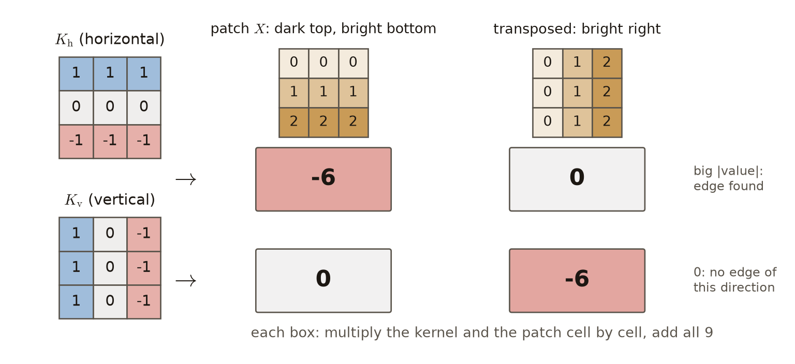
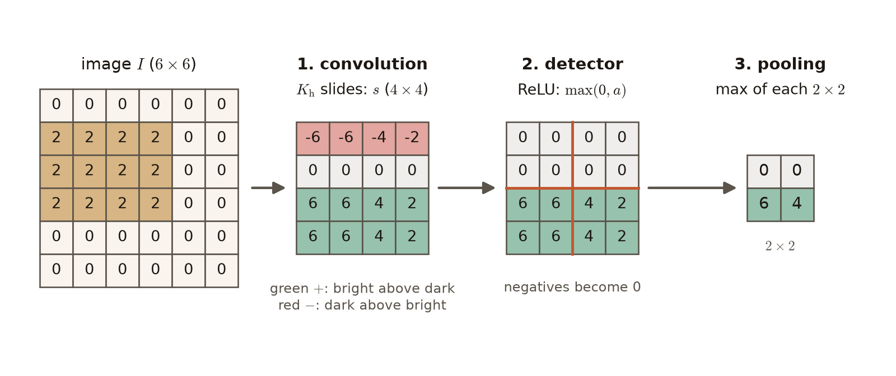

# 第6週 KP03：卷積層三階段（The three stages of a convolutional layer）

> 程度：大學生
>
> Level: Undergraduate (undergrad)

本講義是第6週「卷積與池化」的第三個知識點（KP03）。KP01 讓一個小核在影像上滑動，逐格相乘再加總，得到特徵圖；KP02（自主學習）看 LeNet 怎麼把這種層一層層疊成完整的網路。這一節把其中一層拆開，回答兩個問題：一層卷積層裡面，到底做了哪幾件事？核裡的那九個數字，又是從哪裡來的？

This is the third knowledge point (KP03) of Week 6, "Convolution and pooling". KP01 slid a small kernel over an image, multiplying cell by cell and adding up, to get a feature map; KP02 (self-study) looks at how LeNet stacks such layers into a complete network. This section takes one of those layers apart and answers two questions: what exactly happens inside one convolutional layer, and where do the nine numbers of the kernel come from?

先備知識是 KP01 的核與特徵圖、第2週的活化函數：線性整流函數 $\mathrm{ReLU}(a)=\max(0,a)$，以及第3週的反向傳播與梯度下降。第一次出現的詞與符號都會定義。所有數字都由 `assets/figures/src/lec06-kp03-figures.py` 算出，可以自己重算。

The prerequisites are the kernel and feature map of KP01, the ReLU activation function of Week 2, $\mathrm{ReLU}(a)=\max(0,a)$, and the backpropagation and gradient descent of Week 3. Every term and symbol is defined when it first appears. Every number is computed by `assets/figures/src/lec06-kp03-figures.py` and can be recomputed.

[下載本單元投影片](../slides/lec06-kp03-conv-layer-three-stages.jbd.json)

[Download the slides of this unit (English)](../slides/lec06-kp03-conv-layer-three-stages-en.jbd.json)

## KP03 卷積層三階段（The three stages of a convolutional layer）

### 學習目標（Learning objectives）

讀完之後，你能依序說出一層卷積層的三個階段：卷積、偵測器、池化，並說出每一站把數字變成什麼。你能用一個手設計的邊緣核，在一小塊影像上算出邊緣的反應，並解釋正負號的意思。你能讓一張小影像親手走完三站，寫出每一站的結果。你也能說明為什麼核的數字要交給反向傳播去學，而不是由人手設計。

After reading, you can name the three stages of a convolutional layer in order, convolution, detector and pooling, and say what each stage does to the numbers. You can compute the edge response of a hand-designed edge kernel on a small patch of an image and explain what its sign means. You can take a small image through the three stages by hand and write down the result of each stage. You can also explain why the numbers of the kernel are learned by backpropagation instead of being designed by hand.

### 符號表（Symbols）

| 符號 | 中文意義 | English meaning |
|---|---|---|
| $I[p,q]$ | 影像第 $p$ 列、第 $q$ 行的畫素值 | pixel value of the image at row $p$, column $q$ |
| $K[m,n]$ | 核第 $m$ 列、第 $n$ 行的權重 | weight of the kernel at row $m$, column $n$ |
| $k$ | 核的邊長，本講義 $k=3$ | side length of the kernel; $k=3$ in this note |
| $K_{\mathrm h},\ K_{\mathrm v}$ | 水平與垂直的 Prewitt 核 | the horizontal and the vertical Prewitt kernel |
| $s[i,j]$ | 卷積階段的輸出（特徵圖）在 $(i,j)$ 的值 | value of the convolution output (feature map) at $(i,j)$ |
| $r[i,j]$ | 偵測器階段的輸出 | output of the detector stage |
| $y[u,v]$ | 池化階段的輸出 | output of the pooling stage |
| $a$ | 活化函數的輸入（第2週的寫法） | input of an activation function (Week 2 notation) |
| $e$ | 損失（第3週的寫法） | loss (Week 3 notation) |
| $\eta$ | 學習率 | learning rate |

本講義的指標一律從 $0$ 開始數，公式不含偏置，與 KP01 相同。

All indices in this note start at $0$ and the formulas have no bias, as in KP01.

### 1. 一層卷積層有三站（One convolutional layer has three stages）

KP01 的「核在影像上滑動、逐格相乘再加總」，只是一層卷積層的第一站。完整的一層依序有三站：

The sliding multiply-and-add of KP01 is only the first stage of a convolutional layer. A complete layer has three stages, in this order:

- **卷積階段**：核在輸入上滑動，每個位置做一次乘加，得到特徵圖 $s$。式子沿用 KP01：$s[i,j]=\sum_{m=0}^{k-1}\sum_{n=0}^{k-1} I[i+m,\,j+n]\,K[m,n]$。
- **偵測器階段**：對特徵圖的每一格各套一次活化函數，決定這個位置的特徵「被點亮」多少。
- **池化階段**：把特徵圖切成小塊，每一塊只留一個摘要數字，圖因此變小。

- **Convolution stage**: the kernel slides over the input and does one multiply-and-add at each position, giving the feature map $s$. The formula is the one of KP01: $s[i,j]=\sum_{m=0}^{k-1}\sum_{n=0}^{k-1} I[i+m,\,j+n]\,K[m,n]$.
- **Detector stage**: an activation function is applied to every cell of the feature map, deciding how strongly the feature at that position "lights up".
- **Pooling stage**: the feature map is cut into small blocks and each block keeps only one summary number, so the map becomes smaller.

這就像修圖軟體裡的「找邊緣」濾鏡：第一站套上濾鏡，第二站只留下正的反應，第三站把結果縮小。先看第一站：核裡的數字長什麼樣，它又怎麼找到邊緣？

This is like the "find edges" filter of a photo editor: the first stage applies the filter, the second keeps only the positive responses, and the third shrinks the result. Start with the first stage: what do the numbers of a kernel look like, and how does it find an edge?

### 2. 第一站：Prewitt 核挑出水平或垂直的邊緣（Stage one: Prewitt kernels pick out horizontal or vertical edges）

**邊緣**是影像裡亮暗突然改變的地方。深度學習流行之前，影像處理的工程師用手設計核來找邊緣。經典的例子是兩個 $3\times3$ 的 **Prewitt 核**：

An **edge** is a place in an image where the brightness changes suddenly. Before deep learning became popular, image-processing engineers designed kernels by hand to find edges. The classic example is the pair of $3\times3$ **Prewitt kernels**:

$$
K_{\mathrm h}=\begin{bmatrix} 1 & 1 & 1\\ 0 & 0 & 0\\ -1 & -1 & -1 \end{bmatrix},\qquad
K_{\mathrm v}=\begin{bmatrix} 1 & 0 & -1\\ 1 & 0 & -1\\ 1 & 0 & -1 \end{bmatrix}
$$

水平核 $K_{\mathrm h}$ 是「上面一列減下面一列」，遇到上下亮暗不同的水平邊緣，反應最大。垂直核 $K_{\mathrm v}$ 是「左邊一行減右邊一行」，對左右亮暗不同的垂直邊緣反應最大。

The horizontal kernel $K_{\mathrm h}$ computes "top row minus bottom row", so its response is largest on a horizontal edge, where the brightness differs between top and bottom. The vertical kernel $K_{\mathrm v}$ computes "left column minus right column" and responds most to a vertical edge, where the brightness differs between left and right.

拿一小塊 $3\times3$ 的影像 $X$ 來算。它的三列是 $[0,0,0]$、$[1,1,1]$、$[2,2,2]$，上面暗、下面亮。核和小塊一樣大，蓋上去只算一次：

Compute on a $3\times3$ patch $X$ of an image. Its rows are $[0,0,0]$, $[1,1,1]$ and $[2,2,2]$: dark on top, bright below. The kernel is as large as the patch, so it is laid down only once:

- $K_{\mathrm h}$：第 $0$ 列 $0\cdot1+0\cdot1+0\cdot1=0$，第 $1$ 列乘 $0$ 得 $0$，第 $2$ 列 $2\cdot(-1)+2\cdot(-1)+2\cdot(-1)=-6$，合計 $-6$。
- $K_{\mathrm v}$：每一列都是 $1\cdot v+0\cdot v+(-1)\cdot v=0$（$v$ 是那一列的值），合計 $0$。

- $K_{\mathrm h}$: row $0$ gives $0\cdot1+0\cdot1+0\cdot1=0$, row $1$ is multiplied by $0$ and gives $0$, and row $2$ gives $2\cdot(-1)+2\cdot(-1)+2\cdot(-1)=-6$; the total is $-6$.
- $K_{\mathrm v}$: every row gives $1\cdot v+0\cdot v+(-1)\cdot v=0$, where $v$ is the value of that row; the total is $0$.

**圖說 `lec06-kp03-prewitt-responses`**：先看左邊的兩個核，藍色是 $+1$、紅色是 $-1$。再看上方兩個小塊：左邊是 $X$，右邊是把 $X$ 轉置（列與行互換）、變成左暗右亮的小塊。中間四個方框是核與小塊逐格相乘再加總的結果。水平核只對上下對比的 $X$ 有反應，垂直核只對左右對比的那一塊有反應，各給 $-6$（紅色方框表示負的反應），另一格都是 $0$。

**Caption `lec06-kp03-prewitt-responses`**: First look at the two kernels on the left; blue is $+1$ and red is $-1$. Then look at the two patches on top: the left one is $X$, and the right one is $X$ transposed (rows and columns swapped), dark on the left and bright on the right. The four boxes are the results of multiplying a kernel and a patch cell by cell and adding up. The horizontal kernel responds only to the top-versus-bottom patch $X$, the vertical kernel only to the left-versus-right patch; each gives $-6$ (a red box marks a negative response), and the other box is $0$.

所以核真的在「挑」它會的那一種邊緣。反應的絕對值大，表示有這個方向的邊緣；正負號說明哪一邊比較亮 `[補充]`。$K_{\mathrm h}$ 給正數時上面比較亮，給負數時下面比較亮，就像 $X$ 的 $-6$。

So a kernel really picks out the one kind of edge it knows. A response with a large absolute value means there is an edge in that direction; the sign tells which side is brighter `[Added]`. $K_{\mathrm h}$ gives a positive number when the top is brighter and a negative number when the bottom is brighter, like the $-6$ of $X$.

一小塊只算一個數。一整張影像走完三站，又會變成什麼？

One patch gives only one number. What becomes of a whole image after all three stages?

### 3. 走完三站：6×6 影像變成 2×2（Through all three stages: a 6×6 image becomes 2×2）

主例子 `[補充]` 是一張 $6\times6$ 的影像：第 $1$ 到 $3$ 列、第 $0$ 到 $3$ 行是亮度 $2$ 的亮塊，其餘都是 $0$。亮塊有一條上緣（第 $0$、$1$ 列之間）和一條下緣（第 $3$、$4$ 列之間）。

The main example `[Added]` is a $6\times6$ image: rows $1$ to $3$, columns $0$ to $3$ form a bright block of brightness $2$, and everything else is $0$. The block has a top edge (between rows $0$ and $1$) and a bottom edge (between rows $3$ and $4$).

**第一站：卷積。** 用 $K_{\mathrm h}$ 做 KP01 的有效輸出，每個方向有 $6-3+1=4$ 個位置，所以特徵圖是 $4\times4$。三個代表格：

**Stage one: convolution.** Take the valid output of KP01 with $K_{\mathrm h}$; each direction has $6-3+1=4$ positions, so the feature map is $4\times4$. Three representative cells:

- $s[0,0]$：窗是第 $0$ 到 $2$ 列、第 $0$ 到 $2$ 行。上列全是 $0$，下列全是 $2$，所以 $0-2\cdot3=-6$。這是上緣，上暗下亮。
- $s[2,0]$：窗是第 $2$ 到 $4$ 列。上列全是 $2$，下列全是 $0$，所以 $2\cdot3-0=6$。這是下緣，上亮下暗。
- $s[0,3]$：窗是第 $3$ 到 $5$ 行，下列只有第 $3$ 行是 $2$，所以 $0-2=-2$。窗只蓋到亮塊的一小部分，反應比較小。

- $s[0,0]$: the window covers rows $0$ to $2$, columns $0$ to $2$. The top row is all $0$ and the bottom row is all $2$, so $0-2\cdot3=-6$. This is the top edge, dark above bright.
- $s[2,0]$: the window covers rows $2$ to $4$. The top row is all $2$ and the bottom row is all $0$, so $2\cdot3-0=6$. This is the bottom edge, bright above dark.
- $s[0,3]$: the window covers columns $3$ to $5$, and only column $3$ of its bottom row is $2$, so $0-2=-2$. The window covers only a small part of the block, so the response is smaller.

整張特徵圖四列是 $[-6,-6,-4,-2]$、$[0,0,0,0]$、$[6,6,4,2]$、$[6,6,4,2]$。第 $1$ 列的窗涵蓋第 $1$ 到 $3$ 列，最上一列和最下一列一模一樣，相減就是 $0$。

The whole feature map has the rows $[-6,-6,-4,-2]$, $[0,0,0,0]$, $[6,6,4,2]$ and $[6,6,4,2]$. The windows of row $1$ cover rows $1$ to $3$, whose top and bottom rows are identical, so they give $0$.

**第二站：偵測器。** 這裡用第2週的線性整流函數 $\mathrm{ReLU}(a)=\max(0,a)$：負數變 $0$，正數不變。寫成 $r[i,j]=\mathrm{ReLU}(s[i,j])=\max(0,\,s[i,j])$。第 $0$ 列的 $-6,-6,-4,-2$ 全變成 $0$，其餘不變。結果只剩「上亮下暗」的下緣被點亮。

**Stage two: detector.** Here it is the ReLU of Week 2: $\max(0,a)$, which turns negative numbers into $0$ and keeps positive numbers. Written out, $r[i,j]=\max(0,\,s[i,j])$. The $-6,-6,-4,-2$ of row $0$ all become $0$, and everything else stays. Only the bottom edge, bright above dark, is still lit.

**第三站：池化。** 這裡用**最大池化**：把 $4\times4$ 的 $r$ 切成四塊不重疊的 $2\times2$，每塊只留最大值，寫成 $y[u,v]=\max\big(r[2u,2v],\,r[2u,2v+1],\,r[2u+1,2v],\,r[2u+1,2v+1]\big)$。左上與右上兩塊全是 $0$；左下一塊是 $6,6,6,6$，得 $6$；右下一塊是 $4,2,4,2$，得 $4$。所以 $y$ 兩列是 $[0,0]$、$[6,4]$。

**Stage three: pooling.** Here it is **max pooling**: cut the $4\times4$ map $r$ into four non-overlapping $2\times2$ blocks and keep only the largest number of each block, written $y[u,v]=\max\big(r[2u,2v],\,r[2u,2v+1],\,r[2u+1,2v],\,r[2u+1,2v+1]\big)$. The top-left and top-right blocks are all $0$; the bottom-left block is $6,6,6,6$ and gives $6$; the bottom-right block is $4,2,4,2$ and gives $4$. So $y$ has the rows $[0,0]$ and $[6,4]$.

**圖說 `lec06-kp03-three-stages`**：由左往右看。最左邊是 $6\times6$ 影像，橘色的是亮塊。第一站的特徵圖裡，綠色是正數（上亮下暗），紅色是負數（上暗下亮）。第二站的 $\mathrm{ReLU}$ 把紅色那一列全變成 $0$，橘線把它切成四塊 $2\times2$。第三站每塊只留最大值，得到 $2\times2$ 的 $[0,0]$、$[6,4]$：亮塊的下緣在下半部；左半邊的窗整段蓋在下緣上，所以是 $6$，右半邊只蓋到下緣的一部分，所以是 $4$。

**Caption `lec06-kp03-three-stages`**: Read from left to right. On the far left is the $6\times6$ image, with the bright block in orange. In the feature map of stage one, green cells are positive (bright above dark) and red cells are negative (dark above bright). The ReLU of stage two turns the whole red row into $0$, and the orange lines cut the map into four $2\times2$ blocks. Stage three keeps the largest number of each block and gives the $2\times2$ rows $[0,0]$ and $[6,4]$: the bottom edge of the block lies in the lower half; the windows of the left half lie entirely on the bottom edge, so they give $6$, while those of the right half cover only part of it, so they give $4$.

三站為什麼缺一不可？

Why is each of the three stages needed?

- 少了偵測器：卷積只是乘加，是線性運算。第2週說過，線性運算疊再多層，仍等於一次線性運算。兩層卷積直接疊起來，也只等於一層卷積（見小練習第 3 題）。活化函數讓網路能表達非線性的關係。
- 少了池化：特徵圖和輸入差不多大，後面的層要處理的數字很多。池化把圖縮小，也讓小位移的影響變小；KP08–KP09 會算給你看，而且它只帶來近似的穩定。
- 少了卷積：就回到 KP01 的全連接層，失去稀疏連接與權重共享的好處。

- Without the detector: convolution is only multiply-and-add, a linear operation. As Week 2 showed, any number of stacked linear operations is still one linear operation, and two convolutions stacked directly equal a single convolution (see Practice 3). The activation function lets the network express nonlinear relations.
- Without pooling: the feature map is about as large as the input, so the following layers have many numbers to process. Pooling shrinks the map and makes small shifts matter less; KP08–KP09 work this out, and the stability it brings is only approximate.
- Without convolution: we are back to the fully connected layer of KP01 and lose the benefits of sparse connectivity and parameter sharing.

常見錯誤：以為卷積層就是一次乘法。它是三站：卷積、偵測器、池化。另一個常見錯誤 `[補充]`：只看 $K_{\mathrm h}$ 的輸出大小，忘了正負號。上暗下亮的邊緣給負數，經過 $\mathrm{ReLU}$ 就消失了。

Common error: thinking that a convolutional layer is a single multiplication. It has three stages: convolution, detector and pooling. Another common error `[Added]`: looking only at the size of the output of $K_{\mathrm h}$ and forgetting its sign. An edge that is dark above bright gives a negative number and disappears after the ReLU.

可是 $K_{\mathrm h}$ 只會找一種邊緣。換一個任務，例如分辨貓和狗，這九個數字還對嗎？

But $K_{\mathrm h}$ finds only one kind of edge. For another task, telling cats from dogs for example, are these nine numbers still right?

### 4. 核的數字交給反向傳播學（Let backpropagation learn the numbers of the kernel）

不同的任務、不同的資料，最好用的核不會長一樣。真實影像裡有斜線、紋理、角落、毛皮的花紋；要工程師為每一種情況手調九個數字，不切實際。

Different tasks and different data need different kernels. Real images contain slanted lines, textures, corners and patterns of fur, and asking engineers to hand-tune nine numbers for every case is not practical.

卷積神經網路的做法是：把核裡的每一個數字 $K[m,n]$ 都當成**可學習權重**，和第2週全連接層的權重一樣，由資料決定。怎麼學？用第3週的反向傳播算出損失 $e$ 對每個權重的偏導數，再用梯度下降更新：

The approach of a convolutional neural network is to treat every number $K[m,n]$ of the kernel as a **learnable weight**, decided by the data just like the weights of the fully connected layer of Week 2. How is it learned? Backpropagation from Week 3 computes the partial derivative of the loss $e$ with respect to each weight, and gradient descent updates it:

$$
K[m,n]\leftarrow K[m,n]-\eta\,\frac{\partial e}{\partial K[m,n]}
$$

這個梯度算得出來，因為卷積階段對核是線性的：$s[i,j]$ 對 $K[m,n]$ 的偏導數，就是被它乘到的那個畫素 $I[i+m,\,j+n]$ `[補充]`。例如主例子的 $s[2,0]$，對 $K[0,0]$ 的偏導數是 $I[2,0]=2$。同一個 $K[m,n]$ 在每個位置都用到，反向傳播用第3週的連鎖律把各位置的貢獻加起來。

This gradient can be computed because the convolution stage is linear in the kernel: the partial derivative of $s[i,j]$ with respect to $K[m,n]$ is exactly the pixel it multiplies, $I[i+m,\,j+n]$ `[Added]`. For example, the partial derivative of $s[2,0]$ in the main example with respect to $K[0,0]$ is $I[2,0]=2$. The same $K[m,n]$ is used at every position, and backpropagation adds up the contributions of all positions with the chain rule of Week 3.

![左邊是手設的水平 Prewitt 核，數字固定；箭頭指向右邊九格 K[m,n] 的可學習核；綠色的前向箭頭經過卷積、線性整流函數、池化到損失 e；紅色的反向箭頭從損失回到核，標出偏導數與梯度下降的更新式](../assets/figures/lec06-kp03-learned-kernel.png)

**圖說 `lec06-kp03-learned-kernel`**：先看左邊：手設的 $K_{\mathrm h}$，九個數字是固定的。箭頭往右：同樣的九格改成權重 $K[m,n]$。再看綠色箭頭：前向時，核做卷積，接著 $\mathrm{ReLU}$、池化與後面的層，最後算出損失 $e$。最後看紅色箭頭：反向時，損失對每個 $K[m,n]$ 的偏導數傳回來，用梯度下降更新這九個數。

**Caption `lec06-kp03-learned-kernel`**: First look at the left: the hand-set $K_{\mathrm h}$, whose nine numbers are fixed. Follow the arrow to the right: the same nine cells become weights $K[m,n]$. Then the green arrows: in the forward pass the kernel convolves, followed by the ReLU, the pooling and the later layers, and finally the loss $e$ is computed. Finally the red arrow: in the backward pass the partial derivative of the loss with respect to each $K[m,n]$ comes back, and gradient descent updates the nine numbers.

學出來的核，可能像 Prewitt 那樣抓邊緣，也可能抓紋理、斑點或更複雜的局部圖案。卷積神經網路沒有發明新的神奇濾波器，而是讓反向傳播取代工程師手調。Prewitt 的用處，是讓我們看清「核在做什麼」。

A learned kernel may catch edges like Prewitt does, or textures, spots and more complex local patterns. A CNN does not invent a magical new filter; it lets backpropagation replace the engineer's hand-tuning. The use of Prewitt is to show what a kernel does.

常見錯誤：以為卷積神經網路只能用 Prewitt 這種邊緣核。Prewitt 只是手調時代的例子，現代的卷積層從資料學核。

Common error: thinking that a CNN can only use edge kernels like Prewitt. Prewitt is just an example from the era of hand-tuning; a modern convolutional layer learns its kernels from data.

最後留一個問題。本講義的式子沿用 KP01，核照原樣蓋上去。教科書的卷積卻要先把核轉 $180^\circ$ 再蓋，而 $K_{\mathrm h}$ 轉 $180^\circ$ 後正好變成自己的負號，反應也跟著變號 `[補充]`。到底該不該翻？這個「滑著乘加」要怎麼精確寫成算式？KP04 回答。

One question is left. The formula in this note follows KP01 and lays the kernel down as it is. The textbook convolution, however, rotates the kernel by $180^\circ$ first, and $K_{\mathrm h}$ rotated by $180^\circ$ becomes exactly its own negative, so the response changes sign too `[Added]`. Should the kernel be flipped or not? How is this sliding multiply-and-add written as an exact formula? KP04 answers.

### 本單元重點整理（KP03 summary）

**一句話重點**：一層卷積層有三站：卷積（核滑動做乘加）、偵測器（逐格套活化函數）、池化（每塊留一個摘要）；核的數字不是人手設計的，而是當成權重，用反向傳播學出來。

**One-sentence summary**: A convolutional layer has three stages, convolution (the kernel slides and multiplies and adds), detector (an activation function on every cell) and pooling (one summary per block); the numbers of the kernel are not designed by hand but treated as weights and learned by backpropagation.

**白話說明**：第一站像套上濾鏡，把某種局部圖案變成大數字；第二站只留下正的反應；第三站把結果縮小成摘要。濾鏡裡的九個數字，交給梯度去調。

**Plain explanation**: The first stage is like applying a filter that turns one kind of local pattern into large numbers; the second keeps only the positive responses; the third shrinks the result into a summary. The nine numbers of the filter are tuned by the gradient.

**正式定義**：卷積 $s[i,j]=\sum_{m=0}^{k-1}\sum_{n=0}^{k-1} I[i+m,\,j+n]\,K[m,n]$；偵測器（$\mathrm{ReLU}$）$r[i,j]=\max(0,\,s[i,j])$；$2\times2$ 最大池化 $y[u,v]=\max\big(r[2u,2v],\,r[2u,2v+1],\,r[2u+1,2v],\,r[2u+1,2v+1]\big)$。

學習時，$\dfrac{\partial s[i,j]}{\partial K[m,n]}=I[i+m,\,j+n]$，並以 $K[m,n]\leftarrow K[m,n]-\eta\,\dfrac{\partial e}{\partial K[m,n]}$ 更新。

**Formal definition**: Convolution $s[i,j]=\sum_{m=0}^{k-1}\sum_{n=0}^{k-1} I[i+m,\,j+n]\,K[m,n]$; detector (ReLU) $r[i,j]=\max(0,\,s[i,j])$; $2\times2$ max pooling $y[u,v]=\max\big(r[2u,2v],\,r[2u,2v+1],\,r[2u+1,2v],\,r[2u+1,2v+1]\big)$.

For learning, $\dfrac{\partial s[i,j]}{\partial K[m,n]}=I[i+m,\,j+n]$, and the update is $K[m,n]\leftarrow K[m,n]-\eta\,\dfrac{\partial e}{\partial K[m,n]}$.

**例子**：上暗下亮的小塊 $X$，$K_{\mathrm h}$ 給 $-6$、$K_{\mathrm v}$ 給 $0$；轉置後對調。$6\times6$ 的亮塊影像經 $K_{\mathrm h}$ 得到四列 $[-6,-6,-4,-2]$、$[0,0,0,0]$、$[6,6,4,2]$、$[6,6,4,2]$，$\mathrm{ReLU}$ 後第 $0$ 列變 $0$，最大池化得 $[0,0]$、$[6,4]$。逐步計算見第 2–3 節。

**Example**: On the patch $X$, dark above bright, $K_{\mathrm h}$ gives $-6$ and $K_{\mathrm v}$ gives $0$; on its transpose the two swap. The $6\times6$ image with the bright block gives, with $K_{\mathrm h}$, the rows $[-6,-6,-4,-2]$, $[0,0,0,0]$, $[6,6,4,2]$ and $[6,6,4,2]$; after the ReLU row $0$ becomes $0$, and max pooling gives $[0,0]$ and $[6,4]$. The step-by-step computations are in Sections 2–3.

**常見迷思**：

- 「一層卷積層就是一次乘法。」錯，它是卷積、偵測器、池化三站。
- 「卷積神經網路只能用 Prewitt 這種邊緣核。」錯，現代的卷積層從資料學核；Prewitt 只是手調時代的例子。
- 「$K_{\mathrm h}$ 的輸出越大，邊緣越明顯。」不完整：要看絕對值，正負號說明哪一邊比較亮；負的反應經過 $\mathrm{ReLU}$ 會變成 $0$。
- 「兩層卷積直接疊起來，可以學到非線性的圖案。」錯，中間沒有活化函數時，兩層卷積只等於一層卷積。

**Common misconceptions**:

- "A convolutional layer is a single multiplication." Wrong: it has three stages, convolution, detector and pooling.
- "A CNN can only use edge kernels like Prewitt." Wrong: a modern convolutional layer learns its kernels from data; Prewitt is just an example from the era of hand-tuning.
- "The larger the output of $K_{\mathrm h}$, the clearer the edge." Incomplete: look at the absolute value, because the sign tells which side is brighter, and a negative response becomes $0$ after the ReLU.
- "Two convolutions stacked directly can learn nonlinear patterns." Wrong: without an activation function in between, two convolutions equal a single convolution.

**圖**：本單元有三張圖。

- `lec06-kp03-prewitt-responses`：兩個 Prewitt 核對兩個小塊的反應。
- `lec06-kp03-three-stages`：$6\times6$ 影像走完卷積、$\mathrm{ReLU}$、池化三站。
- `lec06-kp03-learned-kernel`：核從手設變成可學習權重。

三張圖與文中數字都由同一支程式產生：`lec06-kp03-figures.py`。

**Figure**: Three figures in this unit.

- `lec06-kp03-prewitt-responses`: the responses of the two Prewitt kernels to two patches.
- `lec06-kp03-three-stages`: a $6\times6$ image through the three stages of convolution, ReLU and pooling.
- `lec06-kp03-learned-kernel`: the kernel turns from hand-set numbers into learnable weights.

All three figures and every number in the text come from one program: `lec06-kp03-figures.py`.

**想深入**（選讀）`[補充]`：偵測器不一定用 $\mathrm{ReLU}$，第2週的其他活化函數也可以；池化也不一定取最大值，取平均也很常見。KP08 會比較不同的池化，KP07 會談多個核與彩色通道。

**Going deeper** (optional) `[Added]`: the detector need not be a ReLU, since other activation functions of Week 2 also work; pooling need not take the maximum either, and taking the average is also common. KP08 compares different kinds of pooling, and KP07 covers several kernels and colour channels.

**小練習**：

1. 一小塊影像三列是 $[2,2,2]$、$[2,2,2]$、$[0,0,0]$。分別算出 $K_{\mathrm h}$ 與 $K_{\mathrm v}$ 的反應，並和第 2 節 $X$ 的 $-6$ 比較正負號。
2. `[補充]` 一張 $4\times4$ 特徵圖四列是 $[-3,1,0,2]$、$[4,-1,-2,5]$、$[0,0,-6,1]$、$[2,-4,3,3]$。先做 $\mathrm{ReLU}$，再做 $2\times2$ 最大池化。
3. `[補充]` 一維訊號 $x=[1,-3,2,5,-4]$。先用核 $[1,1]$ 做一維的滑動乘加 $s[t]=x[t]\,w[0]+x[t+1]\,w[1]$，再對結果用核 $[1,-1]$ 做一次。和一次用三格的核 $[1,0,-1]$（$s[t]=x[t]-x[t+2]$）比較。若在兩次之間加一次 $\mathrm{ReLU}$，結果還一樣嗎？
4. `[補充]` 主例子的 $6\times6$ 影像改用 $K_{\mathrm v}$ 走完三站：卷積、$\mathrm{ReLU}$、$2\times2$ 最大池化。被點亮的是亮塊的哪一條邊？

**Practice**:

1. A patch of an image has rows $[2,2,2]$, $[2,2,2]$ and $[0,0,0]$. Compute the responses of $K_{\mathrm h}$ and $K_{\mathrm v}$, and compare the sign with the $-6$ of $X$ in Section 2.
2. `[Added]` A $4\times4$ feature map has rows $[-3,1,0,2]$, $[4,-1,-2,5]$, $[0,0,-6,1]$ and $[2,-4,3,3]$. Apply the ReLU first, then $2\times2$ max pooling.
3. `[Added]` Take the 1-D signal $x=[1,-3,2,5,-4]$. First apply the 1-D sliding multiply-and-add $s[t]=x[t]\,w[0]+x[t+1]\,w[1]$ with the kernel $[1,1]$, then apply it once more to the result with the kernel $[1,-1]$. Compare with a single pass of the three-cell kernel $[1,0,-1]$, that is $s[t]=x[t]-x[t+2]$. If a ReLU is applied between the two passes, is the result still the same?
4. `[Added]` Take the $6\times6$ image of the main example through the three stages with $K_{\mathrm v}$ instead: convolution, ReLU and $2\times2$ max pooling. Which edge of the bright block lights up?

**第 1 題解答** `[補充]`：

1. $K_{\mathrm h}$：第 $0$ 列 $2+2+2=6$，第 $1$ 列乘 $0$ 得 $0$，第 $2$ 列 $0$，合計 $6$。
2. $K_{\mathrm v}$：第 $0$、$1$ 列都是 $1\cdot2+0\cdot2+(-1)\cdot2=0$，第 $2$ 列全是 $0$，合計 $0$。
3. 這塊是上亮下暗，和 $X$ 的上暗下亮相反，所以 $K_{\mathrm h}$ 的反應從 $-6$ 變號成 $6$；它沒有左右對比，所以 $K_{\mathrm v}$ 仍是 $0$。

**Solution to question 1** `[Added]`:

1. $K_{\mathrm h}$: row $0$ gives $2+2+2=6$, row $1$ is multiplied by $0$ and gives $0$, row $2$ gives $0$; the total is $6$.
2. $K_{\mathrm v}$: rows $0$ and $1$ each give $1\cdot2+0\cdot2+(-1)\cdot2=0$, and row $2$ is all $0$; the total is $0$.
3. This patch is bright above dark, the opposite of $X$, which is dark above bright, so the response of $K_{\mathrm h}$ changes sign from $-6$ to $6$; it has no left-right contrast, so $K_{\mathrm v}$ still gives $0$.

**第 2 題解答** `[補充]`：

1. $\mathrm{ReLU}$ 把負數變 $0$：四列變成 $[0,1,0,2]$、$[4,0,0,5]$、$[0,0,0,1]$、$[2,0,3,3]$。
2. 左上一塊是 $0,1,4,0$，最大是 $4$；右上一塊是 $0,2,0,5$，最大是 $5$。
3. 左下一塊是 $0,0,2,0$，最大是 $2$；右下一塊是 $0,1,3,3$，最大是 $3$。
4. 池化結果兩列是 $[4,5]$、$[2,3]$。

**Solution to question 2** `[Added]`:

1. The ReLU turns negative numbers into $0$: the rows become $[0,1,0,2]$, $[4,0,0,5]$, $[0,0,0,1]$ and $[2,0,3,3]$.
2. The top-left block is $0,1,4,0$, with maximum $4$; the top-right block is $0,2,0,5$, with maximum $5$.
3. The bottom-left block is $0,0,2,0$, with maximum $2$; the bottom-right block is $0,1,3,3$, with maximum $3$.
4. The pooled result has the rows $[4,5]$ and $[2,3]$.

**第 3 題解答** `[補充]`：

1. 核 $[1,1]$：$s[t]=x[t]+x[t+1]$，得到 $[-2,-1,7,1]$。例如 $1+(-3)=-2$。
2. 再用核 $[1,-1]$：$-2-(-1)=-1$，$-1-7=-8$，$7-1=6$，得到 $[-1,-8,6]$。
3. 一次用 $[1,0,-1]$：$1-2=-1$，$-3-5=-8$，$2-(-4)=6$，也是 $[-1,-8,6]$。兩次線性的乘加等於一次乘加，因為 $(x[t]+x[t+1])-(x[t+1]+x[t+2])=x[t]-x[t+2]$。
4. 中間加 $\mathrm{ReLU}$：$[-2,-1,7,1]$ 變成 $[0,0,7,1]$，再用 $[1,-1]$ 得到 $[0,-7,6]$，和 $[-1,-8,6]$ 不同。活化函數讓兩層不再能合併成一層，這正是偵測器階段的作用。

**Solution to question 3** `[Added]`:

1. Kernel $[1,1]$: $s[t]=x[t]+x[t+1]$, giving $[-2,-1,7,1]$; for example $1+(-3)=-2$.
2. Then kernel $[1,-1]$: $-2-(-1)=-1$, $-1-7=-8$ and $7-1=6$, giving $[-1,-8,6]$.
3. A single pass of $[1,0,-1]$: $1-2=-1$, $-3-5=-8$ and $2-(-4)=6$, also $[-1,-8,6]$. Two linear multiply-and-add passes equal one, because $(x[t]+x[t+1])-(x[t+1]+x[t+2])=x[t]-x[t+2]$.
4. With a ReLU in between: $[-2,-1,7,1]$ becomes $[0,0,7,1]$, and the kernel $[1,-1]$ then gives $[0,-7,6]$, which differs from $[-1,-8,6]$. The activation function keeps the two layers from merging into one, which is exactly the role of the detector stage.

**第 4 題解答** `[補充]`：

1. $K_{\mathrm v}$ 是左行減右行。以 $s[1,2]$ 為例：窗是第 $1$ 到 $3$ 列、第 $2$ 到 $4$ 行，每一列都是 $2-0=2$，三列合計 $6$。
2. 整張特徵圖四列是 $[0,0,4,4]$、$[0,0,6,6]$、$[0,0,4,4]$、$[0,0,2,2]$。第 $0$、$1$ 行的窗左右一樣亮，所以是 $0$。
3. 沒有負數，所以 $\mathrm{ReLU}$ 後不變。
4. 最大池化：左邊兩塊全是 $0$；右上一塊是 $4,4,6,6$，得 $6$；右下一塊是 $4,4,2,2$，得 $4$。結果兩列是 $[0,6]$、$[0,4]$。
5. 被點亮的是亮塊的右緣（第 $3$、$4$ 行之間），左亮右暗。亮塊的左緣貼著影像邊界，窗看不到它的左邊，所以沒有反應。

**Solution to question 4** `[Added]`:

1. $K_{\mathrm v}$ is the left column minus the right column. Take $s[1,2]$: the window covers rows $1$ to $3$ and columns $2$ to $4$; every row gives $2-0=2$, so the three rows give $6$.
2. The whole feature map has the rows $[0,0,4,4]$, $[0,0,6,6]$, $[0,0,4,4]$ and $[0,0,2,2]$. The windows over columns $0$ and $1$ are equally bright on the left and on the right, so they give $0$.
3. There are no negative numbers, so the ReLU changes nothing.
4. Max pooling: the two left blocks are all $0$; the top-right block is $4,4,6,6$ and gives $6$; the bottom-right block is $4,4,2,2$ and gives $4$. The result has the rows $[0,6]$ and $[0,4]$.
5. The right edge of the block lights up (between columns $3$ and $4$), bright on the left and dark on the right. The left edge of the block touches the border of the image, so no window sees anything to its left, and it gives no response.

### 來源更正與取捨（Corrections to the source）

本講義依 CCC-LNS IDL_115 第4章 KP03（主文、教授講解與簡報）重新撰寫，該教材的第4章就是本課的第6週。來源的讀取日期是 2026-10-27。來源沒有的內容，都在出現的地方標示 `[補充]`。

- 來源把第二站寫成「激活」或「啟用」。本課第2週用「活化函數」，本講義統一使用。
- 來源說少了池化時，物件平移 $1$ 個畫素就會讓下游特徵完全錯位。KP01 已說明卷積層是平移等變的：輸入移動，特徵圖跟著移動，不是完全錯位。本講義改寫成池化讓圖變小，並讓小位移的影響變小，細節留給 KP08–KP09。
- 來源把卷積階段稱為含偏置的仿射運算。本講義沿用 KP01 的約定，公式不含偏置。
- 來源只說 Prewitt 核遇到邊緣時輸出的絕對值很大。本講義補上正負號的意思，並指出負的反應經過 $\mathrm{ReLU}$ 會變成 $0$。
- 來源的更新式用 $\boldsymbol W$ 表示核、$\mathcal L$ 表示損失。本講義改用 $K[m,n]$ 與第3週的損失 $e$。
- 取捨：來源的錄音室等化器比喻、手設核與學習核的多列比較表（含多通道）不採用，多通道留給 KP07；保留修圖軟體「找邊緣」濾鏡這一個說法。來源互動實驗室的 $6\times6\to4\times4\to2\times2$ 流程保留，但影像數值由本講義自訂。沿用來源的部分：三站的名稱與順序、兩個 Prewitt 核、第 2 節的小塊與 $-6$、$0$ 兩個反應，以及第 1 題的小塊。

This note is rewritten from KP03 of CCC-LNS IDL_115 Chapter 4 (main text, teaching notes and slides); Chapter 4 of that material is Week 6 of this course. The source was accessed on 2026-10-27. Content that the source does not contain is marked `[Added]` where it appears.

- The source calls the second stage "activation" with two different Chinese words. This note uses the single term of Week 2, activation function, throughout.
- The source says that without pooling a shift of $1$ pixel makes the downstream features completely misaligned. KP01 showed that a convolutional layer is translation equivariant: when the input moves, the feature map moves with it, which is not complete misalignment. This note says instead that pooling shrinks the map and makes small shifts matter less, with details left to KP08–KP09.
- The source calls the convolution stage an affine operation with a bias. This note keeps the convention of KP01 and writes the formula without a bias.
- The source says only that a Prewitt kernel gives an output with a large absolute value at an edge. This note adds what the sign means and points out that a negative response becomes $0$ after the ReLU.
- The source's update formula uses $\boldsymbol W$ for the kernel and $\mathcal L$ for the loss. This note uses $K[m,n]$ and the loss $e$ of Week 3.
- Choices: the source's analogy of a recording-studio equaliser and its multi-row table comparing hand-set and learned kernels (including several channels) are not used; several channels are left to KP07. The single image of a photo editor's "find edges" filter is kept. The $6\times6\to4\times4\to2\times2$ flow of the source's interactive lab is kept, but the image values are chosen by this note. Taken from the source: the names and order of the three stages, the two Prewitt kernels, the patch of Section 2 with its responses $-6$ and $0$, and the patch of Practice 1.

### 術語對照（Terminology）

| 中文 | English |
|---|---|
| 卷積層 | convolutional layer |
| 卷積階段 | convolution stage |
| 偵測器階段 | detector stage |
| 池化階段 | pooling stage |
| 池化 | pooling |
| 最大池化 | max pooling |
| 核（濾波器） | kernel (filter) |
| 特徵圖 | feature map |
| 有效輸出 | valid output |
| 邊緣 | edge |
| Prewitt 核 | Prewitt kernel |
| 活化函數 | activation function |
| 線性整流函數（$\mathrm{ReLU}$） | rectified linear unit (ReLU) |
| 可學習權重 | learnable weight |
| 損失 | loss |
| 學習率 | learning rate |
| 反向傳播 | backpropagation |
| 梯度下降 | gradient descent |
| 連鎖律 | chain rule |
| 偏導數 | partial derivative |
| 轉置 | transpose |
| 卷積神經網路 | convolutional neural network (CNN) |
| 稀疏連接 | sparse connectivity |
| 權重共享 | parameter sharing (weight sharing) |
| 平移等變 | translation equivariance |
| 全連接層 | fully connected layer |
| 課程來源教材（CCC-LNS） | course source material (CCC-LNS) |
