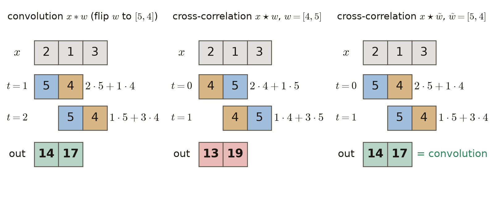
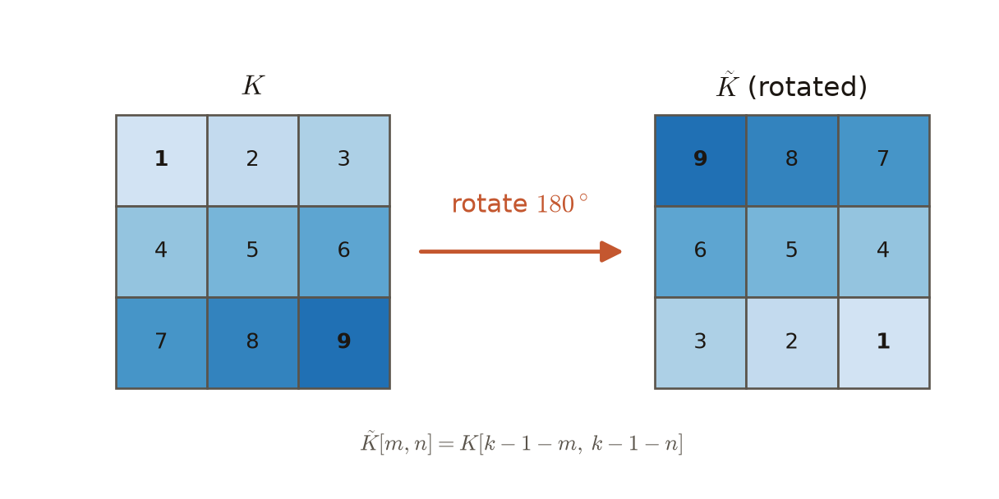
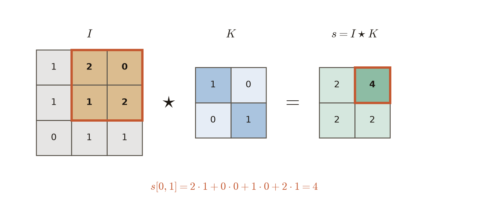

# 第6週 KP04：離散卷積與互相關（Discrete convolution and cross-correlation）

> 程度：大學生
>
> Level: Undergraduate (undergrad)

本講義是第6週「卷積與池化」的第四個知識點（KP04）。KP03 說過，卷積層的第一站是拿一個小窗在影像上滑動、逐格相乘再加總。這一節要把這個動作寫成精確的算式。接著回答一個常讓人困惑的問題：課本上的卷積，和程式實際算的是同一件事嗎？

This is the fourth knowledge point (KP04) of Week 6, "Convolution and pooling". KP03 said that the first stage of a convolutional layer slides a small window over the image, multiplies cell by cell and adds up. This section writes that action as an exact formula. It also answers a question that often confuses students: is the convolution of the textbook the same thing that the code computes?

先備知識只有 KP03 的「小窗滑動」與第3章的反向傳播。第一次出現的符號都會定義。所有數字都由 `assets/figures/src/lec06-kp04-figures.py` 算出，可以自己重算。

內容依 CCC-LNS IDL_115 第4章 KP04 重新撰寫，該教材的第4章就是本課的第6週。來源的讀取日期是 2026-10-27。來源沒有的內容，都在出現的地方標示 `[補充]`。

The only prerequisites are the sliding window of KP03 and the backpropagation of Chapter 3. Every symbol is defined when it first appears. Every number is computed by `assets/figures/src/lec06-kp04-figures.py` and can be recomputed.

The text is rewritten from KP04 of CCC-LNS IDL_115 Chapter 4; Chapter 4 of that material is Week 6 of this course. The source was accessed on 2026-10-27. Content that the source does not contain is marked `[Added]` where it appears.

[下載本單元投影片](../slides/lec06-kp04-discrete-conv-cross-correlation.jbd.json)

[Download the slides of this unit (English)](../slides/lec06-kp04-discrete-conv-cross-correlation-en.jbd.json)

## KP04 離散卷積與互相關（Discrete convolution and cross-correlation）

### 學習目標（Learning objectives）

讀完之後，你能寫出一維與二維離散卷積的定義，並指出定義裡哪一步是「翻轉核」。你能寫出互相關的定義，說出它和卷積只差在核有沒有翻。你能用小數字親手算出兩者的輸出。你也能解釋為什麼深度學習框架省略翻轉，模型的能力卻不受影響。

After reading, you can write the definitions of one- and two-dimensional discrete convolution and point out the step that flips the kernel. You can write the definition of cross-correlation and say that it differs from convolution only in whether the kernel is flipped. You can compute both outputs by hand with small numbers. You can also explain why deep-learning frameworks skip the flip without changing what the model can do.

### 符號表（Symbols）

| 符號 | 中文意義 | English meaning |
|---|---|---|
| $x[\tau]$ | 一維輸入訊號在位置 $\tau$ 的值，訊號長 $n$ 格 | value of the 1-D input signal at position $\tau$; the signal has $n$ cells |
| $w[m]$ | 一維核的第 $m$ 個權重，共 $k$ 個 | the $m$-th weight of the 1-D kernel, $k$ weights in total |
| $t$ | 一維輸出位置 | 1-D output position |
| $I[p,q]$ | 影像第 $p$ 列、第 $q$ 行的畫素值 | pixel value of the image at row $p$, column $q$ |
| $K[m,n]$ | 二維核第 $m$ 列、第 $n$ 行的權重，大小 $k\times k$ | weight of the 2-D kernel at row $m$, column $n$; size $k\times k$ |
| $s[i,j]$ | 二維輸出（特徵圖）在 $(i,j)$ 的值 | value of the 2-D output (feature map) at $(i,j)$ |
| $\tau$；$p,\ q$ | 求和時掃過**輸入**各格的指標 | summation indices that sweep the cells of the **input** |
| $m,\ n$ | 求和時掃過**核**各格的指標 | summation indices that sweep the cells of the **kernel** |
| $*$ | 卷積 | convolution |
| $\star$ | 互相關 | cross-correlation |
| $\tilde{w},\ \tilde{K}$ | 翻轉後的核（二維是轉 $180^\circ$） | the flipped kernel (rotated by $180^\circ$ in 2-D) |

本講義的指標一律從 $0$ 開始數 `[補充]`。

All indices in this note start at $0$ `[Added]`.

### 1. 每個輸出是附近幾格的加權和（Each output is a weighted sum of nearby inputs）

KP03 用 Prewitt 核找邊緣時，每個輸出只看它附近的 $3\times 3$ 格。把這件事一般化：每個輸出位置，等於「附近幾格輸入」乘上一組固定權重再加總。這組權重就叫**核**，也叫**濾波器**。

When KP03 found edges with the Prewitt kernel, each output looked only at the $3\times 3$ cells near it. Generalise this: each output position equals the nearby inputs times a fixed set of weights, added up. This set of weights is called the **kernel**, also called a **filter**.

先看最小的例子。一維訊號 $x=[2,1,3]$ 有 3 格，核 $w=[4,5]$ 有 2 個權重。把核蓋在訊號上，對齊的格子相乘再相加，就得到一個輸出。核往右挪一格，再算一次。

Start with the smallest example. The 1-D signal $x=[2,1,3]$ has 3 cells and the kernel $w=[4,5]$ has 2 weights. Lay the kernel on the signal, multiply the aligned cells and add: that gives one output. Move the kernel one cell to the right and compute again.

核必須完整落在訊號範圍內，所以只有 $3-2+1=2$ 個位置可以算。這種輸出叫**有效輸出**。一般地，長 $n$ 的訊號配長 $k$ 的核，有效輸出有 $n-k+1$ 個數。KP07 會再談輸出大小。

The kernel must lie completely inside the signal, so only $3-2+1=2$ positions can be computed. This is called the **valid output**. In general, a signal of length $n$ with a kernel of length $k$ has $n-k+1$ valid outputs. KP07 returns to output sizes.

問題來了：核要「照原樣」蓋上去，還是要先左右顛倒再蓋？兩種做法的數字不一樣。

Here is the question: should the kernel be laid down as it is, or reversed left to right first? The two choices give different numbers.

用一個比喻區分兩者。理論的卷積像烙餅，要先翻面再壓下去。實務上的做法像蓋橡皮章，拿起來直接蓋。這個比喻只對應「核的方向」，不涉及乘加的細節。

An analogy separates the two. Convolution in theory is like a pancake that is flipped before it is pressed down. The practical way is like a rubber stamp that is picked up and stamped directly. The analogy covers only the direction of the kernel, not the details of the multiply-and-add.

### 2. 理論的卷積：先翻核再滑動（Convolution in theory: flip the kernel, then slide）

訊號處理課本對一維離散卷積的定義如下：

Signal-processing textbooks define 1-D discrete convolution as follows:

$$
(x*w)[t]=\sum_{\tau=-\infty}^{\infty} x[\tau]\,w[t-\tau]
$$

求和指標 $\tau$ 掃過所有輸入位置，訊號與核之外的格子都當成 $0$。關鍵在 $w[t-\tau]$ 的下標：$-\tau$ 把核沿軸鏡射，$+t$ 再把鏡射後的核挪到位置 $t$。所以卷積的指標是相減的，核必須先翻轉，再滑動。

The summation index $\tau$ sweeps all input positions; cells outside the signal and the kernel count as $0$. The key is the subscript of $w[t-\tau]$: $-\tau$ mirrors the kernel along the axis, and $+t$ moves the mirrored kernel to position $t$. So the indices of convolution are subtracted, and the kernel must be flipped before it slides.

這個定義對任何 $t$ 都算得出一個數，但核和訊號沒有重疊時一定是 $0$。把核和訊號至少有一格重疊的位置全部列出，叫**完整卷積**，共有 $n+k-1$ 個數。用主例子 $x=[2,1,3]$、$w=[4,5]$ 逐項代入，$t$ 從 $0$ 到 $3$ `[補充]`：

The definition produces a number for every $t$, but it is always $0$ when the kernel and the signal do not overlap. Listing all positions where they overlap in at least one cell gives the **full convolution**, with $n+k-1$ numbers. Substitute the main example $x=[2,1,3]$, $w=[4,5]$ term by term, for $t$ from $0$ to $3$ `[Added]`:

- $t=0$：$x[0]\,w[0]=2\cdot4=8$
- $t=1$：$x[0]\,w[1]+x[1]\,w[0]=2\cdot5+1\cdot4=14$
- $t=2$：$x[1]\,w[1]+x[2]\,w[0]=1\cdot5+3\cdot4=17$
- $t=3$：$x[2]\,w[1]=3\cdot5=15$

所以完整卷積是 $[8,14,17,15]$。$t=0$ 與 $t=3$ 時，核只有一格落在訊號上，另一格在訊號外面。核完整落在訊號範圍內的只有 $t=1,2$，所以有效輸出是 $[14,17]$。

So the full convolution is $[8,14,17,15]$. At $t=0$ and $t=3$ only one cell of the kernel lies on the signal; the other cell is outside. Only at $t=1,2$ does the kernel lie completely inside the signal, so the valid output is $[14,17]$.

看 $t=1$ 那一行：$x[0]$ 乘的是 $w[1]=5$，$x[1]$ 乘的是 $w[0]=4$。等於把核翻成 $[5,4]$ 之後才對齊。

Look at the line $t=1$: $x[0]$ is multiplied by $w[1]=5$ and $x[1]$ by $w[0]=4$. That is the same as flipping the kernel to $[5,4]$ before aligning it.

常見錯誤：把式子裡的 $w[t-\tau]$ 當成 $w[\tau-t]$，以為核是照原樣滑過去。這樣算出來的其實是下一節的互相關，數字會不同。

Common error: reading $w[t-\tau]$ in the formula as $w[\tau-t]$ and thinking the kernel slides as it is. What that computes is in fact the cross-correlation of the next section, and the numbers differ.

### 3. 程式裡的互相關：不翻直接蓋（Cross-correlation in code: slide without flipping）

上一節的翻轉，在程式裡多半被省略。不翻核、直接蓋上去的運算叫**互相關**，寫成 $\star$：

The flip of the previous section is usually skipped in code. The operation that lays the kernel down without flipping it is called **cross-correlation**, written $\star$:

$$
(x\star w)[t]=\sum_{m=0}^{k-1} x[t+m]\,w[m]
$$

這裡的指標是相加的：$w[0]$ 永遠對齊 $x[t]$，$w[1]$ 對齊 $x[t+1]$，核的順序不變。$t$ 從 $0$ 數到 $n-k$，正好是有效輸出。主例子代入：

Here the indices are added: $w[0]$ always lines up with $x[t]$ and $w[1]$ with $x[t+1]$, so the order of the kernel is kept. $t$ runs from $0$ to $n-k$, which is exactly the valid output. Substitute the main example:

- $t=0$：$x[0]\,w[0]+x[1]\,w[1]=2\cdot4+1\cdot5=13$
- $t=1$：$x[1]\,w[0]+x[2]\,w[1]=1\cdot4+3\cdot5=19$

互相關得到 $[13,19]$，卷積得到 $[14,17]$，數字確實不同。可是把核換成翻轉後的 $\tilde{w}=[5,4]$ 再做互相關，就得到 $2\cdot5+1\cdot4=14$ 與 $1\cdot5+3\cdot4=17$，和卷積一模一樣。

Cross-correlation gives $[13,19]$ and convolution gives $[14,17]$; the numbers really differ. But replace the kernel by the flipped $\tilde{w}=[5,4]$ and do cross-correlation: the result is $2\cdot5+1\cdot4=14$ and $1\cdot5+3\cdot4=17$, exactly the convolution.

一般地，令 $\tilde{w}[m]=w[k-1-m]$，則兩種運算的有效輸出逐項相等：

In general, let $\tilde{w}[m]=w[k-1-m]$; then the valid outputs of the two operations are equal entry by entry:

$$
(x\star\tilde{w})[t]=(x*w)[t+k-1]
$$

右邊的 $t+k-1$ 只是編號的平移。依定義，卷積的有效輸出從 $t=k-1$ 開始編號，互相關從 $t=0$ 開始。主例子中 $k=2$，所以卷積的 $t=1,2$ 對應互相關的 $t=0,1$。

The $t+k-1$ on the right is only a shift of numbering. By definition, the valid output of convolution is numbered from $t=k-1$, that of cross-correlation from $t=0$. In the main example $k=2$, so $t=1,2$ of convolution correspond to $t=0,1$ of cross-correlation.

**圖說 `lec06-kp04-flip-1d`**：先看三欄頂端同一條訊號 $[2,1,3]$，再看核的兩種顏色：橘色是 $4$，藍色是 $5$。左欄藍色在前（核已翻轉），中欄橘色在前（沒有翻），右欄又是藍色在前。左欄照卷積的定義標成 $t=1,2$，另外兩欄標成 $t=0,1$。最後比較底部的輸出：左右兩欄都是 $[14,17]$，只有中欄不同。

**Caption `lec06-kp04-flip-1d`**: First look at the same signal $[2,1,3]$ at the top of all three columns, then at the two colours of the kernel: orange is $4$ and blue is $5$. In the left column blue comes first (the kernel is flipped), in the middle orange comes first (no flip), and in the right column blue comes first again. The left column is labelled $t=1,2$ as in the definition of convolution; the other two are labelled $t=0,1$. Finally compare the outputs at the bottom: the left and right columns both give $[14,17]$; only the middle differs.

常見錯誤：以為「互相關」是另一種完全不同的運算。其實兩者只差核的方向，乘加的骨架相同。

Common error: thinking that cross-correlation is a completely different operation. The two differ only in the direction of the kernel; the multiply-and-add skeleton is the same.

### 4. 二維影像：核轉 180 度（Two-dimensional images: rotate the kernel by 180 degrees）

影像有高和寬兩個方向，所以核也是二維的 $K$，卷積在兩個方向上都做一次。二維卷積的定義是（$p,q$ 掃過影像各格）：

An image has two directions, height and width, so the kernel $K$ is also 2-D and convolution acts in both directions. The definition of 2-D convolution is ($p,q$ sweep the cells of the image):

$$
(I*K)[i,j]=\sum_{p}\sum_{q} I[p,q]\,K[i-p,\,j-q]
$$

兩個下標都是相減，所以核在列方向翻一次、在行方向也翻一次。左右翻再上下翻，合起來就是轉 $180^\circ$：

Both subscripts are subtracted, so the kernel is flipped once along the rows and once along the columns. Flipping left-right and then up-down amounts to a rotation by $180^\circ$:

$$
\tilde{K}[m,n]=K[k-1-m,\,k-1-n]
$$

求和範圍理論上是無窮，實務上只加核蓋得到的格子，核外面當成 $0$。核很小時（例如 $3\times3$、$5\times5$），這就是在每個 $(i,j)$ 做一次局部乘加。

In theory the sums run to infinity; in practice only the cells under the kernel are added, and everything outside the kernel counts as $0$. When the kernel is small (for example $3\times3$ or $5\times5$), this is one local multiply-and-add at each $(i,j)$.

**圖說 `lec06-kp04-rotate-180`**：先看左邊的 $K$：$1$ 在左上，$9$ 在右下，顏色由淺到深。再看右邊的 $\tilde{K}$：深淺整個倒過來，$1$ 跑到右下，$9$ 跑到左上。底部的算式給出每一格的新位置。

**Caption `lec06-kp04-rotate-180`**: First look at $K$ on the left: $1$ is at the top left, $9$ at the bottom right, and the colours go from light to dark. Then look at $\tilde{K}$ on the right: the shading is reversed, $1$ has moved to the bottom right and $9$ to the top left. The formula at the bottom gives the new position of every cell.

二維互相關則是不翻核，直接把核的左上角對齊影像的 $(i,j)$：

Two-dimensional cross-correlation does not flip the kernel; it aligns the top-left corner of the kernel with $(i,j)$ of the image:

$$
s[i,j]=(I\star K)[i,j]=\sum_{m=0}^{k-1}\sum_{n=0}^{k-1} I[i+m,\,j+n]\,K[m,n]
$$

和一維一樣，用翻轉的核做互相關，等於做卷積，只差編號平移 $k-1$ `[補充]`：

As in 1-D, cross-correlation with the flipped kernel equals convolution, up to a shift of numbering by $k-1$ `[Added]`:

$$
(I\star\tilde{K})[i,j]=(I*K)[i+k-1,\,j+k-1]
$$

依卷積的定義，有效輸出位於 $i,j$ 從 $k-1$ 開始的位置。本講義寫「卷積的有效輸出 $s[i,j]$」時，都把它重新從 $0$ 編號，也就是取上式的左邊 `[補充]`。

By the definition of convolution, its valid output sits at $i,j$ starting from $k-1$. When this note writes "the valid output $s[i,j]$ of convolution", it is renumbered from $0$, that is, the left-hand side of the equation above `[Added]`.

看一個二維例子。$3\times3$ 影像 $I$ 的三列依序是 $[1,2,0]$、$[1,1,2]$、$[0,1,1]$。核 $K$ 是 $2\times2$ 單位矩陣，對角線是 $1$、其餘是 $0$。

輸出大小是 $(3-2+1)\times(3-2+1)=2\times2$。以 $s[0,1]$ 為例，核蓋住第 $0$、$1$ 列與第 $1$、$2$ 行：

Take a 2-D example. The $3\times3$ image $I$ has rows $[1,2,0]$, $[1,1,2]$ and $[0,1,1]$. The kernel $K$ is the $2\times2$ identity matrix: $1$ on the diagonal, $0$ elsewhere.

The output size is $(3-2+1)\times(3-2+1)=2\times2$. Take $s[0,1]$: the kernel covers rows $0$ and $1$ and columns $1$ and $2$:

$$
\begin{aligned}
s[0,1]&=I[0,1]K[0,0]+I[0,2]K[0,1]+I[1,1]K[1,0]+I[1,2]K[1,1]\\
&=2\cdot1+0\cdot0+1\cdot0+2\cdot1=4
\end{aligned}
$$

四個位置都算完，輸出兩列是 $[2,4]$ 與 $[2,2]$。

After all four positions, the two rows of the output are $[2,4]$ and $[2,2]$.

**圖說 `lec06-kp04-2d-correlation`**：先看左邊影像 $I$ 框起來的四格 $2,0,1,2$，再看中間的核 $K$，只有對角線是 $1$。核蓋在框上時，對角的兩格 $2$ 與 $2$ 被保留，加起來是 $4$。最後看右邊輸出的框，正是 $s[0,1]=4$。

**Caption `lec06-kp04-2d-correlation`**: First look at the four framed cells $2,0,1,2$ of the image $I$ on the left, then at the kernel $K$ in the middle, which has $1$ only on the diagonal. With the kernel on the frame, the two diagonal cells $2$ and $2$ are kept, and they add up to $4$. Finally look at the frame in the output on the right: it is exactly $s[0,1]=4$.

這個例子有一個陷阱。單位矩陣轉 $180^\circ$ 之後還是自己，所以用卷積算也得到 $[2,4]$ 與 $[2,2]$。核轉 $180^\circ$ 後不變時，兩種運算一樣。要看出差別，必須換成轉了會變的核（見小練習第 3 題）。

This example hides a trap. The identity matrix rotated by $180^\circ$ is itself, so convolution also gives $[2,4]$ and $[2,2]$. When the kernel does not change under a $180^\circ$ rotation, the two operations agree. To see a difference, use a kernel that does change under rotation (see Practice 3).

### 5. 為什麼不翻也能訓練（Why training works without the flip）

既然兩者數字不同，框架省略翻轉不會出錯嗎？關鍵在於卷積神經網路的核不是人手寫的，而是用反向傳播學出來的。第 3、4 節已經看到：用 $K$ 做卷積，和用 $\tilde{K}$ 做互相關，輸出完全相同。

Since the numbers differ, doesn't skipping the flip cause errors? The key is that the kernel of a convolutional neural network is not written by hand; it is learned by backpropagation. Sections 3 and 4 already showed that convolution with $K$ and cross-correlation with $\tilde{K}$ give exactly the same output.

所以「所有卷積網路」和「所有互相關網路」是同一群函數，只是同一組數字換了排列。兩種慣例的表達能力相同，原因就在這裡：兩群函數完全一樣。

So the set of all convolution networks and the set of all cross-correlation networks are the same set of functions; only the arrangement of the same numbers differs. This is why the two conventions have the same expressive power: the two sets of functions are identical.

梯度下降只負責在這群函數裡找一個損失小的。它不在乎慣例叫什麼名字，所以不翻也找得到。卷積網路能學到的核，互相關網路都能學到它的翻轉版本。

Gradient descent only searches this set of functions for one with a small loss. It does not care what the convention is called, so it finds one without the flip too. For every kernel a convolution network can learn, a cross-correlation network can learn its flipped version.

另一個比喻：慣用左手或右手寫字，只要練習夠，都能寫出漂亮的字。梯度下降就是那段練習。這個比喻只說明「結果一樣好」，不表示兩隻手學到的動作一樣；兩種慣例能學到的核互為翻轉。

Another analogy: whether you write with your left or right hand, enough practice gives beautiful handwriting. Gradient descent is that practice. The analogy only says that the results are equally good; it does not mean that both hands learn the same motion. The kernels the two conventions can learn are flips of each other.

這個推論有一個假設：核的數字必須是學出來的。下面兩種情況，翻不翻就有差別：

The argument has one assumption: the numbers of the kernel must be learned. In the two cases below, flipping does matter:

- 核是人手設計的固定濾波器，例如 KP03 的 Prewitt 核。翻轉後的 Prewitt 核正負號全反，偵測到的邊緣也會變號（見小練習第 2 題）。
- 把一個框架訓練好的權重，搬到使用另一種慣例的程式裡 `[補充]`。這時核必須先轉 $180^\circ$，否則輸出會錯。

- The kernel is a fixed, hand-designed filter, such as the Prewitt kernel of KP03. The flipped Prewitt kernel has every sign reversed, so the sign of every detected edge is reversed too (see Practice 2).
- Weights trained in one framework are moved into code that uses the other convention `[Added]`. The kernel must then be rotated by $180^\circ$ first, otherwise the output is wrong.

與實作的連結：PyTorch 的 `torch.nn.functional.conv2d` 與 TensorFlow 的 `tf.nn.conv2d` 名字叫卷積。但它們實際做的是互相關。論文的公式常寫 $*$，程式裡多半是 $\star$。

Connection to code: PyTorch's `torch.nn.functional.conv2d` and TensorFlow's `tf.nn.conv2d` are called convolution. But they actually compute cross-correlation. Papers often write $*$, while the code mostly computes $\star$.

NumPy 的情形是 `[補充]`：`np.convolve` 會翻核，`np.correlate` 不翻。本講義的程式用這兩個函式核對了第 2、3 節的數字。

The case of NumPy is `[Added]`: `np.convolve` flips the kernel and `np.correlate` does not. The program of this note uses these two functions to check the numbers of Sections 2 and 3.

到這裡，「滑著乘加」已經有了精確的算式。可是同一個乘加，也可以寫成一個巨大的全連接層。和全連接層比，卷積到底省下了什麼？這是 KP05 的主題：稀疏連接與權重共享。

At this point the sliding multiply-and-add has an exact formula. But the same multiply-and-add can also be written as one huge fully connected layer. Compared with a fully connected layer, what does convolution save? That is the topic of KP05: sparse connectivity and parameter sharing.

### 本單元重點整理（KP04 summary）

**一句話重點**：理論上的卷積要先把核翻轉再滑動；深度學習程式通常不翻轉，實際算的是互相關。翻轉只是核的數字換個排列，兩種寫法的表達能力相同，而核是學出來的，所以不翻也能訓練。

**One-sentence summary**: Convolution in theory flips the kernel before sliding it; deep-learning code usually does not flip and actually computes cross-correlation. Flipping only rearranges the numbers of the kernel, so the two forms have the same expressive power, and since the kernel is learned, training works without the flip.

**白話說明**：烙餅要先翻面再壓，蓋章則是直接蓋，兩者印出的圖案互為鏡像。如果章面讓學生自己刻，他會看著印出的結果，把圖案刻成需要的方向。這裡的學生就是梯度下降，刻好的章面就是學到的核。

**Plain explanation**: A pancake is flipped before it is pressed, while a stamp is stamped directly, so the two prints are mirror images. If students carve the stamp themselves, they look at the print and carve the pattern in the direction that is needed. Here the student is gradient descent, and the carved stamp is the learned kernel.

**正式定義**：一維卷積 $(x*w)[t]=\sum_{\tau} x[\tau]\,w[t-\tau]$；一維互相關 $(x\star w)[t]=\sum_{m=0}^{k-1} x[t+m]\,w[m]$。

二維卷積 $(I*K)[i,j]=\sum_{p}\sum_{q} I[p,q]\,K[i-p,\,j-q]$；二維互相關 $(I\star K)[i,j]=\sum_{m=0}^{k-1}\sum_{n=0}^{k-1} I[i+m,\,j+n]\,K[m,n]$。

翻轉的核是 $\tilde{K}[m,n]=K[k-1-m,\,k-1-n]$，且 $(I\star\tilde{K})[i,j]=(I*K)[i+k-1,\,j+k-1]$。

**Formal definition**: 1-D convolution $(x*w)[t]=\sum_{\tau} x[\tau]\,w[t-\tau]$; 1-D cross-correlation $(x\star w)[t]=\sum_{m=0}^{k-1} x[t+m]\,w[m]$.

2-D convolution $(I*K)[i,j]=\sum_{p}\sum_{q} I[p,q]\,K[i-p,\,j-q]$; 2-D cross-correlation $(I\star K)[i,j]=\sum_{m=0}^{k-1}\sum_{n=0}^{k-1} I[i+m,\,j+n]\,K[m,n]$.

The flipped kernel is $\tilde{K}[m,n]=K[k-1-m,\,k-1-n]$, and $(I\star\tilde{K})[i,j]=(I*K)[i+k-1,\,j+k-1]$.

**例子**：$x=[2,1,3]$、$w=[4,5]$。卷積的有效輸出是 $[14,17]$，互相關是 $[13,19]$，改用 $\tilde{w}=[5,4]$ 做互相關又得到 $[14,17]$。二維影像 $I$ 與 $2\times2$ 單位矩陣核做互相關，輸出兩列是 $[2,4]$ 與 $[2,2]$。逐步計算見第 2–4 節。

**Example**: $x=[2,1,3]$, $w=[4,5]$. The valid output of convolution is $[14,17]$, that of cross-correlation is $[13,19]$, and cross-correlation with $\tilde{w}=[5,4]$ gives $[14,17]$ again. Cross-correlating the 2-D image $I$ with the $2\times2$ identity kernel gives the output rows $[2,4]$ and $[2,2]$. The step-by-step computations are in Sections 2–4.

**常見迷思**：

- 「核一定要先轉 $180^\circ$，否則網路無法訓練。」錯，不翻也能訓練，網路能學到翻轉後的核。
- 「式子右邊的求和指標就是輸出。」錯，求和指標只負責掃過各格，和輸出無關，即使兩者用了同一個字母。
- 「框架的函式叫 `conv2d`，所以它在做真正的卷積。」錯，它多半在做互相關。
- 「用一個例子試過兩者結果一樣，就代表兩者相同。」錯，核轉 $180^\circ$ 後不變時才會一樣，例如單位矩陣。

**Common misconceptions**:

- "The kernel must be rotated by $180^\circ$ first, otherwise the network cannot be trained." Wrong: it trains without the flip and can learn the flipped kernel.
- "The summation index on the right-hand side is the output." Wrong: the summation index only sweeps the cells and has nothing to do with the output, even if the two use the same letter.
- "The framework's function is called `conv2d`, so it computes true convolution." Wrong: it mostly computes cross-correlation.
- "One example gave the same result for both, so the two are the same." Wrong: they agree only when the kernel is unchanged by a $180^\circ$ rotation, such as the identity matrix.

**圖**：本單元有三張圖。

- `lec06-kp04-flip-1d`：一維翻與不翻的對照。
- `lec06-kp04-rotate-180`：二維核轉 $180^\circ$。
- `lec06-kp04-2d-correlation`：二維互相關的一次乘加。

三張圖與文中數字都由同一支程式產生：`lec06-kp04-figures.py`。

**Figure**: Three figures in this unit.

- `lec06-kp04-flip-1d`: flip versus no flip in 1-D.
- `lec06-kp04-rotate-180`: rotating a 2-D kernel by $180^\circ$.
- `lec06-kp04-2d-correlation`: one multiply-and-add of 2-D cross-correlation.

All three figures and every number in the text come from one program: `lec06-kp04-figures.py`.

**想深入**（選讀，需要訊號與系統的背景）：卷積滿足交換律，$x*w=w*x$；互相關一般不滿足。卷積在傅立葉域對應逐點相乘，互相關則需要多一步複共軛。

**完整互相關**和完整卷積一樣，列出核與訊號有重疊的所有位置，訊號外補 $0$，也就是 $t$ 從 $-(k-1)$ 到 $n-1$ `[補充]`。

用主例子驗證 `[補充]`：完整卷積 $x*w$ 與 $w*x$ 都是 $[8,14,17,15]$。完整互相關 $x\star w$ 是 $[10,13,19,12]$。若把較長的 $x$ 當成核，$w\star x$ 卻是 $[12,19,13,10]$，順序整個倒過來。這些性質在訊號處理很重要，但對「學一個核」的卷積神經網路沒有影響。

**Going deeper** (optional; needs a background in signals and systems): convolution is commutative, $x*w=w*x$; cross-correlation in general is not. Convolution corresponds to pointwise multiplication in the Fourier domain, while cross-correlation needs an extra complex conjugate.

The **full cross-correlation**, like the full convolution, lists every position where the kernel and the signal overlap, with zeros outside the signal; that is, $t$ runs from $-(k-1)$ to $n-1$ `[Added]`.

A check with the main example `[Added]`: the full convolutions $x*w$ and $w*x$ are both $[8,14,17,15]$. The full cross-correlation $x\star w$ is $[10,13,19,12]$. Treating the longer $x$ as the kernel, $w\star x$ is $[12,19,13,10]$, the order reversed. These properties matter in signal processing but do not affect a convolutional neural network that learns its kernel.

**小練習**：

1. 令 $x=[1,0,2]$、$w=[3,4]$，分別算出卷積與互相關的有效輸出。（提示：卷積先把核翻成 $[4,3]$。）
2. `[補充]` 一個 $3\times3$ 小塊 $X$ 三列是 $[0,0,0]$、$[1,1,1]$、$[2,2,2]$（上暗下亮）。水平 Prewitt 核 $H$ 三列是 $[1,1,1]$、$[0,0,0]$、$[-1,-1,-1]$。核和小塊一樣大，所以有效輸出只有 $1$ 個數。分別算出 $X\star H$ 與 $X*H$ 的這個數，並說明正負號為何相反。（提示：先把核轉 $180^\circ$。）
3. 用第 4 節的影像 $I$ 與核 $K$，$K$ 兩列是 $[1,2]$、$[0,0]$。分別算出互相關與卷積的 $2\times2$ 有效輸出。（提示：轉 $180^\circ$ 後的核兩列是 $[0,0]$、$[2,1]$。）
4. `[補充]` 訊號 $[3,1,4,1,5]$ 分別用核 $[1,2,1]$ 與 $[1,0,-1]$ 做互相關與卷積。哪一個核的兩種結果相同，為什麼？輸出各有幾個數？（提示：比較核翻轉前後是否相同。）

**Practice**:

1. Let $x=[1,0,2]$ and $w=[3,4]$. Compute the valid outputs of convolution and of cross-correlation. (Hint: convolution first flips the kernel to $[4,3]$.)
2. `[Added]` A $3\times3$ patch $X$ has rows $[0,0,0]$, $[1,1,1]$, $[2,2,2]$ (dark on top, bright below). The horizontal Prewitt kernel $H$ has rows $[1,1,1]$, $[0,0,0]$, $[-1,-1,-1]$. The kernel is as large as the patch, so the valid output is a single number. Compute this number for $X\star H$ and for $X*H$, and explain why the signs are opposite. (Hint: first rotate the kernel by $180^\circ$.)
3. Use the image $I$ of Section 4 and the kernel $K$ with rows $[1,2]$ and $[0,0]$. Compute the $2\times2$ valid outputs of cross-correlation and of convolution. (Hint: the rotated kernel has rows $[0,0]$ and $[2,1]$.)
4. `[Added]` Apply the kernels $[1,2,1]$ and $[1,0,-1]$ to the signal $[3,1,4,1,5]$ with cross-correlation and with convolution. For which kernel are the two results the same, and why? How many numbers does each output have? (Hint: compare the kernel before and after flipping.)

**第 1 題解答** `[補充]`：

1. 卷積：核翻成 $[4,3]$。第一個數是 $1\cdot4+0\cdot3=4$，第二個數是 $0\cdot4+2\cdot3=6$，有效輸出 $[4,6]$。
2. 互相關：核維持 $[3,4]$。第一個數是 $1\cdot3+0\cdot4=3$，第二個數是 $0\cdot3+2\cdot4=8$，有效輸出 $[3,8]$。

**Solution to question 1** `[Added]`:

1. Convolution: the kernel becomes $[4,3]$. The first number is $1\cdot4+0\cdot3=4$ and the second is $0\cdot4+2\cdot3=6$, so the valid output is $[4,6]$.
2. Cross-correlation: the kernel stays $[3,4]$. The first number is $1\cdot3+0\cdot4=3$ and the second is $0\cdot3+2\cdot4=8$, so the valid output is $[3,8]$.

**第 2 題解答** `[補充]`：

1. 互相關：逐列相乘再加。第 $0$ 列是 $0\cdot1+0\cdot1+0\cdot1=0$。第 $1$ 列是 $1\cdot0+1\cdot0+1\cdot0=0$。第 $2$ 列是 $2\cdot(-1)+2\cdot(-1)+2\cdot(-1)=-6$。合計 $s[0,0]=(X\star H)[0,0]=-6$。
2. 卷積：用轉 $180^\circ$ 的核，三列是 $[-1,-1,-1]$、$[0,0,0]$、$[1,1,1]$。第 $0$、$1$ 列都得 $0$。第 $2$ 列是 $2\cdot1+2\cdot1+2\cdot1=6$。合計 $s[0,0]=6$（卷積的有效輸出依第 4 節重新從 $0$ 編號，即 $(X*H)[2,2]$）。
3. 原因：這個核轉 $180^\circ$ 後剛好變成自己的負號，所以兩種運算的結果互為相反數。

**Solution to question 2** `[Added]`:

1. Cross-correlation: multiply row by row and add. Row $0$ gives $0\cdot1+0\cdot1+0\cdot1=0$. Row $1$ gives $1\cdot0+1\cdot0+1\cdot0=0$. Row $2$ gives $2\cdot(-1)+2\cdot(-1)+2\cdot(-1)=-6$. In total $s[0,0]=(X\star H)[0,0]=-6$.
2. Convolution: use the rotated kernel with rows $[-1,-1,-1]$, $[0,0,0]$, $[1,1,1]$. Rows $0$ and $1$ give $0$. Row $2$ gives $2\cdot1+2\cdot1+2\cdot1=6$. In total $s[0,0]=6$ (the valid output of convolution renumbered from $0$ as in Section 4, that is $(X*H)[2,2]$).
3. Reason: rotating this kernel by $180^\circ$ gives exactly its negative, so the two results are opposite numbers.

**第 3 題解答** `[補充]`（卷積的 $s$ 依第 4 節的約定重新從 $0$ 編號）：

1. 互相關：$s[0,0]=1\cdot1+2\cdot2=5$，$s[0,1]=2\cdot1+0\cdot2=2$，$s[1,0]=1\cdot1+1\cdot2=3$，$s[1,1]=1\cdot1+2\cdot2=5$。輸出兩列是 $[5,2]$、$[3,5]$。
2. 卷積：用轉後的核做互相關，只有核的下列有值。$s[0,0]=1\cdot2+1\cdot1=3$，$s[0,1]=1\cdot2+2\cdot1=4$，$s[1,0]=0\cdot2+1\cdot1=1$，$s[1,1]=1\cdot2+1\cdot1=3$。輸出兩列是 $[3,4]$、$[1,3]$。
3. 照定義直接算 $(I*K)[1,1]$ 到 $(I*K)[2,2]$，也得到同樣四個數。兩種運算的結果不同，因為這個核轉 $180^\circ$ 後會改變。

**Solution to question 3** `[Added]` (the $s$ of convolution is renumbered from $0$, as agreed in Section 4):

1. Cross-correlation: $s[0,0]=1\cdot1+2\cdot2=5$, $s[0,1]=2\cdot1+0\cdot2=2$, $s[1,0]=1\cdot1+1\cdot2=3$, $s[1,1]=1\cdot1+2\cdot2=5$. The output rows are $[5,2]$ and $[3,5]$.
2. Convolution: cross-correlate with the rotated kernel, whose lower row alone is nonzero. $s[0,0]=1\cdot2+1\cdot1=3$, $s[0,1]=1\cdot2+2\cdot1=4$, $s[1,0]=0\cdot2+1\cdot1=1$, $s[1,1]=1\cdot2+1\cdot1=3$. The output rows are $[3,4]$ and $[1,3]$.
3. Computing $(I*K)[1,1]$ to $(I*K)[2,2]$ directly from the definition gives the same four numbers. The two operations differ because this kernel changes under a $180^\circ$ rotation.

**第 4 題解答** `[補充]`：

1. 輸出長度：$5-3+1=3$，兩個核都輸出 $3$ 個數。
2. 核 $[1,2,1]$：互相關與卷積都是 $[9,10,11]$，例如第一個數 $3\cdot1+1\cdot2+4\cdot1=9$。它翻轉後還是 $[1,2,1]$，所以兩者相同。
3. 核 $[1,0,-1]$：互相關是 $[-1,0,-1]$，例如 $3\cdot1+1\cdot0+4\cdot(-1)=-1$。卷積用翻轉後的 $[-1,0,1]$，得到 $[1,0,1]$。翻轉後變成自己的負號，所以結果互為相反數。

**Solution to question 4** `[Added]`:

1. Output length: $5-3+1=3$, so both kernels output $3$ numbers.
2. Kernel $[1,2,1]$: cross-correlation and convolution both give $[9,10,11]$; for example the first number is $3\cdot1+1\cdot2+4\cdot1=9$. Flipped, it is still $[1,2,1]$, so the two agree.
3. Kernel $[1,0,-1]$: cross-correlation gives $[-1,0,-1]$, for example $3\cdot1+1\cdot0+4\cdot(-1)=-1$. Convolution uses the flipped $[-1,0,1]$ and gives $[1,0,1]$. Flipping turns it into its negative, so the results are opposite numbers.

### 來源更正與取捨（Corrections to the source）

- 來源式 (2) 寫成 $a[t]=(x*k)[t]=\sum_{a} x[a]\,w[t-a]$。左邊稱核為 $k$，右邊卻用 $w$；求和指標 $a$ 又與輸出 $a[t]$ 撞名。本講義統一用 $w$ 表示核，用 $\tau$ 當求和指標，意義不變。
- 來源式 (4) 寫成 $\sum_{m=1}^{k}\sum_{n=1}^{k} I[m,n]\,K[m-i,\,n-j]$，下標寫錯。照字面代入，核不會隨輸出位置一起滑動。本講義改用一般寫法 $\sum_{m}\sum_{n} I[i+m,\,j+n]\,K[m,n]$，指標從 $0$ 開始。來源簡報圖中的 $(f\star k)[n]=\sum f[m]\,k[n+m]$ 也屬同一類問題，同樣以本講義的寫法為準。
- 來源的二維例子把 $s=[[2,4],[2,2]]$ 標為卷積的結果。這個數字正確，但因為單位矩陣轉 $180^\circ$ 不變，它同時也是互相關的結果。本講義把它當互相關的主例子，並另外說明這一點。
- 二維卷積的影像指標改用 $p,q$，讓 $m,n$ 只代表核的指標；並補上二維的編號平移關係。
- 沿用來源的部分：烙餅與蓋章的比喻、左右手寫字的比喻出自來源的教授講解；小練習第 1 題出自同一處；第 3 題的核出自來源的互動實驗；框架實作互相關的說法出自來源。
- 來源的式號 (2)–(4) 不沿用；本講義的公式不編號。

- The source's Eq. (2) reads $a[t]=(x*k)[t]=\sum_{a} x[a]\,w[t-a]$. The left side calls the kernel $k$ but the right side uses $w$; the summation index $a$ also clashes with the output $a[t]$. This note uses $w$ for the kernel and $\tau$ for the summation index; the meaning is unchanged.
- The source's Eq. (4) reads $\sum_{m=1}^{k}\sum_{n=1}^{k} I[m,n]\,K[m-i,\,n-j]$ with wrong subscripts. Taken literally, the kernel does not slide with the output position. This note uses the standard form $\sum_{m}\sum_{n} I[i+m,\,j+n]\,K[m,n]$ with indices from $0$. The formula $(f\star k)[n]=\sum f[m]\,k[n+m]$ in the source's slide figure has the same kind of problem and is likewise replaced by the form used here.
- The source labels $s=[[2,4],[2,2]]$ of its 2-D example as the result of convolution. The numbers are right, but since the identity matrix is unchanged by a $180^\circ$ rotation, it is also the result of cross-correlation. This note uses it as the main example of cross-correlation and explains that point.
- The image indices of 2-D convolution are renamed $p,q$, so that $m,n$ always index the kernel; the 2-D shift-of-numbering relation is added.
- Taken from the source: the pancake-and-stamp analogy and the left-or-right-hand analogy come from the source's teaching notes; Practice 1 comes from the same place; the kernel of Practice 3 comes from the source's interactive lab; the statement that frameworks compute cross-correlation comes from the source.
- The source's equation numbers (2)–(4) are not reused; the formulas in this note are unnumbered.

### 術語對照（Terminology）

| 中文 | English |
|---|---|
| 離散卷積 | discrete convolution |
| 互相關 | cross-correlation |
| 核（濾波器） | kernel (filter) |
| 翻轉核 | flipping the kernel |
| 旋轉 $180^\circ$ | rotation by $180^\circ$ |
| 有效輸出 | valid output |
| 完整卷積、完整互相關 | full convolution, full cross-correlation |
| 特徵圖 | feature map |
| 求和指標 | summation index |
| 交換律 | commutativity |
| 傅立葉域 | Fourier domain |
| 反向傳播 | backpropagation |
| 稀疏連接 | sparse connectivity |
| 權重共享 | parameter sharing |
| 卷積神經網路 | convolutional neural network (CNN) |
| 深度學習框架（PyTorch、TensorFlow、NumPy） | deep-learning frameworks and libraries (PyTorch, TensorFlow, NumPy) |
| 課程來源教材（CCC-LNS） | course source material (CCC-LNS) |
