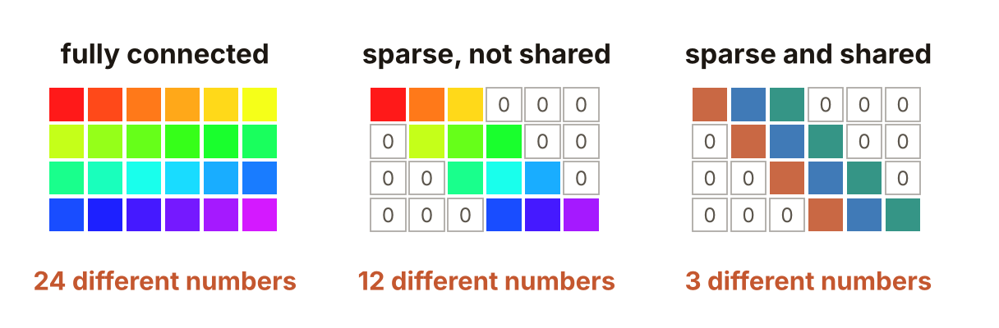
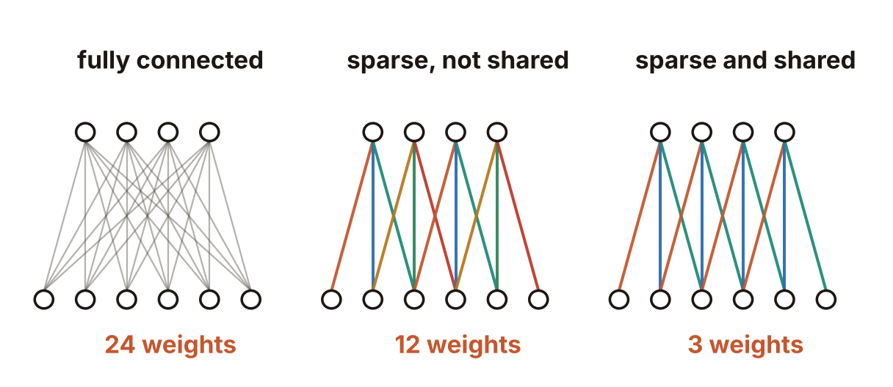
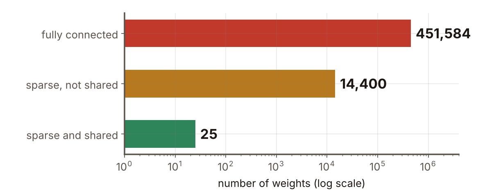
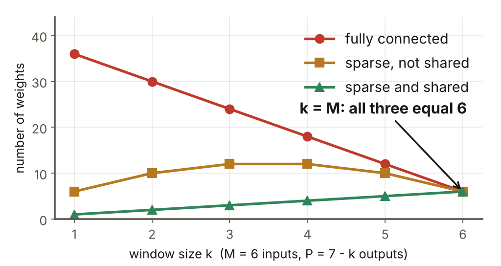

# 第6週 KP05：稀疏連接與權重共享（Sparse connectivity and parameter sharing）

> 程度：大學生
>
> Level: Undergraduate (undergrad)

本講義是第6週「卷積與池化」的第五個知識點（KP05）。KP01 說明為什麼影像不該攤平，並初步比較了三種接法的權重個數；KP03 把一層拆成三個階段；KP04 把「滑著乘加」寫成精確算式，最後提到：同一個乘加也可以寫成一個巨大的全連接層。這一節接著問：和全連接層比，卷積到底省下了什麼？省下的東西有幾種？

This is the fifth knowledge point (KP05) of Week 6, "Convolution and pooling". KP01 explained why an image should not be flattened and made a first comparison of the weight counts of three layers; KP03 split one layer into three stages; KP04 wrote the sliding multiply-and-add as an exact formula and ended by noting that the same multiply-and-add can also be written as one huge fully connected layer. This note continues with the question: compared with a fully connected layer, what exactly does convolution save, and how many different things does it save?

先備知識是 KP01 的稀疏連接與權重共享的初步介紹、KP04 的一維滑動乘加 $s[t]=\sum_m x[t+m]\,w[m]$，以及第2週的全連接層。第一次出現的詞與符號都會定義。所有數字都由 `assets/figures/src/lec06-kp05-figures.py` 算出，可以自己重算。

The prerequisites are the first introduction of sparse connectivity and parameter sharing in KP01, the 1-D sliding multiply-and-add $s[t]=\sum_m x[t+m]\,w[m]$ of KP04, and the fully connected layer of Week 2. Every term and symbol is defined when it first appears. Every number is computed by `assets/figures/src/lec06-kp05-figures.py` and can be recomputed.

[下載本單元投影片](../slides/lec06-kp05-sparse-connectivity-parameter-sharing.jbd.json)

[Download the slides of this unit (English)](../slides/lec06-kp05-sparse-connectivity-parameter-sharing-en.jbd.json)

## KP05 稀疏連接與權重共享（Sparse connectivity and parameter sharing）

### 學習目標（Learning objectives）

讀完之後，你能把一維卷積寫成一個權重矩陣，並指出矩陣裡的零對應稀疏連接、重複的數字對應權重共享。你能對全連接層、只稀疏不共享的層、稀疏又共享的卷積層，分別算出權重個數、連線個數與乘加次數，並說出兩個限制各省下了哪一樣、省了幾倍。你也能說明窗和輸入一樣大時三者為什麼變成一樣，以及為什麼共享只省權重、不省乘加。

After reading, you can write a 1-D convolution as a weight matrix and point out that the zeros in the matrix correspond to sparse connectivity and the repeated numbers correspond to parameter sharing. For a fully connected layer, a layer that is sparse but not shared, and a convolutional layer that is sparse and shared, you can compute the number of weights, the number of connections and the number of multiply-adds, and say which of the three each restriction saves and by what factor. You can also explain why the three layers become the same when the window is as large as the input, and why sharing saves weights but not multiply-adds.

### 符號表（Symbols）

| 符號 | 中文意義 | English meaning |
|---|---|---|
| $M$ | 輸入的格數（一維訊號的長度） | number of input cells (length of the 1-D signal) |
| $k$ | 核（窗）的格數 | number of cells of the kernel (window) |
| $P$ | 輸出的格數，$P=M-k+1$（只算核完整落在輸入內的有效輸出） | number of output cells, $P=M-k+1$ (valid outputs only, where the kernel lies completely inside the input) |
| $x[\tau]$ | 輸入在位置 $\tau$ 的值 | value of the input at position $\tau$ |
| $w[m]$ | 核的第 $m$ 個權重 | the $m$-th weight of the kernel |
| $s[t]$ | 輸出在位置 $t$ 的值 | value of the output at position $t$ |
| $\mathbf{W}$ | $P\times M$ 的權重矩陣，第 $t$ 列是第 $t$ 個輸出的權重 | the $P\times M$ weight matrix; row $t$ holds the weights of output $t$ |

本講義的指標一律從 $0$ 開始數。為了不和 KP04 用 $n$ 表示訊號長度混淆，這裡的長度改用 $M$、輸出格數用 $P$。參數個數一律不含偏置 `[補充]`。

All indices in this note start at $0$. To avoid clashing with KP04, where $n$ is the signal length, the length here is $M$ and the number of outputs is $P$. Parameter counts never include biases `[Added]`.

### 1. 卷積可以寫成一個全連接層（A convolution can be written as a fully connected layer）

先看一個具體例子。輸入有 $M=6$ 格：$x=[2,1,3,0,1,4]$。核有 $k=3$ 格：$w=[1,2,-1]$。用 KP04 的滑動乘加 $s[t]=\sum_{m=0}^{2}x[t+m]\,w[m]$，有效輸出有 $P=6-3+1=4$ 格：

Look at a concrete example first. The input has $M=6$ cells: $x=[2,1,3,0,1,4]$. The kernel has $k=3$ cells: $w=[1,2,-1]$. With the sliding multiply-and-add of KP04, $s[t]=\sum_{m=0}^{2}x[t+m]\,w[m]$, the valid output has $P=6-3+1=4$ cells:

- $s[0]=2\cdot1+1\cdot2+3\cdot(-1)=1$
- $s[1]=1\cdot1+3\cdot2+0\cdot(-1)=7$
- $s[2]=3\cdot1+0\cdot2+1\cdot(-1)=2$
- $s[3]=0\cdot1+1\cdot2+4\cdot(-1)=-2$

同樣的四個數，也可以用矩陣乘法算出來。把 $x$ 看成長度 $6$ 的向量，每個輸出是一列權重和 $x$ 的內積。第 $t$ 列只在位置 $t,t+1,t+2$ 放 $w$ 的三個數，其餘位置都是 $0$：

The same four numbers can also be computed by a matrix product. Treat $x$ as a vector of length $6$; each output is the inner product of one row of weights with $x$. Row $t$ holds the three numbers of $w$ at positions $t,t+1,t+2$ and zeros everywhere else:

$$
\mathbf{W}=\begin{bmatrix}1&2&-1&0&0&0\\0&1&2&-1&0&0\\0&0&1&2&-1&0\\0&0&0&1&2&-1\end{bmatrix},\qquad \mathbf{W}x=[1,\,7,\,2,\,-2].
$$

這就是第2週的全連接層，只是權重矩陣長得很特別。兩個特點正好對應兩個限制。

This is exactly a fully connected layer of Week 2, only with a very special weight matrix. Its two features correspond to the two restrictions.

- 每一列大部分是 $0$：輸出只看窗內的 $k$ 格，窗外的連線不存在。這是**稀疏連接**（sparse connectivity）。
- 每一列都是同一組 $1,2,-1$ 往右挪一格：所有輸出共用同一個核。這是**權重共享**（parameter sharing）。

- Most of each row is $0$: an output looks only at the $k$ cells in its window, and the connections outside the window do not exist. This is **sparse connectivity**.
- Every row is the same $1,2,-1$ moved one cell to the right: all outputs use the same kernel. This is **parameter sharing**.

**圖說 `lec06-kp05-weight-matrix`**：先看左邊的矩陣：$4\times6=24$ 格全部有顏色，而且顏色都不同，代表 $24$ 個互相獨立的權重。再看中間：每列只留三格，其餘是 $0$，共 $12$ 個顏色不同的權重。最後看右邊：同樣只留三格，但每一列都是同樣的三種顏色往右挪一格，所以只有 $3$ 個不同的數。

**Caption `lec06-kp05-weight-matrix`**: First look at the left matrix: all $4\times6=24$ cells are coloured, and all colours differ, standing for $24$ independent weights. Then look at the middle one: each row keeps only three cells and the rest are $0$, giving $12$ weights with different colours. Finally look at the right one: it also keeps three cells per row, but every row has the same three colours moved one cell to the right, so there are only $3$ different numbers.

寫成矩陣有一個好處：「卷積層是全連接層加上兩個限制」不再只是一句話，而是看得見的圖案。

Writing it as a matrix has one benefit: "a convolutional layer is a fully connected layer with two restrictions" is no longer only a sentence but a visible pattern.

### 2. 要數三樣東西：權重、連線、乘加（Three things to count: weights, connections, multiply-adds）

比較三種層，要數三樣東西，它們不是同一個數。

To compare the three layers we count three things, and they are not the same number.

- **權重**（weight）：不同的待學數字有幾個。這是模型要記住、要用資料學出來的量。
- **連線**（connection）：一個輸入送進一個輸出的路徑有幾條。矩陣裡不是 $0$ 的格子，每一格是一條連線。
- **乘加**（multiply-add）：算一次輸出要做的「乘一個權重再加進總和」有幾次。每條連線一次乘加，所以乘加次數等於連線數。

- **Weights**: how many different learnable numbers there are. This is what the model must store and learn from data.
- **Connections**: how many paths from an input into an output there are. Every non-zero cell of the matrix is one connection.
- **Multiply-adds**: how many times we multiply by a weight and add into a sum to compute all outputs. One connection costs one multiply-add, so the number of multiply-adds equals the number of connections.

三種層的接法與數目如下，輸出都取 $P=M-k+1$ 格。

The three layers and their counts are as follows; all take $P=M-k+1$ outputs.

| 層（Layer） | 權重（Weights） | 連線與乘加（Connections and multiply-adds） | $M=6,\ k=3$ |
|---|---|---|---|
| 全連接（fully connected） | $MP$ | $MP$ | $24$；$24$ |
| 只稀疏、不共享（sparse, not shared） | $kP$ | $kP$ | $12$；$12$ |
| 稀疏又共享＝卷積層（sparse and shared） | $k$ | $kP$ | $3$；$12$ |

**圖說 `lec06-kp05-three-layers`**：下排是 $6$ 個輸入，上排是 $4$ 個輸出，一條線是一條連線。先看左邊：灰線 $24$ 條，每條是獨立的權重。再看中間：線只剩 $12$ 條，每條仍有自己的顏色。最後看右邊：還是 $12$ 條線，但只有 $3$ 種顏色，同色的線用同一個權重。

**Caption `lec06-kp05-three-layers`**: The bottom row has $6$ inputs and the top row $4$ outputs; one line is one connection. First look at the left: there are $24$ grey lines, each an independent weight. Then the middle: only $12$ lines remain, each still with its own colour. Finally the right: there are still $12$ lines, but only $3$ colours, and lines of the same colour use the same weight.

從表可以讀出兩個限制各省了什麼：

The table shows what each restriction saves:

- 稀疏連接讓每個輸出只看 $k$ 格而不是 $M$ 格，所以權重、連線、乘加三樣一起降為原來的 $k/M$：$24\to12$，省了 $M/k=2$ 倍。
- 權重共享讓 $P$ 個輸出共用一組 $k$ 個權重，所以只有權重降為原來的 $1/P$：$12\to3$，省了 $P=4$ 倍。連線與乘加不變，仍是 $12$。

- Sparse connectivity lets every output look at $k$ cells instead of $M$, so weights, connections and multiply-adds all fall to $k/M$ of their size: $24\to12$, a saving of $M/k=2$ times.
- Parameter sharing lets $P$ outputs use one set of $k$ weights, so only the weights fall, to $1/P$ of their size: $12\to3$, a saving of $P=4$ times. Connections and multiply-adds do not change; they remain $12$.

兩個倍數相乘，就是全連接對卷積層的權重比：$2\times4=8=MP/k=24/3$。

Multiplying the two factors gives the ratio of weights between the fully connected layer and the convolutional layer: $2\times4=8=MP/k=24/3$.

**常見錯誤**：把「共享讓計算量變少」當成事實。共享沒有省乘加，因為每個輸出還是要自己做 $k$ 次乘加。省乘加的是稀疏連接。

**Common error**: taking "sharing makes the computation smaller" for a fact. Sharing does not save multiply-adds, because every output still does its own $k$ multiply-adds. It is sparse connectivity that saves them.

### 3. 影像變大，差距怎麼放大（How the gap grows with the image）

換成影像的例子。輸入是 $28\times28$ 的灰階影像，有 $M=784$ 個畫素。用一個 $5\times5$ 的核，有效輸出是 $24\times24=576$ 格，所以 $P=576$、$k=25$。三種層（都只有一個核、不含偏置）的數目是：

Now an image example. The input is a $28\times28$ grayscale image with $M=784$ pixels. Use one $5\times5$ kernel; the valid output has $24\times24=576$ cells, so $P=576$ and $k=25$. The counts of the three layers (one kernel each, biases excluded) are:

- 全連接：每個輸出接全部 $784$ 個畫素，$784\times576=451{,}584$ 個權重，也是 $451{,}584$ 次乘加。
- 只稀疏、不共享：每個輸出接 $25$ 個畫素，$25\times576=14{,}400$ 個權重，$14{,}400$ 次乘加。
- 稀疏又共享：只有一個 $5\times5$ 核，$25$ 個權重；乘加仍是 $14{,}400$ 次。

- Fully connected: every output connects to all $784$ pixels, giving $784\times576=451{,}584$ weights and also $451{,}584$ multiply-adds.
- Sparse, not shared: every output connects to $25$ pixels, giving $25\times576=14{,}400$ weights and $14{,}400$ multiply-adds.
- Sparse and shared: there is one $5\times5$ kernel, so $25$ weights; the multiply-adds are still $14{,}400$.

**圖說 `lec06-kp05-counts`**：橫軸是權重個數，採對數刻度，每一格差十倍。先看最上面的紅條：全連接 $451{,}584$。再看中間：只稀疏，掉到 $14{,}400$。最後看最下面的綠條：再共享，只剩 $25$。

**Caption `lec06-kp05-counts`**: The horizontal axis is the number of weights on a logarithmic scale, where each tick is ten times the previous one. First look at the red bar at the top: the fully connected layer has $451{,}584$. Then the middle one: sparse only falls to $14{,}400$. Finally the green bar at the bottom: with sharing it is only $25$.

比一比：稀疏省了 $M/k=784/25=31.36$ 倍，共享省了 $P=576$ 倍；兩者相乘是 $451{,}584/25=18{,}063.36$ 倍。權重少了四個數量級，乘加卻只從 $451{,}584$ 降到 $14{,}400$，只少了約 $31$ 倍。

Compare: sparsity saves $M/k=784/25=31.36$ times and sharing saves $P=576$ times; together they save $451{,}584/25=18{,}063.36$ times. The weights fall by four orders of magnitude, but the multiply-adds fall only from $451{,}584$ to $14{,}400$, about $31$ times.

因此，卷積層最大的好處是權重少：模型小、要學的數字少，也比較不容易過擬合（第4週）。計算量的好處比較小，只有稀疏連接那一份。

So the main benefit of a convolutional layer is few weights: a small model with few numbers to learn, which is also less prone to overfitting (Week 4). The benefit in computation is smaller; it is only the part that sparse connectivity gives.

### 4. 兩個限制缺一不可，窗和輸入一樣大時三者相同（Neither restriction alone is enough; at k = M all three layers coincide）

固定 $M=6$，讓窗 $k$ 從 $1$ 變到 $6$。輸出格數是 $P=7-k$。三種層的權重個數是：

Fix $M=6$ and let the window $k$ grow from $1$ to $6$. The number of outputs is $P=7-k$. The numbers of weights of the three layers are:

| $k$ | $P$ | 全連接 $MP$ | 只稀疏 $kP$ | 稀疏又共享 $k$ |
|---|---|---|---|---|
| $1$ | $6$ | $36$ | $6$ | $1$ |
| $2$ | $5$ | $30$ | $10$ | $2$ |
| $3$ | $4$ | $24$ | $12$ | $3$ |
| $4$ | $3$ | $18$ | $12$ | $4$ |
| $5$ | $2$ | $12$ | $10$ | $5$ |
| $6$ | $1$ | $6$ | $6$ | $6$ |

**圖說 `lec06-kp05-k-to-m`**：橫軸是窗的大小 $k$，縱軸是權重個數，輸入固定 $M=6$。先看紅線：全連接隨 $k$ 變大而下降，因為輸出變少了。再看綠線：只共享一組核，權重就是 $k$，一路上升。最後看右端：$k=M=6$ 時，三條線交在同一點 $6$。

**Caption `lec06-kp05-k-to-m`**: The horizontal axis is the window size $k$ and the vertical axis the number of weights, with the input fixed at $M=6$. First look at the red line: the fully connected layer falls as $k$ grows, because there are fewer outputs. Then the green line: one shared kernel means $k$ weights, rising all the way. Finally look at the right end: at $k=M=6$ the three lines meet at the same point, $6$.

為什麼會交在一起？看兩個倍數：稀疏省 $M/k$ 倍，共享省 $P=M-k+1$ 倍。$k=M$ 時，兩個倍數都是 $1$。窗已經看到整個輸入，沒有可以省的連線；有效輸出只剩 $P=1$ 格，只有一個位置，也沒有「另一個位置」可以共用。這時卷積層就是一個只有一個輸出的全連接層。

Why do they meet? Look at the two factors: sparsity saves $M/k$ times and sharing saves $P=M-k+1$ times. At $k=M$ both factors are $1$. The window already sees the whole input, so there are no connections to remove; and the valid output has only $P=1$ cell, one position, so there is no other position to share with. The convolutional layer is then a fully connected layer with a single output.

這也說明為什麼兩個限制缺一不可：

This also shows why neither restriction alone is enough:

- 只有稀疏、沒有共享，叫**局部連接層**（locally connected layer）：每個位置各學自己的 $k$ 個權重，權重是 $kP$。上面的例子裡是 $14{,}400$，仍是卷積層 $25$ 的 $576$ 倍。
- 只有共享、沒有稀疏，是沒有意義的：要讓「同一組權重用在不同位置」，就要先有一個比輸入小的窗。窗和輸入一樣大時只有一個位置，沒有東西可共享。

- With sparsity but no sharing we have a **locally connected layer**: every position learns its own $k$ weights, so there are $kP$. In the example above that is $14{,}400$, still $576$ times the $25$ of the convolutional layer.
- Sharing without sparsity is meaningless: to use the same weights at different positions we first need a window smaller than the input. When the window is as large as the input there is only one position and nothing to share.

### 5. 兩個假設，以及什麼時候不成立（The two assumptions and when they fail）

兩個限制也是兩個關於資料的假設，在看資料之前就放進了模型（KP01 稱為歸納偏置）。

The two restrictions are also two assumptions about the data, built into the model before it sees any data (called inductive biases in KP01).

- 稀疏連接假設：有用的圖案是局部的，一個輸出只需要看附近的一小塊。照片的邊緣、紋理確實如此。
- 權重共享假設：同一種圖案出現在任何位置，意義都一樣。貓耳朵出現在左上角或右下角，都是貓耳朵。

- Sparse connectivity assumes that useful patterns are local, so an output needs only a small nearby patch. Edges and textures in photographs are like that.
- Parameter sharing assumes that the same pattern means the same thing wherever it appears. A cat's ear in the upper left or the lower right is still a cat's ear.

假設不成立時，限制就會傷到模型。如果任務中「位置本身就帶有意義」，例如每張影像都已經對齊、同一個位置永遠是同一個器官，那麼共享會逼不同位置用同一個核，反而不合適；這時可以考慮局部連接層，讓每個位置有自己的權重，代價是權重多了 $P$ 倍 `[補充]`。如果有用的圖案很大、不是局部的，太小的窗也看不到它；這一點在多層疊起來之後會改善，細節留給後面的週次 `[補充]`。

When an assumption does not hold, the restriction hurts the model. If the position itself carries meaning in the task, for example when every image is already aligned so that the same place always shows the same organ, then sharing forces different positions to use the same kernel, which does not fit; a locally connected layer, with its own weights at each position, can then be considered, at the cost of $P$ times more weights `[Added]`. If the useful patterns are large and not local, a window that is too small cannot see them either; this improves when many layers are stacked, and the details are left to later weeks `[Added]`.

**與實作的連結** `[補充]`：共享權重在反向傳播時有一個結果。核的一個權重 $w[m]$ 被用在所有 $P$ 個位置，所以它的梯度是 $P$ 個位置的貢獻加起來：$\dfrac{\partial e}{\partial w[m]}=\sum_{t=0}^{P-1}\dfrac{\partial e}{\partial s[t]}\,x[t+m]$。每個權重因此看到很多筆資料，學得更穩。

**Connection to code** `[Added]`: Shared weights have a consequence in backpropagation. One weight $w[m]$ of the kernel is used at all $P$ positions, so its gradient is the sum of the contributions of all $P$ positions: $\dfrac{\partial e}{\partial w[m]}=\sum_{t=0}^{P-1}\dfrac{\partial e}{\partial s[t]}\,x[t+m]$. Every weight therefore sees many examples and is learned more stably.

到這裡，我們知道卷積層省下什麼、省了多少。這種接法還有另一個性質：圖案移到哪裡，輸出就跟著移到哪裡。KP01 已用一個小例子看過，KP06 會把它說清楚：什麼叫平移等變，它在什麼條件下成立。

At this point we know what a convolutional layer saves and by how much. This way of connecting has another property: wherever a pattern moves, the output moves with it. KP01 already saw this in a small example, and KP06 makes it precise: what translation equivariance means and under what conditions it holds.

### 本單元重點整理（KP05 summary）

**一句話重點**：卷積層是權重矩陣有兩個特徵的全連接層：矩陣大部分是 $0$（稀疏連接，省下 $M/k$ 倍的權重與乘加），其餘各列是同一組權重往右挪（權重共享，只再省下 $P$ 倍的權重，乘加不變）。

**One-sentence summary**: A convolutional layer is a fully connected layer whose weight matrix has two features: most of it is $0$ (sparse connectivity, saving $M/k$ times in weights and multiply-adds), and the remaining rows are one set of weights moved to the right (parameter sharing, saving a further $P$ times in weights only, with multiply-adds unchanged).

**白話說明**：全連接像是每個輸出各雇一位專家、請他看整張圖。卷積像是只雇一位專家，讓他拿著小放大鏡走遍全圖。放大鏡很小，所以每次只看一點點，這是稀疏；同一位專家走遍全圖，所以只要養一位專家的薪水，這是共享。但每個位置還是要看一次，所以看的次數沒有少。這個比喻只對應到計數，不說明核的數字怎麼學出來 `[補充]`。

**Plain explanation**: A fully connected layer is like hiring one expert per output and asking each to look at the whole picture. A convolutional layer hires a single expert who walks over the picture with a small magnifying glass. The glass is small so each look covers little, which is sparsity; one expert walks everywhere, so only one salary is paid, which is sharing. But every position still gets one look, so the number of looks does not fall. `[Added]` The analogy covers the counts only; it does not describe how the expert's numbers are learned.

**正式定義**：輸入 $M$ 格、窗 $k$ 格、有效輸出 $P=M-k+1$ 格時，全連接層有 $MP$ 個權重，只稀疏不共享的層有 $kP$ 個權重，卷積層有 $k$ 個權重；後兩者的連線數與乘加數都是 $kP$，全連接是 $MP$。

**Formal definition**: With $M$ input cells, a window of $k$ cells and $P=M-k+1$ valid outputs, a fully connected layer has $MP$ weights, a layer that is sparse but not shared has $kP$ weights, and a convolutional layer has $k$ weights; the last two have $kP$ connections and multiply-adds, and the fully connected layer has $MP$.

**例子**：$M=6$、$k=3$ 時，三種層的權重是 $24,12,3$，乘加是 $24,12,12$。$28\times28$ 影像配一個 $5\times5$ 核時，權重是 $451{,}584,\ 14{,}400,\ 25$，乘加是 $451{,}584,\ 14{,}400,\ 14{,}400$。

**Example**: With $M=6$ and $k=3$ the weights of the three layers are $24,12,3$ and the multiply-adds are $24,12,12$. For a $28\times28$ image with one $5\times5$ kernel the weights are $451{,}584,\ 14{,}400,\ 25$ and the multiply-adds are $451{,}584,\ 14{,}400,\ 14{,}400$.

**常見迷思**：

- 「卷積層的權重是 $kP$。」錯，那是沒有共享的局部連接層；卷積層共享，權重只有 $k$。
- 「共享讓計算量變少。」錯，共享只省權重；乘加仍是 $kP$。
- 「窗愈大，卷積層愈接近全連接層。」對，$k=M$ 時三者完全一樣，因為兩個限制都沒有可省的東西。
- 「稀疏連接會丟掉遠處的資訊。」不完全對，一層只看局部，但多層疊起來看得到更大的範圍，細節留給後面的週次。

**Common misconceptions**:

- "The weights of a convolutional layer are $kP$." Wrong: that is the locally connected layer without sharing; a convolutional layer shares, so it has only $k$ weights.
- "Sharing reduces the computation." Wrong: sharing saves only weights; the multiply-adds are still $kP$.
- "The larger the window, the closer a convolutional layer is to a fully connected one." Correct: at $k=M$ the three layers are identical, because neither restriction has anything left to save.
- "Sparse connectivity throws away distant information." Not entirely: one layer looks only locally, but stacked layers see a wider range; the details are left to later weeks.

**圖**：本單元有四張圖。

- `lec06-kp05-weight-matrix`：三種層的權重矩陣，零與重複的顏色。
- `lec06-kp05-three-layers`：三種層的連線圖。
- `lec06-kp05-counts`：$28\times28$ 影像的三種權重個數。
- `lec06-kp05-k-to-m`：窗 $k$ 變大時三種權重個數，在 $k=M$ 交會。

四張圖與文中數字都由同一支程式產生：`lec06-kp05-figures.py`。

**Figure**: Four figures in this unit.

- `lec06-kp05-weight-matrix`: the weight matrices of the three layers, zeros and repeated colours.
- `lec06-kp05-three-layers`: the connection diagrams of the three layers.
- `lec06-kp05-counts`: the three weight counts for a $28\times28$ image.
- `lec06-kp05-k-to-m`: the three weight counts as the window $k$ grows, meeting at $k=M$.

All four figures and every number in the text come from one program: `lec06-kp05-figures.py`.

**想深入**（選讀）`[補充]`：把二維卷積也寫成矩陣，原理相同。$H\times W$ 的影像攤平成長 $HW$ 的向量，同尺寸輸出要一個 $HW\times HW$ 的矩陣，$k\times k$ 的核只在每列的 $k^2$ 個位置放數字，其餘為 $0$。這種「帶狀、每列重複」的矩陣在線性代數中稱為（分塊）Toeplitz 矩陣；本課不需要這個名詞。

**Going deeper** (optional) `[Added]`: A 2-D convolution can also be written as a matrix, with the same principle. An $H\times W$ image flattened into a vector of length $HW$ needs an $HW\times HW$ matrix for a same-size output, and a $k\times k$ kernel puts numbers in only $k^2$ positions of each row, the rest being $0$. Such a "banded, row-repeating" matrix is called a (block) Toeplitz matrix in linear algebra; this course does not need the name.

**小練習**：

1. 輸入 $M=8$、窗 $k=3$、有效輸出。分別算出全連接、只稀疏不共享、卷積這三種層的權重個數與乘加次數，並驗證「稀疏省 $M/k$ 倍、共享省 $P$ 倍」。（提示：先算 $P=M-k+1$。）
2. 輸入 $M=10$、窗 $k=4$，同樣算三種層的權重個數。兩個倍數各是多少？它們的乘積等於哪兩個權重個數的比？
3. 一個一維卷積層輸入 $M=100$、窗 $k=5$。如果拿掉權重共享，權重個數、連線數與乘加次數各怎麼變？（提示：分別看哪些數字不依賴共享。）
4. `[補充]` 輸入 $x=[0,5,5,0]$、核 $w=[1,-1]$，把滑動乘加寫成 $3\times4$ 的權重矩陣再乘 $x$，並和 KP01 的練習結果比較。（提示：每一列是 $[1,-1]$ 往右挪一格，其餘為 $0$。）

**Practice**:

1. The input is $M=8$, the window $k=3$, with valid outputs. Compute the number of weights and multiply-adds of the fully connected layer, the layer that is sparse but not shared, and the convolutional layer, and verify "sparsity saves $M/k$ times and sharing saves $P$ times". (Hint: first compute $P=M-k+1$.)
2. The input is $M=10$ and the window $k=4$. Compute the weights of the three layers again. What are the two factors, and the ratio of which two weight counts is their product?
3. A 1-D convolutional layer has input $M=100$ and window $k=5$. If parameter sharing is removed, how do the number of weights, connections and multiply-adds change? (Hint: look at which numbers do not depend on sharing.)
4. `[Added]` For the input $x=[0,5,5,0]$ and the kernel $w=[1,-1]$, write the sliding multiply-and-add as a $3\times4$ weight matrix and multiply it with $x$, then compare with the exercise of KP01. (Hint: every row is $[1,-1]$ moved one cell to the right, the rest is $0$.)

**第 1 題解答** `[補充]`：

1. $P=8-3+1=6$。全連接 $MP=8\times6=48$ 個權重，$48$ 次乘加。
2. 只稀疏不共享：$kP=3\times6=18$ 個權重，$18$ 次乘加。卷積：$3$ 個權重，$18$ 次乘加。
3. 稀疏省了 $48/18=8/3=M/k$ 倍；共享省了 $18/3=6=P$ 倍；兩者相乘是 $8/3\times6=16=48/3$。

**Solution to question 1** `[Added]`:

1. $P=8-3+1=6$. The fully connected layer has $MP=8\times6=48$ weights and $48$ multiply-adds.
2. Sparse, not shared: $kP=3\times6=18$ weights and $18$ multiply-adds. Convolution: $3$ weights and $18$ multiply-adds.
3. Sparsity saves $48/18=8/3=M/k$ times; sharing saves $18/3=6=P$ times; together $8/3\times6=16=48/3$.

**第 2 題解答** `[補充]`：

1. $P=10-4+1=7$。全連接 $10\times7=70$，只稀疏 $4\times7=28$，卷積 $4$。
2. 稀疏省 $70/28=2.5=M/k$ 倍，共享省 $28/4=7=P$ 倍。
3. 兩者相乘是 $2.5\times7=17.5=70/4$，也就是全連接與卷積層權重個數的比。

**Solution to question 2** `[Added]`:

1. $P=10-4+1=7$. Fully connected $10\times7=70$, sparse only $4\times7=28$, convolution $4$.
2. Sparsity saves $70/28=2.5=M/k$ times, and sharing saves $28/4=7=P$ times.
3. Their product is $2.5\times7=17.5=70/4$, the ratio of the weights of the fully connected layer to those of the convolutional layer.

**第 3 題解答** `[補充]`：

1. $P=100-5+1=96$。有共享時權重是 $5$；拿掉共享後，每個位置各有 $5$ 個權重，共 $5\times96=480$ 個。
2. 連線數是 $kP=480$，乘加次數也是 $480$，兩者不依賴共享，所以不變。
3. 所以拿掉共享只讓權重從 $5$ 增加到 $480$，是 $P=96$ 倍；連線與乘加都不變。

**Solution to question 3** `[Added]`:

1. $P=100-5+1=96$. With sharing the weights are $5$; without sharing, every position has its own $5$ weights, $5\times96=480$ in total.
2. The number of connections is $kP=480$ and the number of multiply-adds is also $480$; neither depends on sharing, so neither changes.
3. So removing sharing raises only the weights, from $5$ to $480$, which is $P=96$ times; connections and multiply-adds stay the same.

**第 4 題解答** `[補充]`：

1. 矩陣是 $\begin{bmatrix}1&-1&0&0\\0&1&-1&0\\0&0&1&-1\end{bmatrix}$。
2. 乘上 $x=[0,5,5,0]$：第 $0$ 列 $0\cdot1+5\cdot(-1)=-5$；第 $1$ 列 $5\cdot1+5\cdot(-1)=0$；第 $2$ 列 $5\cdot1+0\cdot(-1)=5$。
3. 結果是 $[-5,0,5]$，和 KP01 練習第 4 題第 1 小題的 $[0,-5,0,5,0]$ 在同一訊號上算的是同一件事。不同的是這裡的訊號只有四格 $[0,5,5,0]$，所以輸出是三格；中間那個 $0$ 對應訊號平坦處，$-5$ 與 $5$ 是兩側的邊緣。

**Solution to question 4** `[Added]`:

1. The matrix is $\begin{bmatrix}1&-1&0&0\\0&1&-1&0\\0&0&1&-1\end{bmatrix}$.
2. Multiplying by $x=[0,5,5,0]$: row $0$ gives $0\cdot1+5\cdot(-1)=-5$; row $1$ gives $5\cdot1+5\cdot(-1)=0$; row $2$ gives $5\cdot1+0\cdot(-1)=5$.
3. The result is $[-5,0,5]$, the same kind of computation as the $[0,-5,0,5,0]$ of question 4 of KP01 on the signal $[0,0,5,5,0,0]$. The difference is that the signal here has only four cells $[0,5,5,0]$, so the output has three cells; the middle $0$ marks the flat part of the signal, and $-5$ and $5$ are the edges on its two sides.

### 來源更正與取捨（Corrections to the source）

本講義依 CCC-LNS IDL_115 第4章 KP05（簡報）重新撰寫，該教材的第4章就是本課的第6週。來源的讀取日期是 2026-10-30。來源沒有的內容，都在出現的地方標示 `[補充]`。

- 來源把卷積層的參數量寫成 $\mathrm{Params}_{\mathrm{Conv}}=k\times n$，並說壓縮比是 $m/k$。這個 $kn$ 其實是**沒有共享**時的權重個數，也是連線數與乘加次數；共享之後權重只剩 $k$。來源的 $m/k$ 因此是稀疏連接單獨省下的倍數。本講義把三樣東西分開數：權重、連線、乘加，並分別寫出兩個限制的倍數 $M/k$ 與 $P$。
- 來源的例子寫「$224\times224$ 彩色輸入，$m\approx50{,}000$」，並算出 $50{,}000/9\approx5{,}555$ 倍。重算：$224\times224=50{,}176$ 是**單一通道**的畫素數，彩色是 $150{,}528$；$50{,}176/9\approx5{,}575$，用 $50{,}000$ 算是 $5{,}556$。本講義改用 $28\times28$ 的完整例子，避免通道數的混淆，通道留給 KP07。
- 來源說「只共享、不稀疏」是核和全圖一樣大，等於一次性的全連接運算。本講義依計算寫成：窗和輸入一樣大時，有效輸出只有一格，兩個限制都沒有東西可省，三種層完全相同。
- 來源的符號 $m$（輸入節點數）、$n$（輸出節點數）改為 $M$、$P$，避免和 KP04 中 $n$ 是訊號長度、$m$ 是核的指標混淆；一維核的記號沿用 KP04 的 $w[m]$。
- 來源有「局部連接層」的名稱與說明（只稀疏、不共享），本講義沿用，並補上「什麼時候該考慮它」的條件。
- 來源的互動模擬器、四題測驗與「考題常客」的包裝不採用。本講義的練習題是依本單元的數字重新設計，測驗題的概念（參數量複雜度、退化邊界、共享的定義、全連接權重的使用方式）都包含在正文與練習裡。
- 取捨：來源的連線圖是 $4\times4$ 的示意，參數量寫 $16$ 對 $2$；本講義改用 $M=6$、$k=3$，讓權重矩陣、連線圖與計數表用同一個例子，也和 KP04 的一維寫法相容。

This note is rewritten from KP05 of CCC-LNS IDL_115 Chapter 4 (slides); Chapter 4 of that material is Week 6 of this course. The source was accessed on 2026-10-30. Content that the source does not contain is marked `[Added]` where it appears.

- The source writes the number of parameters of a convolutional layer as $\mathrm{Params}_{\mathrm{Conv}}=k\times n$ and the compression ratio as $m/k$. That $kn$ is in fact the number of weights **without sharing**, and also the number of connections and multiply-adds; after sharing only $k$ weights remain. The source's $m/k$ is therefore the factor saved by sparse connectivity alone. This note counts three things separately: weights, connections and multiply-adds, and writes the factors of the two restrictions, $M/k$ and $P$.
- The source's example says "a $224\times224$ colour input, $m\approx50{,}000$" and computes $50{,}000/9\approx5{,}555$ times. Recomputed: $224\times224=50{,}176$ is the number of pixels of **one channel**; a colour image has $150{,}528$; $50{,}176/9\approx5{,}575$, and using $50{,}000$ gives $5{,}556$. This note uses a complete $28\times28$ example instead to avoid confusion about channels, which are left to KP07.
- The source says that "sharing without sparsity" means a kernel as large as the whole image, equivalent to a one-shot fully connected operation. This note writes it by computation: when the window is as large as the input, the valid output has one cell, neither restriction has anything to save, and the three layers are identical.
- The source's symbols $m$ (number of input nodes) and $n$ (number of output nodes) are renamed $M$ and $P$ to avoid confusion with KP04, where $n$ is the signal length and $m$ the kernel index; the 1-D kernel notation $w[m]$ follows KP04.
- The source names and describes the locally connected layer (sparse, not shared); this note keeps it and adds the conditions under which it should be considered.
- The source's interactive simulator, four-question quiz and "favourite exam question" packaging are not used. The practice questions of this note are newly designed from the numbers of this unit, and the concepts of the quiz (parameter complexity, the degenerate boundary, the definition of sharing, how weights of a fully connected layer are used) are all contained in the text and the practice.
- Choices: the source's connection diagram is a $4\times4$ sketch with parameter counts $16$ versus $2$; this note uses $M=6$ and $k=3$, so that the weight matrix, the connection diagram and the counting table share one example and are compatible with the 1-D notation of KP04.

### 術語對照（Terminology）

| 中文 | English |
|---|---|
| 全連接層 | fully connected layer |
| 卷積層 | convolutional layer |
| 稀疏連接 | sparse connectivity |
| 權重共享 | parameter sharing (weight sharing) |
| 局部連接層 | locally connected layer |
| 核（濾波器） | kernel (filter) |
| 窗 | window |
| 權重 | weight |
| 連線 | connection |
| 乘加 | multiply-add |
| 有效輸出 | valid output |
| 權重矩陣 | weight matrix |
| 歸納偏置 | inductive bias |
| 過擬合 | overfitting |
| 反向傳播 | backpropagation |
| 梯度 | gradient |
| 平移等變 | translation equivariance |
| 托普利茲矩陣 | Toeplitz matrix |
| 課程來源教材（CCC-LNS） | course source material (CCC-LNS) |
