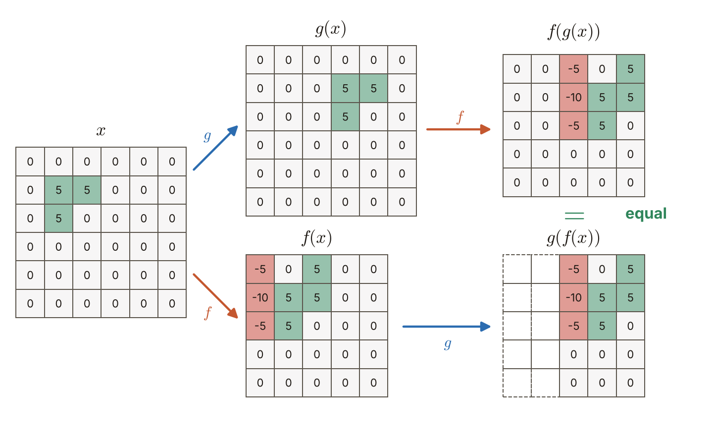
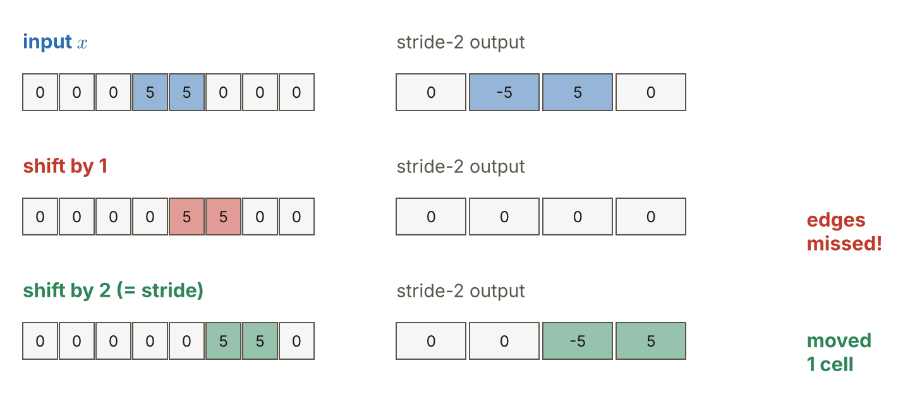
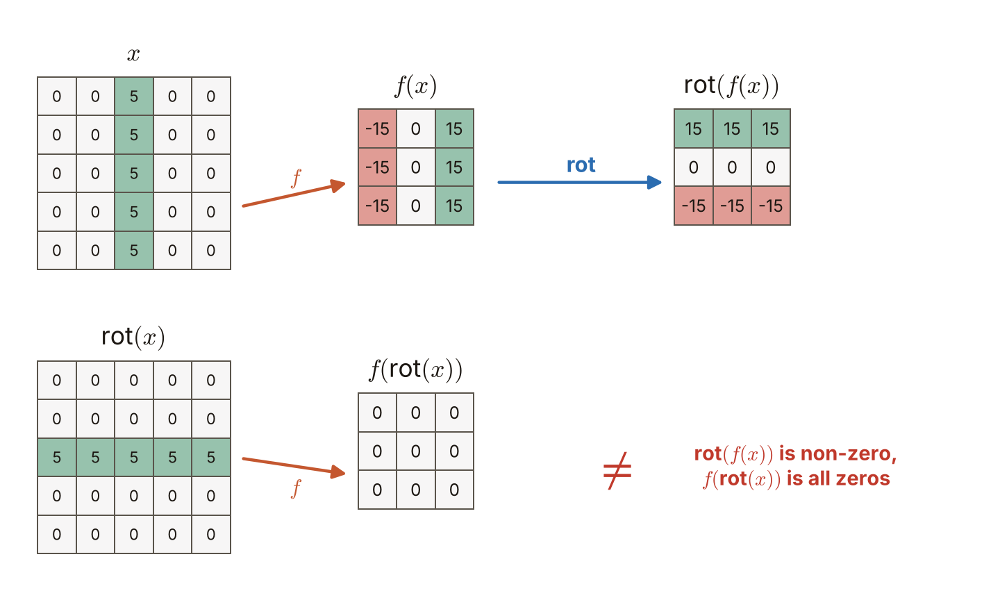

# 第6週 KP06：平移等變（Translation equivariance）

> 程度：大學生
>
> Level: Undergraduate (undergrad)

本講義是第6週「卷積與池化」的第六個知識點（KP06）。KP01 用一個很小的例子看過：輸入向右平移，卷積的輸出也跟著向右平移。KP05 說明了為什麼：所有位置共用同一個核。這一節把這個現象寫成一條精確的式子，看它在什麼條件下成立、什麼時候失效，並和另一個常被混淆的詞「平移不變」分開。

This is the sixth knowledge point (KP06) of Week 6, "Convolution and pooling". KP01 looked at a very small example: when the input shifts to the right, the output of a convolution shifts to the right as well. KP05 explained why: all positions share one kernel. This note writes the phenomenon as an exact formula, checks under which conditions it holds and when it fails, and separates it from a word it is often confused with, translation invariance.

先備知識是 KP04 的滑動乘加 $s[t]=\sum_m x[t+m]\,w[m]$、KP05 的權重共享，以及 KP01 的平移例子。第一次出現的詞與符號都會定義。所有數字都由 `assets/figures/src/lec06-kp06-figures.py` 算出，可以自己重算。

The prerequisites are the sliding multiply-and-add $s[t]=\sum_m x[t+m]\,w[m]$ of KP04, the parameter sharing of KP05, and the shift example of KP01. Every term and symbol is defined when it first appears. Every number is computed by `assets/figures/src/lec06-kp06-figures.py` and can be recomputed.

[下載本單元投影片](../slides/lec06-kp06-translation-equivariance.jbd.json)

[Download the slides of this unit (English)](../slides/lec06-kp06-translation-equivariance-en.jbd.json)

## KP06 平移等變（Translation equivariance）

### 學習目標（Learning objectives）

讀完之後，你能說明「先平移再卷積」與「先卷積再平移」得到同樣的結果，並在一個二維小例子上親手驗證。你能用共享權重寫出一維的證明，並說出沒有共享的局部連接層為什麼做不到。你能指出平移等變成立的條件：步幅為 $1$、只比較兩條路徑都有定義的位置，並說出步幅 $2$、旋轉、縮放為什麼會破壞它。你也能分清平移等變與平移不變：各自保留什麼、各由哪一種層負責。

After reading, you can explain that "shift and then convolve" and "convolve and then shift" give the same result, and verify it by hand on a small 2-D example. You can write the 1-D proof using shared weights and say why a locally connected layer without sharing cannot do it. You can state the conditions under which translation equivariance holds: a stride of $1$, and comparing only positions where both paths are defined; and say why a stride of $2$, rotation and scaling break it. You can also tell translation equivariance from translation invariance: what each preserves and which kind of layer provides it.

### 符號表（Symbols）

| 符號 | 中文意義 | English meaning |
|---|---|---|
| $x$ | 輸入（一維訊號或二維影像） | input (1-D signal or 2-D image) |
| $w,\ K$ | 一維的核、二維的核 | 1-D kernel, 2-D kernel |
| $f$ | 卷積運算：用核滑著乘加，只算有效輸出，步幅 $1$（KP04 的互相關，核不翻轉） | the convolution operation: slide the kernel and multiply-add, valid outputs only, stride $1$ (the cross-correlation of KP04, kernel not flipped) |
| $g$ | 平移運算：整體向右移 $d$ 格，左邊補 $0$ | the shift operation: move everything right by $d$ cells, filling zeros on the left |
| $d$ | 平移的格數 | the number of cells of the shift |
| $s[t]$ | 輸出在位置 $t$ 的值，$s=f(x)$ | value of the output at position $t$, $s=f(x)$ |
| $T_d$ | 一維的平移：$(T_dx)[\tau]=x[\tau-d]$（$\tau<d$ 補 $0$） | 1-D shift: $(T_dx)[\tau]=x[\tau-d]$ (zero for $\tau<d$) |

本講義的指標一律從 $0$ 開始數。參數個數一律不含偏置 `[補充]`。

All indices in this note start at $0$. Parameter counts never include biases `[Added]`.

### 1. 先平移再卷積，還是先卷積再平移（Shift then convolve, or convolve then shift）

要比較兩條路，先把兩個動作說清楚。**卷積** $f$ 是 KP04 的滑動乘加：核在輸入上滑，每個位置乘加一次，只算核完整落在輸入內的有效輸出。**平移** $g$ 是把整張輸入向右挪 $d$ 格，左邊空出來的格子補 $0$，右邊擠出去的丟掉。

To compare the two routes, first make the two actions precise. The **convolution** $f$ is the sliding multiply-and-add of KP04: the kernel slides over the input and multiplies-adds once at each position, giving only the valid outputs where the kernel lies completely inside the input. The **shift** $g$ moves the whole input right by $d$ cells, fills the freed cells on the left with $0$ and drops what is pushed out on the right.

兩條路是：

The two routes are:

- 路徑 A，先平移再卷積：$f(g(x))$。
- 路徑 B，先卷積再平移：$g(f(x))$。

- Route A, shift and then convolve: $f(g(x))$.
- Route B, convolve and then shift: $g(f(x))$.

用一個二維小例子看。輸入是 $6\times6$ 的影像 $x$，只有左上角附近有一小塊圖案：第 $1$ 列的 $5,5$ 與第 $2$ 列的 $5,0$（其餘為 $0$），放在第 $1$ 到 $2$ 列、第 $1$ 到 $2$ 行。核是 $K=\begin{bmatrix}1&-1\\1&-1\end{bmatrix}$，它對「左邊亮、右邊暗」的垂直邊緣有正的反應，反過來有負的反應。平移取 $d=2$，也就是向右移兩行。

Look at a small 2-D example. The input is a $6\times6$ image $x$ with a small pattern near the top left: $5,5$ in row $1$ and $5,0$ in row $2$ (everything else is $0$), at rows $1$ to $2$ and columns $1$ to $2$. The kernel is $K=\begin{bmatrix}1&-1\\1&-1\end{bmatrix}$; it responds positively to a vertical edge that is bright on the left and dark on the right, and negatively to the opposite. Take the shift $d=2$, that is, two columns to the right.

**圖說 `lec06-kp06-two-paths`**：先看上面那條路：$x$ 的圖案右移兩行成為 $g(x)$，再卷積得到 $f(g(x))$。再看下面那條路：先卷積得到 $f(x)$，它的非零區塊再右移兩行成為 $g(f(x))$。最後比較右邊兩張 $5\times5$ 的輸出：每一格都相同。$g(f(x))$ 左邊兩行是虛線，因為舊輸出右移後那裡沒有舊值可填；$f(g(x))$ 在那裡算出的是 $0$。

**Caption `lec06-kp06-two-paths`**: First follow the upper route: the pattern of $x$ moves right by two columns to become $g(x)$, and the convolution gives $f(g(x))$. Then follow the lower route: the convolution gives $f(x)$ first, and its non-zero block is then moved right by two columns to give $g(f(x))$. Finally compare the two $5\times5$ outputs on the right: every cell is the same. The two left columns of $g(f(x))$ are dashed because after the shift there is no old output to put there; $f(g(x))$ computes $0$ there.

例如 $f(x)$ 的第 $1$ 列是 $[-10,5,5,0,0]$。路徑 A 的第 $1$ 列是 $[0,0,-10,5,5]$，正好是它右移兩格。兩條路對每個有定義的格子都給出同一個數。

For example, row $1$ of $f(x)$ is $[-10,5,5,0,0]$. Row $1$ of route A is $[0,0,-10,5,5]$, exactly that row moved right by two cells. The two routes give the same number at every cell where both are defined.

這個性質叫**平移等變**（translation equivariance）：$f(g(x))=g(f(x))$。輸入平移多少，輸出就跟著平移多少。影像裡的貓向右移兩格，特徵圖上「貓的反應」也向右移兩格。位置的資訊沒有丟掉，只是跟著輸入走。

This property is called **translation equivariance**: $f(g(x))=g(f(x))$. However far the input shifts, the output shifts the same amount. If the cat in the image moves two cells to the right, the "cat response" on the feature map also moves two cells to the right. The information about position is not lost; it just follows the input.

### 2. 為什麼成立：同一個核走到哪都一樣（Why it holds: the same kernel everywhere）

用一維來證明，只需要一行代數。輸出是 $s[t]=\sum_{m=0}^{k-1}x[t+m]\,w[m]$。平移後的輸入是 $(T_dx)[\tau]=x[\tau-d]$，把它送進同一個 $f$：

A 1-D proof takes one line of algebra. The output is $s[t]=\sum_{m=0}^{k-1}x[t+m]\,w[m]$. The shifted input is $(T_dx)[\tau]=x[\tau-d]$; feed it into the same $f$:

$$
f(T_dx)[t]=\sum_{m=0}^{k-1}x[t+m-d]\,w[m]=s[t-d].
$$

最右邊就是把原輸出 $s$ 向右挪 $d$ 格。關鍵在第一個等號之後：每一項用的還是同一個 $w[m]$，只有輸入的位置跟著動。如果每個位置的權重不同，這一步就走不通。

The right-hand side is the old output $s$ moved right by $d$ cells. The key is after the first equals sign: every term still uses the same $w[m]$, and only the position in the input moves. If every position had different weights, this step would not work.

數字例：$x=[2,1,3,0,1,4,0,0]$、$w=[1,2,-1]$，輸出是 $s=[1,7,2,-2,9,4]$。右移 $d=2$ 後，$T_2x=[0,0,2,1,3,0,1,4]$，輸出是 $[-2,3,1,7,2,-2]$。從位置 $t\ge2$ 開始看：$[1,7,2,-2]$，正好是 $s$ 的前四個數。前面兩個數 $-2$ 與 $3$ 是左邊補進去的 $0$ 造成的新值，不屬於舊輸出。

A numerical example: $x=[2,1,3,0,1,4,0,0]$ and $w=[1,2,-1]$ give $s=[1,7,2,-2,9,4]$. After shifting right by $d=2$, $T_2x=[0,0,2,1,3,0,1,4]$ and the output is $[-2,3,1,7,2,-2]$. Look from position $t\ge2$: $[1,7,2,-2]$, exactly the first four numbers of $s$. The first two numbers $-2$ and $3$ are new values caused by the zeros padded on the left; they do not belong to the old output.

沒有共享就沒有等變。用 KP05 的局部連接層（只稀疏、不共享）試試：窗是 $2$ 格，位置 $t$ 的權重是 $a_t=t+1$ 與 $b_t=1$，$s[t]=a_tx[t]+b_tx[t+1]$。輸入 $x=[0,0,4,0,0,0]$ 的輸出是 $[0,4,12,0,0]$。把尖峰右移一格，$x=[0,0,0,4,0,0]$ 的輸出是 $[0,0,4,16,0]$。把前一個輸出右移一格會得到 $[\cdot,0,4,12,0]$，與 $[0,0,4,16,0]$ 不同：$12$ 變成了 $16$，因為尖峰走到了另一個位置，那裡的權重不一樣。

Without sharing there is no equivariance. Try the locally connected layer of KP05 (sparse, not shared): the window has $2$ cells and position $t$ has weights $a_t=t+1$ and $b_t=1$, so $s[t]=a_tx[t]+b_tx[t+1]$. The input $x=[0,0,4,0,0,0]$ gives $[0,4,12,0,0]$. Move the spike right by one cell, $x=[0,0,0,4,0,0]$, and the output is $[0,0,4,16,0]$. Shifting the previous output right by one gives $[\cdot,0,4,12,0]$, which differs from $[0,0,4,16,0]$: the $12$ has become $16$, because the spike moved to another position, where the weights are different.

所以平移等變不是卷積的巧合，而是權重共享的直接結果。

So translation equivariance is not a coincidence of convolution; it is a direct consequence of parameter sharing.

**常見錯誤**：以為只要「每個位置都算」就會等變。局部連接層每個位置也都算，但權重各異，它不等變。

**Common error**: thinking that "computing at every position" is enough for equivariance. A locally connected layer also computes at every position, but with different weights, and it is not equivariant.

### 3. 什麼時候破功（When it breaks）

平移等變有條件。三種情況會讓它失效或打折。

Translation equivariance has conditions. Three situations break it or weaken it.

**邊界。** 平移會把 $0$ 從邊界送進來，或把舊值擠出去，所以只有兩條路徑都有定義的位置才能比較，上面的例子都是這樣做的。靠近邊界的窗會和補進來的 $0$ 一起算，那裡的值和原輸出沒有關係。

**Borders.** A shift sends zeros in from the border or pushes old values out, so only the positions where both routes are defined can be compared, as in the examples above. Windows near the border are computed together with the zeros that came in, and those values have nothing to do with the old output.

**步幅大於 $1$。** KP07 會正式介紹步幅：核每次不是挪一格，而是挪兩格以上。用 $x=[0,0,0,5,5,0,0,0]$ 與核 $w=[1,-1]$。步幅 $1$ 的輸出是 $[0,0,-5,0,5,0,0]$。改成步幅 $2$，只留下位置 $0,2,4,6$ 的值，得到 $[0,-5,5,0]$。把輸入右移一格，$[0,0,0,0,5,5,0,0]$ 的步幅 $2$ 輸出是 $[0,0,0,0]$，邊緣的反應整個消失，沒有「跟著移」。右移兩格（正好是步幅），$[0,0,0,0,0,5,5,0]$ 的輸出是 $[0,0,-5,5]$，是原輸出向右移了一格。所以步幅 $s$ 的卷積只對 $s$ 的倍數的平移等變，輸出只移 $d/s$ 格。

**A stride larger than $1$.** KP07 introduces the stride formally: the kernel moves not one cell but two or more at a time. Take $x=[0,0,0,5,5,0,0,0]$ and the kernel $w=[1,-1]$. With a stride of $1$ the output is $[0,0,-5,0,5,0,0]$. With a stride of $2$ only the values at positions $0,2,4,6$ are kept, giving $[0,-5,5,0]$. Shift the input right by one cell: $[0,0,0,0,5,5,0,0]$ has the stride-$2$ output $[0,0,0,0]$; the edge responses vanish and do not "follow". Shift it right by two cells (exactly the stride): $[0,0,0,0,0,5,5,0]$ has the output $[0,0,-5,5]$, the old output moved right by one cell. So a convolution with stride $s$ is equivariant only to shifts that are multiples of $s$, and the output moves by $d/s$ cells.

**圖說 `lec06-kp06-stride-break`**：左邊是三種輸入，右邊是各自的步幅 $2$ 輸出。先看第一列：原輸入得到 $0,-5,5,0$。再看第二列：右移一格後，輸出全是 $0$，紅字標出邊緣被漏掉。最後看第三列：右移兩格後，輸出是 $0,0,-5,5$，綠字標出它只移了一格。

**Caption `lec06-kp06-stride-break`**: The left side shows three inputs and the right side their stride-$2$ outputs. First look at the first row: the original input gives $0,-5,5,0$. Then the second row: after a shift of one cell the output is all $0$, and the red text says the edges are missed. Finally the third row: after a shift of two cells the output is $0,0,-5,5$, and the green text says it moved by only one cell.

**旋轉與縮放。** 卷積只對平移等變，對旋轉和縮放不等變。看一個例子：$5\times5$ 的影像有一條垂直的亮線，核是垂直邊緣核 $K_{\mathrm v}=\begin{bmatrix}1&0&-1\\1&0&-1\\1&0&-1\end{bmatrix}$。$f(x)$ 的每一列是 $[-15,0,15]$，線的兩側各有一個反應。先把影像轉 $90^\circ$ 再卷積，亮線變成水平，$f(\mathrm{rot}(x))$ 全是 $0$：垂直邊緣核看不到水平線。而先卷積再轉 $90^\circ$ 的 $\mathrm{rot}(f(x))$ 有非零的值。兩者不同。

**Rotation and scaling.** A convolution is equivariant only to shifts, not to rotation or scaling. Look at an example: a $5\times5$ image has one vertical bright line, and the kernel is the vertical-edge kernel $K_{\mathrm v}=\begin{bmatrix}1&0&-1\\1&0&-1\\1&0&-1\end{bmatrix}$. Every row of $f(x)$ is $[-15,0,15]$, one response on each side of the line. Rotate the image by $90^\circ$ first and then convolve: the line becomes horizontal and $f(\mathrm{rot}(x))$ is all $0$; the vertical-edge kernel cannot see a horizontal line. Convolving first and then rotating by $90^\circ$ gives $\mathrm{rot}(f(x))$, which has non-zero values. The two differ.

**圖說 `lec06-kp06-rotation`**：先看上排：垂直線經卷積得到 $f(x)$，再轉 $90^\circ$ 得到 $\mathrm{rot}(f(x))$，有 $15$ 與 $-15$。再看下排：先把影像轉成水平線，再卷積，$f(\mathrm{rot}(x))$ 全是 $0$。兩條路結果不同，所以不是等變。

**Caption `lec06-kp06-rotation`**: First look at the upper row: the vertical line goes through the convolution to give $f(x)$, and rotating it by $90^\circ$ gives $\mathrm{rot}(f(x))$, with values $15$ and $-15$. Then the lower row: rotate the image into a horizontal line first and then convolve, and $f(\mathrm{rot}(x))$ is all $0$. The two routes differ, so it is not equivariant.

縮放也一樣：物體變大或變小，圖案的大小和核的窗大小的關係就變了，同一個核不再對得上。

Scaling is similar: when an object grows or shrinks, the relation between the size of the pattern and the size of the kernel's window changes, and the same kernel no longer fits.

### 4. 等變與不變：保留什麼，誰負責（Equivariance and invariance: what is kept, who provides it）

兩個詞要分開。

The two words must be kept apart.

- **平移等變**：$f(g(x))=g(f(x))$。輸出跟著輸入移，位置資訊還在。
- **平移不變**：$f(g(x))=f(x)$。輸入怎麼移，輸出都不變，位置資訊沒了。

- **Translation equivariance**: $f(g(x))=g(f(x))$. The output moves with the input, and the position information remains.
- **Translation invariance**: $f(g(x))=f(x)$. However the input moves, the output stays, and the position information is gone.

| 特性 | 平移等變 | 平移不變 |
|---|---|---|
| 式子 | $f(g(x))=g(f(x))$ | $f(g(x))=f(x)$ |
| 輸出的行為 | 跟著輸入一起移 | 不動 |
| 保留的資訊 | 東西「在哪裡」 | 東西「是什麼」 |
| 由誰提供 | 卷積層 | 池化層帶來近似的不變（KP08–KP09） |
| 適合的任務 | 偵測、分割等要知道位置的任務 | 整張影像的分類 `[補充]` |

| Property | Translation equivariance | Translation invariance |
|---|---|---|
| Formula | $f(g(x))=g(f(x))$ | $f(g(x))=f(x)$ |
| Behaviour of the output | moves with the input | does not move |
| Information kept | where the thing is | what the thing is |
| Provided by | convolutional layers | pooling brings approximate invariance (KP08–KP09) |
| Suitable tasks | detection, segmentation, tasks that need positions | classification of a whole image `[Added]` |

如果卷積真是平移不變，貓在左邊或右邊的特徵圖會一模一樣，網路就分不出貓在哪。卷積選了等變，是為了不丟位置；要得到「貓在哪都是貓」，要靠後面的池化把位置資訊逐步丟掉一點。池化只對小位移帶來近似的不變，詳細留給 KP08–KP09。

If a convolution were translation invariant, the feature maps for a cat on the left and on the right would be identical, and the network could not tell where the cat is. A convolution chooses equivariance in order not to lose position; to get "a cat is a cat anywhere", the pooling that follows throws away some position information step by step. Pooling brings only approximate invariance to small shifts; the details are left to KP08–KP09.

在卷積後面接逐格運算的活化函數（例如 ReLU）不會破壞等變，因為它對每一格各自處理：先平移再 ReLU，與先 ReLU 再平移相同。KP03 的三個階段（卷積、偵測器、池化）裡，前兩個階段合起來仍是等變的。

A cell-by-cell activation function (such as ReLU) after the convolution does not break equivariance, because it treats each cell alone: shifting and then ReLU is the same as ReLU and then shifting. Of the three stages of KP03 (convolution, detector, pooling), the first two together are still equivariant.

**實務上怎麼處理旋轉與縮放** `[補充]`：卷積不保證對旋轉與縮放等變，常見的做法是**資料增強**：訓練時對圖片隨機旋轉、隨機縮放與裁切，讓網路用不同的核（例如不同方向的邊緣核）學會這些變化。另一類是專門的架構，例如空間變換網路和特徵金字塔，細節留給後面的週次。

**What to do in practice about rotation and scaling** `[Added]`: a convolution does not guarantee equivariance to rotation or scaling, and a common remedy is **data augmentation**: during training, rotate, scale and crop the images at random so that the network learns these variations with different kernels (for example edge kernels of different orientations). Another kind of remedy is dedicated architectures such as spatial transformer networks and feature pyramids, with the details left to later weeks.

到這裡，我們知道卷積層對平移等變，以及什麼時候不成立。要真正實作一層卷積，還要決定核每次挪幾格、有幾個通道、邊界怎麼補、輸出會有多大。這是 KP07 的主題：步幅、通道、補邊與輸出尺寸。

At this point we know that a convolutional layer is translation equivariant, and when it is not. To implement a convolutional layer we must still decide how many cells the kernel moves at a time, how many channels there are, how the border is padded and how large the output is. That is the topic of KP07: stride, channels, padding and output size.

### 本單元重點整理（KP06 summary）

**一句話重點**：卷積層對平移等變：先平移再卷積，等於先卷積再平移，因為所有位置共用同一個核；這只在步幅為 $1$、比較兩條路都有定義的位置時成立，對旋轉與縮放不成立，也不等於平移不變。

**One-sentence summary**: A convolutional layer is translation equivariant: shifting and then convolving equals convolving and then shifting, because all positions share one kernel; this holds for a stride of $1$ and at positions where both routes are defined, it fails for rotation and scaling, and it is not translation invariance.

**白話說明**：同一個放大鏡走到哪都一樣。圖案移到哪裡，放大鏡就在那裡看到同樣的東西，所以特徵圖上的反應也跟著移到那裡。但放大鏡沒有轉動的能力：圖案轉了，放大鏡就可能看不懂。

**Plain explanation**: The same magnifying glass behaves the same wherever it goes. Wherever the pattern moves, the glass sees the same thing there, so the response on the feature map moves there too. But the glass cannot rotate: when the pattern is rotated, the glass may no longer understand it. `[Added]` The analogy covers shifting only; it does not say how the kernel learns its numbers.

**正式定義**：令 $f$ 是步幅 $1$ 的有效卷積，$g$ 是向右平移 $d$ 格。平移等變是 $f(g(x))=g(f(x))$。一維時 $f(T_dx)[t]=\sum_m x[t+m-d]\,w[m]=s[t-d]$，與 $f$ 的權重共享直接相關。平移不變是 $f(g(x))=f(x)$。

**Formal definition**: Let $f$ be the valid convolution with a stride of $1$ and $g$ the shift to the right by $d$ cells. Translation equivariance is $f(g(x))=g(f(x))$. In 1-D, $f(T_dx)[t]=\sum_m x[t+m-d]\,w[m]=s[t-d]$, which follows directly from the parameter sharing of $f$. Translation invariance is $f(g(x))=f(x)$.

**例子**：$6\times6$ 影像上的小圖案右移兩行，用核 $\begin{bmatrix}1&-1\\1&-1\end{bmatrix}$ 卷積，兩條路的 $5\times5$ 輸出完全相同。局部連接層（權重各位置不同）把尖峰右移一格，輸出由 $12$ 變成 $16$，不等變。步幅 $2$ 時，右移一格的輸出全是 $0$，右移兩格才是原輸出移了一格。

**Example**: A small pattern on a $6\times6$ image is shifted right by two columns and convolved with the kernel $\begin{bmatrix}1&-1\\1&-1\end{bmatrix}$; the $5\times5$ outputs of the two routes are identical. For a locally connected layer (different weights at each position), moving a spike right by one cell changes the output from $12$ to $16$; it is not equivariant. With a stride of $2$, a shift by one cell gives an all-zero output, and only a shift by two cells gives the old output moved by one cell.

**常見迷思**：

- 「卷積對平移不變。」錯，是等變：輸出跟著移，位置資訊還在。不變是池化帶來的近似性質。
- 「只要每個位置都算，就會等變。」錯，要每個位置共用同一組權重。局部連接層不等變。
- 「卷積對旋轉與縮放也等變。」錯，一個垂直邊緣核看不見旋轉後的水平線。
- 「卷積網路任何平移都等變。」不完全對，步幅大於 $1$ 時只對步幅倍數的平移等變，邊界附近也不成立。

**Common misconceptions**:

- "A convolution is translation invariant." Wrong: it is equivariant, the output moves with the input and the position information remains. Invariance is an approximate property brought by pooling.
- "Computing at every position is enough for equivariance." Wrong: every position must share one set of weights. A locally connected layer is not equivariant.
- "A convolution is also equivariant to rotation and scaling." Wrong: a vertical-edge kernel cannot see a horizontal line after rotation.
- "A convolutional network is equivariant to every shift." Not entirely: with a stride larger than $1$ it is equivariant only to shifts that are multiples of the stride, and it fails near the border.

**圖**：本單元有三張圖。

- `lec06-kp06-two-paths`：先平移再卷積與先卷積再平移，兩個輸出相同。
- `lec06-kp06-stride-break`：步幅 $2$ 時，右移一格漏掉邊緣，右移兩格才跟著移。
- `lec06-kp06-rotation`：垂直邊緣核看不見旋轉後的水平線。

三張圖與文中數字都由同一支程式產生：`lec06-kp06-figures.py`。

**Figure**: Three figures in this unit.

- `lec06-kp06-two-paths`: shift then convolve and convolve then shift give the same output.
- `lec06-kp06-stride-break`: with a stride of $2$, a shift by one cell misses the edges, and only a shift by two cells is followed.
- `lec06-kp06-rotation`: a vertical-edge kernel cannot see a horizontal line after rotation.

All three figures and every number in the text come from one program: `lec06-kp06-figures.py`.

**想深入**（選讀）`[補充]`：旋轉輸入等於把核轉過去。對步幅 $1$ 的有效卷積，$f(\mathrm{rot}(x),K)=\mathrm{rot}\bigl(f(x,\mathrm{rot}^{-1}(K))\bigr)$，程式用兩個核各驗證了一次。所以卷積網路要認出各種方向的同一個圖案，就要有各個方向的核，這就是資料增強讓網路自己學出多方向核的原因。

**Going deeper** (optional) `[Added]`: Rotating the input equals rotating the kernel the other way. For a valid convolution with a stride of $1$, $f(\mathrm{rot}(x),K)=\mathrm{rot}\bigl(f(x,\mathrm{rot}^{-1}(K))\bigr)$, and the program checked it with two kernels. So for a convolutional network to recognise the same pattern in many orientations, it needs kernels of those orientations, which is why data augmentation lets the network learn multi-orientation kernels by itself.

**小練習**：

1. 一維訊號 $x=[0,1,4,2,0,0,0,0,0]$、核 $w=[1,2]$，用 $s[t]=x[t]w[0]+x[t+1]w[1]$ 算出輸出。再把 $x$ 右移 $3$ 格重算。兩個輸出從哪個位置開始對得上？（提示：右移 $d$ 格後，從位置 $t\ge d$ 比較。）
2. `[補充]` 對本講義的 $6\times6$ 二維例子，把圖案只右移一行（$d=1$）。算出 $f(g(x))$，並和 $g(f(x))$ 比較。（提示：先寫出 $f(x)$ 的五列，再整體右移一行。）
3. `[補充]` 一維訊號 $x=[0,0,5,5,0,0,0,0]$、核 $w=[1,-1]$，用步幅 $2$（只留位置 $0,2,4,6$）算出輸出。再把 $x$ 右移一格重算。輸出是不是原輸出右移一格？（提示：先算步幅 $1$ 的輸出，再挑位置。）
4. `[補充]` 卷積後面接 ReLU，還對平移等變嗎？用本講義 $f(x)$ 右移兩行的例子驗證，並說出原因。（提示：ReLU 把每一格各自變成 $\max(0,\cdot)$。）

**Practice**:

1. For the 1-D signal $x=[0,1,4,2,0,0,0,0,0]$ and the kernel $w=[1,2]$, compute the output with $s[t]=x[t]w[0]+x[t+1]w[1]$. Then shift $x$ right by $3$ cells and recompute. From which position do the two outputs match? (Hint: after shifting right by $d$ cells, compare from position $t\ge d$.)
2. `[Added]` For the $6\times6$ 2-D example of this note, shift the pattern right by only one column ($d=1$). Compute $f(g(x))$ and compare it with $g(f(x))$. (Hint: first write the five rows of $f(x)$, then move them all right by one column.)
3. `[Added]` For the 1-D signal $x=[0,0,5,5,0,0,0,0]$ and the kernel $w=[1,-1]$, compute the output with a stride of $2$ (keep only positions $0,2,4,6$). Then shift $x$ right by one cell and recompute. Is the output the old output moved right by one cell? (Hint: first compute the stride-$1$ output, then pick the positions.)
4. `[Added]` Is a convolution followed by ReLU still translation equivariant? Verify it with the example of $f(x)$ shifted right by two columns, and say why. (Hint: ReLU turns each cell into $\max(0,\cdot)$ on its own.)

**第 1 題解答** `[補充]`：

1. 原輸出：$s[0]=0+2\cdot1=2$，$s[1]=1+2\cdot4=9$，$s[2]=4+2\cdot2=8$，$s[3]=2+0=2$，其餘為 $0$。所以 $s=[2,9,8,2,0,0,0,0]$。
2. 右移 $3$ 格後 $x'=[0,0,0,0,1,4,2,0,0]$，輸出是 $[0,0,0,2,9,8,2,0]$。
3. 從位置 $t\ge3$ 比較：$[2,9,8,2,0]$，正好是 $s$ 的前五個數 $[2,9,8,2,0]$。位置 $0$ 到 $2$ 是補進來的 $0$ 造成的新值。

**Solution to question 1** `[Added]`:

1. Original output: $s[0]=0+2\cdot1=2$, $s[1]=1+2\cdot4=9$, $s[2]=4+2\cdot2=8$, $s[3]=2+0=2$, and $0$ elsewhere. So $s=[2,9,8,2,0,0,0,0]$.
2. After shifting right by $3$ cells $x'=[0,0,0,0,1,4,2,0,0]$ and the output is $[0,0,0,2,9,8,2,0]$.
3. Comparing from position $t\ge3$: $[2,9,8,2,0]$, exactly the first five numbers $[2,9,8,2,0]$ of $s$. Positions $0$ to $2$ are new values caused by the padded zeros.

**第 2 題解答** `[補充]`：

1. $f(x)$ 的五列是 $[-5,0,5,0,0]$、$[-10,5,5,0,0]$、$[-5,5,0,0,0]$、$[0,0,0,0,0]$、$[0,0,0,0,0]$。
2. 圖案右移一行後，$f(g(x))$ 的前三列是 $[0,-5,0,5,0]$、$[0,-10,5,5,0]$、$[0,-5,5,0,0]$，後兩列全是 $0$。
3. 把 $f(x)$ 每列整體右移一行（左邊補 $0$）得到的正是這五列，所以 $f(g(x))=g(f(x))$，每一格都相同。

**Solution to question 2** `[Added]`:

1. The five rows of $f(x)$ are $[-5,0,5,0,0]$, $[-10,5,5,0,0]$, $[-5,5,0,0,0]$, $[0,0,0,0,0]$, $[0,0,0,0,0]$.
2. After shifting the pattern right by one column, the first three rows of $f(g(x))$ are $[0,-5,0,5,0]$, $[0,-10,5,5,0]$, $[0,-5,5,0,0]$, and the last two rows are all $0$.
3. Moving every row of $f(x)$ right by one column (padding $0$ on the left) gives exactly these five rows, so $f(g(x))=g(f(x))$ and every cell is the same.

**第 3 題解答** `[補充]`：

1. 步幅 $1$ 的輸出：$s[t]=x[t]-x[t+1]$，得 $[0,-5,0,5,0,0,0]$。步幅 $2$ 只留位置 $0,2,4,6$：$[0,0,0,0]$，邊緣全部漏掉。
2. 右移一格後 $x=[0,0,0,5,5,0,0,0]$，步幅 $1$ 的輸出是 $[0,0,-5,0,5,0,0]$，步幅 $2$ 留下 $[0,-5,5,0]$。
3. 原步幅 $2$ 輸出是 $[0,0,0,0]$，新輸出是 $[0,-5,5,0]$，不是原輸出右移一格，所以步幅 $2$ 對移一格不等變。

**Solution to question 3** `[Added]`:

1. The stride-$1$ output: $s[t]=x[t]-x[t+1]$, giving $[0,-5,0,5,0,0,0]$. A stride of $2$ keeps positions $0,2,4,6$: $[0,0,0,0]$, and all edges are missed.
2. After shifting right by one cell, $x=[0,0,0,5,5,0,0,0]$; the stride-$1$ output is $[0,0,-5,0,5,0,0]$ and the stride-$2$ output keeps $[0,-5,5,0]$.
3. The old stride-$2$ output is $[0,0,0,0]$ and the new one is $[0,-5,5,0]$, which is not the old output moved right by one cell, so a stride of $2$ is not equivariant to a shift by one cell.

**第 4 題解答** `[補充]`：

1. $f(x)$ 套上 ReLU 後是 $[0,0,5,0,0]$、$[0,5,5,0,0]$、$[0,5,0,0,0]$、兩列 $0$。
2. 先把 $f(x)$ 右移兩行再 ReLU，與先 ReLU 再右移兩行，結果相同，第 $1$ 列都是 $[0,0,0,5,5]$。
3. 原因：ReLU 對每一格各自運算，不看鄰居，也不看位置。平移只是換了格子的位置，所以「先平移再 ReLU」與「先 ReLU 再平移」相同。

**Solution to question 4** `[Added]`:

1. After ReLU, $f(x)$ becomes $[0,0,5,0,0]$, $[0,5,5,0,0]$, $[0,5,0,0,0]$ and two rows of $0$.
2. Shifting $f(x)$ right by two columns and then applying ReLU gives the same as applying ReLU first and then shifting right by two columns; row $1$ is $[0,0,0,5,5]$ in both.
3. The reason: ReLU acts on each cell alone, looking neither at neighbours nor at position. A shift only changes where the cells are, so "shift then ReLU" equals "ReLU then shift".

### 來源更正與取捨（Corrections to the source）

本講義依 CCC-LNS IDL_115 第4章 KP06（簡報）重新撰寫，該教材的第4章就是本課的第6週。來源的讀取日期是 2026-10-30。來源沒有的內容，都在出現的地方標示 `[補充]`。

- 來源把 equivariance 稱為「平移等價性」，並在題目選項裡寫「equivalence」。一般用語是「平移等變」（equivariance），本講義統一使用；等變與不變的區分沿用來源。
- 來源說「先平移再卷積與先卷積再平移結果完全相同」，互動實驗室也說任何平移量 $\Delta$ 都「每一格數值嚴格相等」。這只在步幅 $1$ 並且只比較兩條路都有定義的位置時成立。本講義補上條件，並用步幅 $2$ 的例子說明為什麼不成立。
- 來源把平移不變主要歸給池化，「特別是全域池化」。本講義改寫成池化只帶來對小位移的近似不變，細節留給 KP08–KP09；全域池化的內容在 KP10。
- 來源說旋轉不成立的原因是「濾波核並非旋轉對稱」。這個說法對，但不完整：旋轉輸入等於旋轉核，本講義用一個垂直邊緣核的小例子與程式驗證補上。
- 來源的縮放說明（超過 $3\times3$ 核的感受野視窗）沒有給數字，本講義只用文字說明，不另做數值例。
- 來源以 STN、FPN 與資料增強作為旋轉與縮放的處理，本講義只講資料增強，STN 與 FPN 只點名並留給後面的週次。
- 來源的互動模擬器與四題測驗不採用。本講義的練習題依本單元的數字重新設計，測驗題的概念（等變與不變的區分、可交換式、旋轉與縮放不成立、貓向右移的直觀意義）都包含在正文與練習裡。
- 取捨：來源的主要例子是示意圖；本講義改用 $6\times6$ 的二維數字例，讓兩條路徑的每一格都能驗算，並新增局部連接層、步幅 $2$ 與 ReLU 的例子。符號 $f$、$g$ 沿用來源，核與輸出的記號沿用 KP04 與 KP05。

This note is rewritten from KP06 of CCC-LNS IDL_115 Chapter 4 (slides); Chapter 4 of that material is Week 6 of this course. The source was accessed on 2026-10-30. Content that the source does not contain is marked `[Added]` where it appears.

- The source calls equivariance "translation equivalence" and writes "equivalence" in a quiz option. The standard term is translation equivariance, used throughout this note; the distinction between equivariance and invariance follows the source.
- The source says that "shift then convolve and convolve then shift give exactly the same result", and its interactive lab says that every shift $\Delta$ gives values that are "strictly equal at every cell". This holds only for a stride of $1$ and when comparing only positions where both routes are defined. This note adds the conditions and explains with a stride-$2$ example why it fails otherwise.
- The source attributes translation invariance mainly to pooling, "especially global pooling". This note says instead that pooling brings only approximate invariance to small shifts, with the details left to KP08–KP09; global pooling is covered in KP10.
- The source says that rotation fails because "the kernel is not rotation symmetric". This is correct but incomplete: rotating the input equals rotating the kernel, which this note adds with a small vertical-edge example and a program check.
- The source's explanation of scaling (beyond the receptive-field window of a $3\times3$ kernel) gives no numbers, and this note explains it in words only, without a numerical example.
- The source lists STN, FPN and data augmentation as remedies for rotation and scaling; this note covers only data augmentation, and only names STN and FPN, leaving them to later weeks.
- The source's interactive simulator and four-question quiz are not used. The practice questions of this note are newly designed from the numbers of this unit, and the concepts of the quiz (equivariance versus invariance, the commutation formula, failure under rotation and scaling, the meaning of the cat moving right) are all contained in the text and the practice.
- Choices: the source's main example is a sketch; this note uses a $6\times6$ numerical 2-D example so that every cell of the two routes can be checked, and adds the examples of a locally connected layer, a stride of $2$ and ReLU. The symbols $f$ and $g$ follow the source, and the notation of the kernel and the output follows KP04 and KP05.

### 術語對照（Terminology）

| 中文 | English |
|---|---|
| 平移等變 | translation equivariance |
| 平移不變 | translation invariance |
| 卷積 | convolution |
| 平移 | shift (translation) |
| 核 | kernel |
| 有效輸出 | valid output |
| 權重共享 | parameter sharing (weight sharing) |
| 局部連接層 | locally connected layer |
| 步幅 | stride |
| 邊界 | border |
| 旋轉 | rotation |
| 縮放 | scaling |
| 活化函數 | activation function |
| 池化 | pooling |
| 資料增強 | data augmentation |
| 垂直邊緣核 | vertical-edge kernel |
| 課程來源教材（CCC-LNS） | course source material (CCC-LNS) |
