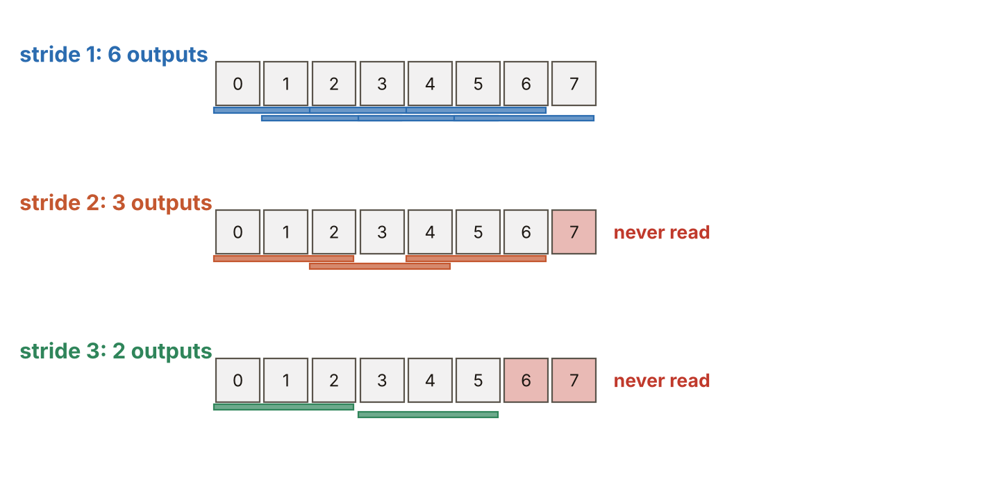
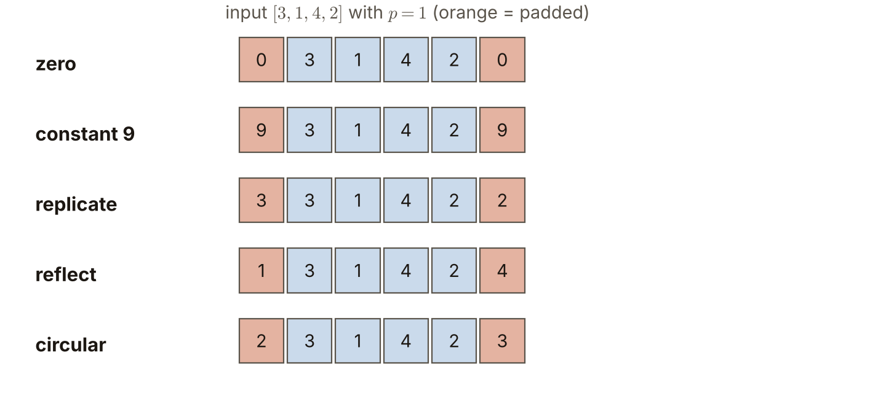
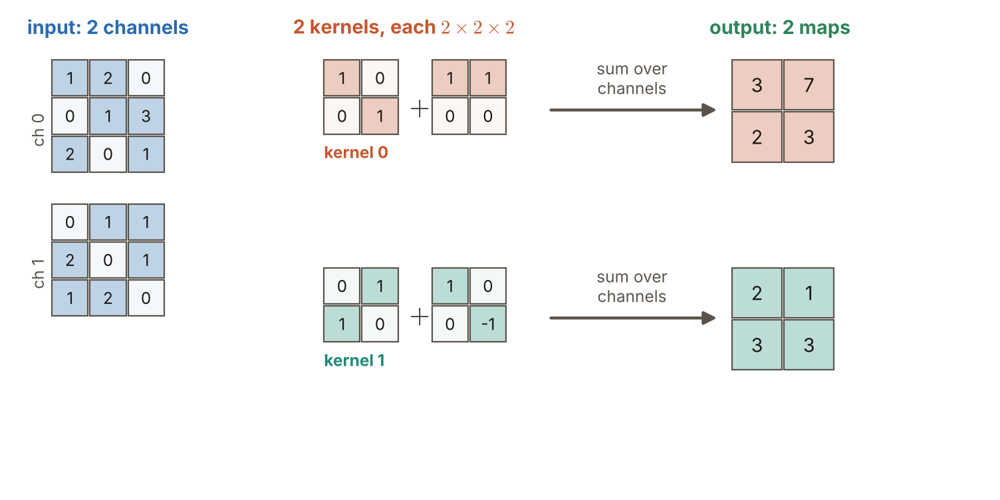

# 第6週 KP07：步幅、通道、補邊與輸出尺寸（Stride, channels, padding and output size）

> 程度：大學生
>
> Level: Undergraduate (undergrad)

本講義是第6週「卷積與池化」的第七個知識點（KP07）。KP04 算過沒有補邊時的輸出大小，KP05 說明了一個核共用權重，KP06 提醒步幅大於 $1$ 會讓平移等變打折。這一節把「核每次挪幾格、邊界怎麼補、有幾個通道」這幾個旋鈕放在一起，推出一條能預測輸出尺寸的公式，並算出一層真實大小的卷積層有多少權重。

This is the seventh knowledge point (KP07) of Week 6, "Convolution and pooling". KP04 counted the output size without padding, KP05 explained that one kernel shares its weights, and KP06 warned that a stride larger than $1$ weakens translation equivariance. This note puts the knobs together: how many cells the kernel moves at a time, how the border is padded and how many channels there are. It derives a formula that predicts the output size, and counts the weights of one convolutional layer of realistic size.

先備知識是 KP04 的有效輸出 $d-f+1$、KP05 的權重與乘加個數，以及 KP06 的步幅例子。第一次出現的詞與符號都會定義。所有數字都由 `assets/figures/src/lec06-kp07-figures.py` 算出，可以自己重算。

The prerequisites are the valid output $d-f+1$ of KP04, the counts of weights and multiply-adds of KP05, and the stride example of KP06. Every term and symbol is defined when it first appears. Every number is computed by `assets/figures/src/lec06-kp07-figures.py` and can be recomputed.

[下載本單元投影片](../slides/lec06-kp07-stride-channels-padding-output-size.jbd.json)

[Download the slides of this unit (English)](../slides/lec06-kp07-stride-channels-padding-output-size-en.jbd.json)

## KP07 步幅、通道、補邊與輸出尺寸（Stride, channels, padding and output size）

### 學習目標（Learning objectives）

讀完之後，你能用公式 $\bigl\lfloor\frac{d-f+2p}{s}\bigr\rfloor+1$ 算出輸出的邊長，並解釋公式裡每一項的來源，包括為什麼要向下取整，以及取整後哪些格子沒有被讀到。你能說出 valid 與 same 補邊的意思，算出 same 需要的補邊圈數，並列舉五種補邊方式各填什麼數。你能說明一個核的深度必須等於輸入通道數，輸出有幾張特徵圖由核的個數決定，並算出權重個數。你也能對 $224\times224\times3$ 的輸入、$64$ 個 $3\times3$ 核的層，算出輸出大小、權重個數與乘加次數。

After reading, you can compute the side length of the output with the formula $\bigl\lfloor\frac{d-f+2p}{s}\bigr\rfloor+1$ and explain where each term comes from, including why we round down and which cells are never read after rounding. You can say what valid and same padding mean, compute the number of padding rings same padding needs, and list what each of five padding methods fills in. You can explain that the depth of a kernel must equal the number of input channels, that the number of output maps is set by the number of kernels, and count the weights. You can also compute the output size, the number of weights and the number of multiply-adds for a layer with a $224\times224\times3$ input and $64$ kernels of size $3\times3$.

### 符號表（Symbols）

| 符號 | 中文意義 | English meaning |
|---|---|---|
| $d$ | 輸入的邊長（正方形影像，單位是格） | side length of the input (a square image, in cells) |
| $f$ | 核的邊長 | side length of the kernel |
| $p$ | 每一邊補的圈數 | number of rings padded on each side |
| $s$ | 步幅：核每次挪的格數 | stride: the number of cells the kernel moves at a time |
| $C_{\mathrm{in}},\ C_{\mathrm{out}}$ | 輸入的通道數、輸出的通道數（等於核的個數） | number of input channels, number of output channels (equal to the number of kernels) |
| $\lfloor\cdot\rfloor$ | 向下取整，例如 $\lfloor 2.5\rfloor=2$ | round down, for example $\lfloor 2.5\rfloor=2$ |

本講義的指標一律從 $0$ 開始數。$d,\ f$ 是二維正方形的邊長，一維時就是 KP05 的 $M,\ k$。這一節把偏置算進參數個數，並另外寫出 `[補充]`。

All indices in this note start at $0$. Here $d$ and $f$ are side lengths of 2-D squares; in 1-D they are the $M$ and $k$ of KP05. This note counts the biases in the number of parameters and states them separately `[Added]`.

### 1. 不補邊，輸出會縮一圈（Without padding the output shrinks by a ring）

核要完整落在輸入內才能算一個輸出。邊長 $d$ 的輸入，邊長 $f$ 的核，核的左上角能放的位置是 $0,1,\dots,d-f$，共 $d-f+1$ 個，所以輸出邊長是 $d-f+1$。$5\times5$ 的輸入配 $3\times3$ 的核，輸出是 $3\times3$：最外面那一圈被削掉了。

A kernel can compute an output only when it lies completely inside the input. For an input of side $d$ and a kernel of side $f$, the top-left corner of the kernel can be at positions $0,1,\dots,d-f$, which are $d-f+1$ positions, so the output side is $d-f+1$. A $5\times5$ input with a $3\times3$ kernel gives a $3\times3$ output: the outermost ring has been cut off.

這在淺層網路還不要緊，疊很多層就麻煩了：每一層都縮一圈，影像很快就變小。解法是在輸入外面先補上幾圈格子，再做卷積。每邊補 $p$ 圈，輸入的邊長就變成 $d+2p$，輸出邊長變成 $d+2p-f+1$。

This does not matter in a shallow network, but with many layers it is a problem: every layer shrinks the image by a ring, and the image soon becomes small. The remedy is to pad a few rings of cells around the input before convolving. Padding $p$ rings on each side makes the input side $d+2p$, and the output side $d+2p-f+1$.

兩個名字要記：完全不補（$p=0$）叫 **valid**；補到輸出和輸入一樣大，叫 **same**。例如 $d=5,\ f=3$：$p=0$ 時輸出是 $3$，$p=1$ 時輸出是 $5-3+2+1=5$，和輸入一樣大。

Two names to remember: no padding at all ($p=0$) is called **valid**, and padding until the output is as large as the input is called **same**. For example with $d=5,\ f=3$: for $p=0$ the output is $3$, and for $p=1$ it is $5-3+2+1=5$, as large as the input.

**常見迷思**：valid 並不是「比較正確」的意思。它在訊號處理裡只是指「不擴充邊界，只在原本的訊號內部運算」。

**Common misconception**: valid does not mean "more correct". In signal processing it only means "no extension of the border; compute only inside the original signal".

### 2. 步幅：核一次挪幾格（Stride: how many cells the kernel moves at a time）

到目前為止核每次挪一格。**步幅**（stride）$s$ 是核每次挪的格數。$s=2$ 就是每隔一格才算一個輸出，輸出會少很多。

Until now the kernel moved one cell at a time. The **stride** $s$ is the number of cells the kernel moves at a time. With $s=2$ an output is computed only every second cell, and there are far fewer outputs.

輸出有幾個？核的左上角可以放在 $0,\ s,\ 2s,\dots$，一直到不超過 $d+2p-f$ 為止。這些位置的個數是

How many outputs are there? The top-left corner can be at $0,\ s,\ 2s,\dots$, up to but not beyond $d+2p-f$. The number of these positions is

$$
\Bigl\lfloor\frac{d-f+2p}{s}\Bigr\rfloor+1 .
$$

分子 $d-f+2p$ 是核能走的最大距離；除以 $s$ 再向下取整，是走了幾步；加上最初站的那一格，才是位置的個數。取整是因為核只能整步地走，最後不夠一步的零頭就放棄。

The numerator $d-f+2p$ is the largest distance the kernel can travel; dividing by $s$ and rounding down is the number of steps; adding the first position the kernel stands on gives the number of positions. The rounding appears because the kernel moves in whole steps, and a leftover of less than one step is dropped.

用一維的例子看。取 $f=3$、$p=0$：

Look at a 1-D example. Take $f=3$ and $p=0$:

| $d$ | $s$ | $\lfloor(d-3)/s\rfloor+1$ | 沒有被讀到的格子 |
|---|---|---|---|
| $8$ | $1$ | $6$ | 無 |
| $8$ | $2$ | $\lfloor5/2\rfloor+1=3$ | 第 $7$ 格 |
| $8$ | $3$ | $\lfloor5/3\rfloor+1=2$ | 第 $6$、$7$ 格 |
| $7$ | $2$ | $\lfloor4/2\rfloor+1=3$ | 無 |

| $d$ | $s$ | $\lfloor(d-3)/s\rfloor+1$ | cells never read |
|---|---|---|---|
| $8$ | $1$ | $6$ | none |
| $8$ | $2$ | $\lfloor5/2\rfloor+1=3$ | cell $7$ |
| $8$ | $3$ | $\lfloor5/3\rfloor+1=2$ | cells $6$ and $7$ |
| $7$ | $2$ | $\lfloor4/2\rfloor+1=3$ | none |

**圖說 `lec06-kp07-stride-windows`**：每一列是同一個 $8$ 格的輸入，色條是核的每個窗。先看第一列：步幅 $1$，$6$ 個窗，每一格都被讀到。再看第二列：步幅 $2$，只有 $3$ 個窗，最右邊的第 $7$ 格紅色，沒被任何窗讀到。最後看第三列：步幅 $3$，只剩 $2$ 個窗，第 $6$、$7$ 格都沒被讀到。

**Caption `lec06-kp07-stride-windows`**: Every row is the same $8$-cell input, and the coloured bars are the windows of the kernel. First look at the top row: stride $1$ gives $6$ windows, and every cell is read. Then the middle row: stride $2$ gives only $3$ windows, and the rightmost cell $7$ is red because no window reads it. Finally the bottom row: stride $3$ leaves $2$ windows, and cells $6$ and $7$ are not read.

步幅大於 $1$ 有兩件事要記：輸出的邊長大約變成原來的 $1/s$，所以步幅 $2$ 是一種「順便縮小」的做法；而 KP06 看到，步幅 $s$ 的卷積只對 $s$ 的倍數的平移等變。

Two things to remember about a stride larger than $1$: the side of the output becomes about $1/s$ of the original, so a stride of $2$ is a way to shrink the map on the way; and KP06 showed that a convolution with stride $s$ is equivariant only to shifts that are multiples of $s$.

**常見錯誤**：以為取整只是四捨五入的小事。取整表示輸入最右邊（和最下面）可能有幾格完全沒有被讀到，上表第二列就是例子。

**Common error**: thinking that the rounding is a minor detail. The rounding means that a few cells at the right (and the bottom) of the input may never be read, as the second row of the table shows.

### 3. 補邊：補什麼數字（Padding: which numbers to put in）

補邊就是在輸入外圍加上幾圈格子，這些格子要填什麼數？最常見的是補 $0$，另外還有四種。用 $[3,1,4,2]$ 補 $p=1$ 圈：

Padding adds rings of cells around the input; which numbers should fill them? The most common is $0$, and there are four more. Pad $[3,1,4,2]$ with $p=1$:

| 方式 | 補完的結果 | 規則 |
|---|---|---|
| 補零（zero） | $[0,3,1,4,2,0]$ | 填 $0$ |
| 補常數（constant） | $[9,3,1,4,2,9]$ | 填指定的常數（這裡是 $9$） |
| 複製（replicate） | $[3,3,1,4,2,2]$ | 複製最邊緣的值 |
| 鏡射（reflect） | $[1,3,1,4,2,4]$ | 以邊緣為鏡面，反射靠內的值 |
| 環狀（circular） | $[2,3,1,4,2,3]$ | 頭尾相接，從另一端取值 |

| Method | Result after padding | Rule |
|---|---|---|
| zero | $[0,3,1,4,2,0]$ | fill with $0$ |
| constant | $[9,3,1,4,2,9]$ | fill with a given constant ($9$ here) |
| replicate | $[3,3,1,4,2,2]$ | copy the edge value |
| reflect | $[1,3,1,4,2,4]$ | mirror the inner values about the edge |
| circular | $[2,3,1,4,2,3]$ | join head and tail and take the value from the other end |

**圖說 `lec06-kp07-padding-modes`**：橘色是補進去的格子，藍色是原本的輸入 $[3,1,4,2]$。先看第一列補零：兩端是 $0$。再往下看，複製是把 $3$ 與 $2$ 各抄一次，鏡射是取靠內的 $1$ 與 $4$，環狀是取對面的 $2$ 與 $3$。

**Caption `lec06-kp07-padding-modes`**: Orange cells are the padded ones and blue cells are the original input $[3,1,4,2]$. First look at the top row, zero padding: both ends are $0$. Going down, replicate copies $3$ and $2$ once more each, reflect takes the inner $1$ and $4$, and circular takes the values from the opposite end, $2$ and $3$.

補零最簡單，也最常見。其他方式的差別在於補進去的值看起來像不像真的影像：補零會在邊緣製造一圈人造的黑邊，複製與鏡射讓邊緣的圖案延續，環狀適合頭尾本來就相接的資料（例如環繞的全景圖）。來源列出各種方式的常見用途，本講義沒有逐一查證，使用前請先看資料的性質 `[補充]`。

Zero padding is the simplest and most common. The other methods differ in how much the padded values look like a real image: zero padding creates an artificial dark ring at the border, replicate and reflect let the pattern at the border continue, and circular suits data whose ends really join (for example a wrap-around panorama). The source lists common uses of each method; this note has not checked them one by one, so look at the nature of the data before using one `[Added]`.

**same 需要補幾圈？** 取步幅 $s=1$，輸出邊長是 $d-f+2p+1$。讓它等於 $d$，得到 $2p=f-1$，也就是 $p=\frac{f-1}{2}$。所以 $f=3$ 補 $1$ 圈、$f=5$ 補 $2$ 圈。這個式子只在核是奇數、步幅是 $1$ 時剛好是整數；偶數的核沒有剛好的 same。

**How many rings does same need?** Take a stride $s=1$; the output side is $d-f+2p+1$. Setting it equal to $d$ gives $2p=f-1$, that is $p=\frac{f-1}{2}$. So $f=3$ needs $1$ ring and $f=5$ needs $2$. The formula gives a whole number only for an odd kernel and a stride of $1$; an even kernel has no exact same padding.

**常見錯誤**：以為「same 補邊」永遠保持尺寸。步幅大於 $1$ 時輸出會縮小：$d=224,\ f=3,\ p=1,\ s=2$ 的輸出是 $\lfloor(224-3+2)/2\rfloor+1=112$，是輸入的一半。

**Common error**: believing that "same padding" always keeps the size. With a stride larger than $1$ the output shrinks: $d=224,\ f=3,\ p=1,\ s=2$ gives $\lfloor(224-3+2)/2\rfloor+1=112$, half of the input.

### 4. 通道：核有深度，輸出有張數（Channels: kernels have depth, outputs have count）

彩色影像每個畫素有紅、綠、藍三個數，影像有三個**通道**（channel），可以看成三張疊在一起的 $d\times d$ 平面。一般地說，輸入有 $C_{\mathrm{in}}$ 個通道。

A colour image has three numbers per pixel, red, green and blue, so the image has three **channels** and can be seen as three $d\times d$ planes stacked together. In general the input has $C_{\mathrm{in}}$ channels.

這時一個核也要有深度：$f\times f\times C_{\mathrm{in}}$，每個通道配一片 $f\times f$ 的核。算一個輸出時，每個通道各自做滑動乘加，再把各通道的結果加起來，得到**一個**數。所以一個核產生一張特徵圖，不論輸入有幾個通道。

A kernel must now have depth as well: $f\times f\times C_{\mathrm{in}}$, with one $f\times f$ slice per channel. To compute one output, every channel does its own sliding multiply-and-add, and the results of the channels are added, giving **one** number. So one kernel produces one feature map, however many input channels there are.

要得到 $C_{\mathrm{out}}$ 張特徵圖，就用 $C_{\mathrm{out}}$ 個互相獨立的核。所以

To get $C_{\mathrm{out}}$ feature maps we use $C_{\mathrm{out}}$ independent kernels. Hence

- 核的深度等於輸入的通道數 $C_{\mathrm{in}}$。
- 輸出的通道數 $C_{\mathrm{out}}$ 等於核的個數。
- 權重個數是 $f\times f\times C_{\mathrm{in}}\times C_{\mathrm{out}}$，另加 $C_{\mathrm{out}}$ 個偏置（每個核一個）`[補充]`。

- The depth of a kernel equals the number of input channels $C_{\mathrm{in}}$.
- The number of output channels $C_{\mathrm{out}}$ equals the number of kernels.
- The number of weights is $f\times f\times C_{\mathrm{in}}\times C_{\mathrm{out}}$, plus $C_{\mathrm{out}}$ biases, one per kernel `[Added]`.

用一個小例子算。輸入有 $2$ 個通道、各是 $3\times3$；有 $2$ 個核，每個是 $2\times2\times2$（每個通道一片 $2\times2$）；不補邊、步幅 $1$，所以輸出邊長是 $3-2+1=2$。

Compute a small example. The input has $2$ channels of size $3\times3$ each; there are $2$ kernels, each $2\times2\times2$ (one $2\times2$ slice per channel); no padding and a stride of $1$, so the output side is $3-2+1=2$.

**圖說 `lec06-kp07-channels`**：先看左邊：輸入有兩個通道。再看中間：每個核有兩片 $2\times2$，一片配一個通道。最後看右邊：每個核把兩個通道的乘加結果相加，得到一張 $2\times2$ 的特徵圖，兩個核就是兩張。

**Caption `lec06-kp07-channels`**: First look at the left: the input has two channels. Then the middle: every kernel has two $2\times2$ slices, one per channel. Finally the right: every kernel adds the multiply-add results of the two channels and gives one $2\times2$ feature map, so two kernels give two maps.

以核 $0$ 在位置 $(0,0)$ 為例：通道 $0$ 左上的 $2\times2$ 區塊與核 $0$ 的第一片乘加得到 $2$；通道 $1$ 的對應區塊與第二片乘加得到 $1$；兩者相加是 $3$，就是輸出 $(0,0)$ 的值。核 $0$ 的輸出是 $\begin{bmatrix}3&7\\2&3\end{bmatrix}$，核 $1$ 的輸出是 $\begin{bmatrix}2&1\\3&3\end{bmatrix}$。

Take kernel $0$ at position $(0,0)$: the top-left $2\times2$ block of channel $0$ multiplied and added with the first slice of kernel $0$ gives $2$; the corresponding block of channel $1$ with the second slice gives $1$; the two add up to $3$, the value of output $(0,0)$. The output of kernel $0$ is $\begin{bmatrix}3&7\\2&3\end{bmatrix}$ and that of kernel $1$ is $\begin{bmatrix}2&1\\3&3\end{bmatrix}$.

**常見錯誤**：把「核的深度」和「輸出的張數」混在一起。深度由輸入決定（$C_{\mathrm{in}}$），張數由核的個數決定（$C_{\mathrm{out}}$）。

**Common error**: mixing up the depth of a kernel with the number of output maps. The depth is set by the input ($C_{\mathrm{in}}$), and the number of maps by the number of kernels ($C_{\mathrm{out}}$).

### 5. 一層真實大小的卷積層（A convolutional layer of realistic size）

把前面的旋鈕放在一起，算一層真實大小的卷積層：輸入是 $224\times224$ 的彩色影像（$C_{\mathrm{in}}=3$），用 $64$ 個 $3\times3$ 的核（$C_{\mathrm{out}}=64$）。

Put the knobs together for a layer of realistic size: the input is a $224\times224$ colour image ($C_{\mathrm{in}}=3$) and the layer uses $64$ kernels of size $3\times3$ ($C_{\mathrm{out}}=64$).

- 補 $p=1$、步幅 $s=1$：輸出邊長 $\lfloor(224-3+2)/1\rfloor+1=224$，輸出是 $224\times224\times64$，共 $3{,}211{,}264$ 個數。
- 不補邊：輸出邊長是 $222$。
- 補 $p=1$、步幅 $s=2$：輸出邊長是 $\lfloor(224-3+2)/2\rfloor+1=112$。
- 權重個數：$3\times3\times3\times64=1{,}728$，再加 $64$ 個偏置，共 $1{,}792$ 個參數。
- 乘加次數（補 $p=1$、$s=1$，邊緣的補零也算在內）：每個輸出位置做 $3\times3\times3=27$ 次乘加，共 $224\times224\times64\times27=86{,}704{,}128$ 次 `[補充]`。

- With $p=1$ and $s=1$: the output side is $\lfloor(224-3+2)/1\rfloor+1=224$, the output is $224\times224\times64$, that is $3{,}211{,}264$ numbers.
- Without padding: the output side is $222$.
- With $p=1$ and $s=2$: the output side is $\lfloor(224-3+2)/2\rfloor+1=112$.
- Number of weights: $3\times3\times3\times64=1{,}728$, plus $64$ biases, so $1{,}792$ parameters.
- Number of multiply-adds (with $p=1$ and $s=1$, the padded zeros at the border counted too): every output position does $3\times3\times3=27$ multiply-adds, so $224\times224\times64\times27=86{,}704{,}128$ `[Added]`.

KP01 曾經說，這一層和全連接層的輸出大小不同，不宜直接相除。現在補 $p=1$ 後，輸出恰好是 $224\times224\times64$，可以公平比較了。同樣的輸入（$150{,}528$ 個數）和同樣的輸出（$3{,}211{,}264$ 個數）用全連接層連起來，要 $150{,}528\times3{,}211{,}264=483{,}385{,}147{,}392$ 個權重，約是卷積層 $1{,}728$ 個權重的 $279{,}736{,}775$ 倍。

KP01 said that the outputs of this layer and a fully connected layer have different sizes, so the two counts should not simply be divided. With $p=1$ the output is exactly $224\times224\times64$, and a fair comparison is possible. Connecting the same input ($150{,}528$ numbers) to the same output ($3{,}211{,}264$ numbers) with a fully connected layer needs $150{,}528\times3{,}211{,}264=483{,}385{,}147{,}392$ weights, about $279{,}736{,}775$ times the $1{,}728$ weights of the convolutional layer.

到這裡，我們知道卷積層的旋鈕怎麼決定輸出大小與權重個數。下一步是卷積後面的兩個階段：偵測器與池化。KP08 先看偵測器與池化各做什麼。

At this point we know how the knobs of a convolutional layer set the output size and the number of weights. The next step is the two stages after the convolution: the detector and pooling. KP08 looks at what each of them does.

### 本單元重點整理（KP07 summary）

**一句話重點**：卷積層的輸出邊長由四個旋鈕決定：$\bigl\lfloor\frac{d-f+2p}{s}\bigr\rfloor+1$；一個核的深度等於輸入通道數，輸出通道數等於核的個數，權重個數是 $f\times f\times C_{\mathrm{in}}\times C_{\mathrm{out}}$。

**One-sentence summary**: The side of the output of a convolutional layer is set by four knobs, $\bigl\lfloor\frac{d-f+2p}{s}\bigr\rfloor+1$; the depth of one kernel equals the number of input channels, the number of output channels equals the number of kernels, and the number of weights is $f\times f\times C_{\mathrm{in}}\times C_{\mathrm{out}}$.

**白話說明**：核要完整落在輸入裡才算一個輸出，所以不補邊會縮一圈；補幾圈就能把縮掉的補回來。步幅是核一次走幾步，走得愈大，輸出愈少，最後不夠一步的零頭就沒被讀到。通道是把多張圖疊起來看：一個核同時看所有通道、輸出一張圖；想要幾張圖，就準備幾個核。

**Plain explanation**: The kernel must lie completely inside the input to count as one output, so without padding the output shrinks by a ring; padding some rings gives the shrunken part back. The stride is how far the kernel steps each time: the larger it is, the fewer outputs, and a leftover of less than one step is never read. Channels are several maps stacked together: one kernel looks at all channels at once and outputs one map, and to get as many maps as we want we prepare as many kernels.

**正式定義**：輸入邊長 $d$、核邊長 $f$、每邊補 $p$ 圈、步幅 $s$，輸出邊長 $\bigl\lfloor\frac{d-f+2p}{s}\bigr\rfloor+1$。$s=1$ 時，same 補邊要 $p=\frac{f-1}{2}$（$f$ 為奇數）。$C_{\mathrm{in}}$ 個輸入通道、$C_{\mathrm{out}}$ 個核時，權重 $f^2C_{\mathrm{in}}C_{\mathrm{out}}$ 個，偏置 $C_{\mathrm{out}}$ 個。

**Formal definition**: With input side $d$, kernel side $f$, $p$ rings of padding on each side and stride $s$, the output side is $\bigl\lfloor\frac{d-f+2p}{s}\bigr\rfloor+1$. For $s=1$, same padding needs $p=\frac{f-1}{2}$ ($f$ odd). With $C_{\mathrm{in}}$ input channels and $C_{\mathrm{out}}$ kernels there are $f^2C_{\mathrm{in}}C_{\mathrm{out}}$ weights and $C_{\mathrm{out}}$ biases.

**例子**：$d=5,\ f=3$：valid 是 $3$，$p=1$ 是 $5$。$d=8,\ f=3,\ s=2$：輸出 $3$，第 $7$ 格沒被讀到。$224\times224\times3$ 配 $64$ 個 $3\times3$ 核、$p=1$：輸出 $224\times224\times64$，權重 $1{,}728$ 個。

**Example**: For $d=5,\ f=3$: valid gives $3$ and $p=1$ gives $5$. For $d=8,\ f=3,\ s=2$: the output is $3$ and cell $7$ is never read. For $224\times224\times3$ with $64$ kernels of size $3\times3$ and $p=1$: the output is $224\times224\times64$ and there are $1{,}728$ weights.

**常見迷思**：

- 「valid 是比較正確的補邊。」錯，valid 只是不補邊。
- 「same 補邊永遠保持尺寸。」錯，步幅大於 $1$ 時輸出會縮小，偶數的核也沒有剛好的 same。
- 「取整只是小事。」錯，取整表示最右邊與最下面可能有格子沒被讀到。
- 「核的深度和輸出的張數是同一個數。」錯，深度是 $C_{\mathrm{in}}$，張數是核的個數 $C_{\mathrm{out}}$。

**Common misconceptions**:

- "Valid is the more correct padding." Wrong: valid only means no padding.
- "Same padding always keeps the size." Wrong: with a stride larger than $1$ the output shrinks, and an even kernel has no exact same padding.
- "The rounding is minor." Wrong: it means that cells at the right and the bottom may never be read.
- "The depth of a kernel and the number of output maps are the same number." Wrong: the depth is $C_{\mathrm{in}}$ and the number of maps is the number of kernels $C_{\mathrm{out}}$.

**圖**：本單元有三張圖。

- `lec06-kp07-stride-windows`：步幅 $1,2,3$ 的窗，以及沒有被讀到的格子。
- `lec06-kp07-padding-modes`：五種補邊方式補出的結果。
- `lec06-kp07-channels`：2 個通道、2 個核，各核對通道相加。

三張圖與文中數字都由同一支程式產生：`lec06-kp07-figures.py`。

**Figure**: Three figures in this unit.

- `lec06-kp07-stride-windows`: the windows for strides $1,2,3$ and the cells that are never read.
- `lec06-kp07-padding-modes`: the results of five padding methods.
- `lec06-kp07-channels`: 2 channels and 2 kernels, each kernel summing over the channels.

All three figures and every number in the text come from one program: `lec06-kp07-figures.py`.

**想深入**（選讀）`[補充]`：公式的右邊其實就是核的左上角可以站的位置個數。若想要輸出剛好是輸入的 $1/s$（例如 $s=2$ 時邊長折半），可以選 $f=3$、$p=1$：$\lfloor(d+2-3)/2\rfloor+1=\lfloor(d-1)/2\rfloor+1$，$d$ 為偶數時剛好是 $d/2$，例如 $224\to112$。

**Going deeper** (optional) `[Added]`: The right-hand side of the formula is just the number of positions where the top-left corner of the kernel can stand. To make the output exactly $1/s$ of the input (for example halving the side for $s=2$), choose $f=3$ and $p=1$: $\lfloor(d+2-3)/2\rfloor+1=\lfloor(d-1)/2\rfloor+1$, which is exactly $d/2$ for an even $d$, for example $224\to112$.

**小練習**：

1. 輸入邊長 $d=32$、核 $f=5$。分別算出 $p=0,\ s=1$、$p=2,\ s=1$、$p=0,\ s=2$ 的輸出邊長。（提示：用 $\lfloor(d-f+2p)/s\rfloor+1$。）
2. `[補充]` $d=10,\ f=3,\ p=1,\ s=3$ 的輸出邊長是多少？補完邊的輸入有 $12$ 格，哪些格子沒被讀到？（提示：窗的左上角站在 $0,3,6,\dots$，每個窗讀 $3$ 格。）
3. `[補充]` 一層有 $C_{\mathrm{in}}=16$ 個輸入通道、$C_{\mathrm{out}}=32$ 個核、核是 $3\times3$。權重個數與參數個數（含偏置）各是多少？（提示：核的深度是 $C_{\mathrm{in}}$。）
4. `[補充]` 把 $[5,1,7]$ 補 $p=2$ 圈，分別用補零、複製、鏡射、環狀四種方式寫出結果。（提示：鏡射以邊緣為鏡面，環狀頭尾相接。）

**Practice**:

1. The input side is $d=32$ and the kernel $f=5$. Compute the output side for $p=0,\ s=1$, for $p=2,\ s=1$ and for $p=0,\ s=2$. (Hint: use $\lfloor(d-f+2p)/s\rfloor+1$.)
2. `[Added]` What is the output side for $d=10,\ f=3,\ p=1,\ s=3$? The padded input has $12$ cells; which cells are never read? (Hint: the top-left corner of the window stands at $0,3,6,\dots$ and every window reads $3$ cells.)
3. `[Added]` A layer has $C_{\mathrm{in}}=16$ input channels, $C_{\mathrm{out}}=32$ kernels and $3\times3$ kernels. How many weights and how many parameters (with biases) are there? (Hint: the depth of a kernel is $C_{\mathrm{in}}$.)
4. `[Added]` Pad $[5,1,7]$ with $p=2$ rings, using zero, replicate, reflect and circular padding, and write the results. (Hint: reflect mirrors about the edge, and circular joins head and tail.)

**第 1 題解答** `[補充]`：

1. $p=0,\ s=1$：$\lfloor(32-5)/1\rfloor+1=28$。
2. $p=2,\ s=1$：$\lfloor(32-5+4)/1\rfloor+1=32$，和輸入一樣大，正好是 same（$p=(5-1)/2=2$）。
3. $p=0,\ s=2$：$\lfloor27/2\rfloor+1=13+1=14$。

**Solution to question 1** `[Added]`:

1. $p=0,\ s=1$: $\lfloor(32-5)/1\rfloor+1=28$.
2. $p=2,\ s=1$: $\lfloor(32-5+4)/1\rfloor+1=32$, as large as the input, exactly same padding ($p=(5-1)/2=2$).
3. $p=0,\ s=2$: $\lfloor27/2\rfloor+1=13+1=14$.

**第 2 題解答** `[補充]`：

1. $\lfloor(10-3+2)/3\rfloor+1=\lfloor9/3\rfloor+1=4$，輸出邊長是 $4$。
2. 窗的左上角在 $0,3,6,9$，窗讀的格子是 $0$–$2$、$3$–$5$、$6$–$8$、$9$–$11$。
3. 補完邊的 $12$ 格都被讀到，沒有零頭。

**Solution to question 2** `[Added]`:

1. $\lfloor(10-3+2)/3\rfloor+1=\lfloor9/3\rfloor+1=4$, so the output side is $4$.
2. The top-left corner of the window stands at $0,3,6,9$, and the windows read cells $0$–$2$, $3$–$5$, $6$–$8$, $9$–$11$.
3. All $12$ cells of the padded input are read; there is no leftover.

**第 3 題解答** `[補充]`：

1. 權重：$3\times3\times16\times32=4{,}608$。
2. 偏置：每個核一個，共 $32$ 個。
3. 參數：$4{,}608+32=4{,}640$。

**Solution to question 3** `[Added]`:

1. Weights: $3\times3\times16\times32=4{,}608$.
2. Biases: one per kernel, $32$ in total.
3. Parameters: $4{,}608+32=4{,}640$.

**第 4 題解答** `[補充]`：

1. 補零：$[0,0,5,1,7,0,0]$。
2. 複製：$[5,5,5,1,7,7,7]$。
3. 鏡射：$[7,1,5,1,7,1,5]$（左邊補 $7,1$，右邊補 $1,5$，都是靠內的值反射）。
4. 環狀：$[1,7,5,1,7,5,1]$（左邊補末兩個 $1,7$，右邊補開頭兩個 $5,1$）。

**Solution to question 4** `[Added]`:

1. Zero: $[0,0,5,1,7,0,0]$.
2. Replicate: $[5,5,5,1,7,7,7]$.
3. Reflect: $[7,1,5,1,7,1,5]$ (padded $7,1$ on the left and $1,5$ on the right, both reflecting the inner values).
4. Circular: $[1,7,5,1,7,5,1]$ (the last two values $1,7$ on the left and the first two values $5,1$ on the right).

### 來源更正與取捨（Corrections to the source）

本講義依 CCC-LNS IDL_115 第4章 KP07（簡報）重新撰寫，該教材的第4章就是本課的第6週。來源的讀取日期是 2026-10-30。來源沒有的內容，都在出現的地方標示 `[補充]`。

- 來源把 same 補邊寫成「維持輸入與輸出長寬相同的設定」，並說現代架構用 $3\times3$ 配 $p=1$ 保持尺寸。這只在步幅是 $1$ 且核是奇數時成立。本講義補上條件與 $p=\frac{f-1}{2}$ 的推導，並用步幅 $2$ 的例子說明輸出會縮小。
- 來源的公式把取整寫成「截斷無法完整對齊的右側邊界」。本講義進一步用一維例子說明取整的後果：輸入最右邊可能有格子沒被讀到。
- 來源說 valid 在訊號處理歷史中是「完全不擴充邊界」。本講義保留這個說法，並明說它不是「比較正確」的意思。
- 來源列出五種補邊方式與各自的典型用途（例如影像修復用複製、風格遷移與超解析度用鏡射、全景圖與週期性模擬用環狀）。本講義用同一個 $[3,1,4,2]$ 的例子算出五種結果，但各種用途是來源的說法，沒有逐一查證，已在正文註明。
- 來源的多通道說明、$f\times f\times C_{\mathrm{in}}\times C_{\mathrm{out}}$ 的參數量與偏置的寫法沿用。本講義補上一個可以手算的 $2$ 通道、$2$ 核的小例子，並把 KP01 留下的比較（$224\times224\times3$ 配 $64$ 個核）補算完整，因為補邊後輸出大小與全連接層相同。
- 來源以「步幅 $2$ 輸出尺寸大致折半」一句話帶過，沒有算數。本講義用公式算出 $224\to112$，並與 KP06 的結論連起來：步幅大於 $1$ 只對步幅倍數的平移等變。
- 來源的符號 $d,\ f,\ p,\ s,\ C_{\mathrm{in}},\ C_{\mathrm{out}}$ 沿用；一維時對應 KP05 的 $M,\ k$。
- 來源的互動計算器與四題測驗不採用。本講義的練習題依本單元的數字重新設計，測驗題的概念（核深度對齊 $C_{\mathrm{in}}$、輸出尺寸公式、valid 的定義、補邊方法的辨析）都包含在正文與練習裡。

This note is rewritten from KP07 of CCC-LNS IDL_115 Chapter 4 (slides); Chapter 4 of that material is Week 6 of this course. The source was accessed on 2026-10-30. Content that the source does not contain is marked `[Added]` where it appears.

- The source describes same padding as "the setting that keeps the input and output the same size" and says that modern architectures use $3\times3$ with $p=1$ to keep the size. This holds only for a stride of $1$ and an odd kernel. This note adds the conditions and the derivation of $p=\frac{f-1}{2}$, and uses a stride-$2$ example to show that the output shrinks.
- The source describes the floor as "truncating the right border that cannot be aligned completely". This note goes on to show the consequence of the rounding with a 1-D example: cells at the right of the input may never be read.
- The source says that valid in the history of signal processing means "no extension of the border at all". This note keeps that and says explicitly that it does not mean "more correct".
- The source lists five padding methods with their typical uses (for example replicate for image repair, reflect for style transfer and super-resolution, circular for panoramas and periodic simulation). This note computes the five results on the same example $[3,1,4,2]$, but the uses are the source's claims and have not been checked one by one, as stated in the text.
- The source's explanation of multiple channels, the parameter count $f\times f\times C_{\mathrm{in}}\times C_{\mathrm{out}}$ and the biases are kept. This note adds a small hand-computable example with $2$ channels and $2$ kernels, and completes the comparison that KP01 left open ($224\times224\times3$ with $64$ kernels), because with padding the output has the same size as the fully connected layer's.
- The source only says in one sentence that a stride of $2$ "roughly halves the output size", without numbers. This note computes $224\to112$ with the formula and connects it to the conclusion of KP06: a stride larger than $1$ is equivariant only to multiples of the stride.
- The source's symbols $d,\ f,\ p,\ s,\ C_{\mathrm{in}},\ C_{\mathrm{out}}$ are kept; in 1-D they correspond to $M,\ k$ of KP05.
- The source's interactive calculator and four-question quiz are not used. The practice questions of this note are newly designed from the numbers of this unit, and the concepts of the quiz (kernel depth aligned with $C_{\mathrm{in}}$, the output-size formula, the definition of valid, distinguishing padding methods) are all contained in the text and the practice.

### 術語對照（Terminology）

| 中文 | English |
|---|---|
| 步幅 | stride |
| 補邊（填充） | padding |
| 通道 | channel |
| 核的深度 | depth of a kernel |
| 特徵圖 | feature map |
| 輸出尺寸 | output size |
| 向下取整 | floor (round down) |
| valid 補邊 | valid padding |
| same 補邊 | same padding |
| 補零 | zero padding |
| 補常數 | constant padding |
| 複製補邊 | replicate padding |
| 鏡射補邊 | reflect padding |
| 環狀補邊 | circular padding |
| 偏置 | bias |
| 乘加 | multiply-add |
| 課程來源教材（CCC-LNS） | course source material (CCC-LNS) |
