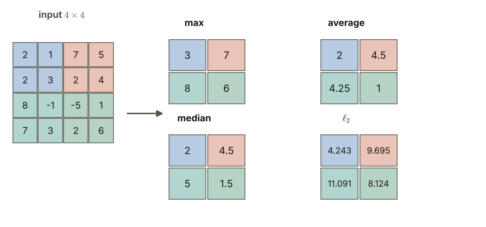
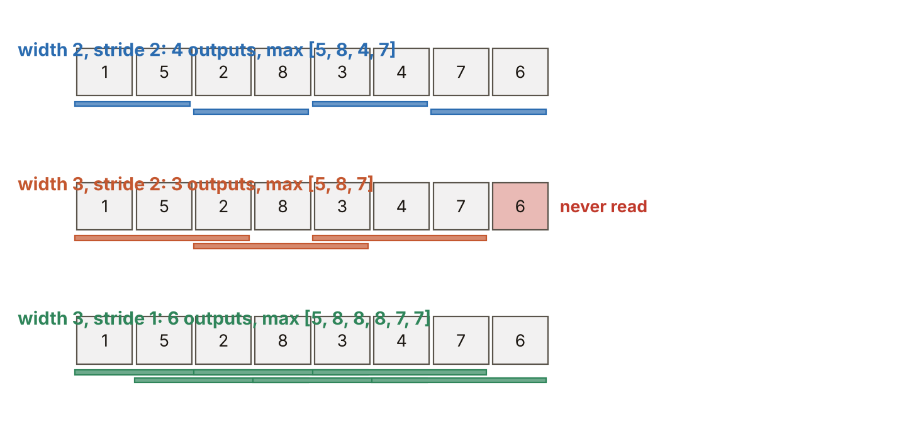

# 第6週 KP08：偵測器與池化（Detector and pooling）

> 程度：大學生
>
> Level: Undergraduate (undergrad)

本講義是第6週「卷積與池化」的第八個知識點（KP08）。KP03 把一層卷積層拆成三站：卷積、偵測器、池化，並用 $\mathrm{ReLU}$ 和 $2\times2$ 最大池化走過一個小例子。這一節把後兩站各自講清楚：偵測器到底做什麼，池化有哪幾種摘要方式，以及池化的窗、步幅、通道要怎麼設定。

This is the eighth knowledge point (KP08) of Week 6, "Convolution and pooling". KP03 split a convolutional layer into three stages, convolution, detector and pooling, and walked through a small example with $\mathrm{ReLU}$ and $2\times2$ max pooling. This note explains the last two stages one by one: what exactly the detector does, which kinds of summary pooling has, and how to set the window, the stride and the channels of pooling.

先備知識是 KP03 的三站、KP07 的輸出邊長公式與第2週的活化函數。第一次出現的詞與符號都會定義。所有數字都由 `assets/figures/src/lec06-kp08-figures.py` 算出，可以自己重算。

The prerequisites are the three stages of KP03, the output-side formula of KP07 and the activation functions of Week 2. Every term and symbol is defined when it first appears. Every number is computed by `assets/figures/src/lec06-kp08-figures.py`, so you can recompute it yourself.

[下載本單元投影片](../slides/lec06-kp08-detector-and-pooling.jbd.json)

[Download the slides of this unit (English)](../slides/lec06-kp08-detector-and-pooling-en.jbd.json)

## KP08 偵測器與池化（Detector and pooling）

### 學習目標（Learning objectives）

讀完之後，你能說明偵測器階段做的是逐格套活化函數，並說出為什麼叫「偵測器」。你能說明池化是沒有可學習權重的局部統計摘要，並在一張 $4\times4$ 的圖上算出最大、平均、中位數與 $\ell_2$ 四種池化。你能說出池化的窗寬、步幅、通道與補邊各自的作用，並算出輸出大小。你也能說明為什麼池化不改變通道數、參數個數是 $0$。

After reading, you can explain that the detector stage applies an activation function cell by cell, and say why it is called a "detector". You can explain that pooling is a local statistical summary with no learnable weights, and compute max, average, median and $\ell_2$ pooling on a $4\times4$ map. You can say what the window width, the stride, the channels and the padding of pooling each do, and compute the output size. You can also explain why pooling does not change the number of channels and has $0$ parameters.

### 符號表（Symbols）

| 符號 | 中文意義 | English meaning |
|---|---|---|
| $s[i,j]$ | 卷積階段的輸出（特徵圖）在 $(i,j)$ 的值 | value of the convolution output (feature map) at $(i,j)$ |
| $r[i,j]$ | 偵測器階段的輸出 | output of the detector stage |
| $y[u,v]$ | 池化階段的輸出 | output of the pooling stage |
| $\sigma$ | 偵測器套用的活化函數，本講義用 $\mathrm{ReLU}$ | the activation function of the detector; $\mathrm{ReLU}$ in this note |
| $w$ | 池化窗的邊長（寬度） | side length (width) of the pooling window |
| $s_{\mathrm p}$ | 池化的步幅 | stride of pooling |
| $d$ | 輸入特徵圖的邊長 | side length of the input feature map |
| $\ell_2$ | 窗內各數平方和的平方根 | square root of the sum of squares of the numbers in the window |

本講義的指標一律從 $0$ 開始數，公式不含偏置，與 KP01 相同。池化的步幅寫 $s_{\mathrm p}$，以免和特徵圖 $s$ 混淆 `[補充]`。

Indices start at $0$ and the formulas have no bias, as in KP01. The stride of pooling is written $s_{\mathrm p}$ so that it is not confused with the feature map $s$ `[Added]`.

### 1. 偵測器：逐格套活化函數，點亮特徵（The detector: apply an activation to every cell and light up the feature）

在生物視覺與訊號處理裡，「偵測器」是一個在目標出現時發出強訊號、沒有目標時保持沉默的單元。卷積階段只做線性的乘加，輸出有正有負。偵測器階段對特徵圖 $s$ 的**每一格各套一次**活化函數 $\sigma$，得到 $r$：

$r[i,j]=\sigma\bigl(s[i,j]\bigr)$

本講義用第2週的 $\mathrm{ReLU}(a)=\max(0,a)$：窗裡的圖案和核吻合、給出正的大數字時，這一格被「點亮」；不吻合、給出負數時，就被截成 $0$。每一格各算各的，不看鄰居，也不看位置。

In biological vision and signal processing a "detector" is a unit that gives a strong signal when its target appears and stays silent otherwise. The convolution stage only does linear multiply-adds, and its output has both signs. The detector stage applies the activation function $\sigma$ to **every cell** of the feature map $s$, once each, and gives $r$. This note uses the $\mathrm{ReLU}(a)=\max(0,a)$ of Week 2: when the pattern in the window matches the kernel and gives a large positive number, the cell is "lit"; when it does not match and gives a negative number, it is cut to $0$. Every cell is computed on its own, looking neither at neighbours nor at position.

用 KP03 的主例子：特徵圖第 $0$ 列是 $[-6,-6,-4,-2]$，套上 $\mathrm{ReLU}$ 後全變 $0$，其餘不變。偵測器因此只留下「上亮下暗」的下緣。

With the main example of KP03: row $0$ of the feature map is $[-6,-6,-4,-2]$ and becomes all $0$ after $\mathrm{ReLU}$, while the rest is unchanged. The detector thus keeps only the bottom edge, bright above and dark below.

偵測器帶來非線性。KP03 已經算過：兩層卷積中間沒有偵測器，只等於一層卷積。

The detector brings nonlinearity. KP03 already showed that two convolutions with no detector in between equal one convolution.

常見錯誤：以為偵測器是另一個要學的層。它沒有可學習的權重，只是一個固定的函數（在本講義是 $\mathrm{ReLU}$）。要學的是前一站的核。

Common error: thinking that the detector is another layer to be learned. It has no learnable weights and is only a fixed function ($\mathrm{ReLU}$ in this note). What is learned is the kernel of the previous stage.

### 2. 池化：沒有權重的局部統計摘要（Pooling: a local statistical summary without weights）

池化階段把 $r$ 切成小窗，每個窗**只留一個摘要數字**，圖因此變小。窗內的數字怎麼摘要，有幾種常見做法：

- **最大池化**：取窗內最大值。只問「這一帶有沒有強反應」，不管它在窗裡的哪一格。
- **平均池化**：取窗內平均。保留整個窗的整體亮度，但容易被極端值拉動。
- **中位數池化**：窗內數字排序後取中間值（偶數個時取中間兩個的平均）。不怕個別的極端值，但排序比較費工 `[補充]`。
- **$\ell_2$ 池化**：取各數平方和的平方根 $\sqrt{\sum x^2}$，反映窗內的總能量。

Pooling cuts $r$ into small windows and **keeps only one summary number per window**, so the map shrinks. There are several common ways to summarise the numbers in a window:

- **Max pooling**: the maximum of the window. It only asks "is there a strong response nearby", regardless of which cell of the window it is in.
- **Average pooling**: the mean of the window. It keeps the overall brightness of the whole window but is easily pulled by extreme values.
- **Median pooling**: sort the numbers of the window and take the middle one (the mean of the middle two if the count is even). It is not afraid of individual extreme values, but sorting is more work `[Added]`.
- **$\ell_2$ pooling**: the square root of the sum of squares $\sqrt{\sum x^2}$, reflecting the total energy of the window.

池化和卷積最關鍵的差別：池化是純粹的統計運算，**沒有任何可學習的權重**，也不用反向傳播去調整它的數字。KP03 的 $y[u,v]=\max\{r[2u,2v],\,r[2u,2v+1],\,r[2u+1,2v],\,r[2u+1,2v+1]\}$ 就是步幅 $2$、窗寬 $2$ 的最大池化。

The key difference between pooling and convolution: pooling is a pure statistic and has **no learnable weights**; backpropagation does not tune any number of it. The $y[u,v]=\max\{r[2u,2v],\,r[2u,2v+1],\,r[2u+1,2v],\,r[2u+1,2v+1]\}$ of KP03 is max pooling with width $2$ and stride $2$.

### 3. 同一張 $4\times4$，四種摘要四個故事（The same $4\times4$ map, four summaries, four stories）

教科書的 $4\times4$ 輸入是 $X$，三列在下面照寫。窗寬 $2$、步幅 $2$，整張切成四塊不重疊的 $2\times2$。每一塊的四種摘要如下：

The textbook $4\times4$ input is $X$, with rows $[2,1,7,5]$, $[2,3,2,4]$, $[8,-1,-5,1]$, $[7,3,2,6]$. With width $2$ and stride $2$ the map is cut into four non-overlapping $2\times2$ blocks. The four summaries of every block are as follows.

| 塊 Block | 數字 Numbers | 最大 max | 平均 average | 中位數 median | $\ell_2$ |
|---|---|---|---|---|---|
| 左上 top-left | $2,1,2,3$ | $3$ | $2$ | $2$ | $\sqrt{18}\approx4.243$ |
| 右上 top-right | $7,5,2,4$ | $7$ | $4.5$ | $4.5$ | $\sqrt{94}\approx9.695$ |
| 左下 bottom-left | $8,-1,7,3$ | $8$ | $4.25$ | $5$ | $\sqrt{123}\approx11.091$ |
| 右下 bottom-right | $-5,1,2,6$ | $6$ | $1$ | $1.5$ | $\sqrt{66}\approx8.124$ |

**圖說 `lec06-kp08-pooling-4x4`**：先看左邊的輸入，四種顏色是四塊不重疊的 $2\times2$。再看右邊第一個輸出，最大池化：每一塊只留最大值，得到 $[3,7]$、$[8,6]$。接著看平均池化與中位數池化：同一張輸入給出不同的數。最後看 $\ell_2$ 池化：它的數字最大，因為平方和包含了每一格的能量。

**Caption `lec06-kp08-pooling-4x4`**: First look at the input on the left, where the four colours are the four non-overlapping $2\times2$ blocks. Then the first output on the right, max pooling: every block keeps only its maximum, giving $[3,7]$, $[8,6]$. Next the average and median pooling: the same input gives different numbers. Finally the $\ell_2$ pooling: its numbers are the largest because the sum of squares includes the energy of every cell.

右下一塊含有 $-5$：最大池化仍然抓到最強的 $6$，平均池化被拉低到 $1$，中位數是 $1.5$。沒有哪一種永遠最好，要看下游任務在乎什麼。卷積網路內部最常用的是最大池化，因為活化的大小表示「特徵是否存在」。

The bottom-right block contains $-5$: max pooling still catches the strongest $6$, average pooling is pulled down to $1$ and the median is $1.5$. No summary is always best; it depends on what the downstream task cares about. Max pooling is the most common inside convolutional networks, because the size of an activation says "whether the feature is present".

### 4. 池化的窗、步幅、通道與補邊（Window, stride, channels and padding of pooling）

池化的設定和卷積用同一套語言。

Pooling is set up in the same language as convolution.

- **窗寬 $w$**：常用 $2\times2$ 或 $3\times3$。窗愈大，縮得愈厲害。
- **步幅 $s_{\mathrm p}$**：步幅等於窗寬時，窗彼此不重疊，是最常見的設定；步幅小於窗寬時，窗互相重疊，叫**重疊池化**。
- **補邊**：和卷積一樣可以補，但池化很少補。補零再做最大池化時，外圍會引進 $0$。
- **輸出大小**：沿用 KP07 的公式，$\bigl\lfloor\frac{d-w+2p}{s_{\mathrm p}}\bigr\rfloor+1$。$d=4,\ w=2,\ s_{\mathrm p}=2$ 得 $2$；$d=224$ 同樣設定得 $112$。
- **通道**：池化對每個通道**各自獨立**做，不跨通道相加。所以輸出的通道數和輸入一樣，$4\times4\times3$ 的輸入得到 $2\times2\times3$。
- **參數個數**：$0$。$224\times224\times64$ 的特徵圖經過 $2\times2$、步幅 $2$ 的池化，變成 $112\times112\times64$，格數剩四分之一，權重個數仍是 $0$。

- **Window width $w$**: usually $2\times2$ or $3\times3$. The larger the window, the stronger the shrinking.
- **Stride $s_{\mathrm p}$**: when the stride equals the width the windows do not overlap, the most common setting; when the stride is smaller than the width the windows overlap, called **overlapping pooling**.
- **Padding**: it can be added as in convolution, but pooling rarely pads. Zero padding followed by max pooling brings $0$ into the border.
- **Output size**: the formula of KP07, $\bigl\lfloor\frac{d-w+2p}{s_{\mathrm p}}\bigr\rfloor+1$. $d=4,\ w=2,\ s_{\mathrm p}=2$ gives $2$; $d=224$ with the same setting gives $112$.
- **Channels**: pooling is done on every channel **on its own**, with no summing across channels. So the output has as many channels as the input: a $4\times4\times3$ input gives $2\times2\times3$.
- **Number of parameters**: $0$. A $224\times224\times64$ feature map pooled with $2\times2$ and stride $2$ becomes $112\times112\times64$, a quarter of the cells, and the number of weights is still $0$.

用一維的一列 $[1,5,2,8,3,4,7,6]$ 看窗和步幅。窗寬 $2$、步幅 $2$：四個窗，最大池化得 $[5,8,4,7]$。窗寬 $3$、步幅 $2$（重疊）：$\lfloor(8-3)/2\rfloor+1=3$ 個窗，得 $[5,8,7]$，第 $7$ 格沒有被任何窗讀到。窗寬 $3$、步幅 $1$：六個窗，得 $[5,8,8,8,7,7]$。

Look at the window and the stride on a 1-D row $[1,5,2,8,3,4,7,6]$. Width $2$, stride $2$: four windows, and max pooling gives $[5,8,4,7]$. Width $3$, stride $2$ (overlapping): $\lfloor(8-3)/2\rfloor+1=3$ windows, giving $[5,8,7]$, and cell $7$ is read by no window. Width $3$, stride $1$: six windows, giving $[5,8,8,8,7,7]$.

**圖說 `lec06-kp08-pooling-windows`**：每一列是同一條 $8$ 格的數列，色條是池化的窗。先看第一列：窗寬 $2$、步幅 $2$，$4$ 個窗剛好蓋滿，輸出 $[5,8,4,7]$。再看第二列：窗寬 $3$、步幅 $2$，窗互相重疊，$3$ 個窗，最右邊的第 $7$ 格紅色，沒被讀到。最後看第三列：步幅 $1$，$6$ 個窗，每一格都被讀到。

**Caption `lec06-kp08-pooling-windows`**: Every row is the same $8$-cell row and the coloured bars are the pooling windows. First the top row: width $2$ and stride $2$, four windows cover everything exactly and the output is $[5,8,4,7]$. Then the middle row: width $3$ and stride $2$, the windows overlap, there are $3$ of them, and the rightmost cell $7$ is red because no window reads it. Finally the bottom row: stride $1$, $6$ windows, and every cell is read.

常見錯誤：以為池化會把通道也合併掉。池化只縮小空間，每個通道各做各的，通道數不變。

Common error: thinking that pooling also merges the channels. Pooling only shrinks the space; every channel is done on its own and the number of channels does not change.

### 本單元重點整理（KP08 summary）

**一句話重點**：偵測器對特徵圖的每一格各套一次活化函數（如 $\mathrm{ReLU}$），點亮吻合的特徵；池化把圖切成窗，每窗只留一個摘要（最大、平均、中位數、$\ell_2$），沒有可學習權重，窗、步幅、補邊的規則和卷積相同，通道各自獨立。

**One-sentence summary**: the detector applies an activation function (such as $\mathrm{ReLU}$) to every cell of the feature map once each, lighting up matching features; pooling cuts the map into windows and keeps one summary per window (max, average, median, $\ell_2$), has no learnable weights, follows the same rules as convolution for window, stride and padding, and treats every channel independently.

**白話說明**：偵測器像一道門檻，只讓吻合的反應通過。池化像把一頁頁細節縮成摘要：最大池化只記「這一帶最強的一個」，平均池化記「大致的平均」。摘要是一套固定的規則，不需要學。

**Plain explanation**: the detector is like a threshold that lets only matching responses through. Pooling is like shrinking pages of detail into a summary: max pooling remembers only "the strongest one nearby", average pooling "the rough average". The summary is a fixed rule and needs no learning.

**正式定義**：$r[i,j]=\sigma(s[i,j])$，$\mathrm{ReLU}$ 時 $r=\max(0,s)$。池化窗內的數 $x_1,\dots,x_m$ 的摘要為 $\max_k x_k$、$\frac1m\sum_k x_k$、中位數或 $\sqrt{\sum_k x_k^2}$。輸出邊長 $\bigl\lfloor\frac{d-w+2p}{s_{\mathrm p}}\bigr\rfloor+1$，通道數不變，參數個數為 $0$。

**Formal definition**: $r[i,j]=\sigma(s[i,j])$, and $r=\max(0,s)$ for $\mathrm{ReLU}$. For the numbers $x_1,\dots,x_m$ in a pooling window the summary is $\max_k x_k$, $\frac1m\sum_k x_k$, the median or $\sqrt{\sum_k x_k^2}$. The output side is $\bigl\lfloor\frac{d-w+2p}{s_{\mathrm p}}\bigr\rfloor+1$, the number of channels is unchanged and the number of parameters is $0$.

**例子**：$4\times4$ 的 $X$ 切成四塊：最大池化 $[3,7]$、$[8,6]$，平均 $[2,4.5]$、$[4.25,1]$，中位數 $[2,4.5]$、$[5,1.5]$。一維 $[1,5,2,8,3,4,7,6]$ 窗寬 $3$、步幅 $2$ 得 $[5,8,7]$，第 $7$ 格沒被讀到。$224\times224\times64$ 池化成 $112\times112\times64$。

**Example**: the $4\times4$ map $X$ cut into four blocks: max pooling $[3,7]$, $[8,6]$, average $[2,4.5]$, $[4.25,1]$, median $[2,4.5]$, $[5,1.5]$. The 1-D row $[1,5,2,8,3,4,7,6]$ with width $3$ and stride $2$ gives $[5,8,7]$, and cell $7$ is not read. $224\times224\times64$ is pooled to $112\times112\times64$.

**常見迷思**：

- 「偵測器是另一個要學權重的層。」錯，它是固定的函數，沒有可學習權重。
- 「池化的數字也要靠反向傳播學。」錯，池化沒有權重；反向傳播只是把梯度傳回去。
- 「池化會把所有通道加在一起。」錯，各通道獨立，通道數不變。
- 「最大池化和平均池化只是名字不同，結果差不多。」錯，同一張圖給出不同的數，遇到極端值差別更大。

**Common misconceptions**:

- "The detector is another layer with weights to learn." Wrong: it is a fixed function with no learnable weights.
- "The numbers of pooling are also learned by backpropagation." Wrong: pooling has no weights; backpropagation only passes the gradient back.
- "Pooling adds all channels together." Wrong: channels are independent and their number does not change.
- "Max pooling and average pooling only differ in name and give similar results." Wrong: the same map gives different numbers, and the difference is larger with extreme values.

**圖**：本單元有兩張圖。

- `lec06-kp08-pooling-4x4`：同一張 $4\times4$ 的四種池化。
- `lec06-kp08-pooling-windows`：窗寬與步幅不同時的窗，以及沒被讀到的格子。

兩張圖與文中數字都由同一支程式產生：`lec06-kp08-figures.py`。

**Figures**: this unit has two figures.

- `lec06-kp08-pooling-4x4`: four poolings of the same $4\times4$ map.
- `lec06-kp08-pooling-windows`: windows for different widths and strides, and the cells that are not read.

Both figures and the numbers in the text come from the same program: `lec06-kp08-figures.py`.

**想深入**（選讀）`[補充]`：偵測器與最大池化可以交換順序。$\mathrm{ReLU}$ 是不遞減的函數，所以 $\mathrm{ReLU}(\max x)=\max(\mathrm{ReLU}\,x)$，例如窗 $[-5,1,2,6]$ 兩邊都是 $6$，窗 $[-5,-1,-2,-3]$ 兩邊都是 $0$。先池化再偵測可以少算幾次 $\mathrm{ReLU}$。平均池化沒有這個性質：$[-4,2]$ 先平均得 $-1$、再 $\mathrm{ReLU}$ 得 $0$，先 $\mathrm{ReLU}$ 得 $[0,2]$、再平均得 $1$。反向傳播時，最大池化把梯度只送給窗裡最大的那一格，例如窗 $[3,7,2,4]$ 的梯度是 $[0,1,0,0]$；平均池化把梯度平分，是 $[0.25,0.25,0.25,0.25]$。

**Going deeper** (optional) `[Added]`: the detector and max pooling can swap order. $\mathrm{ReLU}$ is non-decreasing, so $\mathrm{ReLU}(\max x)=\max(\mathrm{ReLU}\,x)$; for example the window $[-5,1,2,6]$ gives $6$ on both sides and the window $[-5,-1,-2,-3]$ gives $0$ on both sides. Pooling first and detecting afterwards saves a few $\mathrm{ReLU}$ evaluations. Average pooling does not have this property: $[-4,2]$ averaged first gives $-1$ and then $\mathrm{ReLU}$ gives $0$, while $\mathrm{ReLU}$ first gives $[0,2]$ and averaging then gives $1$. In backpropagation, max pooling sends the gradient only to the largest cell of the window, for example the gradient of the window $[3,7,2,4]$ is $[0,1,0,0]$; average pooling splits the gradient equally, giving $[0.25,0.25,0.25,0.25]$.

**小練習**：

1. 一張 $4\times4$ 特徵圖四列是 $[1,3,2,0]$、$[4,2,1,5]$、$[0,1,3,2]$、$[2,6,1,4]$。用窗寬 $2$、步幅 $2$ 分別算出最大池化與平均池化。
2. `[補充]` 分別算出 $d=224,\ w=2,\ s_{\mathrm p}=2$、$d=7,\ w=3,\ s_{\mathrm p}=2$、$d=8,\ w=3,\ s_{\mathrm p}=2$ 的輸出邊長。第三個設定有哪一格沒被讀到？一個 $112\times112\times64$ 的特徵圖經過 $2\times2$、步幅 $2$ 的池化，輸出多大，有幾個權重？
3. `[補充]` 一個窗是 $[2,2,3,100]$，其中 $100$ 是雜訊。算出最大、平均與中位數，說明哪一種最不受雜訊影響。
4. `[補充]` 窗 $[3,7,2,4]$ 的最大池化輸出的梯度是 $1$。把這個梯度分給窗內四格，最大池化與平均池化各是怎麼分的？

**Practice**:

1. A $4\times4$ feature map has rows $[1,3,2,0]$, $[4,2,1,5]$, $[0,1,3,2]$, $[2,6,1,4]$. With width $2$ and stride $2$ compute max pooling and average pooling.
2. `[Added]` Compute the output side for $d=224,\ w=2,\ s_{\mathrm p}=2$, for $d=7,\ w=3,\ s_{\mathrm p}=2$ and for $d=8,\ w=3,\ s_{\mathrm p}=2$. Which cell is not read in the third setting? A $112\times112\times64$ feature map goes through $2\times2$ pooling with stride $2$: how large is the output and how many weights are there?
3. `[Added]` A window is $[2,2,3,100]$, where $100$ is noise. Compute the max, the average and the median and say which is least affected by the noise.
4. `[Added]` The output of max pooling for the window $[3,7,2,4]$ has gradient $1$. How do max pooling and average pooling each split this gradient over the four cells of the window?

**第 1 題解答** `[補充]`：

1. 左上塊 $1,3,4,2$：最大 $4$，平均 $10/4=2.5$。
2. 右上塊 $2,0,1,5$：最大 $5$，平均 $8/4=2$。
3. 左下塊 $0,1,2,6$：最大 $6$，平均 $9/4=2.25$。右下塊 $3,2,1,4$：最大 $4$，平均 $10/4=2.5$。
4. 最大池化是 $[4,5]$、$[6,4]$，平均池化是 $[2.5,2]$、$[2.25,2.5]$。

**Solution to question 1** `[Added]`:

1. The top-left block $1,3,4,2$: max $4$, average $10/4=2.5$.
2. The top-right block $2,0,1,5$: max $5$, average $8/4=2$.
3. The bottom-left block $0,1,2,6$: max $6$, average $9/4=2.25$. The bottom-right block $3,2,1,4$: max $4$, average $10/4=2.5$.
4. Max pooling gives $[4,5]$, $[6,4]$ and average pooling gives $[2.5,2]$, $[2.25,2.5]$.

**第 2 題解答** `[補充]`：

1. $d=224,\ w=2,\ s_{\mathrm p}=2$：$\lfloor(224-2)/2\rfloor+1=112$。
2. $d=7,\ w=3,\ s_{\mathrm p}=2$：$\lfloor(7-3)/2\rfloor+1=3$，窗從 $0,2,4$ 開始，剛好蓋滿 $0$ 到 $6$。
3. $d=8,\ w=3,\ s_{\mathrm p}=2$：$\lfloor(8-3)/2\rfloor+1=3$，窗從 $0,2,4$ 開始，只蓋到 $0$ 到 $6$，第 $7$ 格沒被讀到。
4. $112\times112\times64$ 池化後是 $56\times56\times64$，通道數不變，權重個數是 $0$。

**Solution to question 2** `[Added]`:

1. $d=224,\ w=2,\ s_{\mathrm p}=2$: $\lfloor(224-2)/2\rfloor+1=112$.
2. $d=7,\ w=3,\ s_{\mathrm p}=2$: $\lfloor(7-3)/2\rfloor+1=3$; the windows start at $0,2,4$ and cover exactly $0$ to $6$.
3. $d=8,\ w=3,\ s_{\mathrm p}=2$: $\lfloor(8-3)/2\rfloor+1=3$; the windows start at $0,2,4$ and cover only $0$ to $6$, so cell $7$ is not read.
4. $112\times112\times64$ becomes $56\times56\times64$ after pooling; the number of channels is unchanged and the number of weights is $0$.

**第 3 題解答** `[補充]`：

1. 最大池化是 $100$，被雜訊整個決定。
2. 平均是 $(2+2+3+100)/4=26.75$，被雜訊大幅拉高。
3. 中位數：排序 $2,2,3,100$，取中間兩個 $2,3$ 的平均，得 $2.5$，幾乎不受雜訊影響。所以中位數最不受影響；代價是要排序。

**Solution to question 3** `[Added]`:

1. Max pooling gives $100$, decided entirely by the noise.
2. The average is $(2+2+3+100)/4=26.75$, pulled up strongly by the noise.
3. The median: sorted $2,2,3,100$, take the mean of the middle two $2,3$, giving $2.5$, almost unaffected by the noise. So the median is least affected; the price is sorting.

**第 4 題解答** `[補充]`：

1. 最大池化：最大的是 $7$，梯度全給它，窗內四格得到 $[0,1,0,0]$。
2. 平均池化：輸出是四格的平均，每格對輸出的影響一樣，梯度平分，每格得 $1/4=0.25$，即 $[0.25,0.25,0.25,0.25]$。
3. 兩種都不更新池化本身，因為池化沒有權重；梯度只是通過池化，傳回前面的層。

**Solution to question 4** `[Added]`:

1. Max pooling: the largest is $7$ and it gets the whole gradient, so the four cells of the window get $[0,1,0,0]$.
2. Average pooling: the output is the mean of four cells and every cell influences it equally, so the gradient is split equally, $1/4=0.25$ per cell, that is $[0.25,0.25,0.25,0.25]$.
3. Neither updates pooling itself, since pooling has no weights; the gradient merely passes through pooling and goes back to the earlier layers.

### 來源更正與取捨（Corrections to the source）

本講義依 CCC-LNS IDL_115 第4章 KP08（簡報）重新撰寫，該教材的第4章就是本課的第6週。來源的讀取日期是 2026-10-30。來源沒有的內容，都在出現的地方標示 `[補充]`。

This note is rewritten from KP08 of CCC-LNS IDL_115 Chapter 4 (slides); Chapter 4 of that material is Week 6 of this course. The source was accessed on 2026-10-30. Content that the source does not contain is marked `[Added]` where it appears.

- 來源把右上塊 $[7,5;2,4]$ 的中位數寫成 $5.5$。排序後是 $2,4,5,7$，中間兩個 $4,5$ 的平均是 $4.5$。本講義改為 $4.5$，來源的中位數矩陣 $[[2,5.5],[5,1.5]]$ 應為 $[[2,4.5],[5,1.5]]$。其他三塊（$2$、$5$、$1.5$）與最大、平均的數字都正確。
- 來源的算例把 $\ell_2$ 池化只用文字說明，沒有算數。本講義算出四塊的值 $4.243,\ 9.695,\ 11.091,\ 8.124$。
- 來源的中文講「Max Pooling 對局部微小位移最具魯棒性」，這是 KP09 的內容；本講義只談池化的種類與設定，不先下結論。來源把偵測器稱為啟用函式，本課第2週用「活化函數」，本講義統一使用。
- 來源把偵測器寫成「神經元被徹底截斷為 0」。本講義改寫成：負的反應在 $\mathrm{ReLU}$ 下變成 $0$，並用 KP03 的例子說明；偵測器不一定是 $\mathrm{ReLU}$。
- 取捨：來源的互動實驗室與四題測驗不採用，概念（偵測器的角色、$4\times4$ 的最大池化結果、池化沒有可學習參數、負值對平均池化的影響）都包含在正文與練習裡。補充的內容有：中位數排序的成本、重疊池化的一維算例、偵測器與最大池化交換順序、池化的梯度分配。

- The source writes the median of the upper-right block $[7,5;2,4]$ as $5.5$. Sorted it is $2,4,5,7$ and the mean of the middle two $4,5$ is $4.5$. This note uses $4.5$; the source's median matrix $[[2,5.5],[5,1.5]]$ should be $[[2,4.5],[5,1.5]]$. The other three blocks ($2$, $5$, $1.5$) and the max and average numbers are correct.
- The source only explains $\ell_2$ pooling in words, without numbers. This note computes the values of the four blocks, $4.243,\ 9.695,\ 11.091,\ 8.124$.
- The source says in Chinese that "max pooling is the most robust to small local shifts"; that belongs to KP09, so this note only covers the kinds and the settings of pooling and does not conclude in advance. The source calls the detector's function an activation in another wording; Week 2 of this course uses "activation function", used throughout this note.
- The source describes the detector as "neurons being completely cut to 0". This note rewrites it as: negative responses become $0$ under $\mathrm{ReLU}$, illustrated with the example of KP03; the detector need not be $\mathrm{ReLU}$.
- Choices: the source's interactive lab and four-question quiz are not used, and their concepts (the role of the detector, the max-pooling result on the $4\times4$ map, pooling having no learnable parameters, the effect of negative values on average pooling) are all contained in the text and the practice. The added content is: the cost of sorting for the median, a 1-D example of overlapping pooling, swapping the detector and max pooling, and the gradient routing of pooling.

### 術語對照（Terminology）

| 中文 | English |
|---|---|
| 偵測器 | detector |
| 池化 | pooling |
| 最大池化 | max pooling |
| 平均池化 | average pooling |
| 中位數池化 | median pooling |
| $\ell_2$ 池化 | $\ell_2$ pooling |
| 重疊池化 | overlapping pooling |
| 窗寬 | window width |
| 步幅 | stride |
| 通道 | channel |
| 活化函數 | activation function |
| 可學習權重 | learnable weight |
| 梯度 | gradient |
