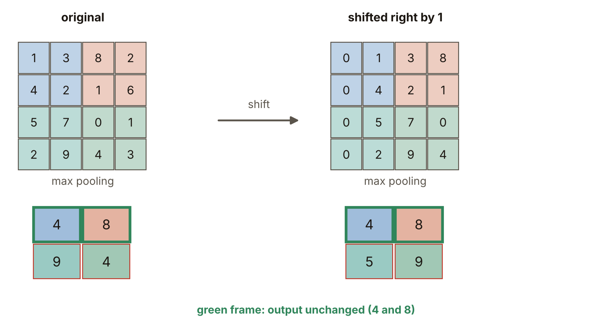
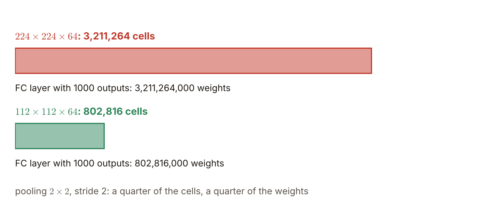

# 第6週 KP09：池化的局部不變與下採樣（Local invariance and downsampling of pooling）

> 程度：大學生
>
> Level: Undergraduate (undergrad)

本講義是第6週「卷積與池化」的第九個知識點（KP09）。KP08 說明了池化怎麼算：每個窗留一個摘要，沒有權重。這一節回答：池化為什麼值得做？答案有兩個。輸入稍微平移，池化的輸出常常不變；而且池化讓特徵圖變小，後面的層要處理的數字少很多。

This is the ninth knowledge point (KP09) of Week 6, "Convolution and pooling". KP08 explained how pooling is computed: every window keeps one summary and there are no weights. This note answers why pooling is worth doing. There are two answers: when the input shifts slightly the pooled output often does not change, and pooling shrinks the feature map so that later layers handle far fewer numbers.

先備知識是 KP06 的平移等變、KP07 的輸出邊長公式與 KP08 的最大池化。第一次出現的詞與符號都會定義。所有數字都由 `assets/figures/src/lec06-kp09-figures.py` 算出，可以自己重算。

The prerequisites are the translation equivariance of KP06, the output-side formula of KP07 and the max pooling of KP08. Every term and symbol is defined when it first appears. Every number is computed by `assets/figures/src/lec06-kp09-figures.py`, so you can recompute it yourself.

[下載本單元投影片](../slides/lec06-kp09-pooling-invariance-downsampling.jbd.json)

[Download the slides of this unit (English)](../slides/lec06-kp09-pooling-invariance-downsampling-en.jbd.json)

## KP09 池化的局部不變與下採樣（Local invariance and downsampling of pooling）

### 學習目標（Learning objectives）

讀完之後，你能用一個 $4\times4$ 的例子說明：輸入右移一格，所有格子都改了，最大池化的輸出卻有一半沒變。你能說出為什麼分類常常在乎「有沒有」勝過「在哪裡」，並舉出位置本身就是答案、池化的不變性反而有害的任務。你能算出池化帶來的下採樣好處，包括特徵圖的格數與後面全連接層的權重個數。你也能分清卷積的平移等變與池化的平移不變，說出各自負責什麼。

After reading, you can use a $4\times4$ example to explain that when the input shifts right by one, every cell changes yet half of the max-pooled output stays the same. You can say why classification often cares more about "whether" than "where", and give tasks where the position itself is the answer so that the invariance of pooling does harm. You can compute the benefit of downsampling, including the number of cells of the feature map and the number of weights of a later fully connected layer. You can also tell the translation equivariance of convolution from the translation invariance of pooling and say what each is responsible for.

### 符號表（Symbols）

| 符號 | 中文意義 | English meaning |
|---|---|---|
| $A,\ B$ | 原來的 $4\times4$ 圖，與右移一格後的圖 | the original $4\times4$ map and the map shifted right by one |
| $g$ | 平移：整體右移，左邊補 $0$ | shift: move everything right and fill $0$ on the left |
| $f$ | 一層運算（卷積或池化） | one layer's operation (convolution or pooling) |
| $y[u,v]$ | 池化的輸出 | output of pooling |
| $w,\ s_{\mathrm p}$ | 池化的窗寬與步幅 | width and stride of pooling |
| $\approx$ | 近似相等 | approximately equal |

本講義的指標一律從 $0$ 開始數，公式不含偏置，與 KP01 相同。

Indices start at $0$ and the formulas have no bias, as in KP01.

### 1. 輸入右移一格，池化的輸出卻有一半沒變（Shift the input by one and half of the pooled output does not change）

取一張 $4\times4$ 的圖 $A$，四列是 $[1,3,8,2]$、$[4,2,1,6]$、$[5,7,0,1]$、$[2,9,4,3]$。用窗寬 $2$、步幅 $2$ 做最大池化，四個窗的最大值是 $[4,8]$、$[9,4]$。

Take a $4\times4$ map $A$ with rows $[1,3,8,2]$, $[4,2,1,6]$, $[5,7,0,1]$, $[2,9,4,3]$. Max pooling with width $2$ and stride $2$ gives the four window maxima $[4,8]$, $[9,4]$.

把 $A$ 整體右移一格，左邊補 $0$，得到 $B$，四列是 $[0,1,3,8]$、$[0,4,2,1]$、$[0,5,7,0]$、$[0,2,9,4]$。逐格比，$16$ 格全部改了。可是 $B$ 的最大池化是 $[4,8]$、$[5,9]$：上面兩個輸出 $4$ 與 $8$ 完全沒動，只有下面兩個變了。

Shift $A$ right by one with $0$ filled on the left and you get $B$ with rows $[0,1,3,8]$, $[0,4,2,1]$, $[0,5,7,0]$, $[0,2,9,4]$. Cell by cell all $16$ cells have changed. Yet the max pooling of $B$ is $[4,8]$, $[5,9]$: the two upper outputs $4$ and $8$ did not move at all and only the two lower ones changed.

**圖說 `lec06-kp09-shift-pooling`**：先看左右兩張 $4\times4$ 的圖：右邊把左邊整體右移一格，每一格的數字都不同。再看各自下方的輸出：綠框的 $4$ 與 $8$ 在兩邊相同。最後看下排：$9,4$ 變成 $5,9$，因為下排窗的最大值被滑出或換了窗。

**Caption `lec06-kp09-shift-pooling`**: First look at the two $4\times4$ maps: the right one is the left one shifted right by one and every cell has a different number. Then the outputs below each: the green-framed $4$ and $8$ are the same on both sides. Finally the bottom row: $9,4$ become $5,9$, because the maximum of the lower windows slid out or moved to another window.

原因很直接：上排的窗，最強的 $4$ 與 $8$ 在平移後仍然落在同一個窗裡；下排的 $9$ 被推到另一個窗，所以兩個輸出都換了。只要窗內的最強特徵還在窗內，最大池化的摘要就不動。這個性質叫**局部平移不變**，它是近似的、只對小的位移成立。

The reason is direct: for the upper windows the strongest $4$ and $8$ still fall into the same window after the shift; the lower $9$ is pushed into another window, so both outputs change. As long as the strongest feature of a window stays inside that window, the max-pooling summary does not move. This property is called **local translation invariance**; it is approximate and holds only for small shifts.

平均池化沒有這麼好的運氣：同一組輸入，平均池化從 $[2.5,4.25]$、$[5.75,2]$ 變成 $[1.25,3.5]$、$[1.75,5]$，四個輸出全改 `[補充]`。位移若剛好等於步幅 $2$，最大池化的輸出就整體右移一個輸出格，原來的輸出沒有消失，只是搬了位置 `[補充]`。

Average pooling is not so lucky: for the same inputs it goes from $[2.5,4.25]$, $[5.75,2]$ to $[1.25,3.5]$, $[1.75,5]$, and all four outputs change `[Added]`. When the shift equals the stride $2$, the max-pooled output simply moves right by one output cell: the old outputs do not vanish, they only change place `[Added]`.

常見錯誤：以為池化對任何平移都不變。不變只是近似的，位移大一點，或最強的特徵被推進另一個窗，輸出就會變。

Common error: thinking that pooling is invariant to any shift. The invariance is only approximate; with a larger shift, or when the strongest feature is pushed into another window, the output changes.

### 2. 「在不在」常常比「在哪裡」重要（"Whether" often matters more than "where"）

以手寫數字 5 為例。影像分類最關心的是「這張圖裡有沒有 5 的曲線與橫槓」，而不是這一筆精確落在第 $14$ 還是第 $15$ 個畫素。筆劃偏左偏右幾個畫素，分類通常不在乎。

Take the handwritten digit 5. What image classification cares about most is "whether this image has the curve and the bar of a 5", not whether a stroke lies at exactly pixel $14$ or pixel $15$. A few pixels to the left or right usually does not matter.

池化把位置稍微模糊掉：窗內的特徵在不在，被留下；它在窗裡的哪一格，被丟掉。這讓分類對小位移更穩，也讓模型比較不會把「剛好在這個位置」當成答案的一部分去背 `[補充]`。

Pooling blurs the position a little: whether a feature is in the window is kept and which cell of the window it is in is thrown away. This makes classification steadier against small shifts and makes it less likely for the model to memorise "exactly at this position" as part of the answer `[Added]`.

### 3. 位置本身就是答案時，不變性反而有害（When the position itself is the answer, invariance does harm）

不是每個任務都在乎「在不在」。人臉關鍵點偵測（例如瞳孔中心）、身體關節的位置、精確的距離量測，位置本身就是要輸出的答案。這時池化把窗內的位置丟掉，等於把答案洗掉一部分。

Not every task cares about "whether". Face keypoint detection (for example the centre of the pupil), the positions of body joints and exact distance measurement all need the position itself as the output. Then pooling throws away the position inside the window and washes part of the answer away.

用一個小例子看。兩張 $4\times4$ 的熱圖，各只有一個峰值 $9$：第一張在第 $0$ 列第 $2$ 行，第二張在第 $1$ 列第 $3$ 行。兩者位置不同，但用窗寬 $2$、步幅 $2$ 的最大池化後，輸出都是 $[0,9]$、$[0,0]$，一模一樣 `[補充]`。池化只告訴我們「右上那個窗裡有峰」，沒有說峰在窗的哪一格。

Look at a small example. Two $4\times4$ heat maps each have a single peak $9$: the first at row $0$, column $2$, and the second at row $1$, column $3$. The positions differ, but after max pooling with width $2$ and stride $2$ both give $[0,9]$, $[0,0]$, exactly the same `[Added]`. Pooling only tells us "there is a peak in the upper-right window", and not at which cell of the window.

所以位置要緊的任務，常常少用池化，或改用其他方式保留位置。KP06 說過，平移等變的卷積會保留位置；是池化把位置逐步丟掉。

So tasks where position matters often use less pooling or keep the position in other ways. KP06 said that the translation-equivariant convolution keeps position; it is pooling that throws position away step by step.

### 4. 下採樣的紅利：格數少了，後面的權重也少了（The payoff of downsampling: fewer cells and fewer later weights）

池化還有一個很實際的好處：讓特徵圖變小。步幅 $s_{\mathrm p}>1$ 時，邊長縮成大約 $1/s_{\mathrm p}$。$2\times2$、步幅 $2$ 的池化讓邊長減半，格數剩四分之一。

Pooling has another very practical benefit: it makes the feature map smaller. With a stride $s_{\mathrm p}>1$ the side shrinks to about $1/s_{\mathrm p}$. A $2\times2$ pooling with stride $2$ halves the side and leaves a quarter of the cells.

$224\times224\times64$ 的特徵圖有 $3{,}211{,}264$ 格，池化成 $112\times112\times64$ 後只剩 $802{,}816$ 格。如果後面接一個有 $1000$ 個輸出的全連接層，權重個數從 $3{,}211{,}264\times1000=3{,}211{,}264{,}000$ 降到 $802{,}816\times1000=802{,}816{,}000$，也是四分之一 `[補充]`。後面的層要處理的數字少了，計算量與過擬合的風險也跟著降低。

A $224\times224\times64$ feature map has $3{,}211{,}264$ cells and is left with $802{,}816$ after pooling to $112\times112\times64$. If a fully connected layer with $1000$ outputs follows, the number of weights drops from $3{,}211{,}264\times1000=3{,}211{,}264{,}000$ to $802{,}816\times1000=802{,}816{,}000$, again a quarter `[Added]`. The later layers have fewer numbers to process, so the amount of computation and the risk of overfitting drop as well.

**圖說 `lec06-kp09-downsampling`**：先看上面的紅色長條：$224\times224\times64$ 有 $3{,}211{,}264$ 格，下方標出接 $1000$ 個輸出的全連接層要 $3{,}211{,}264{,}000$ 個權重。再看下面的綠色短條：池化後只有 $802{,}816$ 格，權重 $802{,}816{,}000$ 個，只有原來的四分之一。

**Caption `lec06-kp09-downsampling`**: First look at the red long bar above: $224\times224\times64$ has $3{,}211{,}264$ cells, and below it the fully connected layer with $1000$ outputs needs $3{,}211{,}264{,}000$ weights. Then the green short bar below: after pooling there are only $802{,}816$ cells and $802{,}816{,}000$ weights, a quarter of the original.

常見錯誤：以為池化的好處只是平移不變。縮小特徵圖、減少後面的計算與權重，同樣是池化的重要用途。

Common error: thinking that the only benefit of pooling is translation invariance. Shrinking the feature map and reducing later computation and weights is just as important a use of pooling.

### 5. 等變與不變：卷積與池化分工（Equivariance and invariance: convolution and pooling divide the work）

KP06 說卷積是平移等變：$f(g(x))=g(f(x))$，輸入移多少，特徵圖也跟著移多少，位置資訊還在。池化帶來的是近似的平移不變：$f(g(x))\approx f(x)$，輸入小小一動，輸出幾乎不動，位置資訊被模糊掉。

KP06 said that convolution is translation equivariant: $f(g(x))=g(f(x))$, the feature map moves as far as the input and the position information is kept. What pooling brings is an approximate translation invariance: $f(g(x))\approx f(x)$, a small move of the input hardly moves the output and the position information is blurred.

兩者分工合作：卷積在前面保留位置、找出圖案；池化一路把位置逐步模糊，到最後的分類只問「是什麼」。適合的任務也不同。

The two divide the work: convolution at the front keeps position and finds patterns; pooling blurs the position step by step until the final classification only asks "what it is". The suited tasks differ too.

| 特性 | 卷積（KP06） | 池化（本節） |
|---|---|---|
| 平移的性質 | 等變 $f(g(x))=g(f(x))$ | 近似不變 $f(g(x))\approx f(x)$ |
| 輸入右移 | 特徵圖跟著右移 | 輸出幾乎不動（小位移） |
| 位置資訊 | 保留 | 逐步模糊 |
| 下採樣 | 步幅大於 $1$ 時有 | 步幅大於 $1$ 時有 |
| 適合的任務 | 語意分割、畫素級標註、物件邊界定位 | 整張影像分類、場景辨識、特徵有沒有 |

| Property | Convolution (KP06) | Pooling (this note) |
|---|---|---|
| Behaviour under a shift | equivariant $f(g(x))=g(f(x))$ | approximately invariant $f(g(x))\approx f(x)$ |
| Input moves right | the feature map moves right | the output hardly moves (small shifts) |
| Position information | kept | blurred step by step |
| Downsampling | with a stride larger than $1$ | with a stride larger than $1$ |
| Suited tasks | semantic segmentation, pixel labelling, object boundaries | whole-image classification, scene recognition, whether a feature is present |

### 本單元重點整理（KP09 summary）

**一句話重點**：最大池化對局部小位移近似不變，只要窗內最強的特徵還在窗內，輸出就不動；池化也讓特徵圖縮小，減少後面的格數與權重。位置本身是答案時，池化的不變性反而有害；卷積保留位置（等變），池化模糊位置（近似不變），兩者分工。

**One-sentence summary**: max pooling is approximately invariant to small local shifts: as long as the strongest feature of a window stays inside the window the output does not move; pooling also shrinks the feature map, reducing the later cells and weights. When the position itself is the answer the invariance of pooling does harm; convolution keeps position (equivariant) and pooling blurs position (approximately invariant), and the two divide the work.

**白話說明**：池化像把一張地圖縮小成每一區一個重點。重點還在這一區，地圖稍微平移也看不出差別；但你也就不知道重點在這一區的哪個角落。地圖縮小以後，後面要讀的字也少很多。

**Plain explanation**: pooling is like shrinking a map to one highlight per district. As long as the highlight stays in the district, a slight shift of the map makes no visible difference; but then you also no longer know in which corner of the district it lies. After the map is shrunk, there is far less text to read later.

**正式定義**：平移 $g$ 後，卷積滿足 $f(g(x))=g(f(x))$，池化近似滿足 $f(g(x))\approx f(x)$。步幅 $s_{\mathrm p}$ 的池化把邊長縮成約 $1/s_{\mathrm p}$，格數縮成約 $1/s_{\mathrm p}^2$。

**Formal definition**: after a shift $g$, convolution satisfies $f(g(x))=g(f(x))$ and pooling approximately satisfies $f(g(x))\approx f(x)$. A pooling with stride $s_{\mathrm p}$ shrinks the side to about $1/s_{\mathrm p}$ and the number of cells to about $1/s_{\mathrm p}^2$.

**例子**：$4\times4$ 的 $A$ 右移一格，$16$ 格全改，最大池化 $[4,8],[9,4]$ 變成 $[4,8],[5,9]$，一半沒動；平均池化四個全改。兩個峰值在不同位置的熱圖，池化後都是 $[0,9],[0,0]$。$224\times224\times64$ 池化成 $112\times112\times64$，接 $1000$ 個輸出的全連接層從 $3{,}211{,}264{,}000$ 降到 $802{,}816{,}000$ 個權重。

**Example**: the $4\times4$ map $A$ shifted right by one changes all $16$ cells, max pooling $[4,8],[9,4]$ becomes $[4,8],[5,9]$ with half unmoved, while average pooling changes all four. Two heat maps with the peak at different places both give $[0,9],[0,0]$ after pooling. $224\times224\times64$ pooled to $112\times112\times64$ takes a fully connected layer with $1000$ outputs from $3{,}211{,}264{,}000$ to $802{,}816{,}000$ weights.

**常見迷思**：

- 「池化對任何平移都不變。」錯，只是近似，大一點的位移就會變。
- 「池化的不變性對所有任務都有益。」錯，位置本身是答案時有害。
- 「池化的好處只有平移不變。」錯，縮小特徵圖、減少後面的格數與權重同樣重要。
- 「卷積和池化都是平移不變。」錯，卷積是等變，池化才是近似不變。

**Common misconceptions**:

- "Pooling is invariant to any shift." Wrong: only approximately; a larger shift changes it.
- "The invariance of pooling helps every task." Wrong: it harms when the position itself is the answer.
- "The only benefit of pooling is translation invariance." Wrong: shrinking the feature map and reducing later cells and weights matters just as much.
- "Both convolution and pooling are translation invariant." Wrong: convolution is equivariant and only pooling is approximately invariant.

**圖**：本單元有兩張圖。

- `lec06-kp09-shift-pooling`：輸入右移一格，最大池化一半輸出不動。
- `lec06-kp09-downsampling`：池化後的格數與全連接層權重。

兩張圖與文中數字都由同一支程式產生：`lec06-kp09-figures.py`。

**Figures**: this unit has two figures.

- `lec06-kp09-shift-pooling`: the input shifts right by one and half of the max-pooled output does not move.
- `lec06-kp09-downsampling`: the cells after pooling and the weights of a fully connected layer.

Both figures and the numbers in the text come from the same program: `lec06-kp09-figures.py`.

**想深入**（選讀）`[補充]`：位移剛好等於步幅時，池化是等變的：$A$ 右移 $2$ 格後，最大池化變成 $[0,4]$、$[0,9]$，正是 $[4,8]$、$[9,4]$ 整體右移一個輸出格，最右邊的 $8$ 與 $4$ 被擠出範圍。這和 KP06 一致：步幅 $s$ 的運算只對 $s$ 的倍數的平移等變。不變和等變是兩端，實際的池化介於中間：位移小、最強特徵還在窗內時近似不變，位移等於步幅時等變，其他位移則兩者都不嚴格成立。

**Going deeper** (optional) `[Added]`: when the shift equals the stride, pooling is equivariant: after shifting $A$ right by $2$, max pooling gives $[0,4]$, $[0,9]$, which is exactly $[4,8]$, $[9,4]$ moved right by one output cell, with the rightmost $8$ and $4$ pushed out of range. This agrees with KP06: an operation of stride $s$ is equivariant only to shifts that are multiples of $s$. Invariance and equivariance are the two ends, and real pooling lies in between: approximately invariant for small shifts with the strongest feature still inside the window, equivariant when the shift equals the stride, and neither strictly true for other shifts.

**小練習**：

1. 一維的一列 $x=[0,5,4,0,9,1,2,0]$，用窗寬 $2$、步幅 $2$ 做最大池化。再把 $x$ 右移一格（左邊補 $0$）重算。有幾個輸出沒變？換成平均池化呢？
2. `[補充]` 一個 $56\times56\times128$ 的特徵圖接一個有 $1000$ 個輸出的全連接層，有多少權重？先經過一次 $2\times2$、步幅 $2$ 的池化，權重變成多少？
3. `[補充]` 同一列 $x$ 右移 $2$ 格（等於步幅），最大池化的輸出和原輸出有什麼關係？
4. `[補充]` 兩張 $4\times4$ 的熱圖各只有一個峰值 $9$：第一張在第 $0$ 列第 $2$ 行，第二張在第 $1$ 列第 $3$ 行。用窗寬 $2$、步幅 $2$ 的最大池化後，兩者的輸出相同嗎？這對偵測峰值的精確位置有什麼影響？

**Practice**:

1. A 1-D row $x=[0,5,4,0,9,1,2,0]$ is max-pooled with width $2$ and stride $2$. Then shift $x$ right by one (fill $0$ on the left) and recompute. How many outputs are unchanged? What about average pooling?
2. `[Added]` A $56\times56\times128$ feature map feeds a fully connected layer with $1000$ outputs: how many weights? After one $2\times2$ pooling with stride $2$ first, how many weights are there?
3. `[Added]` Shift the same row $x$ right by $2$ (equal to the stride). How does the max-pooled output relate to the original output?
4. `[Added]` Two $4\times4$ heat maps each have a single peak $9$: the first at row $0$, column $2$ and the second at row $1$, column $3$. After max pooling with width $2$ and stride $2$ are the two outputs equal? What does this mean for detecting the exact position of the peak?

**第 1 題解答** `[補充]`：

1. 原列的四個窗：$[0,5]\to5$、$[4,0]\to4$、$[9,1]\to9$、$[2,0]\to2$，最大池化是 $[5,4,9,2]$。
2. 右移一格後 $[0,0,5,4,0,9,1,2]$，四個窗：$[0,0]\to0$、$[5,4]\to5$、$[0,9]\to9$、$[1,2]\to2$，輸出 $[0,5,9,2]$。
3. 逐位置比：$5\to0$、$4\to5$ 變了，$9$ 與 $2$ 沒變，所以有 $2$ 個輸出沒變。
4. 平均池化：原來是 $[2.5,2,5,1]$，右移後是 $[0,4.5,4.5,1.5]$，四個全變了。

**Solution to question 1** `[Added]`:

1. The four windows of the original row: $[0,5]\to5$, $[4,0]\to4$, $[9,1]\to9$, $[2,0]\to2$, so max pooling gives $[5,4,9,2]$.
2. After shifting right by one, $[0,0,5,4,0,9,1,2]$, the four windows are $[0,0]\to0$, $[5,4]\to5$, $[0,9]\to9$, $[1,2]\to2$, giving $[0,5,9,2]$.
3. Comparing position by position: $5\to0$ and $4\to5$ changed while $9$ and $2$ did not, so $2$ outputs are unchanged.
4. Average pooling: originally $[2.5,2,5,1]$ and after the shift $[0,4.5,4.5,1.5]$, all four changed.

**第 2 題解答** `[補充]`：

1. 沒有池化：$56\times56\times128=401{,}408$ 格，權重 $401{,}408\times1000=401{,}408{,}000$。
2. 池化後是 $28\times28\times128=100{,}352$ 格，權重 $100{,}352\times1000=100{,}352{,}000$。
3. 剛好是原來的四分之一：$401{,}408{,}000/4=100{,}352{,}000$。

**Solution to question 2** `[Added]`:

1. Without pooling: $56\times56\times128=401{,}408$ cells, weights $401{,}408\times1000=401{,}408{,}000$.
2. After pooling $28\times28\times128=100{,}352$ cells, weights $100{,}352\times1000=100{,}352{,}000$.
3. Exactly a quarter of the original: $401{,}408{,}000/4=100{,}352{,}000$.

**第 3 題解答** `[補充]`：

1. 右移 $2$ 格：$[0,0,0,5,4,0,9,1]$。四個窗：$[0,0]\to0$、$[0,5]\to5$、$[4,0]\to4$、$[9,1]\to9$，輸出 $[0,5,4,9]$。
2. 原輸出是 $[5,4,9,2]$。新輸出 $[0,5,4,9]$ 正是原輸出整體右移一個輸出格，最右邊的 $2$ 被擠出，左邊補進 $0$。
3. 位移等於步幅時，輸出是等變的：輸入移 $2$ 格，輸出移 $2/2=1$ 格。

**Solution to question 3** `[Added]`:

1. Shifting right by $2$: $[0,0,0,5,4,0,9,1]$. The four windows are $[0,0]\to0$, $[0,5]\to5$, $[4,0]\to4$, $[9,1]\to9$, giving $[0,5,4,9]$.
2. The original output is $[5,4,9,2]$. The new output $[0,5,4,9]$ is exactly the original output moved right by one output cell, with the rightmost $2$ pushed out and $0$ filled in at the left.
3. When the shift equals the stride the output is equivariant: the input moves $2$ cells and the output moves $2/2=1$ cell.

**第 4 題解答** `[補充]`：

1. 第一張的峰值 $9$ 在第 $0$ 列第 $2$ 行，落在右上窗，輸出 $[0,9]$、$[0,0]$。
2. 第二張的峰值在第 $1$ 列第 $3$ 行，也落在右上窗，輸出同樣是 $[0,9]$、$[0,0]$。
3. 兩個輸出相同，所以池化後無法分辨峰值在右上窗的哪一格。要偵測精確位置時，池化的不變性反而有害，需要少用池化或保留位置。

**Solution to question 4** `[Added]`:

1. The peak $9$ of the first map is at row $0$, column $2$, inside the upper-right window, giving $[0,9]$, $[0,0]$.
2. The peak of the second map is at row $1$, column $3$, also inside the upper-right window, and the output is again $[0,9]$, $[0,0]$.
3. The two outputs are equal, so after pooling we cannot tell which cell of the upper-right window the peak is in. For detecting the exact position the invariance of pooling does harm, and one needs less pooling or another way to keep the position.

### 來源更正與取捨（Corrections to the source）

本講義依 CCC-LNS IDL_115 第4章 KP09（簡報）重新撰寫，該教材的第4章就是本課的第6週。來源的讀取日期是 2026-10-30。來源沒有的內容，都在出現的地方標示 `[補充]`。

This note is rewritten from KP09 of CCC-LNS IDL_115 Chapter 4 (slides); Chapter 4 of that material is Week 6 of this course. The source was accessed on 2026-10-30. Content that the source does not contain is marked `[Added]` where it appears.

- 來源說「輸入向右挪一格，四個畫素全改」。來源的圖只畫了一半的 $4\times4$ 資料。本講義補成完整的 $4\times4$，逐格比對，$16$ 格全部改變，並由程式算出 $[4,8,9,4]\to[4,8,5,9]$。
- 來源把池化說成「具備局部平移不變性」，並在表格寫成 $f(g(x))\approx f(x)$。本講義保留，但明說只是近似、只對小位移成立，並補上平均池化四個輸出全改、位移等於步幅時輸出整體搬移。
- 來源的表格把下採樣的好處寫成「倍數削減後續全連接層參數量」。本講義算出具體數字：$224\times224\times64$ 池化成 $112\times112\times64$，接 $1000$ 個輸出的全連接層權重從 $3{,}211{,}264{,}000$ 降到 $802{,}816{,}000$，是四分之一。
- 來源的任務對照寫「卷積適合語意分割，池化適合分類」。本講義改寫成「平移等變保留位置，近似不變模糊位置」，並用兩個峰值的熱圖例子說明位置本身是答案時，池化的不變性為何有害。
- 取捨：來源的互動模擬器與四題測驗不採用，概念（局部平移穩健、「在不在」勝於「在哪裡」、不變性的代價、下採樣的好處）都包含在正文與練習裡。補充的內容有：平均池化的對照、位移等於步幅時的等變、熱圖例子、全連接層權重的算例。

- The source says "shift the input right by one, all four pixels change". The source's figure draws only half of the $4\times4$ data. This note completes it to a full $4\times4$, compares cell by cell, finds all $16$ cells changed, and has the program compute $[4,8,9,4]\to[4,8,5,9]$.
- The source says pooling "has local translation invariance" and writes $f(g(x))\approx f(x)$ in its table. This note keeps it but says explicitly that it is only approximate and only for small shifts, and adds that average pooling changes all four outputs and that when the shift equals the stride the output moves as a whole.
- The source's table writes the benefit of downsampling as "reducing the parameters of the later fully connected layer by a factor". This note computes concrete numbers: $224\times224\times64$ pooled to $112\times112\times64$ takes a fully connected layer with $1000$ outputs from $3{,}211{,}264{,}000$ to $802{,}816{,}000$ weights, a quarter.
- The source's task comparison says "convolution suits semantic segmentation and pooling suits classification". This note rewrites it as "equivariance keeps position and approximate invariance blurs position", and uses the heat-map example with two peaks to show why the invariance of pooling harms when the position itself is the answer.
- Choices: the source's interactive simulator and four-question quiz are not used, and their concepts (robustness to local shifts, "whether" over "where", the cost of invariance, the benefit of downsampling) are in the text and the practice. The added content is: the average-pooling comparison, equivariance when the shift equals the stride, the heat-map example and the weight computation of the fully connected layer.

### 術語對照（Terminology）

| 中文 | English |
|---|---|
| 局部平移不變 | local translation invariance |
| 平移等變 | translation equivariance |
| 下採樣 | downsampling |
| 最大池化 | max pooling |
| 平均池化 | average pooling |
| 熱圖 | heat map |
| 全連接層 | fully connected layer |
| 步幅 | stride |
| 過擬合 | overfitting |
