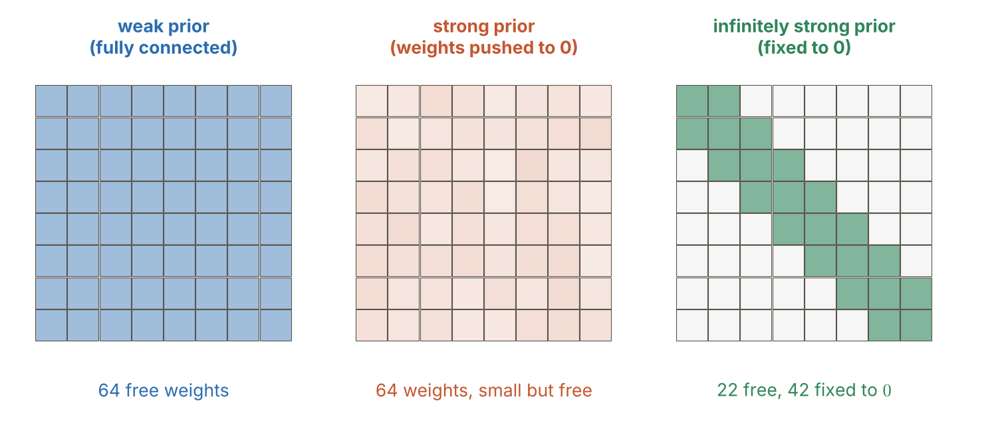
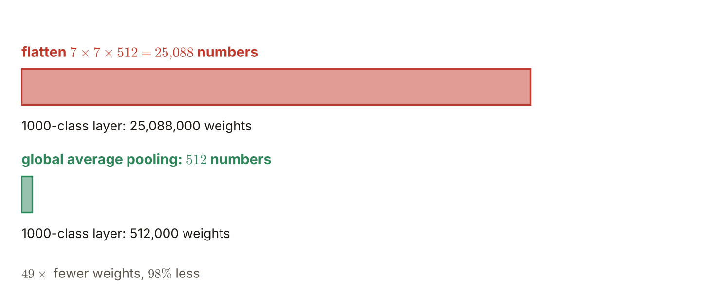

# 第6週 KP10：無限強先驗、動態池化與全域平均池化（The infinitely strong prior, dynamic pooling and global average pooling）

> 程度：大學生
>
> Level: Undergraduate (undergrad)

本講義是第6週「卷積與池化」的最後一個知識點（KP10），屬於自主學習。KP05 看到卷積層把遠距連線的權重變成 $0$，KP08–KP09 看到池化沒有權重。這一節把它們放進同一個觀點：卷積與池化是一種**無限強的先驗**，在看資料之前就把許多連線釘死成 $0$。接著看池化的兩個延伸，動態池化與空間金字塔池化，最後看現代網路尾端用的全域平均池化。

This is the last knowledge point (KP10) of Week 6, "Convolution and pooling", and it is for self-study. KP05 saw that a convolutional layer turns the weights of distant connections into $0$, and KP08–KP09 saw that pooling has no weights. This note puts them into one view: convolution and pooling are an **infinitely strong prior** that fixes many connections to $0$ before seeing any data. It then looks at two extensions of pooling, dynamic pooling and spatial pyramid pooling, and finally at the global average pooling used at the end of modern networks.

先備知識是 KP01 與 KP05 的稀疏連接、第4週的權重衰減（L1、L2 正則化）與 KP08–KP09 的池化。第一次出現的詞與符號都會定義。所有數字都由 `assets/figures/src/lec06-kp10-figures.py` 算出，可以自己重算。

The prerequisites are the sparse connectivity of KP01 and KP05, the weight decay (L1 and L2 regularization) of Week 4, and the pooling of KP08–KP09. Every term and symbol is defined when it first appears. Every number is computed by `assets/figures/src/lec06-kp10-figures.py`, so you can recompute it yourself.

[下載本單元投影片](../slides/lec06-kp10-infinitely-strong-prior-gap.jbd.json)

[Download the slides of this unit (English)](../slides/lec06-kp10-infinitely-strong-prior-gap-en.jbd.json)

## KP10 無限強先驗、動態池化與全域平均池化（The infinitely strong prior, dynamic pooling and global average pooling）

### 學習目標（Learning objectives）

讀完之後，你能說出「先驗」是看資料之前對權重的信念，並分辨弱先驗、較強先驗與無限強先驗，說明卷積與池化為什麼屬於最後一種。你能在一個 $8\times8$ 的權重矩陣上算出有多少格被釘成 $0$。你能說出動態池化與空間金字塔池化各解決什麼問題。你也能算出全域平均池化比「攤平再全連接」少多少權重，並說出它在現代網路尾端的角色。

After reading, you can say that a "prior" is a belief about the weights before seeing the data, tell the weak prior, the stronger prior and the infinitely strong prior apart, and explain why convolution and pooling belong to the last. You can count on an $8\times8$ weight matrix how many cells are fixed to $0$. You can say what dynamic pooling and spatial pyramid pooling each solve. You can also compute how many weights global average pooling saves over "flatten then fully connect", and say its role at the end of modern networks.

### 符號表（Symbols）

| 符號 | 中文意義 | English meaning |
|---|---|---|
| $W$ | 一層的權重矩陣，第 $i$ 列是第 $i$ 個輸出的權重 | the weight matrix of a layer; row $i$ holds the weights of output $i$ |
| $k$ | 卷積核的邊長（一維時是寬度） | side of the convolution kernel (width in 1-D) |
| $H,\ W_{\mathrm f},\ C$ | 特徵圖的高、寬與通道數 | height, width and number of channels of a feature map |
| $\mathrm{GAP}$ | 全域平均池化：每個通道取整張圖的平均 | global average pooling: the mean of the whole map per channel |
| $b$ | 空間金字塔池化某一層的格數（箱子數） | number of bins of one level of spatial pyramid pooling |
| $n$ | 輸入特徵圖的邊長 | side of the input feature map |

本講義的指標一律從 $0$ 開始數，公式不含偏置，與 KP01 相同。特徵圖的寬寫 $W_{\mathrm f}$，以免和權重矩陣 $W$ 混淆 `[補充]`。

Indices start at $0$ and the formulas have no bias, as in KP01. The width of a feature map is written $W_{\mathrm f}$ so that it is not confused with the weight matrix $W$ `[Added]`.

### 1. 先驗：看資料之前，對權重的信念（A prior: a belief about the weights before seeing the data）

**先驗**是在看到訓練資料之前，我們對權重長什麼樣的信念。信念的強度可以分成三級。

A **prior** is our belief about what the weights look like before seeing the training data. The strength of the belief can be divided into three levels.

- **弱先驗**：全連接層。權重矩陣處處都有值，每個權重都能被梯度自由調整。容量很大，但參數太多，容易過擬合。
- **較強先驗**：L1 正則化或權重衰減（第4週）。把權重往 $0$ 推，鼓勵權重小或稀疏，但權重仍然是自由的：資料的訊號夠強，梯度還是能把它拉回來。
- **無限強先驗**：卷積與池化。對距離太遠的輸入，權重**直接釘死成 $0$**，梯度永遠改不到它們。不是「希望它小」，而是「它根本不存在」。

- **Weak prior**: a fully connected layer. The weight matrix has values everywhere and every weight can be freely adjusted by the gradient. The capacity is large, but there are too many parameters and it overfits easily.
- **Stronger prior**: L1 regularization or weight decay (Week 4). It pushes the weights towards $0$ and encourages small or sparse weights, but the weights are still free: if the signal of the data is strong enough the gradient can pull them back.
- **Infinitely strong prior**: convolution and pooling. For inputs that are too far away the weights are **fixed to $0$**, and the gradient can never change them. It is not "we would like it small" but "it does not exist".

用一個 $8\times8$ 的權重矩陣來數（$8$ 個輸出、$8$ 個輸入）。全連接層有 $64$ 個自由的權重。把每個輸出只接寬度 $3$ 的鄰居，就只剩一條寬 $3$ 的帶子，$22$ 格可能不是 $0$，其餘 $42$ 格被釘成 $0$。再讓每一列共用同一個核（KP05），自由的權重只剩 $3$ 個。

Count on an $8\times8$ weight matrix ($8$ outputs and $8$ inputs). A fully connected layer has $64$ free weights. If every output connects only to neighbours of width $3$, only a band of width $3$ is left: $22$ cells may be non-zero and the remaining $42$ cells are fixed to $0$. If every row then shares the same kernel (KP05), only $3$ free weights remain.

**圖說 `lec06-kp10-prior-matrices`**：先看左邊的弱先驗：$64$ 格全部是自由的權重。再看中間的較強先驗：$64$ 格仍然是自由的，只是都被推得很小（顏色很淡）。最後看右邊的無限強先驗：只有斜帶上的 $22$ 格是自由的綠色，其餘 $42$ 格是被釘成 $0$ 的白色，梯度改不到。

**Caption `lec06-kp10-prior-matrices`**: First look at the weak prior on the left: all $64$ cells are free weights. Then the stronger prior in the middle: all $64$ cells are still free, only pushed very small (pale colours). Finally the infinitely strong prior on the right: only the $22$ cells on the diagonal band are free (green) and the remaining $42$ cells are white and fixed to $0$, out of reach of the gradient.

常見錯誤：以為卷積只是「很強的 L1 正則化」。L1 只是把權重推向 $0$，權重仍然自由；卷積與池化是結構上的限制，權重根本不在模型裡。

Common error: thinking that convolution is just "a very strong L1 regularization". L1 only pushes weights towards $0$ and the weights stay free; convolution and pooling are structural restrictions, and the weights are simply not in the model.

### 2. 為什麼釘成 $0$ 反而學得更好：押注稀疏與奧卡姆剃刀（Why fixing to $0$ learns better: betting on sparsity and Occam's razor）

在超高維度的影像上，全連接網路的自由參數太多，必然被維度災難拖垮：資料不夠，參數卻能把訓練集背下來。卷積網路**押注稀疏**：它假設有用的規律是局部的，空間上離得很遠的畫素之間不必直接連線。這個賭注對照片大致成立（KP01），所以把遠距連線釘成 $0$，幾乎不損失表達能力，卻大幅縮小了要搜尋的函數範圍。

On very high-dimensional images a fully connected network has too many free parameters and is dragged down by the curse of dimensionality: the data are not enough but the parameters can memorise the training set. A convolutional network **bets on sparsity**: it assumes that the useful regularities are local and that pixels far apart need no direct connection. The bet roughly holds for photographs (KP01), so fixing the distant connections to $0$ loses almost no expressive power while greatly shrinking the range of functions to search.

這也呼應**奧卡姆剃刀**：如果兩個模型都能解釋資料，結構比較精簡的那個，泛化通常比較好。無限強先驗就是把這個原則直接做進網路的結構。限制「不能學」有時比「都能學」更強。

This also echoes **Occam's razor**: if two models both explain the data, the one with the simpler structure usually generalises better. The infinitely strong prior builds this principle directly into the structure of the network. Restricting "cannot learn" is sometimes stronger than "can learn everything".

這個賭注也可能輸：若任務需要很遠兩點之間的直接關係，過強的局部限制就會有害。所以現代網路靠堆很多層，讓感受野逐步變大（KP01 與 KP05）`[補充]`。

The bet can also be lost: if the task needs a direct relation between two far points, an over-strong local restriction does harm. Modern networks therefore stack many layers so that the receptive field grows step by step (KP01 and KP05) `[Added]`.

### 3. 動態池化：不一定要池化相鄰的格子（Dynamic pooling: pooling need not use neighbouring cells）

KP08 的池化窗是固定的幾何鄰居：每個窗是相鄰的 $2\times2$ 格。**動態池化**讓池化的範圍跟著內容走：先把特徵點依內容或位置分群（例如用 K 平均分群），再對**同一群**一起池化。每個輸入可以有自己量身打造的摘要區域。

The pooling window of KP08 is a fixed geometric neighbourhood: every window is an adjacent $2\times2$ block. **Dynamic pooling** lets the range of pooling follow the content: first group the feature points by content or position (for example with K-means clustering) and then pool **within each group**. Every input can have its own tailor-made summary regions.

用一個一維的小例子。八個特徵點的位置是 $2,3,4,5,6,7,20,21$，值依序是 $3,8,1,6,2,5,4,9$。若用寬 $4$ 的固定格子，位置 $2,3$ 在第一格、$4$ 到 $7$ 在第二格、$20,21$ 在第六格，最大池化得 $[8,6,9]$：自然的一群 $2$ 到 $7$ 被切成兩半。若先用 K 平均（$k=2$）分群，得到 $\{2,\dots,7\}$ 與 $\{20,21\}$ 兩群，最大池化得 $[8,9]$：自然的一群留在一起 `[補充]`。

A small 1-D example. Eight feature points are at positions $2,3,4,5,6,7,20,21$ with values $3,8,1,6,2,5,4,9$. With a fixed grid of width $4$, positions $2,3$ fall in the first cell, $4$ to $7$ in the second and $20,21$ in the sixth, and max pooling gives $[8,6,9]$: the natural group $2$ to $7$ is cut into two halves. If K-means with $k=2$ groups them first we get the two groups $\{2,\dots,7\}$ and $\{20,21\}$ and max pooling gives $[8,9]$: the natural group stays together `[Added]`.

### 4. 空間金字塔池化：用固定數量的箱子，吃任意大小的圖（Spatial pyramid pooling: a fixed number of bins for any image size）

全連接層需要固定長度的輸入。若輸入圖片大小不同，卷積後的特徵圖大小也不同，攤平出來的長度就不一樣，只好把圖片裁切或縮放。**空間金字塔池化**（SPP）的做法是：不固定窗的大小，而固定**箱子的個數**。例如取三層，$4\times4$、$2\times2$、$1\times1$ 個箱子，每個箱子做一次最大池化。

A fully connected layer needs an input of fixed length. If the input images differ in size the feature maps after the convolutions differ in size too, the flattened lengths differ, and one has to crop or rescale the images. **Spatial pyramid pooling** (SPP) fixes the **number of bins** instead of the window size. For example take three levels with $4\times4$, $2\times2$ and $1\times1$ bins and max-pool each bin once.

不管特徵圖是 $13\times13$ 還是 $10\times10$，每個通道都得到 $16+4+1=21$ 個數。邊長 $n$ 的圖切成 $b$ 個箱子時，窗寬取 $\lceil n/b\rceil$、步幅取 $\lfloor n/b\rfloor$：$n=13,\ b=4$ 是窗 $4$、步幅 $3$；$n=10,\ b=4$ 是窗 $3$、步幅 $2$ `[補充]`。$256$ 個通道就得到固定長度 $21\times256=5376$ 的向量，可以直接接全連接層。

Whether the feature map is $13\times13$ or $10\times10$, every channel yields $16+4+1=21$ numbers. When a map of side $n$ is cut into $b$ bins the window is $\lceil n/b\rceil$ and the stride $\lfloor n/b\rfloor$: for $n=13,\ b=4$ that is window $4$ and stride $3$; for $n=10,\ b=4$ it is window $3$ and stride $2$ `[Added]`. $256$ channels give a vector of fixed length $21\times256=5376$ that can feed a fully connected layer directly.

另一個做法是反過來：依輸入大小調整池化核的寬度，讓輸出的格數固定。兩種做法的目的相同：讓卷積骨架能直接吃任意長寬比的真實照片，免去粗暴的裁切。

Another way is the reverse: adjust the width of the pooling kernel to the input size so that the number of output cells is fixed. Both ways have the same aim: letting the convolutional backbone take real photographs of any aspect ratio directly, without crude cropping.

### 5. 全域平均池化：取代巨大的全連接層（Global average pooling: replacing the giant fully connected layer）

**全域平均池化**（GAP）是池化的極端：窗和整張特徵圖一樣大，每個通道只留**整張圖的平均**，一張 $H\times W_{\mathrm f}$ 的圖變成一個數。$C$ 個通道就得到一個 $C$ 維的向量，直接接分類器。

**Global average pooling** (GAP) is the extreme of pooling: the window is as large as the whole feature map and every channel keeps only the **mean of the whole map**, so an $H\times W_{\mathrm f}$ map becomes one number. $C$ channels give a $C$-dimensional vector that feeds the classifier directly.

用小例子看。三張 $2\times2$ 的特徵圖是 $[1,3;5,7]$、$[0,2;2,0]$、$[4,4;4,4]$，全域平均池化得到 $[4,1,4]$ `[補充]`。

A small example. Three $2\times2$ feature maps $[1,3;5,7]$, $[0,2;2,0]$, $[4,4;4,4]$ give $[4,1,4]$ under global average pooling `[Added]`.

差別在權重個數。尾端的特徵圖是 $7\times7\times512$，要分成 $1000$ 類。若攤平再全連接，輸入有 $7\times7\times512=25{,}088$ 個數，權重是 $25{,}088\times1000=25{,}088{,}000$ 個。改用全域平均池化，輸入只有 $512$ 個數，權重是 $512\times1000=512{,}000$ 個，少了 $49$ 倍，也就是減少 $98\%$ `[補充]`。現代網路（例如 ResNet）在尾端就是這樣做，省掉了數千萬個全連接的權重。

The difference is in the number of weights. The final feature map is $7\times7\times512$ and has to be sorted into $1000$ classes. Flattening and fully connecting gives an input of $7\times7\times512=25{,}088$ numbers and $25{,}088\times1000=25{,}088{,}000$ weights. With global average pooling the input has only $512$ numbers and the weights are $512\times1000=512{,}000$, $49$ times fewer, a reduction of $98\%$ `[Added]`. Modern networks such as ResNet do exactly this at the end, saving tens of millions of fully connected weights.

**圖說 `lec06-kp10-gap`**：先看上面的紅色長條：攤平 $7\times7\times512=25{,}088$ 個數，接 $1000$ 類的全連接層要 $25{,}088{,}000$ 個權重。再看下面的綠色短條：全域平均池化只剩 $512$ 個數，權重 $512{,}000$ 個，少了 $49$ 倍。

**Caption `lec06-kp10-gap`**: First look at the red long bar above: flattening $7\times7\times512=25{,}088$ numbers, a fully connected layer for $1000$ classes needs $25{,}088{,}000$ weights. Then the green short bar below: global average pooling leaves only $512$ numbers and $512{,}000$ weights, $49$ times fewer.

常見錯誤：以為全域平均池化會把所有通道平均成一個數。它是每個通道各自取整張圖的平均，通道數不變。

Common error: thinking that global average pooling averages all channels into a single number. It takes the mean of the whole map for every channel on its own and the number of channels is unchanged.

### 本單元重點整理（KP10 summary）

**一句話重點**：卷積與池化是無限強先驗：把遠距連線的權重在結構上釘成 $0$，梯度改不到，這個「押注稀疏」的限制讓模型泛化更好；動態池化讓池化範圍跟著內容，空間金字塔池化用固定數量的箱子吃任意大小的圖，全域平均池化把每張特徵圖壓成一個數，取代巨大的全連接層。

**One-sentence summary**: convolution and pooling are an infinitely strong prior: the weights of distant connections are structurally fixed to $0$ out of reach of the gradient, and this "bet on sparsity" lets the model generalise better; dynamic pooling lets the pooling range follow the content, spatial pyramid pooling takes images of any size with a fixed number of bins, and global average pooling squeezes every feature map into one number, replacing the giant fully connected layer.

**白話說明**：與其讓模型自己去發現「遠處的點用不著連線」，不如一開始就把這些線拆掉。拆掉的線不會再長回來，所以要學的東西少很多。池化的三個延伸，是讓「縮成摘要」這件事更有彈性：分群、固定箱子數，或乾脆整張取平均。

**Plain explanation**: rather than let the model discover that "far points need no connection", remove those wires from the start. Removed wires do not grow back, so far less has to be learned. The three extensions of pooling make "shrinking into a summary" more flexible: grouping, a fixed number of bins, or simply the mean of the whole map.

**正式定義**：全域平均池化 $\mathrm{GAP}(x)_c=\frac{1}{HW_{\mathrm f}}\sum_{i,j}x_c[i,j]$。SPP 在 $b$ 個箱子的一層取窗寬 $\lceil n/b\rceil$、步幅 $\lfloor n/b\rfloor$，每通道輸出 $\sum b^2$ 個數。$8\times8$ 寬 $3$ 的帶子有 $22$ 個自由格、$42$ 個釘成 $0$ 的格。

**Formal definition**: global average pooling $\mathrm{GAP}(x)_c=\frac{1}{HW_{\mathrm f}}\sum_{i,j}x_c[i,j]$. A level of SPP with $b$ bins takes the window $\lceil n/b\rceil$ and the stride $\lfloor n/b\rfloor$ and outputs $\sum b^2$ numbers per channel. An $8\times8$ band of width $3$ has $22$ free cells and $42$ cells fixed to $0$.

**例子**：$8\times8$ 的矩陣，全連接 $64$ 個自由權重，寬 $3$ 的帶子 $22$ 個。$13\times13$ 與 $10\times10$ 的圖經 SPP（$4\times4$、$2\times2$、$1\times1$）都得到每通道 $21$ 個數。$7\times7\times512$ 的特徵圖，攤平接 $1000$ 類要 $25{,}088{,}000$ 個權重，全域平均池化只要 $512{,}000$ 個。

**Example**: for an $8\times8$ matrix the fully connected layer has $64$ free weights and a band of width $3$ has $22$. Maps of $13\times13$ and $10\times10$ give $21$ numbers per channel under SPP ($4\times4$, $2\times2$, $1\times1$). For a $7\times7\times512$ feature map, flattening into $1000$ classes takes $25{,}088{,}000$ weights and global average pooling only $512{,}000$.

**常見迷思**：

- 「卷積只是很強的 L1 正則化。」錯，L1 的權重仍然自由；卷積是結構上的限制，權重不在模型裡。
- 「把連線釘成 $0$ 會讓模型學不好。」錯，在照片上押注稀疏大致成立，泛化反而更好。
- 「全域平均池化會把所有通道平均成一個數。」錯，每個通道各自取平均，通道數不變。
- 「空間金字塔池化的輸出長度跟著輸入大小變。」錯，箱子數固定，輸出長度固定。

**Common misconceptions**:

- "Convolution is just a very strong L1 regularization." Wrong: the weights of L1 stay free; convolution is a structural restriction and the weights are not in the model.
- "Fixing connections to $0$ makes the model learn worse." Wrong: the bet on sparsity roughly holds for photographs and the model generalises better.
- "Global average pooling averages all channels into one number." Wrong: every channel is averaged on its own and the number of channels is unchanged.
- "The output length of spatial pyramid pooling follows the input size." Wrong: the number of bins is fixed, so the output length is fixed.

**圖**：本單元有兩張圖。

- `lec06-kp10-prior-matrices`：三級先驗的 $8\times8$ 權重矩陣。
- `lec06-kp10-gap`：全域平均池化與攤平再全連接的權重個數。

兩張圖與文中數字都由同一支程式產生：`lec06-kp10-figures.py`。

**Figures**: this unit has two figures.

- `lec06-kp10-prior-matrices`: the $8\times8$ weight matrices of the three levels of prior.
- `lec06-kp10-gap`: the number of weights of global average pooling versus flatten-then-fully-connect.

Both figures and the numbers in the text come from the same program: `lec06-kp10-figures.py`.

**想深入**（選讀）`[補充]`：全域平均池化還有一個副作用：每個通道對應一個類別的「證據圖」，把最後一層的特徵圖逐通道看，就能知道網路把注意力放在影像的哪裡。這是類別激活圖一類方法的出發點，細節留給後面的週次。另外，GAP 沒有權重，所以不會像全連接層那樣把輸入大小綁死：只要通道數固定，輸入圖多大都行。

**Going deeper** (optional) `[Added]`: global average pooling has another side effect: every channel corresponds to a kind of "evidence map" for a class, and looking at the last feature maps channel by channel shows where the network puts its attention in the image. This is the starting point of class-activation-map methods, with details left to later weeks. Also, GAP has no weights, so it does not tie the input size down as a fully connected layer does: as long as the number of channels is fixed the input image can be of any size.

**小練習**：

1. 一個寬 $3$ 的帶子，輸入與輸出都是 $10$ 個。權重矩陣 $10\times10$ 有多少格可能不是 $0$？多少格被釘成 $0$？
2. `[補充]` 把 $7\times7\times512$ 的特徵圖分成 $1000$ 類：攤平再全連接要多少權重？全域平均池化再接 $1000$ 類呢？少了幾倍？
3. `[補充]` 三張 $2\times2$ 的特徵圖是 $[1,3;5,7]$、$[0,2;2,0]$、$[4,4;4,4]$。算出全域平均池化的輸出。
4. `[補充]` 特徵圖是 $13\times13$ 或 $10\times10$，用 $4\times4$、$2\times2$、$1\times1$ 三層箱子。分別算出每一層的窗寬與步幅，以及 $256$ 個通道的輸出長度。

**Practice**:

1. A band of width $3$ with $10$ inputs and $10$ outputs. How many cells of the $10\times10$ weight matrix may be non-zero? How many are fixed to $0$?
2. `[Added]` A $7\times7\times512$ feature map is sorted into $1000$ classes: how many weights for flatten-then-fully-connect? And for global average pooling followed by $1000$ classes? How many times fewer?
3. `[Added]` Three $2\times2$ feature maps are $[1,3;5,7]$, $[0,2;2,0]$, $[4,4;4,4]$. Compute the output of global average pooling.
4. `[Added]` The feature map is $13\times13$ or $10\times10$, with three levels of $4\times4$, $2\times2$, $1\times1$ bins. Compute the window and the stride of every level and the output length for $256$ channels.

**第 1 題解答** `[補充]`：

1. 帶子上每個輸出接寬 $3$ 的鄰居：中間 $8$ 個輸出各接 $3$ 個，兩端的輸出各接 $2$ 個。
2. 可能不是 $0$ 的格數是 $8\times3+2\times2=28$。
3. 其餘 $100-28=72$ 格被釘成 $0$。

**Solution to question 1** `[Added]`:

1. On the band every output connects to neighbours of width $3$: the $8$ middle outputs connect to $3$ inputs each and the two end outputs to $2$ each.
2. The number of cells that may be non-zero is $8\times3+2\times2=28$.
3. The remaining $100-28=72$ cells are fixed to $0$.

**第 2 題解答** `[補充]`：

1. 攤平：$7\times7\times512=25{,}088$ 個數，權重 $25{,}088\times1000=25{,}088{,}000$。
2. 全域平均池化：$512$ 個數，權重 $512\times1000=512{,}000$。
3. 倍數：$25{,}088/512=49$，少了 $49$ 倍，也就是減少 $98\%$。

**Solution to question 2** `[Added]`:

1. Flatten: $7\times7\times512=25{,}088$ numbers, weights $25{,}088\times1000=25{,}088{,}000$.
2. Global average pooling: $512$ numbers, weights $512\times1000=512{,}000$.
3. The factor: $25{,}088/512=49$, $49$ times fewer, a reduction of $98\%$.

**第 3 題解答** `[補充]`：

1. 第一張：$(1+3+5+7)/4=4$。
2. 第二張：$(0+2+2+0)/4=1$。
3. 第三張：$(4+4+4+4)/4=4$。輸出是 $[4,1,4]$，每個通道一個數，通道數不變。

**Solution to question 3** `[Added]`:

1. The first map: $(1+3+5+7)/4=4$.
2. The second map: $(0+2+2+0)/4=1$.
3. The third map: $(4+4+4+4)/4=4$. The output is $[4,1,4]$, one number per channel, with the number of channels unchanged.

**第 4 題解答** `[補充]`：

1. $13\times13$：$4\times4$ 層窗 $\lceil13/4\rceil=4$、步幅 $\lfloor13/4\rfloor=3$；$2\times2$ 層窗 $7$、步幅 $6$；$1\times1$ 層窗 $13$、步幅 $13$。
2. $10\times10$：$4\times4$ 層窗 $3$、步幅 $2$；$2\times2$ 層窗 $5$、步幅 $5$；$1\times1$ 層窗 $10$、步幅 $10$。
3. 兩種大小每個通道都是 $16+4+1=21$ 個數，$256$ 個通道的輸出長度都是 $21\times256=5376$。

**Solution to question 4** `[Added]`:

1. $13\times13$: the $4\times4$ level has window $\lceil13/4\rceil=4$ and stride $\lfloor13/4\rfloor=3$; the $2\times2$ level has window $7$ and stride $6$; the $1\times1$ level has window $13$ and stride $13$.
2. $10\times10$: the $4\times4$ level has window $3$ and stride $2$; the $2\times2$ level has window $5$ and stride $5$; the $1\times1$ level has window $10$ and stride $10$.
3. Both sizes give $16+4+1=21$ numbers per channel, and the output length for $256$ channels is $21\times256=5376$ in both cases.

### 來源更正與取捨（Corrections to the source）

本講義依 CCC-LNS IDL_115 第4章 KP10（簡報）重新撰寫，該教材的第4章就是本課的第6週。來源的讀取日期是 2026-10-30。來源沒有的內容，都在出現的地方標示 `[補充]`。

This note is rewritten from KP10 of CCC-LNS IDL_115 Chapter 4 (slides); Chapter 4 of that material is Week 6 of this course. The source was accessed on 2026-10-30. Content that the source does not contain is marked `[Added]` where it appears.

- 來源說全域平均池化讓「參數量直降 90% 以上」，沒有算數。本講義用 $7\times7\times512$ 接 $1000$ 類算出 $25{,}088{,}000\to512{,}000$，少 $49$ 倍，減少 $98\%$。
- 來源把動態池化只用文字說明（先 K 平均分群再同群池化）。本講義補上一個一維的小例子：固定格子把自然的一群切開，分群後保持在一起。
- 來源的 SPP 只說「$4\times4$、$2\times2$、$1\times1$ 個箱子」。本講義補上箱子對應的窗寬 $\lceil n/b\rceil$ 與步幅 $\lfloor n/b\rfloor$，並用 $13\times13$ 與 $10\times10$ 算出每個通道都是 $21$ 個數。原書 Fig. 11 的「動態調整池化核寬」與 SPP 的關係，本講義只用文字說明。
- 來源把卷積與池化稱為「無限強先驗」並與 L1、權重衰減並列。本講義保留，並用 $8\times8$ 矩陣算出 $64$、$22$、$42$ 三個數，明說 L1 的權重仍然自由，無限強先驗的權重不在模型裡。來源的「押注稀疏」與奧卡姆剃刀沿用，本講義補上賭注也可能輸（任務需要遠距關係時）。
- 取捨：來源的互動實驗室與四題測驗不採用，概念都包含在正文與練習。補充的內容有：$8\times8$ 帶子的格數、三個 $2\times2$ 圖的 GAP 算例、類別激活圖的提示。

- The source says global average pooling lets "the parameters drop by more than 90%", without numbers. This note computes with $7\times7\times512$ into $1000$ classes: $25{,}088{,}000\to512{,}000$, $49$ times fewer, a reduction of $98\%$.
- The source explains dynamic pooling only in words (K-means clustering first, then pooling within each group). This note adds a small 1-D example: a fixed grid cuts a natural group apart and clustering keeps it together.
- The source's SPP only says "$4\times4$, $2\times2$, $1\times1$ bins". This note adds the window $\lceil n/b\rceil$ and the stride $\lfloor n/b\rfloor$ of the bins and computes with $13\times13$ and $10\times10$ that every channel gives $21$ numbers. The relation between "adjusting the pooling kernel width" of Fig. 11 of the original book and SPP is only described in words here.
- The source calls convolution and pooling an "infinitely strong prior" and puts them beside L1 and weight decay. This note keeps that, computes the three numbers $64$, $22$, $42$ on an $8\times8$ matrix, and says explicitly that the weights of L1 stay free while those of the infinitely strong prior are not in the model. The source's "betting on sparsity" and Occam's razor are kept and this note adds that the bet can be lost (when the task needs distant relations).
- Choices: the source's interactive lab and four-question quiz are not used, and their concepts are in the text and the practice. The added content is: the cell counts of the $8\times8$ band, the GAP computation on three $2\times2$ maps, and the hint about class activation maps.

### 術語對照（Terminology）

| 中文 | English |
|---|---|
| 先驗 | prior |
| 無限強先驗 | infinitely strong prior |
| 押注稀疏 | betting on sparsity |
| 奧卡姆剃刀 | Occam's razor |
| 動態池化 | dynamic pooling |
| K 平均 | K-means |
| 空間金字塔池化 | spatial pyramid pooling (SPP) |
| 全域平均池化 | global average pooling (GAP) |
| 權重衰減 | weight decay |
| 維度災難 | curse of dimensionality |
| 感受野 | receptive field |
