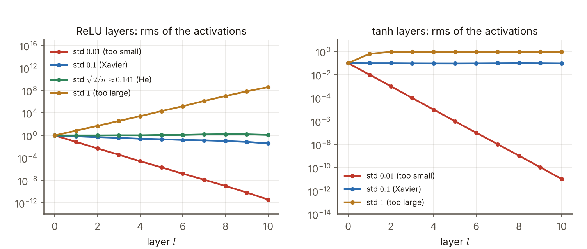
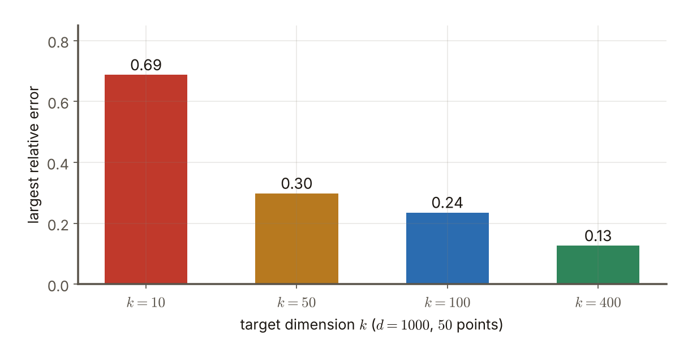
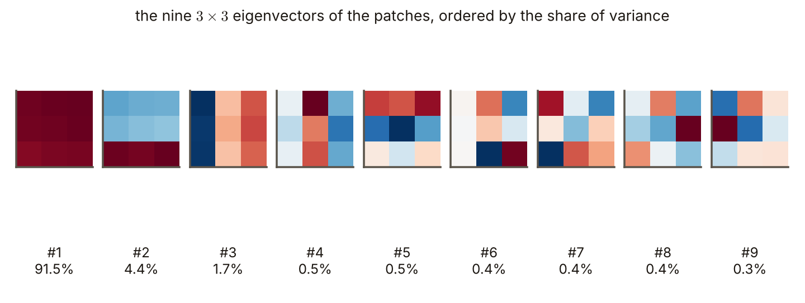

# 第7週 KP01：權重初始化（Weight initialization）

> 程度：大學生
>
> Level: Undergraduate (undergrad)

本講義是第7週「卷積神經網路（二）：經典架構」的第一個知識點（KP01）。第6週把卷積層的零件講完了：卷積、偵測器、池化。這一節回到一個更基本的問題：卷積核裡的數字，在訓練開始前要設成多少？設得不好，網路連訓練都起不了步，後面的經典架構（AlexNet、VGG、ResNet）也就談不上。

This is the first knowledge point (KP01) of Week 7, "Convolutional neural networks (2): classic architectures". Week 6 covered the parts of a convolutional layer: convolution, detector and pooling. This note goes back to a more basic question: what should the numbers inside a kernel be before training starts? If they are set badly the network cannot even start to train, and the classic architectures (AlexNet, VGG, ResNet) are out of the question.

先備知識是第3週的反向傳播與梯度下降、第2週的活化函數（ReLU、tanh），以及變異數的兩條基本規則（下面有補課框）。第一次出現的詞與符號都會定義。所有數字都由 `assets/figures/src/lec07-kp01-figures.py` 算出，可以自己重算。

The prerequisites are the backpropagation and gradient descent of Week 3, the activation functions of Week 2 (ReLU, tanh) and two basic rules of variance (a refresher box is below). Every term and symbol is defined when it first appears. Every number is computed by `assets/figures/src/lec07-kp01-figures.py`, so you can recompute it yourself.

## KP01 權重初始化（Weight initialization）

### 學習目標（Learning objectives）

讀完之後，你能說出為什麼反向傳播一定要先有初值，並用一個小例子說明「所有權重一樣」會讓兩個神經元永遠一模一樣。你能用逐層的數字說明：權重太小，訊號一層層縮到幾乎為零；權重太大，訊號一層層爆開。你能說出隨機投影與 Johnson–Lindenstrauss 引理為什麼讓「隨機」成為可用的起點。你能算出 Xavier 與 He 初始化的標準差，並說出各自配哪一種活化函數。你也能說出非監督初始化（用 PCA）的步驟。

After reading, you can say why backpropagation needs a starting value and use a small example to show that "all weights equal" keeps two neurons identical forever. You can use layer-by-layer numbers to show that too small weights shrink the signal to almost zero while too large weights blow it up. You can say why random projection and the Johnson–Lindenstrauss lemma make "random" a usable starting point. You can compute the standard deviations of Xavier and He initialization and say which activation function each goes with. You can also state the steps of unsupervised initialization with PCA.

### 先備知識與快速自測（Prerequisites and quick self-test）

**補課框：變異數兩條規則** `[補充]`。變異數 $\mathrm{Var}(X)$ 衡量一個隨機數離平均有多遠。規則一：$\mathrm{Var}(aX)=a^{2}\,\mathrm{Var}(X)$，乘上 $a$，變異數乘上 $a^{2}$。規則二：互相獨立的隨機數相加，變異數也相加。例如 $X$ 的變異數是 $4$：$3X$ 的變異數是 $9\times4=36$；兩個獨立的 $X$ 相加，變異數是 $4+4=8$。

**Refresher box: two rules of variance** `[Added]`. The variance $\mathrm{Var}(X)$ measures how far a random number lies from its mean. Rule one: $\mathrm{Var}(aX)=a^{2}\,\mathrm{Var}(X)$: multiply by $a$ and the variance is multiplied by $a^{2}$. Rule two: for independent random numbers the variances add. For example if $X$ has variance $4$, then $3X$ has variance $9\times4=36$ and the sum of two independent copies of $X$ has variance $4+4=8$.

**自測** `[補充]`：

1. 若 $X$ 的變異數是 $2$，$5X$ 的變異數是多少？答案是 $25\times2=50$。
2. ReLU 的定義是什麼？答案是 $\max(0,z)$：負數變 $0$，正數不變。
3. 反向傳播用什麼規則把誤差從輸出傳回前面各層？答案是連鎖律（第3週 KP06）。

**Self-test** `[Added]`:

1. If $X$ has variance $2$, what is the variance of $5X$? Answer: $25\times2=50$.
2. What is the definition of ReLU? Answer: $\max(0,z)$: negative numbers become $0$ and positive numbers stay.
3. By which rule does backpropagation pass the error from the output back to the earlier layers? Answer: the chain rule (Week 3, KP06).

### 符號表（Symbols）

| 符號 | 中文意義 | English meaning |
|---|---|---|
| $W$ | 一層的權重矩陣（卷積層裡就是卷積核的數字） | the weight matrix of a layer (in a convolutional layer, the numbers of the kernels) |
| $\sigma$ | 權重的標準差（隨機抽權重時的大小） | standard deviation of the weights (how large they are when drawn at random) |
| $n_{\mathrm{in}},\ n_{\mathrm{out}}$ | 一個神經元的輸入個數（扇入）與它送出訊號的神經元個數（扇出） | the number of inputs of a neuron (fan-in) and the number of neurons it feeds (fan-out) |
| $n$ | 本講義例子裡每層的寬度，固定為 $100$ | width of each layer in this note's example, fixed at $100$ |
| $x_l$ | 第 $l$ 層的輸出，$x_0$ 是輸入 | output of layer $l$; $x_0$ is the input |
| $\mathrm{rms}(x)$ | 均方根：$\sqrt{\text{平方的平均}}$，用來量「訊號有多大」 | root mean square, $\sqrt{\text{mean of squares}}$, used to measure how large the signal is |
| $k,\ d$ | 隨機投影的目標維度與原本維度 | target dimension and original dimension of a random projection |
| $s$ | 非監督初始化裡的步幅與小塊（patch）邊長 | stride and patch side in unsupervised initialization |

本講義的指標一律從 $0$ 開始數，公式不含偏置，與第6週 KP01 相同。

Indices start at $0$ and the formulas have no bias, as in Week 6 KP01.

### 1. 為什麼一定要先設初值（Why a starting value is needed）

CNN 的權重就是卷積核裡的數字。訓練的目標是讓損失變小，主要靠反向傳播：先算損失對每個權重的梯度，再沿著梯度的反方向走一小步。這是一個**迭代**演算法，每一步都要從「目前的權重」出發。所以第一步之前，每個權重都要先有一個數字。

The weights of a CNN are the numbers inside the kernels. Training aims to make the loss smaller, mainly by backpropagation: first compute the gradient of the loss with respect to every weight, then take a small step against the gradient. This is an **iterative** algorithm, and every step starts from "the current weights". So before the first step every weight needs a number.

常見的做法有三條：隨機初始化、顧變異數的隨機法（Xavier、He），以及用非監督方法（例如 PCA）先學一組核。近代實務以前兩類為主。下面依序講。

There are three common routes: random initialization, random initialization that looks after the variance (Xavier and He), and learning a set of kernels first with an unsupervised method such as PCA. Modern practice mostly uses the first two. They are covered in turn below.

先看一個容易想到、卻行不通的做法：**所有權重設成同一個數**。取一個很小的網路：兩個輸入 $x=(1,2)$，兩個隱藏神經元（ReLU），一個輸出，目標值 $t=3$，損失是 $\tfrac12(y-t)^2$。把每一個權重都設成 $0.5$ `[補充]`。

First consider an idea that comes to mind easily but does not work: **set all weights to the same number**. Take a very small network: two inputs $x=(1,2)$, two hidden neurons (ReLU), one output, target $t=3$ and loss $\tfrac12(y-t)^2$. Set every weight to $0.5$ `[Added]`.

兩個隱藏神經元的輸入都是 $0.5\times1+0.5\times2=1.5$，輸出都是 $1.5$。網路的輸出是 $0.5\times1.5+0.5\times1.5=1.5$，誤差是 $y-t=-1.5$。輸出層兩個權重的梯度都是 $-1.5\times1.5=-2.25$，兩個隱藏神經元各自輸入權重的梯度也都是 $(-0.75,\,-1.5)$。

Both hidden neurons receive $0.5\times1+0.5\times2=1.5$ and output $1.5$. The network output is $0.5\times1.5+0.5\times1.5=1.5$ and the error is $y-t=-1.5$. The two output weights both have gradient $-1.5\times1.5=-2.25$, and the input weights of the two hidden neurons both have gradient $(-0.75,\,-1.5)$.

兩個神經元拿到一模一樣的梯度，更新之後仍然一模一樣，下一步又拿到一模一樣的梯度。它們永遠是同一個神經元的兩份拷貝，多出來的那一個白白浪費。若把權重全設成 $0$ 更糟：隱藏輸出是 $0$，梯度也是 $0$，網路一步都動不了 `[補充]`。解法是讓每個權重的起點**不一樣**，所以用隨機數。

The two neurons receive exactly the same gradient, stay identical after the update, and receive identical gradients again at the next step. They stay two copies of one neuron for ever, and the extra one is wasted. If all weights were set to $0$ it is even worse: the hidden outputs are $0$, the gradients are $0$ and the network cannot move a single step `[Added]`. The fix is to give every weight a **different** starting point, which is why we use random numbers.

常見錯誤：以為初始化只是「隨便給個起點」。起點若有對稱性，訓練再久也打不破。

Common error: thinking that initialization just means "give it any starting point". If the starting point is symmetric, no amount of training breaks the symmetry.

### 2. 隨機數不能太大也不能太小（Random numbers must be neither too large nor too small）

隨機就夠了嗎？不夠，還要看大小。權重可以從高斯分布（鐘形）或均勻分布抽出來，標準差記成 $\sigma$。要看 $\sigma$ 的影響，最直接的辦法是讓訊號一層層穿過網路，量每一層輸出有多大。

Is random enough? No, the size matters too. Weights can be drawn from a Gaussian (bell-shaped) or a uniform distribution, with standard deviation written $\sigma$. The most direct way to see the effect of $\sigma$ is to pass a signal through the network layer by layer and measure how large each layer's output is.

本節的實驗 `[補充]`：$10$ 層全連接，每層寬度 $n=100$，沒有偏置，權重都從標準差 $\sigma$ 的高斯抽出。輸入是 $1000$ 筆標準常態的隨機數。用均方根 $\mathrm{rms}(x)=\sqrt{\text{平方的平均}}$ 量每層輸出的大小，輸入的 $\mathrm{rms}$ 約為 $1$。

The experiment of this section `[Added]`: $10$ fully connected layers, each of width $n=100$, no bias, all weights drawn from a Gaussian with standard deviation $\sigma$. The input is $1000$ standard-normal random vectors. The size of each layer's output is measured by the root mean square $\mathrm{rms}(x)=\sqrt{\text{mean of squares}}$, and the input has $\mathrm{rms}$ about $1$.

先看 ReLU。$\sigma=0.01$ 時，第 $1$ 層輸出的 $\mathrm{rms}$ 是 $0.0705$，第 $5$ 層是 $2.1\times10^{-6}$，第 $10$ 層是 $3.9\times10^{-12}$：訊號縮到幾乎為零。$\sigma=1$ 時反過來：第 $1$ 層 $7.05$，第 $5$ 層 $2.1\times10^{4}$，第 $10$ 層 $3.9\times10^{8}$：訊號爆開。

Look at ReLU first. With $\sigma=0.01$ the $\mathrm{rms}$ of layer $1$ is $0.0705$, of layer $5$ it is $2.1\times10^{-6}$ and of layer $10$ it is $3.9\times10^{-12}$: the signal shrinks to almost zero. With $\sigma=1$ it is the other way round: $7.05$ at layer $1$, $2.1\times10^{4}$ at layer $5$ and $3.9\times10^{8}$ at layer $10$: the signal blows up.

**圖說 `lec07-kp01-signal`**〔功能：一目了然〕：先看左圖兩端的線：紅線一路往下掉，金色線一路往上衝，兩條都離開了「約 $1$」的合理範圍。再看中間的綠線：它貼著 $1$ 不動，這是 He 初始化的結果（第 4 節）。最後看右圖：tanh 的紅線同樣掉到 $10^{-11}$，金色線不是爆開而是貼在約 $0.96$，因為 tanh 的輸出被壓在 $-1$ 到 $1$ 之間，卡在平的部分。

**Caption `lec07-kp01-signal`** [Function: seeing it at a glance]: First look at the two ends of the left plot: the red line keeps falling and the gold line keeps climbing, and both leave the reasonable range of "about $1$". Then look at the green line in the middle: it stays at $1$, the result of He initialization (Section 4). Finally look at the right plot: the red tanh line also falls to $10^{-11}$, while the gold line does not blow up but sticks at about $0.96$, because the output of tanh is squeezed between $-1$ and $1$ and sits on the flat part.

為什麼是這樣？看一層。每個輸出是 $n$ 個輸入的加權和，權重各自獨立、平均 $0$，由變異數的兩條規則，加權和的變異數是 $n\,\sigma^{2}$ 乘上輸入的平方平均。ReLU 把負的一半砍成 $0$，平方的平均剩一半。所以一層 ReLU 之後，$\mathrm{rms}$ 乘上

Why does this happen? Look at one layer. Each output is a weighted sum of $n$ inputs. The weights are independent with mean $0$, so by the two rules of variance the variance of the sum is $n\,\sigma^{2}$ times the mean of the squared inputs. ReLU cuts the negative half to $0$ and halves the mean of squares. So after one ReLU layer the $\mathrm{rms}$ is multiplied by

$$
\sqrt{\frac{n}{2}}\;\sigma .
$$

$n=100$ 時，$\sigma=0.01$ 的倍率是 $7.07\times0.01=0.0707$，十層後是 $0.0707^{10}\approx3.1\times10^{-12}$，與實驗的 $3.9\times10^{-12}$ 同一個量級。$\sigma=1$ 的倍率是 $7.07$，十層後約 $3.1\times10^{8}$，實驗是 $3.9\times10^{8}$。每層只差一個固定倍數，十層就差出十幾個數量級。

With $n=100$ the factor for $\sigma=0.01$ is $7.07\times0.01=0.0707$, and after ten layers $0.0707^{10}\approx3.1\times10^{-12}$, of the same order as the experiment's $3.9\times10^{-12}$. The factor for $\sigma=1$ is $7.07$, and after ten layers about $3.1\times10^{8}$, against $3.9\times10^{8}$ in the experiment. Each layer is off by one fixed factor, and ten layers make an error of many orders of magnitude.

這個問題會傷到訓練。反向傳播時，梯度也要穿過同樣的一串層：前向訊號縮成零，梯度跟著縮成零，前面的層幾乎學不動（梯度消失）；前向訊號爆開，梯度跟著爆開，一步就把權重推到失控（梯度爆炸）。權重的大小要剛剛好，讓每一層的訊號大小前後差不多。

This hurts training. In backpropagation the gradient has to pass through the same stack of layers: if the forward signal shrinks to zero the gradient shrinks with it and the early layers hardly learn (vanishing gradient); if the forward signal blows up the gradient blows up and a single step throws the weights out of control (exploding gradient). The weights must be just the right size so that the signal keeps about the same size from layer to layer.

常見錯誤：以為權重愈大愈能避免訊號消失。太大一樣會爆開，tanh 與 sigmoid 還會被推進平坦的部分，梯度又幾乎為零。

Common error: thinking that larger weights always avoid vanishing signals. Too large blows up just the same, and tanh and sigmoid get pushed onto their flat parts where the gradient is again almost zero.

### 3. 隨機權重為什麼是可用的起點：隨機投影（Why random weights are a usable start: random projection）

一層的權重 $W$ 是一個矩陣，把輸入向量映到另一個向量，也就是一個線性**投影**。隨機初始化等於隨機挑了一個投影。我們擔心的是：隨機挑的投影，會不會把輸入的結構弄壞？

The weights $W$ of a layer form a matrix that maps an input vector to another vector, a linear **projection**. Random initialization amounts to picking a random projection. The worry is: could a randomly chosen projection destroy the structure of the input?

Johnson–Lindenstrauss（JL）引理給了正面的答案：把 $d$ 維空間的 $N$ 個點，用隨機矩陣投影到 $k$ 維，只要 $k$ 夠大，任兩點之間的距離會以高機率只變動一個有界的小比例。通常的寫法是：任兩點的距離平方變動不超過 $1\pm\varepsilon$ 倍，需要的 $k$ 大約是 $\ln N/\varepsilon^{2}$ 的量級 `[補充]`。投影矩陣的每個數字取平均 $0$、變異數 $1/k$ 的高斯，距離才不會整體變大或變小。

The Johnson–Lindenstrauss (JL) lemma gives a positive answer: take $N$ points in $d$ dimensions and project them to $k$ dimensions with a random matrix; as long as $k$ is large enough, the distance between any two points changes only by a bounded small fraction, with high probability. It is usually written as: every squared distance changes by no more than a factor $1\pm\varepsilon$, and the needed $k$ is of the order $\ln N/\varepsilon^{2}$ `[Added]`. Each number of the projection matrix is Gaussian with mean $0$ and variance $1/k$, so that distances do not become larger or smaller as a whole.

用一個實驗看 `[補充]`：取 $50$ 個點，每個點在 $d=1000$ 維，共有 $1225$ 對距離。投影到 $k=10,\,50,\,100,\,400$ 維，看最差的一對距離變動了百分之幾。結果是 $69\%$、$30\%$、$24\%$、$13\%$：維度愈高，最差的誤差愈小。

Look at an experiment `[Added]`: take $50$ points in $d=1000$ dimensions, which makes $1225$ pairwise distances. Project them to $k=10,\,50,\,100,\,400$ dimensions and see by what percentage the worst pair of distances changed. The result is $69\%$, $30\%$, $24\%$, $13\%$: the higher the dimension, the smaller the worst error.

**圖說 `lec07-kp01-jl`**〔功能：精準度〕：先看最左邊的紅色長條：投影到只有 $10$ 維時，最差的一對距離錯了 $0.69$，也就是 $69\%$。再看右邊三根：維度加到 $50$、$100$、$400$，最大誤差降到 $0.30$、$0.24$、$0.13$。要記的是趨勢：誤差隨 $k$ 增大而縮小，而且沒有任何一對距離被弄得面目全非。

**Caption `lec07-kp01-jl`** [Function: precision]: First look at the red bar on the far left: projected to only $10$ dimensions, the worst pair of distances is off by $0.69$, that is $69\%$. Then look at the three on the right: with $50$, $100$ and $400$ dimensions the largest error falls to $0.30$, $0.24$ and $0.13$. What to remember is the trend: the error shrinks as $k$ grows, and no pair of distances is changed beyond recognition.

這對初始化的意義是：只要隨機權重的大小設得合理（上面的 $1/k$ 就是一種「合理」），隨機的一層不會毀掉輸入資料的距離結構，所以它是可以出發的起點。反過來，權重的大小不對（第 2 節），連這個保證都沒有。JL 說明「隨機」可行，下一節要說的是「大小」怎麼定。

For initialization the meaning is: as long as the size of the random weights is reasonable (the $1/k$ above is one kind of "reasonable"), a random layer does not destroy the distance structure of the input data, so it is a starting point one can set off from. Conversely, with the wrong weight size (Section 2) even this guarantee is gone. JL says that "random" works; the next section is about how to fix the "size".

常見錯誤：以為 JL 保證了整個網路的訓練結果。它只說一層隨機投影不會壞掉距離結構，說的是起點，不是終點。

Common error: thinking that JL guarantees the training result of the whole network. It only says that one random projection does not break the distance structure, which is about the starting point and not the end point.

### 4. 顧變異數：Xavier 與 He（Looking after the variance: Xavier and He）

目標很清楚：讓各層的訊號大小前後差不多。上一節已經推出一層 ReLU 的倍率是 $\sqrt{n/2}\,\sigma$。要讓倍率等於 $1$，解出 $\sigma$：

The goal is clear: keep the signal about the same size from layer to layer. The previous section derived that the factor of one ReLU layer is $\sqrt{n/2}\,\sigma$. Setting the factor equal to $1$ and solving for $\sigma$:

$$
\sigma_{\mathrm{He}}=\sqrt{\frac{2}{n_{\mathrm{in}}}} \qquad\text{（ReLU）}.
$$

這就是 **He 初始化**，配 ReLU 及它的變體。$n_{\mathrm{in}}$ 是每個神經元的輸入個數。$n=100$ 時 $\sigma_{\mathrm{He}}=\sqrt{2/100}=0.141$，圖左的綠線就是它：$10$ 層的 $\mathrm{rms}$ 介於 $0.99$ 與 $1.62$ 之間，第 $10$ 層是 $1.24$ `[補充]`。

This is the **He initialization**, which goes with ReLU and its variants. $n_{\mathrm{in}}$ is the number of inputs of each neuron. For $n=100$, $\sigma_{\mathrm{He}}=\sqrt{2/100}=0.141$, and the green line in the left plot is exactly this: the $\mathrm{rms}$ over $10$ layers stays between $0.99$ and $1.62$ and is $1.24$ at layer $10$ `[Added]`.

**Xavier（Glorot）初始化**配 tanh、sigmoid 這類飽和型活化函數。tanh 在原點附近近似一條直線，沒有 ReLU 砍掉一半的效應，所以一層的倍率是 $\sqrt{n}\,\sigma$。要倍率為 $1$，需要 $\sigma^{2}=1/n_{\mathrm{in}}$。另一方面，反向傳播時梯度要穿過的是**扇出** $n_{\mathrm{out}}$（要看一個神經元送出訊號給幾個神經元）。Xavier 取兩者折衷 `[補充]`：

**Xavier (Glorot) initialization** goes with saturating activations such as tanh and sigmoid. Near the origin tanh is close to a straight line and has no halving effect as ReLU does, so the factor of one layer is $\sqrt{n}\,\sigma$. A factor of $1$ needs $\sigma^{2}=1/n_{\mathrm{in}}$. On the other hand in backpropagation the gradient has to pass through the **fan-out** $n_{\mathrm{out}}$ (how many neurons a neuron feeds). Xavier takes a compromise between the two `[Added]`:

$$
\sigma_{\mathrm{Xavier}}=\sqrt{\frac{2}{n_{\mathrm{in}}+n_{\mathrm{out}}}} \qquad\text{（tanh、sigmoid）}.
$$

兩者都是依扇入、扇出縮放初始的標準差，免得訊號與梯度在層與層之間消失或爆開。純高斯或純均勻的隨機數，在現代深層網路中已不常當預設。

Both scale the initial standard deviation by the fan-in and fan-out, so that the signal and the gradient do not vanish or explode between layers. Purely Gaussian or purely uniform random numbers are no longer used as the default in modern deep networks.

| 情況 | $n_{\mathrm{in}}\to n_{\mathrm{out}}$ | Xavier $\sqrt{2/(n_{\mathrm{in}}+n_{\mathrm{out}})}$ | He $\sqrt{2/n_{\mathrm{in}}}$ |
|---|---|---|---|
| 圖中的例子 | $100\to100$ | $0.1000$ | $0.1414$ |
| 寬層 | $256\to256$ | $0.0625$ | $0.0884$ |
| 輸入層接隱藏層 | $784\to100$ | $0.0476$ | $0.0505$ |

| Case | $n_{\mathrm{in}}\to n_{\mathrm{out}}$ | Xavier $\sqrt{2/(n_{\mathrm{in}}+n_{\mathrm{out}})}$ | He $\sqrt{2/n_{\mathrm{in}}}$ |
|---|---|---|---|
| example in the figure | $100\to100$ | $0.1000$ | $0.1414$ |
| wide layer | $256\to256$ | $0.0625$ | $0.0884$ |
| input layer to hidden layer | $784\to100$ | $0.0476$ | $0.0505$ |

注意「配對」很重要：把 Xavier 用在 ReLU 上，倍率是 $1/\sqrt2=0.707$，十層後 $0.707^{10}=0.031$，圖左的藍線（實驗值 $0.039$）就是這個結果，慢慢縮小；把 He 用在 tanh 上則相反，每層倍率約 $\sqrt2$，訊號會變大，tanh 容易被推向平坦的部分 `[補充]`。圖右的藍線是 Xavier 配 tanh：十層後 $\mathrm{rms}$ 仍是 $0.095$，起點是 $0.1$，幾乎沒有變。

The pairing matters: Xavier on ReLU gives a factor of $1/\sqrt2=0.707$, and after ten layers $0.707^{10}=0.031$, which is the blue line in the left plot (measured $0.039$), slowly shrinking; He on tanh goes the other way: the factor per layer is about $\sqrt2$, the signal grows and tanh is easily pushed onto its flat parts `[Added]`. The blue line in the right plot is Xavier with tanh: after ten layers the $\mathrm{rms}$ is still $0.095$ against $0.1$ at the start, almost unchanged.

常見錯誤：以為 Xavier 與 He 是兩個可以隨便換的名字。它們針對的活化函數不同：Xavier 配 tanh、sigmoid，He 配 ReLU 家族。

Common error: thinking that Xavier and He are two names that can be swapped freely. They target different activation functions: Xavier goes with tanh and sigmoid and He with the ReLU family.

### 5. 非監督初始化：用 PCA 學出一組核（Unsupervised initialization: learning a set of kernels with PCA）

第三條路線不用亂數，而是先從資料學。步驟如下，設步幅為 $s$：

The third route uses no random numbers and learns from the data first. The steps are as follows, with stride $s$:

1. 從影像切出許多 $s\times s$ 的小塊（patch），拉成一條向量。
2. 為了讓特徵對小位移比較穩，每個小塊再平移幾個像素，平移後的小塊也一起收集。
3. 把所有小塊（原來的與平移後的）當成資料矩陣的列，做主成分分析（PCA）。
4. PCA 得到一組特徵向量，每個特徵向量排回 $s\times s$ 的樣子，就是一個初始的卷積核。
5. 同樣的流程可以逐層重複，以非監督的方式初始化整座 CNN。

1. Cut many $s\times s$ patches out of images and flatten each into a vector.
2. To make the features steadier against small shifts, shift each patch by a few pixels and collect the shifted patches too.
3. Take all the patches (the original and the shifted ones) as the rows of a data matrix and run principal component analysis (PCA).
4. PCA gives a set of eigenvectors; each eigenvector arranged back into an $s\times s$ shape is one initial convolution kernel.
5. The same procedure can be repeated layer by layer to initialize a whole CNN without labels.

PCA 是在資料裡找「變化最大的方向」：第一個特徵向量是變化最大的方向，第二個是剩下的方向裡最大的，依此類推，互相垂直。

PCA looks in the data for "the directions of largest variation": the first eigenvector is the direction of largest variation, the second is the largest among the remaining directions, and so on, each perpendicular to the others.

用一個實驗看 `[補充]`：造一張 $64\times64$ 的合成影像（平滑的起伏、一條水平的亮帶、一道垂直的階梯邊，再加一點雜訊）。取 $s=3$，原來的小塊加上向下、向右、斜向各平移 $1$ 格的小塊，共 $4\times20\times20=1600$ 個小塊，每個是 $9$ 維。PCA 得到 $9$ 個特徵向量。

Look at an experiment `[Added]`: make a synthetic $64\times64$ image (smooth ups and downs, a horizontal bright band, a vertical step edge, plus some noise). Take $s=3$ and the original patches plus the patches shifted by $1$ cell down, right and diagonally, which gives $4\times20\times20=1600$ patches of $9$ dimensions each. PCA gives $9$ eigenvectors.

**圖說 `lec07-kp01-pca`**〔功能：一目了然〕：先看第 $1$ 個：九格同一個顏色，是「取平均」的核，占了 $91.5\%$ 的變異，因為這張合成圖的大部分變化是整塊亮度的高低。再看第 $2$、$3$ 個：一個是上下兩邊對比，一個是左右兩邊對比，也就是水平與垂直方向的邊緣偵測。最後看後面六個：形狀雜亂，各占不到 $0.6\%$，多半在抓雜訊。這些比例依這張合成圖而定，換一張圖會不同。

**Caption `lec07-kp01-pca`** [Function: seeing it at a glance]: First look at the $1$st: all nine cells have one colour, an "averaging" kernel, and it takes $91.5\%$ of the variation because most of the variation of this synthetic image is the overall brightness. Then look at the $2$nd and $3$rd: one contrasts the upper and lower sides and the other the left and right sides, that is edge detection in the horizontal and vertical directions. Finally the last six: irregular shapes, each under $0.6\%$, mostly catching noise. The shares depend on this synthetic image and would differ for another image.

這條路線的好處是核的起點已經帶著資料的結構，不是亂數。壞處是要多做一道 PCA，逐層重複也麻煩，所以近代實務很少把它當預設，常用的是 He 與 Xavier。

The benefit of this route is that the starting kernels already carry the structure of the data rather than being random. The cost is one more PCA, and repeating it layer by layer is a nuisance, so modern practice rarely uses it as a default and commonly uses He and Xavier.

### 本單元重點整理（KP01 summary）

**一句話重點**：反向傳播是迭代演算法，一定要先給每個權重一個初值；初值要隨機（打破對稱），而且大小要依扇入、扇出調整，讓訊號與梯度在層間不消失也不爆開：ReLU 用 He，tanh 與 sigmoid 用 Xavier；也可以先用 PCA 從資料學出一組核。

**One-sentence summary**: backpropagation is iterative and needs an initial value for every weight; the values must be random (to break symmetry) and their size must be adjusted by the fan-in and fan-out so that the signal and the gradient neither vanish nor explode between layers: He for ReLU, Xavier for tanh and sigmoid; one can also first learn a set of kernels from the data with PCA.

**白話說明**：初始化像叫一群人同時出發跑接力。每個人的起點要不一樣，否則大家永遠做同樣的事；每個人傳話的音量要剛好，太小傳到後面聽不見，太大傳到後面吵翻天。

**Plain explanation**: initialization is like starting a team of people in a relay at once. Everyone must start at a different place, otherwise they all keep doing the same thing; and everyone must pass the message on at the right volume: too quiet and the back of the line cannot hear it, too loud and the back of the line is in uproar.

**正式定義**：一層 ReLU 的前向倍率是 $\sqrt{n_{\mathrm{in}}/2}\,\sigma$。He 初始化 $\sigma=\sqrt{2/n_{\mathrm{in}}}$ 使倍率為 $1$；Xavier 初始化 $\sigma=\sqrt{2/(n_{\mathrm{in}}+n_{\mathrm{out}})}$ 兼顧前向與反向。JL 引理說明隨機投影以高機率近似保留成對距離。

**Formal definition**: the forward factor of one ReLU layer is $\sqrt{n_{\mathrm{in}}/2}\,\sigma$. He initialization $\sigma=\sqrt{2/n_{\mathrm{in}}}$ makes the factor $1$; Xavier initialization $\sigma=\sqrt{2/(n_{\mathrm{in}}+n_{\mathrm{out}})}$ looks after both the forward and the backward pass. The JL lemma says that a random projection approximately preserves pairwise distances with high probability.

**例子**：權重全是 $0.5$ 的小網路，兩個隱藏神經元梯度都是 $(-0.75,-1.5)$，永遠一樣。$10$ 層、寬 $100$ 的 ReLU 網路，$\sigma=0.01$ 時第 $10$ 層 $\mathrm{rms}=3.9\times10^{-12}$，$\sigma=1$ 時 $3.9\times10^{8}$，He 的 $\sigma=0.141$ 時約 $1.24$。$1225$ 對距離投影到 $400$ 維後最大誤差 $13\%$。

**Example**: in the small network with all weights $0.5$ both hidden neurons have gradient $(-0.75,-1.5)$ for ever. In a ReLU network of $10$ layers and width $100$ the $\mathrm{rms}$ of layer $10$ is $3.9\times10^{-12}$ for $\sigma=0.01$, $3.9\times10^{8}$ for $\sigma=1$ and about $1.24$ for He's $\sigma=0.141$. After projecting $1225$ distances to $400$ dimensions the largest error is $13\%$.

**常見迷思**：

- 「所有權重設成 $0$ 最乾淨。」錯，梯度也是 $0$ 或完全對稱，網路學不起來。
- 「權重愈大愈好，才不會消失。」錯，太大會爆開，tanh 還會飽和。
- 「Xavier 與 He 隨便選一個。」錯，Xavier 配 tanh、sigmoid，He 配 ReLU。
- 「JL 保證訓練一定成功。」錯，它只說隨機起點不會毀掉距離結構。

**Common misconceptions**:

- "Setting all weights to $0$ is the cleanest." Wrong: the gradients are $0$ or perfectly symmetric, and the network cannot learn.
- "The larger the weights the better, so that nothing vanishes." Wrong: too large blows up, and tanh saturates.
- "Xavier and He can be picked at random." Wrong: Xavier goes with tanh and sigmoid, He with ReLU.
- "JL guarantees that training succeeds." Wrong: it only says that a random start does not destroy the distance structure.

**圖**：本單元有三張圖。

- `lec07-kp01-signal`：$10$ 層網路中，各種 $\sigma$ 下訊號大小逐層的變化。
- `lec07-kp01-jl`：隨機投影到不同維度後，最大的距離誤差。
- `lec07-kp01-pca`：PCA 得到的九個 $3\times3$ 核。

三張圖與文中數字都由同一支程式產生：`lec07-kp01-figures.py`。

**Figures**: this unit has three figures.

- `lec07-kp01-signal`: how the signal size changes layer by layer in a $10$-layer network for various $\sigma$.
- `lec07-kp01-jl`: the largest distance error after random projection to different dimensions.
- `lec07-kp01-pca`: the nine $3\times3$ kernels obtained by PCA.

The three figures and the numbers in the text all come from the same program: `lec07-kp01-figures.py`.

**想深入**（選讀）`[補充]`：第 4 節的推導假設每層的輸入彼此獨立、權重平均為 $0$，也沒有偏置。實際網路不完全滿足，所以標準差只是「讓起點大致平衡」的設定，不是精確的保證。圖左的綠線在第 $8$ 到 $9$ 層升到 $1.6$ 左右就是例子。後面的章節會看到批次正規化等方法，用另一種手段讓各層的訊號大小保持穩定。

**Going deeper** (optional) `[Added]`: the derivation of Section 4 assumes that the inputs of each layer are independent, the weights have mean $0$ and there is no bias. Real networks do not satisfy this exactly, so the standard deviation is a setting that "roughly balances the starting point" and not an exact guarantee. The green line in the left plot rising to about $1.6$ around layers $8$ to $9$ is an example. Later sections will meet methods such as batch normalization that keep the signal size stable by other means.

**小練習**：

1. 一層有 $n_{\mathrm{in}}=n_{\mathrm{out}}=256$。算 Xavier 與 He 的標準差。
2. 輸入層接隱藏層，$n_{\mathrm{in}}=784$、$n_{\mathrm{out}}=100$。算 Xavier 與 He 的標準差。
3. `[補充]` $10$ 層 ReLU 網路，寬 $n=100$，權重標準差 $\sigma=0.05$。每層的倍率是多少？十層後 $\mathrm{rms}$ 變成原來的幾倍？這是消失還是爆開？
4. `[補充]` 在第 3 節的實驗中，要讓最大的相對距離誤差低於 $0.15$，四個維度（$10,50,100,400$）裡哪些可以？
5. `[補充]` 回到第 1 節的小網路，若兩個隱藏神經元的輸入權重改成 $(0.5,0.5)$ 與 $(0.3,0.7)$，它們的梯度還會一樣嗎？最簡單的避免對稱的辦法是什麼？

**Practice**:

1. A layer has $n_{\mathrm{in}}=n_{\mathrm{out}}=256$. Compute the Xavier and He standard deviations.
2. An input layer feeds a hidden layer with $n_{\mathrm{in}}=784$ and $n_{\mathrm{out}}=100$. Compute the Xavier and He standard deviations.
3. `[Added]` A $10$-layer ReLU network of width $n=100$ has weight standard deviation $\sigma=0.05$. What is the factor per layer? By what factor does the $\mathrm{rms}$ change after ten layers? Is this vanishing or exploding?
4. `[Added]` In the experiment of Section 3, which of the four dimensions ($10,50,100,400$) bring the largest relative distance error below $0.15$?
5. `[Added]` Back to the small network of Section 1: if the input weights of the two hidden neurons are changed to $(0.5,0.5)$ and $(0.3,0.7)$, are their gradients still equal? What is the simplest way to avoid the symmetry?

**第 1 題解答** `[補充]`：

1. Xavier：$\sqrt{2/(256+256)}=\sqrt{1/256}=1/16=0.0625$。
2. He：$\sqrt{2/256}=\sqrt{1/128}=0.0884$。
3. He 比 Xavier 大 $\sqrt2$ 倍，因為 He 只除以扇入。

**Solution to question 1** `[Added]`:

1. Xavier: $\sqrt{2/(256+256)}=\sqrt{1/256}=1/16=0.0625$.
2. He: $\sqrt{2/256}=\sqrt{1/128}=0.0884$.
3. He is $\sqrt2$ times Xavier because He divides only by the fan-in.

**第 2 題解答** `[補充]`：

1. Xavier：$\sqrt{2/(784+100)}=\sqrt{2/884}=0.0476$。
2. He：$\sqrt{2/784}=0.0505$。
3. 扇入與扇出差很多時，兩者也差得少：$0.0476$ 與 $0.0505$。

**Solution to question 2** `[Added]`:

1. Xavier: $\sqrt{2/(784+100)}=\sqrt{2/884}=0.0476$.
2. He: $\sqrt{2/784}=0.0505$.
3. Even when the fan-in and fan-out differ a lot the two stay close: $0.0476$ and $0.0505$.

**第 3 題解答** `[補充]`：

1. 倍率是 $\sqrt{n/2}\,\sigma=\sqrt{50}\times0.05=7.071\times0.05=0.3536=2^{-3/2}$。
2. 十層後是 $0.3536^{10}=2^{-15}=3.05\times10^{-5}$ 倍。
3. 每層縮小，所以是消失：$\mathrm{rms}$ 縮成原來的約三萬分之一。

**Solution to question 3** `[Added]`:

1. The factor is $\sqrt{n/2}\,\sigma=\sqrt{50}\times0.05=7.071\times0.05=0.3536=2^{-3/2}$.
2. After ten layers it is $0.3536^{10}=2^{-15}=3.05\times10^{-5}$ times.
3. Every layer shrinks, so this is vanishing: the $\mathrm{rms}$ becomes about one thirty-thousandth of the original.

**第 4 題解答** `[補充]`：

1. 四個維度的最大誤差是 $0.69$、$0.30$、$0.24$、$0.13$。
2. 低於 $0.15$ 的只有 $k=400$。
3. 誤差要降下來，維度要夠高；$k=100$ 的 $0.24$ 還不夠。

**Solution to question 4** `[Added]`:

1. The largest errors of the four dimensions are $0.69$, $0.30$, $0.24$, $0.13$.
2. Only $k=400$ is below $0.15$.
3. To bring the error down the dimension must be high enough; $0.24$ at $k=100$ is not yet enough.

**第 5 題解答** `[補充]`：

1. 第一個神經元的輸入是 $0.5\times1+0.5\times2=1.5$，第二個是 $0.3\times1+0.7\times2=1.7$，兩個輸出不同，梯度也就不再一樣。
2. 兩個神經元不再是拷貝，各自往不同的方向學。
3. 最簡單的辦法是：每個權重都用隨機數，並依第 4 節定標準差。

**Solution to question 5** `[Added]`:

1. The input of the first neuron is $0.5\times1+0.5\times2=1.5$ and that of the second is $0.3\times1+0.7\times2=1.7$, so the two outputs differ and so do the gradients.
2. The two neurons are no longer copies, and each learns in a different direction.
3. The simplest way is to draw every weight at random with a standard deviation set as in Section 4.

### 小測驗（Quiz，來源原題）

來源的四題都保留原題與全部選項；來源頁面沒有標出答案，下面的答案與解析是依本講義的內容寫的 `[補充]`。

The four questions of the source are kept with all options; the source page marks no answers, and the answers and explanations below are written from the content of this note `[Added]`.

1. 為什麼 CNN 必須在反向傳播前先初始化？
   - A. 卷積核不是權重，所以不能算梯度
   - B. 權重就是核的數值，backprop 是迭代優化，沒有初值就沒有優化變數
   - C. 初始化可以完全取代損失函數
   - D. He 初始化會讓網路不必訓練

2. 隨機初始化與 Johnson–Lindenstrauss 引理的關係是？
   - A. JL 要求權重必須全為 0
   - B. 權重可看成隨機投影，JL 說明隨機投影能近似保留成對距離
   - C. JL 只適用於二階 Newton 法
   - D. JL 禁止使用 ReLU

3. 關於初始值大小與現代初始化方法，何者正確？
   - A. 權重愈大愈好，可避免爆炸
   - B. 太大會爆炸、太小會消失；Xavier／Glorot 適合 tanh／sigmoid，He 適合 ReLU
   - C. Xavier 專為 ReLU 設計，He 專為 sigmoid 設計
   - D. 現代網路必須用純均勻 $[-100,100]$ 初始化

4. 非監督初始化中，PCA 產出什麼來當卷積核？
   - A. 隨機高斯矩陣，與 patch 無關
   - B. 對原 patch 與微平移 patch 做 PCA，得到 $s\times s$ 特徵向量矩陣當初始核
   - C. 全 1 的平均池化核
   - D. 只有 bias、沒有核

1. Why must a CNN be initialized before backpropagation?
   - A. Convolution kernels are not weights, so no gradient can be computed
   - B. The weights are the numbers of the kernels, and backprop is an iterative optimization: without an initial value there is no optimization variable
   - C. Initialization can fully replace the loss function
   - D. He initialization makes training unnecessary

2. What is the relation between random initialization and the Johnson–Lindenstrauss lemma?
   - A. JL requires all weights to be 0
   - B. The weights can be seen as a random projection, and JL says a random projection approximately preserves pairwise distances
   - C. JL applies only to second-order Newton methods
   - D. JL forbids the use of ReLU

3. Which statement about the size of the initial values and modern initialization methods is correct?
   - A. The larger the weights the better, to avoid explosion
   - B. Too large explodes and too small vanishes; Xavier/Glorot suits tanh/sigmoid and He suits ReLU
   - C. Xavier is designed for ReLU and He for sigmoid
   - D. Modern networks must use plain uniform $[-100,100]$ initialization

4. In unsupervised initialization, what does PCA produce to serve as the convolution kernels?
   - A. A random Gaussian matrix unrelated to patches
   - B. PCA of the original patches and slightly shifted patches gives an $s\times s$ eigenvector matrix used as the initial kernels
   - C. An all-ones averaging-pooling kernel
   - D. Only a bias and no kernel

**題後解析** `[補充]`：

- **第 1 題，B。** 卷積核裡的數字就是權重（A 錯）；反向傳播從「目前的權重」出發，沒有初值就沒有起點。初始化取代不了損失函數（C 錯），He 初始化也不能讓訓練變得不必要（D 錯）。見第 1 節。
- **第 2 題，B。** 一層權重是一個投影矩陣，隨機初始化對應隨機投影，JL 說明隨機投影以高機率近似保留成對距離。JL 與權重全為 $0$（A）、牛頓法（C）、ReLU（D）都無關。見第 3 節。
- **第 3 題，B。** 太大爆開、太小消失；Xavier 配 tanh、sigmoid，He 配 ReLU（第 2、4 節）。A 說愈大愈好是錯的；C 把兩者配反；D 的 $[-100,100]$ 只是一個太大的反例。
- **第 4 題，B。** 對原小塊與微平移的小塊做 PCA，特徵向量排成 $s\times s$ 當初始核（第 5 節）。A 與 C、D 都不是這個流程。

**Explanations** `[Added]`:

- **Question 1, B.** The numbers of the kernels are the weights (A is wrong); backpropagation starts from "the current weights" and without initial values there is no starting point. Initialization cannot replace the loss function (C is wrong) and He initialization does not make training unnecessary (D is wrong). See Section 1.
- **Question 2, B.** The weights of a layer are a projection matrix, random initialization corresponds to a random projection, and JL says that a random projection approximately preserves pairwise distances with high probability. JL has nothing to do with all-zero weights (A), Newton's method (C) or ReLU (D). See Section 3.
- **Question 3, B.** Too large explodes and too small vanishes; Xavier goes with tanh and sigmoid and He with ReLU (Sections 2 and 4). A is wrong that larger is better; C swaps the two pairings; the $[-100,100]$ of D is merely an example that is far too large.
- **Question 4, B.** PCA of the original patches and the slightly shifted patches, with the eigenvectors arranged as $s\times s$ initial kernels (Section 5). A, C and D are not this procedure.

**下一個單元的問題**：起點設好了，網路可以訓練了。可是怎麼知道一個架構比另一個好？下一個單元（KP02）介紹影像辨識的標準競賽 ImageNet 與 ILSVRC，以及第一個在這個競賽上大勝的深層 CNN：AlexNet。

**The question for the next unit**: with the starting point set, the network can be trained. But how do we know that one architecture is better than another? The next unit (KP02) introduces ImageNet and ILSVRC, the standard competition of image recognition, and AlexNet, the first deep CNN to win it by a large margin.

### 來源更正與取捨（Corrections to the source）

本講義依 CCC-LNS IDL_115 第4章 KP11（網頁講義）重新撰寫，該教材的第4章包含本課的第6週與第7週。來源的讀取日期是 2026-11-04。來源沒有的內容，都在出現的地方標示 `[補充]`。

This note is rewritten from KP11 of CCC-LNS IDL_115 Chapter 4 (web lecture); Chapter 4 of that material covers Weeks 6 and 7 of this course. The source was accessed on 2026-11-04. Content that the source does not contain is marked `[Added]` where it appears.

- 來源只說 Xavier 與 He「依扇入、扇出縮放初始變異數」，沒有給公式與數字。本講義補上公式 $\sqrt{2/n_{\mathrm{in}}}$ 與 $\sqrt{2/(n_{\mathrm{in}}+n_{\mathrm{out}})}$、每層倍率 $\sqrt{n/2}\,\sigma$ 的推導，以及 $10$ 層網路的逐層實驗；這些公式是標準結果，數字都由程式算出，不出自來源。
- 來源說 JL 引理「以高機率近似保留成對距離（誤差有界）」，沒有寫條件。本講義補了 $1\pm\varepsilon$ 與 $k$ 的量級 $\ln N/\varepsilon^{2}$，只寫量級，不寫常數，並用 $50$ 個點的實驗當數字例。
- 來源對 PCA 初始化寫「得到 $s\times s$ 的特徵向量矩陣，用來取代該層的 patch 權重」。$s\times s$ 的小塊有 $s^{2}$ 維，PCA 會得到 $s^{2}$ 個特徵向量，所以矩陣的大小是 $s^{2}\times s^{2}$；每個特徵向量排回 $s\times s$ 才是一個核。本講義依此理解，這是詮釋，已標示。
- 來源的第 1 節說權重太大易爆炸、太小易消失，沒有給數字。本講義的逐層實驗是新增，用同一組亂數種子，可以重算。
- 來源的小測驗四題原題保留，並補上答案與解析（來源頁面沒有標答案）。
- 取捨：來源的「純高斯或均勻亂數較少當預設」保留。來源沒有講批次正規化，本講義也沒有講，只在「想深入」提一句。

- The source says only that Xavier and He "scale the initial variance by the fan-in and fan-out" and gives no formulas or numbers. This note adds the formulas $\sqrt{2/n_{\mathrm{in}}}$ and $\sqrt{2/(n_{\mathrm{in}}+n_{\mathrm{out}})}$, the derivation of the factor $\sqrt{n/2}\,\sigma$ per layer and the layer-by-layer experiment on a $10$-layer network; the formulas are standard results and the numbers are all computed by the program, not from the source.
- The source says the JL lemma "approximately preserves pairwise distances with high probability (bounded error)" without conditions. This note adds $1\pm\varepsilon$ and the order $\ln N/\varepsilon^{2}$ of $k$, giving the order only and not the constant, and uses an experiment with $50$ points as the numerical example.
- For PCA initialization the source writes "obtains an $s\times s$ eigenvector matrix used to replace the patch weights of that layer". An $s\times s$ patch has $s^{2}$ dimensions and PCA gives $s^{2}$ eigenvectors, so the matrix has size $s^{2}\times s^{2}$; each eigenvector arranged back to $s\times s$ is one kernel. This note reads it so; this is an interpretation and is marked.
- The source's first section says that too large weights tend to explode and too small ones to vanish, without numbers. The layer-by-layer experiment of this note is new, uses a fixed random seed and can be recomputed.
- The four quiz questions of the source are kept as asked, with answers and explanations added (the source page marks no answers).
- Choices: the source's remark that "plain Gaussian or uniform random numbers are rarely the default" is kept. The source does not discuss batch normalization and neither does this note, apart from one sentence in "Going deeper".

### 術語對照（Terminology）

| 中文 | English |
|---|---|
| 權重初始化 | weight initialization |
| 反向傳播 | backpropagation |
| 對稱 | symmetry |
| 均方根 | root mean square (rms) |
| 梯度消失 | vanishing gradient |
| 梯度爆炸 | exploding gradient |
| 扇入、扇出 | fan-in, fan-out |
| 隨機投影 | random projection |
| Johnson–Lindenstrauss 引理 | Johnson–Lindenstrauss lemma |
| Xavier（Glorot）初始化 | Xavier (Glorot) initialization |
| He 初始化 | He initialization |
| 主成分分析 | principal component analysis (PCA) |
| 小塊 | patch |
| 特徵向量 | eigenvector |
| 飽和型活化函數 | saturating activation function |
