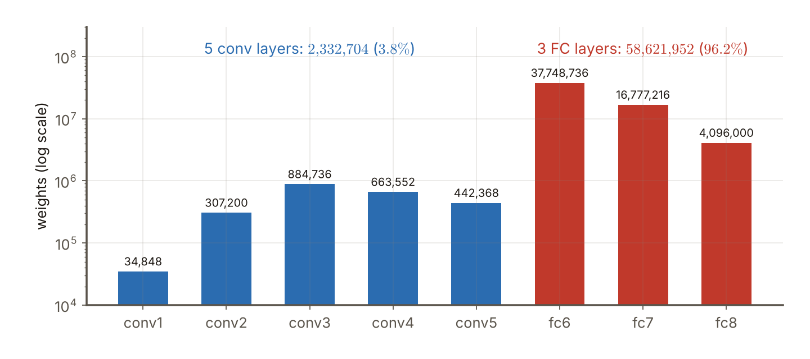
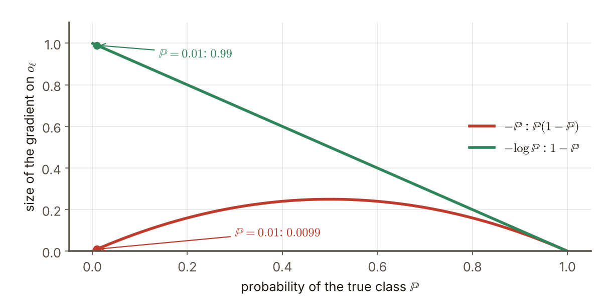

# 第7週 KP02：ImageNet、ILSVRC 與 AlexNet（ImageNet, ILSVRC and AlexNet）

> 程度：大學生
>
> Level: Undergraduate (undergrad)

本講義是第7週「卷積神經網路（二）：經典架構」的第二個知識點（KP02）。KP01 把訓練的起點設好了。這一節問：怎麼知道一個架構比另一個好？答案是大家在同一個競賽、同一批資料上比。後面的 VGG、Inception、ResNet 都在這個競賽上一代接一代；而第一個用深層 CNN 大勝的，就是 AlexNet。

This is the second knowledge point (KP02) of Week 7, "Convolutional neural networks (2): classic architectures". KP01 set the starting point of training. This note asks: how do we know that one architecture is better than another? The answer is that everyone competes on the same contest and the same data. VGG, Inception and ResNet all competed there one generation after another; and the first deep CNN to win by a large margin was AlexNet.

先備知識是第6週 KP02 的 LeNet 骨架（卷積、池化、全連接）、KP07 的輸出尺寸公式、第2週的 softmax 與 KP01 的初始化。第一次出現的詞與符號都會定義。所有數字都由 `assets/figures/src/lec07-kp02-figures.py` 算出，可以自己重算。

The prerequisites are the LeNet skeleton of Week 6 KP02 (convolution, pooling, fully connected), the output-size formula of KP07, the softmax of Week 2 and the initialization of KP01. Every term and symbol is defined when it first appears. Every number is computed by `assets/figures/src/lec07-kp02-figures.py`, so you can recompute it yourself.

[下載本單元投影片](../slides/lec07-kp02-imagenet-alexnet.jbd.json)

[Download the slides of this unit (English)](../slides/lec07-kp02-imagenet-alexnet-en.jbd.json)

## KP02 ImageNet、ILSVRC 與 AlexNet（ImageNet, ILSVRC and AlexNet）

### 學習目標（Learning objectives）

讀完之後，你能說出 ImageNet 與 ILSVRC 的規模與關係，並解釋 top-1 與 top-5 錯誤率。你能列出 AlexNet 八層的核大小，說出它為什麼被拆到兩張 GPU 上。你能算出每一層的權重個數，並說明為什麼全連接層占了絕大部分。你能用一個數字例子說明局部響應正規化（LRN）在做什麼，也能說出重疊池化的設定。你也能寫出 softmax 損失，並指出來源式子裡一處與標準寫法不同的地方。

After reading, you can state the scale of ImageNet and ILSVRC and how they relate, and explain the top-1 and top-5 error rates. You can list the kernels of the eight layers of AlexNet and say why it was split over two GPUs. You can compute the number of weights of every layer and explain why the fully connected layers hold most of them. You can use a numerical example to show what local response normalization (LRN) does, and state the setting of overlapping pooling. You can also write the softmax loss and point out a place where the source's formula differs from the standard form.

### 符號表（Symbols）

| 符號 | 中文意義 | English meaning |
|---|---|---|
| $a_{x,y}^{i}$ | 第 $i$ 個核在位置 $(x,y)$ 經過 ReLU 後的輸出 | output of kernel $i$ at position $(x,y)$ after ReLU |
| $b_{x,y}^{i}$ | LRN 之後的輸出 | output after LRN |
| $N$ | 這一層的核個數 | number of kernels of the layer |
| $k,\ n,\ \alpha,\ \beta$ | LRN 的四個超參數 | the four hyperparameters of LRN |
| $o_j$ | softmax 之前第 $j$ 類的輸出 | output of class $j$ before the softmax |
| $\mathbb{P}$ | 真實類別的 softmax 機率 | softmax probability of the true class |
| $\ell$ | 真實類別的編號 | index of the true class |

本講義的指標一律從 $0$ 開始數，公式不含偏置，權重個數也不含偏置，與第6週相同。

Indices start at $0$, the formulas have no bias and the numbers of weights do not count biases, as in Week 6.

### 1. 競賽場地：ImageNet 與 ILSVRC（The contest ground: ImageNet and ILSVRC）

**ImageNet** 是一個很大的影像資料庫：約 $1500$ 萬張標註過的高解析影像，約 $22{,}000$ 個物體類別。影像從網路蒐集，再由人透過 Amazon Mechanical Turk 一張張標註。

**ImageNet** is a very large image database: about $15$ million labelled high-resolution images in about $22{,}000$ object categories. The images were collected from the web and labelled one by one by people through Amazon Mechanical Turk.

**ILSVRC**（ImageNet 大規模視覺辨識挑戰）自 $2010$ 年起每年舉辦，是影像分類與物件偵測的指標基準。它用的是 ImageNet 的精選子集：約 $120$ 萬張影像、$1000$ 類，每類約 $1000$ 張，影像是 RGB，解析度 $224\times224$（來源的說法；原圖大小不一，這應是縮放、裁切後送進網路的大小 `[補充]`）。算一下：$1000$ 類乘上每類約 $1000$ 張，是 $10^{6}$ 的量級，與 $120$ 萬相符。

**ILSVRC** (the ImageNet Large Scale Visual Recognition Challenge) has been held every year since $2010$ and is the benchmark for image classification and object detection. It uses a chosen subset of ImageNet: about $1.2$ million images in $1000$ categories, about $1000$ per category, in RGB at a resolution of $224\times224$ (the source's wording; the original images differ in size and this should be the size after resizing and cropping that enters the network `[Added]`). A quick check: $1000$ categories times about $1000$ images each is of the order $10^{6}$, consistent with $1.2$ million.

競賽的成績用**錯誤率**表示，有兩種。**top-1 錯誤率**：模型給分數最高的那一類，不是真實類別的比例。**top-5 錯誤率**：分數最高的前五類裡，**沒有**真實類別的比例。top-5 比較寬鬆，因為一張圖裡常有好幾種東西，猜五次只要有一次猜中就算對 `[補充]`。例如測 $1000$ 張圖，top-5 錯誤率 $17.0\%$ 就是有 $170$ 張圖的真實類別沒有出現在前五名 `[補充]`。

Results in the contest are given as **error rates**, of two kinds. The **top-1 error rate** is the fraction of images for which the class with the highest score is not the true class. The **top-5 error rate** is the fraction for which the true class is **not** among the five highest-scoring classes. Top-5 is more lenient because one image often contains several things, and a hit in any one of five guesses counts `[Added]`. For example for $1000$ test images a top-5 error rate of $17.0\%$ means that for $170$ images the true class is not among the first five `[Added]`.

後面三個單元的 VGG、Inception／GoogLeNet、ResNet，以及 DenseNet，多數都是在 ILSVRC 上競爭、一代接一代，所以先認識這個場地很重要。

The VGG, Inception/GoogLeNet, ResNet and DenseNet of the following units mostly competed on ILSVRC, one generation after another, so it is important to know this ground first.

常見錯誤：以為 ImageNet 與 ILSVRC 是同一個東西。ILSVRC 只是 ImageNet 的一個子集，約 $120$ 萬張、$1000$ 類。

Common error: thinking that ImageNet and ILSVRC are the same thing. ILSVRC is only a subset of ImageNet, about $1.2$ million images in $1000$ categories.

### 2. AlexNet 的輪廓：八層、兩張 GPU（The outline of AlexNet: eight layers, two GPUs）

AlexNet 由 Krizhevsky 在 Hinton 指導下提出（Sutskever 為共同作者），拿下 ILSVRC $2012$ 冠軍，常被視為深度學習在影像領域爆發的起點。骨架承襲第6週的 LeNet：先是卷積與池化，最後接全連接。它有八層：**五層卷積加三層全連接**。

AlexNet was proposed by Krizhevsky under the guidance of Hinton (Sutskever was a co-author) and won ILSVRC $2012$; it is often regarded as the start of the explosion of deep learning in imaging. The skeleton follows the LeNet of Week 6: convolution and pooling first and fully connected layers last. It has eight layers: **five convolutional and three fully connected**.

當時一張 GPU 的顯存約 $3$ GB，放不下整個網路，所以網路被拆到兩張 GPU 上，既放得下，訓練也更快。這就是下表第 $2$、$4$、$5$ 層核的深度只有 $48$ 與 $192$ 的原因：它們只看同一張 GPU 上前一層一半的特徵圖。第 $3$ 層的深度是 $256$，因為它看兩張 GPU 的全部。

A GPU of that time had about $3$ GB of memory and could not hold the whole network, so the network was split over two GPUs, which both fits it in and speeds up training. This is why the kernels of layers $2$, $4$ and $5$ in the table below have a depth of only $48$ and $192$: they see only half of the previous layer's feature maps, those on the same GPU. The depth of layer $3$ is $256$ because it sees all of them from both GPUs.

| 層 | 種類 | 核的個數 | 每個核的大小 | 說明 |
|---|---|---|---|---|
| 1 | 卷積 | $96$ | $11\times11\times3$ | 輸入 $224\times224\times3$（來源寫法），步幅 $4$ |
| 2 | 卷積 | $256$ | $5\times5\times48$ | 深度 $48$ 是前一層 $96$ 的一半 |
| 3 | 卷積 | $384$ | $3\times3\times256$ | 看兩張 GPU 全部的 $256$ 張 |
| 4 | 卷積 | $384$ | $3\times3\times192$ | 深度 $192$ 是 $384$ 的一半 |
| 5 | 卷積 | $256$ | $3\times3\times192$ | 同上 |
| 6 | 全連接 | $4096$ 個神經元 | | |
| 7 | 全連接 | $4096$ 個神經元 | | |
| 8 | 全連接 | $1000$ 個神經元 | | 每類一個，接 softmax |

| Layer | Type | Number of kernels | Size of each kernel | Note |
|---|---|---|---|---|
| 1 | convolution | $96$ | $11\times11\times3$ | input $224\times224\times3$ (the source's wording), stride $4$ |
| 2 | convolution | $256$ | $5\times5\times48$ | depth $48$ is half of the previous $96$ |
| 3 | convolution | $384$ | $3\times3\times256$ | sees all $256$ maps of both GPUs |
| 4 | convolution | $384$ | $3\times3\times192$ | depth $192$ is half of $384$ |
| 5 | convolution | $256$ | $3\times3\times192$ | same |
| 6 | fully connected | $4096$ neurons | | |
| 7 | fully connected | $4096$ neurons | | |
| 8 | fully connected | $1000$ neurons | | one per class, with softmax |

除了最後一層用 softmax 做 $1000$ 類分類，其餘層都用 ReLU，實務上收斂比較快。全網路約 $6000$ 萬個參數、$65$ 萬個神經元。ILSVRC $2010$ 的錯誤率是 top-1 $37.5\%$、top-5 $17.0\%$。注意這是 $2010$ 年資料上的結果，不是 $2012$ 年奪冠的成績；$2012$ 年的數字來源沒有給。

Apart from the last layer, which uses softmax for the $1000$-way classification, all layers use ReLU, which in practice converges faster. The whole network has about $60$ million parameters and $650$ thousand neurons. The error rates on ILSVRC $2010$ are $37.5\%$ for top-1 and $17.0\%$ for top-5. Note that these are results on the $2010$ data and not the score of the $2012$ win; the source gives no number for $2012$.

來源沒有給特徵圖的邊長。用第6週 KP07 的公式 $\lfloor(n+2p-k)/s\rfloor+1$ 可以推 `[補充]`：輸入 $227$，第 $1$ 層（核 $11$、步幅 $4$、不補邊）得 $55$；池化（窗 $3$、步幅 $2$）得 $27$；第 $2$ 層（核 $5$、補邊 $2$）仍是 $27$；池化得 $13$；第 $3$、$4$、$5$ 層（核 $3$、補邊 $1$）都是 $13$；最後一次池化得 $6$。所以第 $5$ 層之後是 $6\times6\times256=9216$ 個數，送進第 6 層。

The source gives no side lengths of the feature maps. They can be derived with the formula $\lfloor(n+2p-k)/s\rfloor+1$ of Week 6 KP07 `[Added]`: with input $227$, layer $1$ (kernel $11$, stride $4$, no padding) gives $55$; pooling (window $3$, stride $2$) gives $27$; layer $2$ (kernel $5$, padding $2$) stays at $27$; pooling gives $13$; layers $3$, $4$, $5$ (kernel $3$, padding $1$) all give $13$; the last pooling gives $6$. So after layer $5$ there are $6\times6\times256=9216$ numbers that enter layer 6.

注意來源寫輸入是 $224\times224$。若真的是 $224$，第 $1$ 層是 $\lfloor(224-11)/4\rfloor+1=54$，而且 $(224-11)/4=53.25$ 不是整數，窗最後會多出一截。實務上 AlexNet 的輸入常寫成 $227\times227$（或 $224$ 加補邊），這樣才除得盡 `[補充]`。本講義的特徵圖尺寸都用 $227$ 推。

Note that the source writes the input as $224\times224$. If it really is $224$, layer $1$ gives $\lfloor(224-11)/4\rfloor+1=54$, and $(224-11)/4=53.25$ is not an integer, so the window overhangs at the end. In practice the input of AlexNet is often written $227\times227$ (or $224$ with padding), which divides evenly `[Added]`. This note derives all feature-map sizes from $227$.

### 3. 參數都在哪裡（Where the parameters are）

用表裡的核大小可以直接算每一層的權重個數 `[補充]`。第 $1$ 層：$96\times11\times11\times3=34{,}848$。第 $2$ 層：$256\times5\times5\times48=307{,}200$。第 $3$ 層：$384\times3\times3\times256=884{,}736$。第 $4$ 層：$384\times3\times3\times192=663{,}552$。第 $5$ 層：$256\times3\times3\times192=442{,}368$。五層卷積加起來是 $2{,}332{,}704$。

The number of weights of every layer follows directly from the kernel sizes in the table `[Added]`. Layer $1$: $96\times11\times11\times3=34{,}848$. Layer $2$: $256\times5\times5\times48=307{,}200$. Layer $3$: $384\times3\times3\times256=884{,}736$. Layer $4$: $384\times3\times3\times192=663{,}552$. Layer $5$: $256\times3\times3\times192=442{,}368$. The five convolutional layers add up to $2{,}332{,}704$.

全連接層要看輸入個數。第 $6$ 層：$9216\times4096=37{,}748{,}736$。第 $7$ 層：$4096\times4096=16{,}777{,}216$。第 $8$ 層：$4096\times1000=4{,}096{,}000$。三層合計 $58{,}621{,}952$。全部加起來是 $60{,}954{,}656$，約 $6100$ 萬，與來源的「約 $6000$ 萬」一致。

The fully connected layers depend on the number of inputs. Layer $6$: $9216\times4096=37{,}748{,}736$. Layer $7$: $4096\times4096=16{,}777{,}216$. Layer $8$: $4096\times1000=4{,}096{,}000$. The three add up to $58{,}621{,}952$. All together $60{,}954{,}656$, about $61$ million, consistent with the source's "about $60$ million".

**圖說 `lec07-kp02-params`**〔功能：一目了然〕：先看藍色的五根：第 $1$ 層約 $3.5\times10^{4}$，其餘四層在 $3\times10^{5}$ 到 $9\times10^{5}$ 之間。再看紅色的三根：全連接層高出一到兩個數量級，光 `fc6` 就有 $3774$ 萬。注意縱軸是對數刻度，高度的差距其實比看起來大。最後看兩個標示：卷積只占 $3.8\%$，全連接占 $96.2\%$。

**Caption `lec07-kp02-params`** [Function: seeing it at a glance]: First look at the five blue bars: layer $1$ has about $3.5\times10^{4}$ and the other four lie between $3\times10^{5}$ and $9\times10^{5}$. Then look at the three red bars: the fully connected layers are one to two orders of magnitude higher, and `fc6` alone has $37.74$ million. Note that the vertical axis is logarithmic, so the real differences in height are larger than they look. Finally look at the two labels: convolution takes only $3.8\%$ and the fully connected layers take $96.2\%$.

這個比例和第6週 LeNet 一樣：參數的絕大部分在最後的全連接層，卷積層用共享的小核，參數很少。第6週 KP10 說的全域平均池化，就是針對這個問題。神經元的個數則相反，主要在前面的卷積層：第 $1$ 層就有 $55\times55\times96=290{,}400$ 個，全網路約 $6.6\times10^{5}$，與來源的約 $65$ 萬同一個量級 `[補充]`。

This is the same pattern as the LeNet of Week 6: most of the parameters are in the final fully connected layers, while the convolutional layers use small shared kernels and have few. The global average pooling of Week 6 KP10 targets exactly this problem. The neurons are the other way round and sit mainly in the early convolutional layers: layer $1$ alone has $55\times55\times96=290{,}400$, and the whole network about $6.6\times10^{5}$, of the same order as the source's about $650$ thousand `[Added]`.

常見錯誤：以為卷積層是參數的大宗。卷積層算得多（神經元多），但參數只占 $3.8\%$。

Common error: thinking that the convolutional layers hold most of the parameters. The convolutional layers do much computation (many neurons) but hold only $3.8\%$ of the parameters.

### 4. 局部響應正規化與重疊池化（Local response normalization and overlapping pooling）

第 $1$、$2$ 層在 ReLU 之後做**局部響應正規化（LRN）**，有助於泛化。它把同一個位置上、鄰近幾張特徵圖的輸出放在一起看：

Layers $1$ and $2$ apply **local response normalization (LRN)** after ReLU, which helps generalization. It looks together at the outputs of several neighbouring feature maps at the same position:

$$
b_{x,y}^{i}=\frac{a_{x,y}^{i}}{\left(k+\alpha\sum_{j=\max(0,\,i-n/2)}^{\min(N-1,\,i+n/2)}\left(a_{x,y}^{j}\right)^{2}\right)^{\beta}} .
$$

分母把 $n$ 張鄰近特徵圖的平方加起來：鄰居很強，分母大，$b$ 被壓低。經交叉驗證得到的超參數是 $k=2$、$n=5$、$\alpha=10^{-4}$、$\beta=0.75$。$n=5$ 取鄰近的 $5$ 張，也就是 $i-2$ 到 $i+2$（$n/2$ 取 $2$）`[補充]`。

The denominator adds up the squares of $n$ neighbouring feature maps: if the neighbours are strong the denominator is large and $b$ is pushed down. The hyperparameters found by cross-validation are $k=2$, $n=5$, $\alpha=10^{-4}$, $\beta=0.75$. With $n=5$ the $5$ neighbours are taken, that is $i-2$ to $i+2$ ($n/2$ taken as $2$) `[Added]`.

用數字看 `[補充]`。某個位置上五張特徵圖，中間那張 $a=100$。情況一：鄰居都是 $0$。平方和是 $10^{4}$，分母 $(2+10^{-4}\times10^{4})^{0.75}=3^{0.75}=2.28$，$b=100/2.28=43.9$。情況二：五張都是 $100$。平方和是 $5\times10^{4}$，分母 $(2+5)^{0.75}=4.30$，$b=100/4.30=23.2$。同樣是 $100$，鄰居也強時，被壓得更低：強的特徵之間互相競爭，像神經科學說的側抑制。

Look at numbers `[Added]`. At one position there are five feature maps and the middle one has $a=100$. Case one: the neighbours are all $0$. The sum of squares is $10^{4}$, the denominator is $(2+10^{-4}\times10^{4})^{0.75}=3^{0.75}=2.28$ and $b=100/2.28=43.9$. Case two: all five are $100$. The sum of squares is $5\times10^{4}$, the denominator is $(2+5)^{0.75}=4.30$ and $b=100/4.30=23.2$. The same $100$ is pushed down more when the neighbours are also strong: strong features compete with each other, like the lateral inhibition of neuroscience.

當活化值很小時，$\alpha\sum a^{2}$ 幾乎是 $0$，LRN 只是把輸出乘上固定的 $2^{-0.75}=0.595$，幾乎不改變相對大小。例如鄰近五張是 $(0,3,4,0,0)$，中間的 $4$ 變成 $4/(2+10^{-4}\times25)^{0.75}=2.376$。

When the activations are small, $\alpha\sum a^{2}$ is almost $0$ and LRN merely multiplies the output by the fixed $2^{-0.75}=0.595$, hardly changing relative sizes. For example with the five neighbours $(0,3,4,0,0)$ the middle $4$ becomes $4/(2+10^{-4}\times25)^{0.75}=2.376$.

池化方面：第 $1$、$2$、$5$ 層之後做最大池化，第 $1$、$2$ 層是先 LRN 再池化。池化的窗寬是 $3$、步幅是 $2$。窗比步幅大，相鄰兩個窗會共用一格，所以叫**重疊池化**。第6週的池化窗與步幅都是 $2$，彼此不重疊，這裡不同。

For pooling: max pooling follows layers $1$, $2$ and $5$, and in layers $1$ and $2$ LRN comes first and pooling after. The pooling window has width $3$ and stride $2$. The window is larger than the stride, so two neighbouring windows share one cell, which is why it is called **overlapping pooling**. The pooling of Week 6 had window and stride both $2$ and did not overlap, which differs from here.

常見錯誤：把 LRN 與第4週的批次正規化當成同一件事。LRN 是在同一個位置、鄰近的特徵圖之間做壓低；批次正規化是對一批資料做標準化。兩者不同，後來的架構大多不再用 LRN（見 KP03）。

Common error: treating LRN and the batch normalization of Week 4 as the same thing. LRN pushes down among neighbouring feature maps at the same position, whereas batch normalization standardizes over a batch of data. They differ, and later architectures mostly no longer use LRN (see KP03).

### 5. 損失：softmax 與多項邏輯迴歸（The loss: softmax and multinomial logistic regression）

輸出層有 $1000$ 個神經元，softmax 把輸出 $o_{0},\dots,o_{999}$ 變成機率：

The output layer has $1000$ neurons and softmax turns the outputs $o_{0},\dots,o_{999}$ into probabilities:

$$
\mathbb{P}(y=\ell)=\frac{e^{o_\ell}}{\sum_{j=0}^{999}e^{o_j}} .
$$

例如只有三類、輸出 $(2,1,0.1)$ 時，機率是 $(0.659,\ 0.242,\ 0.099)$，三個加起來是 $1$ `[補充]`。訓練的目標是讓真實類別 $\ell$ 的機率愈大愈好。

For example with only three classes and outputs $(2,1,0.1)$ the probabilities are $(0.659,\ 0.242,\ 0.099)$, which add up to $1$ `[Added]`. Training aims to make the probability of the true class $\ell$ as large as possible.

來源把「最大化 $\mathbb{P}$」改寫成「最小化 $-\mathbb{P}$」，式子是 $\min_\theta\bigl(-\mathbb{P}(y_i=\ell)\bigr)$。標準的多項邏輯迴歸最小化的是**對數**：$-\log\mathbb{P}(y=\ell)$ `[補充]`。兩者方向一樣，但梯度大不同。對 $o_\ell$ 的梯度，$-\mathbb{P}$ 的大小是 $\mathbb{P}(1-\mathbb{P})$，而 $-\log\mathbb{P}$ 的大小是 $1-\mathbb{P}$。

The source rewrites "maximize $\mathbb{P}$" as "minimize $-\mathbb{P}$", with the formula $\min_\theta\bigl(-\mathbb{P}(y_i=\ell)\bigr)$. The standard multinomial logistic regression minimizes the **logarithm**: $-\log\mathbb{P}(y=\ell)$ `[Added]`. The two have the same direction but very different gradients. For the gradient on $o_\ell$ the size of $-\mathbb{P}$ is $\mathbb{P}(1-\mathbb{P})$, while that of $-\log\mathbb{P}$ is $1-\mathbb{P}$.

**圖說 `lec07-kp02-loss`**〔功能：精準度〕：先看橫軸最左邊，$\mathbb{P}=0.01$，也就是模型幾乎猜錯、真實類別只拿到 $1\%$ 的機率。再看這一點上兩條線的高度：綠色（$-\log\mathbb{P}$）是 $0.99$，梯度很大，會用力把它拉回來；紅色（$-\mathbb{P}$）只有 $0.0099$，幾乎沒有梯度，錯得最離譜的時候反而學得最慢。最後看右邊：兩條線都在 $\mathbb{P}\to1$ 時趨近 $0$。

**Caption `lec07-kp02-loss`** [Function: precision]: First look at the far left of the horizontal axis, $\mathbb{P}=0.01$, where the model is nearly wrong and the true class gets only $1\%$ of the probability. Then look at the height of the two lines at this point: the green one ($-\log\mathbb{P}$) is $0.99$, a large gradient that pulls hard to correct it; the red one ($-\mathbb{P}$) is only $0.0099$, almost no gradient, so it learns slowest exactly when it is most wrong. Finally look at the right: both lines approach $0$ as $\mathbb{P}\to1$.

這就是為什麼實務上都用對數形式。來源式 (8) 的寫法是一個簡化，本講義依標準寫法講，並標出差別。

This is why the logarithmic form is used in practice. The formula (8) of the source is a simplification, and this note follows the standard form and marks the difference.

常見錯誤：以為「最大化機率」就等於「最小化負機率」所以沒差。方向相同，但優化的難易差很多。

Common error: thinking that "maximize the probability" and "minimize the negative probability" make no difference. The direction is the same but the ease of optimization differs a lot.

### 本單元重點整理（KP02 summary）

**一句話重點**：架構要在同一批資料上比：ILSVRC 約 $120$ 萬張、$1000$ 類，用 top-1 與 top-5 錯誤率評分；AlexNet 是第一個大勝的深層 CNN（五層卷積加三層全連接、ReLU、LRN、重疊池化、兩張 GPU），約 $6100$ 萬個權重，其中 $96.2\%$ 在三層全連接。

**One-sentence summary**: architectures must be compared on the same data: ILSVRC has about $1.2$ million images in $1000$ classes and is scored by the top-1 and top-5 error rates; AlexNet was the first deep CNN to win by a large margin (five convolutional and three fully connected layers, ReLU, LRN, overlapping pooling, two GPUs) and has about $61$ million weights, $96.2\%$ of them in the three fully connected layers.

**白話說明**：ImageNet 像一本超大的圖鑑，ILSVRC 是從中挑出的一場考試。AlexNet 是第一個靠「很深、很大、用 GPU 訓練」在這場考試拿到壓倒性成績的網路。它大部分的「記憶」在最後三層全連接，前面的卷積像眼睛，負責看。

**Plain explanation**: ImageNet is like a huge picture encyclopedia and ILSVRC is an exam drawn from it. AlexNet was the first network to take an overwhelming score in this exam by being deep, large and trained on GPUs. Most of its "memory" is in the last three fully connected layers, while the convolutional layers in front act like eyes and do the looking.

**正式定義**：$\mathrm{LRN}:\ b^{i}=a^{i}/(k+\alpha\sum_{j}(a^{j})^{2})^{\beta}$，$k=2,\,n=5,\,\alpha=10^{-4},\,\beta=0.75$。softmax：$\mathbb{P}(y=\ell)=e^{o_\ell}/\sum_{j}e^{o_j}$，損失（標準寫法）$-\log\mathbb{P}(y=\ell)$。

**Formal definition**: $\mathrm{LRN}:\ b^{i}=a^{i}/(k+\alpha\sum_{j}(a^{j})^{2})^{\beta}$ with $k=2,\,n=5,\,\alpha=10^{-4},\,\beta=0.75$. Softmax: $\mathbb{P}(y=\ell)=e^{o_\ell}/\sum_{j}e^{o_j}$ and the loss (standard form) is $-\log\mathbb{P}(y=\ell)$.

**例子**：第 $1$ 層 $96\times11\times11\times3=34{,}848$ 個權重，第 $6$ 層 $9216\times4096=37{,}748{,}736$，總共 $60{,}954{,}656$，全連接 $58{,}621{,}952$（$96.2\%$）。LRN 的中間值 $100$，鄰居為 $0$ 時變 $43.9$，五張都是 $100$ 時變 $23.2$。真實類別機率 $0.01$ 時，$-\log\mathbb{P}$ 的梯度是 $0.99$，$-\mathbb{P}$ 只有 $0.0099$。

**Example**: layer $1$ has $96\times11\times11\times3=34{,}848$ weights, layer $6$ has $9216\times4096=37{,}748{,}736$, in all $60{,}954{,}656$, of which $58{,}621{,}952$ ($96.2\%$) are fully connected. The middle value $100$ of LRN becomes $43.9$ when the neighbours are $0$ and $23.2$ when all five are $100$. When the true class has probability $0.01$ the gradient of $-\log\mathbb{P}$ is $0.99$ and that of $-\mathbb{P}$ is only $0.0099$.

**常見迷思**：

- 「ImageNet 就是 ILSVRC。」錯，ILSVRC 是約 $120$ 萬張、$1000$ 類的子集。
- 「參數主要在卷積層。」錯，AlexNet 有 $96.2\%$ 在全連接層。
- 「LRN 就是批次正規化。」錯，LRN 在鄰近特徵圖之間壓低；兩者機制不同。
- 「最小化 $-\mathbb{P}$ 與最小化 $-\log\mathbb{P}$ 一樣。」錯，方向同，但前者在錯得最離譜時梯度最小。

**Common misconceptions**:

- "ImageNet is ILSVRC." Wrong: ILSVRC is a subset of about $1.2$ million images in $1000$ classes.
- "The parameters are mainly in the convolutional layers." Wrong: in AlexNet $96.2\%$ are in the fully connected layers.
- "LRN is batch normalization." Wrong: LRN pushes down among neighbouring feature maps and the mechanisms differ.
- "Minimizing $-\mathbb{P}$ is the same as minimizing $-\log\mathbb{P}$." Wrong: the direction is the same, but the former has the smallest gradient when the model is most wrong.

**圖**：本單元有兩張圖。

- `lec07-kp02-params`：AlexNet 各層的權重個數。
- `lec07-kp02-loss`：$-\mathbb{P}$ 與 $-\log\mathbb{P}$ 的梯度大小。

兩張圖與文中數字都由同一支程式產生：`lec07-kp02-figures.py`。

**Figures**: this unit has two figures.

- `lec07-kp02-params`: the number of weights of each layer of AlexNet.
- `lec07-kp02-loss`: the gradient sizes of $-\mathbb{P}$ and $-\log\mathbb{P}$.

Both figures and the numbers in the text come from the same program: `lec07-kp02-figures.py`.

**想深入**（選讀）`[補充]`：第 $2$ 層核的深度是 $48$，是拆成兩張 GPU 的結果。若不拆（每個核看全部 $96$ 張），第 $2$ 層的權重是 $256\times5\times5\times96=614{,}400$，是現在的兩倍。這種「只看一部分輸入通道」後來被稱為分組卷積，但它出自當時顯存的限制，不是刻意的設計。

**Going deeper** (optional) `[Added]`: the depth of the kernels in layer $2$ is $48$, a result of splitting over two GPUs. Without the split (every kernel seeing all $96$ maps) the weights of layer $2$ would be $256\times5\times5\times96=614{,}400$, twice the current number. This "looking at only some of the input channels" was later called grouped convolution, but it came from the memory limit of the time rather than a deliberate design.

**小練習**：

1. 第 $1$ 層有多少個權重？
2. 第 $6$ 層有多少個權重？它占全網路權重的幾成？
3. `[補充]` 輸入 $227$，第 $1$ 層核 $11$、步幅 $4$、不補邊，輸出邊長是多少？若輸入是 $224$ 呢？
4. `[補充]` 五張鄰近特徵圖是 $(0,3,4,0,0)$，用 $k=2$、$n=5$、$\alpha=10^{-4}$、$\beta=0.75$，中間的 $4$ 經 LRN 變成多少？
5. `[補充]` 某個模型測 $1000$ 張圖，top-5 錯誤率是 $17.0\%$，有幾張圖的真實類別在前五名裡？
6. `[補充]` 真實類別的機率是 $0.1$，兩種損失對 $o_\ell$ 的梯度大小各是多少？

**Practice**:

1. How many weights does layer $1$ have?
2. How many weights does layer $6$ have? What fraction of all weights of the network is that?
3. `[Added]` With input $227$, layer $1$ with kernel $11$, stride $4$ and no padding, what is the side of the output? And for an input of $224$?
4. `[Added]` The five neighbouring feature maps are $(0,3,4,0,0)$; with $k=2$, $n=5$, $\alpha=10^{-4}$, $\beta=0.75$, what does the middle $4$ become after LRN?
5. `[Added]` A model is tested on $1000$ images and the top-5 error rate is $17.0\%$. For how many images is the true class among the first five?
6. `[Added]` The probability of the true class is $0.1$. What are the gradient sizes of the two losses on $o_\ell$?

**第 1 題解答** `[補充]`：

1. 第 $1$ 層有 $96$ 個核，每個核是 $11\times11\times3$。
2. 權重個數是 $96\times11\times11\times3=96\times363=34{,}848$。
3. 不含偏置；若含偏置要再加 $96$。

**Solution to question 1** `[Added]`:

1. Layer $1$ has $96$ kernels, each $11\times11\times3$.
2. The number of weights is $96\times11\times11\times3=96\times363=34{,}848$.
3. Biases are not counted; counting biases adds $96$.

**第 2 題解答** `[補充]`：

1. 第 $6$ 層的輸入是 $6\times6\times256=9216$ 個數，輸出是 $4096$ 個神經元。
2. 權重是 $9216\times4096=37{,}748{,}736$。
3. 占全網路 $60{,}954{,}656$ 的 $37{,}748{,}736/60{,}954{,}656=61.9\%$，約六成二。

**Solution to question 2** `[Added]`:

1. The input of layer $6$ is $6\times6\times256=9216$ numbers and the output is $4096$ neurons.
2. The weights are $9216\times4096=37{,}748{,}736$.
3. That is $37{,}748{,}736/60{,}954{,}656=61.9\%$ of all $60{,}954{,}656$, about $62\%$.

**第 3 題解答** `[補充]`：

1. 輸入 $227$：$\lfloor(227-11)/4\rfloor+1=54+1=55$，$216/4=54$ 剛好整除。
2. 輸入 $224$：$(224-11)/4=53.25$，取整得 $53$，再加 $1$ 是 $54$，不整除。
3. 所以 $227$ 才除得盡，這也是 AlexNet 常寫 $227$ 的原因。

**Solution to question 3** `[Added]`:

1. Input $227$: $\lfloor(227-11)/4\rfloor+1=54+1=55$, and $216/4=54$ divides exactly.
2. Input $224$: $(224-11)/4=53.25$, which rounds down to $53$, plus $1$ gives $54$, not an exact division.
3. So only $227$ divides evenly, which is why AlexNet is often written with $227$.

**第 4 題解答** `[補充]`：

1. 平方和是 $0+9+16+0+0=25$。
2. 分母是 $(2+10^{-4}\times25)^{0.75}=2.0025^{0.75}=1.6834$。
3. $b=4/1.6834=2.376$。

**Solution to question 4** `[Added]`:

1. The sum of squares is $0+9+16+0+0=25$.
2. The denominator is $(2+10^{-4}\times25)^{0.75}=2.0025^{0.75}=1.6834$.
3. $b=4/1.6834=2.376$.

**第 5 題解答** `[補充]`：

1. 錯誤的比例是 $17.0\%$，所以有 $1000\times0.170=170$ 張錯。
2. 對的有 $1000-170=830$ 張。
3. 也就是有 $830$ 張圖的真實類別在前五名裡。

**Solution to question 5** `[Added]`:

1. The error fraction is $17.0\%$, so $1000\times0.170=170$ images are wrong.
2. The correct ones are $1000-170=830$.
3. That is, for $830$ images the true class is among the first five.

**第 6 題解答** `[補充]`：

1. $-\mathbb{P}$ 的梯度大小是 $\mathbb{P}(1-\mathbb{P})=0.1\times0.9=0.09$。
2. $-\log\mathbb{P}$ 的梯度大小是 $1-\mathbb{P}=0.9$。
3. 後者是前者的 $10$ 倍；$\mathbb{P}=0.01$ 時是 $0.99/0.0099=100$ 倍。

**Solution to question 6** `[Added]`:

1. The gradient size of $-\mathbb{P}$ is $\mathbb{P}(1-\mathbb{P})=0.1\times0.9=0.09$.
2. The gradient size of $-\log\mathbb{P}$ is $1-\mathbb{P}=0.9$.
3. The latter is $10$ times the former; at $\mathbb{P}=0.01$ it is $0.99/0.0099=100$ times.

### 小測驗（Quiz，來源原題）

來源的四題都保留原題與全部選項；來源頁面沒有標出答案，下面的答案與解析是依本講義的內容寫的 `[補充]`。

The four questions of the source are kept with all options; the source page marks no answers, and the answers and explanations below are written from the content of this note `[Added]`.

1. ImageNet 與 ILSVRC 子集的規模，何者正確？
   - A. ImageNet 約 1.2M 張／1000 類；ILSVRC 約 15M 張／22k 類
   - B. ImageNet 約 15M 張／22k 類；ILSVRC 約 1.2M 張／1000 類、影像 $224\times224$
   - C. 兩者都只有 10 類 MNIST
   - D. ILSVRC 影像是灰階 $28\times28$

2. AlexNet 的層數組成與硬體設定是？
   - A. 只有 3 層全連接、單 CPU
   - B. 八層：5 層卷積加 3 層全連接，因 3GB 顯存限制拆到兩張 GPU
   - C. 16 層全 $3\times3$ 卷積（那是 VGG）
   - D. 不含全連接、只用 GAP

3. 式 (7) LRN 的超參數（交叉驗證）是？
   - A. $k=0,\ n=1,\ \alpha=1,\ \beta=1$
   - B. $k=2,\ n=5,\ \alpha=10^{-4},\ \beta=0.75$
   - C. $k=5,\ n=2,\ \alpha=0.75,\ \beta=10^{-4}$
   - D. LRN 沒有超參數

4. AlexNet 的池化、參數規模與損失（式 (8)），何者正確？
   - A. 非重疊池化 2／2、約 60 萬參數、均方誤差
   - B. 重疊池化核寬 3／stride 2、約 6000 萬參數、1000 類多項邏輯迴歸（softmax）
   - C. 沒有池化、參數無限、Hinge loss
   - D. 只在最後一層池化、約 1000 個參數、二元邏輯迴歸

1. Which statement about the scale of ImageNet and the ILSVRC subset is correct?
   - A. ImageNet has about 1.2M images in 1000 classes; ILSVRC about 15M images in 22k classes
   - B. ImageNet has about 15M images in 22k classes; ILSVRC about 1.2M images in 1000 classes with images of $224\times224$
   - C. Both are only the 10-class MNIST
   - D. ILSVRC images are grayscale $28\times28$

2. What are the layers and the hardware setting of AlexNet?
   - A. Only 3 fully connected layers, single CPU
   - B. Eight layers: 5 convolutional and 3 fully connected, split over two GPUs because of the 3 GB memory limit
   - C. 16 layers of all $3\times3$ convolutions (that is VGG)
   - D. No fully connected layers, only GAP

3. What are the hyperparameters of LRN in formula (7) (by cross-validation)?
   - A. $k=0,\ n=1,\ \alpha=1,\ \beta=1$
   - B. $k=2,\ n=5,\ \alpha=10^{-4},\ \beta=0.75$
   - C. $k=5,\ n=2,\ \alpha=0.75,\ \beta=10^{-4}$
   - D. LRN has no hyperparameters

4. Which is correct for the pooling, the parameter scale and the loss (formula (8)) of AlexNet?
   - A. Non-overlapping pooling 2/2, about 600 thousand parameters, mean squared error
   - B. Overlapping pooling with window 3 / stride 2, about 60 million parameters, 1000-class multinomial logistic regression (softmax)
   - C. No pooling, unlimited parameters, hinge loss
   - D. Pooling only at the last layer, about 1000 parameters, binary logistic regression

**題後解析** `[補充]`：

- **第 1 題，B。** ImageNet 約 $15$ 百萬張、$22{,}000$ 類；ILSVRC 是約 $1.2$ 百萬張、$1000$ 類、$224\times224$ 的子集（第 1 節）。A 把兩者對調；C、D 是 MNIST 的特徵。
- **第 2 題，B。** 五層卷積加三層全連接，因為單卡約 $3$ GB 顯存不夠而拆到兩張 GPU（第 2 節）。C 是 VGG（KP03）；A、D 與 AlexNet 無關。
- **第 3 題，B。** 交叉驗證得 $k=2$、$n=5$、$\alpha=10^{-4}$、$\beta=0.75$（第 4 節）。C 把數字對調；D 錯，LRN 有四個超參數。
- **第 4 題，B。** 池化窗寬 $3$、步幅 $2$ 是重疊的；約 $6000$ 萬參數；損失是 $1000$ 類的 softmax 多項邏輯迴歸（第 3、4、5 節）。其他選項的池化、參數規模或損失都不對。

**Explanations** `[Added]`:

- **Question 1, B.** ImageNet has about $15$ million images in $22{,}000$ classes; ILSVRC is the subset of about $1.2$ million images in $1000$ classes at $224\times224$ (Section 1). A swaps the two; C and D describe MNIST.
- **Question 2, B.** Five convolutional and three fully connected layers, split over two GPUs because about $3$ GB on a single card is not enough (Section 2). C is VGG (KP03); A and D have nothing to do with AlexNet.
- **Question 3, B.** Cross-validation gives $k=2$, $n=5$, $\alpha=10^{-4}$, $\beta=0.75$ (Section 4). C swaps the numbers; D is wrong because LRN has four hyperparameters.
- **Question 4, B.** The pooling window of width $3$ and stride $2$ overlaps; about $60$ million parameters; the loss is the $1000$-class softmax multinomial logistic regression (Sections 3, 4 and 5). The pooling, parameter scale or loss of the other options are all wrong.

**下一個單元的問題**：AlexNet 只有八層，卷積核還用到 $11\times11$ 的大核。如果把網路加深，同時把核縮到最小，會發生什麼？下一個單元（KP03）看 VGG。

**The question for the next unit**: AlexNet has only eight layers and its kernels go up to a large $11\times11$. What happens if we make the network deeper and shrink the kernels to the smallest size? The next unit (KP03) looks at VGG.

### 來源更正與取捨（Corrections to the source）

本講義依 CCC-LNS IDL_115 第4章 KP12（網頁講義）重新撰寫，該教材的第4章包含本課的第6週與第7週。來源的讀取日期是 2026-11-04。來源沒有的內容，都在出現的地方標示 `[補充]`。

This note is rewritten from KP12 of CCC-LNS IDL_115 Chapter 4 (web lecture); Chapter 4 of that material covers Weeks 6 and 7 of this course. The source was accessed on 2026-11-04. Content that the source does not contain is marked `[Added]` where it appears.

- 來源寫輸入是 $224\times224\times3$，並給第 $1$ 層核 $11\times11\times3$、步幅 $4$。這樣 $(224-11)/4$ 不是整數。本講義保留來源的寫法，並說明 $227$ 才除得盡；特徵圖邊長（$55$、$27$、$13$、$6$）與補邊都是 `[補充]`，來源沒有給。
- 來源式 (8) 把損失寫成最小化 $-\mathbb{P}$。標準寫法是最小化 $-\log\mathbb{P}$。本講義用標準寫法，並用梯度大小說明兩者的差別。這是對來源的更正，已標示。
- 來源說全網路約 $6000$ 萬個參數、$65$ 萬個神經元。本講義由核大小算出權重 $60{,}954{,}656$（不含偏置），並由特徵圖邊長算出約 $6.6\times10^{5}$ 個神經元，兩者與來源同一個量級。
- 來源說「第 $1$、$2$ 層在 ReLU 之後做 LRN」；$\sum$ 的上下限寫了 $n/2$，本講義取 $n/2=2$，即鄰近 $5$ 張，並標示。
- 取捨：來源的小測驗四題原題保留，補上答案與解析。來源的圖 12（AlexNet 架構圖）不採用，改用各層核大小的表與權重個數的圖。

- The source writes the input as $224\times224\times3$ and gives layer $1$ a kernel $11\times11\times3$ with stride $4$. Then $(224-11)/4$ is not an integer. This note keeps the source's wording and explains that only $227$ divides evenly; the side lengths of the feature maps ($55$, $27$, $13$, $6$) and the paddings are `[Added]` since the source does not give them.
- The source's formula (8) writes the loss as minimizing $-\mathbb{P}$. The standard form minimizes $-\log\mathbb{P}$. This note uses the standard form and explains the difference with the gradient sizes. This is a correction of the source and is marked.
- The source says about $60$ million parameters and $650$ thousand neurons for the whole network. This note computes $60{,}954{,}656$ weights (without biases) from the kernel sizes and about $6.6\times10^{5}$ neurons from the feature-map sizes, both of the same order as the source.
- The source says that "layers $1$ and $2$ apply LRN after ReLU"; the limits of the sum are written with $n/2$ and this note takes $n/2=2$, that is $5$ neighbours, and marks it.
- Choices: the four quiz questions of the source are kept as asked, with answers and explanations added. The source's Figure 12 (the AlexNet architecture drawing) is not used; a table of the kernel sizes and a figure of the numbers of weights replace it.

### 術語對照（Terminology）

| 中文 | English |
|---|---|
| ImageNet | ImageNet |
| ILSVRC（ImageNet 大規模視覺辨識挑戰） | ILSVRC (ImageNet Large Scale Visual Recognition Challenge) |
| top-1／top-5 錯誤率 | top-1 / top-5 error rate |
| AlexNet | AlexNet |
| 局部響應正規化 | local response normalization (LRN) |
| 重疊池化 | overlapping pooling |
| 側抑制 | lateral inhibition |
| 多項邏輯迴歸 | multinomial logistic regression |
| 分組卷積 | grouped convolution |
| 顯存 | GPU memory |
| 全連接層 | fully connected layer |
| 超參數 | hyperparameter |
