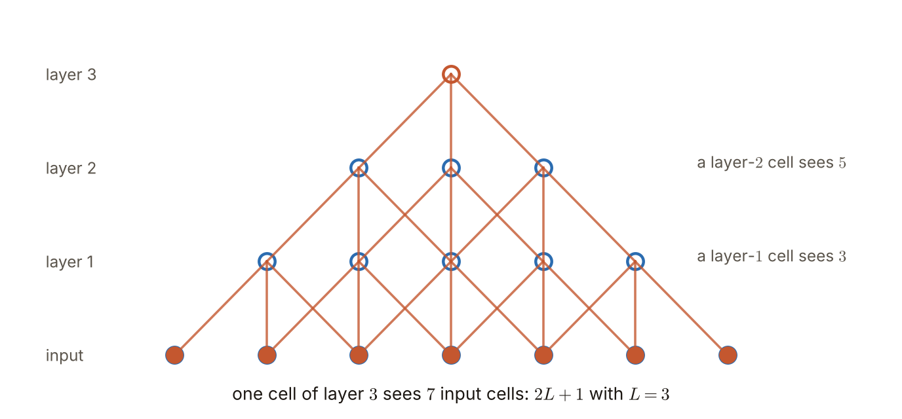
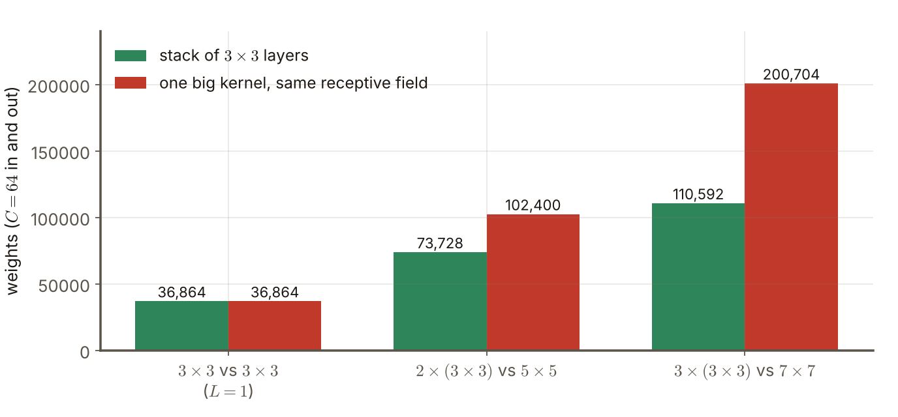
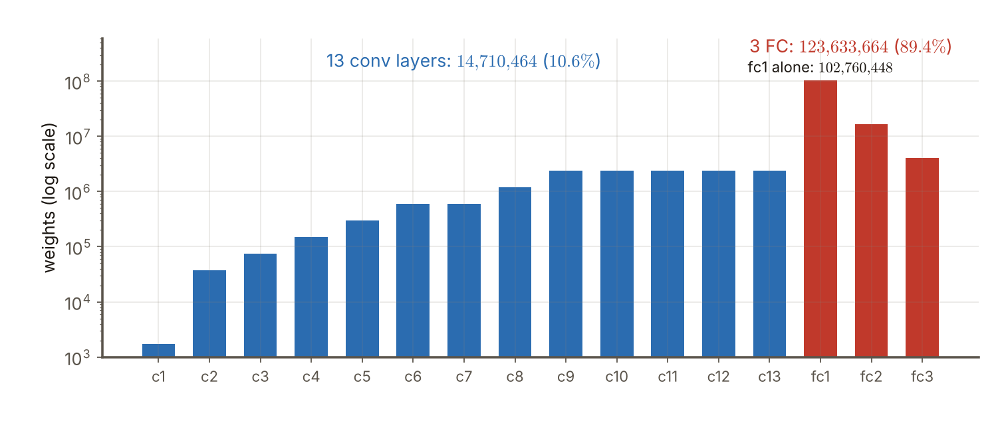

# 第7週 KP03：VGG，用 3×3 小核堆出深度（VGG: depth from stacks of 3×3 kernels）

> 程度：大學生
>
> Level: Undergraduate (undergrad)

本講義是第7週「卷積神經網路（二）：經典架構」的第三個知識點（KP03）。AlexNet 只有八層，還用了 $11\times11$ 的大核。這一節問：如果把網路明顯加深，同時把核縮到最小，會發生什麼？VGG 的答案是：幾乎全用 $3\times3$ 的小核，一層一層堆上去。

This is the third knowledge point (KP03) of Week 7, "Convolutional neural networks (2): classic architectures". AlexNet has only eight layers and uses a large $11\times11$ kernel. This note asks: what happens if we make the network clearly deeper and shrink the kernels to the smallest size? VGG's answer is to use almost only $3\times3$ kernels and stack them layer upon layer.

先備知識是第6週 KP07 的步幅、補邊與輸出尺寸公式，KP08 的最大池化，第3週的動量、第4週的 L2 權重衰減，以及 KP02 的 AlexNet。第一次出現的詞與符號都會定義。所有數字都由 `assets/figures/src/lec07-kp03-figures.py` 算出，可以自己重算。

The prerequisites are the stride, padding and output-size formula of Week 6 KP07, the max pooling of KP08, the momentum of Week 3, the L2 weight decay of Week 4 and the AlexNet of KP02. Every term and symbol is defined when it first appears. Every number is computed by `assets/figures/src/lec07-kp03-figures.py`, so you can recompute it yourself.

[下載本單元投影片](../slides/lec07-kp03-vgg-infographic-voiced.jbd.json)

[Download the slides of this unit (English)](../slides/lec07-kp03-vgg-en.jbd.json)

## KP03 VGG，用 3×3 小核堆出深度（VGG: depth from stacks of 3×3 kernels）

### 學習目標（Learning objectives）

讀完之後，你能說出 VGG 想回答的問題，以及它「幾乎全用 $3\times3$ 核」的設計。你能算出 $L$ 層 $3\times3$ 堆疊的感受野，並比較它與單一大核的權重個數。你能說出 stride $1$、padding $1$ 的卷積為什麼讓空間尺寸不變，以及縮小尺寸靠什麼。你能列出 VGG 的池化、全連接與激活設定，並說出它為什麼不用 LRN。你也能說出訓練用的超參數，並算出一個 VGG-16 的各層權重。

After reading, you can state the question VGG tries to answer and its design of "almost only $3\times3$ kernels". You can compute the receptive field of a stack of $L$ layers of $3\times3$ and compare its number of weights with that of one big kernel. You can say why a convolution with stride $1$ and padding $1$ keeps the spatial size and what is used to shrink it. You can list the pooling, fully connected and activation settings of VGG and say why it does not use LRN. You can also state the training hyperparameters and compute the weights of each layer of a VGG-16.

### 符號表（Symbols）

| 符號 | 中文意義 | English meaning |
|---|---|---|
| $L$ | 堆疊的 $3\times3$ 卷積層數 | number of stacked $3\times3$ convolutional layers |
| $C$ | 輸入與輸出的通道數（本講義的例子兩者相同） | number of input and output channels (equal in this note's examples) |
| $n$ | 特徵圖的邊長 | side of the feature map |
| $\eta$ | 學習率 | learning rate |
| $\lambda$ | $\ell_2$ 權重衰減係數 | $\ell_2$ weight-decay coefficient |

本講義的指標一律從 $0$ 開始數，公式不含偏置，權重個數也不含偏置，與第6週相同。

Indices start at $0$, the formulas have no bias and the numbers of weights do not count biases, as in Week 6.

### 1. VGG 在問什麼（What VGG asks）

VGG 出自牛津大學的 Visual Geometry Group。它的問題很單純：**網路明顯加深，能不能學到更複雜、更有層次的特徵？** 深度增加，可學習的參數會暴增，也有過擬合的風險。VGG 的對策不是先把模型變瘦，而是用更大的訓練集。

VGG comes from the Visual Geometry Group of the University of Oxford. Its question is simple: **if the network is made clearly deeper, can it learn more complex and more hierarchical features?** More depth makes the learnable parameters explode and brings a risk of overfitting. VGG's remedy is not to slim the model first but to use a larger training set.

它的設計是：幾乎全程使用 $3\times3$ 卷積核，只有少數地方插入 $1\times1$ 核，用來對各通道的數值做線性變換（通道混和）。小核的好處是參數好控制，不容易過擬合，這對很深的網路特別重要。下一節用數字說明為什麼。

Its design is to use $3\times3$ convolution kernels almost everywhere, inserting a $1\times1$ kernel only in a few places to apply a linear transformation to the values across channels (channel mixing). The benefit of small kernels is that the parameters are easy to control and overfitting is less likely, which matters especially for very deep networks. The next section explains with numbers why.

### 2. 為什麼是 3×3 的堆疊（Why stacks of 3×3）

先看一個 $3\times3$ 層：輸出的一格，看得到輸入的 $3\times3$ 區域，這個區域叫**感受野**（receptive field）。再疊一層 $3\times3$：上一層的每一格各看 $3$ 格，而相鄰的兩格又互相重疊，所以第二層的一格看得到輸入的 $5$ 格寬。疊第三層，變成 $7$ 格寬。每多一層，感受野的邊長多 $2$：

Start with one $3\times3$ layer: one output cell sees a $3\times3$ region of the input, and this region is called the **receptive field**. Stack another $3\times3$ layer: each cell of the previous layer sees $3$ cells, and neighbouring cells overlap, so a cell of the second layer sees $5$ input cells in width. With a third layer it is $7$ wide. Every extra layer adds $2$ to the side of the receptive field:

$$
\text{感受野邊長 side of the receptive field}=2L+1 .
$$

**圖說 `lec07-kp03-rf`**〔功能：空間幾何具象化〕：先看最上面的那一格（第 $3$ 層）：它只連到下一層的 $3$ 格。再往下看：這 $3$ 格各自又連到 $3$ 格，彼此重疊，所以第 $1$ 層共有 $5$ 格被牽涉。最後看最下排：實心的 $7$ 個點全部被這一格「看見」，所以三層 $3\times3$ 的感受野是 $7$。

**Caption `lec07-kp03-rf`** [Function: making the spatial geometry concrete]: First look at the top cell (layer $3$): it connects to only $3$ cells of the layer below. Then look further down: each of these $3$ connects to $3$ cells, overlapping each other, so $5$ cells of layer $1$ are involved. Finally look at the bottom row: all $7$ filled dots are "seen" by this one cell, so the receptive field of three $3\times3$ layers is $7$.

三層 $3\times3$ 的感受野，和一個 $7\times7$ 的大核一樣大。那為什麼要堆三層小的？因為權重比較少。設輸入與輸出都是 $C$ 個通道。一個 $3\times3$ 層有 $9C^{2}$ 個權重，三層是 $27C^{2}$；一個 $7\times7$ 層有 $49C^{2}$ 個。$27/49=0.551$，只要 $55.1\%$。

The receptive field of three $3\times3$ layers is as large as that of one $7\times7$ kernel. Why then stack three small ones? Because there are fewer weights. Let the input and output both have $C$ channels. A $3\times3$ layer has $9C^{2}$ weights, three layers have $27C^{2}$; one $7\times7$ layer has $49C^{2}$. $27/49=0.551$, only $55.1\%$.

取 $C=64$ `[補充]`：三層 $3\times3$ 是 $27\times64^{2}=110{,}592$ 個權重，一個 $7\times7$ 是 $49\times64^{2}=200{,}704$ 個，少了 $90{,}112$。兩層 $3\times3$ 對一個 $5\times5$：$73{,}728$ 對 $102{,}400$，是 $18/25=72\%$。

Take $C=64$ `[Added]`: three $3\times3$ layers have $27\times64^{2}=110{,}592$ weights and one $7\times7$ has $49\times64^{2}=200{,}704$, which is $90{,}112$ fewer. Two $3\times3$ layers against one $5\times5$: $73{,}728$ against $102{,}400$, which is $18/25=72\%$.

**圖說 `lec07-kp03-params`**〔功能：精準度〕：先看最左邊一組：只有一層時，兩種做法一樣，各是 $36{,}864$。再看中間：要同樣看到 $5$ 格寬，兩層 $3\times3$ 的綠色比一個 $5\times5$ 的紅色矮。最後看右邊：要看到 $7$ 格寬，差距拉到 $90{,}112$。感受野愈大，小核堆疊省得愈多。

**Caption `lec07-kp03-params`** [Function: precision]: First look at the group on the far left: with a single layer the two approaches are the same, $36{,}864$ each. Then the middle: to see $5$ cells in width, the green two $3\times3$ layers are shorter than the red single $5\times5$. Finally the right: to see $7$ cells in width the gap grows to $90{,}112$. The larger the receptive field, the more the stack of small kernels saves.

還有一個好處 `[補充]`：每個卷積層後面都接一次 ReLU，三層 $3\times3$ 有三次非線性，一個 $7\times7$ 只有一次。同樣大的感受野，堆疊的版本表達力更強。

There is one more benefit `[Added]`: every convolutional layer is followed by a ReLU, so three $3\times3$ layers have three non-linearities while one $7\times7$ has only one. For the same receptive field the stacked version is more expressive.

常見錯誤：以為小核「看得比較少」。單一層確實只看 $3\times3$，但堆疊後的感受野和大核一樣大，而且參數更少。

Common error: thinking that small kernels "see less". One layer indeed sees only $3\times3$, but after stacking the receptive field is as large as that of the big kernel, with fewer parameters.

### 3. 尺寸不縮的卷積，縮小靠池化（Convolutions that keep the size, and pooling that shrinks it）

輸入是 $224\times224\times3$ 的影像，先對 RGB 三個通道各減去它們的均值（零中心化）。所有 $3\times3$ 卷積的步幅都是 $1$，補邊（padding）是 $1$。用第6週 KP07 的公式，輸出邊長是 $\lfloor(n+2\times1-3)/1\rfloor+1=n$：**空間尺寸不變**。如果不補邊，$224$ 會縮成 $222$，每疊一層就少兩格，邊緣的資訊逐層被丟掉；到了邊長只有 $7$ 的深處，再疊三層就只剩 $1$ 格 `[補充]`。

The input is a $224\times224\times3$ image, from which the mean of each of the three RGB channels is first subtracted (zero-centering). Every $3\times3$ convolution has stride $1$ and padding $1$. With the formula of Week 6 KP07 the output side is $\lfloor(n+2\times1-3)/1\rfloor+1=n$: the **spatial size does not change**. Without padding $224$ would shrink to $222$, losing two cells per layer and discarding the information at the edges layer by layer; deep inside, where the side is only $7$, three more layers would leave just $1$ cell `[Added]`.

降低解析度不靠卷積，靠池化：最大池化的窗寬是 $2$、步幅是 $2$，窗與窗不重疊，長寬各減半。這和 AlexNet 窗寬 $3$、步幅 $2$ 的重疊池化不同。每池化一次，邊長減半：$224\to112\to56\to28\to14\to7$，共五次 `[補充]`。

The resolution is lowered not by convolution but by pooling: the max-pooling window has width $2$ and stride $2$, the windows do not overlap and both height and width are halved. This differs from the overlapping pooling of AlexNet with window $3$ and stride $2$. Each pooling halves the side: $224\to112\to56\to28\to14\to7$, five times `[Added]`.

分工變得很乾淨：**卷積只負責抽特徵，池化只負責縮小。** 這讓每一段的尺寸一眼就能算出來。

The division of labour becomes very clean: **convolutions only extract features and pooling only shrinks.** This makes the size of every stage computable at a glance.

### 4. 全連接、激活與不用 LRN（Fully connected layers, activations and no LRN）

卷積之後接三層全連接：$4096\to4096\to1000$，最後的 $1000$ 對應 ILSVRC 的 $1000$ 類。隱藏層用 ReLU，輸出層用 softmax。多數 VGG 版本**不用**局部響應正規化（LRN），原因是實驗上 LRN 在 ILSVRC 上沒有幫助。這與 KP02 的 AlexNet 形成對比：AlexNet 在第 $1$、$2$ 層用 LRN，VGG 把它拿掉了。

After the convolutions come three fully connected layers, $4096\to4096\to1000$, where the final $1000$ corresponds to the $1000$ classes of ILSVRC. Hidden layers use ReLU and the output layer uses softmax. Most VGG versions **do not use** local response normalization (LRN), because in experiments LRN did not help on ILSVRC. This contrasts with the AlexNet of KP02: AlexNet used LRN in layers $1$ and $2$ and VGG dropped it.

來源沒有給卷積層的層數，說它依版本而異。為了算數字，取最常被引用的 **VGG-16**：$13$ 層卷積加 $3$ 層全連接，共 $16$ 層 `[補充]`。VGG-16 的卷積全是 $3\times3$，沒有 $1\times1$ `[補充]`。卷積的通道數依序是 $64,64\,|\,128,128\,|\,256,256,256\,|\,512,512,512\,|\,512,512,512$，每段之後一次池化；全連接層的輸入是 $7\times7\times512$ 個數。

The source gives no number of convolutional layers and says it depends on the version. To compute numbers take the most frequently cited **VGG-16**: $13$ convolutional layers plus $3$ fully connected layers, $16$ layers in all `[Added]`. All convolutions of VGG-16 are $3\times3$ and there is no $1\times1$ `[Added]`. The channels of the convolutions are $64,64\,|\,128,128\,|\,256,256,256\,|\,512,512,512\,|\,512,512,512$, with one pooling after each group; the input of the fully connected layers is $7\times7\times512$ numbers.

每一層的權重個數是 $3\times3\times C_{\mathrm{in}}\times C_{\mathrm{out}}$。第 $1$ 層：$9\times3\times64=1{,}728$。第 $2$ 層：$9\times64\times64=36{,}864$。最大的卷積層是 $512\to512$，每層 $9\times512\times512=2{,}359{,}296$。$13$ 層卷積合計 $14{,}710{,}464$。全連接：$7\times7\times512\times4096=102{,}760{,}448$、$4096\times4096=16{,}777{,}216$、$4096\times1000=4{,}096{,}000$，合計 $123{,}633{,}664$。

The number of weights of a layer is $3\times3\times C_{\mathrm{in}}\times C_{\mathrm{out}}$. Layer $1$: $9\times3\times64=1{,}728$. Layer $2$: $9\times64\times64=36{,}864$. The largest convolutional layers are $512\to512$, each $9\times512\times512=2{,}359{,}296$. The $13$ convolutional layers add up to $14{,}710{,}464$. Fully connected: $7\times7\times512\times4096=102{,}760{,}448$, $4096\times4096=16{,}777{,}216$ and $4096\times1000=4{,}096{,}000$, adding up to $123{,}633{,}664$.

**圖說 `lec07-kp03-vgg16`**〔功能：一目了然〕：先看藍色：卷積層的權重隨通道數增加，一路爬到每層約 $236$ 萬。再看紅色最左的 `fc1`：$1.03$ 億，比最大的卷積層高了約 $44$ 倍。最後看兩個標示：全連接占了 $89.4\%$，單單 `fc1` 就占 $74.3\%$。

**Caption `lec07-kp03-vgg16`** [Function: seeing it at a glance]: First look at the blue: the weights of the convolutional layers climb with the number of channels up to about $2.36$ million per layer. Then look at the leftmost red `fc1`: $103$ million, about $44$ times the largest convolutional layer. Finally look at the two labels: the fully connected layers hold $89.4\%$ and `fc1` alone holds $74.3\%$.

全部合計 $138{,}344{,}128$ 個權重；加上偏置（卷積 $4224$ 個、全連接 $9{,}192$ 個），是 $138{,}357{,}544$，這就是常被引用的「約 $1.38$ 億個參數」。和 KP02 的 AlexNet（約 $6100$ 萬）比，深度加倍，參數也多了一倍多，而且仍然有近九成在全連接層。

The total is $138{,}344{,}128$ weights; with the biases ($4224$ for the convolutions and $9{,}192$ for the fully connected layers) it is $138{,}357{,}544$, the often-quoted "about $138$ million parameters". Compared with the AlexNet of KP02 (about $61$ million) the depth doubles and the parameters more than double, and almost $90\%$ are still in the fully connected layers.

常見錯誤：以為 VGG 把全連接層也換成小核。它的末端仍是三層全連接，而且這三層占了近九成參數。

Common error: thinking that VGG replaces the fully connected layers by small kernels as well. Its end is still three fully connected layers, and they hold almost $90\%$ of the parameters.

### 5. 訓練配方（The training recipe）

VGG 的訓練設定是一份實務配方：

The training settings of VGG are a practical recipe:

| 項目 | 設定 | 白話 |
|---|---|---|
| 優化器 | 帶動量的 mini-batch SGD | 第3週的 SGD 加動量 |
| 批量大小 | $256$ | 每次用 $256$ 張圖算一次梯度 |
| 動量係數 | $0.9$ | 保留上一步方向的九成 |
| $\ell_2$ 權重衰減 | $\lambda=5\times10^{-4}$ | 第4週的 L2 正則化，抑制權重變大 |
| 初始學習率 | $\eta=10^{-2}$ | 起步的步長 |
| 學習率調整 | 驗證準確率進入平台期時除以 $10$ | 學不動了就把步子縮小 |

| Item | Setting | In plain words |
|---|---|---|
| optimizer | mini-batch SGD with momentum | the SGD with momentum of Week 3 |
| batch size | $256$ | one gradient is computed from $256$ images at a time |
| momentum coefficient | $0.9$ | keep nine tenths of the previous direction |
| $\ell_2$ weight decay | $\lambda=5\times10^{-4}$ | the L2 regularization of Week 4, keeping the weights from growing |
| initial learning rate | $\eta=10^{-2}$ | the step size at the start |
| learning-rate schedule | divide by $10$ when the validation accuracy reaches a plateau | when learning stalls, shrink the steps |

用數字看 `[補充]`：ILSVRC 約 $120$ 萬張圖，批量 $256$ 時，一個 epoch（把所有圖看一遍）要 $1{,}200{,}000/256=4687.5$，也就是 $4688$ 次更新。學習率每遇一次平台期除以 $10$：$10^{-2}\to10^{-3}\to10^{-4}$。

Look at numbers `[Added]`: ILSVRC has about $1.2$ million images, and with batch size $256$ one epoch (one pass over all images) takes $1{,}200{,}000/256=4687.5$, that is $4688$ updates. Each time a plateau is met the learning rate is divided by $10$: $10^{-2}\to10^{-3}\to10^{-4}$.

這份配方裡，第 $1$ 節說的「用更大的訓練集對抗過擬合」之外，L2 權重衰減是另一道防線：深網路參數多，權重衰減不讓它們任意變大。初始化沿用 KP01 的想法；來源沒有說 VGG 用哪一種。

In this recipe, besides the "larger training set against overfitting" of Section 1, L2 weight decay is another line of defence: a deep network has many parameters and weight decay keeps them from growing arbitrarily. The initialization follows the ideas of KP01; the source does not say which kind VGG uses.

### 本單元重點整理（KP03 summary）

**一句話重點**：VGG 以「幾乎全用 $3\times3$ 核、stride $1$、padding $1$，用 $2\times2$ 池化縮小」堆出深度：$L$ 層 $3\times3$ 的感受野是 $2L+1$，權重比單一大核少；末端仍是 $4096$-$4096$-$1000$ 的全連接，不用 LRN。

**One-sentence summary**: VGG builds depth by "almost only $3\times3$ kernels, stride $1$, padding $1$ and shrinking with $2\times2$ pooling": $L$ layers of $3\times3$ have a receptive field of $2L+1$ with fewer weights than one big kernel; the end is still a $4096$-$4096$-$1000$ fully connected stack, and LRN is not used.

**白話說明**：想看一個 $7$ 格寬的範圍，可以用一支很粗的筆一次掃過去，也可以用三支細筆接力：第一支看 $3$ 格，第二支接著看，第三支再接著看，最後的視野一樣寬，卻省了近一半的材料，還多了兩次思考的機會。

**Plain explanation**: to look at a $7$-cell-wide range you can sweep once with one very thick brush, or you can pass the job along three thin brushes: the first looks at $3$ cells, the second follows, the third follows again, and the final view is just as wide with almost half the material saved and two more chances to think.

**正式定義**：$L$ 層 $3\times3$、stride $1$ 的感受野邊長是 $2L+1$；輸入輸出通道都是 $C$ 時權重是 $9LC^{2}$，單一 $(2L+1)\times(2L+1)$ 核是 $(2L+1)^{2}C^{2}$。補邊 $1$ 時 $\lfloor(n+2-3)/1\rfloor+1=n$。

**Formal definition**: the receptive-field side of $L$ layers of $3\times3$ with stride $1$ is $2L+1$; with $C$ input and output channels the weights are $9LC^{2}$, against $(2L+1)^{2}C^{2}$ for one $(2L+1)\times(2L+1)$ kernel. With padding $1$, $\lfloor(n+2-3)/1\rfloor+1=n$.

**例子**：$C=64$，三層 $3\times3$ 為 $110{,}592$，一個 $7\times7$ 為 $200{,}704$。VGG-16 的 $13$ 層卷積 $14{,}710{,}464$ 個權重，$3$ 層全連接 $123{,}633{,}664$（$89.4\%$），合計 $138{,}344{,}128$。尺寸 $224\to112\to56\to28\to14\to7$。

**Example**: with $C=64$ three $3\times3$ layers have $110{,}592$ and one $7\times7$ has $200{,}704$. The $13$ convolutional layers of VGG-16 have $14{,}710{,}464$ weights and the $3$ fully connected layers $123{,}633{,}664$ ($89.4\%$), $138{,}344{,}128$ in all. Sizes: $224\to112\to56\to28\to14\to7$.

**常見迷思**：

- 「小核看得比較少。」錯，堆疊後的感受野與大核一樣，參數更少。
- 「VGG 把全連接層也拿掉了。」錯，末端仍有三層全連接，占近九成參數。
- 「VGG 靠卷積縮小尺寸。」錯，補邊讓卷積不縮，縮小靠 $2\times2$ 池化。
- 「VGG 和 AlexNet 一樣用 LRN。」錯，多數 VGG 版本不用，因為實驗上沒幫助。

**Common misconceptions**:

- "Small kernels see less." Wrong: after stacking the receptive field equals that of the big kernel, with fewer parameters.
- "VGG removed the fully connected layers too." Wrong: the end still has three fully connected layers holding almost $90\%$ of the parameters.
- "VGG shrinks the size with convolutions." Wrong: padding keeps the size under convolution and shrinking is done by $2\times2$ pooling.
- "VGG uses LRN like AlexNet." Wrong: most VGG versions do not, because it did not help in experiments.

**圖**：本單元有三張圖。

- `lec07-kp03-rf`：三層 $3\times3$ 的感受野是 $7$。
- `lec07-kp03-params`：小核堆疊與單一大核的權重個數。
- `lec07-kp03-vgg16`：VGG-16 各層的權重個數。

三張圖與文中數字都由同一支程式產生：`lec07-kp03-figures.py`。

**Figures**: this unit has three figures.

- `lec07-kp03-rf`: the receptive field of three $3\times3$ layers is $7$.
- `lec07-kp03-params`: the number of weights of a stack of small kernels against one big kernel.
- `lec07-kp03-vgg16`: the number of weights of each layer of VGG-16.

The three figures and the numbers in the text all come from the same program: `lec07-kp03-figures.py`.

**想深入**（選讀）`[補充]`：全連接層的第一層輸入是 $7\times7\times512=25{,}088$ 個數。第6週 KP10 的全域平均池化把每個通道取平均，只剩 $512$ 個數，這一層的權重就從 $102{,}760{,}448$ 降到 $512\times4096=2{,}097{,}152$，少了 $49$ 倍。後來的架構（例如 KP06 的 ResNet）就用這個辦法省掉大部分的全連接參數。

**Going deeper** (optional) `[Added]`: the first fully connected layer takes $7\times7\times512=25{,}088$ numbers. The global average pooling of Week 6 KP10 averages each channel and leaves only $512$ numbers, so the weights of this layer drop from $102{,}760{,}448$ to $512\times4096=2{,}097{,}152$, $49$ times fewer. Later architectures (for example the ResNet of KP06) use this to save most of the fully connected parameters.

**小練習**：

1. 四層 $3\times3$、stride $1$ 堆疊的感受野邊長是多少？
2. `[補充]` 通道數 $C=128$，兩層 $3\times3$ 與一個 $5\times5$ 各有多少權重？前者是後者的幾成？
3. `[補充]` $56\times56$ 的特徵圖經一層 $3\times3$ 卷積，stride $1$：不補邊與補邊 $1$ 的輸出邊長各是多少？再經 $2\times2$、步幅 $2$ 的池化呢？
4. `[補充]` VGG-16 第 $1$ 層（$3\to64$）與第 $2$ 層（$64\to64$）各有多少權重？
5. `[補充]` 若把 VGG-16 `fc1` 前面改成全域平均池化，`fc1` 的權重是多少？少了幾倍？
6. `[補充]` 批量 $256$、$1.2$ 百萬張圖，一個 epoch 要幾次更新？

**Practice**:

1. What is the receptive-field side of four stacked $3\times3$ layers with stride $1$?
2. `[Added]` With $C=128$ channels, how many weights do two $3\times3$ layers and one $5\times5$ have? What fraction of the latter is the former?
3. `[Added]` A $56\times56$ feature map goes through one $3\times3$ convolution with stride $1$: what is the output side without padding and with padding $1$? And after a $2\times2$ pooling with stride $2$?
4. `[Added]` How many weights do layer $1$ ($3\to64$) and layer $2$ ($64\to64$) of VGG-16 have?
5. `[Added]` If a global average pooling is put in front of `fc1` of VGG-16, how many weights does `fc1` have? How many times fewer?
6. `[Added]` With batch size $256$ and $1.2$ million images, how many updates does one epoch take?

**第 1 題解答** `[補充]`：

1. 每多一層，邊長多 $2$：$3,5,7,9$。
2. 公式 $2L+1$，$L=4$ 得 $9$。

**Solution to question 1** `[Added]`:

1. Every extra layer adds $2$ to the side: $3,5,7,9$.
2. The formula $2L+1$ with $L=4$ gives $9$.

**第 2 題解答** `[補充]`：

1. 兩層 $3\times3$：$2\times9\times128^{2}=18\times16{,}384=294{,}912$。
2. 一個 $5\times5$：$25\times16{,}384=409{,}600$。
3. $294{,}912/409{,}600=0.72$，是 $72\%$，與 $18/25$ 相同，和 $C$ 無關。

**Solution to question 2** `[Added]`:

1. Two $3\times3$ layers: $2\times9\times128^{2}=18\times16{,}384=294{,}912$.
2. One $5\times5$: $25\times16{,}384=409{,}600$.
3. $294{,}912/409{,}600=0.72$, that is $72\%$, the same as $18/25$ and independent of $C$.

**第 3 題解答** `[補充]`：

1. 不補邊：$\lfloor(56-3)/1\rfloor+1=54$。
2. 補邊 $1$：$\lfloor(56+2-3)/1\rfloor+1=56$。
3. 補邊後再經 $2\times2$、步幅 $2$ 池化：$\lfloor(56-2)/2\rfloor+1=28$。

**Solution to question 3** `[Added]`:

1. Without padding: $\lfloor(56-3)/1\rfloor+1=54$.
2. With padding $1$: $\lfloor(56+2-3)/1\rfloor+1=56$.
3. With padding and then $2\times2$ pooling with stride $2$: $\lfloor(56-2)/2\rfloor+1=28$.

**第 4 題解答** `[補充]`：

1. 第 $1$ 層：$3\times3\times3\times64=1{,}728$。
2. 第 $2$ 層：$3\times3\times64\times64=36{,}864$。
3. 第 $2$ 層是第 $1$ 層的 $21.3$ 倍，因為輸入通道從 $3$ 變成 $64$。

**Solution to question 4** `[Added]`:

1. Layer $1$: $3\times3\times3\times64=1{,}728$.
2. Layer $2$: $3\times3\times64\times64=36{,}864$.
3. Layer $2$ has $21.3$ times as many as layer $1$ because the input channels go from $3$ to $64$.

**第 5 題解答** `[補充]`：

1. 原來：$7\times7\times512\times4096=25{,}088\times4096=102{,}760{,}448$。
2. 改後輸入只有 $512$ 個數：$512\times4096=2{,}097{,}152$。
3. $102{,}760{,}448/2{,}097{,}152=49$，少了 $49$ 倍，剛好是 $7\times7$。

**Solution to question 5** `[Added]`:

1. Before: $7\times7\times512\times4096=25{,}088\times4096=102{,}760{,}448$.
2. After, the input is only $512$ numbers: $512\times4096=2{,}097{,}152$.
3. $102{,}760{,}448/2{,}097{,}152=49$, $49$ times fewer, exactly $7\times7$.

**第 6 題解答** `[補充]`：

1. $1{,}200{,}000/256=4687.5$。
2. 最後一批不足 $256$ 張，仍算一次更新，所以進位成 $4688$ 次。

**Solution to question 6** `[Added]`:

1. $1{,}200{,}000/256=4687.5$.
2. The last batch has fewer than $256$ images and still counts as one update, so it rounds up to $4688$ updates.

### 小測驗（Quiz，來源原題）

來源的四題都保留原題與全部選項。這一節的來源頁面有標出答案，下面依來源的答案寫解析。

The four questions of the source are kept with all options. The source page marks the answers for this section, and the explanations below follow the source's answers.

1. VGG 的 $3\times3$ 卷積採用 stride 1、padding 1，主要效果是？
   - A. 特徵圖長寬各減半
   - B. 空間尺寸維持不變
   - C. 強制使用 LRN
   - D. 把輸入變成一維向量

2. VGG 末端三層全連接的神經元數依序是？
   - A. 1000-1000-1000
   - B. 4096-1000-10
   - C. 4096-4096-1000
   - D. 120-84-10

3. 與 AlexNet 相比，多數 VGG 版本對 LRN 的態度是？
   - A. 每層必用
   - B. 通常不使用，因實驗上在 ILSVRC 沒幫助
   - C. 用 LRN 取代 ReLU
   - D. 只用在 softmax 之後

4. VGG 的 max pooling 設定為何？
   - A. 視窗 3、stride 1，重疊
   - B. 視窗 2、stride 2，不重疊
   - C. 只用 global average pooling
   - D. 視窗 5、stride 1

1. A $3\times3$ convolution of VGG uses stride 1 and padding 1; what is the main effect?
   - A. Height and width of the feature map are halved
   - B. The spatial size stays the same
   - C. LRN is forced
   - D. The input becomes a one-dimensional vector

2. What are the numbers of neurons of the last three fully connected layers of VGG, in order?
   - A. 1000-1000-1000
   - B. 4096-1000-10
   - C. 4096-4096-1000
   - D. 120-84-10

3. Compared with AlexNet, what is the attitude of most VGG versions to LRN?
   - A. Used in every layer
   - B. Usually not used, because it did not help on ILSVRC in experiments
   - C. LRN replaces ReLU
   - D. Used only after softmax

4. What is the max-pooling setting of VGG?
   - A. Window 3, stride 1, overlapping
   - B. Window 2, stride 2, non-overlapping
   - C. Only global average pooling
   - D. Window 5, stride 1

**題後解析**：

- **第 1 題，B。** $\lfloor(n+2-3)/1\rfloor+1=n$，尺寸不變（第 3 節）；縮小靠池化，A 錯。
- **第 2 題，C。** $4096\to4096\to1000$（第 4 節）。D 是 LeNet 的 $120$-$84$-$10$（第6週 KP02）。
- **第 3 題，B。** 多數版本不用 LRN，因為實驗上沒有幫助（第 4 節）。
- **第 4 題，B。** 窗寬 $2$、步幅 $2$，不重疊，長寬各減半（第 3 節）。A 是重疊池化，那是 AlexNet 的風格（窗 $3$、步幅 $2$）。

**Explanations**:

- **Question 1, B.** $\lfloor(n+2-3)/1\rfloor+1=n$, the size does not change (Section 3); shrinking is done by pooling, so A is wrong.
- **Question 2, C.** $4096\to4096\to1000$ (Section 4). D is the $120$-$84$-$10$ of LeNet (Week 6 KP02).
- **Question 3, B.** Most versions do not use LRN, because it did not help in experiments (Section 4).
- **Question 4, B.** Window $2$ and stride $2$, non-overlapping, halving height and width (Section 3). A is an overlapping pooling, which is the style of AlexNet (window $3$, stride $2$).

**下一個單元的問題**：VGG 靠「更深」往前走，但參數與計算量也一起暴增。能不能不單靠加深，而是讓每一層更聰明地使用小核與大核？下一個單元（KP04）看 Inception 與 GoogLeNet。

**The question for the next unit**: VGG moves forward by "going deeper", but parameters and computation blow up together. Instead of relying on depth alone, can each layer use small and large kernels more cleverly? The next unit (KP04) looks at Inception and GoogLeNet.

### 來源更正與取捨（Corrections to the source）

本講義依 CCC-LNS IDL_115 第4章 KP13（網頁講義）重新撰寫，該教材的第4章包含本課的第6週與第7週。來源的讀取日期是 2026-11-04。來源沒有的內容，都在出現的地方標示 `[補充]`。

This note is rewritten from KP13 of CCC-LNS IDL_115 Chapter 4 (web lecture); Chapter 4 of that material covers Weeks 6 and 7 of this course. The source was accessed on 2026-11-04. Content that the source does not contain is marked `[Added]` where it appears.

- 來源說卷積層數依版本而異，沒有給具體數字，也沒有給任何公式。本講義補上感受野 $2L+1$、小核堆疊與單一大核的權重比較（$C=64$ 的例子）、$224\to7$ 的尺寸鏈，以及 VGG-16 的逐層權重（$13$ 層卷積、通道 $64$ 到 $512$）；這些都由程式算出，標示 `[補充]`。VGG-16 的總數 $138{,}357{,}544$（含偏置）與常見的引用值相符，作為驗算。
- 補邊 $1$ 使尺寸不變是來源的設定（來源沒有講不補邊的後果），本講義用第6週 KP07 的公式驗算，並補上不補邊的對照。
- 來源說對策是「更大的訓練集，而非先把模型變瘦」。本講義保留，並補上 L2 權重衰減也是一道防線的說明。
- 來源沒有說 VGG 的初始化方式，本講義也沒有編造，只說沿用 KP01 的想法。
- 來源的標題寫「深度與感受野」，但沒有講感受野怎麼算；本講義補上，這是新增的核心內容。
- 取捨：來源的小測驗四題原題保留，答案依來源頁面標示，並補上解析。

- The source says the number of convolutional layers depends on the version, gives no concrete numbers and no formulas. This note adds the receptive field $2L+1$, the weight comparison of a stack of small kernels and one big kernel (the $C=64$ example), the size chain $224\to7$ and the weights of each layer of VGG-16 ($13$ convolutional layers, channels $64$ to $512$); these are computed by the program and marked `[Added]`. The total of VGG-16, $138{,}357{,}544$ with biases, agrees with the frequently cited value and serves as a check.
- Padding $1$ keeping the size is the source's setting (the source does not discuss what happens without padding), and this note checks it with the formula of Week 6 KP07 and adds the comparison without padding.
- The source says the remedy is "a larger training set rather than slimming the model first". This note keeps it and adds that L2 weight decay is another line of defence.
- The source does not say how VGG is initialized and this note does not invent it either, only saying that it follows the ideas of KP01.
- The source's title says "depth and receptive field" but does not explain how to compute a receptive field; this note adds it, which is new core content.
- Choices: the four quiz questions of the source are kept as asked, with the answers as marked on the source page and explanations added.

### 術語對照（Terminology）

| 中文 | English |
|---|---|
| VGG | VGG |
| 感受野 | receptive field |
| 小核堆疊 | stack of small kernels |
| 通道混和 | channel mixing |
| 補邊 | padding |
| 零中心化 | zero-centering |
| 最大池化 | max pooling |
| 局部響應正規化 | local response normalization (LRN) |
| 動量 | momentum |
| 權重衰減 | weight decay |
| 學習率 | learning rate |
| 平台期 | plateau |
| 批量大小 | batch size |
