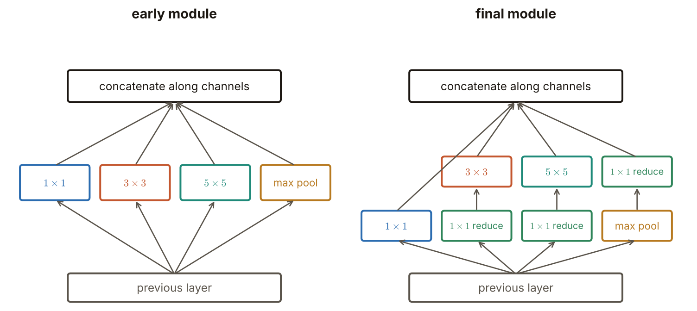
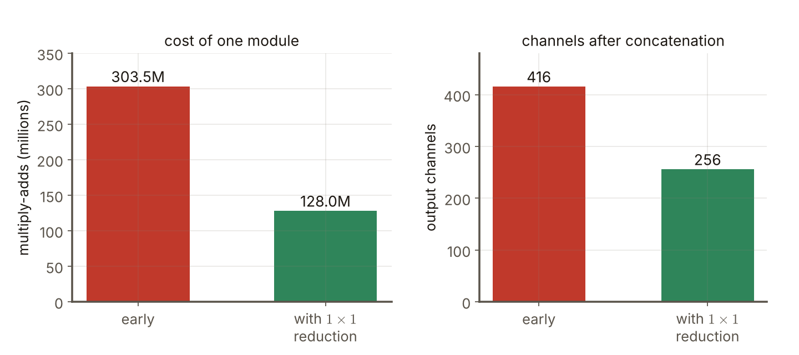

# 第7週 KP04：Inception 與 GoogLeNet，多尺度並列與 1×1 降維（Inception and GoogLeNet: multi-scale branches and 1×1 reduction）

> 程度：大學生
>
> Level: Undergraduate (undergrad)

本講義是第7週「卷積神經網路（二）：經典架構」的第四個知識點（KP04）。VGG 靠「更深」往前走，參數與計算量也一起暴增。這一節問：不單靠加深，能不能讓每一層更聰明地使用小核與大核？Inception 的答案是：同一層裡讓不同大小的核並排工作，再把結果接起來；並且在貴的大核前面，先用 $1\times1$ 卷積把通道壓小。

This is the fourth knowledge point (KP04) of Week 7, "Convolutional neural networks (2): classic architectures". VGG moved forward by "going deeper" and the parameters and computation blew up together. This note asks: instead of relying on depth alone, can each layer use small and large kernels more cleverly? Inception's answer is to let kernels of different sizes work side by side in one layer and join the results; and in front of the expensive large kernels, to first shrink the channels with a $1\times1$ convolution.

先備知識是第6週 KP07 的通道與輸出尺寸、KP03 的小核堆疊與權重個數，以及 KP02 與 KP03 的 AlexNet 與 VGG。第一次出現的詞與符號都會定義。所有數字都由 `assets/figures/src/lec07-kp04-figures.py` 算出，可以自己重算。

The prerequisites are the channels and output size of Week 6 KP07, the stacks of small kernels and numbers of weights of KP03, and the AlexNet and VGG of KP02 and KP03. Every term and symbol is defined when it first appears. Every number is computed by `assets/figures/src/lec07-kp04-figures.py`, so you can recompute it yourself.

[下載本單元投影片](../slides/lec07-kp04-inception-googlenet.jbd.json)

[Download the slides of this unit (English)](../slides/lec07-kp04-inception-googlenet-en.jbd.json)

## KP04 Inception 與 GoogLeNet，多尺度並列與 1×1 降維（Inception and GoogLeNet: multi-scale branches and 1×1 reduction）

### 學習目標（Learning objectives）

讀完之後，你能說出 Inception 想解決的兩個問題：過擬合與計算量暴增。你能畫出早期模組的四條並列路徑，並說出為什麼要同時放 $1\times1$、$3\times3$、$5\times5$ 與池化。你能用一個小例子說明 $1\times1$ 卷積做了什麼。你能算出在 $3\times3$、$5\times5$ 前先降維，計算量與輸出通道各少多少。你也能說出 GoogLeNet 整網的前處理與激活設定。

After reading, you can state the two problems Inception tries to solve: overfitting and exploding computation. You can draw the four parallel paths of the early module and say why $1\times1$, $3\times3$, $5\times5$ and pooling are all put in. You can use a small example to show what a $1\times1$ convolution does. You can compute how much the computation and the output channels shrink when channels are reduced before the $3\times3$ and $5\times5$. You can also state the preprocessing and activation settings of the whole GoogLeNet.

### 符號表（Symbols）

| 符號 | 中文意義 | English meaning |
|---|---|---|
| $h\times w$ | 特徵圖的高與寬（本講義的例子是 $28\times28$） | height and width of the feature map ($28\times28$ in this note's example) |
| $C_{\mathrm{in}},\ C_{\mathrm{out}}$ | 輸入與輸出通道數 | number of input and output channels |
| $k$ | 卷積核邊長 | side of the convolution kernel |
| 乘加 | 一次乘法加一次加法；計算量用乘加個數量 | multiply-add: one multiplication plus one addition; computation is counted in multiply-adds |

一個 $k\times k$ 卷積、輸出尺寸與輸入相同時，乘加個數是 $h\times w\times C_{\mathrm{out}}\times k^{2}\times C_{\mathrm{in}}$，權重個數是 $k^{2}\,C_{\mathrm{in}}\,C_{\mathrm{out}}$ `[補充]`。本講義的指標一律從 $0$ 開始數，公式不含偏置，與第6週相同。

For a $k\times k$ convolution whose output has the same size as the input, the number of multiply-adds is $h\times w\times C_{\mathrm{out}}\times k^{2}\times C_{\mathrm{in}}$ and the number of weights is $k^{2}\,C_{\mathrm{in}}\,C_{\mathrm{out}}$ `[Added]`. Indices start at $0$ and the formulas have no bias, as in Week 6.

### 1. 名字與動機（The name and the motivation）

Inception 模組與 GoogLeNet 出自同一篇工作。名字有雙關：團隊在 Google，同時向 LeNet 致敬。GoogLeNet 獲得 ILSVRC $2014$ 第一名。

The Inception module and GoogLeNet come from the same work. The name is a pun: the team was at Google, and the name also pays tribute to LeNet. GoogLeNet won first place in ILSVRC $2014$.

要讓網路更有能力，有三種辦法：加深、加寬，或兩者並用。但每一種都有兩個代價。一是**過擬合**：參數多，標註資料不夠時，模型容易把訓練資料背起來。二是**計算量暴增**：網路愈大，算得愈久。Inception 的解法是讓網路更**稀疏**：不要每個地方都塞滿密集的運算，只在需要的地方放，這呼應了奧卡姆剃刀（能簡單就不要複雜）。

There are three ways to make a network more capable: deeper, wider, or both. But each has two costs. One is **overfitting**: with many parameters and too little labelled data the model easily memorizes the training data. The other is **exploding computation**: the larger the network the longer it takes. Inception's solution is to make the network more **sparse**: do not fill every place with dense computation but only place it where needed, which echoes Occam's razor (do not use the complex when the simple will do).

常見錯誤：以為加寬或加深不用付代價。兩者都讓參數與計算量變多，要有辦法把它們控制住。

Common error: thinking that going wider or deeper costs nothing. Both increase the parameters and the computation, and one needs a way to keep them under control.

### 2. 早期模組：多尺度並列（The early module: multi-scale branches）

怎麼決定一層要用 $1\times1$、$3\times3$ 還是 $5\times5$？Inception 的想法是：**全部都放，讓網路自己挑**。早期的模組有四條並列的路徑：$1\times1$ 卷積、$3\times3$ 卷積、$5\times5$ 卷積，以及一個 $3\times3$ 的最大池化。四條路徑都吃同一份輸入，輸出沿通道方向接在一起（concatenate）。

How do we decide whether a layer should use $1\times1$, $3\times3$ or $5\times5$? Inception's idea is: **put in all of them and let the network choose**. The early module has four parallel paths: a $1\times1$ convolution, a $3\times3$ convolution, a $5\times5$ convolution and a $3\times3$ max pooling. All four take the same input and their outputs are joined along the channel direction (concatenation).

為什麼要不同大小？淺層裡相關的神經元常在空間上聚成一小團，用 $1\times1$ 卷積就能有效處理；相關的範圍比較廣時，才需要比較大的核。所以各大小的核各負責一種範圍。要接在一起，各路徑的輸出邊長必須相同，所以用補邊讓卷積不縮小尺寸 `[補充]`。

Why different sizes? In shallow layers the related neurons often cluster into a small spatial blob, which a $1\times1$ convolution handles well; only when the related range is wider are larger kernels needed. So each size of kernel is responsible for one range. To join the outputs the paths must have the same side, so padding keeps the size under convolution `[Added]`.

各層裡 $1\times1$、$3\times3$、$5\times5$ 的比例不固定：愈靠近輸出，特徵愈抽象，需要更大的感受野，所以較深的層配置較多的 $3\times3$ 與 $5\times5$。早期模組用的都是小核（最大是 $5\times5$）；來源指出 $5\times5$ 等較大的核昂貴、參數多。

The proportions of $1\times1$, $3\times3$ and $5\times5$ are not fixed across layers: the closer to the output, the more abstract the features and the larger the receptive field needed, so deeper layers have more $3\times3$ and $5\times5$. The early module uses only small kernels (at most $5\times5$); the source points out that the larger kernels such as $5\times5$ are expensive and have many parameters.

### 3. 1×1 卷積在做什麼（What a 1×1 convolution does）

$1\times1$ 卷積看不到鄰居，它只在**同一個位置**上，把各通道的數字做線性組合。可以把它想成：每個位置有一條長度為 $C_{\mathrm{in}}$ 的向量，乘上一個 $C_{\mathrm{in}}\times C_{\mathrm{out}}$ 的矩陣，得到長度 $C_{\mathrm{out}}$ 的新向量。

A $1\times1$ convolution cannot see the neighbours; it only forms linear combinations of the numbers of the channels **at the same position**. Think of it so: each position has a vector of length $C_{\mathrm{in}}$ that is multiplied by a $C_{\mathrm{in}}\times C_{\mathrm{out}}$ matrix to give a new vector of length $C_{\mathrm{out}}$.

用一個小例子看 `[補充]`。兩個位置、三個通道：第一個位置是 $(1,2,3)$，第二個是 $(0,1,1)$。核矩陣是 $3\times2$：$\begin{pmatrix}1&0\\0&1\\1&-1\end{pmatrix}$。第一個位置：$1\times1+2\times0+3\times1=4$，$1\times0+2\times1+3\times(-1)=-1$，得 $(4,-1)$。第二個位置：$(0+0+1,\ 0+1-1)=(1,0)$。三個通道變成兩個通道，空間上的位置完全沒動。

Look at a small example `[Added]`. Two positions and three channels: the first position is $(1,2,3)$ and the second $(0,1,1)$. The kernel matrix is $3\times2$: $\begin{pmatrix}1&0\\0&1\\1&-1\end{pmatrix}$. First position: $1\times1+2\times0+3\times1=4$ and $1\times0+2\times1+3\times(-1)=-1$, giving $(4,-1)$. Second position: $(0+0+1,\ 0+1-1)=(1,0)$. Three channels become two while the spatial positions do not move at all.

所以 $1\times1$ 卷積有兩個用途：一是混合通道（VGG 偶爾用到，KP03 提過），二是**改變通道數**。把通道從多變少，就是降維。

So the $1\times1$ convolution has two uses: one is to mix channels (VGG used it occasionally, as KP03 mentioned) and the other is to **change the number of channels**. Reducing the channels from many to few is dimensionality reduction.

### 4. 最終模組：先降維，再做貴的卷積（The final module: reduce first, then do the expensive convolution）

早期模組有一個問題：大核直接吃很多通道，貴；而最大池化不改變通道數，通道會不斷累積。最終模組加了 $1\times1$ 降維，位置有二：

The early module has a problem: a large kernel taking many channels directly is expensive, and max pooling does not change the number of channels, so the channels keep accumulating. The final module adds $1\times1$ reductions in two places:

- 在昂貴的 $3\times3$、$5\times5$ 卷積**之前**，先用 $1\times1$ 把通道壓小。
- 在最大池化**之後**也接一個 $1\times1$，避免池化使輸出的通道數過多。

- **Before** the expensive $3\times3$ and $5\times5$ convolutions, shrink the channels with a $1\times1$.
- **After** the max pooling, also put a $1\times1$ so that the pooling does not make the number of output channels too large.

**圖說 `lec07-kp04-modules`**〔功能：一目了然〕：先比較左右兩邊的底部：左邊四條路徑直接吃前一層；右邊多了綠色的 $1\times1$ 降維方塊。再看 $3\times3$ 與 $5\times5$：右邊它們不再直接吃前一層，而是先經過綠色方塊。最後看池化那一條：右邊的綠色方塊在池化「之後」。最上面兩邊都一樣：沿通道串接。

**Caption `lec07-kp04-modules`** [Function: seeing it at a glance]: First compare the bottoms of the two sides: on the left the four paths take the previous layer directly; on the right there are green $1\times1$ reduction boxes. Then look at $3\times3$ and $5\times5$: on the right they no longer take the previous layer directly but pass a green box first. Finally the pooling path: on the right the green box comes "after" the pooling. The top is the same on both sides: concatenation along the channels.

來源沒有給通道數。為了算出降維省多少，取 GoogLeNet 的一個模組當例子 `[補充]`：輸入 $28\times28\times192$；$1\times1$ 路徑 $64$ 個核；$3\times3$ 路徑先降到 $96$ 再做 $128$ 個 $3\times3$；$5\times5$ 路徑先降到 $16$ 再做 $32$ 個 $5\times5$；池化路徑後接 $32$ 個 $1\times1$。這組數字是原始 GoogLeNet 的一個模組（3a）的設定，不是來源給的，所有結果都由程式算出。

The source gives no numbers of channels. To compute how much the reduction saves, take one module of GoogLeNet as an example `[Added]`: input $28\times28\times192$; the $1\times1$ path has $64$ kernels; the $3\times3$ path first reduces to $96$ and then applies $128$ kernels of $3\times3$; the $5\times5$ path first reduces to $16$ and then applies $32$ kernels of $5\times5$; the pooling path is followed by $32$ kernels of $1\times1$. These numbers are the settings of one module (3a) of the original GoogLeNet and are not given by the source; all results are computed by the program.

先看 $5\times5$ 這一條。**直接**用 $32$ 個 $5\times5$ 吃 $192$ 個通道：$28\times28\times32\times25\times192=120{,}422{,}400$ 次乘加。**先降維**：$1\times1$ 把 $192$ 降到 $16$，是 $28\times28\times16\times192=2{,}408{,}448$；再做 $5\times5$，是 $28\times28\times32\times25\times16=10{,}035{,}200$；合計 $12{,}443{,}648$。少了 $120{,}422{,}400/12{,}443{,}648=9.68$ 倍，約十分之一。

First the $5\times5$ path. Using $32$ kernels of $5\times5$ **directly** on $192$ channels costs $28\times28\times32\times25\times192=120{,}422{,}400$ multiply-adds. With **reduction first**: the $1\times1$ takes $192$ down to $16$ at $28\times28\times16\times192=2{,}408{,}448$; then the $5\times5$ costs $28\times28\times32\times25\times16=10{,}035{,}200$; together $12{,}443{,}648$. That is $120{,}422{,}400/12{,}443{,}648=9.68$ times fewer, about a tenth.

整個模組：早期做法（沒有降維，池化那條保留全部 $192$ 個通道）合計 $303{,}464{,}448$ 次乘加，輸出 $64+128+32+192=416$ 個通道。最終做法合計 $128{,}049{,}152$ 次乘加，輸出 $64+128+32+32=256$ 個通道。早期做法的計算量是最終做法的 $2.37$ 倍，輸出通道也少了 $160$ 個。

The whole module: the early way (no reduction, the pooling path keeping all $192$ channels) costs $303{,}464{,}448$ multiply-adds in total and outputs $64+128+32+192=416$ channels. The final way costs $128{,}049{,}152$ in total and outputs $64+128+32+32=256$ channels. The computation of the early way is $2.37$ times that of the final way, and the output has $160$ fewer channels.

| 路徑 | 早期（乘加） | 最終（乘加，含降維） |
|---|---|---|
| $1\times1$ | $9{,}633{,}792$ | $9{,}633{,}792$ |
| $3\times3$ | $173{,}408{,}256$ | $14{,}450{,}688+86{,}704{,}128=101{,}154{,}816$ |
| $5\times5$ | $120{,}422{,}400$ | $2{,}408{,}448+10{,}035{,}200=12{,}443{,}648$ |
| 池化後的 $1\times1$ | 無 | $4{,}816{,}896$ |
| 合計 | $303{,}464{,}448$ | $128{,}049{,}152$ |

| Path | Early (multiply-adds) | Final (multiply-adds, with reduction) |
|---|---|---|
| $1\times1$ | $9{,}633{,}792$ | $9{,}633{,}792$ |
| $3\times3$ | $173{,}408{,}256$ | $14{,}450{,}688+86{,}704{,}128=101{,}154{,}816$ |
| $5\times5$ | $120{,}422{,}400$ | $2{,}408{,}448+10{,}035{,}200=12{,}443{,}648$ |
| $1\times1$ after pooling | none | $4{,}816{,}896$ |
| Total | $303{,}464{,}448$ | $128{,}049{,}152$ |

**圖說 `lec07-kp04-cost`**〔功能：精準度〕：先看左圖：紅色是早期模組的 $303.5$ 百萬次乘加，綠色是加了降維的 $128.0$ 百萬次，不到一半。再看右圖：輸出通道從 $416$ 降到 $256$。降維沒有把輸出弄窄到不能用：四條路徑仍然都在，只是每條路徑吃得更少。

**Caption `lec07-kp04-cost`** [Function: precision]: First look at the left plot: red is the $303.5$ million multiply-adds of the early module and green is the $128.0$ million with the reduction, less than half. Then the right plot: the output channels fall from $416$ to $256$. The reduction does not narrow the output until it is unusable: all four paths are still there and each simply takes in less.

權重個數也一樣：這個模組早期做法是 $387{,}072$ 個，最終做法是 $163{,}328$ 個。

The number of weights follows suit: this module has $387{,}072$ in the early way and $163{,}328$ in the final way.

常見錯誤：以為 $1\times1$ 降維會讓網路「看不清楚」。$1\times1$ 只是對通道做線性壓縮，而且前後都有 ReLU；$3\times3$ 與 $5\times5$ 仍然負責看空間。

Common error: thinking that a $1\times1$ reduction makes the network "see less clearly". The $1\times1$ only compresses the channels linearly, with ReLU around it; the $3\times3$ and $5\times5$ still do the looking in space.

### 5. 整個 GoogLeNet（The whole GoogLeNet）

GoogLeNet 把這種模組一層一層疊起來當骨幹。前處理與 VGG 相同：輸入 $224\times224\times3$ 的影像，減去 RGB 各通道的均值（零中心化）。所有卷積，包括模組內部的卷積，都用 ReLU。

GoogLeNet stacks such modules layer by layer as its backbone. The preprocessing is the same as for VGG: the input is a $224\times224\times3$ image from which the mean of each RGB channel is subtracted (zero-centering). All convolutions, including those inside the modules, use ReLU.

來源沒有給 GoogLeNet 的層數、各層通道數或參數量，本講義也不編造這些數字。能確定的是設計的邏輯：用多尺度並列取代單一大小的核，用 $1\times1$ 降維控制計算量，用堆疊模組加深網路。

The source gives no number of layers, channels per layer or parameters for GoogLeNet and this note does not invent them. What can be stated with certainty is the logic of the design: replace a single kernel size by multi-scale branches, control the computation with $1\times1$ reduction and deepen the network by stacking modules.

### 本單元重點整理（KP04 summary）

**一句話重點**：Inception 模組讓 $1\times1$、$3\times3$、$5\times5$ 與池化並列，沿通道串接，並在 $3\times3$、$5\times5$ 之前與池化之後加 $1\times1$ 降維，用更少的計算與參數拿到多尺度的特徵。

**One-sentence summary**: the Inception module puts $1\times1$, $3\times3$, $5\times5$ and pooling side by side, concatenates along the channels, and adds $1\times1$ reductions before the $3\times3$ and $5\times5$ and after the pooling, getting multi-scale features with less computation and fewer parameters.

**白話說明**：像拍團體照時同時用廣角、標準、望遠三支鏡頭拍，再把照片疊在一起。為了不讓底片太多太貴，先把原圖縮成小張，再交給貴的鏡頭處理。

**Plain explanation**: it is like taking a group photo with a wide-angle, a standard and a telephoto lens at once and then stacking the photos. To avoid too much expensive film, the original is first shrunk to a small print and only then handed to the expensive lenses.

**正式定義**：沿通道串接 $[y_{1\times1},\,y_{3\times3},\,y_{5\times5},\,y_{\mathrm{pool}}]$；$k\times k$ 卷積的乘加個數 $h\,w\,C_{\mathrm{out}}k^{2}C_{\mathrm{in}}$；先經 $1\times1$ 降到 $r$ 個通道，再做 $k\times k$：$h\,w\,r\,C_{\mathrm{in}}+h\,w\,C_{\mathrm{out}}k^{2}r$。

**Formal definition**: concatenate along the channels $[y_{1\times1},\,y_{3\times3},\,y_{5\times5},\,y_{\mathrm{pool}}]$; the multiply-adds of a $k\times k$ convolution are $h\,w\,C_{\mathrm{out}}k^{2}C_{\mathrm{in}}$; with a $1\times1$ reduction to $r$ channels first and then the $k\times k$: $h\,w\,r\,C_{\mathrm{in}}+h\,w\,C_{\mathrm{out}}k^{2}r$.

**例子**：輸入 $28\times28\times192$ 的模組，$5\times5$ 路徑直接做 $120{,}422{,}400$ 次乘加，先降到 $16$ 個通道只要 $12{,}443{,}648$（$9.68$ 倍）。整個模組 $303{,}464{,}448\to128{,}049{,}152$ 次乘加，輸出通道 $416\to256$。

**Example**: in a module with input $28\times28\times192$ the $5\times5$ path costs $120{,}422{,}400$ multiply-adds directly and only $12{,}443{,}648$ after reducing to $16$ channels ($9.68$ times). The whole module goes from $303{,}464{,}448$ to $128{,}049{,}152$ multiply-adds and from $416$ to $256$ output channels.

**常見迷思**：

- 「加寬、加深不用付代價。」錯，都讓參數與計算量變多。
- 「$1\times1$ 卷積什麼都沒做。」錯，它在每個位置混合通道，並可改變通道數。
- 「降維會讓網路看不清楚。」錯，空間仍由 $3\times3$、$5\times5$ 負責。
- 「每層的 $1\times1$、$3\times3$、$5\times5$ 比例都一樣。」錯，愈深的層配置愈多大核。

**Common misconceptions**:

- "Going wider or deeper costs nothing." Wrong: both increase the parameters and the computation.
- "A $1\times1$ convolution does nothing." Wrong: it mixes channels at each position and can change the number of channels.
- "Reduction makes the network see less clearly." Wrong: space is still handled by the $3\times3$ and $5\times5$.
- "The proportions of $1\times1$, $3\times3$ and $5\times5$ are the same in every layer." Wrong: deeper layers have more large kernels.

**圖**：本單元有兩張圖。

- `lec07-kp04-modules`：早期模組與最終模組的結構。
- `lec07-kp04-cost`：一個模組的計算量與輸出通道數。

兩張圖與文中數字都由同一支程式產生：`lec07-kp04-figures.py`。

**Figures**: this unit has two figures.

- `lec07-kp04-modules`: the structure of the early module and the final module.
- `lec07-kp04-cost`: the computation and the number of output channels of one module.

Both figures and the numbers in the text come from the same program: `lec07-kp04-figures.py`.

**想深入**（選讀）`[補充]`：$1\times1$ 降維也省權重。$5\times5$ 路徑直接做要 $25\times192\times32=153{,}600$ 個權重，先降維只要 $192\times16+25\times16\times32=3{,}072+12{,}800=15{,}872$，約十分之一。這與 KP03 小核堆疊省權重的思路相通：都是用更便宜的分工，換同樣大的感受野。

**Going deeper** (optional) `[Added]`: the $1\times1$ reduction also saves weights. The $5\times5$ path directly needs $25\times192\times32=153{,}600$ weights; with the reduction first only $192\times16+25\times16\times32=3{,}072+12{,}800=15{,}872$, about a tenth. This is in the same spirit as the weight saving of the stacks of small kernels in KP03: both use a cheaper division of labour to get the same receptive field.

**小練習**：

1. `[補充]` 在 $28\times28\times192$ 的輸入上，用 $64$ 個 $1\times1$ 核，有多少權重？多少次乘加？
2. `[補充]` $3\times3$ 路徑：直接 $128$ 個 $3\times3$ 吃 $192$ 個通道，與先降到 $96$ 再做 $128$ 個 $3\times3$，各有多少權重？
3. `[補充]` 早期模組的池化路徑保留 $192$ 個通道。串接後輸出幾個通道？
4. `[補充]` 兩個位置 $(1,2,3)$ 與 $(0,1,1)$，經 $3\times2$ 的 $1\times1$ 核 $\begin{pmatrix}1&0\\0&1\\1&-1\end{pmatrix}$，輸出各是什麼？
5. 為什麼較深、靠近輸出的 Inception 層配置較多 $3\times3$ 與 $5\times5$？

**Practice**:

1. `[Added]` On an input of $28\times28\times192$, how many weights and how many multiply-adds do $64$ kernels of $1\times1$ have?
2. `[Added]` The $3\times3$ path: how many weights are there for $128$ kernels of $3\times3$ taking $192$ channels directly, and for reducing to $96$ first and then applying $128$ kernels of $3\times3$?
3. `[Added]` The pooling path of the early module keeps $192$ channels. How many channels does the concatenation output?
4. `[Added]` For the two positions $(1,2,3)$ and $(0,1,1)$ and the $3\times2$ $1\times1$ kernel $\begin{pmatrix}1&0\\0&1\\1&-1\end{pmatrix}$, what are the outputs?
5. Why do the deeper layers, close to the output, have more $3\times3$ and $5\times5$ kernels?

**第 1 題解答** `[補充]`：

1. 權重：$1\times1\times192\times64=12{,}288$。
2. 乘加：$28\times28\times12{,}288=784\times12{,}288=9{,}633{,}792$。
3. 這就是早期模組裡 $1\times1$ 那一條的計算量。

**Solution to question 1** `[Added]`:

1. Weights: $1\times1\times192\times64=12{,}288$.
2. Multiply-adds: $28\times28\times12{,}288=784\times12{,}288=9{,}633{,}792$.
3. This is the computation of the $1\times1$ path in the early module.

**第 2 題解答** `[補充]`：

1. 直接：$3\times3\times192\times128=221{,}184$。
2. 先降維：$1\times1\times192\times96=18{,}432$，再 $3\times3\times96\times128=110{,}592$，合計 $129{,}024$。
3. 少了 $221{,}184-129{,}024=92{,}160$ 個；降維後的權重只有直接做的 $129{,}024/221{,}184=58.3\%$。

**Solution to question 2** `[Added]`:

1. Directly: $3\times3\times192\times128=221{,}184$.
2. With reduction: $1\times1\times192\times96=18{,}432$, then $3\times3\times96\times128=110{,}592$, together $129{,}024$.
3. That is $221{,}184-129{,}024=92{,}160$ fewer; the weights with reduction are only $129{,}024/221{,}184=58.3\%$ of the direct way.

**第 3 題解答** `[補充]`：

1. 通道是各路徑通道數相加：$64+128+32+192$。
2. 合計 $416$。
3. 最終模組池化後接 $32$ 個 $1\times1$，改成 $64+128+32+32=256$。

**Solution to question 3** `[Added]`:

1. The channels are the sum over the paths: $64+128+32+192$.
2. The total is $416$.
3. In the final module the pooling is followed by $32$ kernels of $1\times1$, making $64+128+32+32=256$.

**第 4 題解答** `[補充]`：

1. 第一個位置：$(1\times1+2\times0+3\times1,\ 1\times0+2\times1+3\times(-1))=(4,-1)$。
2. 第二個位置：$(0+0+1,\ 0+1-1)=(1,0)$。
3. 三個通道變成兩個，位置不變。

**Solution to question 4** `[Added]`:

1. First position: $(1\times1+2\times0+3\times1,\ 1\times0+2\times1+3\times(-1))=(4,-1)$.
2. Second position: $(0+0+1,\ 0+1-1)=(1,0)$.
3. Three channels become two and the positions stay.

**第 5 題解答**：

1. 愈靠近輸出，特徵愈抽象，需要看更廣的範圍。
2. 感受野更大才能處理較廣的空間相關，所以配置較多 $3\times3$ 與 $5\times5$。
3. 淺層的相關多聚成小團，$1\times1$ 就夠用。

**Solution to question 5**:

1. The closer to the output, the more abstract the features, which need a wider range.
2. A larger receptive field is needed for the wider spatial correlation, hence more $3\times3$ and $5\times5$.
3. In shallow layers the correlation mostly clusters into small blobs and $1\times1$ is enough.

### 小測驗（Quiz，來源原題）

來源的四題都保留原題與全部選項。來源頁面有標出答案，下面依來源的答案寫解析。

The four questions of the source are kept with all options. The source page marks the answers, and the explanations below follow the source's answers.

1. 最終版 Inception 模組相對早期設計多了什麼？
   - A. 把所有核改成 $7\times7$
   - B. 在 $3\times3$、$5\times5$ 之前以及 pooling 之後加入 $1\times1$ 降維
   - C. 拿掉所有 $1\times1$
   - D. 用全連接層取代卷積

2. Inception 用 $1\times1$ 卷積的主要動機是？
   - A. 專門做影像上色
   - B. 線性變換特徵，並在大核之前／pooling 之後降維以降低計算量
   - C. 取代 softmax
   - D. 強制使用 LRN

3. 關於 GoogLeNet，下列何者正確？
   - A. 輸入 $224\times224\times3$ 先減 RGB 均值；以堆疊 Inception 為骨幹；卷積用 ReLU
   - B. 輸入必須是 $32\times32$ 灰階
   - C. 全程不用 ReLU、改用 LRN
   - D. 只有一層 Inception

4. 為什麼較深、靠近輸出的 Inception 層會配置較多 $3\times3$ 與 $5\times5$？
   - A. 需要更大的感受野來處理更抽象的特徵
   - B. 淺層才需要大核
   - C. $1\times1$ 在深層被禁止
   - D. max pooling 只能接在輸出層

1. What does the final Inception module have in addition to the early design?
   - A. All kernels changed to $7\times7$
   - B. $1\times1$ reductions before the $3\times3$ and $5\times5$ and after the pooling
   - C. All $1\times1$ removed
   - D. Fully connected layers replacing the convolutions

2. What is the main motivation for the $1\times1$ convolution in Inception?
   - A. Specially for colourizing images
   - B. A linear transformation of the features and a reduction before the large kernels / after the pooling to lower the computation
   - C. To replace softmax
   - D. To force the use of LRN

3. Which statement about GoogLeNet is correct?
   - A. The $224\times224\times3$ input first has the RGB mean subtracted; stacked Inception modules form the backbone; convolutions use ReLU
   - B. The input must be a $32\times32$ grayscale image
   - C. No ReLU at all, LRN is used instead
   - D. Only one Inception layer

4. Why do the deeper Inception layers, close to the output, have more $3\times3$ and $5\times5$ kernels?
   - A. A larger receptive field is needed for more abstract features
   - B. Only shallow layers need large kernels
   - C. $1\times1$ is forbidden in deep layers
   - D. Max pooling can only be attached to the output layer

**題後解析**：

- **第 1 題，B。** 最終模組在 $3\times3$、$5\times5$ 前以及池化後加 $1\times1$ 降維（第 4 節）。
- **第 2 題，B。** $1\times1$ 對通道做線性變換，並在大核之前、池化之後降維，降低計算量（第 3、4 節）。
- **第 3 題，A。** 前處理與 VGG 相同，骨幹是堆疊的 Inception 模組，卷積用 ReLU（第 5 節）。
- **第 4 題，A。** 愈深特徵愈抽象，需要更大的感受野（第 2 節）。

**Explanations**:

- **Question 1, B.** The final module adds $1\times1$ reductions before the $3\times3$ and $5\times5$ and after the pooling (Section 4).
- **Question 2, B.** The $1\times1$ applies a linear transformation to the channels and reduces before the large kernels and after the pooling, lowering the computation (Sections 3 and 4).
- **Question 3, A.** The preprocessing is the same as for VGG, the backbone is stacked Inception modules and the convolutions use ReLU (Section 5).
- **Question 4, A.** The deeper the more abstract the features and the larger the receptive field needed (Section 2).

**下一個單元的問題**：Inception 與 VGG 都是把影像送進去，吐出一個類別。如果任務不是「整張圖是什麼」，而是「每個畫素是什麼」，網路的輸出就要和輸入一樣大。下一個單元（KP05）看專為分割而生的 U-Net。

**The question for the next unit**: Inception and VGG both take an image and output one class. If the task is not "what is the whole image" but "what is each pixel", the output of the network must be as large as the input. The next unit (KP05) looks at the U-Net built for segmentation.

### 來源更正與取捨（Corrections to the source）

本講義依 CCC-LNS IDL_115 第4章 KP14（網頁講義）重新撰寫，該教材的第4章包含本課的第6週與第7週。來源的讀取日期是 2026-11-04。來源沒有的內容，都在出現的地方標示 `[補充]`。

This note is rewritten from KP14 of CCC-LNS IDL_115 Chapter 4 (web lecture); Chapter 4 of that material covers Weeks 6 and 7 of this course. The source was accessed on 2026-11-04. Content that the source does not contain is marked `[Added]` where it appears.

- 來源沒有給任何通道數、層數、參數量或公式。本講義補上 $1\times1$ 卷積的小例子、乘加與權重的算式，並用 GoogLeNet 一個模組（輸入 $28\times28\times192$）的設定算出降維的效果；這組通道數來自原始 GoogLeNet，不是來源給的，已標示 `[補充]`，所有結果由程式算出。
- 來源說各層的 $1\times1$、$3\times3$、$5\times5$ 比例不固定、較深層配置較多大核。本講義保留，沒有補具體比例。
- 來源說「呼應押注稀疏與奧卡姆剃刀」。本講義保留這個動機，沒有再展開理論。
- 來源沒有說各路徑要補邊讓尺寸相同才能串接；這是接得起來的必要條件，本講義補上並標示。
- 來源沒有給 GoogLeNet 的層數與參數量，本講義也沒有給。
- 取捨：來源的小測驗四題原題保留，答案依來源頁面標示，並補上解析。圖 13、14、15 不採用，改用本講義自己的方塊圖與長條圖。

- The source gives no numbers of channels, layers or parameters and no formulas. This note adds a small example of the $1\times1$ convolution, the formulas of multiply-adds and weights, and uses the settings of one module of GoogLeNet (input $28\times28\times192$) to compute the effect of the reduction; these channel numbers come from the original GoogLeNet and not from the source, are marked `[Added]`, and all results are computed by the program.
- The source says the proportions of $1\times1$, $3\times3$ and $5\times5$ differ across layers and deeper layers have more large kernels. This note keeps it and adds no concrete proportions.
- The source says it "echoes betting on sparsity and Occam's razor". This note keeps the motivation without developing the theory.
- The source does not say that the paths must be padded to the same size before they can be concatenated; this is a necessary condition for joining them and this note adds and marks it.
- The source gives no number of layers or parameters for GoogLeNet and neither does this note.
- Choices: the four quiz questions of the source are kept as asked, with the answers as marked on the source page and explanations added. Figures 13, 14 and 15 are not used; this note's own block diagram and bar charts replace them.

### 術語對照（Terminology）

| 中文 | English |
|---|---|
| Inception 模組 | Inception module |
| GoogLeNet | GoogLeNet |
| 多尺度 | multi-scale |
| 並列路徑 | parallel paths |
| 串接 | concatenation |
| $1\times1$ 卷積 | $1\times1$ convolution |
| 降維 | dimensionality reduction |
| 通道 | channel |
| 稀疏 | sparse |
| 奧卡姆剃刀 | Occam's razor |
| 乘加 | multiply-add |
| 感受野 | receptive field |
| 過擬合 | overfitting |
