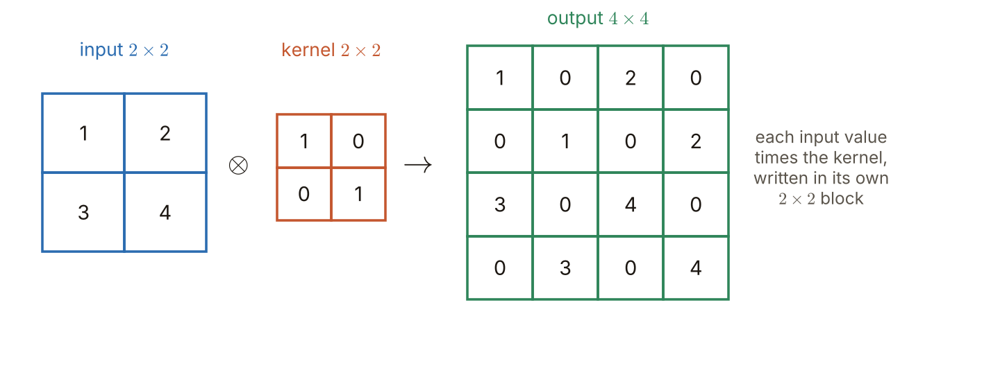
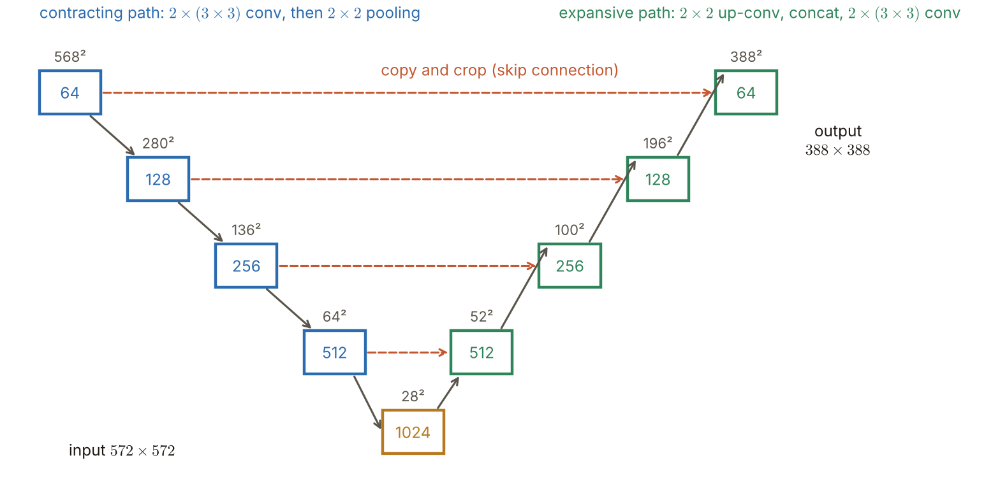

# 第7週 KP05：U-Net，收縮、擴張與跳接（U-Net: contraction, expansion and skip connections）

> 程度：大學生
>
> Level: Undergraduate (undergrad)

本講義是第7週「卷積神經網路（二）：經典架構」的第五個知識點（KP05）。前面的 AlexNet、VGG、Inception 都是「整張圖進去，一個類別出來」。如果任務是「每個畫素屬於哪一類」，輸出就要和輸入一樣大。U-Net 為這件事而設計，最初用在生醫影像的分割。

This is the fifth knowledge point (KP05) of Week 7, "Convolutional neural networks (2): classic architectures". AlexNet, VGG and Inception all take "the whole image in and one class out". If the task is "which class does each pixel belong to", the output must be as large as the input. U-Net was designed for this, first for the segmentation of biomedical images.

先備知識是第6週 KP07 的輸出尺寸公式與補邊、KP08 的最大池化，KP03 的 VGG（通道加倍、$3\times3$ 卷積），以及第2週的 softmax 與交叉熵。第一次出現的詞與符號都會定義。所有數字都由 `assets/figures/src/lec07-kp05-figures.py` 算出，可以自己重算。

The prerequisites are the output-size formula and padding of Week 6 KP07, the max pooling of KP08, the VGG of KP03 (channels doubled, $3\times3$ convolutions), and the softmax and cross-entropy of Week 2. Every term and symbol is defined when it first appears. Every number is computed by `assets/figures/src/lec07-kp05-figures.py`, so you can recompute it yourself.

[下載本單元投影片](../slides/lec07-kp05-unet-infographic-voiced.jbd.json)

[Download the slides of this unit (English)](../slides/lec07-kp05-unet-en.jbd.json)

## KP05 U-Net，收縮、擴張與跳接（U-Net: contraction, expansion and skip connections）

### 學習目標（Learning objectives）

讀完之後，你能說出什麼是分割，以及 U-Net 的收縮路徑與擴張路徑各負責什麼。你能畫出每一步的運算：兩次 $3\times3$ 卷積、池化、轉置卷積與串接。你能用一個小例子算出 $2\times2$ 轉置卷積。你能說出原始 U-Net 為什麼要在跳接前裁切，並算出各層的尺寸與裁切量。你也能說出輸出的形式、逐畫素的交叉熵損失，以及原作的訓練設定。

After reading, you can say what segmentation is and what the contracting and expansive paths of U-Net are each responsible for. You can draw the operations of each step: two $3\times3$ convolutions, pooling, transposed convolution and concatenation. You can use a small example to compute a $2\times2$ transposed convolution. You can say why the original U-Net crops before the skip connection and compute the sizes and crops of each level. You can also state the form of the output, the pixel-wise cross-entropy loss and the training settings of the original work.

### 符號表（Symbols）

| 符號 | 中文意義 | English meaning |
|---|---|---|
| $n$ | 特徵圖的邊長 | side of the feature map |
| $c$ | 類別個數，也是輸出的通道數 | number of classes, also the number of output channels |
| $\mathbb{P}_{p}$ | 畫素 $p$ 的真實類別得到的 softmax 機率 | softmax probability that pixel $p$ gets its true class |
| $\otimes$ | 轉置卷積：每個輸入值乘上核，寫進各自的區塊 | transposed convolution: every input value times the kernel, written into its own block |

本講義的指標一律從 $0$ 開始數，公式不含偏置，權重個數也不含偏置，與第6週相同。

Indices start at $0$, the formulas have no bias and the numbers of weights do not count biases, as in Week 6.

### 1. 名稱與結構：為什麼是 U（The name and the structure: why a U）

U-Net 出自生醫影像分割，是 ISBI 電子顯微鏡神經結構分割挑戰的優勝架構。**分割**（segmentation）是替影像的每個畫素貼上類別標籤，例如「這個畫素是細胞、那個畫素是背景」。

U-Net comes from biomedical image segmentation and was the winning architecture of the ISBI challenge on the segmentation of neuronal structures in electron microscopy. **Segmentation** is putting a class label on every pixel of an image, for example "this pixel is cell and that pixel is background".

它的形狀像字母 U，分成兩段。左邊是**收縮路徑**（contracting path）：一路縮小，負責抓語境，判斷「這一塊大概是什麼組織」。右邊是**擴張路徑**（expansive path）：一路放大，負責精準定位，判斷「邊界在哪個畫素」。

Its shape is like the letter U, in two parts. On the left is the **contracting path**: it shrinks all the way and captures the context, judging "roughly what tissue this region is". On the right is the **expansive path**: it enlarges all the way and does the precise localization, judging "at which pixel the boundary lies".

兩段缺一不可。只知道「大概是細胞」而邊緣對不齊，不行；邊緣很銳利卻看不懂語境，也不行。分割要的是兩者兼得，所以把兩段接成一個 U，中間還用跳接把左邊的細節直接送到右邊。

Neither part can be missing. Knowing only "roughly a cell" with edges that do not line up is not enough; sharp edges without understanding the context is not enough either. Segmentation needs both, so the two parts are joined into a U, and in between skip connections send the details on the left directly to the right.

### 2. 收縮路徑：縮小、加通道（The contracting path: shrink and add channels）

收縮路徑的每一步做三件事：

Every step of the contracting path does three things:

1. 連續兩次 $3\times3$ 卷積，每次後面接 ReLU。
2. 以步幅 $2$ 的 $2\times2$ 最大池化下採樣，邊長減半。
3. 每下採樣一次，特徵通道數加倍。

1. Two successive $3\times3$ convolutions, each followed by ReLU.
2. Downsampling with a $2\times2$ max pooling of stride $2$, halving the side.
3. The number of feature channels doubles at each downsampling.

這和 KP03 的 VGG 很像：小核卷積、$2\times2$ 池化、通道加倍。通道數的起點來源沒有給；原作用 $64$，一路是 $64,128,256,512,1024$ `[補充]`。一邊縮小空間、一邊加深通道，網路看的範圍愈來愈廣，語境也愈來愈多。

This is much like the VGG of KP03: small-kernel convolutions, $2\times2$ pooling and doubled channels. The source does not give the starting number of channels; the original work used $64$, so the channels go $64,128,256,512,1024$ `[Added]`. Shrinking space while deepening the channels, the network looks at an ever wider range and gathers more context.

### 3. 擴張路徑：放大與跳接（The expansive path: enlarging and skip connections）

擴張路徑的每一步同樣有兩次 $3\times3$ 卷積加 ReLU，但**不用池化**，改用 **$2\times2$ 轉置卷積**（transpose convolution，也叫反卷積 deconvolution 或 up-convolution）把特徵圖放大。每上採樣一次，通道數減半。

Every step of the expansive path likewise has two $3\times3$ convolutions with ReLU, but **no pooling**; instead a **$2\times2$ transposed convolution** (also called deconvolution or up-convolution) enlarges the feature map. The number of channels halves at each upsampling.

轉置卷積怎麼算？每個輸入值乘上整個核，寫進輸出裡屬於它的 $2\times2$ 區塊。用一個小例子看 `[補充]`：輸入 $\begin{pmatrix}1&2\\3&4\end{pmatrix}$，核 $\begin{pmatrix}1&0\\0&1\end{pmatrix}$。輸入的 $1$ 乘上核，寫在左上角的 $2\times2$ 區塊，得 $\begin{pmatrix}1&0\\0&1\end{pmatrix}$；輸入的 $2$ 乘上核，寫在右上角，得 $\begin{pmatrix}2&0\\0&2\end{pmatrix}$；其餘類推。拼起來是 $4\times4$：

How is a transposed convolution computed? Each input value is multiplied by the whole kernel and written into its own $2\times2$ block of the output. Look at a small example `[Added]`: the input is $\begin{pmatrix}1&2\\3&4\end{pmatrix}$ and the kernel $\begin{pmatrix}1&0\\0&1\end{pmatrix}$. The input $1$ times the kernel is written into the upper-left $2\times2$ block, giving $\begin{pmatrix}1&0\\0&1\end{pmatrix}$; the input $2$ times the kernel is written into the upper-right block, giving $\begin{pmatrix}2&0\\0&2\end{pmatrix}$; and so on. Put together it is $4\times4$:

$$
\begin{pmatrix}1&0&2&0\\0&1&0&2\\3&0&4&0\\0&3&0&4\end{pmatrix}.
$$

**圖說 `lec07-kp05-transpose`**〔功能：一目了然〕：先看左邊的輸入與中間的核，各是 $2\times2$。再看右邊 $4\times4$ 的輸出，它被分成四個 $2\times2$ 的區塊，每一塊對應一個輸入值：左上區塊是 $1$ 乘上核，右下區塊是 $4$ 乘上核。最後看邊長：從 $2$ 變成 $4$，放大了一倍，而且區塊之間不重疊。

**Caption `lec07-kp05-transpose`** [Function: seeing it at a glance]: First look at the input on the left and the kernel in the middle, each $2\times2$. Then the $4\times4$ output on the right, divided into four $2\times2$ blocks, each corresponding to one input value: the upper-left block is $1$ times the kernel and the lower-right block is $4$ times the kernel. Finally the side: it goes from $2$ to $4$, doubled, and the blocks do not overlap.

放大之後，擴張路徑把它和收縮路徑「同一層」的特徵圖**串接**（concatenate）起來。收縮路徑的特徵圖還保留著細節（邊緣在哪裡），放大的特徵圖帶著語境，兩個疊在一起，後面的卷積就能同時用到兩種資訊。這條由左送到右的捷徑叫**跳接**（skip connection）。

After enlarging, the expansive path **concatenates** the result with the feature map of the "same level" of the contracting path. The feature map of the contracting path still holds the details (where the edges are) and the enlarged one carries the context; stacked together, the convolutions that follow can use both kinds of information. This shortcut from left to right is called a **skip connection**.

常見錯誤：以為轉置卷積是卷積的「反運算」，能把原來的數字還原。它只是把尺寸放大，核裡的數字是學出來的，並不會還原池化丟掉的資訊。

Common error: thinking that the transposed convolution is the "inverse" of convolution and can restore the original numbers. It only enlarges the size, the numbers of the kernel are learned, and it does not restore the information that pooling threw away.

### 4. 尺寸的帳：為什麼要裁切（The size accounting: why cropping is needed）

原始 U-Net 的卷積都**不補邊**（unpadded）：每個 $3\times3$ 卷積讓邊長少 $2$。於是左邊的特徵圖比右邊對應的特徵圖大，無法直接串接，必須先把左邊的圖裁切（crop）到和右邊一樣大。用原作的輸入 $572\times572$ 來算 `[補充]`：

The convolutions of the original U-Net are all **unpadded**: every $3\times3$ convolution cuts $2$ from the side. As a result the feature map on the left is larger than the corresponding one on the right and they cannot be concatenated directly; the left one must first be cropped to the same size as the right one. Compute with the original input $572\times572$ `[Added]`:

| 層級 | 收縮路徑（兩次卷積後） | 擴張路徑放大後 | 左邊要裁掉（每邊） | 擴張路徑兩次卷積後 |
|---|---|---|---|---|
| 1（最上） | $568$ | $392$ | $(568-392)/2=88$ | $388$ |
| 2 | $280$ | $200$ | $(280-200)/2=40$ | $196$ |
| 3 | $136$ | $104$ | $(136-104)/2=16$ | $100$ |
| 4 | $64$ | $56$ | $(64-56)/2=4$ | $52$ |
| 底部 | $28$（池化後 $32$，兩次卷積得 $28$） | | | |

| Level | Contracting path (after two convolutions) | Expansive path after enlarging | Crop of the left map (per side) | Expansive path after two convolutions |
|---|---|---|---|---|
| 1 (top) | $568$ | $392$ | $(568-392)/2=88$ | $388$ |
| 2 | $280$ | $200$ | $(280-200)/2=40$ | $196$ |
| 3 | $136$ | $104$ | $(136-104)/2=16$ | $100$ |
| 4 | $64$ | $56$ | $(64-56)/2=4$ | $52$ |
| bottom | $28$ ($32$ after pooling, $28$ after two convolutions) | | | |

從 $572$ 進去，$568\to284\to280\to140\to136\to68\to64\to32\to28$ 到達底部；再 $56\to52$、$104\to100$、$200\to196$、$392\to388$ 往上。最後輸出是 $388\times388$，比輸入 $572\times572$ 小。

Going in from $572$: $568\to284\to280\to140\to136\to68\to64\to32\to28$ reaches the bottom; then $56\to52$, $104\to100$, $200\to196$, $392\to388$ going up. The final output is $388\times388$, smaller than the input $572\times572$.

**圖說 `lec07-kp05-unet`**〔功能：空間幾何具象化〕：先看藍色的左半：方塊愈往下，邊長愈小（$568\to280\to136\to64$）、通道愈多（$64\to512$）。再看底部的金色方塊：邊長只剩 $28$，通道是 $1024$，這裡的語境最廣。最後看橘色虛線與綠色右半：虛線把左邊每一層的特徵圖送到右邊同一層（複製並裁切），右邊一路放大回到 $388$。

**Caption `lec07-kp05-unet`** [Function: making the spatial geometry concrete]: First look at the blue left half: the lower the box, the smaller the side ($568\to280\to136\to64$) and the more the channels ($64\to512$). Then the gold box at the bottom: the side is only $28$ and the channels $1024$, where the context is widest. Finally the orange dashed lines and the green right half: the dashed lines send the feature map of each level on the left to the same level on the right (copy and crop), and the right side enlarges all the way back to $388$.

現代的實作可以改用補邊（padding）：每個 $3\times3$ 卷積用補邊 $1$，尺寸不變，左右同一層一開始就一樣大，不必裁切，輸出也與輸入一樣大。例如輸入 $256\times256$，收縮路徑是 $256\to128\to64\to32\to16$，擴張路徑放大回 $32\to64\to128\to256$ `[補充]`。

Modern implementations can use padding instead: every $3\times3$ convolution uses padding $1$ and keeps the size, the two sides of one level are equally large from the start, no cropping is needed and the output is as large as the input. For example with an input of $256\times256$ the contracting path goes $256\to128\to64\to32\to16$ and the expansive path enlarges back $32\to64\to128\to256$ `[Added]`.

常見錯誤：以為 U-Net 的輸出一定和輸入一樣大。原始的不補邊版本輸出較小（$572\to388$）；要一樣大需要補邊。

Common error: thinking that the output of U-Net is always as large as the input. The original unpadded version has a smaller output ($572\to388$); the same size needs padding.

### 5. 輸出、損失與訓練（Output, loss and training）

最後一張特徵圖有 $c$ 個通道，每個類別一個，再接 softmax。所以每個畫素得到一組機率，加起來是 $1$。輸出的空間尺寸與（補邊版的）輸入相同。

The last feature map has $c$ channels, one per class, followed by softmax. So every pixel gets a set of probabilities that add up to $1$. The spatial size of the output equals that of the (padded) input.

損失是**交叉熵**（cross-entropy），因為分割就是逐畫素的分類。每個畫素的損失是 $-\log\mathbb{P}_{p}$，$\mathbb{P}_{p}$ 是該畫素的真實類別得到的機率；整張圖取平均。用一個小例子看 `[補充]`：一張 $2\times2$ 的圖，四個畫素的真實類別機率是 $0.7,\,0.5,\,0.9,\,0.2$。四個畫素的損失是 $0.357,\,0.693,\,0.105,\,1.609$，平均是 $0.691$。機率 $0.2$ 的那個畫素錯得最多，損失最大。

The loss is the **cross-entropy**, because segmentation is pixel-wise classification. The loss of one pixel is $-\log\mathbb{P}_{p}$, where $\mathbb{P}_{p}$ is the probability the pixel gets for its true class; it is averaged over the image. Look at a small example `[Added]`: a $2\times2$ image whose four pixels have true-class probabilities $0.7,\,0.5,\,0.9,\,0.2$. The four pixel losses are $0.357,\,0.693,\,0.105,\,1.609$ and the average is $0.691$. The pixel with probability $0.2$ is most wrong and has the largest loss.

原作在 Caffe 上訓練。生醫影像的圖塊很大，所以批量只用 $1$；來源說動量取 $0.9$、與 VGG 相同（KP03）；但 U-Net 原論文寫的是 $0.99$ `[補充]`，這裡以原論文為準提醒讀者。另外，原作的損失還加了一張邊界權重圖，讓相鄰細胞之間的細縫更受重視 `[補充]`；本講義只講逐畫素的交叉熵。U-Net 之後有許多變體，例如把 U 改成 Y 形的 Y-Net。

The original work was trained in Caffe. Biomedical image tiles are large, so the batch size was only $1$; the source says the momentum was $0.9$, the same as for VGG (KP03), but the original U-Net paper gives $0.99$ `[Added]`, and this note points to the paper. The original loss also adds a border weight map that gives more weight to the thin gaps between touching cells `[Added]`; this note covers only the pixel-wise cross-entropy. Many variants followed U-Net, for example Y-Net, which turns the U into a Y.

### 本單元重點整理（KP05 summary）

**一句話重點**：U-Net 用收縮路徑（兩次 $3\times3$ 卷積、$2\times2$ 池化、通道加倍）抓語境，用擴張路徑（$2\times2$ 轉置卷積、通道減半、與左邊同層特徵串接、兩次 $3\times3$ 卷積）做精準定位，輸出每個畫素的類別機率，以逐畫素的交叉熵訓練。

**One-sentence summary**: U-Net captures context with a contracting path (two $3\times3$ convolutions, $2\times2$ pooling, doubled channels) and does precise localization with an expansive path ($2\times2$ transposed convolution, halved channels, concatenation with the same-level feature map on the left, two $3\times3$ convolutions), outputs a class probability for every pixel and is trained with the pixel-wise cross-entropy.

**白話說明**：像先縮小地圖看整體（這一帶是市區），再一步步放大回原比例；放大時，把原本地圖上清楚的街道輪廓貼回來，才不會放大後糊成一團。

**Plain explanation**: it is like first shrinking a map to see the whole (this area is the city centre) and then enlarging it step by step back to the original scale; while enlarging, the clear outlines of the streets from the original map are pasted back, so that the enlarged map does not blur into a mess.

**正式定義**：轉置卷積（$2\times2$、步幅 $2$）：每個輸入值乘上核，寫進輸出中各自不重疊的 $2\times2$ 區塊，邊長乘 $2$。無補邊的 $3\times3$ 卷積讓邊長減 $2$。損失 $\frac1{|P|}\sum_{p}-\log\mathbb{P}_{p}$。

**Formal definition**: transposed convolution ($2\times2$, stride $2$): each input value times the kernel is written into its own non-overlapping $2\times2$ block of the output and the side is multiplied by $2$. An unpadded $3\times3$ convolution reduces the side by $2$. The loss is $\frac1{|P|}\sum_{p}-\log\mathbb{P}_{p}$.

**例子**：輸入 $\begin{pmatrix}1&2\\3&4\end{pmatrix}$、核 $\begin{pmatrix}1&0\\0&1\end{pmatrix}$ 的轉置卷積得 $4\times4$。輸入 $572$ 的原始 U-Net，輸出是 $388$，左邊各層裁掉 $88,40,16,4$。四個畫素的機率 $0.7,0.5,0.9,0.2$，平均損失 $0.691$。

**Example**: a transposed convolution of the input $\begin{pmatrix}1&2\\3&4\end{pmatrix}$ with the kernel $\begin{pmatrix}1&0\\0&1\end{pmatrix}$ gives $4\times4$. For the original U-Net with input $572$ the output is $388$ and the maps on the left are cropped by $88,40,16,4$. Four pixels with probabilities $0.7,0.5,0.9,0.2$ have an average loss of $0.691$.

**常見迷思**：

- 「轉置卷積能還原池化丟掉的資訊。」錯，它只放大尺寸，細節靠跳接補回。
- 「U-Net 的輸出一定和輸入一樣大。」錯，原始不補邊版本是 $572\to388$。
- 「U-Net 只能做醫學影像。」錯，它出自醫學分割，但結構（收縮、擴張、跳接）可用在任何要逐畫素輸出的任務。
- 「分割用的損失和分類不同。」錯，都是交叉熵，只是逐畫素算再平均。

**Common misconceptions**:

- "The transposed convolution restores the information that pooling threw away." Wrong: it only enlarges the size and the details are put back by the skip connections.
- "The output of U-Net is always as large as the input." Wrong: the original unpadded version goes $572\to388$.
- "U-Net is only for medical images." Wrong: it comes from medical segmentation, but the structure (contraction, expansion, skip connection) can be used in any task with pixel-wise output.
- "Segmentation uses a different loss from classification." Wrong: both use cross-entropy, only computed per pixel and then averaged.

**圖**：本單元有兩張圖。

- `lec07-kp05-unet`：U 形架構、各層邊長與通道。
- `lec07-kp05-transpose`：$2\times2$ 轉置卷積的小例子。

兩張圖與文中數字都由同一支程式產生：`lec07-kp05-figures.py`。

**Figures**: this unit has two figures.

- `lec07-kp05-unet`: the U-shaped architecture with the sides and channels of each level.
- `lec07-kp05-transpose`: a small example of a $2\times2$ transposed convolution.

Both figures and the numbers in the text come from the same program: `lec07-kp05-figures.py`.

**想深入**（選讀）`[補充]`：照這個佈局（輸入 $1$ 個通道、輸出 $2$ 類、通道 $64$ 到 $1024$）算，權重總數是 $31{,}023{,}808$（不含偏置），約 $3100$ 萬，和 KP02 的 AlexNet（約 $6100$ 萬）、KP03 的 VGG-16（約 $1.38$ 億）比，小得多。因為 U-Net 沒有龐大的全連接層，全是卷積。

**Going deeper** (optional) `[Added]`: with this layout (input $1$ channel, output $2$ classes, channels $64$ to $1024$) the total number of weights is $31{,}023{,}808$ (without biases), about $31$ million, much smaller than the AlexNet of KP02 (about $61$ million) and the VGG-16 of KP03 (about $138$ million), because U-Net has no huge fully connected layer and is all convolutions.

**小練習**：

1. `[補充]` 輸入 $572$，經兩次無補邊的 $3\times3$ 卷積，再經 $2\times2$、步幅 $2$ 的池化，邊長依序是多少？
2. `[補充]` 擴張路徑某層放大後是 $104$，左邊對應的特徵圖是 $136$。每邊要裁掉多少？
3. `[補充]` 輸入 $\begin{pmatrix}1&2\\3&4\end{pmatrix}$、核 $\begin{pmatrix}1&1\\1&1\end{pmatrix}$ 的 $2\times2$ 轉置卷積（步幅 $2$）輸出是什麼？
4. `[補充]` 三個畫素的真實類別機率是 $0.5,\,0.5,\,0.25$，平均交叉熵損失是多少？
5. `[補充]` 擴張路徑第一步，轉置卷積把 $1024$ 個通道變成 $512$。串接左邊的 $512$ 個通道後共有幾個通道？
6. `[補充]` 若所有卷積都補邊 $1$，輸入 $256$，收縮路徑四次池化後的邊長是多少？

**Practice**:

1. `[Added]` The input is $572$; after two unpadded $3\times3$ convolutions and then a $2\times2$ pooling with stride $2$, what are the successive sides?
2. `[Added]` A level of the expansive path is $104$ after enlarging and the corresponding map on the left is $136$. How much must be cropped per side?
3. `[Added]` What is the output of the $2\times2$ transposed convolution (stride $2$) of the input $\begin{pmatrix}1&2\\3&4\end{pmatrix}$ with the kernel $\begin{pmatrix}1&1\\1&1\end{pmatrix}$?
4. `[Added]` Three pixels have true-class probabilities $0.5,\,0.5,\,0.25$. What is the average cross-entropy loss?
5. `[Added]` In the first step of the expansive path the transposed convolution turns $1024$ channels into $512$. How many channels are there after concatenating the $512$ channels from the left?
6. `[Added]` If all convolutions use padding $1$ and the input is $256$, what is the side after the four poolings of the contracting path?

**第 1 題解答** `[補充]`：

1. 第一次卷積：$572-2=570$。
2. 第二次卷積：$570-2=568$。
3. 池化：$568/2=284$。

**Solution to question 1** `[Added]`:

1. First convolution: $572-2=570$.
2. Second convolution: $570-2=568$.
3. Pooling: $568/2=284$.

**第 2 題解答** `[補充]`：

1. 左邊比右邊大 $136-104=32$。
2. 要從左右兩邊平均裁掉，每邊 $32/2=16$。
3. 裁完左邊也是 $104$，可以和右邊串接。

**Solution to question 2** `[Added]`:

1. The left is larger than the right by $136-104=32$.
2. It is cropped equally from both sides, $32/2=16$ per side.
3. After cropping the left is also $104$ and can be concatenated with the right.

**第 3 題解答** `[補充]`：

1. 輸入 $1$ 乘上全 $1$ 的核，寫成 $\begin{pmatrix}1&1\\1&1\end{pmatrix}$，放左上。
2. 同理 $2$、$3$、$4$ 各填滿自己的 $2\times2$ 區塊。
3. 輸出是 $\begin{pmatrix}1&1&2&2\\1&1&2&2\\3&3&4&4\\3&3&4&4\end{pmatrix}$，等於把每格放大成 $2\times2$。

**Solution to question 3** `[Added]`:

1. The input $1$ times the all-ones kernel is $\begin{pmatrix}1&1\\1&1\end{pmatrix}$, placed at the upper left.
2. Likewise $2$, $3$, $4$ each fill their own $2\times2$ block.
3. The output is $\begin{pmatrix}1&1&2&2\\1&1&2&2\\3&3&4&4\\3&3&4&4\end{pmatrix}$, which enlarges every cell to $2\times2$.

**第 4 題解答** `[補充]`：

1. $-\log0.5=0.693$，兩個畫素各 $0.693$。
2. $-\log0.25=1.386$。
3. 平均：$(0.693+0.693+1.386)/3=0.924$。

**Solution to question 4** `[Added]`:

1. $-\log0.5=0.693$, for each of two pixels.
2. $-\log0.25=1.386$.
3. The average is $(0.693+0.693+1.386)/3=0.924$.

**第 5 題解答** `[補充]`：

1. 轉置卷積後是 $512$ 個通道。
2. 串接左邊的 $512$ 個，共 $512+512=1024$ 個通道。
3. 之後的卷積再把通道降回 $512$。

**Solution to question 5** `[Added]`:

1. After the transposed convolution there are $512$ channels.
2. Concatenating the $512$ from the left gives $512+512=1024$ channels.
3. The following convolutions bring the channels down to $512$ again.

**第 6 題解答** `[補充]`：

1. 補邊後卷積不改變邊長，只有池化減半。
2. 四次池化：$256\to128\to64\to32\to16$。
3. 邊長是 $16$。

**Solution to question 6** `[Added]`:

1. With padding the convolutions do not change the side and only pooling halves it.
2. Four poolings: $256\to128\to64\to32\to16$.
3. The side is $16$.

### 小測驗（Quiz，來源原題）

來源的四題都保留原題與全部選項；來源頁面沒有標出答案，下面的答案與解析是依本講義的內容寫的 `[補充]`。

The four questions of the source are kept with all options; the source page marks no answers, and the answers and explanations below are written from the content of this note `[Added]`.

1. U-Net 收縮路徑與擴張路徑的分工是？
   - A. 兩者都只做分類、不做定位
   - B. 收縮路徑抓上下文，擴張路徑做精準定位
   - C. 收縮路徑只做全連接，擴張路徑只做 LRN
   - D. 兩者功能完全相同、只是畫成 U 形好看

2. 原始 U-Net 在 skip connection 時要先 crop，原因是？
   - A. 因為用了 unpadded 卷積，特徵圖逐步縮小，兩邊尺寸對不齊
   - B. 因為 softmax 會改變空間大小
   - C. 因為 max pooling 的 stride 必須是 3
   - D. 因為輸出通道數必須是 1000

3. U-Net 擴張路徑用來放大特徵圖的運算是？（見 `lec07-kp05-transpose`）
   - A. 再做一次 stride 2 的 max pooling
   - B. $2\times2$ 反卷積／轉置卷積（deconvolution / transpose conv）
   - C. 把影像複製四次
   - D. 只用 $1\times1$ 卷積升空間解析度

4. U-Net 最初主要應用與輸出形式是？
   - A. 手寫數字 10 類分類，輸出 10 維向量
   - B. 生醫影像分割；輸出與輸入同空間尺寸、$c$ 個類別通道＋softmax＋cross-entropy
   - C. 機器翻譯
   - D. 只做超解析度、沒有類別通道

1. What is the division of labour between the contracting and expansive paths of U-Net?
   - A. Both only classify and do no localization
   - B. The contracting path captures the context and the expansive path does the precise localization
   - C. The contracting path only does fully connected layers and the expansive path only LRN
   - D. The two have exactly the same function and are drawn as a U only because it looks nice

2. Why does the original U-Net have to crop before the skip connection?
   - A. Because unpadded convolutions were used, the feature maps shrink step by step and the sizes on the two sides do not match
   - B. Because softmax changes the spatial size
   - C. Because the stride of max pooling must be 3
   - D. Because the number of output channels must be 1000

3. Which operation does the expansive path of U-Net use to enlarge the feature map? (see `lec07-kp05-transpose`)
   - A. Another max pooling with stride 2
   - B. A $2\times2$ deconvolution / transpose convolution
   - C. Copying the image four times
   - D. Only a $1\times1$ convolution to raise the spatial resolution

4. What are the original application and the output form of U-Net?
   - A. 10-class handwritten-digit classification with a 10-dimensional output vector
   - B. Biomedical image segmentation; the output has the same spatial size as the input, $c$ class channels + softmax + cross-entropy
   - C. Machine translation
   - D. Only super-resolution with no class channels

**題後解析** `[補充]`：

- **第 1 題，B。** 收縮路徑縮小並抓語境，擴張路徑放大並定位（第 1 節）。
- **第 2 題，A。** 不補邊使每次卷積少兩格，左邊的圖比右邊大，所以要先裁（第 4 節）。
- **第 3 題，B。** 擴張路徑用 $2\times2$ 轉置卷積放大（第 3 節）。A 是縮小，C、D 不是這個做法。
- **第 4 題，B。** 生醫影像分割，輸出 $c$ 個類別通道、softmax 與逐畫素的交叉熵（第 5 節）。「同空間尺寸」要用補邊的版本；原始不補邊版本略小（第 4 節）。

**Explanations** `[Added]`:

- **Question 1, B.** The contracting path shrinks and captures the context and the expansive path enlarges and localizes (Section 1).
- **Question 2, A.** Without padding every convolution loses two cells, the map on the left is larger than that on the right, and so it must be cropped first (Section 4).
- **Question 3, B.** The expansive path enlarges with a $2\times2$ transposed convolution (Section 3). A shrinks, and C and D are not this method.
- **Question 4, B.** Biomedical segmentation, with $c$ class channels, softmax and the pixel-wise cross-entropy (Section 5). "The same spatial size" needs the padded version; the original unpadded version is slightly smaller (Section 4).

**下一個單元的問題**：網路愈深，效能愈好嗎？經驗上超過大約 $20$ 層以後，再加深反而會讓訓練準確率先飽和、再變差。下一個單元（KP06）看 ResNet 怎麼解決這個退化問題。

**The question for the next unit**: does a deeper network always perform better? Empirically, beyond about $20$ layers, adding more depth makes the training accuracy saturate and then get worse. The next unit (KP06) looks at how ResNet solves this degradation problem.

### 來源更正與取捨（Corrections to the source）

本講義依 CCC-LNS IDL_115 第4章 KP15（網頁講義）重新撰寫，該教材的第4章包含本課的第6週與第7週。來源的讀取日期是 2026-11-04。來源沒有的內容，都在出現的地方標示 `[補充]`。

This note is rewritten from KP15 of CCC-LNS IDL_115 Chapter 4 (web lecture); Chapter 4 of that material covers Weeks 6 and 7 of this course. The source was accessed on 2026-11-04. Content that the source does not contain is marked `[Added]` where it appears.

- 來源說原始 U-Net 用不補邊的卷積、跳接前要裁切，同時又說「輸出與輸入空間尺寸相同」。兩句話互相矛盾：不補邊時輸出比輸入小（$572\to388$）。本講義用不補邊版本算出 $572\to388$，並說明輸出與輸入同尺寸需要補邊的現代實作，這是對來源的更正。
- 來源沒有給通道數、輸入尺寸或參數量。本講義補上通道 $64$ 到 $1024$、輸入 $572$ 的尺寸鏈、各層的裁切量與權重總數 $31{,}023{,}808$，都由程式算出，標示 `[補充]`。
- 來源提到轉置卷積的圖 17，本講義改用自己算的 $2\times2$ 小例子，並加上全 $1$ 核的練習。
- 來源說批量為 $1$、動量 $0.9$ 並說與 VGG 相同。據原論文，動量其實是 $0.99$，本講義在正文提醒並標示 `[補充]`；批量 $1$ 保留。來源說原作在 Caffe 上訓練，保留。
- 取捨：來源的小測驗四題原題保留，補上答案與解析（來源頁面沒有標答案）。圖 16（U-Net 架構）不採用，改用本講義自己的架構圖。

- The source says the original U-Net uses unpadded convolutions and crops before the skip connection, and also says "the output has the same spatial size as the input". The two statements contradict each other: without padding the output is smaller than the input ($572\to388$). This note computes $572\to388$ for the unpadded version and explains that the same size needs the padded modern implementations, which is a correction of the source.
- The source gives no numbers of channels, input size or parameters. This note adds the channels $64$ to $1024$, the size chain for input $572$, the crop of each level and the total number of weights $31{,}023{,}808$, all computed by the program and marked `[Added]`.
- The source mentions Figure 17 of the transposed convolution; this note uses its own computed $2\times2$ example and adds an exercise with the all-ones kernel.
- The source says the batch size is $1$ and the momentum $0.9$, the same as for VGG. According to the original paper the momentum is actually $0.99$; this note points this out in the text, marked `[Added]`, and keeps the batch size $1$. The source says the original work was trained in Caffe, kept.
- Choices: the four quiz questions of the source are kept as asked, with answers and explanations added (the source page marks no answers). Figure 16 (the U-Net architecture) is not used; this note's own architecture figure replaces it.

### 術語對照（Terminology）

| 中文 | English |
|---|---|
| U-Net | U-Net |
| 影像分割 | image segmentation |
| 收縮路徑 | contracting path |
| 擴張路徑 | expansive path |
| 轉置卷積（反卷積） | transposed convolution (deconvolution) |
| 跳接 | skip connection |
| 串接 | concatenation |
| 裁切 | crop |
| 補邊 | padding |
| 交叉熵 | cross-entropy |
| 逐畫素 | pixel-wise |
| 語境 | context |
| 下採樣、上採樣 | downsampling, upsampling |
