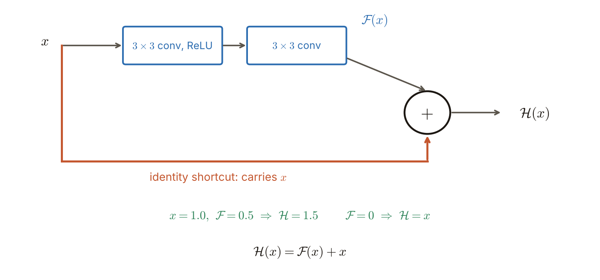
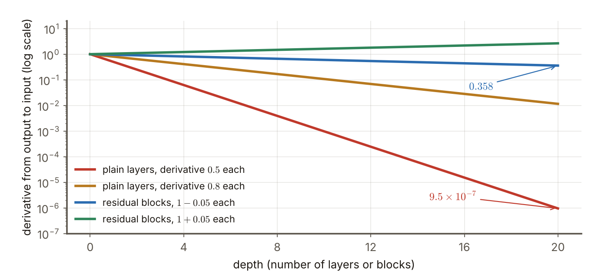

# 第7週 KP06：ResNet，殘差學習（ResNet: residual learning）

> 程度：大學生
>
> Level: Undergraduate (undergrad)

本講義是第7週「卷積神經網路（二）：經典架構」的第六個知識點（KP06）。從 AlexNet 到 VGG，網路愈來愈深，成績也愈來愈好。可是經驗上，超過大約 $20$ 層以後，再加深反而會讓訓練準確率先飽和、再變差。這一節看 ResNet 怎麼解決這個「退化問題」：讓每一組層不學整個目標，只學目標與輸入的差。

This is the sixth knowledge point (KP06) of Week 7, "Convolutional neural networks (2): classic architectures". From AlexNet to VGG the networks got deeper and the results better. But empirically, beyond about $20$ layers, adding more depth makes the training accuracy saturate and then get worse. This note looks at how ResNet solves this "degradation problem": let each group of layers learn not the whole target but only the difference between the target and the input.

先備知識是第3週的反向傳播與連鎖律、KP03 的 VGG 與 KP01 的訊號大小。第一次出現的詞與符號都會定義。所有數字都由 `assets/figures/src/lec07-kp06-figures.py` 算出，可以自己重算。

The prerequisites are the backpropagation and chain rule of Week 3, the VGG of KP03 and the signal size of KP01. Every term and symbol is defined when it first appears. Every number is computed by `assets/figures/src/lec07-kp06-figures.py`, so you can recompute it yourself.

## KP06 ResNet，殘差學習（ResNet: residual learning）

### 學習目標（Learning objectives）

讀完之後，你能說出退化問題是什麼，並分辨它與過擬合的不同。你能寫出殘差學習的式子 $\mathcal{F}(x):=\mathcal{H}(x)-x$ 與 $\mathcal{H}(x)=\mathcal{F}(x)+x$，並說出殘差塊與捷徑的結構。你能解釋為什麼學「差」比學「全部」容易，並用連鎖律說明捷徑讓梯度更容易回到淺層。你也能說出 ResNet 的變體命名，以及它在實務上常當骨幹的用法。

After reading, you can say what the degradation problem is and tell it apart from overfitting. You can write the residual-learning formulas $\mathcal{F}(x):=\mathcal{H}(x)-x$ and $\mathcal{H}(x)=\mathcal{F}(x)+x$ and describe the structure of the residual block and the shortcut. You can explain why learning the "difference" is easier than learning "everything", and use the chain rule to show that the shortcut lets the gradient reach shallow layers more easily. You can also state how the variants of ResNet are named and how it is commonly used as a backbone in practice.

### 符號表（Symbols）

| 符號 | 中文意義 | English meaning |
|---|---|---|
| $x$ | 一組層的輸入 | the input of a group of layers |
| $\mathcal{H}(x)$ | 這組層想要學到的目標映射 | the target mapping this group of layers wants to learn |
| $\mathcal{F}(x)$ | 殘差：目標與輸入的差，$\mathcal{H}(x)-x$ | the residual: the difference between the target and the input, $\mathcal{H}(x)-x$ |
| 捷徑 | 把 $x$ 繞過這組層、直接加到輸出的連線 | shortcut: a connection that bypasses the group of layers and adds $x$ directly to the output |
| $f'$ | 殘差 $\mathcal{F}$ 對 $x$ 的導數（本講義的例子取很小的值） | the derivative of the residual $\mathcal{F}$ with respect to $x$ (very small values in this note's examples) |

本講義的指標一律從 $0$ 開始數，公式不含偏置，權重個數也不含偏置，與第6週相同。

Indices start at $0$, the formulas have no bias and the numbers of weights do not count biases, as in Week 6.

### 1. 退化問題：更深卻更差（The degradation problem: deeper but worse）

經驗上，網路超過大約 $20$ 層後，再加深常常使**訓練準確率**先飽和、再變差。注意是「訓練」準確率變差，不是測試準確率。過擬合的特徵是訓練準確率很高而測試準確率低；這裡連訓練準確率都在下降，所以它不是過擬合，而是**優化出了問題**：網路有能力變好，卻沒有被訓練出來 `[補充]`。

Empirically, beyond about $20$ layers, adding more depth often makes the **training accuracy** saturate and then get worse. Note that it is the "training" accuracy that gets worse, not the test accuracy. Overfitting is characterized by a high training accuracy and a low test accuracy; here even the training accuracy falls, so it is not overfitting but a problem of **optimization**: the network has the capacity to be better and is not being trained into it `[Added]`.

這很奇怪，因為直覺上多出來的層可以學成**恆等映射**（輸出等於輸入，什麼都不改）。那麼深的網路至少能做到和淺的一樣好：前面照淺網路的做法，多出來的層學成恆等。所以更深的網路在理論上不該比淺的差。實際卻做不到，代表要「學成恆等映射」這件事，對一疊普通的層來說並不容易。

This is strange, because intuitively the extra layers could learn the **identity mapping** (output equals input, changing nothing). Then a deep network can do at least as well as a shallow one: the front part does what the shallow network does and the extra layers learn the identity. So in theory a deeper network should not be worse than a shallow one. In practice it cannot be done, which shows that "learning the identity mapping" is not easy for a stack of ordinary layers.

常見錯誤：以為網路變差一定是過擬合。看訓練準確率：訓練準確率也變差，就不是過擬合。

Common error: thinking that a network getting worse must be overfitting. Look at the training accuracy: if the training accuracy gets worse too, it is not overfitting.

### 2. 殘差學習（Residual learning）

ResNet 改了「學什麼」。一般的做法是讓一組堆疊的層直接學目標映射 $\mathcal{H}(x)$。ResNet 讓這組層學的是**殘差**：

ResNet changes "what to learn". The ordinary approach lets a group of stacked layers learn the target mapping $\mathcal{H}(x)$ directly. ResNet lets this group learn the **residual**:

$$
\mathcal{F}(x):=\mathcal{H}(x)-x \tag{9}
$$

移項之後，目標映射寫成

Moving a term over, the target mapping is written

$$
\mathcal{H}(x)=\mathcal{F}(x)+x \tag{10}
$$

實作是**殘差塊**（residual block）：主路由幾層卷積組成，學 $\mathcal{F}$；旁邊有一條**恆等捷徑**（identity shortcut），把輸入 $x$ 原封不動地繞過去，在最後與 $\mathcal{F}(x)$ 相加。整個網路由許多殘差塊堆疊而成。主路取兩層 $3\times3$ 卷積是常見的選擇 `[補充]`。

It is implemented as a **residual block**: the main path consists of a few convolutional layers and learns $\mathcal{F}$; beside it an **identity shortcut** carries the input $x$ around unchanged and adds it to $\mathcal{F}(x)$ at the end. The whole network is a stack of many residual blocks. Two $3\times3$ convolutions are a common choice for the main path `[Added]`.

**圖說 `lec07-kp06-block`**〔功能：一目了然〕：先看上面藍色的主路：兩層 $3\times3$ 卷積，輸出叫 $\mathcal{F}(x)$。再看下面橘色的長線：它是捷徑，把 $x$ 原樣帶過去。最後看右邊的加號：兩條路在這裡相加，得到 $\mathcal{H}(x)=\mathcal{F}(x)+x$。底下的例子：$x=1.0$、$\mathcal{F}=0.5$ 時 $\mathcal{H}=1.5$；如果主路學成 $\mathcal{F}=0$，輸出就等於輸入。

**Caption `lec07-kp06-block`** [Function: seeing it at a glance]: First look at the blue main path on top: two $3\times3$ convolutions whose output is called $\mathcal{F}(x)$. Then the long orange line below: it is the shortcut and carries $x$ over unchanged. Finally the plus sign on the right: the two paths add up here to give $\mathcal{H}(x)=\mathcal{F}(x)+x$. The example at the bottom: with $x=1.0$ and $\mathcal{F}=0.5$ we get $\mathcal{H}=1.5$; if the main path learns $\mathcal{F}=0$ the output equals the input.

相加要求 $\mathcal{F}(x)$ 與 $x$ 的形狀相同。形狀不同時（例如通道數變了），捷徑上要先接一個 $1\times1$ 卷積把 $x$ 變成相同的形狀 `[補充]`。

The addition requires $\mathcal{F}(x)$ and $x$ to have the same shape. When the shapes differ (for example the number of channels changes) a $1\times1$ convolution is first put on the shortcut to turn $x$ into the same shape `[Added]`.

### 3. 為什麼學殘差比較容易（Why learning the residual is easier）

**第一，恆等映射變得很容易。** 一疊普通的層要學成恆等，所有權重要剛好湊成「輸出等於輸入」，很難。殘差塊只要把 $\mathcal{F}$ 學成 $0$，也就是主路的權重趨近 $0$，輸出就是 $x$。把權重推向 $0$ 比湊出恆等容易得多。所以多出來的層，至少不會讓結果更差。

**First, the identity mapping becomes very easy.** For a stack of ordinary layers to learn the identity, all the weights must add up exactly to "output equals input", which is hard. A residual block only has to learn $\mathcal{F}=0$, that is, the weights of the main path go towards $0$, and the output is $x$. Pushing weights towards $0$ is far easier than assembling an identity. So the extra layers will at least not make the result worse.

**第二，梯度比較容易回到淺層。** 反向傳播用連鎖律把梯度從輸出傳回輸入。對 $\mathcal{H}(x)=\mathcal{F}(x)+x$ 微分：

**Second, the gradient reaches the shallow layers more easily.** Backpropagation uses the chain rule to carry the gradient from the output back to the input. Differentiating $\mathcal{H}(x)=\mathcal{F}(x)+x$:

$$
\frac{\partial\mathcal{H}}{\partial x}=\frac{\partial\mathcal{F}}{\partial x}+1 .
$$

多出來的那個 $1$ 來自捷徑。一個殘差塊的導數是「一個小數加 $1$」，不是一個可能很小的數。堆疊許多塊時，把各塊的導數乘起來。

The extra $1$ comes from the shortcut. The derivative of a residual block is "a small number plus $1$" rather than a possibly very small number. When many blocks are stacked, the derivatives of the blocks are multiplied together.

用數字看 `[補充]`（導數是假設的，不是量出來的）。普通的層，若每層的導數是 $0.5$，二十層後是 $0.5^{20}=9.5\times10^{-7}$，梯度幾乎消失；每層是 $0.8$，也只剩 $0.8^{20}=0.0115$。殘差塊，若 $\partial\mathcal{F}/\partial x$ 只是 $\pm0.05$，每塊的導數是 $1.05$ 或 $0.95$，二十塊後是 $1.05^{20}=2.653$ 或 $0.95^{20}=0.358$，與 $1$ 同一個數量級，沒有消失也沒有爆開。

Look at numbers `[Added]` (the derivatives are assumed, not measured). For ordinary layers, if each layer has a derivative of $0.5$ then after twenty layers it is $0.5^{20}=9.5\times10^{-7}$ and the gradient has almost vanished; with $0.8$ per layer only $0.8^{20}=0.0115$ is left. For residual blocks, if $\partial\mathcal{F}/\partial x$ is only $\pm0.05$ the derivative of each block is $1.05$ or $0.95$, and after twenty blocks it is $1.05^{20}=2.653$ or $0.95^{20}=0.358$, of the same order of magnitude as $1$, neither vanishing nor exploding.

**圖說 `lec07-kp06-depth`**〔功能：精準度〕：先看最下面的紅線：普通的層，每層導數 $0.5$，二十層後掉到 $9.5\times10^{-7}$，梯度幾乎傳不回去。再看上面的金色線：每層 $0.8$ 也掉了兩個數量級。最後看藍線與綠線：殘差塊的導數是「$1$ 加一個小數」，二十塊之後仍然在 $0.358$ 到 $2.653$ 之間，沒有消失也沒有爆開。

**Caption `lec07-kp06-depth`** [Function: precision]: First look at the red line at the bottom: ordinary layers with a derivative of $0.5$ per layer fall to $9.5\times10^{-7}$ after twenty layers and the gradient can hardly get back. Then the gold line above: $0.8$ per layer also falls by two orders of magnitude. Finally the blue and green lines: the derivative of a residual block is "$1$ plus a small number" and after twenty blocks it is still between $0.358$ and $2.653$, neither vanishing nor exploding.

**第三，捷徑不花參數。** 恆等捷徑只是把 $x$ 加進去，沒有權重。取通道 $C=64$，一個殘差塊的主路兩層 $3\times3$ 共有 $2\times9\times64\times64=73{,}728$ 個權重，和不加捷徑的普通兩層一樣，捷徑只多一次加法 `[補充]`。

**Third, the shortcut costs no parameters.** The identity shortcut merely adds $x$ and has no weights. With $C=64$ channels the two $3\times3$ layers of the main path of a residual block have $2\times9\times64\times64=73{,}728$ weights, the same as for two ordinary layers without the shortcut; the shortcut costs only one addition `[Added]`.

經驗上，優化殘差 $\mathcal{F}(x)$，比直接優化一個沒有參考點的 $\mathcal{H}(x)$ 容易。這是來源的說法；上面的第一、第二點是它的兩個理由。

Empirically, optimizing the residual $\mathcal{F}(x)$ is easier than directly optimizing an $\mathcal{H}(x)$ without a reference point. This is the source's statement; the first and second points above are two reasons for it.

常見錯誤：以為捷徑讓網路「跳過」了後面的層，所以那些層沒用。捷徑只是多一條路；主路的 $\mathcal{F}$ 仍然在學東西，輸出是兩者相加。

Common error: thinking that the shortcut makes the network "skip" the layers and so those layers are useless. The shortcut is only one more path; the $\mathcal{F}$ of the main path still learns, and the output is the sum of the two.

### 4. 變體與用法（Variants and usage）

ResNet 依層數命名：**ResNet-18、34、50、101**，數字就是網路的層數。層數愈多，能力愈強，也愈慢、愈吃記憶體。筆電等級的任務，往往 ResNet-18 就夠用了。

ResNet is named by its number of layers: **ResNet-18, 34, 50, 101**, where the number is the number of layers of the network. The more layers, the stronger but also the slower and the more memory-hungry. For laptop-level tasks ResNet-18 is often enough.

較深的 $50$、$101$ 層版本常把主路改成 $1\times1$、$3\times3$、$1\times1$ 三層的「瓶頸塊」，先降維再還原，與 KP04 的降維同一個想法 `[補充]`；來源沒有細講。

The deeper $50$- and $101$-layer versions often change the main path to a "bottleneck block" of $1\times1$, $3\times3$, $1\times1$ layers, reducing and then restoring the channels, the same idea as the reduction of KP04 `[Added]`; the source does not go into detail.

在實務與研究裡，ResNet（或其他標準 CNN；來源舉 LeNet 為例）常被當成**骨幹**（backbone）：直接拿來抽特徵，研究的精力放在別的地方，例如新的損失函數。這也是為什麼要熟悉這些經典架構：它們是後來許多模型的底。

In practice and research, ResNet (or another standard CNN; the source gives LeNet as an example) is often used as a **backbone**: taken directly to extract features while the research effort goes elsewhere, for example into new loss functions. This is also why these classic architectures are worth knowing: they are the foundation of many later models.

### 本單元重點整理（KP06 summary）

**一句話重點**：超過約 $20$ 層後訓練準確率反而變差，是優化的退化問題，不是過擬合；ResNet 讓一組層學殘差 $\mathcal{F}(x)=\mathcal{H}(x)-x$，輸出 $\mathcal{H}(x)=\mathcal{F}(x)+x$，恆等捷徑使恆等映射容易學、梯度容易回到淺層，而且不增加參數。

**One-sentence summary**: beyond about $20$ layers the training accuracy gets worse, a degradation problem of optimization and not overfitting; ResNet lets a group of layers learn the residual $\mathcal{F}(x)=\mathcal{H}(x)-x$ with output $\mathcal{H}(x)=\mathcal{F}(x)+x$, and the identity shortcut makes the identity mapping easy to learn, lets the gradient reach shallow layers easily and adds no parameters.

**白話說明**：改作業時，與其把整份作業重寫一遍，不如只把錯的地方圈出來改：原稿（$x$）原封不動留著，只學「要改多少」（$\mathcal{F}$）。沒有要改的地方，改動就是 $0$，原稿原樣保留。

**Plain explanation**: when correcting homework, instead of rewriting the whole thing you only mark and fix the wrong places: the draft ($x$) is kept untouched and only "how much to change" ($\mathcal{F}$) is learned. Where nothing needs changing the change is $0$ and the draft is kept as it was.

**正式定義**：$\mathcal{F}(x):=\mathcal{H}(x)-x$（式 9），$\mathcal{H}(x)=\mathcal{F}(x)+x$（式 10），$\partial\mathcal{H}/\partial x=\partial\mathcal{F}/\partial x+1$。

**Formal definition**: $\mathcal{F}(x):=\mathcal{H}(x)-x$ (formula 9), $\mathcal{H}(x)=\mathcal{F}(x)+x$ (formula 10), $\partial\mathcal{H}/\partial x=\partial\mathcal{F}/\partial x+1$.

**例子**：$x=1.0$、$\mathcal{F}=0.5$ 得 $\mathcal{H}=1.5$；$\mathcal{F}=0$ 得 $\mathcal{H}=x$。每層導數 $0.5$ 的普通層，二十層後 $9.5\times10^{-7}$；每塊 $1.05$ 的殘差塊，二十塊後 $2.653$。$C=64$ 的兩層 $3\times3$ 主路 $73{,}728$ 個權重，捷徑不加權重。

**Example**: $x=1.0$ and $\mathcal{F}=0.5$ give $\mathcal{H}=1.5$; $\mathcal{F}=0$ gives $\mathcal{H}=x$. Ordinary layers with a derivative of $0.5$ per layer reach $9.5\times10^{-7}$ after twenty layers; residual blocks with $1.05$ per block reach $2.653$ after twenty blocks. The main path of two $3\times3$ layers with $C=64$ has $73{,}728$ weights and the shortcut adds none.

**常見迷思**：

- 「更深一定更好。」錯，超過約 $20$ 層的普通網路，訓練準確率會變差。
- 「訓練準確率變差就是過擬合。」錯，過擬合是訓練好、測試差。
- 「捷徑讓後面的層沒有用。」錯，主路的 $\mathcal{F}$ 仍在學，輸出是兩者相加。
- 「捷徑要多花參數。」錯，恆等捷徑沒有權重，只多一次加法。

**Common misconceptions**:

- "Deeper is always better." Wrong: for ordinary networks beyond about $20$ layers the training accuracy gets worse.
- "A worse training accuracy is overfitting." Wrong: overfitting is good on training and bad on testing.
- "The shortcut makes the later layers useless." Wrong: the $\mathcal{F}$ of the main path still learns and the output is the sum.
- "The shortcut costs extra parameters." Wrong: the identity shortcut has no weights, only one more addition.

**圖**：本單元有兩張圖。

- `lec07-kp06-block`：殘差塊與 $\mathcal{H}=\mathcal{F}+x$ 的小例子。
- `lec07-kp06-depth`：普通層與殘差塊的導數連乘。

兩張圖與文中數字都由同一支程式產生：`lec07-kp06-figures.py`。

**Figures**: this unit has two figures.

- `lec07-kp06-block`: the residual block and the small example of $\mathcal{H}=\mathcal{F}+x$.
- `lec07-kp06-depth`: the product of derivatives for ordinary layers and residual blocks.

Both figures and the numbers in the text come from the same program: `lec07-kp06-figures.py`.

**想深入**（選讀）`[補充]`：把 $\mathcal{F}(x)=0.1\,x$ 的塊連續堆十個，每塊把輸入乘 $1.1$，輸出是 $1.1^{10}=2.594$ 倍。殘差塊不是不改變輸入，而是在輸入上「加一點」。若每塊的 $\mathcal{F}$ 都不小，輸出會一路變大，所以實務上還要搭配正規化與合適的初始化（KP01）。

**Going deeper** (optional) `[Added]`: stack ten blocks with $\mathcal{F}(x)=0.1\,x$ in a row; each block multiplies the input by $1.1$ and the output is $1.1^{10}=2.594$ times the input. A residual block does not leave the input unchanged but "adds a little" to it. If the $\mathcal{F}$ of every block is not small the output keeps growing, so in practice normalization and a suitable initialization (KP01) are needed as well.

**小練習**：

1. 殘差塊的輸入 $x=2$，主路輸出 $\mathcal{F}=-0.5$。輸出 $\mathcal{H}$ 是多少？
2. 若希望某一塊輸出等於輸入，主路應該學成什麼？
3. `[補充]` 普通的層，每層的導數是 $0.9$。二十層後是多少？
4. `[補充]` 把 $\mathcal{F}(x)=0.1\,x$ 的塊堆十個，輸出是輸入的幾倍？
5. `[補充]` 通道 $C=128$，兩層 $3\times3$ 的主路有多少權重？恆等捷徑有幾個？
6. 訓練準確率隨深度下降，為什麼不是過擬合？

**Practice**:

1. The input of a residual block is $x=2$ and the main path outputs $\mathcal{F}=-0.5$. What is the output $\mathcal{H}$?
2. If a block is to output exactly its input, what must the main path learn?
3. `[Added]` For ordinary layers each with a derivative of $0.9$, what is the product after twenty layers?
4. `[Added]` Stack ten blocks with $\mathcal{F}(x)=0.1\,x$. By what factor is the output larger than the input?
5. `[Added]` With $C=128$ channels, how many weights does a main path of two $3\times3$ layers have? How many does the identity shortcut have?
6. Why is a training accuracy that falls with depth not overfitting?

**第 1 題解答**：

1. 式 (10)：$\mathcal{H}=\mathcal{F}+x=-0.5+2$。
2. 結果是 $1.5$。

**Solution to question 1**:

1. Formula (10): $\mathcal{H}=\mathcal{F}+x=-0.5+2$.
2. The result is $1.5$.

**第 2 題解答**：

1. 要 $\mathcal{H}(x)=x$，由式 (9) 得 $\mathcal{F}(x)=\mathcal{H}(x)-x=0$。
2. 所以主路只要學成輸出 $0$，也就是權重趨近 $0$。

**Solution to question 2**:

1. For $\mathcal{H}(x)=x$, formula (9) gives $\mathcal{F}(x)=\mathcal{H}(x)-x=0$.
2. So the main path only has to learn to output $0$, that is, its weights go towards $0$.

**第 3 題解答** `[補充]`：

1. 每層導數 $0.9$，二十層連乘 $0.9^{20}$。
2. $0.9^{20}=0.1216$。
3. 即使每層只差一點，連乘二十次也剩約八分之一。

**Solution to question 3** `[Added]`:

1. Each layer has derivative $0.9$ and twenty layers multiply to $0.9^{20}$.
2. $0.9^{20}=0.1216$.
3. Even when every layer is only slightly off, twenty multiplications leave about an eighth.

**第 4 題解答** `[補充]`：

1. 每塊 $\mathcal{H}=\mathcal{F}+x=0.1\,x+x=1.1\,x$。
2. 十塊連乘 $1.1^{10}$。
3. $1.1^{10}=2.594$ 倍。

**Solution to question 4** `[Added]`:

1. Each block gives $\mathcal{H}=\mathcal{F}+x=0.1\,x+x=1.1\,x$.
2. Ten blocks multiply to $1.1^{10}$.
3. $1.1^{10}=2.594$ times.

**第 5 題解答** `[補充]`：

1. 兩層 $3\times3$：$2\times9\times128\times128=2\times9\times16{,}384=294{,}912$。
2. 恆等捷徑只是把 $x$ 加進去，沒有權重，是 $0$ 個。
3. 所以加捷徑不改變權重個數，仍是 $294{,}912$。

**Solution to question 5** `[Added]`:

1. Two $3\times3$ layers: $2\times9\times128\times128=2\times9\times16{,}384=294{,}912$.
2. The identity shortcut merely adds $x$ and has no weights, that is $0$.
3. So adding the shortcut does not change the number of weights, still $294{,}912$.

**第 6 題解答**：

1. 過擬合的特徵是訓練表現好、測試表現差。
2. 這裡訓練準確率本身就下降，連訓練資料都擬合不好。
3. 所以問題在優化，網路沒有被訓練到它本來有能力達到的地方，不是記得太多。

**Solution to question 6**:

1. Overfitting is characterized by good training performance and poor test performance.
2. Here the training accuracy itself falls, and even the training data are fitted poorly.
3. So the problem lies in optimization: the network is not trained to where it has the capacity to reach, rather than remembering too much.

### 小測驗（Quiz，來源原題）

來源本節的四題裡，前兩題屬於這個單元，後兩題（DenseNet、EfficientNet 與 ConvNeXt）放在 KP07。來源頁面沒有標出答案，下面的答案與解析是依本講義的內容寫的 `[補充]`。

Of the four questions of this section of the source, the first two belong to this unit and the last two (DenseNet, EfficientNet and ConvNeXt) are in KP07. The source page marks no answers, and the answers and explanations below are written from the content of this note `[Added]`.

1. 「退化問題」（degradation）指的是？
   - A. 只要超過 3 層就一定無法訓練
   - B. 大約超過 20 層後，再加深可能使訓練準確率飽和甚至下降
   - C. pooling 會讓所有梯度變為零
   - D. 只有 U-Net 會發生、分類網路不會

2. 殘差學習式 (9)(10) 的含義是？
   - A. 直接規定 $\mathcal{H}(x)=0$
   - B. 層去學 $\mathcal{F}(x):=\mathcal{H}(x)-x$，因此目標映射寫成 $\mathcal{H}(x)=\mathcal{F}(x)+x$（shortcut 把 $x$ 加回）
   - C. 把卷積全部換成全連接
   - D. 禁止使用 ReLU

1. What does the "degradation problem" refer to?
   - A. Beyond 3 layers a network can never be trained
   - B. Beyond about 20 layers, adding more depth may make the training accuracy saturate or even fall
   - C. Pooling makes all gradients zero
   - D. It happens only with U-Net and not with classification networks

2. What do the residual-learning formulas (9) and (10) mean?
   - A. They directly set $\mathcal{H}(x)=0$
   - B. The layers learn $\mathcal{F}(x):=\mathcal{H}(x)-x$, so the target mapping is written $\mathcal{H}(x)=\mathcal{F}(x)+x$ (the shortcut adds $x$ back)
   - C. They replace all convolutions by fully connected layers
   - D. They forbid the use of ReLU

**題後解析** `[補充]`：

- **第 1 題，B。** 約 $20$ 層以後訓練準確率先飽和、再變差（第 1 節）。A 把層數說成 $3$ 層、C 與 D 都與退化問題無關。
- **第 2 題，B。** 讓層學殘差 $\mathcal{F}$，輸出加回 $x$（第 2 節）。A、C、D 都不是殘差學習的內容。

**Explanations** `[Added]`:

- **Question 1, B.** After about $20$ layers the training accuracy first saturates and then gets worse (Section 1). A makes it $3$ layers, and C and D have nothing to do with the degradation problem.
- **Question 2, B.** Let the layers learn the residual $\mathcal{F}$ and add $x$ back to the output (Section 2). A, C and D are not what residual learning means.

**下一個單元的問題**：殘差塊用「加法」把前面層的輸出接到後面。如果不加、而是把前面所有層的輸出都接過來，會怎樣？下一個單元（KP07）看 DenseNet，也看 ResNet 之後的 EfficientNet 與 ConvNeXt，並回顧整章。

**The question for the next unit**: a residual block connects the output of an earlier layer to a later one by "addition". What if, instead of adding, we connect the outputs of all earlier layers? The next unit (KP07) looks at DenseNet, and at EfficientNet and ConvNeXt after ResNet, and reviews the whole chapter.

### 來源更正與取捨（Corrections to the source）

本講義依 CCC-LNS IDL_115 第4章 KP16 前半（網頁講義）重新撰寫，該教材的第4章包含本課的第6週與第7週。來源的讀取日期是 2026-11-04。來源沒有的內容，都在出現的地方標示 `[補充]`。

This note is rewritten from the first half of KP16 of CCC-LNS IDL_115 Chapter 4 (web lecture); Chapter 4 of that material covers Weeks 6 and 7 of this course. The source was accessed on 2026-11-04. Content that the source does not contain is marked `[Added]` where it appears.

- 來源說「梯度較容易回到淺層，減輕梯度消失」，沒有給推導。本講義補上 $\partial\mathcal{H}/\partial x=\partial\mathcal{F}/\partial x+1$ 的推導與導數連乘的數字例；例子中的每層導數是**假設值**，不是量出來的，已標示。
- 式 (9)、(10) 的編號沿用來源。
- 來源只說「超過約 $20$ 層」，沒有說明退化與過擬合的區別。本講義補上：退化是訓練準確率下降，不是過擬合。
- 來源沒有說殘差塊主路用幾層卷積，也沒有說形狀不同時怎麼辦。本講義用兩層 $3\times3$ 做例子，並補上形狀不同時用 $1\times1$ 卷積的說明，標示 `[補充]`。
- 來源的互動示範（$x=1.0$、$\mathcal{F}=0.5$、$\mathcal{H}=1.5$；$\mathcal{F}=0$ 時 $\mathcal{H}=x$）保留，放進圖與文中。
- 來源列出 ResNet-18、34、50、101 與「筆電級任務 ResNet-18 就夠」，本講義保留，沒有補各變體的層結構或參數量。
- 取捨：來源的小測驗本節四題，前兩題放在這個單元，原題與全部選項保留，補上答案與解析（來源頁面沒有標答案）。圖 18、19 不採用，改用本講義自己的方塊圖與折線圖。

- The source says "the gradient reaches the shallow layers more easily, easing the vanishing gradient", without a derivation. This note adds the derivation of $\partial\mathcal{H}/\partial x=\partial\mathcal{F}/\partial x+1$ and a numerical example of the product of derivatives; the per-layer derivatives in the example are **assumed values**, not measured, and are marked.
- The numbering of formulas (9) and (10) follows the source.
- The source says only "beyond about $20$ layers" and does not explain the difference between degradation and overfitting. This note adds: degradation is a fall in the training accuracy and not overfitting.
- The source does not say how many convolutional layers the main path of a residual block has, nor what to do when the shapes differ. This note uses two $3\times3$ layers as an example and adds the explanation of a $1\times1$ convolution when the shapes differ, marked `[Added]`.
- The source's interactive demo ($x=1.0$, $\mathcal{F}=0.5$, $\mathcal{H}=1.5$; $\mathcal{H}=x$ when $\mathcal{F}=0$) is kept, in the figure and the text.
- The source lists ResNet-18, 34, 50, 101 and "ResNet-18 is often enough for laptop-level tasks"; this note keeps it and adds no layer structure or parameter count of the variants.
- Choices: of the four quiz questions of this section of the source, the first two are in this unit with the original questions and all options kept and answers and explanations added (the source page marks no answers). Figures 18 and 19 are not used; this note's own block diagram and line chart replace them.

### 術語對照（Terminology）

| 中文 | English |
|---|---|
| ResNet | ResNet |
| 退化問題 | degradation problem |
| 恆等映射 | identity mapping |
| 殘差 | residual |
| 殘差塊 | residual block |
| 捷徑 | shortcut |
| 骨幹 | backbone |
| 連鎖律 | chain rule |
| 梯度消失 | vanishing gradient |
| 過擬合 | overfitting |
| 目標映射 | target mapping |
