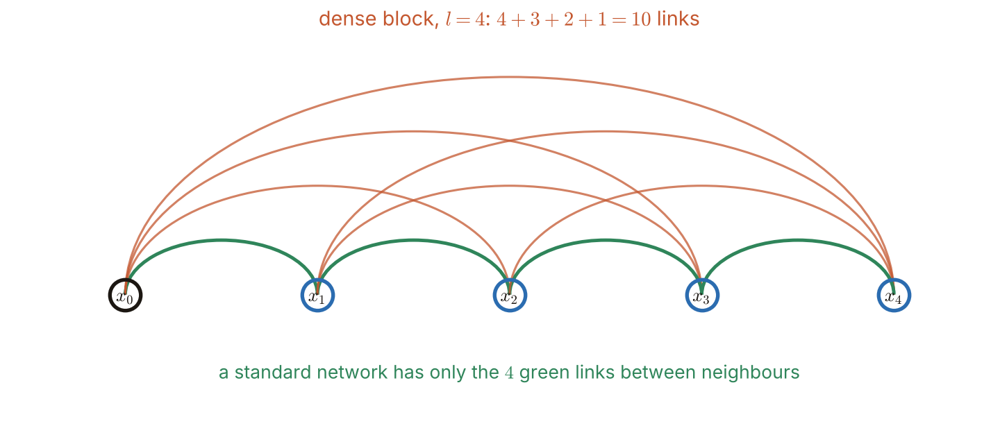
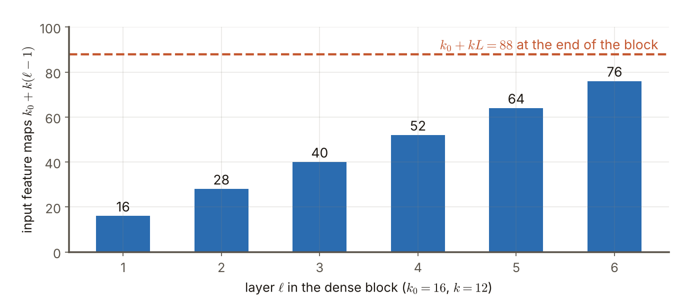

# 第7週 KP07：DenseNet、後續架構與本章回顧（DenseNet, later architectures and a review of the chapter）

> 程度：大學生
>
> Level: Undergraduate (undergrad)

本講義是第7週「卷積神經網路（二）：經典架構」的最後一個知識點（KP07）。KP06 看到殘差塊用「加法」把前面層的輸出接到後面。這一節問：如果把前面**所有**層的輸出都接過來，會怎樣？這就是 DenseNet。接著簡單看 ResNet 之後的兩個架構，EfficientNet 與 ConvNeXt，最後回顧整章。

This is the last knowledge point (KP07) of Week 7, "Convolutional neural networks (2): classic architectures". KP06 saw that a residual block connects the output of an earlier layer to a later one by "addition". This note asks: what if the outputs of **all** earlier layers are connected? This is DenseNet. It then takes a brief look at two architectures after ResNet, EfficientNet and ConvNeXt, and finally reviews the whole chapter.

先備知識是 KP06 的殘差塊與式 (9)(10)、KP04 的串接，以及第4週的批次正規化與第6週 KP08 的平均池化。第一次出現的詞與符號都會定義。所有數字都由 `assets/figures/src/lec07-kp07-figures.py` 算出，可以自己重算。

The prerequisites are the residual block and formulas (9) and (10) of KP06, the concatenation of KP04, the batch normalization of Week 4 and the average pooling of Week 6 KP08. Every term and symbol is defined when it first appears. Every number is computed by `assets/figures/src/lec07-kp07-figures.py`, so you can recompute it yourself.

[下載本單元投影片](../slides/lec07-kp07-densenet-and-beyond.jbd.json)

[Download the slides of this unit (English)](../slides/lec07-kp07-densenet-and-beyond-en.jbd.json)

## KP07 DenseNet、後續架構與本章回顧（DenseNet, later architectures and a review of the chapter）

### 學習目標（Learning objectives）

讀完之後，你能說出密集塊（dense block）的連法，並算出 $l$ 層的連線數 $l(l+1)/2$。你能分辨 ResNet 的加法（式 11）與 DenseNet 的串接（式 12），並說出各自對通道數的影響。你能用成長率 $k$ 算出每一層的輸入特徵圖個數，並說出過渡層做什麼。你能說出 EfficientNet 的複合縮放與 ConvNeXt 的訊息。你也能說出這一週各個經典架構各加了什麼。

After reading, you can describe how a dense block is wired and compute the number $l(l+1)/2$ of connections of $l$ layers. You can tell the addition of ResNet (formula 11) from the concatenation of DenseNet (formula 12) and say what each does to the number of channels. You can use the growth rate $k$ to compute the number of input feature maps of each layer and say what the transition layer does. You can state the compound scaling of EfficientNet and the message of ConvNeXt. You can also say what each classic architecture of this week added.

### 符號表（Symbols）

| 符號 | 中文意義 | English meaning |
|---|---|---|
| $l$ | 密集塊裡的層數 | number of layers in a dense block |
| $x_\ell$ | 第 $\ell$ 層的輸出，$x_0$ 是塊的輸入 | output of layer $\ell$; $x_0$ is the input of the block |
| $\mathcal{F}_\ell$ | 第 $\ell$ 層的運算 | the operation of layer $\ell$ |
| $[x_0,\dots,x_{\ell-1}]$ | 把這些特徵圖沿通道串接 | these feature maps concatenated along the channels |
| $k_0$ | 塊輸入的通道數 | number of channels of the block input |
| $k$ | 成長率：每層卷積產出的特徵圖個數 | growth rate: the number of feature maps each convolution produces |
| $\alpha,\beta,\gamma,\phi$ | 複合縮放的深度、寬度、解析度倍率與總係數 | depth, width and resolution factors of compound scaling and the overall coefficient |

本講義的指標一律從 $0$ 開始數（$x_0$ 是塊的輸入），但密集塊裡的層編號 $\ell$ 從 $1$ 算起；公式不含偏置，權重個數也不含偏置，與第6週相同。小寫的 $l$ 是層數，$\ell$ 是第幾層。

Indices start at $0$ ($x_0$ is the input of the block), but the layer number $\ell$ in a dense block counts from $1$; the formulas have no bias and the numbers of weights do not count biases, as in Week 6. The plain $l$ is the number of layers and $\ell$ is the index of a layer.

### 1. DenseNet：每一層連到後面所有層（DenseNet: every layer connects to all later layers）

ResNet 的捷徑只連「這一塊的輸入」到「這一塊的輸出」。DenseNet 把短接做到極致：在**密集塊**（dense block）裡，每一層以前饋的方式連到**後面所有的層**。

The shortcut of ResNet connects only "the input of this block" to "the output of this block". DenseNet takes shortcuts to the extreme: inside a **dense block** every layer is connected in a feedforward way to **all later layers**.

連線有多少？標準的 $l$ 層網路只連相鄰的層，約有 $l$ 個權重矩陣。DenseNet 的第 $\ell$ 層會收到 $x_0,x_1,\dots,x_{\ell-1}$ 共 $\ell$ 份輸入，所以 $l$ 層共有

How many connections are there? A standard $l$-layer network connects only neighbouring layers and has about $l$ weight matrices. In DenseNet layer $\ell$ receives $\ell$ inputs, $x_0,x_1,\dots,x_{\ell-1}$, so $l$ layers have in all

$$
1+2+\cdots+l=\frac{l(l+1)}{2}
$$

個權重矩陣 `[補充]`（把塊的輸入 $x_0$ 也算作一個來源）。$l=4$ 時是 $10$，標準網路只有 $4$；$l=6$ 時是 $21$ 對 $6$；$l=10$ 時是 $55$ 對 $10$。

weight matrices `[Added]` (counting the input $x_0$ of the block as one source). For $l=4$ it is $10$ against $4$ for a standard network; for $l=6$ it is $21$ against $6$; for $l=10$ it is $55$ against $10$.

**圖說 `lec07-kp07-dense`**〔功能：一目了然〕：先看綠色的 $4$ 條粗弧線：它們連接相鄰的圓圈，就是標準網路的連法。再看橘色的弧線：它們跨過中間的圓圈，把更早的輸出直接接到更後面，共 $6$ 條。最後算總數：每個圓圈都連到它後面的所有圓圈，$4+3+2+1=10$。

**Caption `lec07-kp07-dense`** [Function: seeing it at a glance]: First look at the $4$ thick green arcs: they connect neighbouring circles, which is the wiring of a standard network. Then the orange arcs: they jump over the circles in between and connect earlier outputs directly to much later ones, $6$ of them. Finally count the total: every circle connects to all circles after it, $4+3+2+1=10$.

常見錯誤：以為 DenseNet 的層數特別多。它的重點不是層多，而是**連線**多：每一層都能直接拿到前面所有層的輸出。

Common error: thinking that DenseNet has an especially large number of layers. Its point is not many layers but many **connections**: every layer can directly take the outputs of all earlier layers.

### 2. 加法與串接（Addition and concatenation）

ResNet 與 DenseNet 的差別，在於怎麼把前面的輸出用到後面。ResNet 用**加法**（式 11）：

The difference between ResNet and DenseNet lies in how earlier outputs are used later. ResNet uses **addition** (formula 11):

$$
x_{\ell}=\mathcal{F}_{\ell}\bigl(x_{\ell-1}\bigr)+x_{\ell-1} \tag{11}
$$

DenseNet 用**串接**（式 12）：把前面所有的輸出沿通道接起來，再送進 $\mathcal{F}_\ell$。

DenseNet uses **concatenation** (formula 12): all earlier outputs are joined along the channels and then fed into $\mathcal{F}_\ell$.

$$
x_{\ell}=\mathcal{F}_{\ell}\bigl(\bigl[x_{0},\,x_{1},\,\ldots,\,x_{\ell-1}\bigr]^{\top}\bigr) \tag{12}
$$

對通道數的影響不同：加法要求兩邊形狀相同，相加後通道數不變；串接是把通道疊起來，通道數愈接愈多。在密集塊裡，$\mathcal{F}_\ell$ 通常是批次正規化加 $3\times3$ 卷積加 ReLU（來源還說也可能含池化；但同一個密集塊裡特徵圖邊長必須相同才能串接，所以池化其實放在過渡層 `[補充]`）。DenseNet 原論文的順序是批次正規化、ReLU、卷積 `[補充]`。另外注意：這裡的 $\ell$ 數的是一層運算，KP06 式 (11) 的 $\ell$ 對應的是一個殘差塊（兩層卷積）`[補充]`。

The effect on the number of channels differs: addition requires the two sides to have the same shape and leaves the number of channels unchanged; concatenation stacks the channels and the number grows. In a dense block $\mathcal{F}_\ell$ is usually batch normalization plus a $3\times3$ convolution plus ReLU (the source adds that it may include pooling, but inside one dense block the feature maps must have the same side to be concatenated, so pooling is actually in the transition layers `[Added]`). The order in the original DenseNet paper is batch normalization, ReLU, convolution `[Added]`. Note also that $\ell$ here counts one layer's operation, whereas the $\ell$ of formula (11) in KP06 corresponds to one residual block (two convolutional layers) `[Added]`.

### 3. 成長率與過渡層（The growth rate and the transition layer）

串接會讓通道數一路增加，怎麼控制？每一層卷積只產出**少量**新的特徵圖，個數叫**成長率** $k$。設塊的輸入有 $k_0$ 個通道，第 $\ell$ 層看到 $k_0+k(\ell-1)$ 張輸入特徵圖。經驗上 $k=12$ 這類不大的成長率通常就夠用。

Concatenation makes the number of channels grow all the way; how is it kept in check? Every convolution produces only a **small** number of new feature maps, and this number is the **growth rate** $k$. If the input of the block has $k_0$ channels, layer $\ell$ sees $k_0+k(\ell-1)$ input feature maps. Empirically a small growth rate such as $k=12$ is usually enough.

用數字看 `[補充]`：$k_0=16$、$k=12$、一個塊有 $6$ 層。六層的輸入特徵圖個數是 $16,28,40,52,64,76$，塊的最後共有 $16+6\times12=88$ 個通道。每層 $3\times3$ 卷積產出 $12$ 個，權重是 $9\times(\text{輸入個數})\times12$：$1{,}728,\ 3{,}024,\ 4{,}320,\ 5{,}616,\ 6{,}912,\ 8{,}208$，六層合計 $29{,}808$。

Look at numbers `[Added]`: $k_0=16$, $k=12$ and a block of $6$ layers. The numbers of input feature maps of the six layers are $16,28,40,52,64,76$, and at the end of the block there are $16+6\times12=88$ channels. Each $3\times3$ convolution produces $12$ maps and has $9\times(\text{number of inputs})\times12$ weights: $1{,}728,\ 3{,}024,\ 4{,}320,\ 5{,}616,\ 6{,}912,\ 8{,}208$, adding up to $29{,}808$ for the six layers.

**圖說 `lec07-kp07-growth`**〔功能：精準度〕：先看第 $1$ 層：它只看塊的輸入，$16$ 張特徵圖。再看右邊每一根：每多一層，輸入增加 $12$ 張，也就是前一層新產出的那 $12$ 張。最後看橘色虛線：塊結束時共有 $88$ 個通道，是 $k_0+kL=16+6\times12$。每層自己只產出 $12$ 張，所以每層都很窄。

**Caption `lec07-kp07-growth`** [Function: precision]: First look at layer $1$: it sees only the input of the block, $16$ feature maps. Then each bar to the right: every extra layer adds $12$ inputs, the $12$ newly produced by the previous layer. Finally the orange dashed line: at the end of the block there are $88$ channels, $k_0+kL=16+6\times12$. Each layer itself produces only $12$ maps, so every layer is narrow.

好處是：捷徑多，梯度流動比較好；前面層產生的特徵可以**重複使用**，不必每層重新學一次；因此層數不必很多也能保持表達力，參數反而可能比較省。

The benefits: there are many shortcuts and the gradient flows better; features produced by earlier layers can be **reused** and need not be learned again in every layer; so even without many layers the expressive power is kept and the parameters may even be fewer.

多個密集塊串起來時，塊與塊之間放**過渡層**（transition layer）控制複雜度，內容是批次正規化、$1\times1$ 卷積與 $2\times2$ 平均池化：$1\times1$ 卷積壓縮通道，平均池化把邊長減半。例如把 $88$ 個通道壓成 $44$ 個，權重是 $88\times44=3{,}872$；邊長從 $56$ 變成 $28$ `[補充]`。最後一段是平均池化與全連接加 softmax 做分類。

When several dense blocks are chained, **transition layers** between the blocks control the complexity; they consist of batch normalization, a $1\times1$ convolution and a $2\times2$ average pooling: the $1\times1$ convolution compresses the channels and the average pooling halves the side. For example compressing $88$ channels to $44$ has $88\times44=3{,}872$ weights, and the side goes from $56$ to $28$ `[Added]`. The last stage is average pooling and a fully connected layer with softmax for classification.

常見錯誤：以為串接會讓通道數失控。成長率 $k$ 很小，加上過渡層壓縮，通道數是可以控制的。

Common error: thinking that concatenation makes the number of channels run out of control. The growth rate $k$ is small and the transition layers compress, so the number of channels can be kept in check.

### 4. ResNet 之後：EfficientNet 與 ConvNeXt（After ResNet: EfficientNet and ConvNeXt）

**EfficientNet**（2019）對網路的**深度、寬度與解析度一起**做**複合縮放**（compound scaling），以較少的參數達到當時很強的精度。以前常只放大其中一項（只加深，或只加寬）；EfficientNet 讓三者按固定比例一起放大。

**EfficientNet** (2019) applies **compound scaling** to the **depth, width and resolution together** and reached a very strong accuracy at the time with fewer parameters. Before, often only one of them was enlarged (only deeper, or only wider); EfficientNet enlarges all three together in a fixed proportion.

來源沒有給數字。原論文的做法是：深度、寬度、解析度各乘 $\alpha^{\phi},\ \beta^{\phi},\ \gamma^{\phi}$，$\phi$ 是總係數，並令 $\alpha\beta^{2}\gamma^{2}\approx2$，因為計算量大約與 $\alpha\beta^{2}\gamma^{2}$ 成正比 `[補充]`。論文的常數是 $\alpha=1.2$、$\beta=1.1$、$\gamma=1.15$：算出 $1.2\times1.1^{2}\times1.15^{2}=1.92\approx2$。$\phi=1$ 時深度 $\times1.2$、寬度 $\times1.1$、解析度 $\times1.15$，計算量約 $\times1.92$；$\phi=2$ 時是 $\times1.44$、$\times1.21$、$\times1.3225$，計算量約 $\times3.69$。

The source gives no numbers. The method of the original paper is to multiply the depth, width and resolution by $\alpha^{\phi},\ \beta^{\phi},\ \gamma^{\phi}$ respectively, with $\phi$ an overall coefficient, and to set $\alpha\beta^{2}\gamma^{2}\approx2$ because the computation is roughly proportional to $\alpha\beta^{2}\gamma^{2}$ `[Added]`. The constants of the paper are $\alpha=1.2$, $\beta=1.1$, $\gamma=1.15$: $1.2\times1.1^{2}\times1.15^{2}=1.92\approx2$. For $\phi=1$ the depth is $\times1.2$, the width $\times1.1$, the resolution $\times1.15$ and the computation about $\times1.92$; for $\phi=2$ they are $\times1.44$, $\times1.21$, $\times1.3225$ and the computation about $\times3.69$.

**ConvNeXt**（2022）把 CNN 設計現代化，與 **Transformer**（第12、13週）競爭。它傳達的訊息是：注意力模型的時代，CNN 並沒有過氣；把設計細節更新，CNN 仍然很有競爭力。

**ConvNeXt** (2022) modernizes the design of CNNs to compete with the **Transformer** (Weeks 12 and 13). The message it conveys: in the era of attention models CNNs are not obsolete; with updated design details CNNs remain very competitive.

### 5. 本週與本章回顧（A review of the week and the chapter）

這一週的每個架構，都是為了回答前一個留下的問題：

Every architecture of this week answers the question left by the previous one:

| 單元 | 架構 | 加了什麼 | 留下的問題 |
|---|---|---|---|
| KP01 | 權重初始化 | 隨機打破對稱，He 與 Xavier 讓訊號不消失不爆開 | 怎麼比較架構？ |
| KP02 | AlexNet | 深層 CNN、ReLU、LRN、重疊池化、GPU；$60{,}954{,}656$ 個權重，$96.2\%$ 在全連接 | 能再加深嗎？ |
| KP03 | VGG | $3\times3$ 小核堆疊；VGG-16 有 $138{,}344{,}128$ 個權重 | 計算量與參數暴增 |
| KP04 | Inception | 多尺度並列與 $1\times1$ 降維 | 輸出要逐畫素時怎麼辦？ |
| KP05 | U-Net | 收縮、擴張與跳接；$31{,}023{,}808$ 個權重 | 太深會退化嗎？ |
| KP06 | ResNet | 殘差學習與恆等捷徑 | 前面所有層都接過來呢？ |
| KP07 | DenseNet 等 | 串接、特徵重用；複合縮放；現代化的 CNN | 注意力模型 |

| Unit | Architecture | What it added | Question left |
|---|---|---|---|
| KP01 | weight initialization | random breaks symmetry; He and Xavier keep the signal from vanishing or exploding | how do we compare architectures? |
| KP02 | AlexNet | deep CNN, ReLU, LRN, overlapping pooling, GPUs; $60{,}954{,}656$ weights, $96.2\%$ in the fully connected layers | can it be deeper? |
| KP03 | VGG | stacks of $3\times3$ kernels; VGG-16 has $138{,}344{,}128$ weights | computation and parameters explode |
| KP04 | Inception | multi-scale branches and $1\times1$ reduction | what if the output must be per pixel? |
| KP05 | U-Net | contraction, expansion and skip connections; $31{,}023{,}808$ weights | does too much depth degrade? |
| KP06 | ResNet | residual learning and the identity shortcut | what if all earlier layers are connected? |
| KP07 | DenseNet etc. | concatenation, feature reuse; compound scaling; a modernized CNN | attention models |

表中的權重個數是本週各單元由核大小與層設定算出的（不含偏置）；U-Net 是「輸入 $1$ 個通道、輸出 $2$ 類」的設定，AlexNet 與 VGG-16 是 $1000$ 類，三者不宜直接比較高低；Inception、ResNet、DenseNet 的整網參數量來源沒有給，這裡不列。

The numbers of weights in the table were computed in the units of this week from kernel sizes and layer settings (without biases); U-Net is the setting with "$1$ input channel and $2$ output classes" while AlexNet and VGG-16 have $1000$ classes, so the three should not be compared directly; the whole-network parameter counts of Inception, ResNet and DenseNet are not given by the source and are not listed here.

**本章（卷積神經網路）的結論**，依來源整理：

**Conclusions of the chapter (convolutional neural networks)**, following the source:

- CNN 專攻網格資料（影像）。一層的三階段是**卷積 → 偵測器（激活）→ 池化**，而不是把圖攤平成全連接（第6週）。
- 從 LeNet、AlexNet 開始，VGG、Inception、ResNet、DenseNet 分別在深度、效率與特徵重用上加碼。
- Transformer 在許多領域已成主流，但 CNN 在電腦視覺、醫學影像與邊緣裝置上仍很關鍵，也是理解現代深度學習的基礎。

- CNNs specialize in grid data (images). The three stages of a layer are **convolution → detector (activation) → pooling**, rather than flattening the image into a fully connected layer (Week 6).
- Starting from LeNet and AlexNet, VGG, Inception, ResNet and DenseNet each raise the stakes in depth, efficiency and feature reuse.
- Transformers have become mainstream in many fields, but CNNs remain key in computer vision, medical imaging and edge devices and are also the foundation for understanding modern deep learning.

### 本單元重點整理（KP07 summary）

**一句話重點**：DenseNet 讓密集塊中每一層連到後面所有層（$l$ 層有 $l(l+1)/2$ 個權重矩陣），用串接（式 12）而不是加法，用小的成長率 $k$ 與過渡層控制通道數；EfficientNet 一起縮放深度、寬度、解析度；ConvNeXt 顯示現代化的 CNN 仍能與 Transformer 競爭。

**One-sentence summary**: DenseNet connects every layer of a dense block to all later layers ($l$ layers have $l(l+1)/2$ weight matrices), uses concatenation (formula 12) rather than addition, and keeps the channels in check with a small growth rate $k$ and transition layers; EfficientNet scales depth, width and resolution together; ConvNeXt shows that a modernized CNN can still compete with Transformers.

**白話說明**：ResNet 像每個人只把上一個人的筆記補在自己的後面；DenseNet 像每個人手上拿著前面所有人的筆記，再寫一頁新的。大家的筆記都在手上，不必重抄，每個人只寫一小頁。

**Plain explanation**: ResNet is like everyone adding only the previous person's notes to their own; DenseNet is like everyone holding the notes of all the people before them and writing one new page. Everyone's notes are at hand and need not be copied again, and each person writes only a small page.

**正式定義**：$x_{\ell}=\mathcal{F}_{\ell}([x_0,\dots,x_{\ell-1}])$；第 $\ell$ 層的輸入通道 $k_0+k(\ell-1)$；連線 $l(l+1)/2$。複合縮放：深度 $\alpha^{\phi}$、寬度 $\beta^{\phi}$、解析度 $\gamma^{\phi}$，$\alpha\beta^{2}\gamma^{2}\approx2$。

**Formal definition**: $x_{\ell}=\mathcal{F}_{\ell}([x_0,\dots,x_{\ell-1}])$; the input channels of layer $\ell$ are $k_0+k(\ell-1)$; the connections are $l(l+1)/2$. Compound scaling: depth $\alpha^{\phi}$, width $\beta^{\phi}$, resolution $\gamma^{\phi}$ with $\alpha\beta^{2}\gamma^{2}\approx2$.

**例子**：$l=4$：$10$ 條連線對標準的 $4$ 條。$k_0=16$、$k=12$、六層：輸入 $16,28,40,52,64,76$，塊末 $88$ 通道，權重合計 $29{,}808$。過渡層 $88\to44$：$3{,}872$ 個權重，邊長 $56\to28$。複合縮放 $\phi=1$：計算量約 $\times1.92$。

**Example**: $l=4$: $10$ connections against $4$ for a standard network. $k_0=16$, $k=12$, six layers: inputs $16,28,40,52,64,76$, $88$ channels at the end of the block and $29{,}808$ weights in total. Transition layer $88\to44$: $3{,}872$ weights and side $56\to28$. Compound scaling $\phi=1$: the computation is about $\times1.92$.

**常見迷思**：

- 「DenseNet 的層數特別多。」錯，重點是連線多，每層很窄。
- 「串接和加法一樣。」錯，加法通道不變，串接通道增加。
- 「串接會讓通道數失控。」錯，成長率小，過渡層還會壓縮。
- 「有了 Transformer，CNN 就過時了。」錯，ConvNeXt 等顯示 CNN 仍有競爭力。

**Common misconceptions**:

- "DenseNet has an especially large number of layers." Wrong: the point is many connections, and every layer is narrow.
- "Concatenation is the same as addition." Wrong: addition keeps the channels and concatenation increases them.
- "Concatenation makes the number of channels run out of control." Wrong: the growth rate is small and the transition layers also compress.
- "With Transformers, CNNs are obsolete." Wrong: ConvNeXt and others show that CNNs remain competitive.

**圖**：本單元有兩張圖。

- `lec07-kp07-dense`：密集塊的連線（$l=4$，$10$ 條）。
- `lec07-kp07-growth`：成長率 $k=12$ 下，各層的輸入特徵圖個數。

兩張圖與文中數字都由同一支程式產生：`lec07-kp07-figures.py`。

**Figures**: this unit has two figures.

- `lec07-kp07-dense`: the connections of a dense block ($l=4$, $10$ of them).
- `lec07-kp07-growth`: the number of input feature maps of each layer for growth rate $k=12$.

Both figures and the numbers in the text come from the same program: `lec07-kp07-figures.py`.

**想深入**（選讀）`[補充]`：DenseNet 的每一層很窄，但後面的層看到的輸入愈來愈多。這和 KP04 的 Inception 的「並列再串接」是同一種手法：串接保留所有來源。不同的是 Inception 串接的是同一層的多條路徑，DenseNet 串接的是不同深度的層。

**Going deeper** (optional) `[Added]`: every layer of DenseNet is narrow but the later layers see more and more inputs. This is the same device as the "parallel then concatenate" of Inception in KP04: concatenation keeps all the sources. The difference is that Inception concatenates the several paths of the same layer while DenseNet concatenates layers of different depths.

**小練習**：

1. 一個密集塊有 $l=5$ 層，連線有幾條？標準網路呢？
2. `[補充]` $k_0=24$、$k=12$：第 $4$ 層看到幾張輸入特徵圖？六層之後塊末有幾個通道？
3. `[補充]` $k_0=16$、$k=12$：第 $3$ 層的 $3\times3$ 卷積有多少權重？
4. `[補充]` 過渡層把 $88$ 個通道壓成 $44$ 個，$1\times1$ 卷積有多少權重？平均池化後 $56\times56$ 變多大？
5. `[補充]` 複合縮放取 $\alpha=1.2$、$\beta=1.1$、$\gamma=1.15$，$\phi=2$：深度、寬度、解析度各放大幾倍？計算量約幾倍？
6. ResNet 與 DenseNet 把前面層的輸出用到後面，一個用加法、一個用串接。對通道數各有什麼影響？

**Practice**:

1. A dense block has $l=5$ layers. How many connections are there? And for a standard network?
2. `[Added]` $k_0=24$, $k=12$: how many input feature maps does layer $4$ see? How many channels are there at the end of the block after six layers?
3. `[Added]` $k_0=16$, $k=12$: how many weights does the $3\times3$ convolution of layer $3$ have?
4. `[Added]` A transition layer compresses $88$ channels to $44$: how many weights does the $1\times1$ convolution have? How large does $56\times56$ become after the average pooling?
5. `[Added]` Compound scaling with $\alpha=1.2$, $\beta=1.1$, $\gamma=1.15$ and $\phi=2$: by what factor are the depth, width and resolution enlarged? By about what factor is the computation?
6. ResNet and DenseNet use earlier outputs later, one with addition and one with concatenation. What is the effect on the number of channels in each case?

**第 1 題解答**：

1. 密集塊：$l(l+1)/2=5\times6/2=15$。
2. 標準網路：$5$ 條。
3. 即 $1+2+3+4+5=15$。

**Solution to question 1**:

1. Dense block: $l(l+1)/2=5\times6/2=15$.
2. Standard network: $5$.
3. That is $1+2+3+4+5=15$.

**第 2 題解答** `[補充]`：

1. 第 $4$ 層：$k_0+k(\ell-1)=24+12\times3=60$。
2. 六層之後：$24+12\times6=96$。
3. 每一層都多產出 $12$ 張。

**Solution to question 2** `[Added]`:

1. Layer $4$: $k_0+k(\ell-1)=24+12\times3=60$.
2. After six layers: $24+12\times6=96$.
3. Every layer adds $12$ more maps.

**第 3 題解答** `[補充]`：

1. 第 $3$ 層的輸入：$16+12\times2=40$。
2. 權重：$3\times3\times40\times12=9\times40\times12$。
3. $=4{,}320$。

**Solution to question 3** `[Added]`:

1. The input of layer $3$: $16+12\times2=40$.
2. Weights: $3\times3\times40\times12=9\times40\times12$.
3. $=4{,}320$.

**第 4 題解答** `[補充]`：

1. $1\times1$ 卷積：$88\times44=3{,}872$ 個權重。
2. $2\times2$ 平均池化，步幅 $2$，邊長減半：$56\to28$。
3. 通道減半、邊長減半，特徵圖的總個數剩 $1/8$。

**Solution to question 4** `[Added]`:

1. The $1\times1$ convolution: $88\times44=3{,}872$ weights.
2. $2\times2$ average pooling with stride $2$ halves the side: $56\to28$.
3. Channels halved and side halved leave one eighth of the total number of cells.

**第 5 題解答** `[補充]`：

1. 深度：$1.2^{2}=1.44$ 倍；寬度：$1.1^{2}=1.21$ 倍；解析度：$1.15^{2}=1.3225$ 倍。
2. 計算量約與 $\alpha\beta^{2}\gamma^{2}$ 的 $\phi$ 次方成正比：$1.9203^{2}=3.687$。
3. 約 $3.69$ 倍。

**Solution to question 5** `[Added]`:

1. Depth: $1.2^{2}=1.44$ times; width: $1.1^{2}=1.21$ times; resolution: $1.15^{2}=1.3225$ times.
2. The computation is roughly proportional to the $\phi$-th power of $\alpha\beta^{2}\gamma^{2}$: $1.9203^{2}=3.687$.
3. About $3.69$ times.

**第 6 題解答**：

1. ResNet 用加法，兩邊形狀要相同，相加後通道數不變。
2. DenseNet 用串接，把通道疊起來，通道數愈來愈多。
3. DenseNet 因此要用小的成長率與過渡層控制通道數。

**Solution to question 6**:

1. ResNet uses addition; the two sides must have the same shape and the number of channels is unchanged after adding.
2. DenseNet uses concatenation, which stacks the channels, and the number of channels keeps growing.
3. DenseNet therefore needs a small growth rate and transition layers to control the number of channels.

### 小測驗（Quiz，來源原題）

來源本節四題裡的後兩題屬於這個單元（前兩題在 KP06）。來源頁面沒有標出答案，下面的答案與解析是依本講義的內容寫的 `[補充]`。

Of the four questions of this section of the source, the last two belong to this unit (the first two are in KP06). The source page marks no answers, and the answers and explanations below are written from the content of this note `[Added]`.

3. DenseNet 相對 ResNet 的連接方式，下列何者正確？
   - A. DenseNet 仍用式 (11) 的加法，只是把層數加倍
   - B. DenseNet 用式 (12) 把前面各層輸出 concat；$l$ 層約有 $l(l+1)/2$ 條連線
   - C. DenseNet 刪除所有 skip connection
   - D. growth rate $k$ 必須等於 1000

4. EfficientNet 的複合縮放（compound scaling）與 ConvNeXt 的訊息，正確的是？
   - A. EfficientNet 同時縮放深度、寬度與解析度；ConvNeXt 顯示現代化 CNN 仍可與 Transformer 競爭
   - B. EfficientNet 只加深、不改寬度與解析度
   - C. ConvNeXt 證明 CNN 已完全被淘汰
   - D. 兩者都禁止使用卷積

3. Which statement about the connections of DenseNet compared with ResNet is correct?
   - A. DenseNet still uses the addition of formula (11) and only doubles the number of layers
   - B. DenseNet uses formula (12) to concatenate the outputs of all earlier layers; $l$ layers have about $l(l+1)/2$ connections
   - C. DenseNet removes all skip connections
   - D. The growth rate $k$ must equal 1000

4. Which is correct about EfficientNet's compound scaling and the message of ConvNeXt?
   - A. EfficientNet scales depth, width and resolution at the same time; ConvNeXt shows that a modernized CNN can still compete with Transformers
   - B. EfficientNet only deepens and changes neither width nor resolution
   - C. ConvNeXt proves that CNNs have been completely replaced
   - D. Both forbid the use of convolution

**題後解析** `[補充]`：

- **第 3 題，B。** DenseNet 用串接（式 12），$l$ 層有 $l(l+1)/2$ 條連線（第 1、2 節）。A 是 ResNet 的做法；C 說刪除所有捷徑，剛好相反；D 的成長率 $k$ 通常很小，例如 $12$。
- **第 4 題，A。** 複合縮放同時放大深度、寬度與解析度；ConvNeXt 顯示現代化的 CNN 仍能與 Transformer 競爭（第 4 節）。B 只加深是錯的；C、D 都與來源的說法相反。

**Explanations** `[Added]`:

- **Question 3, B.** DenseNet uses concatenation (formula 12) and $l$ layers have $l(l+1)/2$ connections (Sections 1 and 2). A is what ResNet does; C says all shortcuts are removed, the opposite; the growth rate $k$ of D is usually small, for example $12$.
- **Question 4, A.** Compound scaling enlarges depth, width and resolution together; ConvNeXt shows that a modernized CNN can still compete with Transformers (Section 4). B is wrong in saying only depth; C and D are opposite to the source.

**下一個單元的問題**：第7週到這裡把經典的 CNN 架構看完了。下一週（第8週）看 CNN 的應用：影像分類與物件偵測。到了第12、13週，會看注意力與 Transformer，並回頭比較它與 CNN。

**The question for the next unit**: Week 7 ends here, having covered the classic CNN architectures. The next week (Week 8) looks at the applications of CNNs: image classification and object detection. In Weeks 12 and 13 we will see attention and Transformers and compare them with CNNs.

### 來源更正與取捨（Corrections to the source）

本講義依 CCC-LNS IDL_115 第4章 KP16 後半（網頁講義）重新撰寫，該教材的第4章包含本課的第6週與第7週。來源的讀取日期是 2026-11-04。來源沒有的內容，都在出現的地方標示 `[補充]`。

This note is rewritten from the second half of KP16 of CCC-LNS IDL_115 Chapter 4 (web lecture); Chapter 4 of that material covers Weeks 6 and 7 of this course. The source was accessed on 2026-11-04. Content that the source does not contain is marked `[Added]` where it appears.

- 來源說標準 $l$ 層網路「約有 $l$ 個權重矩陣」，DenseNet「有 $l(l+1)/2$ 個」，沒有說怎麼數。本講義補上：第 $\ell$ 層收到 $\ell$ 份輸入（含塊的輸入 $x_0$），加起來是 $l(l+1)/2$，標示 `[補充]`。
- 來源沒有給成長率以外的任何數字。本講義補上 $k_0=16$、$k=12$、六層的算例，以及過渡層 $88\to44$ 的例子；$44$ 是舉例，不是來源給的壓縮比。
- 來源只說 EfficientNet「對深度、寬度、解析度一起做複合縮放」，沒有給係數。本講義補上原論文的常數 $\alpha=1.2$、$\beta=1.1$、$\gamma=1.15$ 與 $\alpha\beta^{2}\gamma^{2}\approx2$，標示 `[補充]`；這些常數不是來源給的。
- 來源對 ConvNeXt 只有一句話，本講義也只保留那個訊息，沒有補架構細節。
- 週回顧表中各架構的權重個數，是本週前面各單元由程式算出的；來源沒有給 Inception、ResNet、DenseNet 的整網參數量，表中不列。
- 本章結論依來源整理，保留三點。
- 取捨：來源的小測驗本節四題，後兩題放在這個單元，原題與全部選項保留，補上答案與解析（來源頁面沒有標答案）。圖 20、21 不採用，改用本講義自己的連線圖與長條圖。

- The source says a standard $l$-layer network "has about $l$ weight matrices" and DenseNet "has $l(l+1)/2$", without saying how to count. This note adds: layer $\ell$ receives $\ell$ inputs (including the input $x_0$ of the block), which add up to $l(l+1)/2$, marked `[Added]`.
- The source gives no numbers apart from the growth rate. This note adds the worked example with $k_0=16$, $k=12$ and six layers, and the transition-layer example $88\to44$; the $44$ is an illustration and not a compression ratio given by the source.
- The source says only that EfficientNet applies "compound scaling to depth, width and resolution together" and gives no coefficients. This note adds the constants of the original paper $\alpha=1.2$, $\beta=1.1$, $\gamma=1.15$ and $\alpha\beta^{2}\gamma^{2}\approx2$, marked `[Added]`; these constants are not from the source.
- The source has one sentence on ConvNeXt, and this note keeps only that message and adds no architecture details.
- The numbers of weights of the architectures in the review table were computed by the programs of the earlier units of this week; the source gives no whole-network parameter counts for Inception, ResNet and DenseNet, and they are not listed in the table.
- The conclusions of the chapter follow the source, keeping three points.
- Choices: of the four quiz questions of this section of the source, the last two are in this unit with the original questions and all options kept and answers and explanations added (the source page marks no answers). Figures 20 and 21 are not used; this note's own connection diagram and bar chart replace them.

### 術語對照（Terminology）

| 中文 | English |
|---|---|
| DenseNet | DenseNet |
| 密集塊 | dense block |
| 串接 | concatenation |
| 成長率 | growth rate |
| 過渡層 | transition layer |
| 平均池化 | average pooling |
| 特徵重用 | feature reuse |
| EfficientNet | EfficientNet |
| 複合縮放 | compound scaling |
| ConvNeXt | ConvNeXt |
| 批次正規化 | batch normalization |
| 注意力 | attention |
| 骨幹 | backbone |
