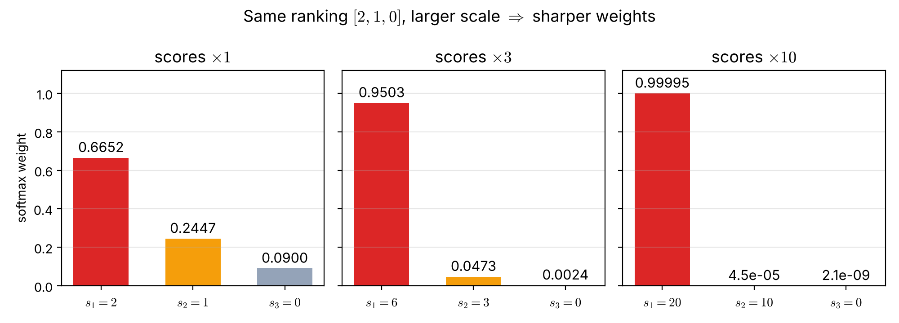

# 第10週 KP01：注意力是動態加權，權重跟著問題改變（Attention is dynamic weighting: the weights change with the question）

> 程度：大學生（undergrad）／Level: Undergraduate (undergrad)

本講義是第10週「注意力機制與 Transformer（一）：自注意力」的第一個知識點（KP01）。第8週的 RNN 把一整句話一步一步壓進一個隱藏狀態。這一節先退一步，問一個更基本的問題：手上有好幾個向量，要合成一個時，該怎麼合？

This is the first knowledge point (KP01) of Week 10, "Attention mechanism and Transformer (1): self-attention". The RNN of Week 8 squeezes a whole sentence, step by step, into one hidden state. This note steps back and asks a more basic question: when you hold several vectors and must merge them into one, how should you merge them?

先備知識是第2週的 softmax、向量的內積，以及第8週的隱藏狀態。第一次出現的詞與符號都會定義。本講義依課程網頁教材 CCC-LNS 第9章改寫，文中「來源」就是指它；來源沒有、由本講義補上的內容標 `[補充]`。所有數字都由 `assets/figures/src/lec10-kp01-figures.py` 算出，可以自己重算。

The prerequisites are the softmax of Week 2, the inner product of vectors and the hidden state of Week 8. Every term and symbol is defined when it first appears. This note is rewritten from Chapter 9 of the course's web material CCC-LNS, which is what "the source" means below; content added by this note is marked `[Added]`. Every number is computed by `assets/figures/src/lec10-kp01-figures.py`, so you can recompute it yourself.

## KP01 注意力是動態加權，權重跟著問題改變（Attention is dynamic weighting: the weights change with the question）

### 學習目標（Learning objectives）

讀完之後，你能說明為什麼「直接平均」會把重要的資訊稀釋掉。你能用查詢向量和內積算出每個位置的分數，再用 softmax 把分數變成權重。你能算出注意力的輸出，並說明它為什麼一定落在原向量圍成的範圍內。你也能說明分數整體放大時，權重會變尖，以及為什麼注意力用「軟加權」而不是「只挑一個」。

After reading, you can explain why "just averaging" dilutes the important information. You can compute a score for every position from a query vector and the inner product, and turn the scores into weights with softmax. You can compute the output of attention and explain why it always lies inside the region spanned by the original vectors. You can also explain why the weights become sharper when all scores are scaled up, and why attention uses "soft weighting" instead of "picking only one".

### 符號表（Symbols）

| 符號 | 中文意義 | English meaning |
|---|---|---|
| $n$ | 要合成的向量個數 | number of vectors to merge |
| $\mathbf{h}_j\in\mathbb{R}^{d}$ | 第 $j$ 個被合成的向量，$d$ 維 | the $j$-th vector to merge, of dimension $d$ |
| $\mathbf{q}\in\mathbb{R}^{d}$ | 查詢向量，代表「現在要找什麼」 | query vector, "what we are looking for now" |
| $s_j$ | 查詢和第 $j$ 個向量的分數 | score of the query against the $j$-th vector |
| $\alpha_j$ | 第 $j$ 個向量分到的權重 | weight given to the $j$-th vector |
| $\mathbf{c}\in\mathbb{R}^{d}$ | 注意力的輸出（加權平均） | output of attention (weighted average) |
| $\mathbf{c}_{\text{avg}}$ | 平均池化的輸出 | output of average pooling |
| $\mathbf{q}^\top\mathbf{h}_j$ | 轉置後相乘，就是兩個向量的內積 | transpose then multiply: the inner product of two vectors |
| $\exp(s)$ | 自然指數 $e^{s}$ | natural exponential $e^{s}$ |

### 1. 平均會把重點稀釋掉（Averaging dilutes what matters）

很多時候，模型手上有一串向量，例如一句話裡每個詞的表示 $\mathbf{h}_1,\dots,\mathbf{h}_n$。最後卻只要一個向量去做決定，例如判斷整句的情緒。最簡單的合成方法是**平均池化**（average pooling）：每個向量分到一樣的份量 $1/n$。

Often a model holds a list of vectors, for example a representation $\mathbf{h}_1,\dots,\mathbf{h}_n$ for every word of a sentence. Yet in the end it needs just one vector to make a decision, for example to judge the mood of the sentence. The simplest way to merge is **average pooling**: every vector gets the same share $1/n$.

$$
\mathbf{c}_{\text{avg}}=\frac{1}{n}\sum_{j=1}^{n}\mathbf{h}_j.
$$

問題是，句子裡真正關鍵的詞往往只有一兩個。平均讓「的」「了」這種詞和關鍵詞分到一樣多，關鍵詞的訊號就被沖淡了。句子越長，沖淡得越厲害。

The trouble is that only one or two words of a sentence usually matter. Averaging gives words like "the" and "of" as much share as the key word, so the signal of the key word is watered down. The longer the sentence, the stronger the dilution.

來源的比喻：平均就像把整本小說丟進果汁機，打成一杯味道均勻的果汁；要回答「兇手是誰」時，你需要的是一支螢光筆，在關鍵那一頁畫重點。這個比喻的侷限是：螢光筆只有「畫」或「不畫」，而注意力的權重是連續的，可以畫得深一點或淺一點。

The source's analogy: averaging is like putting a whole novel into a blender and getting a juice that tastes the same everywhere; to answer "who is the murderer", you need a highlighter that marks the key page. The limit of the analogy: a highlighter either marks or does not, while the weights of attention are continuous and can mark more or less strongly.

**注意力**（attention）就是讓每個位置分到**不同**的份量，而且份量由「現在要做的事」決定。下一節說明份量怎麼算。

**Attention** gives each position a **different** share, and the share is decided by "what we are doing now". The next section shows how the shares are computed.

### 2. 用查詢算分數，用 softmax 變成權重（Score with a query, turn scores into weights with softmax）

先用一個向量 $\mathbf{q}$ 代表「現在要找什麼」，叫做**查詢向量**（query）。拿它和每個 $\mathbf{h}_j$ 算內積，得到**分數**（score）：

First let a vector $\mathbf{q}$ stand for "what we are looking for now"; it is called the **query**. Take its inner product with every $\mathbf{h}_j$ to get a **score**:

$$
s_j=\mathbf{q}^\top\mathbf{h}_j,\qquad j=1,\dots,n.
$$

內積同時看兩件事：方向是否接近，以及向量有多長。方向越接近、向量越長，內積越大，我們就把它當成「這個位置和我要找的東西很像」。分數可以是任何實數，也可能是負的，還不能直接當成份量。

The inner product looks at two things at once: whether the directions are close, and how long the vectors are. The closer the directions and the longer the vectors, the larger the inner product, and we read it as "this position resembles what I am looking for". A score can be any real number, possibly negative, so it cannot be used as a share yet.

第2週的 **softmax** 正好能把一串任意實數變成份量：先取指數，讓每個數都變成正的；再除以總和，讓它們加起來等於 $1$。

The **softmax** of Week 2 turns any list of real numbers into shares: take the exponential so that every number becomes positive, then divide by the total so that they add up to $1$.

$$
\alpha_j=\frac{\exp(s_j)}{\sum_{k=1}^{n}\exp(s_k)},\qquad \alpha_j>0,\quad \sum_{j=1}^{n}\alpha_j=1.
$$

主例子（來源的數字）：三個二維向量 $\mathbf{h}_1=[1,0]^\top$、$\mathbf{h}_2=[0,1]^\top$、$\mathbf{h}_3=[1,1]^\top$，查詢 $\mathbf{q}=[2,0]^\top$。三個分數是

Main example (the source's numbers): three two-dimensional vectors $\mathbf{h}_1=[1,0]^\top$, $\mathbf{h}_2=[0,1]^\top$, $\mathbf{h}_3=[1,1]^\top$ and the query $\mathbf{q}=[2,0]^\top$. The three scores are

$$
s_1=2\times1+0\times0=2,\qquad s_2=2\times0+0\times1=0,\qquad s_3=2\times1+0\times1=2.
$$

取指數：$\exp(2)=7.389$、$\exp(0)=1$。分母是 $7.389+1+7.389=15.778$。所以權重是

Take exponentials: $\exp(2)=7.389$ and $\exp(0)=1$. The denominator is $7.389+1+7.389=15.778$. So the weights are

| 位置 $j$ | 分數 $s_j$ | $\exp(s_j)$ | 權重 $\alpha_j$ |
|---|---|---|---|
| $1$ | $2$ | $7.389$ | $0.4683$ |
| $2$ | $0$ | $1.000$ | $0.0634$ |
| $3$ | $2$ | $7.389$ | $0.4683$ |

| Position $j$ | Score $s_j$ | $\exp(s_j)$ | Weight $\alpha_j$ |
|---|---|---|---|
| $1$ | $2$ | $7.389$ | $0.4683$ |
| $2$ | $0$ | $1.000$ | $0.0634$ |
| $3$ | $2$ | $7.389$ | $0.4683$ |

三個權重加起來是 $1$。查詢指向第一個分量，所以第一個分量大的 $\mathbf{h}_1$、$\mathbf{h}_3$ 分到大部分，$\mathbf{h}_2$ 只分到一點點。注意 $\mathbf{h}_3$ 和查詢差了 $45^\circ$，分數卻和完全同向的 $\mathbf{h}_1$ 一樣是 $2$：它的方向差一點，但長度比較長，兩者剛好抵銷。

The three weights add up to $1$. The query points along the first component, so $\mathbf{h}_1$ and $\mathbf{h}_3$, whose first component is large, take most of the share, and $\mathbf{h}_2$ gets only a little. Note that $\mathbf{h}_3$ is $45^\circ$ away from the query, yet its score is $2$, the same as $\mathbf{h}_1$, which points exactly along the query: its direction is a little off, but it is longer, and the two effects cancel.

常見錯誤：把分數直接當權重用，例如 $2,0,2$ 除以總和 $4$ 得到 $0.5,0,0.5$。這樣負的分數會變成負的權重，而且分數為 $0$ 的位置完全被丟掉。softmax 讓每個位置都至少分到一點，並讓大小關係保持不變。

Common error: using the scores as weights directly, for example dividing $2,0,2$ by the total $4$ to get $0.5,0,0.5$. Then a negative score becomes a negative weight, and a position with score $0$ is dropped completely. Softmax gives every position at least a little and keeps the order of the scores.

### 3. 輸出是加權平均，換一個查詢就換一個位置（The output is a weighted average; a new query moves it）

有了權重，輸出就是各向量的加權和：

With the weights, the output is the weighted sum of the vectors:

$$
\mathbf{c}=\sum_{j=1}^{n}\alpha_j\mathbf{h}_j.
$$

主例子：

Main example:

$$
\mathbf{c}=0.4683\begin{bmatrix}1\\0\end{bmatrix}+0.0634\begin{bmatrix}0\\1\end{bmatrix}+0.4683\begin{bmatrix}1\\1\end{bmatrix}=\begin{bmatrix}0.9366\\0.5317\end{bmatrix}.
$$

對照平均 `[補充]`：每個分到 $1/3$，得到 $\mathbf{c}_{\text{avg}}=[0.6667,\ 0.6667]^\top$。注意力的輸出往第一個分量偏，因為查詢要的正是第一個分量。

Compare with the average `[Added]`: with $1/3$ each, $\mathbf{c}_{\text{avg}}=[0.6667,\ 0.6667]^\top$. The attention output leans toward the first component, because that is exactly what the query asks for.

再換一個查詢 `[補充]`：$\mathbf{q}=[0,2]^\top$。分數變成 $0,2,2$，權重變成 $0.0634,\ 0.4683,\ 0.4683$，輸出變成 $[0.5317,\ 0.9366]^\top$。三個向量完全沒變，只是問題換了，答案就換了。這就是「動態」的意思。

Try another query `[Added]`: $\mathbf{q}=[0,2]^\top$. The scores become $0,2,2$, the weights $0.0634,\ 0.4683,\ 0.4683$ and the output $[0.5317,\ 0.9366]^\top$. The three vectors did not change at all; only the question changed, and so did the answer. This is what "dynamic" means.

因為權重都大於 $0$、加起來是 $1$，這種加權和叫**凸組合**（convex combination）。它在幾何上有個好性質：把所有原向量的端點用一條橡皮筋圍起來，得到的範圍叫**凸包**（convex hull）；輸出一定落在凸包裡面，不會跑出去。

Because the weights are all positive and add up to $1$, this weighted sum is called a **convex combination**. It has a nice geometric property: stretch a rubber band around the end points of all the original vectors; the region it encloses is called the **convex hull**, and the output always lies inside it and never leaves it.

**圖說 `lec10-kp01-weighted-average`**〔功能：一目了然、空間幾何具象化〕：先看三個黑點圍成的淡紫色三角形，這是所有凸組合可能落的範圍。再看中間的灰色方塊，它是平均，每個點各占 $1/3$。最後看兩顆星：紅色查詢 $[2,0]^\top$ 把輸出拉向右邊（$\mathbf{h}_1$、$\mathbf{h}_3$ 那一側），藍色查詢 $[0,2]^\top$ 把輸出拉向上方（$\mathbf{h}_2$、$\mathbf{h}_3$ 那一側），兩顆星都還在三角形裡。

**Caption `lec10-kp01-weighted-average`** [Function: seeing it at a glance, picturing the geometry]: First look at the light purple triangle spanned by the three black points; it is the region where every convex combination can land. Then look at the grey square in the middle; it is the average, with $1/3$ for each point. Finally look at the two stars: the red query $[2,0]^\top$ pulls the output to the right (toward $\mathbf{h}_1$ and $\mathbf{h}_3$), the blue query $[0,2]^\top$ pulls it upward (toward $\mathbf{h}_2$ and $\mathbf{h}_3$), and both stars stay inside the triangle.

常見錯誤：以為注意力和平均池化是同一件事，只是換個名字。平均池化沒有查詢，權重永遠是 $1/n$；注意力的權重由查詢決定，同一組向量遇到不同的查詢，會得到不同的輸出。

Common error: thinking that attention is just average pooling under another name. Average pooling has no query and its weights are always $1/n$; the weights of attention are decided by the query, so the same vectors give different outputs for different queries.

### 4. 分數的大小會改變權重的尖銳程度（The size of the scores changes how sharp the weights are）

上一節的權重只看分數。那麼分數「整體」變大或變小，會怎樣？分兩種情形看。

The weights of the last section depend only on the scores. What happens if the scores as a whole get larger or smaller? Look at two cases.

第一種：每個分數都**加**同一個數。softmax 的分子分母會同乘 $\exp(\text{那個數})$，互相抵銷，權重完全不變。例如 $[2,1,0]$ 的權重是 $0.6652,\ 0.2447,\ 0.0900$；全部加 $5$ 變成 $[7,6,5]$，權重仍是 $0.6652,\ 0.2447,\ 0.0900$ `[補充]`。實作 softmax 的程式（例如 PyTorch）也利用這一點：先把每個分數減掉最大的分數，再取 $\exp$。這樣可以避免 $\exp$ 算出超過電腦能表示的大數（稱為溢位）。

First case: **add** the same number to every score. The numerator and the denominator of softmax are both multiplied by $\exp(\text{that number})$, which cancels, so the weights do not change at all. For example, the weights of $[2,1,0]$ are $0.6652,\ 0.2447,\ 0.0900$; add $5$ to get $[7,6,5]$ and the weights are still $0.6652,\ 0.2447,\ 0.0900$ `[Added]`. Programs that implement softmax (PyTorch, for example) use this too: they subtract the largest score from every score before taking $\exp$. This keeps $\exp$ from producing a number too large for the computer to store (an overflow).

第二種：每個分數都**乘**同一個正數。這時權重會改變。分數之間的差距被放大，softmax 會把更多份量分給最大的那一個，權重變「尖」。

Second case: **multiply** every score by the same positive number. Now the weights do change. The gaps between scores are stretched, softmax gives more of the share to the largest one, and the weights become "sharp".

**圖說 `lec10-kp01-softmax-sharpness`**〔功能：精準度〕：先看左圖，分數 $[2,1,0]$ 的權重三個都看得到。再看中圖，分數乘 $3$ 以後，紅色長條長到 $0.9503$，另外兩個變得很短。最後看右圖，乘 $10$ 以後紅色是 $0.99995$，整組權重幾乎變成「只選一個」。三組分數的大小順序都一樣，差別只在放大的倍數。

**Caption `lec10-kp01-softmax-sharpness`** [Function: precision]: First look at the left panel: all three weights of the scores $[2,1,0]$ are visible. Then look at the middle panel: after multiplying by $3$, the red bar grows to $0.9503$ and the other two become very short. Finally look at the right panel: after multiplying by $10$, the red bar is $0.99995$, and the weights are close to "picking only one". The ranking of the scores is the same in all three panels; only the scale differs.

為什麼不乾脆只挑分數最大的那一個？這叫**硬選擇**（hard selection），用的是「取最大者」的運算。它的問題在訓練：分數稍微變一點，選中的位置要嘛完全不變，要嘛突然跳到另一個，輸出對分數的變化率在絕大多數地方都是 $0$，反向傳播送不回有用的梯度。softmax 的**軟加權**（soft weighting）是平滑的，分數變一點，權重就跟著變一點，所以可以用第3週的反向傳播一起訓練。

Why not just pick the largest score? This is called **hard selection**, and it uses the "take the largest" operation. Its problem is training: when a score changes a little, the chosen position either stays the same or suddenly jumps to another one, so the rate of change of the output with respect to the scores is $0$ nearly everywhere, and backpropagation sends back no useful gradient. The **soft weighting** of softmax is smooth: a small change in the scores gives a small change in the weights, so everything can be trained together with the backpropagation of Week 3.

這一點也預告了 KP05：當向量的維度很高時，內積的數值本來就會很大，等於自動把分數放大，權重會變得太尖。到時候會看到解法是先把分數除以一個數。

This also foreshadows KP05: when the vectors have many dimensions, inner products are naturally large, which scales the scores up by itself and makes the weights too sharp. KP05 shows that the fix is to divide the scores by a number first.

常見錯誤：以為注意力是在「挑」一個位置。標準的注意力是軟加權，每個位置都分到正的份量；權重可以很接近 $0$ 或 $1$，但不會剛好等於。

Common error: thinking that attention "picks" one position. Standard attention is soft weighting, and every position gets a positive share; a weight can be very close to $0$ or $1$, but never exactly equal.

### 本單元重點整理（KP01 summary）

**一句話重點**：注意力先用查詢和每個向量算分數，再用 softmax 把分數變成都大於 $0$、加總為 $1$ 的權重，輸出是各向量的加權平均；權重跟著查詢改變，所以同一組向量能依不同的問題給出不同的答案。

**One-sentence summary**: attention scores every vector against a query, turns the scores into positive weights that add up to $1$ with softmax, and outputs the weighted average of the vectors; the weights change with the query, so the same vectors give different answers to different questions.

**白話說明**：平均是每個人說話都聽一樣多；注意力是先想好自己要問什麼，再多聽和問題有關的人說話。問題換了，該多聽誰也跟著換。

**Plain explanation**: averaging means listening to everyone equally; attention means first deciding what you want to ask, then listening more to the people whose words relate to the question. Change the question, and whom you listen to changes too.

**正式定義**：$s_j=\mathbf{q}^\top\mathbf{h}_j$，$\alpha_j=\exp(s_j)/\sum_{k=1}^{n}\exp(s_k)$，$\mathbf{c}=\sum_{j=1}^{n}\alpha_j\mathbf{h}_j$；其中 $\alpha_j>0$、$\sum_j\alpha_j=1$。

**Formal definition**: $s_j=\mathbf{q}^\top\mathbf{h}_j$, $\alpha_j=\exp(s_j)/\sum_{k=1}^{n}\exp(s_k)$, $\mathbf{c}=\sum_{j=1}^{n}\alpha_j\mathbf{h}_j$, with $\alpha_j>0$ and $\sum_j\alpha_j=1$.

**例子**：$\mathbf{h}_1=[1,0]^\top$、$\mathbf{h}_2=[0,1]^\top$、$\mathbf{h}_3=[1,1]^\top$。$\mathbf{q}=[2,0]^\top$ 時權重 $0.4683,\ 0.0634,\ 0.4683$，輸出 $[0.9366,\ 0.5317]^\top$；$\mathbf{q}=[0,2]^\top$ 時輸出 $[0.5317,\ 0.9366]^\top$；平均是 $[0.6667,\ 0.6667]^\top$。

**Example**: $\mathbf{h}_1=[1,0]^\top$, $\mathbf{h}_2=[0,1]^\top$, $\mathbf{h}_3=[1,1]^\top$. With $\mathbf{q}=[2,0]^\top$ the weights are $0.4683,\ 0.0634,\ 0.4683$ and the output $[0.9366,\ 0.5317]^\top$; with $\mathbf{q}=[0,2]^\top$ the output is $[0.5317,\ 0.9366]^\top$; the average is $[0.6667,\ 0.6667]^\top$.

**常見迷思**：

- 「注意力就是平均池化。」錯，平均沒有查詢，權重固定是 $1/n$。
- 「注意力會挑出一個位置。」錯，它是軟加權，每個位置都分到正的份量。
- 「分數整體放大不影響結果。」錯，加同一個數不影響，乘同一個數會讓權重變尖。

**Common misconceptions**:

- "Attention is average pooling." Wrong: averaging has no query, and its weights are fixed at $1/n$.
- "Attention picks one position." Wrong: it is soft weighting, and every position gets a positive share.
- "Scaling up all scores does not change the result." Wrong: adding the same number does not, but multiplying by the same number makes the weights sharper.

**圖**：本單元有兩張圖。

- `lec10-kp01-weighted-average`：輸出落在三個向量圍成的三角形裡，查詢不同，輸出的位置就不同。
- `lec10-kp01-softmax-sharpness`：分數的順序不變、放大倍數變大時，權重變尖。

**Figures** — this unit has two figures.

- `lec10-kp01-weighted-average`: the outputs lie inside the triangle of the three vectors, and different queries put them at different places.
- `lec10-kp01-softmax-sharpness`: with the same ranking and a larger scale, the weights become sharper.

### 小練習（Practice）

1. 沿用主例子的三個向量，查詢改成 $\mathbf{q}=[1,1]^\top$。算出三個分數、三個權重與輸出 $\mathbf{c}$。提示：$\exp(1)=2.718$、$\exp(2)=7.389$。
2. 如果查詢是 $\mathbf{q}=[0,0]^\top$，權重和輸出是什麼？這說明注意力和平均池化有什麼關係？
3. 有人把分數 $[2,0,2]$ 都減掉 $2$，變成 $[0,-2,0]$，再做 softmax。權重會改變嗎？為什麼？

1. Keep the three vectors of the main example and change the query to $\mathbf{q}=[1,1]^\top$. Compute the three scores, the three weights and the output $\mathbf{c}$. Hint: $\exp(1)=2.718$ and $\exp(2)=7.389$.
2. If the query is $\mathbf{q}=[0,0]^\top$, what are the weights and the output? What does this say about the relation between attention and average pooling?
3. Someone subtracts $2$ from all of the scores $[2,0,2]$, getting $[0,-2,0]$, and then applies softmax. Do the weights change? Why?

**第 1 題解答** `[補充]`：分數 $1,\ 1,\ 2$。分母 $2.718+2.718+7.389=12.825$，權重 $0.2119,\ 0.2119,\ 0.5761$。輸出 $\mathbf{c}=0.2119[1,0]^\top+0.2119[0,1]^\top+0.5761[1,1]^\top=[0.7881,\ 0.7881]^\top$，偏向兩個分量都大的 $\mathbf{h}_3$。

**Solution to question 1** `[Added]`: the scores are $1,\ 1,\ 2$. The denominator is $2.718+2.718+7.389=12.825$ and the weights are $0.2119,\ 0.2119,\ 0.5761$. The output is $\mathbf{c}=0.2119[1,0]^\top+0.2119[0,1]^\top+0.5761[1,1]^\top=[0.7881,\ 0.7881]^\top$, leaning toward $\mathbf{h}_3$, whose two components are both large.

**第 2 題解答** `[補充]`：三個分數都是 $0$，權重都是 $1/3$，輸出 $[0.6667,\ 0.6667]^\top$，剛好是平均。平均池化可以看成「查詢什麼都不偏好」時的注意力。

**Solution to question 2** `[Added]`: all three scores are $0$, all weights are $1/3$ and the output is $[0.6667,\ 0.6667]^\top$, exactly the average. Average pooling can be seen as attention with a query that prefers nothing.

**第 3 題解答** `[補充]`：不會。每個分數加或減同一個數，softmax 的分子分母同乘同一個因子，互相抵銷，權重仍是 $0.4683,\ 0.0634,\ 0.4683$。

**Solution to question 3** `[Added]`: no. Adding or subtracting the same number from every score multiplies the numerator and the denominator of softmax by the same factor, which cancels, so the weights are still $0.4683,\ 0.0634,\ 0.4683$.

### 小測驗（Quiz，來源原題）

來源的兩題自我檢測保留原題與全部選項；來源頁面沒有直接標出答案，下面的解析依來源內文判斷。

The two self-check questions of the source are kept with all options; the source page does not mark the answers directly, and the explanations below follow the source text.

1. 機器學習中「注意力機制」的本質是什麼？
   - (A) 固定不變的正則化懲罰項
   - (B) 對輸入資料各部分進行動態、自適應的加權分配
   - (C) 一種將所有權重強制設為常數的技術
   - (D) 完全捨棄所有權重矩陣的無參數方法
2. 在 Transformer 誕生之前，處理序列資料的主流模型是什麼？
   - (A) 僅使用感知器（Perceptron）
   - (B) RNN 與 LSTM 等循環神經網路
   - (C) 純決策樹模型
   - (D) $K$-means 分群法

1. What is the essence of the "attention mechanism" in machine learning?
   - (A) A fixed regularization penalty
   - (B) A dynamic, adaptive allocation of weights to the parts of the input
   - (C) A technique that forces all weights to be constants
   - (D) A parameter-free method that drops all weight matrices
2. Before the Transformer, what were the mainstream models for sequence data?
   - (A) Perceptrons only
   - (B) Recurrent networks such as the RNN and the LSTM
   - (C) Pure decision trees
   - (D) $K$-means clustering

**解析** `[補充]`：第 1 題選 (B)：第 2、3 節的權重由查詢決定，換查詢就換權重；(C) 描述的正是平均池化，與注意力相反。第 2 題選 (B)：第8週的 RNN、LSTM、GRU 就是 Transformer 出現之前處理序列的主流；第 11 週會看到 Transformer 如何取代它們。

**Explanations** `[Added]`: question 1 is B: in Sections 2 and 3 the weights are decided by the query and change with it; C describes average pooling, the opposite of attention. Question 2 is B: the RNN, LSTM and GRU of Week 8 were the mainstream for sequences before the Transformer appeared; Week 11 shows how the Transformer replaced them.

### 留給下一單元的問題（The question for the next unit）

這一節的向量 $\mathbf{h}_j$ 和查詢 $\mathbf{q}$ 都是直接給定的。在真正的模型裡，它們從哪裡來？下一單元（KP02）先看注意力出現之前的翻譯模型 Seq2Seq：它把整句話壓成一個向量，正好卡在本節說的「平均把重點稀釋」這類問題上。

The vectors $\mathbf{h}_j$ and the query $\mathbf{q}$ of this note were simply given. In a real model, where do they come from? The next unit (KP02) first looks at the translation model Seq2Seq from before attention: it squeezes a whole sentence into one vector, and gets stuck on exactly the kind of problem this note calls "diluting what matters".

### 來源更正與取捨（Corrections to the source）

本講義依 CCC-LNS IDL_115 第9章「注意力機制與 Transformer 核心原理」§1 與教授祕笈「注意力機制概念與直覺」（網頁講義，https://ndhuccc.github.io/CCC-LNS/IDL_115/Ch09-attention-transformers/index.html ，讀取日期 2026-11-13）重新撰寫。來源沒有的內容，都在出現的地方標示 `[補充]`。

This note is rewritten from §1 of Chapter 9, "Core principles of attention mechanisms and the Transformer", of CCC-LNS IDL_115 and its professor's notes "Attention mechanisms: concepts and intuition" (web lecture, https://ndhuccc.github.io/CCC-LNS/IDL_115/Ch09-attention-transformers/index.html , accessed 2026-11-13). Content that the source does not contain is marked `[Added]` where it appears.

- 來源寫 $\alpha_2=1/15.778\approx0.064$。程式算得 $1/15.778=0.06338$，四捨五入到小數第三位是 $0.063$；本講義全部用小數第四位：$0.4683,\ 0.0634,\ 0.4683$，輸出 $[0.9366,\ 0.5317]^\top$（來源寫 $[0.936,\ 0.532]^\top$）。
- 來源用粗斜體 `\boldsymbol` 表示向量；本課程網站不支援，改用 `\mathbf`，意義相同。
- 本講義補上：與平均的數值對照、第二個查詢 $[0,2]^\top$、分數加減同一個數的例子（$[7,6,5]$）、放大倍數的長條圖、三題小練習與解答。
- 取捨：來源提到的統計物理玻爾茲曼分佈連結，需要大學生還沒學過的先備知識，本講義不寫；來源的互動示範無法放進講義，改用兩張圖呈現。

- The source writes $\alpha_2=1/15.778\approx0.064$. The program gives $1/15.778=0.06338$, which rounds to $0.063$ at three decimals; this note uses four decimals throughout: $0.4683,\ 0.0634,\ 0.4683$ and the output $[0.9366,\ 0.5317]^\top$ (the source writes $[0.936,\ 0.532]^\top$).
- The source writes vectors with bold italic `\boldsymbol`; the course website does not support it, so this note uses `\mathbf` with the same meaning.
- This note adds: the numerical comparison with the average, the second query $[0,2]^\top$, the example of adding the same number to all scores ($[7,6,5]$), the bar chart of scaling, and three practice questions with solutions.
- Choices: the source's link to the Boltzmann distribution of statistical physics needs background that undergraduates have not yet met, so this note leaves it out; the source's interactive demo cannot go into a note, so two figures show the same ideas.

## 術語表（Glossary）

| 中文 | English |
|---|---|
| 注意力 | attention |
| 平均池化 | average pooling |
| 查詢向量 | query |
| 分數 | score |
| 權重 | weight |
| 加權平均 | weighted average |
| 凸組合 | convex combination |
| 硬選擇 | hard selection |
| 軟加權 | soft weighting |
| 序列到序列模型（KP02） | sequence-to-sequence model (Seq2Seq) |
| 循環神經網路 | recurrent neural network (RNN) |
| 長短期記憶網路 | long short-term memory (LSTM) |
| 門控循環單元 | gated recurrent unit (GRU) |
| 本課程的網頁教材 | CCC-LNS |
